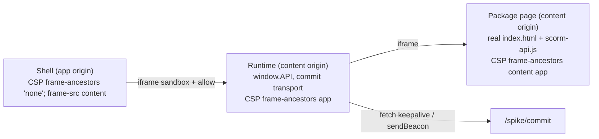

# T5-spike notes: the real packages in the real frames

Author spike, 2026-10-16. Not reviewed. Throwaway code in `apps/player-spike/` (T5a may keep or delete it).
The Lead asked for this folder. `tasks/T5-spike.md` names `apps/player/SPIKE-NOTES.md`; the content is the same.

Status words: **VERIFIED** = I ran it and saw the result. **NOT VERIFIED** = not run, or read in code only.
Browsers: Playwright Chromium 141.0.7390.37 (image `mcr.microsoft.com/playwright:v1.56.0-noble`) and Google Chrome 155.0.8059.80 (host, headless).
Evidence: JSON reports in `.tmp/player-spike/report-*.json` (git-ignored). The final run is `report-final-playwright-chromium.json`.

## Setup (what the spike does)



- `spike.mjs` serves both origins with `context.route()`, with the planned headers (security §5, §7): CSP, `Referrer-Policy: same-origin`, `nosniff`, `Range`. Every other host is blocked (S7).
- The packages are the real Cogniate exports. `stage.sh` copies the zips into a new empty folder, checks the entry names, and extracts each zip into its own empty folder.
- `runtime/own-scorm12.js` is our own SCORM 1.2 subset (contract §8). The runtime can also load `scorm-again` 3.4.6.
- `runtime/html-tracker.js` observes the same-origin HTML package page (ADR-004 option C).

## Answers

| # | Question | Answer | Status |
| --- | --- | --- | --- |
| S1 | CSP | With `frame-ancestors {content} {app}` on package files, every package page runs: `CogniateSCORM.available === true`, `parent.API` found. With `frame-ancestors {content}` only, Chromium and Chrome block the page: "Refused to frame … because an ancestor violates … frame-ancestors https://content.cogniate-content.test". This confirms A-T0-01. | VERIFIED (both browsers) |
| S2 | `scorm-again` behaviour | `""` + `301` before `LMSInitialize`: yes. `cmi.foo`: **401**, not 201. After `LMSFinish`: **it still accepts calls** (`GetValue` gives the value with 0, `SetValue` gives `"true"`, `LMSCommit` gives `"true"` and fires the commit hook; a second `LMSFinish` gives `"true"` with 101). The hooks `on('LMSCommit')` and `on('LMSFinish')` work. `renderCMIToJSONObject()` gives the CMI as nested JSON. | VERIFIED |
| S3 | Decision | **Our own subset.** Reasons are below. | — |
| S4 | Full course | Both APIs reach `passed`, score 100, with `LMSFinish`, about 12.8 s after the start (menu, then lesson with 11 s and a scroll, then the correct answer). A wrong answer gives `failed`, score 0. Commits: 8 `commit`, then 1 `finish` (sequence below). | VERIFIED |
| S5 | Window close | Real delivery to the stack: the runtime `unload` (`sendBeacon` and `fetch` keepalive) arrives, and so do the SCO's own `pagehide` commits. After `LMSFinish` only the runtime `unload` arrives; the SCO makes no more calls. | VERIFIED (Chromium, `page.close` with unload handlers) |
| S6 | Video, full screen, `alert()` | Full screen works with `allow="autoplay; fullscreen"` on the **runtime** iframe. The inner iframe needs no `allow` (same origin, see below). `allow-modals` makes `alert()` show. **The package shows no video:** the `<video>` is inside the "Ask Lyra" card, and this export has no element that opens the card. The 10.7 MB mp4 is never requested. | VERIFIED; video playback NOT VERIFIED (cannot be shown) |
| S7 | External hosts blocked | With the S3 and Google hosts blocked (fail at once) **or hanging** (no answer), the SCORM course completes at the same time (12.8 s). The HTML tracker also completes, after one fix (attach on `interactive`, see "Design consequences"). | VERIFIED |
| Q1 | Frames | See "Frame settings". | VERIFIED |
| Q2 | API and call sequence | See "SCORM call sequence" and "Decision". | VERIFIED |
| Q3 | Commit transport | See "Transport". | VERIFIED (Chromium) |
| Q4 | HTML package | The DOM signals are enough. The observer tracker gives the same result as the SCORM adapter, on the same timeline. | VERIFIED |

## Frame settings (Q1, S1, S6, A-T0-18)

| Setting | Planned value | Result | What breaks if stricter |
| --- | --- | --- | --- |
| Package CSP | `frame-ancestors {content} {app}` | Loads | `{content}` only: page blocked (A-T0-01) |
| Runtime CSP | `frame-ancestors {app}` | Loads | `{content}` only: runtime blocked |
| Runtime iframe `sandbox` | `allow-scripts allow-same-origin allow-forms allow-popups allow-modals` | Loads, `alert()` shows, `window.open` works | See the rows below |
| — without `allow-same-origin` | | **Package blocked.** The runtime gets an opaque origin, and an opaque ancestor matches no `frame-ancestors` source. Also no `parent.API` and no storage (the adapter uses `sessionStorage` and `localStorage`). | Must stay |
| — without `allow-modals` | | `alert()` is ignored silently. The only `alert()` is in the "Ask Lyra" chat, which this export cannot open. | Safe to drop for this export |
| — without `allow-popups` | | `window.open()` returns `null` | Safe to drop for this export (no `target=_blank`) |
| — `allow-scripts allow-same-origin` only | | The course runs and completes | Minimal working set |
| `allow-forms` | | The exports have no `<form>` | Not needed for these exports |
| Runtime iframe `allow` | `autoplay; fullscreen` | Full screen entered in the package page | Without it: `fullscreenEnabled = false`, `requestFullscreen` rejected |
| Inner package iframe `allow` | `autoplay; fullscreen` | Same result **with or without** it | The package is same-origin with the runtime, so it inherits the default `'self'` allowlist. A-T0-18 is true only for a cross-origin child. |
| Shell `Permissions-Policy` (none planned) | — | `fullscreen=(self)` blocks full screen and autoplay in the frames | If the shell ever sends it, it must list `{content}` (VERIFIED: `fullscreen=(self "{content}")` works) |

The package frame inherits the runtime's sandbox flags. Its origin stays `https://content.cogniate-content.test`.

## SCORM call sequence (Q2, S4), own API, correct answer

| t (ms) | Page | Calls | Commit |
| --- | --- | --- | --- |
| 98 | index | `LMSGetValue(lesson_status)` → `""` **301** (probe) → `LMSInitialize("")` → `"true"` 0 → `GetValue(lesson_status)` = `not attempted`, `GetValue(suspend_data)` = `""` → `SetValue` `lesson_location=index`, `lesson_status=incomplete`, `suspend_data=v:2;q:f5f1e28b;p:index;a:-` → `LMSCommit` → `session_time=0000:00:00.00` → `LMSCommit` | seq 1, 2 |
| 1659–1684 | index (leave) | 3 × (`session_time`, `exit=suspend`, `LMSCommit`) from `pagehide`, `beforeunload`, `visibilitychange` | seq 3–5 |
| 1770 | lesson | probe gives `incomplete` **0** → no second `LMSInitialize` (one session for both pages) → `lesson_location`, `session_time`, `LMSCommit` | seq 6 |
| 11771 | lesson | page seen (10 s + scroll): `suspend_data=…p:index,lesson-ai-web-sprint;a:-`, `LMSCommit` | seq 7 |
| 12838 | lesson | answer: `suspend_data=…;a:1`, `score.raw=100`, `min=0`, `max=100`, `interactions.0.{id, type=choice, result=correct, time=00:00:12, student_response=opt_precision, correct_responses.0.pattern=opt_precision}` → completion: `lesson_status=passed` (mastery 70), `session_time=0000:00:12.74`, `exit=""`, `LMSCommit`, **`LMSFinish`** | seq 8, `finish` seq 9 |

- The package reads only `lesson_status` (the probe) and `suspend_data`. It never reads `entry`, `student_id`, `mastery_score`, `launch_data` or `total_time`. Its own mastery value (70) is in `scorm-api.js`.
- Wrong answer: the same sequence with `result=wrong`, `score.raw=0`, `lesson_status=failed`, then `LMSFinish`.
- Second session of a finished course (saved CMI, `entry=""`): probe 301 → `LMSInitialize` → reads `passed` and `suspend_data` → sets the score and `passed` again → `LMSCommit` → `LMSFinish` about 100 ms after load.
- Browse after `LMSFinish` (same runtime, back to the menu):
  - Contract rule (every call → 101): the probe sees 101, so the package thinks the session is open. Every write fails, and nothing is sent.
  - Moodle rule (`scorm_12.js`: 301 after `LMSFinish`, `LMSInitialize` allowed again): the package opens a new session and sends `commit` × 3 and a second `finish` with the same values.
  - `scorm-again`: accepts the writes and sends 3 more commits.
  - Recommendation: keep the contract rule (101). It sends no data after the end of the session. The outcome is the same in every case.

## Decision: our own SCORM 1.2 subset (S3)

| | Own subset (spike) | `scorm-again` 3.4.6 (MIT, no dependencies, 2026-10-08) |
| --- | --- | --- |
| Size (browser) | 195 lines, 10.9 KB, 3.0 KB gzip (unminified) | `scorm12.min.js` 156 KB, 34 KB gzip |
| `cmi.foo` | 201 (SCORM 1.2, Moodle, contract §8) | 401 |
| After `LMSFinish` | `""`/`"false"` with 101 (contract) | accepts get, set, commit; second finish gives `"true"` |
| `cmi.student_preference.*` | 401 (contract) | implemented (0) |
| All other contract rows (301, 101, 201, 402, 403, 404, 405, index gap) | as contract | same |
| Real course | `passed` 100 / `failed` 0, `LMSFinish` | same |
| Hooks and CMI | built in (`onCommit`, `onFinish`, flat CMI) | `on(...)`, nested `renderCMIToJSONObject()` |

Reasons:
1. The contract (§8) and Moodle need 201 for unknown elements and a closed session after `LMSFinish`. `scorm-again` differs in both. A wrapper that corrects it would hide half of its behaviour.
2. We need our own transport (sequence numbers, `fetch` keepalive, `sendBeacon`) anyway. The spike runs `scorm-again` with `lmsCommitUrl: false` and its hooks. Its README says the default commit is a synchronous XHR (Chrome blocks those while a page closes), with `sendBeacon` only for the terminate commit (NOT VERIFIED).
3. The size is about 50 times smaller. There is no SCORM 2004 or sequencing code to review.

Estimate for T5a: the full §8 data model with validation, about 300 lines of TypeScript plus about 300 lines of unit tests (one test per §8 row and per error code). The spike file shows the shape. Keep `scorm-again` as a reference oracle in tests: it is optional.

## Transport (Q3, S5)

Measured in Chromium with real delivery to the stack's content host (the stub logs every request). Commits carry `/{via}/{event}/{seq}` in the path.

| Exit | What arrived after the exit | Lost |
| --- | --- | --- |
| Window close mid-course | `fetch` keepalive `unload` (seq 5), `sendBeacon` `unload` (seq 4, `text/plain;charset=UTF-8`), and the SCO's `pagehide` commits through the runtime (seq 7, 8) | `postMessage` to the shell (seq 6) |
| Window close after `LMSFinish` | `sendBeacon` and `fetch` `unload` (seq 10, 11), with the same CMI as `finish` | `postMessage` |
| Top navigation mid-course | the same as close | `postMessage` |

Facts:

- The runtime `pagehide` fires **before** the SCO's `pagehide`. So the server gets `commit` with a higher `seq` after `unload`.
- The arrival order is not the `seq` order (seen: `commit/8`, `commit/7`, `unload/4`).
- After `LMSFinish`, the only later event is `unload`. It carries the same `session_time` as `finish`.

Recommendation:

- `LMSCommit` / `LMSFinish` → `fetch` with `keepalive: true` and JSON, to the runtime's own origin (no CORS).
- `pagehide` → **one** `sendBeacon` (`text/plain`). Do not send `fetch` as well: both arrive, which makes duplicates.
- Do not use `postMessage` to the shell for state: it is lost when the window closes.
- Server: order by `seq` per session. Accept commits after `unload` and `finish`, and never lower the outcome. Add `session_time` once per session (A-T0-15 item 3). Keep each body small: browsers limit keepalive and beacon bodies to about 64 KB (known limit, NOT VERIFIED here; `suspend_data` is at most 4096 characters).

## HTML package (Q4)

- DOM signals:
  - `body[data-lesson-id]`: `index` or `lesson-ai-web-sprint`.
  - Quiz: `[data-cog-quiz="01M2M36Y89M9KPPZENF1ZW4AWJ"]` with radio inputs `data-cog-correct="true|false"` and values such as `opt_precision`.
  - Links are `href="*.html"`, with no `target` in this export.
  - `localStorage.lessonProgress` (scroll percent) exists, but it has no completion or quiz data (not used).
- The observer tracker applies the ADR-004 rule from the runtime frame, with no change to the package bytes:
  - menu seen at about 100 ms;
  - lesson seen at 11.7 s (10 s dwell + scroll);
  - answer at 12.8 s → complete, score 100, passed (wrong answer: score 0, failed).
- This is the same timeline and the same result as the SCORM adapter.
- The markup is the same in both exports (`data-cog-*` attributes match).

## Design consequences (for the Architect)

1. **Do not wait for the iframe `load` event.** With a hanging external host (S3 images, Google fonts) the package `load` event never fires. My first HTML tracker attached on `load` and recorded nothing (VERIFIED). Attach when the child document reaches `readyState === "interactive"` (the spike polls every 150 ms and also listens for `load`). The SCORM adapter is not affected, because it runs at the end of `<body>`.
2. `allow-same-origin` on the runtime iframe is required. Without it, the CSP blocks the package.
3. The inner iframe `allow` is redundant (same origin). Keeping it does no harm.
4. `allow-forms`, `allow-popups` and `allow-modals` are not needed for these two exports. If a later export needs them, add them per export version. Leaving them on is also safe (content origin cross-site).
5. After `LMSFinish`, keep 101 (contract). Do not copy Moodle's re-initialize behaviour.
6. The export inlines the Tailwind Play CDN script (console warning "cdn.tailwindcss.com should not be used in production"). It makes no network call, but each page is about 0.9 MB.

## Notes for QA (test automation)

- With `page.route()`, requests sent while a page closes are not routed. To test delivery on close, let `/commit` go to a real server (the spike uses `--real-commits` on the stack network).
- In the HTML export, a pointer click on the lesson link can wait forever: some copies of the link are hidden or covered. A DOM `a.click()` works.
- With hanging hosts, `page.goto` waits forever for `load`. Use `waitUntil: 'domcontentloaded'`.
- Playwright Chromium has no H.264. This does not matter for these exports (no visible video). Use Chrome (`channel: 'chrome'`) for a course that plays video.

## How to run

```sh
bash apps/player-spike/stage.sh      # stages the untrusted data in .tmp/player-spike/ (git-ignored)

# All route-based scenarios, Playwright Chromium (no stack needed), about 4 min:
docker run --rm -v "$PWD":/repo -w /repo --ipc=host mcr.microsoft.com/playwright:v1.56.0-noble \
  node apps/player-spike/spike.mjs [--only=csp,sandbox,allow,api,run,close-mid,navigate-away,second,html-run]

# Google Chrome on the host:
node apps/player-spike/spike.mjs --channel=chrome --only=allow,csp,sandbox

# Real delivery on close (stack running; uses the e2e image for the CA in NSS):
docker run --rm --network cogniate-stack_default --ipc=host -v "$PWD":/repo -v "$PWD/infra/.certs/root.crt":/certs/root.crt:ro \
  -w /repo --entrypoint /bin/sh cogniate-stack-e2e:1.56.0 /repo/infra/e2e/entrypoint.sh \
  node apps/player-spike/spike.mjs --only=close-real,navigate-real --real-commits
```

## Not done

- Firefox and Safari (WebKit). The window-close transport, the partitioned cookie and the sandbox are tested only in Chromium.
- A real user closing a real window (the spike uses `page.close({ runBeforeUnload: true })`).
- Video playback (the export has no visible video).
- Mobile browsers (`pagehide` without `beforeunload`).
