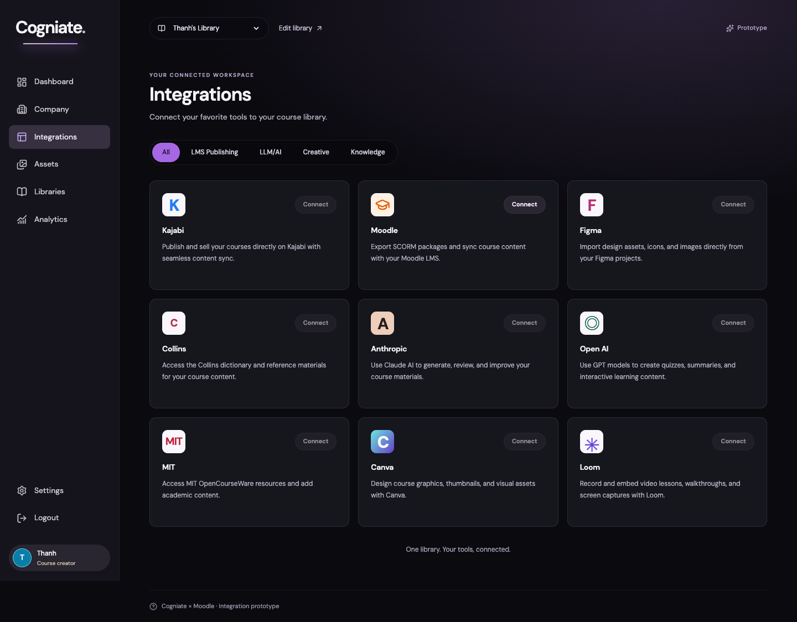

# T6 Author-2 report

Date: 2026-10-18. Branch: `feat/t6-portal-ui`.

The portal is implemented and self-checked. Independent QA and both reviews are still required. No push was made.

## Commits

- `3632d53` — `T6: build Cogniate portal workflows and local web build`
- `18c0775` — `T6: serve the portal and original package downloads`
- `4156514` — `T6: keep keyboard focus inside portal dialogs`
- The commit that contains this report — `T6: add portal self-checks and acceptance evidence` (see `git log -1`).

## Changes

The React 19 portal has sign-in, a library frame, nine integration cards, category filters, and Moodle connection management. The connection wizard supports dynamic registration and manual setup. Its Moodle instructions are data with stable step IDs. It shows API errors, registration errors, error codes, trace IDs, and the next action.

Courses support SCORM and HTML zip uploads with real upload progress. The inspector report shows package details and external hosts. Publications support connection and version selection, withdrawal, and re-publish. The original SCORM download returns the uploaded bytes. Results use the contract endpoints and show history, conflict, failure, Resend, gradebook refresh, and teacher overrides. A missing Results endpoint shows an explicit unavailable state.

All fonts and assets load from the app origin. The API client uses the session cookie and same-origin requests. React renders package and Moodle text as text. Native dialogs also handle Tab wrapping and focus return. The route focus handler waits for loaded data before it restores focus.

### Backend and infrastructure files (complete list)

| File | Change |
| --- | --- |
| `services/cogniate-app/src/app/portal.ts` | New static SPA handler. Explicit portal routes, signed-out redirect, CSP, local asset MIME types, and no API/tool/player fallback. |
| `services/cogniate-app/src/app/server.ts` | Register the portal handler after the existing tool and player routes. |
| `services/cogniate-app/src/app/courses.ts` | Add the contract's `kind=original` download with library and version checks. Fill course publication summaries through the existing repository. |
| `infra/compose.yaml` | Mount only `apps/portal/dist` into the app container. |

No Results backend, LTI service, content host, worker, tracking, player, QA test, or `docs/**` file changed.

### Portal and root files (complete list)

- Root: `package.json`, `package-lock.json`.
- Build: `apps/portal/package.json`, `apps/portal/index.html`, `apps/portal/tsconfig.json`, `apps/portal/vite.config.ts`, `apps/portal/scripts/dev-web.mjs`.
- Frame and shared UI: `apps/portal/src/main.tsx`, `App.tsx`, `Integrations.tsx`, `api.ts`, `hooks.ts`, `types.ts`, `ui.tsx`, `styles.css`.
- Connect: `apps/portal/src/connect/Connect.tsx`, `validation.ts`, `moodle-steps.json`.
- Courses: `apps/portal/src/courses/Courses.tsx`, `PublishDialog.tsx`.
- Results: `apps/portal/src/results/Results.tsx`.
- Tests: `apps/portal/src/portal.test.ts`, `apps/portal/src/server.test.ts`.
- Evidence: `apps/portal/evidence/integrations.png`, `apps/portal/evidence/self-check.json`, this report.

## Commands

From the repository root:

```sh
npm ci
npm run check
npm run build
npm run dev:web
```

`check` passes: **36 files; 490 tests passed; 5 existing skips**. The portal adds 17 component and Node tests. `build` creates `apps/portal/dist`. `dev:web` produced a watched portal build. It also watches `apps/player` when that workspace is present. The Lead must reconcile this script and the compose mounts with the parallel T5 changes.

For this isolated local stack:

```sh
COMPOSE_PROJECT_NAME=cogniate-codex PUBLIC_PORT=9443 STACK_SUBNET=172.30.0.0/16 npm run gen-env
npm run build
npm run stack:up
npm run seed
```

Open `https://app.cogniate.test:9443`. Use the seeded portal account. Credentials remain in the ignored local seed file. No secret value is in this report.

The browser self-check used Playwright 1.56.0, local Google Chrome, and axe at 1440 px. It used only the `cogniate-codex` stack. This stack was stopped after the checks; its data remains. No other stack was changed.

## Acceptance self-check

These are Author self-checks, not QA verdicts. “Fixture” means a contract-shaped browser response or component input. It does not prove the missing T5 backend.

| AC | Evidence and result | Remaining verification |
| --- | --- | --- |
| AC-T6-01 | Live sign-in; title, subtitle, five pills, nine cards, three columns. Component checks cover filtering, newest connection, Manage, Connect another site, and lastError. | QA on its seeded stack. |
| AC-T6-02 | Live: body `rgb(11, 10, 15)`; active pill `rgb(166, 103, 228)`; DM Sans first; card radius `12px`. Screenshot below. | QA screenshot comparison. |
| AC-T6-03 | Live network observation: every portal request used `https://app.cogniate.test:9443`. | QA capture. |
| AC-T6-04 | Live registration against Moodle 5.2.4. Clipboard equals URL. Status became Registered in **4,326 ms** after Connect, with no portal reload. | QA repeat. |
| AC-T6-05 | Live: all 16 rows and all copy values; HTTP issuer and foreign JWKS errors. Component: six field names and valid PUT returns registered. | Full manual Moodle setup with real copied values is for QA. |
| AC-T6-06 | Live real SCORM report: SCORM 1.2, mastery 70, external hosts. Live throttled HTML upload: progress 0–100. Unsafe-path upload: exact error and zero saved versions. | QA's combined throttled SCORM scenario. |
| AC-T6-07 | Live dialog includes only the registered site. Publish shows Available in Moodle and teacher instructions. Withdraw and re-publish pass. | QA repeat. |
| AC-T6-08 | Component and browser fixture: Passed 100, Sent, gradebook refresh. Live missing-endpoint state works. | **Wait for T5 results API and real learner results.** |
| AC-T6-09 | Live axe: **zero violations** on Integrations, create connection, both wizard methods, Courses, report, Publish, Results unavailable, and Results fixture. Keyboard-only wizard, dialog Tab loop, Enter, Esc, and focus return pass. Focus-return regression test included. | Independent QA axe and keyboard run. |
| AC-T6-10 | Node tests: every protected portal route redirects when signed out. Live Logout returns to sign-in; `/app-api/me` returns 401. | QA repeat. |
| AC-T6-11 | Live real SCORM download SHA-256 equals the source zip. HTML has no SCORM download button. Node tests cover unauthenticated, foreign-library, missing-version, and wrong-kind requests. | QA repeat. |
| AC-T6-12 | Component checks compare both arrays with rendered IDs, text, order, and count. Live dynamic wizard shows five steps. Optional new-tool choice is included. Labels were checked against the Moodle 5.2.4 image language file. | T7 validates labels in Moodle pages. |
| AC-T6-13 | Live literal `<b>x</b>` course title and malicious-looking manifest title in course details, Publish, and Results. No injected image and no `window.__xss`. Components also check literal output. | QA repeat across its scenarios. |
| AC-T6-14 | Component conflict/failure/error/history states. Browser fixture: conflict → Resend → Pending → Sent without reload; refresh shows the override sentence. | **Wait for T5b and the three real Moodle grade recipes.** |



Machine-readable measurements and axe results: [self-check.json](evidence/self-check.json).

## Known gaps and questions

- T5 results and score-sync endpoints are absent from this checkout. Real learner results, failure recovery after re-enrolment, and teacher overrides need QA after the merge.
- A valid manual connect is covered by component tests and existing backend tests. This self-check did not create a full manual Moodle tool through the Moodle UI.
- `apps/player` is not yet in this checkout. The portal watch loop works; the combined portal/player loop needs the T5 merge.
- The browser check used local Chrome rather than QA's pinned container browser. No WCAG conformance claim is made from axe alone.
- No blocking question for the Architect. Moodle's exact choice label is **Register as a new external tool**. The JSON `labels` uses that value; the visible explanation also keeps the spec's **Register as a new tool** instruction.
- The UI button uses **Resend**, as the acceptance criteria require. Its title says **Send again**.

Implementation references: [Tailwind Vite integration](https://tailwindcss.com/docs/installation/using-vite), [React Router declarative setup](https://reactrouter.com/start/declarative/installation), [Vite build options](https://vite.dev/config/build-options).
