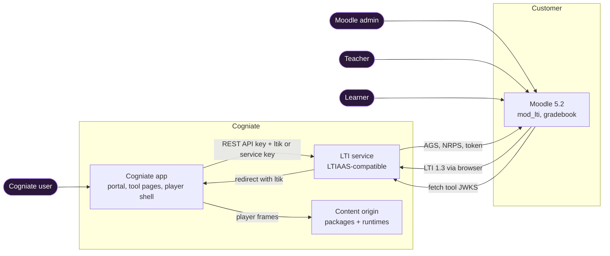
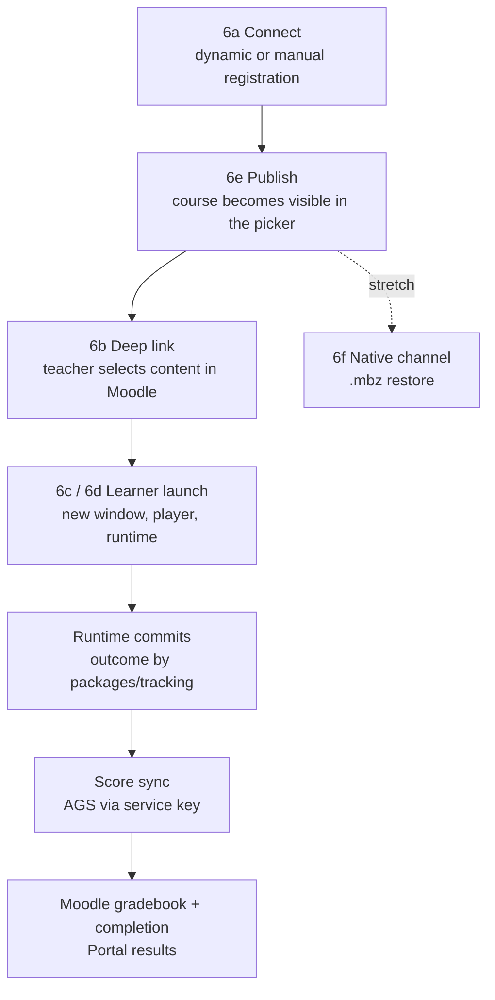
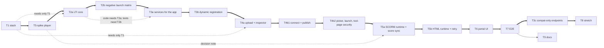

# Architecture: Cogniate × Moodle LTI prototype

Status: T0 done; kept in line with the built code. §6 names the tested SHAs and the pending final regression. Owner: Architect. Date: 2026-10-19.

This page is the overview. Details are in other files:

| File | Content |
| --- | --- |
| [`flows.md`](flows.md) | Sequence diagrams for every flow (connect, deep link, SCORM, HTML, publish, native) |
| [`security.md`](security.md) | Launch checks, cookies, page headers, CSRF, SSRF, content isolation, secrets, tenants |
| [`data-model.md`](data-model.md) | Tables and state machines of both services |
| [`local-stack.md`](local-stack.md) | Host names, TLS, ports, dev-only settings, fallbacks |
| [`contracts/`](contracts/) | LTI service API (LTIAAS-compatible) and Cogniate app API |
| [`adr/`](adr/) | Decisions ADR-001 to ADR-010 |
| [`tasks/`](tasks/) | Task specs, QA rules, test knobs |
| [`open-questions.md`](open-questions.md) | Decisions for humans |

## 1. Goal

The prototype proves one flow on a real Moodle 5.2 site:

1. A Moodle admin connects the Moodle site to a Cogniate library.
2. A Cogniate user uploads a SCORM 1.2 course and an HTML course, and publishes them to Moodle.
3. A teacher adds both courses to a Moodle course with Deep Linking.
4. A learner completes both courses.
5. Score and completion appear in the Moodle gradebook and in the Cogniate portal.

NOTE: The Cogniate side is a stand-in ("Cogniate app"). The real Cogniate API is not confirmed (spec §7.1). The LTI service is the reusable part.

## 2. Terms

Use these words. Use the same word for the same thing.

| Term | Meaning | Moodle label |
| --- | --- | --- |
| **LTI service** | Our LTIAAS-compatible service. It does all LTI 1.3 work. Host `lti.cogniate.test`. | the "Tool URL" host |
| **Tool account** | One LTI tool inside the LTI service (LTIAAS: one account). The prototype has `cogniate` and the test account `qa-second`. | — |
| **Cogniate app** | The stand-in for the Cogniate platform: portal, tool pages, player. Hosts `app.cogniate.test` and `content.cogniate-content.test`. | — |
| **Portal** | The React UI (Integrations, Courses, Results). | — |
| **Tool pages** | Small server pages under `/tool/*` that Moodle opens: registration confirm page, content picker, launch handoff. | — |
| **Content picker** | The tool page where a teacher selects a course. | "Select content" |
| **Player** | The player shell (`/play/*`, app origin) plus one runtime (content origin). | the activity window |
| **Runtime** | The SCORM 1.2 runtime or the **HTML runtime**. Runs on the content origin. | — |
| **Library** | The Cogniate tenant. | — |
| **Package** | One uploaded zip (SCORM 1.2 or HTML). Untrusted data. | "SCORM package" |
| **Course version** | One validated package of one course. | — |
| **Connection** | The link between one library and one Moodle site. It has one platform registration. | the "External tool" (Manage tools) |
| **Platform registration** | The LTI service record for one Moodle tool: issuer, client id, deployments. | "Tool configuration details" |
| **Registration session** | A short-lived record of one dynamic registration in progress. | "Add LTI Advantage" |
| **Publication** | One course made available to one connection. | — |
| **Resource link** | One Moodle activity that points to one publication. | the activity |
| **Attempt** | The progress of one learner on one resource link and one course version. | — |
| **Score sync** | One job that sends one score to Moodle with AGS. | "grade sync" |
| **Course shell** | An empty Moodle course made with web services (stretch, T8). | "course" |
| **ltik / service key / API key** | Launch token (24 h) / token per resource link (no expiry) / secret of a tool account. | — |

## 3. Context

Only the LTI service talks LTI 1.3 to Moodle. The Cogniate app never sees an `id_token`. It uses the LTIAAS-shaped REST API.

| Component | Does | Code |
| --- | --- | --- |
| proxy | TLS with the dev CA, routes by host name, port 443 only | `infra/proxy` |
| LTI service | Keys, JWKS, platform registrations, OIDC login, launch checks, ltik, service keys, Deep Linking JWT, AGS, NRPS, dynamic registration, REST API | `services/lti-service` |
| Cogniate app | Mock login, courses, packages, connections, publications, tool pages, launch handoff, player shell, results, score sync worker | `services/cogniate-app` (`src/app`, `src/tool-pages`, `src/worker`, `src/domain`) |
| Content host | Package files and runtimes on the content origin. No cookies. | `services/cogniate-app/src/content-host` |
| Portal, player | Browser code | `apps/portal`, `apps/player` |
| Moodle + Postgres | The real platform under test | image `erseco/alpine-moodle:v5.2.4` |

## 4. Flows in one picture

Every arrow below has a sequence diagram in [`flows.md`](flows.md).

## 5. Main decisions

| ADR | Decision in one line |
| --- | --- |
| [001](adr/ADR-001-rea-not-used.md) | Do not use `rea`. Independent implementation of the public interface, with a written clean-room process. |
| [002](adr/ADR-002-own-lti-on-jose.md) | Own LTI 1.3 code on `jose`. Not `ltijs` (needs MongoDB). |
| [003](adr/ADR-003-ltiaas-compatibility-scope.md) | Exact LTIAAS scope, a differences table, and a test with an independent client. |
| [004](adr/ADR-004-scorm-html-delivery.md) | SCORM 1.2 and HTML run in our player behind LTI. T5-spike chooses the SCORM API object. |
| [005](adr/ADR-005-local-topology-tls-cookies.md) | HTTPS, four `.test` names on three sites, dev CA made by `gen-env`. Learner launches in a new window. |
| [006](adr/ADR-006-storage.md) | SQLite per service. Package files on disk. Caches in memory. |
| [007](adr/ADR-007-native-channel-stretch.md) | Native `.mbz` channel and the course shell are stretch (T8). |
| [008](adr/ADR-008-repo-layout-and-stack.md) | npm workspaces, Node 24 + TypeScript, Fastify, Vitest, Playwright 1.56.0, React + Vite + Tailwind. |
| [009](adr/ADR-009-moodle-connection-methods.md) | Dynamic registration first, manual fallback, privacy `anonymous`, refuse foreign "update". |
| [010](adr/ADR-010-grade-and-completion-policy.md) | Send only final results, `FullyGraded`, choose the best result, bounded confirmation after uncertain delivery, 409 = conflict. |

## 6. What the plan proves

Status from the QA reports (`docs/reviews/<task>/qa.md`). Each SHA identifies the code that QA tested. "Proven" applies to the listed criteria and tested environment; it does not mean every suite passed on the latest code.

| Goal part | Proving acceptance criteria | Status |
| --- | --- | --- |
| SCORM 1.2 course via LTI 1.3 to the Moodle gradebook | AC-T5-07, AC-T5-08, AC-T7-03 to AC-T7-05 | proven: T5a QA (e05aa29), T7 QA-E2E (dd6dd11) |
| HTML course via LTI 1.3 to the gradebook | AC-T5-09, AC-T5-27, AC-T7-04, AC-T7-05 | proven: T5b QA (edb99c9), T7 QA-E2E (dd6dd11) |
| LTI 1.3 security (state, nonce, signature, claims) | AC-T2-08 to AC-T2-15, AC-T2-20 to AC-T2-29 | proven: T2a QA (a2a5aa3), T2b QA (1fa011d) |
| Deep Linking, AGS, dynamic and manual registration on Moodle 5.2 | AC-T3-01 to AC-T3-14, AC-T3-25, AC-T4-08, AC-T4-10, AC-T7-02, AC-T7-08 | proven: T3a and T3b QA (6f03a80), T3c QA for AC-T3-09 (8fdfa9e), T4b1 QA (a5d9ddc), T7 QA-E2E (dd6dd11) |
| LTIAAS-compatible API (narrow claim, ADR-003) | AC-T3-27 (independent client), T3a and T3c endpoint ACs | proven: T3c QA (8fdfa9e): the real `ltiaas` 0.0.4 SDK passes idtoken, deep linking (form and message), scores and memberships; raw line item ids give `404` (difference D15) |
| Portal: Integrations → Moodle → Connect, Publish, Results | AC-T6-01 to AC-T6-14, AC-T7-06 | proven: T6 QA 14/14 (1639c7e), T7 QA-E2E (dd6dd11) |
| Tenant isolation | AC-T2-18, AC-T4-16, AC-T4-29, AC-T4-34, AC-T7-08, AC-T7-09 | proven: T2a QA (a2a5aa3), T4b1 and T4b2 QA (a5d9ddc), T7 QA-E2E (dd6dd11) |
| Untrusted content isolation | AC-T4-05, AC-T5-01, AC-T5-03, AC-T5-17 | proven: T4a QA round 3 (93884d8), T5a QA (e05aa29) |
| Full E2E on a real Moodle 5.2 | AC-T7-01 to AC-T7-15 | proven: [T7 QA §9](../reviews/T7/qa.md#9-final-regression-run-dd6dd11-final-code), all 15 ACs at dd6dd11; 17 tests pass in 183 s, demo preparation in 8.4 s. AC-T7-11 also has the earlier 3 consecutive runs at 1639c7e. |
| Quick start within 10 minutes | AC-T9-01 | **PASS:** the Lead accepts the [T9 QA §1](../reviews/T9/qa.md#1-results-per-acceptance-criterion) run at bf22fb7, as the [T9 spec](tasks/T9.md#acceptance-criteria) allows (61 s, images already pulled, warm npm cache). Unfamiliar-human usability remains unproven under HR-2; it does not block this AC. |
| Native `.mbz` channel, course shell | AC-T8-02 to AC-T8-10; C-T8-01, C-T8-02 races | proven on local Moodle 5.2.4: [T8 QA round 2](../reviews/T8/qa.md) PASS at 8059c31. Same-version requests return one build id; the library limit and runner lock checks pass. The report retains this SHA because dd6dd11 has no T8 or infra change. MoodleCloud restore remains unverified (Q5). |
| Final regression of the conformance fixes | T4b1, T4b2, T5a, T5b, T6; P1, P2/P5, P11 and review follow-ups | T4b1 (10 ACs), T4b2 (17 ACs), P1 and both TTL passes: PASS at a5d9ddc; see [T4b1 QA](../reviews/T4b1/qa.md#replacement-qa-final-regression--2026-10-19) and [T4b2 QA](../reviews/T4b2/qa.md#replacement-qa-final-regression--2026-10-19). Product code is unchanged from dd6dd11. **T5a/T5b/T6 remain pending:** P2 in-flight failed (app says 90 sent; Moodle keeps 60). Repair and fresh verification are required. The [P5 missing-sync check](tasks/T5b.md#final-regression-p5-bounded-fixture-exception) uses the Lead-approved fixture exception. |
| **Not proven** | Teacher Deep Linking in Safari (Q16). MoodleCloud (Q5). **Not supported:** Moodle in a subfolder, for example `https://school.edu/moodle` (dynamic registration refused, web services use the wrong path, manual connect not tested; Q18). Player in Firefox and Safari, video playback (the export has no visible video), a real person closing a real window, mobile browsers (T5-spike). Load and scale. 1EdTech certification. | — |
| **Not proven (T8 boundaries)** | Restore through Moodle pages (QA used the local CLI). The portal web-services form (QA used the API). The 10 min build timeout, start-up sweep of interrupted builds, planted-file rejection, and `.mbz` copy checks. | [T8 QA §5](../reviews/T8/qa.md#5-not-covered); passing ACs do not cover these paths. |
| **Not guaranteed (P2 remote ordering)** | An older timed-out Moodle request may write after the current best score's accepted confirmation. The 5 s gap does not prove that all remote work finished. | [ADR-010 bounded confirmation policy](adr/ADR-010-grade-and-completion-policy.md#p2-bounded-confirmation-after-uncertain-delivery-2026-10-19). Live repair verification is still pending. |

The [conformance report §9](../reviews/T9/architect-conformance.md#9-round-2-after-fixes), updated in `c3f6d13`, records the historical round 2 APPROVE after the fixes. Follow-ups from `2676cc7` landed in `dd6dd11`: connect wait feedback, superseded-send logging, P11 texts without a score, and the timeout clamp. Both reviewers approved round 2 (`d2cfa76`); the clamp wording was reconciled in `3847139`. [Round 3](../reviews/T9/architect-conformance.md#10-round-3-p2-late-remote-write) reopens P2 after the live grade mismatch.

The report's "Final QA regression" row remains open for T5a, T5b and T6. T4b1, T4b2 and T7 are PASS as shown above. The [T7 report §8](../reviews/T7/qa.md#8-final-candidate-run-8059c31) states that T7 has no lower-retake scenario, so it does not prove the P11 best-score texts.

Accepted deferrals remain: P7 and P10 are known spec differences; A-FX-02's late orphan and A-FX-03's stale-lock race stay deferred. The [human questions and accepted risks](open-questions.md) remain unchanged.

## 7. Task plan

Specs: [`tasks/`](tasks/). QA rules and test knobs: [`tasks/README.md`](tasks/README.md). The thick arrows are the critical path for one Author.

Thick arrows = the order for one Author. Dotted arrows = real dependencies that allow parallel work: T2a and T4a need only T1, T3a's code needs only T2a (its acceptance tests need the T2b profile), and T5a uses the T5-spike decision note. T2b runs right after T2a in the one-Author order, because it proves the launch security.

## 8. Simplified versus production

| Area | Prototype | Production |
| --- | --- | --- |
| Cogniate platform | Mock app and mock login | Real Cogniate back end and SSO |
| Storage | SQLite per service, files on disk, caches in memory | Postgres with row-level security, object storage |
| Keys | One active signing key, encrypted with a master key from `.env` | KMS, 90-day rotation with overlap |
| Jobs | In-process score sync worker | Queue with dead-letter |
| TLS | Dev CA made by `gen-env` | Public CA |
| Content origin | One shared content origin | One subdomain per tenant on a separate domain (Q10) |
| Grading | In the browser (package logic) | Server-side for graded tests (Q8) |
| Certification | Moodle E2E only | 1EdTech LTI Advantage certification |
