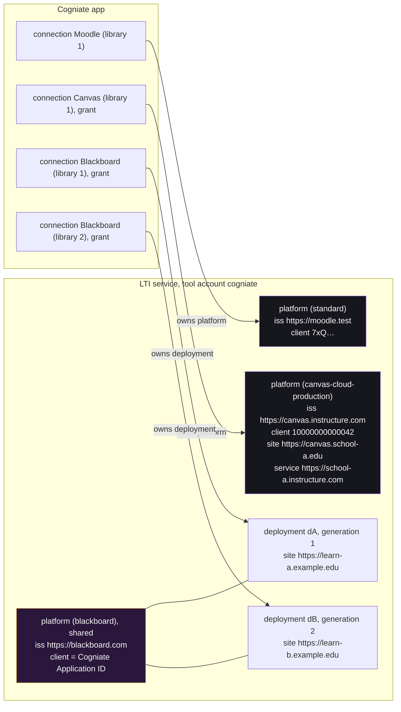
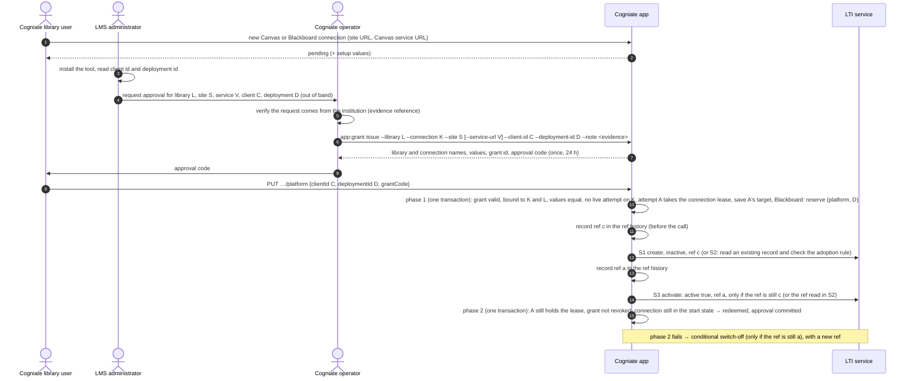

# ADR-011: Blackboard and Canvas through provider profiles

Status: Proposed (M0, revision 6: second correction after the round-2 reviews of revision 5 at `bd9fe36`; disposition in [review-response-M0](../review-response-M0.md), round 2). Amended in M1 by the accepted B-M1-03 design (proposal D revision 3 at `78bc34a`; approvals at `b6e8f73`; [review-response-M1](../review-response-M1.md)): a provider snapshot on each Canvas and Blackboard connection (migration `012`) keeps phase 1 local; no decision of this ADR changes. Date: 2026-10-20. Owner: Architect.
Inputs: [research](../../research/multi-lms.md) (fact ids `F-…`), [phase plan](../../team/multi-lms-plan.md) ("Design requirements from the Lead", "Test environment decisions", "Direction for the first design correction"), the backend and portal audits, the reviewer and QA reports in `docs/reviews/M0/`.
Contract changes: [LTI service §9](../contracts/lti-service-api.md#9-multi-lms-additions-m1), [app §4.2–§4.9, §5.1, §6.1](../contracts/cogniate-app-api.md#42-lms-type-provider-profile-and-capabilities-m1). Tasks: [M1](../tasks/M1.md), [M2](../tasks/M2.md), [M3](../tasks/M3.md), [M4](../tasks/M4.md).

## 1. Context

The prototype supports Moodle 5.2. The product owner wants Blackboard Learn and Canvas next, as a step toward an enterprise LTI service.

Four facts of the current code block hosted LMSs (backend audit; code references in the contracts):

1. **Same-origin rule.** Auth, token and JWKS URLs must be on the issuer origin. Blackboard and Canvas cloud use other hosts (F-BB-4, F-CV-3, F-CV-4).
2. **Issuer as site.** The app and the LTI service use the issuer origin as the LMS page origin in nine places: deep-link return URL, picker and embedded `frame-ancestors`, return links, learner labels. For Blackboard and Canvas cloud the issuer is one global value for all customers (F-BB-3, F-CV-1); pages and services are on the school host (F-BB-6, F-BB-7).
3. **One platform per connection.** A connection owns one platform (issuer + client id), and disconnect switches off the whole platform. Blackboard gives one client id to every school; schools differ only by deployment id (F-BB-2).
4. **Additive migrations only.** Each migration runs in one transaction with foreign keys on. A table rebuild is not safe. So existing `UNIQUE` and `CHECK` constraints stay. The old build also refuses to start on a database with migrations it does not know (ledger table `schema_migration`).

Client ids and deployment ids are not secrets. Every LTI message carries them (F-STD-8), and launch tokens pass through the user's browser. So typed ids never prove that a library may use an LMS installation.

## 2. Decision in short

| # | Decision |
| --- | --- |
| D1 | Each platform record has a **provider profile**. The default profile `standard` keeps today's Moodle rules. |
| D2 | Profiles are **fixed in code** and reviewed. A profile fixes the issuer and the auth, token and JWKS URLs, or a fixed rule that builds them from the site or service URL. No API field, token claim or admin input can set another endpoint. The `standard` profile cannot use a reserved provider issuer, and it refuses a launch whose **signed product family** is Canvas or Blackboard (§4 rule 4). |
| D3 | The **site origin** (LMS pages) is separate from the issuer. For every Canvas profile (cloud and self-hosted), a separate **service origin** (AGS, NRPS, token endpoint) can differ from the site origin; it defaults to the site origin. Both are fixed by the operator grant. |
| D4 | **Tenancy key** = (tool account, issuer, client id, deployment id). Blackboard uses one **shared** platform; each school is one deployment that one connection owns. Canvas and Moodle use **exclusive** platforms. |
| D5 | Every new Canvas or Blackboard binding (first registration, and each added Canvas deployment) needs a one-time **operator approval grant**, bound to the exact library, connection, LMS profile, canonical site and service URLs, client id and deployment id. The app redeems it in a checked two-phase redemption before it activates the binding. A remote record has app launch and grade authority only after the app commits an **approval** for exactly that deployment. Normal LTI launch validation gets no exception. |
| D6 | Each shared deployment has a **binding generation**. A new binding makes every older service key and ltik of that deployment invalid. Existing rows keep generation 0 and their exact key values. |
| D7 | Canvas connects with a developer key (our JSON, Paste JSON), the client id, the deployment id and a grant. Blackboard connects with the Cogniate Application ID (operator registration), the deployment id and a grant. Dynamic registration stays Moodle only. Moodle registration does not change. |
| D8 | Privacy and grades do not change. Canvas and Blackboard launches keep only an **allowlist** of claims. ADR-010 stays as written. Canvas gets only the graded `assignment_selection` placement. |
| D9 | Moodle-only features are **capabilities** of a connection; other LMS types get `CAPABILITY_NOT_SUPPORTED` before any outbound call. |
| D10 | Automated proof uses **signed platform simulations** on fixed `.sim.test` hosts in the `acceptance` profile, plus an acceptance-only app-to-LTI transport gate for deterministic fault tests. Real Blackboard and Canvas checks stay **unverified** until an authorized environment exists. Local and hosted Canvas are separate evidence levels. |
| D11 | Upgrade and rollback use the **new revision's maintenance commands while both services are stopped**: a verified backup before the first new start, and a fully validated restore before the old revision starts. Writes after the backup are lost on rollback. No migration ledger entry is edited. |
| D12 | The operator has a bounded **containment and recovery** path (§4b): suspend a binding without the library's session, then release it. Old authority ends before a corrected binding can activate. Publications, attempts and grades never move to another library. |
| D13 | Every site URL, service URL and self-hosted issuer is stored and compared in one **canonical origin** form (§6). |

## 3. Terms

| Term | Meaning |
| --- | --- |
| **LMS type** | `moodle`, `canvas` or `blackboard`. A field of the app connection. Default `moodle`. |
| **Provider profile** (profile) | A fixed set of trust rules in the LTI service: issuer rule, endpoint rules, site rule, sharing mode, flags. Example: `canvas-cloud-production`. |
| **Site URL** / **site origin** | The https origin where the LMS shows its pages: the Deep Linking return URL, frames and return links. Example: `https://canvas.school.edu`. |
| **Service URL** / **service origin** (Canvas) | The https origin of the Canvas AGS and NRPS URLs and of the token endpoint: the root account domain, for example `https://school.instructure.com`. Default: the site URL. Moodle and Blackboard have no separate value. |
| **Canonical origin** | `https://` + lower-case ASCII host (IDN as punycode) + `:port` only when the port is not 443; no path, no trailing `/`. |
| **Exclusive platform** | A platform (issuer + client id) that one connection owns with all its deployments. Moodle, Canvas. |
| **Shared platform** | One platform for one vendor registration that many connections use. Each connection owns at most one deployment. Blackboard. |
| **Operator** | A Cogniate staff member with shell access to the Cogniate app service (the same trust level as the LTI API key holder). |
| **Approval grant** (grant) | A one-time, expiring approval for one binding, issued by the operator. The portal calls its secret the **approval code**. |
| **Redemption attempt** | One try to redeem a grant. It has a random id, an order number and a saved target. At most one attempt per connection is live (the 60 s **connection lease**, §4a). |
| **Approval** | A committed app row for one (platform, deployment) and one connection. Only phase 2 of a redemption writes it. It is the only source of Canvas and Blackboard launch and grade authority. |
| **Binding ref** | An opaque value on an LTI platform or deployment. Every app write sets a new one and records it first (ref history). Conditional changes compare it in the LTI service (the fence). |
| **Fence-out** | A conditional switch-off that also writes a new ref, so that every older delayed write of the same connection fails. |
| **Suspend** / **release** | Operator commands that switch a binding off without the library's session, and then free its LTI record for a corrected binding (§4b). |
| **Binding generation** | A counter on a shared deployment. It increases with each new binding. Keys and ltiks of an older generation stop working. |

## 4. Tenancy model

Rules:

1. **Never select a tenant from the issuer alone.** Login needs `client_id` when the account has more than one platform for the issuer (unchanged rule). Canvas and Blackboard always send it (F-BB-9, F-CV-6).
2. **Deployment check.** A deployment must be known and active at login (if the hint is present) and at launch. If the login has `lti_deployment_id`, the token `deployment_id` must be the same (F-STD-4). There is no exception for unknown deployments.
3. **Reserved issuers.** A `standard` platform (also one made by dynamic registration) cannot use the issuer origin of a fixed profile (`https://blackboard.com`, the three Canvas cloud issuers, and the simulation issuers when they are on): `ISSUER_RESERVED`.
4. **Signed product family.** A self-hosted Canvas has its own issuer, so rule 3 cannot reserve it. The trusted input is the signed `tool_platform.product_family_code` claim, which the launch checks verify with the platform keys (check 6). Canvas signs `canvas` in every launch, also when self-hosted (F-CV-22); the Blackboard sample signs `BlackboardLearn` (F-BB-16); Moodle signs `moodle`. **Refusal rule (launch check 14, every profile):** if the signed value, compared without case, is `canvas`, the platform profile must be a Canvas profile; if it is `blackboardlearn`, the profile must be a Blackboard profile; else the launch fails with `PROVIDER_PROFILE_MISMATCH`, before any claim is stored. **Compatibility policy:** any other value (for example `moodle`) and a missing claim pass this check, so Moodle and other platforms keep today's behaviour. Dynamic registration also refuses a platform configuration whose `product_family_code` is one of these two values. **Second line in the app:** the app compares the same signed value (`platform.productFamilyCode`) and the platform profile with the connection's LMS type (`canvas` needs a Canvas connection, `blackboardlearn` a Blackboard connection; the profile's LMS must equal the connection `lms`); a mismatch gives `UNKNOWN_PLATFORM` with log reason `lms_mismatch`, and the same missing or unknown value policy. So a `standard` (Moodle) connection to a self-hosted Canvas can be created, but none of its launches works and no personal claim is stored; the library must use a Canvas connection and a grant.
5. **Shared platform (Blackboard).** At most one shared platform per (tool account, profile). The operator makes it once with the vendor Application ID. A connection never creates, changes, deletes or switches off a shared platform. It binds and switches off **its own deployment** only. A `DELETE` of a shared platform with active deployments is refused.
6. **Approval before authority.** A Canvas platform, a Canvas added deployment and a Blackboard deployment are created **inactive**. Only a conditional call of the live redemption attempt activates them. They get app launch and grade authority only when phase 2 commits an approval for exactly that (platform, deployment) (§4a). An active remote record without approval gets no picker, attempt, service key use or grade (app contract §6.1). An approved deployment is never changed by the retry, cancellation or cleanup of another deployment. Typed ids without a grant bind nothing.
7. **Exclusive platform (Canvas, Moodle).** The ownership rules of security §2.6 stay: the app binds only a platform that its call creates; an existing platform gives `409 PLATFORM_IN_USE`. One bounded exception: during a grant redemption, the live attempt may adopt a platform with exactly the grant's profile, issuer, client id, site and service URL that **no connection** owns, if it is inactive, or if its ref is an older ref of the same connection (adoption rows A1–A3, app contract §4.7.1; recovery after a lost LTI response). A Canvas school with two libraries makes two developer keys.
8. **Same Canvas client id in two environments.** Beta and test copy production keys (F-CV-1). The issuer differs, so `(issuer, client id)` differs. One connection (and one grant) per environment.
9. **Duplicate installations and fixed deployments.**
   - Canvas: one key installed twice (root and sub-account) gives two deployment ids. The second fails with `UNKNOWN_DEPLOYMENT` until the connection adds it with its own grant.
   - Blackboard: one Learn site = one deployment = one connection. A Blackboard connection holds **at most one** reservation, and its deployment id is fixed once reserved: a grant for another deployment id cannot be issued for that connection. To correct the id, the user disconnects (cancels) that connection and makes a new one.
10. **Bounded unsupported cases (fail safe).** Canvas inherited (global) developer keys, which use one client id for many Canvas schools: the second school gets `409 PLATFORM_IN_USE`, because an exclusive Canvas platform belongs to one connection and one grant (follow-up D-5). One Blackboard Developer Portal application per host name (F-BB-10): only one tool account per LTI service host can have the `blackboard` profile (follow-up D-6).
11. **Operator containment.** The operator can suspend and release any binding (§4b).

### 4a. Operator approval grant

**Trust boundary.**

| Trusted | Not trusted |
| --- | --- |
| The operator and the operator's out-of-band check (the operator records an evidence reference in the grant note) | Ids that a portal user types |
| The app database and the operator CLI (shell access to the app service) | Any LMS id seen in a launch, a log or a browser |
| The LMS signatures for launches (unchanged checks) | An approval code alone, without the bound library session |

The operator's check: the institution's LMS administrator asks for this library, this site (and, for Canvas, the service URL) and these ids, through a channel that the operator can tie to the institution. The exact evidence policy is a human decision (Q22).

**Grant properties.**

| Property | Rule |
| --- | --- |
| Binding | Exact library, connection, LMS type, profile, canonical site URL, canonical service URL (Canvas; else the site URL), client id, deployment id and purpose (`initial` or `add_deployment`). |
| Issue | The operator names the library and the connection. The CLI prints the library name, the connection name and all bound values before it prints the code, and refuses any mismatch with the connection. |
| Secret | 43 base64url characters (256 bits), shown once to the operator; only its SHA-256 is stored. |
| Life | Default 24 h; 60 s to 7 days. **Expiry is checked when an attempt starts (phase 1) only.** A running attempt is bounded by the 60 s connection lease instead. |
| Redemption | Only in a portal session of the bound library, on the bound connection, with values that equal the grant. Phase 1 starts one attempt and gives it the **connection lease** (60 s; one live attempt per connection, for every grant). Phase 2 commits the approval only if the same attempt still holds the lease, the grant is not revoked, the connection is still in its start state (`pending` for `initial`; `registered` or `connected` for `add_deployment`), and the attempt's own conditional activation succeeded. One successful redemption only. |
| Revoke and replace | The operator may revoke a grant at any time before it is redeemed, also while an attempt holds the lease. A replacement grant revokes older unredeemed grants of the same connection and purpose. The running attempt then fails phase 2 and compensates. The replacement can start only after the old attempt ends (`409 GRANT_IN_USE` before). `revoke` also fences out what that grant's attempts made without approval. |
| Retry | After an LTI failure, a lost LTI response or an app restart, the same connection can retry with the same grant (or a replacement grant with the same values). A Blackboard connection reuses its own reservation. |
| Attempt order | Before every LTI call the attempt checks that it still holds the lease. A call that times out (5 s) ends the attempt with `502`; its handler never resumes. The attempt may adopt only its own ref, an **older** ref of the same connection, or an inactive record that no connection owns (Blackboard: its own reservation); a newly read ref of the same connection is not permission by itself. An older or cancelled attempt can never adopt a newer ref. |
| Fence | The app records every ref before the call that carries it. Every create is inactive; every activation, adoption, switch-off and delete is a compare-and-set on the ref that the app read, and every conditional change writes a **new** random ref that the app never reuses. The LTI service compares atomically with the current ref only (LTI contract §9.15); because app refs never return, a delayed app call cannot undo a later successful app change. A raw unconditional API change by an operator is outside this guarantee. |
| Compensation | When phase 2 fails, the attempt switches off only the record that still carries its own activation ref (one conditional call, with a new ref). If that call fails, the app logs `grant_compensation_failed`; the record has no approval, so it has no authority; the next attempt, `app:grant revoke` or `app:binding suspend` cleans it. |
| Late writes | A call that reaches the LTI service after its handler ended can only create an **inactive** record (a create never replaces one), or change a record whose ref nobody changed since the call was sent. It never creates authority, because only phase 2 writes an approval. A cleanup that found no record does not prove that none will appear; the same cleanup, run again, finds a late record through the saved target. |

The invariants I1–I6, the adoption rule, the cleanup owners and the full outcome table for faults and races are in the app contract §4.7.1.

What the grant proves: the operator approved this one binding after an out-of-band check. What it does not prove: anything the operator did not check. Operator error and social engineering are residual risks (R-M-03); §4b limits their damage. A later self-service proof can replace the operator step (follow-up D-3).

### 4b. Operator containment and recovery

Lead requirement: an operator procedure to recover an incorrectly approved binding. It must end old authority before a corrected binding can activate, and it must not move publications, attempts or grades to another library. It is not self-service reassignment.

| Step | Command (app service shell) | Effect |
| --- | --- | --- |
| 1. Suspend | `app:binding suspend --connection <id> --note "<evidence>"` | Works without the library's session, for any LMS type. Sets the connection `disabled`, revokes its unredeemed grants, then **fences out** every record that the connection owns: its committed binding and the target of each of its attempts, found through the saved targets, also when the connection has no platform id or ref yet (Canvas: platform `active: false`; Blackboard: its deployment `active: false`; each with a new ref). A record with a foreign or newer ref is left unchanged; a remote `404` counts as absent. Logs `binding_suspended`. Running it again repeats the fence-out (the repair step after a failed call or a late write). |
| 2. Release | `app:binding release --connection <id> --note "<evidence>"` | Only for a `disabled` connection with no live lease and no owned active record. Moodle and Canvas: deletes each owned inactive LTI platform with a conditional delete (this removes its launches and service keys; the issuer and client id become free). Blackboard: the LTI deployment stays inactive. Then it deletes only this connection's reservation and approvals. Foreign or newer records are left unchanged; absent records count as done; a repeated release exits 0. Logs `binding_released`. The old connection keeps its publications, resource links, attempts, grants, ref history and score history. |
| 3. Correct binding | normal `app:grant issue` and redemption | For the rightful (or corrected) connection only. Canvas: a new platform with new keys. Blackboard: the inactive deployment becomes active again with generation + 1, so every old key and ltik fails. |

Uses: a wrong library got a binding (squatting through operator error); a wrong Canvas site or service URL, also for a pending connection whose record was made but not committed (correct it without a new developer key: suspend, release, then a new connection and grant with the right values); a `standard` platform that a library made with a self-hosted Canvas issuer and client id, which blocks the rightful Canvas connection with `PLATFORM_IN_USE` (rule 4 already stops its launches; release frees the id).

**Accepted limit (A-M0-10, D-12).** A new Canvas or Blackboard binding always needs a grant, but a Moodle (`standard`) manual connect does not. After a release, an authenticated library can therefore make a new `standard` platform with the same issuer and client id before the rightful Canvas redemption. This race exists only for `canvas-self-hosted`: the hosted Canvas issuers and the Blackboard issuer are reserved, so a `standard` connect with them gets `400 ISSUER_RESERVED` (§4 rule 3; LTI contract §9.1). Check 14 still refuses its Canvas-signed launches before any claim is stored, so this can block setup; it does not give Canvas access. Operator order: issue the rightful grant first, then suspend, then release, then ask the rightful library to redeem at once. This order makes the window short; it does not close it. If the race happens, the operator suspends and releases the new connection and repeats the order. A reserved-identifier or quarantine design is needed before an enterprise service relies on this workflow.

Teacher course items that pointed at the old connection's publications stay unavailable after a correction ("This course is not available"); teachers add the course again under the new connection.

## 5. Origins

| Value | Moodle (`standard`) | Canvas cloud | Canvas self-hosted | Blackboard |
| --- | --- | --- | --- | --- |
| Issuer | Moodle wwwroot | global per environment | the site origin | `https://blackboard.com` |
| Auth endpoint | on issuer origin (admin value) | `sso…canvaslms.com` (profile) | `{site}/api/lti/authorize_redirect` | `developer.blackboard.com` (profile) |
| JWKS | on issuer origin (admin value) | `sso…canvaslms.com` (profile) | `{site}/api/lti/security/jwks` | per Application ID (profile) |
| Token endpoint | on issuer origin (admin value) | `{service}/login/oauth2/token` | `{service}/login/oauth2/token` | `developer.blackboard.com` (profile) |
| Site origin | issuer origin | platform `siteUrl` | platform `siteUrl` (= issuer) | deployment `siteUrl` |
| Service origin | issuer origin | platform `serviceUrl` (default: `siteUrl`) | platform `serviceUrl` (default: `siteUrl`) | deployment `siteUrl` |

Uses of the two origins:

- LTI service, launch **check 13** (profiles other than `standard`): AGS `lineitems`, AGS `lineitem` and NRPS `context_memberships_url` must be https on the **service origin**; `deep_link_return_url` must be https on the **site origin**. Canvas puts these on two hosts when users browse on a domain that is not the root account domain (F-CV-18). A failure names the claim and its origin.
- The platform access token goes only to URLs that passed check 13 and the line item rule. Each call asks only for the scope that it needs.
- `GET /api/idtoken` returns `platform.siteUrl` and `platform.serviceUrl`.
- The app uses the connection `siteUrl` for picker and embedded `frame-ancestors`, `RETURN_URL_MISMATCH`, the return link and learner labels. It refuses a launch whose `platform.siteUrl` or `platform.serviceUrl` differs from the connection value.

For Moodle every value equals the issuer origin, so Moodle behaviour does not change.

**What a third page host can and cannot do** (a host that is neither the site nor the service origin, for example a second vanity domain). Only signed claims and the browser's frame rules are trusted inputs; the `Referer` header and typed values are not.

| Case | Outcome |
| --- | --- |
| Deep Linking from the third host | Canvas builds the return URL on the browser host (F-CV-18), so check 13 fails: `SERVICE_ORIGIN_MISMATCH`, `claim=dl_return`. |
| A Cogniate page framed by the third host | The picker and embedded pages send `frame-ancestors {site}`, so the browser does not show them. This is a browser refusal, not a Cogniate error page. |
| A top-level resource launch through the third host | No trusted input shows the browser host. If the AGS and NRPS URLs are on the service origin, the launch works. A `launch_presentation.return_url` on the third host is not used: "Back to …" goes to `{site}/`. |

So the design does not claim that every third host fails. One page origin per connection is a setup rule; a school that uses two page hosts daily needs follow-up D-2. The Canvas service origin comes from code reading plus an inference about hosted Canvas (F-CV-18); the live matrix checks it.

## 6. Provider trust profiles

The profiles live in one reviewed code module of the LTI service. Each row records its source fact. A change to a profile is an architecture change (ADR revision) with a QA criterion.

| Profile id | LMS | Sharing | Issuer | Auth endpoint | JWKS | Token endpoint | Site URL on | Source |
| --- | --- | --- | --- | --- | --- | --- | --- | --- |
| `standard` | any (Moodle) | exclusive | admin value (https), not reserved | admin value, issuer origin | admin value, issuer origin | admin value, issuer origin | — (issuer origin) | security §2.4 |
| `canvas-cloud-production` | canvas | exclusive | `https://canvas.instructure.com` | `https://sso.canvaslms.com/api/lti/authorize_redirect` | `https://sso.canvaslms.com/api/lti/security/jwks` | `{serviceUrl}/login/oauth2/token` | platform | F-CV-1, -3, -4, -5, -18 |
| `canvas-cloud-beta` | canvas | exclusive | `https://canvas.beta.instructure.com` | `https://sso.beta.canvaslms.com/api/lti/authorize_redirect` | `https://sso.beta.canvaslms.com/api/lti/security/jwks` | `{serviceUrl}/login/oauth2/token` | platform | same |
| `canvas-cloud-test` | canvas | exclusive | `https://canvas.test.instructure.com` | `https://sso.test.canvaslms.com/api/lti/authorize_redirect` | `https://sso.test.canvaslms.com/api/lti/security/jwks` | `{serviceUrl}/login/oauth2/token` | platform | same |
| `canvas-self-hosted` | canvas | exclusive | `{siteUrl}` | `{siteUrl}/api/lti/authorize_redirect` | `{siteUrl}/api/lti/security/jwks` | `{serviceUrl}/login/oauth2/token` | platform (= issuer) | F-CV-2, -18 |
| `blackboard` | blackboard | shared | `https://blackboard.com` | `https://developer.blackboard.com/api/v1/gateway/oidcauth` | `https://developer.blackboard.com/api/v1/management/applications/{clientId}/jwks.json` | `https://developer.blackboard.com/api/v1/gateway/oauth2/jwttoken` | deployment | F-BB-3, -4, -5 |

Every Canvas profile stores a **service URL** on the platform (default: the site URL). `{serviceUrl}` in a template means that value.

Simulation profiles exist only when the service runs with `profile: acceptance` **and** `LTI_PROVIDER_SIMULATION=on`. The `acceptance` compose profile sets both. In every other combination the ids below are unknown (`400 UNKNOWN_PROFILE`).

| Profile id | Copies | Issuer | Fixed hosts |
| --- | --- | --- | --- |
| `blackboard-sim` | `blackboard` | `https://blackboard.sim.test` | `developer.blackboard.sim.test` with the `blackboard` paths |
| `canvas-sim-cloud` | `canvas-cloud-production` | `https://canvas.sim.test` | `sso.canvas.sim.test` with the Canvas auth and JWKS paths; token `{serviceUrl}/login/oauth2/token` |

`canvas-self-hosted` needs no simulation copy: QA uses it with `canvas-self.sim.test` (site and issuer) and `api.canvas-self.sim.test` (a separate service origin), which only the `acceptance` allowlist lets the guarded client reach. The production values are checked as constants (AC-M1-01, unit tests). The test stack never calls them, and nothing spoofs vendor DNS or certificates.

**A stored profile that is unknown at run time** (a simulation profile row while simulations are off): login, launch and API calls treat the platform as inactive (`PLATFORM_NOT_ACTIVE`). `GET /api/platforms` still lists the row with its stored `profile`.

**Canonical origin.** Before the service or the app stores or compares a site URL, a service URL, a self-hosted issuer, or a grant value, it converts the input: scheme and host to lower case, the host to ASCII (punycode), a trailing `/` removed, port `443` removed. An input with a path other than `/`, a query, a fragment, user info or another scheme is refused (site rule 1). Responses always show the canonical form.

**Fixed hosts** of a profile = the host of its fixed issuer and the hosts of its fixed auth, JWKS and token URLs. Hosts built from `{siteUrl}` or `{serviceUrl}` are not fixed hosts.

**Site rules** (every site URL and service URL of a profile other than `standard`, after canonicalization):

1. https origin only: no path (other than `/`), query, fragment or user info. A port is allowed.
2. The host is a DNS name with at least one dot. It is not an IP literal (IPv4 or IPv6), not `localhost` and not under `.localhost`.
3. The host is not a host of our own services (`PUBLIC_LTI_URL`, `PUBLIC_APP_URL`, `PUBLIC_CONTENT_URL`).
4. The host is not a fixed host of the profile, with any port (for example `sso.canvaslms.com`, `canvas.instructure.com`, `developer.blackboard.com`, `blackboard.com`). Site-derived endpoints (the Canvas token endpoint, every self-hosted Canvas endpoint) are allowed by design.
5. `canvas-self-hosted` only: the host does not end with `instructure.com` or `canvaslms.com`, and it is not a fixed host of any profile.
6. The service never fetches the site or service URL at connect time. Every later call to it (token, AGS, NRPS, self-hosted JWKS) goes through the guarded client (security §9). A private address fails there unless the profile is `acceptance` and the host is allowlisted.

Profile flags (data in the profile, not code branches):

| Flag | Profiles | Effect | Source |
| --- | --- | --- | --- |
| `deepLinkingResponseSub` | `blackboard`, `blackboard-sim` | Deep Linking response JWT has `sub` = client id | F-BB-8 |
| `clientAssertionAudArray` | `blackboard`, `blackboard-sim` | client assertion `aud` = `[tokenEndpoint]` | F-BB-5 |
| `minimizeClaims` | all `canvas-*`, `blackboard*` | claim allowlist (§9) | Q3 |
| `serviceOriginCheck` | all except `standard` | launch check 13 | §5 |
| `productFamily` | `canvas-*`: `canvas`; `blackboard*`: `blackboardlearn`; `standard`: none | launch check 14 (§4 rule 4) | F-CV-22, F-BB-16 |

A profile is configuration. It is not proof that a real tenant works. Live status is in the [M3 live matrix](../tasks/M3.md#5-live-check-matrix).

## 7. Registration per LMS

| LMS | Steps (summary) | Values to Cogniate | Who makes the LTI record |
| --- | --- | --- | --- |
| Moodle | Unchanged (ADR-009). | Dynamic, or six values | App (exclusive platform) |
| Canvas | Canvas admin: Developer Keys → LTI key → Paste JSON (our JSON) and the Redirect URIs value; turn the key on; install the app by client id; read the deployment id. Then the operator approval. | client id, deployment id, approval code (site URL, service URL and Canvas type at connection create) | App, after the grant (exclusive platform; endpoints from the profile) |
| Blackboard, operator (once per LTI host) | Register one application in the Blackboard Developer Portal: domain = host of `PUBLIC_LTI_URL`; login initiation URL `{PUBLIC_LTI_URL}/lti/login/cogniate`; one tool redirect URL `{PUBLIC_LTI_URL}/lti/launch/cogniate`; tool JWKS URL `{PUBLIC_LTI_URL}/lti/keys/cogniate`; RS256; one placement "Cogniate" of type Deep Linking with Target Link URI `{PUBLIC_LTI_URL}/lti/launch/cogniate` (login and check 12 accept only this path) and "Allow student access" off. Then `npm run lti:shared-platform`. | — | Operator (shared platform) |
| Blackboard, each school | Learn admin registers the tool with the Cogniate Application ID (user fields: role only; grade and membership services on) and reads the deployment id. Then the operator approval. | deployment id, approval code (site URL at connection create) | App, after the grant (deployment of the shared platform) |

"Allow student access" off applies to the teacher picker placement only. Learners open the course items that Deep Linking creates; those items launch to the same target URL.

No client secret is collected; the strict request bodies refuse a secret field. The Canvas JSON has `privacy_level: anonymous`, no custom fields and only the `assignment_selection` placement. It uses `public_jwk_url`. `?jwk=inline` gives the same document with a **snapshot** of the current public key (F-CV-8), for stacks that Canvas cannot reach; after a signing key change, the Canvas admin must paste a new JSON (the `kid` shows which key Canvas has). The JSON is served through the signed-in portal API, not at a public URL.

Not in this phase: Canvas Dynamic Registration (F-CV-15; the issuer and endpoints must come from the profile; follow-up D-1).

## 8. Deep Linking and learner presentation

| | Moodle | Canvas | Blackboard |
| --- | --- | --- | --- |
| Teacher entry | Activity "Select content" | `assignment_selection` only: a graded assignment. Teachers publish it ("Save & Publish") so learners can open it. | Ultra: Content Market; Original: Build Content (the Deep Linking placement) |
| Picker frame | iframe (modal) | iframe (modal) | iframe |
| Items returned | exactly one `ltiResourceLink` with `lineItem.scoreMaximum = 100` | same; `lineItem` makes the assignment and its points (F-CV-9) | same |
| Return data | `data` claim echoed (if sent) | **`data` is in the query of `deep_link_return_url`** (F-CV-21); no `data` claim | `data` claim echoed (required, F-BB-8) |
| Publication id | `resource` query of the signed `target_link_uri` | same (F-CV-9 workflow) | same |
| `window` hint | not sent (unchanged item) | sent (`assignment_selection` accepts `window`) | sent if accepted |
| Learner default | New window (admin setting) | New tab: Canvas honours the `window` hint (F-CV-11). Canvas still sends `document_target = iframe` (F-CV-17). | depends on Learn settings (live check) |

For every LMS, the auto-submit form action is the `deep_link_return_url` claim **exactly as received** (no rebuild, no normalization of path or query); the origin check compares only its origin. The response JWT echoes a `data` claim only when the request had one.

`link_selection` (Canvas module items) is not offered. Those items have no grade column (F-CV-10). In the current code a completion without a column ends as a `failed` sync row that offers Resend (Reviewer-B preflight B-PF-03), which would mislead teachers. Ungraded items need their own completion policy first (follow-up D-11).

The picker and its submit page allow framing only by the site origin. The deep-link return URL must be on the site origin. Cogniate uses no custom parameters; the publication id is in the signed `target_link_uri`.

An `iframe` learner launch goes to `/play/{playId}/embedded` (existing behaviour), framed only by the site origin. Canvas sends `iframe` for every launch, also in a new tab. So for Canvas connections only, the embedded page continues to the player at once when it is the top-level page (a small nonce script), and shows "Open in a new window" when it is really in a frame. Moodle and Blackboard keep the current static page.

The state cookie stays `SameSite=None; Secure; Partitioned`. Chromium and Firefox keep a partitioned cookie in an LMS frame. Safari 26.2 supports partitioned cookies again (F-WK-1); older Safari versions, or settings that block cross-site cookies, can still block it. The result is browser, version and setting dependent, and stays unverified until a live check records it (R4, R-M-07). Platform storage (`lti_storage_target`, F-STD-7) is follow-up D-4. No proxy redirect (research §5.3).

## 9. Privacy, identity and grades

- The learner id stays the LTI `sub`. No learner accounts (no JIT provisioning).
- **Claim allowlist.** For profiles with `minimizeClaims`, the LTI service keeps only these claims after the launch checks and **before** it stores the launch. Top level: `iss`, `sub`, `aud`, `azp`, `exp`, `iat`, `nonce`. LTI claims (kept members in brackets; `lti/claim` = `https://purl.imsglobal.org/spec/lti/claim/`):
  - `lti/claim/message_type`, `lti/claim/version`, `lti/claim/deployment_id`, `lti/claim/target_link_uri`, `lti/claim/roles`
  - `lti/claim/context` (`id`, `label`, `title`, `type`)
  - `lti/claim/resource_link` (`id`, `title`, `description`)
  - `lti/claim/tool_platform` (`guid`, `name`, `description`, `url`, `product_family_code`, `version`; not `contact_email`)
  - `lti/claim/launch_presentation` (`document_target`, `return_url`, `locale`, `width`, `height`)
  - `https://purl.imsglobal.org/spec/lti-dl/claim/deep_linking_settings` (all members)
  - `https://purl.imsglobal.org/spec/lti-ags/claim/endpoint` (`lineitems`, `lineitem`, `scope`)
  - `https://purl.imsglobal.org/spec/lti-nrps/claim/namesroleservice` (`context_memberships_url`, `service_versions`)

  Everything else is removed: names, emails, pictures, `lis`, `lti1p1`, `custom` (LMS variable substitution can put names or SIS ids there), `role_scope_mentor`, and vendor claims such as `https://blackboard.com/lti/claim/one_time_session_token`. The service logs `launch_claims_minimized {platform_id, claims}` with the removed names only. `GET /api/idtoken` (also `raw=true`) never shows them; `launch.custom` is `{}`. Moodle (`standard`) is unchanged (follow-up D-9). A launch that check 14 refuses stores no claims at all.
- The NRPS rule stays: `/api/memberships` never returns personal fields (D13).
- ADR-010 stays: final outcomes only, the real score, best result, retries. Canvas and Blackboard use the same mapping and the existing status table, with one addition for every LMS: a platform `422` is a permanent refusal (`PLATFORM_REJECTED_REQUEST` → `failed`, no automatic retry), like `400` and `404`. Canvas answers `400` for a score older than its stored result (F-CV-19); that stays `failed` (it is not the Moodle `409` conflict). Canvas answers `422` for a learner who is not a student and when the assignment's attempt limit is reached (F-CV-23); the teacher guide says to keep "Allowed Attempts" unlimited, because the best-result policy can send more than one score.
- Learner labels: `Learner {sub} @ {site host}`. For Moodle the site host equals the issuer host.

## 10. Roles

The old rule ("any role that ends with `#Instructor`, `#ContentDeveloper` or `#Administrator`") counts institution roles. Canvas and Blackboard send institution roles; a teacher who takes a course as a learner has `institution/person#Instructor` and `membership#Learner`. The old rule made that learner a preview with no grade. New rule (F-STD-5):

| Set | Members |
| --- | --- |
| Context staff role | `http://purl.imsglobal.org/vocab/lis/v2/membership#Instructor`, `#ContentDeveloper`, `#Administrator`; sub-roles `http://purl.imsglobal.org/vocab/lis/v2/membership/Instructor#…`, `…/membership/ContentDeveloper#…`, `…/membership/Administrator#…`; simple names `Instructor`, `ContentDeveloper`, `Administrator` |
| Context learner role | `http://purl.imsglobal.org/vocab/lis/v2/membership#Learner`, `…/membership/Learner#…`, simple name `Learner` |
| Admin role | `http://purl.imsglobal.org/vocab/lis/v2/institution/person#Administrator`, `http://purl.imsglobal.org/vocab/lis/v2/system/person#Administrator`, `http://purl.imsglobal.org/vocab/lis/v2/system/person#SysAdmin` |

- **Deep Linking allowed** = a context staff role or an admin role.
- **Graded launch** = a context learner role and no context staff role. Any other launch is a preview (no score sync). This follows ADR-010 rule 6 ("no Learner role → preview").
- Canvas Student View sends `membership#Learner` plus `…/lti/system/person#TestUser` (F-CV-20). It is graded on purpose: Canvas keeps test-student grades, and a teacher can check grade return this way.
- Blackboard roles other than Instructor and Student (teaching assistant, course builder, grader, guest) with "Role in Course" only are not documented; the live matrix records their raw roles (L-B14 to L-B17).
- Moodle effect: teachers, admins without enrolment and students behave as before. One case changes, by design: a Moodle site admin who is enrolled only as a student is now graded. M3 runs the Moodle regression to show no other change.

## 11. Capabilities

| Capability | moodle | canvas | blackboard | Guard when missing |
| --- | --- | --- | --- | --- |
| `dynamicRegistration` | yes | no | no | `POST /app-api/connections` with `method: dynamic` → `422 CAPABILITY_NOT_SUPPORTED` |
| `operatorApproval` | no | yes | yes | (information: the portal asks for an approval code) |
| `webServices` (T8 token) | yes | no | no | `PUT …/web-services` → `409 CAPABILITY_NOT_SUPPORTED`, no outbound call |
| `courseShell` (`createMoodleCourse`) | yes | no | no | `POST /app-api/publications` → `409 CAPABILITY_NOT_SUPPORTED`, nothing stored |
| `addDeployment` | no | yes | no | `POST …/deployments` → `409 CAPABILITY_NOT_SUPPORTED` |
| `canvasConfiguration` | no | yes | no | `GET …/canvas-configuration` → `409 CAPABILITY_NOT_SUPPORTED` |

The `.mbz` download is a course-version feature, not a connection feature. It does not change; the portal labels it as a Moodle-only export.

## 12. Key and connection lifecycle

| Event | Moodle, Canvas (exclusive) | Blackboard (shared deployment) |
| --- | --- | --- |
| Disconnect (portal) or suspend (operator) | platform `active: false` | deployment `active: false`; platform unchanged |
| API call with an old ltik or service key after that | `403 PLATFORM_NOT_ACTIVE` | `403 DEPLOYMENT_NOT_ACTIVE` |
| Score sync rows after that | Moodle unchanged (the `403` makes them `failed`). Canvas and Blackboard: the worker sends nothing; a row becomes `failed` with `lastError = "CONNECTION_DISABLED"` at the first worker pass at or after its due time (not at the disable), with `tries` unchanged; Resend and Refresh answer `409 CONNECTION_NOT_READY`. | same as Canvas |
| New binding, same library | Canvas: a new connection needs a new developer key and a grant, or an operator release (§4b) first to reuse the old key. | A new connection with a grant; the deployment becomes active again with generation + 1. |
| New binding, another library | Only after an operator release (§4b). | Only after an operator release (§4b); generation + 1. |
| Old service key or ltik after a new binding | Canvas after release: the platform and its keys are deleted, so old keys fail (`401`). | `401` (generation differs); the next launch of each activity gets a new key value |
| Key derivation | unchanged (generation 0) | the generation is part of the HMAC input when it is above 0 |

A new binding makes a **new** connection. Activities that teachers made under the old connection name publications of the old connection, so they show "This course is not available". The disconnect dialog and the `DEPLOYMENT_NOT_ACTIVE` page say so; neither promises that switching on again restores old items (follow-up D-7).

## 13. Validation

| Label | Means | Proves |
| --- | --- | --- |
| `SIM` | QA-owned signed platform simulation on fixed `.sim.test` hosts (`acceptance` profile), with the acceptance-only transport gate for fault cases | Our protocol handling against the documented behaviour. Not real LMS behaviour. |
| `MOODLE-LIVE` | Local Moodle 5.2.4 container | No Moodle regression |
| `CANVAS-HOSTED` | An Instructure-hosted Canvas tenant (production, beta or test), with written authorization | Hosted Canvas interoperability for the listed steps |
| `CANVAS-LOCAL` | A self-hosted or local Canvas instance | Self-hosted Canvas only; never fills a hosted row |
| `BLACKBOARD-LIVE` | A real Learn instance with the operator's Developer Portal application, with written authorization | Blackboard interoperability for the listed steps |
| `DOC` | A statement from provider docs only | Nothing about our code |

Every live row records the environment, profile, LMS version, browser and date. Without an authorized environment, every live row is **UNVERIFIED** with exact steps (M3). No public tunnel, deployment or real-tenant change happens without explicit scope authorization from the product owner.

Live-check prerequisites (true blockers for the live rows only):

| Id | Blocker | Needed from |
| --- | --- | --- |
| B-1 | A Canvas tenant where we may create a developer key, a published test course and an enrolled test learner | Product owner |
| B-2 | A Blackboard Developer Portal account (third-party sign-up) and a Learn test instance with admin rights | Product owner |
| B-3 | For Blackboard: our JWKS URL reachable from Blackboard and Learn (public HTTPS), because Learn fetches it (F-BB-13) | Product owner (exposure authorization) |

Canvas can run against a local stack with the inline key snapshot, if B-1 exists and the tester's browser trusts the dev CA and resolves the `.test` names. Implementation (M1, M2) and SIM acceptance (M3) have no blocker.

## 14. Compatibility, migration, upgrade and rollback

Compatibility:

- Every LTI service and app API change is an addition, or a guard for a new LMS type, or check 14 (it refuses only Canvas- or Blackboard-signed launches on a non-matching profile). A request without the new fields behaves as today. Moodle request and response bodies keep every field.
- `deploymentIds` lists active deployments. Moodle has no inactive deployments, so its value does not change.
- The LTIAAS differences table gets D16 to D21 (LTI contract §8).
- Portal labels that named Moodle for every LMS change on purpose (M2 list). Tests that check them change with a Lead-approved list (AC-M3-02).

Migration (forward only, additive; no table rebuild):

- LTI service `004_provider_profiles.sql`: `platform.profile` (default `standard`), `platform.site_url`, `platform.service_url`, `deployment.site_url`, `deployment.active` (default 1), `deployment.binding_generation` (default 0), `deployment.binding_ref`, `platform.binding_ref`, `deployment.created_at`, `oidc_state.login_deployment_id`, `launch.site_origin`, `launch.service_origin`, `launch.binding_generation` (default 0), `service_key.binding_generation` (default 0).
- App `011_lms_types.sql`: `connection.lms` (default `moodle`), `connection.lti_profile` (default `standard`), `connection.service_url`, `connection.lti_binding_ref`, `connection.redeeming_attempt`, `connection.redeeming_since` (connection lease), tables `connection_deployment` (one row per deployment and at most one per connection, with its binding ref), `binding_grant`, `binding_attempt` (with its target), `binding_ref_history` and `approved_deployment`, `picker_session.site_origin`.
- App `012_connection_provider_snapshot.sql` (M1, B-M1-03): `connection.target_issuer`, `connection.target_platform_id`, `connection.target_client_id`, nullable, written once at create, no backfill (data model §4.3). A Canvas or Blackboard row from an `011` build keeps `NULL`; app contract §4.7.3 gives its lifecycle and recovery. Blackboard connections use method `manual` and keep `lti_platform_id` `NULL`.
- Old rows keep their behaviour: `standard` profile, site = issuer origin, deployments active, generation 0 (byte-identical service keys), LMS `moodle`. A `POST …/deployments` without `active` keeps the old default (active). Moodle routing does not use approvals.

The two databases are `infra/.data/lti-service/lti.db` and `infra/.data/cogniate-app/cogniate.db` (with their `-wal` and `-shm` sidecars when present). The new revision adds two maintenance commands: `npm run stack:data-backup` and `npm run stack:data-restore`. They exist only in the new revision, so the procedure switches the **code** first while **both services stay stopped**.

Upgrade procedure (operator, maintenance window; same checkout, compose project, `.env`, keys and data):

1. Stop the Cogniate app and the LTI service with the old revision's compose configuration. Check that both containers are stopped.
2. Switch the checkout to the new revision. Install and build **without** starting either service.
3. `npm run stack:data-backup -- --out <folder outside the checkout>`. The command refuses to run while either service runs. It copies both databases and their sidecars, reads each database's `schema_migration` names, and writes a manifest: backup id, time, compose project, source revision, and for each file its name, size and SHA-256. It verifies the copies against the manifest before it exits 0.
4. Start the new revision. The migrations run at the first start.

Rollback procedure (to the revision before the upgrade):

1. Stop the Cogniate app and the LTI service. Keep the new revision checked out.
2. `npm run stack:data-restore -- --from <folder>`. The command refuses to run while either service runs. It validates the **whole** backup before it changes anything: manifest form, backup id, compose project equal to the current one, every listed file present with its size and SHA-256. Any failure: exit 1 and no target file changes. Then it replaces exactly the two databases and their listed sidecars, and deletes a target `-wal` or `-shm` file that the backup does not list.
3. Switch the checkout to the old revision, install and build it, and start it. It sees only the migrations it knows.

WARNING: Rollback loses every Cogniate write after the backup: new connections, grants, platforms and deployments, launches, attempts, score sync rows and publication changes. Scores that the LMS already accepted stay in the LMS gradebook, but the portal no longer shows their sync rows. Canvas and Blackboard records made after the upgrade stay configured in the LMS, but their launches fail with `UNKNOWN_PLATFORM` after the restore. No migration ledger entry is ever edited or deleted. The backup folder contains secrets: keep it outside the checkout and outside shared evidence.

## 15. Out of scope and follow-ups

Out of scope (separate scope decision): billing, high availability, public deployment, 1EdTech certification, Blackboard REST APIs and 3-legged OAuth, LTI 1.1, Moodle in a subfolder (Q18), self-service reassignment.

| Id | Follow-up decision | Default until decided |
| --- | --- | --- |
| D-1 | Canvas Dynamic Registration with profile-based issuer and endpoint checks | Manual Canvas setup |
| D-2 | More than one page origin per Canvas connection (vanity domain and `*.instructure.com` both in daily use) | One site origin and one service origin; §5 third-host outcomes |
| D-3 | Self-service ownership proof (for example a signed administrator launch with a one-time code) to replace the operator step | Operator approval grant |
| D-4 | LTI platform storage (`lti_storage_target`) for cookie-less frames | Partitioned cookie; R4 |
| D-5 | Canvas inherited (global) keys: shared Canvas platform with per-deployment sites and grants | `409 PLATFORM_IN_USE` |
| D-6 | One host name per tool account (one Blackboard application per host) | Blackboard only for tool account `cogniate` |
| D-7 | Reconnect a disabled connection with its publications | New connection; old activities unavailable; another library only after an operator release |
| D-8 | Drop the NRPS scope (least privilege) | Same scopes as Moodle (ADR-009); each call asks for one scope |
| D-9 | Apply the claim allowlist to `standard` (Moodle) | Moodle unchanged |
| D-10 | A new window for learners in Blackboard and Moodle where the LMS honours `window` (Canvas already does) | Moodle unchanged; Blackboard per Learn settings |
| D-11 | Ungraded items (Canvas `link_selection`): completion policy without a grade column | Not offered |
| D-12 | Reserved identifiers or quarantine after a release, so that a grant-free `standard` connect cannot take a released `canvas-self-hosted` issuer and client id first (A-M0-10, accepted MINOR deferral; hosted Canvas and Blackboard issuers are already reserved) | Operator order of §4b; the residual race is documented in the guides and in `docs/human_review/deferred.md` (M4) |

## 16. Risks

| Id | Risk | Mitigation | Evidence |
| --- | --- | --- | --- |
| R-M-01 | A wrong endpoint in a profile breaks every tenant of that LMS. | Values from primary docs with fact ids; one module; profile change = ADR change; live rows stay unverified. | AC-M1-01, live matrix |
| R-M-02 | The global Blackboard access token reaches a wrong host. | Token only to URLs that passed check 13 and the line item rule. | AC-M1-11, AC-M1-12 |
| R-M-03 | A library binds another institution's LMS installation (squatting). | Operator grant bound to library, connection, site, service URL, client and deployment; check 14 stops the `standard` path for self-hosted Canvas; suspend and release (§4b) end a wrong binding. Residual: operator error or social engineering (Q22). | AC-M1-17, AC-M1-28, AC-M1-29, AC-M1-38, AC-M1-39 |
| R-M-04 | Disconnecting one Blackboard library stops all Blackboard schools. | Disconnect and suspend change only its deployment; the app never changes a shared platform; `DELETE` of a shared platform with active deployments is refused. | AC-M1-06, AC-M1-18 |
| R-M-05 | A Canvas school's page and service hosts differ, or the operator binds the wrong host. | Separate site and service URLs in the grant; failures name the host; guide: copy the service host from a Canvas service URL; suspend, release and a new grant correct it without a new developer key. | AC-M1-12, AC-M1-32, AC-M1-38, live row L-C11 |
| R-M-06 | Personal data enters Cogniate from Canvas or Blackboard. | Anonymous JSON, guide text, claim allowlist, check 14 before storage. | AC-M1-14, AC-M1-39 |
| R-M-07 | Teacher Deep Linking fails in a browser that blocks cross-site cookies in LMS frames. | Partitioned cookie; live rows record browser, version and setting; D-4. | Live rows L-C10, L-B10 |
| R-M-08 | The role change alters Moodle grading. | Only the enrolled-admin case changes; Moodle regression. | AC-M1-16, AC-M3-02 |
| R-M-09 | Rollback loses writes after the backup, or a bad backup damages data. | Maintenance window; backup verified before the first new start; full validation before any restore change; written warning. | AC-M1-23, AC-M1-30 |
| R-M-10 | Simulation passes but a real LMS differs. | Evidence labels; live matrix; no "works with" claim before live PASS. | M3, M4 |
| R-M-11 | The operator step does not scale and delays setup. | Bounded prototype choice; D-3. | — (documented) |
| R-M-12 | Old Blackboard keys work after a new binding. | Binding generation; Canvas release deletes old keys. | AC-M1-27, AC-M1-38 |
| R-M-13 | Inline Canvas key snapshot breaks after a signing key change. | Label, `kid` in the portal, re-export step in the guide. | AC-M1-19, guide, live row L-C14 |
| R-M-14 | A bound Learn host (self-hosted or compromised) captures the gateway token and uses it on other Learn sites until it expires. | Residual; each call asks for one scope; live row L-B12 records whether a token from one site works at another. | L-B12 |
| R-M-15 | A redemption races with revoke, replacement, disconnect, suspend or a newer attempt, or a delayed call arrives late, and activates cancelled authority or switches off a newer binding. | One live attempt per connection; staged inactive creates; compare-and-set with ref rotation at the LTI service for every activation, adoption, switch-off and delete; adoption only of own or older refs; write-ahead ref history and saved targets for cleanup; authority only from a committed approval; `release` waits for the lease to end. | AC-M1-07, AC-M1-20, AC-M1-37, AC-M1-38 |
| R-M-16 | After a release, a library takes the freed `canvas-self-hosted` issuer and client id first with a grant-free `standard` connect (A-M0-10). Hosted Canvas and Blackboard issuers are reserved (`ISSUER_RESERVED`), so they are not exposed. | Check 14 refuses its Canvas launches before storage; operator order of §4b; repeat suspend and release. Residual: repeated hostile registration can delay setup (D-12). | AC-M1-39 |

## 17. Consequences

- The LTI service stays LMS-neutral. A new LMS needs a profile row and tests, not new launch code.
- Canvas and Blackboard setup needs one operator step per binding, and the operator can contain a wrong binding. This is slower than self-service, but it does not trust public ids.
- Product claims after this phase: "Canvas and Blackboard support implemented and tested against signed simulations". Not "works with Canvas" or "works with Blackboard" until the live rows pass.
