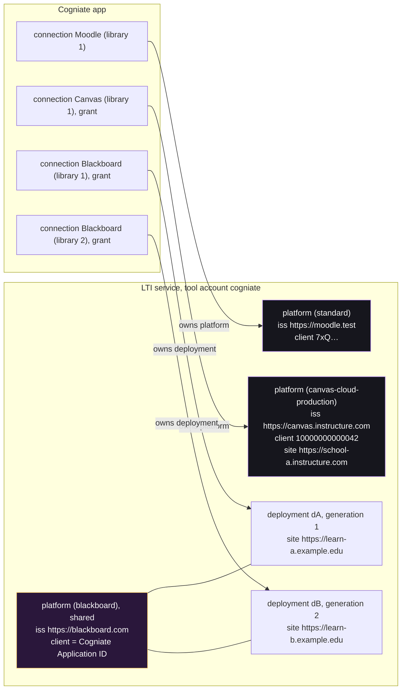

# ADR-011: Blackboard and Canvas through provider profiles

Status: Proposed (M0, revision 4: operator approval for both providers; Reviewer-A and Reviewer-B preflight findings; Lead decisions of 2026-10-20). Date: 2026-10-20. Owner: Architect.
Inputs: [research](../../research/multi-lms.md) (fact ids `F-…`), [phase plan](../../team/multi-lms-plan.md) ("Design requirements from the Lead", "Test environment decisions"), the backend and portal audits forwarded by the Lead.
Contract changes: [LTI service §9](../contracts/lti-service-api.md#9-multi-lms-additions-m1), [app §4.2–§4.8, §5.1, §6.1](../contracts/cogniate-app-api.md#42-lms-type-provider-profile-and-capabilities-m1). Tasks: [M1](../tasks/M1.md), [M2](../tasks/M2.md), [M3](../tasks/M3.md), [M4](../tasks/M4.md).

## 1. Context

The prototype supports Moodle 5.2. The product owner wants Blackboard Learn and Canvas next, as a step toward an enterprise LTI service.

Four facts of the current code block hosted LMSs (backend audit; code references in the contracts):

1. **Same-origin rule.** Auth, token and JWKS URLs must be on the issuer origin. Blackboard and Canvas cloud use other hosts (F-BB-4, F-CV-3, F-CV-4).
2. **Issuer as site.** The app and the LTI service use the issuer origin as the LMS page origin in nine places: deep-link return URL, picker and embedded `frame-ancestors`, return links, learner labels. For Blackboard and Canvas cloud the issuer is one global value for all customers (F-BB-3, F-CV-1); pages and services are on the school host (F-BB-6, F-BB-7).
3. **One platform per connection.** A connection owns one platform (issuer + client id), and disconnect switches off the whole platform. Blackboard gives one client id to every school; schools differ only by deployment id (F-BB-2).
4. **Additive migrations only.** Each migration runs in one transaction with foreign keys on. A table rebuild is not safe. So existing `UNIQUE` and `CHECK` constraints stay (for example `connection.lti_platform_id UNIQUE`, `connection.method IN ('dynamic','manual')`). The old build also refuses to start on a database with migrations it does not know (migration ledger guard).

Client ids and deployment ids are not secrets. Every LTI message carries them (F-STD-8), and launch tokens pass through the user's browser. So typed ids never prove that a library may use an LMS installation.

## 2. Decision in short

| # | Decision |
| --- | --- |
| D1 | Each platform record has a **provider profile**. The default profile `standard` keeps today's Moodle rules, unchanged. |
| D2 | Profiles are **fixed in code** and reviewed. A profile fixes the issuer and the auth, token and JWKS URLs, or a fixed rule that builds them from the site URL. No API field, token claim or admin input can set another endpoint. The `standard` profile cannot use a reserved provider issuer. |
| D3 | The **site origin** (LMS pages) is separate from the issuer. Site origin = deployment site URL, else platform site URL, else issuer origin. For Canvas only, a separate **service origin** (AGS, NRPS, token endpoint) can differ from the site origin; it defaults to the site origin. Both are fixed by the operator grant. |
| D4 | **Tenancy key** = (tool account, issuer, client id, deployment id). Blackboard uses one **shared** platform; each school is one deployment that one connection owns. Canvas and Moodle use **exclusive** platforms. |
| D5 | Every new Canvas or Blackboard binding (first registration, and each added Canvas deployment) needs a one-time **operator approval grant**. The Cogniate operator verifies installation authority outside the portal and issues a grant bound to the exact library, connection, LMS profile, site, client id and deployment id. The app redeems it atomically before it activates the binding. Normal LTI launch validation gets no exception. |
| D6 | Each shared deployment has a **binding generation**. A new binding makes every older service key and ltik of that deployment invalid. Existing rows keep generation 0 and their exact key values. |
| D7 | Canvas connects with a developer key (our JSON, Paste JSON), the client id, the deployment id and a grant. Blackboard connects with the Cogniate Application ID (operator registration), the deployment id and a grant. Dynamic registration stays Moodle only. Moodle registration does not change. |
| D8 | Privacy and grades do not change. Canvas and Blackboard launches keep only an **allowlist** of claims. ADR-010 stays as written. Canvas gets only the graded `assignment_selection` placement. |
| D9 | Moodle-only features are **capabilities** of a connection; other LMS types get `CAPABILITY_NOT_SUPPORTED` before any outbound call. |
| D10 | Automated proof uses **signed platform simulations** on fixed `.sim.test` hosts in the `acceptance` profile. Real Blackboard and Canvas checks stay **unverified** until an authorized environment exists. Local and hosted Canvas are separate evidence levels. |
| D11 | Rollback is a **restore of the pre-upgrade backup** (both SQLite files), taken in a maintenance window. Writes after the backup are lost. No migration ledger entry is edited. |

## 3. Terms

| Term | Meaning |
| --- | --- |
| **LMS type** | `moodle`, `canvas` or `blackboard`. A field of the app connection. Default `moodle`. |
| **Provider profile** (profile) | A fixed set of trust rules in the LTI service: issuer rule, endpoint rules, site rule, sharing mode, flags. Example: `canvas-cloud-production`. |
| **Site URL** / **site origin** | The https origin where the LMS shows its pages: the Deep Linking return URL, frames and return links. Example: `https://canvas.school.edu`. |
| **Service URL** / **service origin** (Canvas) | The https origin of the Canvas AGS and NRPS URLs and of the token endpoint: the root account domain, for example `https://school.instructure.com`. Default: the site URL. Moodle and Blackboard have no separate value (service origin = site origin). |
| **Exclusive platform** | A platform (issuer + client id) that one connection owns with all its deployments. Moodle, Canvas. |
| **Shared platform** | One platform for one vendor registration that many connections use. Each connection owns one deployment. Blackboard. |
| **Operator** | A Cogniate staff member with shell access to the Cogniate app service (the same trust level as the LTI API key holder). |
| **Approval grant** (grant) | A one-time, expiring approval for one binding, issued by the operator. The portal calls its secret the **approval code**. |
| **Binding generation** | A counter on a shared deployment. It increases with each new binding. Keys and ltiks of an older generation stop working. |

## 4. Tenancy model



Rules:

1. **Never select a tenant from the issuer alone.** Login needs `client_id` when the account has more than one platform for the issuer (unchanged rule). Canvas and Blackboard always send it (F-BB-9, F-CV-6).
2. **Deployment check.** A deployment must be known and active at login (if the hint is present) and at launch. If the login has `lti_deployment_id`, the token `deployment_id` must be the same (F-STD-4). The state record keeps the login value. There is no exception for unknown deployments.
3. **Reserved issuers.** A `standard` platform (also one made by dynamic registration) cannot use the issuer origin of a fixed profile (`https://blackboard.com`, the three Canvas cloud issuers, and the simulation issuers when they are on): `ISSUER_RESERVED`. Without this rule, a second platform with the same issuer could bypass the fixed endpoints.
4. **Shared platform (Blackboard).** At most one shared platform per (tool account, profile). The operator makes it once with the vendor Application ID. A connection never creates, changes, deletes or switches off a shared platform. It binds and switches off **its own deployment** only. A `DELETE` of a shared platform with active deployments is refused.
5. **Approval before activation.** A Canvas platform, a Canvas added deployment and a Blackboard deployment become active only after the app redeems a valid grant for exactly that binding (§4a). Typed ids without a grant bind nothing.
6. **Exclusive platform (Canvas, Moodle).** The ownership rules of security §2.6 stay: the app binds only a platform that its call creates; an existing platform gives `409 PLATFORM_IN_USE`. One bounded exception: during a grant redemption, a platform with exactly the grant's profile, issuer, client id and site that **no connection** owns may be bound (crash recovery after the LTI call). A Canvas school with two libraries makes two developer keys.
7. **Same Canvas client id in two environments.** Beta and test copy production keys (F-CV-1). The issuer differs, so `(issuer, client id)` differs. One connection (and one grant) per environment.
8. **Duplicate installations.**
   - Canvas: one key installed twice (root and sub-account) gives two deployment ids. The second fails with `UNKNOWN_DEPLOYMENT` until the connection adds it with its own grant. Fail safe, then recover.
   - Blackboard: one Learn site = one deployment = one connection. A grant redemption for a deployment that another library holds gives `DEPLOYMENT_IN_USE`.
9. **Bounded unsupported cases (fail safe).** Canvas inherited (global) developer keys, which use one client id for many Canvas schools: the second school gets `409 PLATFORM_IN_USE`. The reason is ownership: an exclusive Canvas platform belongs to one connection and one grant, and a shared Canvas model with per-deployment sites and grants is not designed yet (follow-up D-5). One Blackboard Developer Portal application per host name (F-BB-10): only one tool account per LTI service host can have the `blackboard` profile (follow-up D-6).

### 4a. Operator approval grant

```mermaid
sequenceDiagram
    autonumber
    actor CU as Cogniate library user
    actor LA as LMS administrator
    actor OP as Cogniate operator
    participant APP as Cogniate app
    participant LTI as LTI service
    CU->>APP: new Canvas or Blackboard connection (site URL)
    APP-->>CU: pending (+ setup values)
    LA->>LA: install the tool; read client id and deployment id
    LA->>OP: request approval for library L, site S, client C, deployment D (out of band)
    OP->>OP: verify the request comes from the institution (evidence reference)
    OP->>APP: npm run app:grant -- issue --connection K --site S [--service-url V] --client-id C --deployment-id D --note <evidence>
    APP-->>OP: grant id + approval code (shown once; 24 h)
    OP->>CU: approval code
    CU->>APP: PUT …/platform {clientId C, deploymentId D, grantCode}
    APP->>APP: one transaction: grant valid, bound to K and L, values equal, mark redeeming; Blackboard: reserve (platform, D)
    APP->>LTI: create Canvas platform, or add Blackboard deployment (generation + 1 on a re-bind)
    APP->>APP: grant redeemed; connection registered
```

**Trust boundary.**

| Trusted | Not trusted |
| --- | --- |
| The operator and the operator's out-of-band check (the operator records an evidence reference in the grant note) | Ids that a portal user types |
| The app database and the operator CLI (shell access to the app service) | Any LMS id seen in a launch, a log or a browser |
| The LMS signatures for launches (unchanged checks) | An approval code alone, without the bound library session |

The operator's check: the institution's LMS administrator asks for this library, this site (and, for Canvas, the service URL: the account domain that appears in Canvas service URLs) and these ids, through a channel that the operator can tie to the institution (for example a message from an institutional address, or a support call with the LMS admin screen). The exact evidence policy is a human decision (Q22).

**Grant properties.**

| Property | Rule |
| --- | --- |
| Binding | Exact library, connection, LMS type, profile, site URL, service URL (Canvas), client id, deployment id and purpose (`initial` or `add_deployment`). |
| Secret | 43 base64url characters (256 bits), shown once to the operator; only its SHA-256 is stored. |
| Life | Default 24 h; the operator may choose 60 s to 7 days. Revocable by the operator. A new grant for the same connection and purpose revokes older unredeemed ones. |
| Redemption | Only in a portal session of the bound library, on the bound connection, with values that equal the grant. One redemption at a time (a 60 s redeeming mark). One successful redemption only. |
| Failure handling | A failed LTI call leaves the grant unredeemed, so the same connection can retry. A grant mismatch, a wrong library or a wrong connection never changes any LTI row. |

What the grant proves: the operator approved this one binding after an out-of-band check. What it does not prove: anything the operator did not check. Operator error and operator social engineering are residual risks (R-M-03). A later self-service proof (for example a signed administrator launch) can replace the operator step (follow-up D-3).

## 5. Origins

| Value | Moodle (`standard`) | Canvas cloud | Canvas self-hosted | Blackboard |
| --- | --- | --- | --- | --- |
| Issuer | Moodle wwwroot | global per environment | site origin | `https://blackboard.com` |
| Auth endpoint | on issuer origin (admin value) | `sso…canvaslms.com` (profile) | `{site}/api/lti/authorize_redirect` | `developer.blackboard.com` (profile) |
| JWKS | on issuer origin (admin value) | `sso…canvaslms.com` (profile) | `{site}/api/lti/security/jwks` | per Application ID (profile) |
| Token endpoint | on issuer origin (admin value) | `{service}/login/oauth2/token` | `{site}/login/oauth2/token` | `developer.blackboard.com` (profile) |
| Site origin | issuer origin | platform `siteUrl` | issuer origin | deployment `siteUrl` |
| Service origin | issuer origin | platform `serviceUrl` (default: `siteUrl`) | issuer origin | deployment `siteUrl` |

Uses of the site origin:

- LTI service, launch **check 13** (profiles other than `standard`): AGS `lineitems`, AGS `lineitem` and NRPS `context_memberships_url` must be https on the **service origin**; `deep_link_return_url` must be https on the **site origin**. Canvas puts these on two hosts when users browse on a domain that is not the root account domain (F-CV-18).
- The platform access token goes only to URLs that passed check 13 and the line item rule. This matters most for Blackboard: one gateway token works for every Learn site of the Application ID (F-BB-5; the token request names no Learn site).
- `GET /api/idtoken` returns `platform.siteUrl` and `platform.serviceUrl`.
- The app uses the connection `siteUrl` for picker and embedded `frame-ancestors`, `RETURN_URL_MISMATCH`, the return link and learner labels. It refuses a launch whose `platform.siteUrl` or `platform.serviceUrl` differs from the connection value.

For Moodle every value equals the issuer origin, so Moodle behaviour does not change.

One page origin per connection: a Canvas school enters the host that teachers and learners use as the site URL, and its account domain (from a Canvas service URL, or the admin's Canvas account settings) as the service URL. A launch through a third host (for example both a vanity domain and `*.instructure.com` in daily use) fails with `SERVICE_ORIGIN_MISMATCH` (fail safe; follow-up D-2 adds more page origins). The service origin comes from code reading plus an inference about hosted Canvas (F-CV-18); the live matrix checks it.

## 6. Provider trust profiles

The profiles live in one reviewed code module of the LTI service. Each row records its source fact. A change to a profile is an architecture change (ADR revision) with a QA criterion.

| Profile id | LMS | Sharing | Issuer | Auth endpoint | JWKS | Token endpoint | Site URL on | Source |
| --- | --- | --- | --- | --- | --- | --- | --- | --- |
| `standard` | any (Moodle) | exclusive | admin value (https), not reserved | admin value, issuer origin | admin value, issuer origin | admin value, issuer origin | — (issuer origin) | security §2.4 |
| `canvas-cloud-production` | canvas | exclusive | `https://canvas.instructure.com` | `https://sso.canvaslms.com/api/lti/authorize_redirect` | `https://sso.canvaslms.com/api/lti/security/jwks` | `{serviceUrl}/login/oauth2/token` | platform | F-CV-1, -3, -4, -5, -18 |
| `canvas-cloud-beta` | canvas | exclusive | `https://canvas.beta.instructure.com` | `https://sso.beta.canvaslms.com/api/lti/authorize_redirect` | `https://sso.beta.canvaslms.com/api/lti/security/jwks` | `{serviceUrl}/login/oauth2/token` | platform | same |
| `canvas-cloud-test` | canvas | exclusive | `https://canvas.test.instructure.com` | `https://sso.test.canvaslms.com/api/lti/authorize_redirect` | `https://sso.test.canvaslms.com/api/lti/security/jwks` | `{serviceUrl}/login/oauth2/token` | platform | same |
| `canvas-self-hosted` | canvas | exclusive | `{siteUrl}` | `{siteUrl}/api/lti/authorize_redirect` | `{siteUrl}/api/lti/security/jwks` | `{serviceUrl}/login/oauth2/token` | platform (= issuer) | F-CV-2 |
| `blackboard` | blackboard | shared | `https://blackboard.com` | `https://developer.blackboard.com/api/v1/gateway/oidcauth` | `https://developer.blackboard.com/api/v1/management/applications/{clientId}/jwks.json` | `https://developer.blackboard.com/api/v1/gateway/oauth2/jwttoken` | deployment | F-BB-3, -4, -5 |

Simulation profiles exist only when the service runs with `profile: acceptance` **and** `LTI_PROVIDER_SIMULATION=on`. The `acceptance` compose profile sets both. In every other case the ids below are unknown (`400 UNKNOWN_PROFILE`).

| Profile id | Copies | Issuer | Fixed hosts |
| --- | --- | --- | --- |
| `blackboard-sim` | `blackboard` | `https://blackboard.sim.test` | `developer.blackboard.sim.test` with the `blackboard` paths |
| `canvas-sim-cloud` | `canvas-cloud-production` | `https://canvas.sim.test` | `sso.canvas.sim.test` with the Canvas auth and JWKS paths; token `{serviceUrl}/login/oauth2/token` |

`canvas-self-hosted` needs no simulation copy: QA uses it with `canvas-self.sim.test`, which only the `acceptance` allowlist lets the guarded client reach. The production values are checked as constants (AC-M1-01, unit tests). The test stack never calls them, and nothing spoofs vendor DNS or certificates.

**Fixed hosts** of a profile = the host of its fixed issuer and the hosts of its fixed auth, JWKS and token URLs. Hosts built from `{siteUrl}` are not fixed hosts.

Canvas profiles also store a **service URL** on the platform (default: the site URL). `{serviceUrl}` in a template means that value. The site rules below apply to it too.

**Site rules** (every site URL and service URL of a profile other than `standard`):

1. https origin only: no path (other than `/`), query, fragment or user info. A port is allowed.
2. The host is a DNS name with at least one dot. It is not an IP literal, not `localhost` and not under `.localhost`.
3. The host is not a host of our own services (`PUBLIC_LTI_URL`, `PUBLIC_APP_URL`, `PUBLIC_CONTENT_URL`).
4. The host is not a fixed host of the profile (for example `sso.canvaslms.com`, `canvas.instructure.com`, `developer.blackboard.com`, `blackboard.com`). Site-derived endpoints (the Canvas token endpoint, every self-hosted Canvas endpoint) are allowed by design.
5. `canvas-self-hosted` only: the host does not end with `instructure.com` or `canvaslms.com`, and it is not a fixed host of any profile. A self-hosted Canvas that keeps the default issuer (F-CV-2) is refused here; its tokens would also fail check 6, because its keys are not in the Instructure key set.
6. The service never fetches the site URL at connect time. Every later call to it (token, AGS, NRPS, self-hosted JWKS) goes through the guarded client (security §9). A private address fails there unless the profile is `acceptance` and the host is allowlisted.

Profile flags (data in the profile, not code branches):

| Flag | Profiles | Effect | Source |
| --- | --- | --- | --- |
| `deepLinkingResponseSub` | `blackboard`, `blackboard-sim` | Deep Linking response JWT has `sub` = client id | F-BB-8 |
| `clientAssertionAudArray` | `blackboard`, `blackboard-sim` | client assertion `aud` = `[tokenEndpoint]` | F-BB-5 |
| `minimizeClaims` | all `canvas-*`, `blackboard*` | claim allowlist (§9) | Q3 |
| `serviceOriginCheck` | all except `standard` | launch check 13 | §5 |

A profile is configuration. It is not proof that a real tenant works. Live status is in the [M3 live matrix](../tasks/M3.md#5-live-check-matrix).

## 7. Registration per LMS

| LMS | Steps (summary) | Values to Cogniate | Who makes the LTI record |
| --- | --- | --- | --- |
| Moodle | Unchanged (ADR-009). | Dynamic, or six values | App (exclusive platform) |
| Canvas | Canvas admin: Developer Keys → LTI key → Paste JSON (our JSON) and the Redirect URIs value; turn the key on; install the app by client id; read the deployment id. Then the operator approval. | client id, deployment id, approval code (site URL, service URL and Canvas type at connection create) | App, after the grant (exclusive platform; endpoints from the profile) |
| Blackboard, operator (once per LTI host) | Register one application in the Blackboard Developer Portal: domain = host of `PUBLIC_LTI_URL`; login initiation URL `{PUBLIC_LTI_URL}/lti/login/cogniate`; one tool redirect URL `{PUBLIC_LTI_URL}/lti/launch/cogniate`; tool JWKS URL `{PUBLIC_LTI_URL}/lti/keys/cogniate`; RS256; one placement "Cogniate" of type Deep Linking with Target Link URI `{PUBLIC_LTI_URL}/lti/launch/cogniate` (login and check 12 accept only this path) and "Allow student access" off. Then `npm run lti:shared-platform`. | — | Operator (shared platform) |
| Blackboard, each school | Learn admin registers the tool with the Cogniate Application ID (user fields: role only; grade and membership services on) and reads the deployment id. Then the operator approval. | deployment id, approval code (site URL at connection create) | App, after the grant (deployment of the shared platform) |

"Allow student access" off applies to the teacher picker placement only. Learners open the course items that Deep Linking creates; those items launch to the same target URL.

No client secret is collected; the strict request bodies refuse a secret field. The Canvas JSON has `privacy_level: anonymous`, no custom fields and only the `assignment_selection` placement. It uses `public_jwk_url`. `?jwk=inline` gives the same document with a **snapshot** of the current public key (F-CV-8), for stacks that Canvas cannot reach; after a signing key change, the Canvas admin must paste the new JSON (the `kid` shows which key Canvas has). The JSON is served through the signed-in portal API, not at a public URL.

Not in this phase: Canvas Dynamic Registration (F-CV-15). Its configuration `issuer` is the global issuer, so the issuer and endpoints must come from the profile (follow-up D-1).

## 8. Deep Linking and learner presentation

| | Moodle | Canvas | Blackboard |
| --- | --- | --- | --- |
| Teacher entry | Activity "Select content" | `assignment_selection` only: a graded assignment. Teachers publish it ("Save & Publish") so learners can open it. | Ultra: Content Market; Original: Build Content (the Deep Linking placement) |
| Picker frame | iframe (modal) | iframe (modal) | iframe |
| Items returned | exactly one `ltiResourceLink` with `lineItem.scoreMaximum = 100` | same; `lineItem` makes the assignment and its points (F-CV-9) | same |
| Publication id | `resource` query of the signed `target_link_uri` | same (F-CV-9 workflow) | same |
| `window` hint | not sent (unchanged item) | sent (`assignment_selection` accepts `window`) | sent if accepted |
| Learner default | New window (admin setting) | New tab: Canvas honours the `window` hint (F-CV-11). Canvas still sends `document_target = iframe` (F-CV-17). | depends on Learn settings (live check) |

`link_selection` (Canvas module items) is not offered. Those items have no grade column (F-CV-10). In the current code a completion without a column ends as a `failed` sync row that offers Resend (Reviewer-B preflight B-PF-03), which would mislead teachers. Ungraded items need their own completion policy first (follow-up D-11).

The picker and its submit page allow framing only by the site origin. The deep-link return URL must be on the site origin. Cogniate uses no custom parameters; the publication id is in the signed `target_link_uri`.

An `iframe` learner launch goes to `/play/{playId}/embedded` (existing behaviour), framed only by the site origin. Canvas sends `iframe` for every launch, also in a new tab. So for Canvas connections only, the embedded page continues to the player at once when it is the top-level page (a small nonce script), and shows "Open in a new window" when it is really in a frame. Moodle and Blackboard keep the current static page.

The state cookie stays `SameSite=None; Secure; Partitioned`. Chromium and Firefox keep a partitioned cookie in an LMS frame. Safari 26.2 supports partitioned cookies again (F-WK-1); older Safari versions, or settings that block cross-site cookies, can still block it. The result is browser, version and setting dependent, and stays unverified until a live check records them (R4, R-M-07). Platform storage (`lti_storage_target`, F-STD-7) is follow-up D-4. No proxy redirect (research §5.3).

## 9. Privacy, identity and grades

- The learner id stays the LTI `sub`. No learner accounts (no JIT provisioning).
- **Claim allowlist.** For profiles with `minimizeClaims`, the LTI service keeps only these claims after the launch checks and **before** it stores the launch. Top level: `iss`, `sub`, `aud`, `azp`, `exp`, `iat`, `nonce`. LTI claims (kept members in brackets; `lti/claim` = `https://purl.imsglobal.org/spec/lti/claim/`):
  - `lti/claim/message_type`, `lti/claim/version`, `lti/claim/deployment_id`, `lti/claim/target_link_uri`, `lti/claim/roles`
  - `lti/claim/context` (`id`, `label`, `title`, `type`)
  - `lti/claim/resource_link` (`id`, `title`, `description`)
  - `lti/claim/tool_platform` (`guid`, `name`, `description`, `url`, `product_family_code`, `version`; not `contact_email`)
  - `lti/claim/launch_presentation` (`document_target`, `return_url`, `locale`, `width`, `height`)
  - `https://purl.imsglobal.org/spec/lti-dl/claim/deep_linking_settings` (all members)
  - `https://purl.imsglobal.org/spec/lti-ags/claim/endpoint` (`lineitems`, `lineitem`, `scope`)
  - `https://purl.imsglobal.org/spec/lti-nrps/claim/namesroleservice` (`context_memberships_url`, `service_versions`)

  Everything else is removed: names, emails, pictures, `lis`, `lti1p1`, `custom` (LMS variable substitution can put names or SIS ids there), `role_scope_mentor`, and vendor claims such as `https://blackboard.com/lti/claim/one_time_session_token`. The service logs `launch_claims_minimized {platform_id, claims}` with the removed names only. `GET /api/idtoken` (also `raw=true`) never shows them; `launch.custom` is `{}`. Moodle (`standard`) is unchanged (follow-up D-9).
- The NRPS rule stays: `/api/memberships` never returns personal fields (D13).
- ADR-010 stays: final outcomes only, the real score, best result, retries. Canvas and Blackboard use the same mapping and the existing status table, with one addition for every LMS: a platform `422` is a permanent refusal (`PLATFORM_REJECTED_REQUEST` → `failed`, no automatic retry), like `400` and `404`. Canvas answers `400` for a score older than its stored result (F-CV-19); that stays `failed` (it is not the Moodle `409` conflict). Canvas answers `422` for a learner who is not a student in the course.
- Learner labels: `Learner {sub} @ {site host}`. For Moodle the site host equals the issuer host.

## 10. Roles

The old rule ("any role that ends with `#Instructor`, `#ContentDeveloper` or `#Administrator`") counts institution roles. Canvas and Blackboard send institution roles; a teacher who takes a course as a learner has `institution/person#Instructor` and `membership#Learner`. The old rule made that learner a preview with no grade. New rule (F-STD-5):

| Set | Members |
| --- | --- |
| Context staff role | `http://purl.imsglobal.org/vocab/lis/v2/membership#Instructor`, `#ContentDeveloper`, `#Administrator`; sub-roles `http://purl.imsglobal.org/vocab/lis/v2/membership/Instructor#…`, `…/membership/ContentDeveloper#…`, `…/membership/Administrator#…`; simple names `Instructor`, `ContentDeveloper`, `Administrator` |
| Context learner role | `http://purl.imsglobal.org/vocab/lis/v2/membership#Learner`, `…/membership/Learner#…`, simple name `Learner` |
| Admin role | `http://purl.imsglobal.org/vocab/lis/v2/institution/person#Administrator`, `http://purl.imsglobal.org/vocab/lis/v2/system/person#Administrator`, `http://purl.imsglobal.org/vocab/lis/v2/system/person#SysAdmin` |

- **Deep Linking allowed** = a context staff role or an admin role.
- **Graded launch** = a context learner role and no context staff role. Any other launch is a preview (no score sync). This follows ADR-010 rule 6 ("no Learner role → preview").
- Canvas Student View sends `membership#Learner` plus `…/lti/system/person#TestUser` (F-CV-20). It is graded on purpose: Canvas keeps test-student grades, and a teacher can check grade return this way.
- Blackboard roles other than Instructor and Student (teaching assistant, course builder, grader, guest) with "Role in Course" only are not documented; the live matrix records their raw roles (L-B14 to L-B17).
- Moodle effect: teachers, admins without enrolment and students behave as before. One case changes, by design: a Moodle site admin who is enrolled only as a student is now graded. M3 runs the Moodle regression to show no other change.

## 11. Capabilities

| Capability | moodle | canvas | blackboard | Guard when missing |
| --- | --- | --- | --- | --- |
| `dynamicRegistration` | yes | no | no | `POST /app-api/connections` with `method: dynamic` → `422 CAPABILITY_NOT_SUPPORTED` |
| `operatorApproval` | no | yes | yes | (information: the portal asks for an approval code) |
| `webServices` (T8 token) | yes | no | no | `PUT …/web-services` → `409 CAPABILITY_NOT_SUPPORTED`, no outbound call |
| `courseShell` (`createMoodleCourse`) | yes | no | no | `POST /app-api/publications` → `409 CAPABILITY_NOT_SUPPORTED`, nothing stored |
| `addDeployment` | no | yes | no | `POST …/deployments` → `409 CAPABILITY_NOT_SUPPORTED` |
| `canvasConfiguration` | no | yes | no | `GET …/canvas-configuration` → `409 CAPABILITY_NOT_SUPPORTED` |

The `.mbz` download is a course-version feature, not a connection feature. It does not change; the portal labels it as a Moodle-only export.

## 12. Key and connection lifecycle

| Event | Moodle, Canvas (exclusive) | Blackboard (shared deployment) |
| --- | --- | --- |
| Disconnect | platform `active: false` (unchanged) | deployment `active: false`; platform unchanged |
| API call with an old ltik or service key after disconnect | `403 PLATFORM_NOT_ACTIVE` (unchanged) | `403 DEPLOYMENT_NOT_ACTIVE` |
| Score sync rows after disconnect | Moodle unchanged (the `403` makes them `failed`). Canvas and Blackboard: the worker sends nothing; a due row becomes `failed` with `lastError = "CONNECTION_DISABLED"`; Resend and Refresh answer `409 CONNECTION_NOT_READY`. | same as Canvas |
| New binding | Canvas: a new connection needs a new developer key and a new grant (the old platform stays with the old connection). | A new connection of the **same** library, with a new grant; the deployment becomes active again with generation + 1. Another library: `DEPLOYMENT_IN_USE` (D-7). |
| Old service key or ltik after a new binding | — | `401` (generation differs); the next launch of each activity gets a new key value |
| Key derivation | unchanged (generation 0) | the generation is part of the HMAC input when it is above 0 |

A new binding makes a **new** connection. Activities that teachers made under the old connection name publications of the old connection, so they show "This course is not available". The disconnect dialog says so (follow-up D-7).

## 13. Validation

| Label | Means | Proves |
| --- | --- | --- |
| `SIM` | QA-owned signed platform simulation on fixed `.sim.test` hosts (`acceptance` profile) | Our protocol handling against the documented behaviour. Not real LMS behaviour. |
| `MOODLE-LIVE` | Local Moodle 5.2.4 container (T7 suite) | No Moodle regression |
| `CANVAS-HOSTED` | An Instructure-hosted Canvas tenant (production, beta or test), with written authorization | Hosted Canvas interoperability for the listed steps |
| `CANVAS-LOCAL` | A self-hosted or local Canvas instance | Self-hosted Canvas only; never fills a hosted row |
| `BLACKBOARD-LIVE` | A real Learn instance with the operator's Developer Portal application, with written authorization | Blackboard interoperability for the listed steps |
| `DOC` | A statement from provider docs only | Nothing about our code |

Every live row records the environment, profile, LMS version, browser and date. Without an authorized environment, every live row is **UNVERIFIED** with exact steps (M3). No public tunnel, deployment or real-tenant change happens without explicit scope authorization from the product owner.

Live-check prerequisites (true blockers for the live rows only):

| Id | Blocker | Needed from |
| --- | --- | --- |
| B-1 | A Canvas tenant where we may create a developer key, a published test course and an enrolled test learner | Product owner |
| B-2 | A Blackboard Developer Portal account (third-party sign-up) and a Learn test instance with admin rights | Product owner |
| B-3 | For Blackboard: our JWKS URL reachable from Blackboard and Learn (public HTTPS), because Learn fetches it (F-BB-13) | Product owner (exposure authorization) |

Canvas can run against a local stack with the inline key snapshot, if B-1 exists and the tester's browser trusts the dev CA and resolves the `.test` names. Implementation (M1, M2) and SIM acceptance (M3) have no blocker.

## 14. Compatibility, migration, upgrade and rollback

Compatibility:

- Every LTI service and app API change is an addition, or a guard for a new LMS type. A request without the new fields behaves as today. Moodle request and response bodies keep every field.
- `deploymentIds` lists active deployments. Moodle has no inactive deployments, so its value does not change.
- The LTIAAS differences table gets D16 to D20 (LTI contract §8).
- Portal labels that named Moodle for every LMS change on purpose (M2 list). Tests that check them change with a Lead-approved list (AC-M3-02).

Migration (forward only, additive; no table rebuild):

- LTI service `004_provider_profiles.sql`: `platform.profile` (default `standard`), `platform.site_url`, `deployment.site_url`, `deployment.active` (default 1), `deployment.binding_generation` (default 0), `deployment.created_at`, `oidc_state.login_deployment_id`, `launch.site_origin`, `launch.binding_generation` (default 0), `service_key.binding_generation` (default 0).
- App `011_lms_types.sql`: `connection.lms` (default `moodle`), `connection.lti_profile` (default `standard`), tables `connection_deployment` and `binding_grant`, `picker_session.site_origin`. Blackboard connections use method `manual` and keep `lti_platform_id` `NULL`.
- Old rows keep their behaviour: `standard` profile, site = issuer origin, deployments active, generation 0 (byte-identical service keys), LMS `moodle`.

Upgrade procedure (operator, maintenance window):

1. Announce the window. Stop the Cogniate app and the LTI service (the other containers can run).
2. `npm run stack:data-backup -- --out <folder>`: copies `lti.db` and `cogniate.db` (with their `-wal` and `-shm` files if present) while both services are stopped, and writes a manifest with SHA-256 values.
3. Deploy the new build and start the services. The migrations run at start.

Rollback (to the build before the upgrade):

1. Stop the Cogniate app and the LTI service.
2. `npm run stack:data-restore -- --from <folder>`: checks the manifest and puts back both files exactly.
3. Deploy the old build and start the services. The old build sees only the migrations it knows.

WARNING: Rollback loses every write after the backup: new connections, grants, platforms and deployments, launches, attempts, score sync rows and publication changes. Scores that the LMS already accepted stay in the LMS gradebook, but the portal no longer shows their sync rows. Canvas and Blackboard records made after the upgrade stay configured in the LMS, but their launches fail with `UNKNOWN_PLATFORM` after the restore. No migration ledger entry is ever edited or deleted.

## 15. Out of scope and follow-ups

Out of scope (separate scope decision): billing, high availability, public deployment, 1EdTech certification, Blackboard REST APIs and 3-legged OAuth, LTI 1.1, Moodle in a subfolder (Q18).

| Id | Follow-up decision | Default until decided |
| --- | --- | --- |
| D-1 | Canvas Dynamic Registration with profile-based issuer and endpoint checks | Manual Canvas setup |
| D-2 | More than one page origin per Canvas connection (vanity domain and `*.instructure.com` both in daily use) | One site origin and one service origin; a third host fails safe |
| D-3 | Self-service ownership proof (for example a signed administrator launch with a one-time code) to replace the operator step | Operator approval grant |
| D-4 | LTI platform storage (`lti_storage_target`) for cookie-less frames | Partitioned cookie; R4 |
| D-5 | Canvas inherited (global) keys: shared Canvas platform with a token endpoint per deployment | `409 PLATFORM_IN_USE` |
| D-6 | One host name per tool account (one Blackboard application per host) | Blackboard only for tool account `cogniate` |
| D-7 | Reconnect a disabled connection with its publications; move a disabled Blackboard deployment to another library | New connection, same library only; old activities unavailable |
| D-8 | Drop the NRPS scope (least privilege) | Same scopes as Moodle (ADR-009) |
| D-9 | Apply the claim allowlist to `standard` (Moodle) | Moodle unchanged |
| D-10 | A new window for learners in Blackboard and Moodle where the LMS honours `window` (Canvas already does) | Moodle unchanged; Blackboard per Learn settings |
| D-11 | Ungraded items (Canvas `link_selection`): completion policy without a grade column | Not offered |

## 16. Risks

| Id | Risk | Mitigation | Evidence |
| --- | --- | --- | --- |
| R-M-01 | A wrong endpoint in a profile breaks every tenant of that LMS. | Values from primary docs with fact ids; one module; profile change = ADR change; live rows stay unverified. | AC-M1-01, live matrix |
| R-M-02 | The global Blackboard access token reaches a wrong host. | Token only to URLs that passed check 13 and the line item rule. | AC-M1-11, AC-M1-12 |
| R-M-03 | A library binds another institution's LMS installation (squatting). | Operator grant bound to library, connection, site, client and deployment; typed ids bind nothing. Residual: operator error or social engineering of the operator (Q22). | AC-M1-17, AC-M1-28, AC-M1-29 |
| R-M-04 | Disconnecting one Blackboard library stops all Blackboard schools. | Disconnect changes only its deployment; the app never changes a shared platform; `DELETE` of a shared platform with active deployments is refused. | AC-M1-06, AC-M1-18 |
| R-M-05 | A Canvas school's page and service hosts differ, or the operator binds the wrong host. | Separate site and service URLs in the grant; guide: copy the service host from a Canvas service URL or account settings; clear `SERVICE_ORIGIN_MISMATCH`; D-2. | AC-M1-12, AC-M1-32, live row L-C11 |
| R-M-06 | Personal data enters Cogniate from Canvas or Blackboard. | Anonymous JSON, guide text, claim allowlist. | AC-M1-14 |
| R-M-07 | Teacher Deep Linking fails in a browser that blocks cross-site cookies in LMS frames. | Partitioned cookie; live rows record browser, version and setting; D-4. | Live rows L-C10, L-B10 |
| R-M-08 | The role change alters Moodle grading. | Only the enrolled-admin case changes; Moodle regression. | AC-M1-16, AC-M3-02 |
| R-M-09 | Rollback loses writes after the backup. | Maintenance window, verified backup and restore, written warning. | AC-M1-30 |
| R-M-10 | Simulation passes but a real LMS differs. | Evidence labels; live matrix; no "works with" claim before live PASS. | M3, M4 |
| R-M-11 | The operator step does not scale and delays setup. | Bounded prototype choice; D-3. | — (documented) |
| R-M-12 | Old Blackboard keys work after a new binding. | Binding generation. | AC-M1-27 |
| R-M-13 | Inline Canvas key snapshot breaks after a signing key change. | Label, `kid` in the portal, re-export step in the guide. | AC-M1-19, guide |

## 17. Consequences

- The LTI service stays LMS-neutral. A new LMS needs a profile row and tests, not new launch code.
- Canvas and Blackboard setup needs one operator step per binding. This is slower than self-service, but it does not trust public ids.
- Product claims after this phase: "Canvas and Blackboard support implemented and tested against signed simulations". Not "works with Canvas" or "works with Blackboard" until the live rows pass.
