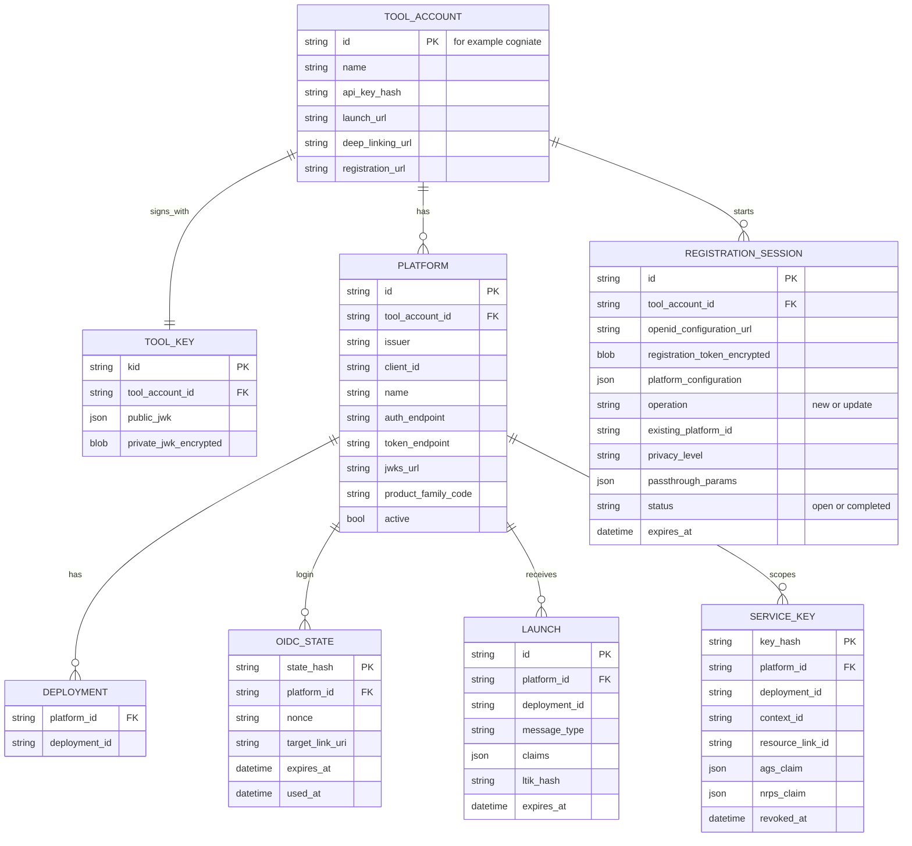
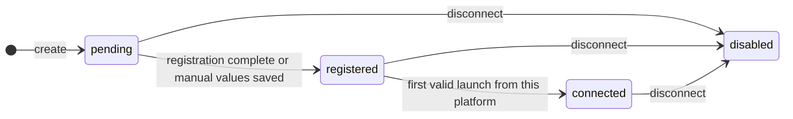
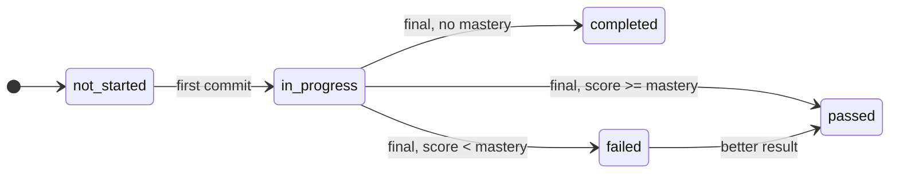
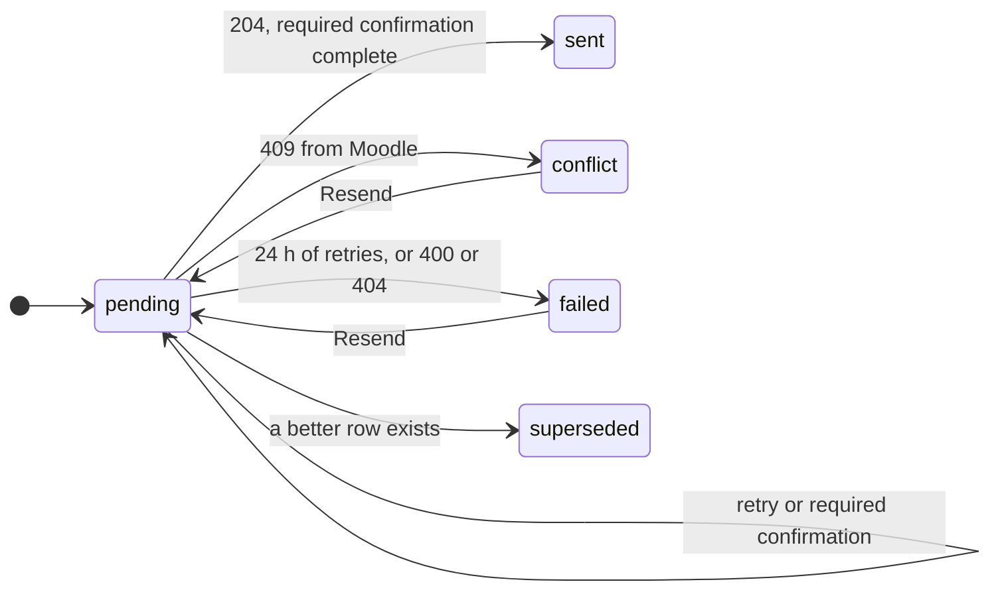

# Data model and state machines

Status: T0 round 2. Storage choice: [ADR-006](adr/ADR-006-storage.md).

Each service has its own SQLite file. Every LTI service row has `tool_account_id` (directly or through its parent). Every Cogniate app row has `library_id` (directly or through its parent). Repository functions take the tenant id as a required argument.

In memory only (lost on restart, no harm): platform access tokens (per platform and scope set), the score timestamp clock (per platform, line item, user), platform JWKS cache.

## 1. LTI service (`lti.db`)



Unique keys:

| Table | Unique key |
| --- | --- |
| `platform` | (`tool_account_id`, `issuer`, `client_id`) |
| `deployment` | (`platform_id`, `deployment_id`) |
| `service_key` | (`platform_id`, `deployment_id`, `context_id`, `resource_link_id`). Later launches return the same key and refresh the claims. |
| `tool_key` | one row per tool account in the prototype (rotation is optional) |

Login and launch URLs carry the tool account (`/lti/login/{toolAccountId}`), so lookups never cross accounts.

## 2. Cogniate app (`cogniate.db`)


Unique keys and rules:

| Table | Rule |
| --- | --- |
| `connection` | `lti_platform_id` unique. A platform belongs to one connection only. |
| `publication` | (`connection_id`, `course_id`) unique |
| `resource_link` | (`connection_id`, `deployment_id`, `context_id`, `resource_link_id`) unique. `publication_id` comes from the **signed** `launch.target`. If a later signed launch names another publication of the same connection (the teacher selected new content for the activity), the row is updated and the event `resource_link_rebound` is logged. |
| `attempt` | One row per (`resource_link_id`, `user_sub`, `course_version_id`). A launch continues the newest attempt if it is `in_progress` **and** its course version belongs to the course of the resource link's current publication. Otherwise it uses the current version of that publication (new row, or the existing row of that version). After a rebind, an old in-progress attempt stays as it is and shows under its own course's publication. |
| `handoff` | Insert fails if the ltik was used before → error page `HANDOFF_USED`. |
| `play_session` | No ltik. Commits use the runtime token. Score sync uses the service key. Stored by `id_hash` only (A-T4b2-03). |
| `picker_session` | Stored by `id_hash` only (A-T4b2-03). The ltik inside is encrypted. |

Score delivery recovery (P2, app contract §10): SQLite must retain in-flight send state, unresolved delivery uncertainty, and any confirmation requirement and due time. Write the in-flight state before the external POST. After restart, an unresolved send is uncertain; an awaited confirmation stays `pending`. The requirement belongs to the learner and activity and passes to a higher result if its row is superseded. A later acknowledged retry does not erase earlier uncertainty. Public status remains one of the existing values; no `sentAt` is set before required confirmation succeeds. Confirmation uses the existing retry window, including its deadline.

### 2.1 Retention (A-T4b2-02)

A cleanup job in each service runs at start and then every 10 min. It deletes rows that can never be used again and logs `retention_cleanup {table, deleted}` (info) when it deletes something.

| Service | Table | Deleted when |
| --- | --- | --- |
| Cogniate app | `handoff` | `expires_at` (= `used_at` + 24 h, the ltik lifetime) is more than 24 h ago |
| Cogniate app | `picker_session` | `expires_at` is more than 24 h ago, except a used pick not yet matched to a launch (kept, because `stats.activities` counts it) |
| Cogniate app | `play_session` | `expires_at` is more than 24 h ago. The session's largest `session_time` is kept on the attempt first (cogniate-app migration 006), so `total_time` is not lost. |
| LTI service | `oidc_state` | `expires_at` is past (10 min life) |
| LTI service | `launch` | the ltik expired more than 24 h ago |
| LTI service | `registration_session` | older than 24 h |

Not deleted in the prototype: attempts, resource links, score syncs, publications, connections, platforms, service keys (they are the record of results).

`tracking_profile` (made at upload, kept per version):

```json
{
  "format": "html",
  "launchPath": "index.html",
  "pages": ["index", "lesson-ai-web-sprint"],
  "menuPage": "index",
  "questionIds": ["01M2M36Y89M9KPPZENF1ZW4AWJ"],
  "masteryScore": 70,
  "minDwellMs": 10000
}
```

## 3. State machines



Connection. The portal shows "Link expired" when `pending` and `ref_expires_at` is past (derived, not stored).



Attempt outcome. The attempt keeps its best outcome. The portal shows the best outcome of the learner on that activity.



Score sync. Retry times: 5 s, 30 s, 2 min, 10 min, 30 min, then every 1 h until 24 h after `created_at` (ADR-010).

Publication: `available` ⇄ `withdrawn`. "Selected in Moodle" and "In use" come from `stats`.
