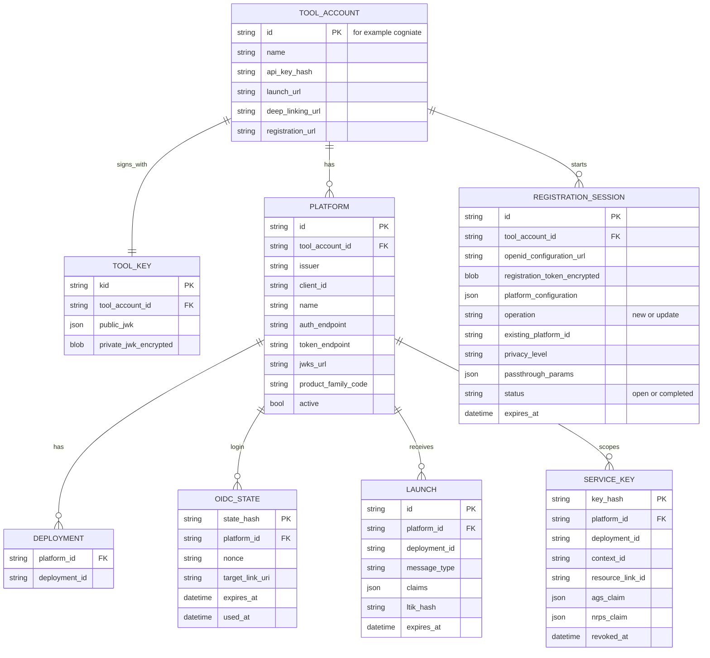
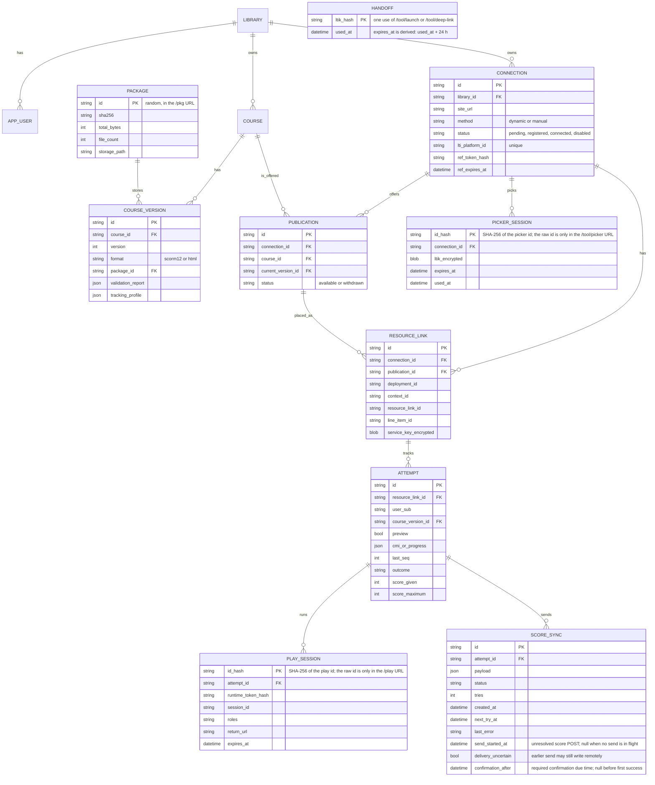
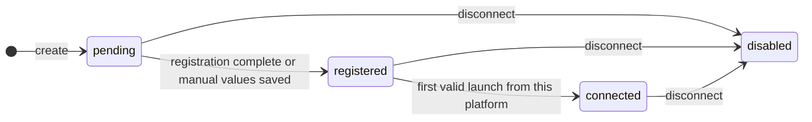
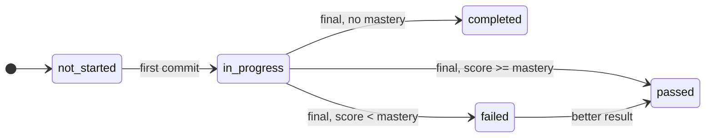
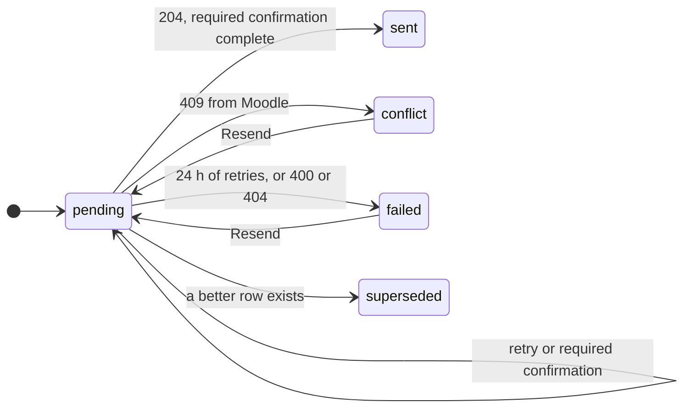
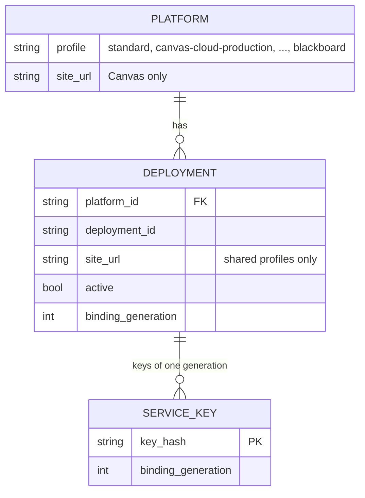
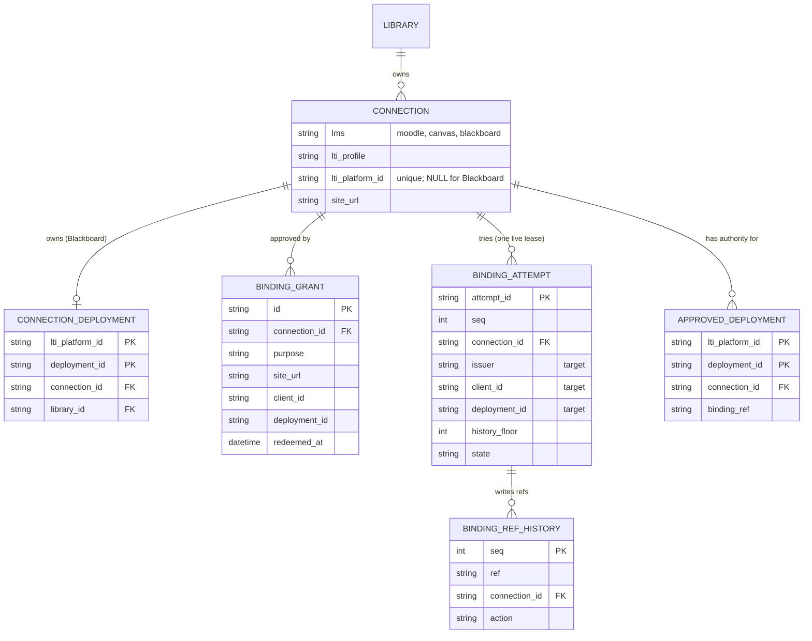

# Data model and state machines

Status: T0 round 2; multi-LMS changes in §4 (M0, 2026-10-20); §4.3 from the accepted B-M1-03 design (M1, [review-response-M1](review-response-M1.md)). Storage choice: [ADR-006](adr/ADR-006-storage.md).

Each service has its own SQLite file. Every LTI service row has `tool_account_id` (directly or through its parent). Every Cogniate app row has `library_id` (directly or through its parent). Repository functions take the tenant id as a required argument.

In memory only (lost on restart, no harm): platform access tokens (per platform and scope set), the score timestamp clock (per platform, line item, user), platform JWKS cache.

## 1. LTI service (`lti.db`)



Unique keys:

| Table | Unique key |
| --- | --- |
| `platform` | (`tool_account_id`, `issuer`, `client_id`) |
| `deployment` | (`platform_id`, `deployment_id`) |
| `service_key` | (`platform_id`, `deployment_id`, `context_id`, `resource_link_id`). Later launches return the same key and refresh the claims. |
| `tool_key` | one row per tool account in the prototype (rotation is optional) |

Login and launch URLs carry the tool account (`/lti/login/{toolAccountId}`), so lookups never cross accounts.

## 2. Cogniate app (`cogniate.db`)



Unique keys and rules:

| Table | Rule |
| --- | --- |
| `connection` | `lti_platform_id` unique. A platform belongs to one connection only. |
| `publication` | (`connection_id`, `course_id`) unique |
| `resource_link` | (`connection_id`, `deployment_id`, `context_id`, `resource_link_id`) unique. `publication_id` comes from the **signed** `launch.target`. If a later signed launch names another publication of the same connection (the teacher selected new content for the activity), the row is updated and the event `resource_link_rebound` is logged. |
| `attempt` | One row per (`resource_link_id`, `user_sub`, `course_version_id`). A launch continues the newest attempt if it is `in_progress` **and** its course version belongs to the course of the resource link's current publication. Otherwise it uses the current version of that publication (new row, or the existing row of that version). After a rebind, an old in-progress attempt stays as it is and shows under its own course's publication. |
| `handoff` | Insert fails if the ltik was used before → error page `HANDOFF_USED`. |
| `play_session` | No ltik. Commits use the runtime token. Score sync uses the service key. Stored by `id_hash` only (A-T4b2-03). |
| `picker_session` | Stored by `id_hash` only (A-T4b2-03). The ltik inside is encrypted. |

Score delivery recovery (P2, app contract §10): SQLite must retain in-flight send state, unresolved delivery uncertainty, and any confirmation requirement and due time. Write the in-flight state before the external POST. After restart, an unresolved send is uncertain; an awaited confirmation stays `pending`. The requirement belongs to the learner and activity and passes to a higher result if its row is superseded. A later acknowledged retry does not erase earlier uncertainty. Public status remains one of the existing values; no `sentAt` is set before required confirmation succeeds. Confirmation uses the existing retry window, including its deadline.

Upgrade boundary: migration `010_score_delivery_confirmation.sql` adds these fields to existing rows with `send_started_at = null`, `delivery_uncertain = 0` and `confirmation_after = null`. It preserves the existing sync history and statuses. Recovery uses markers written after the upgrade; it cannot reconstruct unresolved remote sends made before these fields existed.

### 2.1 Retention (A-T4b2-02)

A cleanup job in each service runs at start and then every 10 min. It deletes rows that can never be used again and logs `retention_cleanup {table, deleted}` (info) when it deletes something.

| Service | Table | Deleted when |
| --- | --- | --- |
| Cogniate app | `handoff` | `expires_at` (= `used_at` + 24 h, the ltik lifetime) is more than 24 h ago |
| Cogniate app | `picker_session` | `expires_at` is more than 24 h ago, except a used pick not yet matched to a launch (kept, because `stats.activities` counts it) |
| Cogniate app | `play_session` | `expires_at` is more than 24 h ago. The session's largest `session_time` is kept on the attempt first (cogniate-app migration 006), so `total_time` is not lost. |
| LTI service | `oidc_state` | `expires_at` is past (10 min life) |
| LTI service | `launch` | the ltik expired more than 24 h ago |
| LTI service | `registration_session` | older than 24 h |

Not deleted in the prototype: attempts, resource links, score syncs, publications, connections, platforms, service keys (they are the record of results).

`tracking_profile` (made at upload, kept per version):

```json
{
  "format": "html",
  "launchPath": "index.html",
  "pages": ["index", "lesson-ai-web-sprint"],
  "menuPage": "index",
  "questionIds": ["01M2M36Y89M9KPPZENF1ZW4AWJ"],
  "masteryScore": 70,
  "minDwellMs": 10000
}
```

## 3. State machines



Connection. The portal shows "Link expired" when `pending` and `ref_expires_at` is past (derived, not stored).



Attempt outcome. The attempt keeps its best outcome. The portal shows the best outcome of the learner on that activity.



Score sync. Retry times: 5 s, 30 s, 2 min, 10 min, 30 min, then every 1 h until 24 h after `created_at` (ADR-010).

Publication: `available` ⇄ `withdrawn`. "Selected in Moodle" and "In use" come from `stats`.

## 4. Multi-LMS changes (M1, ADR-011)

Design: [ADR-011](adr/ADR-011-multi-lms.md). Both migrations are forward only and additive (no table rebuild: the migration runner uses one transaction with foreign keys on). Old rows keep today's behaviour.

### 4.1 LTI service: `004_provider_profiles.sql`

| Table | Change | Default for old rows | Meaning |
| --- | --- | --- | --- |
| `platform` | `profile TEXT NOT NULL DEFAULT 'standard'` | `standard` | provider profile id (ADR-011 §6) |
| `platform` | `site_url TEXT` | `NULL` | Canvas profiles: the school site (page) origin |
| `platform` | `service_url TEXT` | `NULL` | Canvas profiles: the service origin (AGS, NRPS, token endpoint); the same as `site_url` when not sent |
| `deployment` | `site_url TEXT` | `NULL` | shared profiles: the school site origin of this deployment |
| `deployment` | `active INTEGER NOT NULL DEFAULT 1` | `1` | `0` = launches and API calls of this deployment fail |
| `deployment` | `binding_generation INTEGER NOT NULL DEFAULT 0` | `0` | shared profiles: 1 for a create with `active: true` (the default), 0 for a staged create with `active: false`; + 1 at each activation and at each adoption of an active row (LTI contract §9.6). Exclusive platforms and Moodle: always 0. |
| `deployment` | `binding_ref TEXT` | `NULL` | binding ref for conditional changes (LTI contract §9.15); every conditional `PATCH` writes a new value |
| `platform` | `binding_ref TEXT` | `NULL` | binding ref of an exclusive platform (LTI contract §9.15) |
| `deployment` | `created_at INTEGER` | `NULL` | time of `POST …/deployments` |
| `oidc_state` | `login_deployment_id TEXT` | `NULL` | the `lti_deployment_id` of the login request, for check 9 |
| `launch` | `site_origin TEXT` | `NULL` (= issuer origin) | site origin of the launch deployment |
| `launch` | `service_origin TEXT` | `NULL` (= site origin) | service origin of the launch deployment |
| `launch` | `binding_generation INTEGER NOT NULL DEFAULT 0` | `0` | deployment generation at launch time |
| `service_key` | `binding_generation INTEGER NOT NULL DEFAULT 0` | `0` | deployment generation of this key value |



Rules:

| Rule | Detail |
| --- | --- |
| Site origin | `deployment.site_url`, else `platform.site_url`, else the origin of `platform.issuer`. |
| Service origin | `platform.service_url`, else the site origin. |
| Canonical origins | `site_url`, `service_url` and a `canvas-self-hosted` issuer are stored in canonical origin form (ADR-011 §6). |
| Unknown profile | A row whose `profile` is unknown at run time (simulations off) is treated as inactive for login, launch and API calls. |
| Shared platform | At most one platform per (`tool_account_id`, shared profile). The create runs the check and the insert in one transaction. |
| Unique keys | Unchanged: (`tool_account_id`, `issuer`, `client_id`), (`platform_id`, `deployment_id`), service key (`platform_id`, `deployment_id`, `context_id`, `resource_link_id`). A new generation **updates** the service key row (new `key_hash`, new generation); it does not add a row. |
| Key derivation | Generation 0: the HMAC input of today, so every existing key keeps its value. Generation above 0: the generation is part of the input. |
| `PATCH deploymentIds` | Not allowed on a shared platform. On other platforms it is a diff (LTI contract §9.4); kept rows keep `site_url`, `active` and generation. |
| Retention | Unchanged. Deployment rows are never deleted by the cleanup job. |

### 4.2 Cogniate app: `011_lms_types.sql`

| Table | Change | Default for old rows | Meaning |
| --- | --- | --- | --- |
| `connection` | `lms TEXT NOT NULL DEFAULT 'moodle' CHECK (lms IN ('moodle','canvas','blackboard'))` | `moodle` | LMS type |
| `connection` | `lti_profile TEXT NOT NULL DEFAULT 'standard'` | `standard` | LTI service profile id |
| `connection` | `service_url TEXT` | `NULL` (= `site_url`) | Canvas service origin |
| `connection` | `lti_binding_ref TEXT` | `NULL` | Canvas: the activation ref of the committed binding (copy of the approval ref; history) |
| `connection` | `redeeming_attempt TEXT` | `NULL` | connection lease: the attempt that may call the LTI service (app contract §4.7.1) |
| `connection` | `redeeming_since INTEGER` | `NULL` | connection lease start; live for 60 s |
| new `binding_attempt` | see below | — | redemption attempts with their targets |
| new `binding_ref_history` | see below | — | every binding ref that the app wrote, written before its LTI call |
| new `approved_deployment` | see below | — | committed approvals: the only Canvas and Blackboard launch and grade authority |
| `picker_session` | `site_origin TEXT` | `NULL` | `frame-ancestors` and return URL origin of the picker. Code reads `site_origin`, else `issuer_origin` (old rows expire in 1 h). |
| new `connection_deployment` | see below | — | Blackboard deployment reservations |
| new `binding_grant` | see below | — | operator approval grants (app contract §4.7, §4.8) |

```sql
CREATE TABLE connection_deployment (
  lti_platform_id TEXT NOT NULL,                       -- the shared platform (LTI service id)
  deployment_id   TEXT NOT NULL,
  connection_id   TEXT NOT NULL REFERENCES connection (id),
  library_id      TEXT NOT NULL REFERENCES library (id),
  binding_ref     TEXT,                                -- attempt id of the latest redemption of this reservation
  created_at      INTEGER NOT NULL,
  updated_at      INTEGER NOT NULL,
  PRIMARY KEY (lti_platform_id, deployment_id)          -- one owner per school deployment
);
CREATE UNIQUE INDEX connection_deployment_connection ON connection_deployment (connection_id);  -- at most one reservation per connection

CREATE TABLE binding_grant (
  id              TEXT PRIMARY KEY,                     -- grt_...
  code_hash       TEXT NOT NULL UNIQUE,                 -- SHA-256 of the approval code; the code is shown once to the operator
  library_id      TEXT NOT NULL REFERENCES library (id),
  connection_id   TEXT NOT NULL REFERENCES connection (id),
  lms             TEXT NOT NULL,                        -- canvas or blackboard
  lti_profile     TEXT NOT NULL,
  purpose         TEXT NOT NULL CHECK (purpose IN ('initial', 'add_deployment')),
  site_url        TEXT NOT NULL,
  service_url     TEXT NOT NULL,                        -- Canvas service origin; equals site_url for Blackboard
  client_id       TEXT NOT NULL,
  deployment_id   TEXT NOT NULL,
  note            TEXT NOT NULL,                        -- operator evidence reference (never shown in the portal)
  created_at      INTEGER NOT NULL,
  expires_at      INTEGER NOT NULL,
  redeemed_at     INTEGER,
  revoked_at      INTEGER,
  revoked_reason  TEXT CHECK (revoked_reason IN ('operator', 'replaced', 'disconnect', 'suspend'))
);
CREATE INDEX binding_grant_connection ON binding_grant (connection_id, purpose);

CREATE TABLE binding_attempt (
  attempt_id      TEXT PRIMARY KEY,                     -- random
  seq             INTEGER NOT NULL UNIQUE,              -- order of attempts in this database
  connection_id   TEXT NOT NULL REFERENCES connection (id),
  grant_id        TEXT NOT NULL REFERENCES binding_grant (id),
  purpose         TEXT NOT NULL,                        -- initial or add_deployment (copy of the grant)
  lti_profile     TEXT NOT NULL,                        -- target: profile
  issuer          TEXT NOT NULL,                        -- target: canonical issuer, from local data at phase 1 (connection.target_issuer; add_deployment: platform_json issuer)
  client_id       TEXT NOT NULL,                        -- target: client id
  deployment_id   TEXT NOT NULL,                        -- target: deployment id
  lti_platform_id TEXT,                                 -- target platform; set at phase 1 when known (Blackboard, Canvas add_deployment), else by S1 or S2
  history_floor   INTEGER NOT NULL,                     -- highest binding_ref_history.seq at phase 1; refs at or below it are "older"
  state           TEXT NOT NULL CHECK (state IN ('open', 'committed', 'cancelled', 'failed', 'abandoned')),
  started_at      INTEGER NOT NULL,
  ended_at        INTEGER
);
CREATE INDEX binding_attempt_connection ON binding_attempt (connection_id);

CREATE TABLE binding_ref_history (
  seq             INTEGER PRIMARY KEY AUTOINCREMENT,    -- write order
  ref             TEXT NOT NULL UNIQUE,                 -- random, 22 characters [A-Za-z0-9_-]
  connection_id   TEXT NOT NULL REFERENCES connection (id),
  attempt_id      TEXT REFERENCES binding_attempt (attempt_id),  -- NULL for operator and disconnect writes
  grant_id        TEXT REFERENCES binding_grant (id),   -- the attempt's grant, or the grant of a revoke cleanup
  action          TEXT NOT NULL CHECK (action IN ('create', 'activate', 'compensate', 'fence_out', 'revoke_cleanup')),
  lti_platform_id TEXT,                                 -- NULL until known (Canvas initial create)
  deployment_id   TEXT,
  created_at      INTEGER NOT NULL                      -- committed before the LTI call is sent
);
CREATE INDEX binding_ref_history_connection ON binding_ref_history (connection_id);

CREATE TABLE approved_deployment (
  lti_platform_id TEXT NOT NULL,
  deployment_id   TEXT NOT NULL,
  connection_id   TEXT NOT NULL REFERENCES connection (id),
  library_id      TEXT NOT NULL REFERENCES library (id),
  binding_ref     TEXT NOT NULL,                        -- the activation ref that phase 2 committed
  grant_id        TEXT NOT NULL REFERENCES binding_grant (id),
  approved_at     INTEGER NOT NULL,
  PRIMARY KEY (lti_platform_id, deployment_id)           -- one approved owner per remote deployment
);
CREATE INDEX approved_deployment_connection ON approved_deployment (connection_id);
```



| Rule | Detail |
| --- | --- |
| Exclusive platforms | Moodle and Canvas connections keep `lti_platform_id` (unique, unchanged). After `app:binding release` the LTI platform is deleted; the disabled connection keeps `lti_platform_id` and `platform_json` as history (no launch can reach it). |
| Shared platforms | A Blackboard connection has `method = 'manual'` and `lti_platform_id = NULL`. Its platform and deployment are in `connection_deployment`. `platform_json` holds the shared platform view with **only** this connection's deployment id. |
| Reservation | Only phase 1 of a grant redemption (app contract §4.7.1) inserts or moves a row, in the same transaction that takes the connection lease. A connection holds at most one row (unique index); its deployment id is then fixed. A redemption by the same connection reuses its own row (retry). A move is allowed only from a `disabled` connection of the same library. `app:binding release` (§4.9) deletes only the row of the released connection. |
| Approvals | Only phase 2 inserts an `approved_deployment` row, in its commit transaction. If a row of a `disabled` connection exists for the same key (the Blackboard same-library move), phase 2 deletes it in the same transaction. `app:binding release` deletes only the released connection's rows. No other code deletes or changes a row. |
| Launch routing | Canvas and Blackboard: an `approved_deployment` row whose connection is `registered` or `connected`; Moodle: `lti_platform_id` (app contract §6.1). |
| Disconnect and suspend | A Blackboard reservation stays with the disabled connection (the record of who owned the school deployment) until the operator releases it. |
| Binding refs (fence) | The app writes a new random ref for every create, activation, compensation, fence-out and revoke cleanup, and commits its `binding_ref_history` row before it sends the call (write-ahead). Every activation, adoption, switch-off and delete of a Canvas or Blackboard record is conditional on the ref that the app read, and every conditional `PATCH` writes a new ref; the LTI service compares with the current ref and changes in one transaction (LTI contract §9.15). Refs are unique (`ref` is `UNIQUE`) and never reused; this app rule, not the LTI service, makes sure that a delayed app request can never match again. A record is **owned** by connection C when its current ref is in C's history. A ref is **older** for an attempt when its `seq` is at or below the attempt's `history_floor`. Attempt and history rows are never deleted. |
| Connection lease | Phase 1 takes the lease when `connection.redeeming_attempt` is null or `redeeming_since` is 60 s old or more (it then marks the old `open` attempt `abandoned`). Phase 2 needs `redeeming_attempt` = its own id. Only the owning attempt clears the lease. One live attempt per connection, for all grants of the connection. |
| Grants | Phase 1 takes a grant that is not revoked, not redeemed and not expired. Phase 2 needs `revoked_at` and `redeemed_at` null. A grant redeems only for its own `library_id` and `connection_id`. `revoked_reason` tells `replaced` and the other reasons apart. Grants are never deleted (audit record). |
| Tenant scope | Every query of `connection_deployment` and `binding_grant` that serves a portal request includes `library_id`. Only launch routing and the grant redemption read reservations by (`lti_platform_id`, `deployment_id`). |

`resource_link` keeps its unique key (`connection_id`, `deployment_id`, `context_id`, `resource_link_id`). For Canvas and Blackboard the context and resource link ids are unique within the platform deployment, so the key stays correct.

### 4.3 Cogniate app: `012_connection_provider_snapshot.sql`

Accepted B-M1-03 design (proposal D revision 3, app contract §4.7.3). Forward only and additive. No backfill; `011` and its ledger entry are not edited.

| Table | Change | Default for old rows | Meaning |
| --- | --- | --- | --- |
| `connection` | `target_issuer TEXT` | `NULL` | canonical issuer of the provider target: Canvas cloud and sim profile issuer, canonical `site_url` for `canvas-self-hosted`, Blackboard shared issuer |
| `connection` | `target_platform_id TEXT` | `NULL` | Blackboard: the shared platform id at create |
| `connection` | `target_client_id TEXT` | `NULL` | Blackboard: the shared client id at create |

| Rule | Detail |
| --- | --- |
| Writer | Only the `POST /app-api/connections` handler, in the insert transaction, from the one `GET /api/providers` answer that it reads. No `UPDATE`, no request field, no CLI flag; not in the DTO. |
| Moodle | Moodle rows keep `NULL`; Moodle code never reads the fields. |
| Complete | Canvas: `target_issuer` not null. Blackboard: all three not null. A partial row counts as missing. |
| Readers | Phase 1 of an `initial` redemption (check 4a, check 5, the attempt target, the check 7 key), the Blackboard V check, `app:grant issue` (`initial`), `tool-configuration` (Blackboard `client_id`). `add_deployment` and every cleanup command never need them. |
| Old rows | A Canvas or Blackboard row from an `011` build has `NULL` fields; app contract §4.7.3 gives its lifecycle and recovery. |
| Rollback | Unchanged ADR-011 §14 procedure; an older build never starts on a `012` ledger. |
