# Flows

Status: T0 round 2; Canvas and Blackboard flows 6g and 6h, operator containment 6i, added in M0 (2026-10-20; corrected after the formal M0 reviews). Overview: [`README.md`](README.md). Rules behind each step: [`security.md`](security.md). Paths use the tool account `cogniate`. URLs come from the four `PUBLIC_*_URL` values ([`local-stack.md`](local-stack.md)).

## 6a. Connect a Moodle site

### 6a-1. Dynamic registration (default)

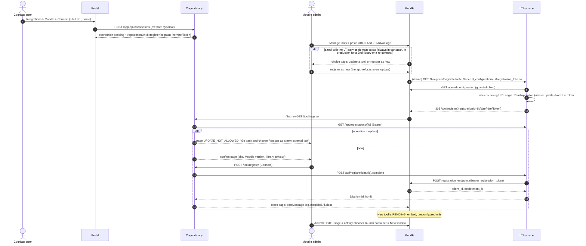

- The `ref` token binds the Moodle registration to one connection. The confirm page needs no Cogniate cookie (it runs in a cross-site iframe).
- Moodle fixes `launchcontainer=3` (embed) and `coursevisible=1` for a dynamic registration, also for an update. So the admin always does the two edits after it. Until then, launches are embedded and get the embed notice page (6c, step 8).
- The tool name in Moodle is `Cogniate (<library name>)`, ASCII only.
- Moodle shows the choice page whenever a tool with the same domain exists. In our stack the seeded tool "Cogniate (seed)" has that domain, so every dynamic registration sees it. In production, the first library on a site does not see it, but a second library or a re-connect does. The admin chooses "register as new"; the app refuses every update (security §2.5).

### 6a-2. Manual registration (DataCamp model)

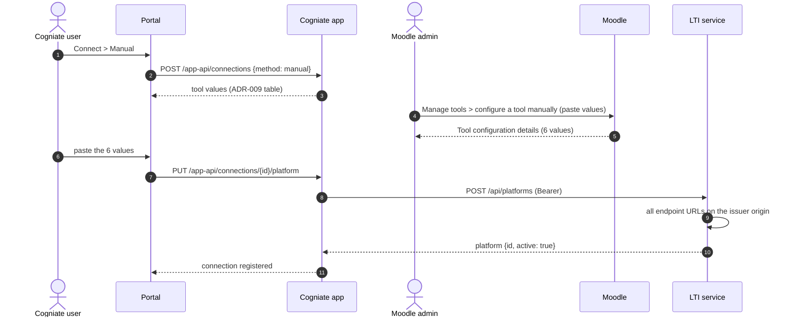

## 6b. Teacher adds a course with Deep Linking

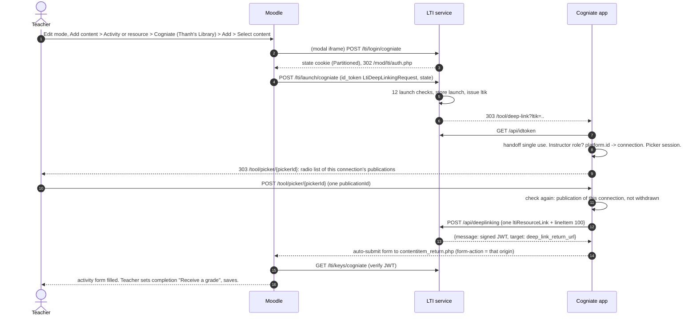

Content item (the app sends exactly this; the LTI service adds no field):

```json
{
  "type": "ltiResourceLink",
  "title": "Build Your First Website with AI: The Zero-to-Hero Micro-Sprint",
  "url": "https://lti.cogniate.test/lti/launch/cogniate?resource=pub_8Jk2",
  "lineItem": { "scoreMaximum": 100, "label": "Build Your First Website with AI", "resourceId": "pub_8Jk2", "tag": "cogniate-score" }
}
```

- The picker is always single select. If Moodle gets more than one item, it hides the activity form, and the teacher cannot set completion (Moodle `contentitem.js`).
- Moodle 4.3+ ignores the `window` and `iframe` hints. The launch container comes from the tool settings.

## 6c. Learner launch → SCORM 1.2 → AGS

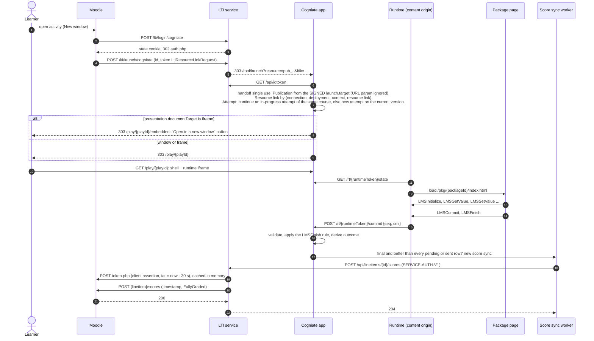

What the Cogniate SCORM package does (vendored `scorm-api.js`, read in full):

| Step | cmi element | When |
| --- | --- | --- |
| Probe | reads `cmi.core.lesson_status` before `LMSInitialize` | Every page. Expects error `301` if no session is open. |
| Start | `cmi.core.lesson_status = incomplete` | First visit, if empty, `not attempted` or `unknown` |
| Location | `cmi.core.lesson_location = <pageKey>` | Every page and when a page is seen |
| Progress | `cmi.suspend_data = v:2;q:f5f1e28b;p:index,...;a:1` (max 4000 chars) | When a page is seen or a question is answered |
| Answer | `cmi.interactions.0.*` | First answer per question. Later answers are ignored. |
| Score | `cmi.core.score.raw = round(correct/total*100)`, `min=0`, `max=100` | On every answer and at completion |
| Time | `cmi.core.session_time = HHHH:MM:SS.SS` | On load, on commit, on unload |
| Exit | `cmi.core.exit = suspend` or `""` | On unload |
| End | `cmi.core.lesson_status = passed / failed` (mastery 70), then `LMSFinish` | All pages seen and all questions answered. Also at once on a later load of a finished course. |

A page is seen after 10 s of visible time and a scroll to the end. The menu page (`index`) is seen on visit. The course has 2 pages and 1 question: correct answer = `passed` 100, wrong answer = `failed` 0.

## 6d. Learner launch → HTML course → AGS

The HTML export has no SCORM API and no completion event. Its only native signal is `localStorage.lessonProgress` (scroll percent). That signal has no quiz result and is browser-local, so we do not use it. The HTML runtime applies the same rule as the SCORM package from the outside (ADR-004).

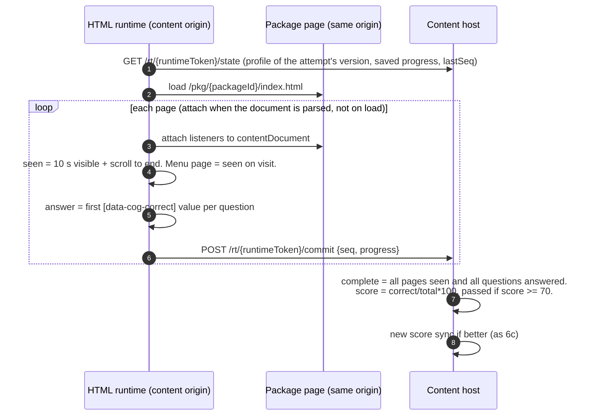

## 6e. Publish to Moodle

"Publish" makes a course version visible in the content picker of one connection. It does not copy anything into Moodle.

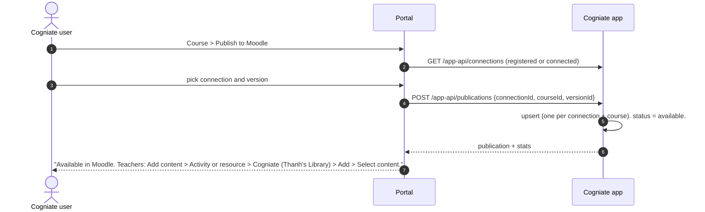

The portal shows "Selected in Moodle" when `stats.activities > 0` (a pick counts even if the teacher then cancels the activity form; Moodle does not tell us) and "In use" when `stats.learners > 0`. "Withdraw" hides the course from the picker. Existing activities then show "This course is no longer available". An empty Moodle course through web services (course shell) is stretch (T8).

## 6f. Native channel (stretch, T8)

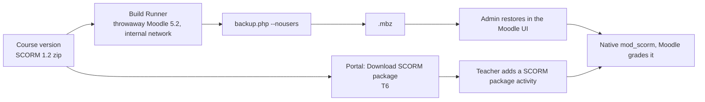

## 6g. Canvas (M1, ADR-011)

### 6g-1. Connect (developer key, operator approval)

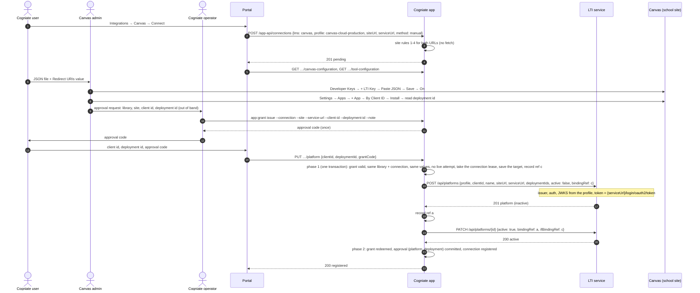

### 6g-2. Teacher selects content (assignment_selection)

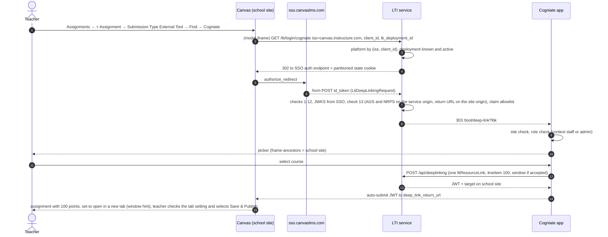

### 6g-3. Learner launch and grade

Same as 6c and 6d after the launch. Differences: Canvas always sends `documentTarget = iframe`, so the launch goes to `/play/{playId}/embedded`; for a Canvas connection that page continues to the player at once when it is top-level (new tab), and shows "Open in a new window" inside a frame. The LTI service gets the access token from `{serviceUrl}/login/oauth2/token` and sends the score to the AGS URL on the service origin.

### 6g-4. Add a second deployment

The Canvas admin installs the same key in a sub-account and gets a second deployment id. A launch from it fails with `UNKNOWN_DEPLOYMENT`. The operator issues a grant with `--purpose add_deployment`; the user enters the deployment id and the approval code (`POST …/deployments`); the app redeems the grant: it creates the deployment inactive on the connection's platform, activates it with a conditional call, and commits an approval for it. Until that approval commits, a launch from the new deployment gets `UNKNOWN_PLATFORM` (`deployment_not_approved`), and the first deployment keeps working.

## 6h. Blackboard (M1, ADR-011)

### 6h-1. Operator setup (once per LTI service host)

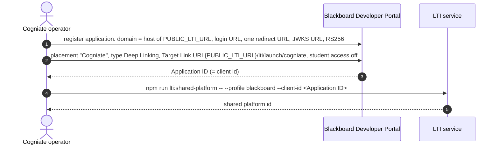

### 6h-2. Connect one school (operator approval)

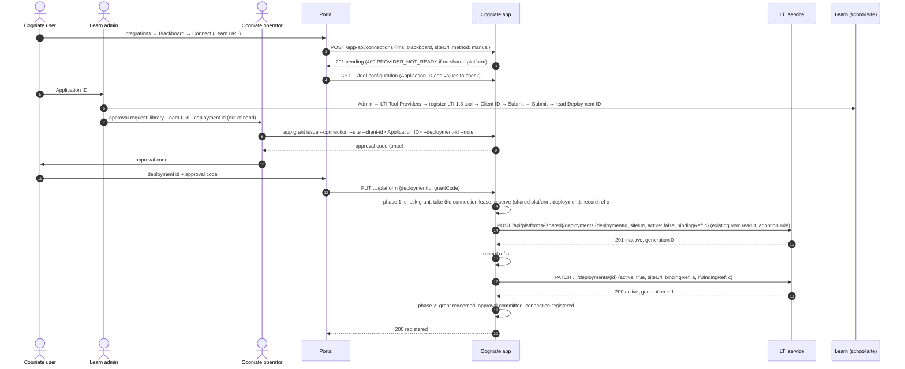

### 6h-3. Teacher Deep Linking and learner launch

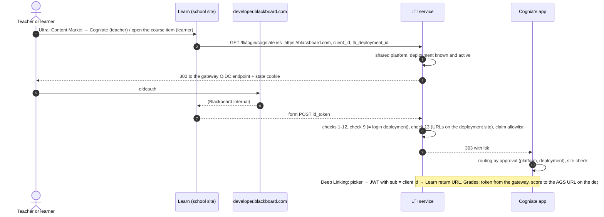

## 6i. Operator containment and recovery (M1, ADR-011 §4b)

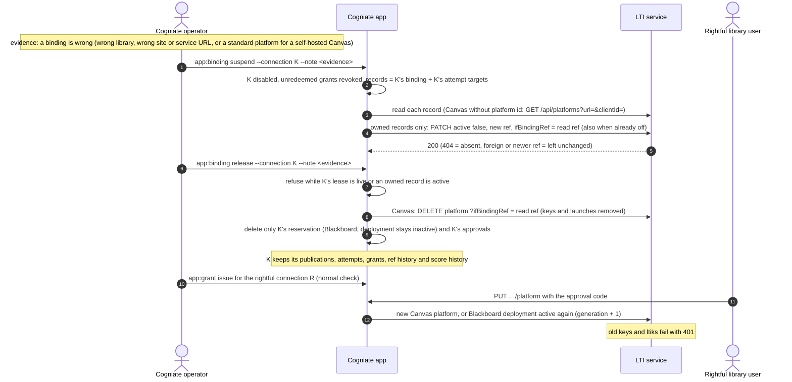
