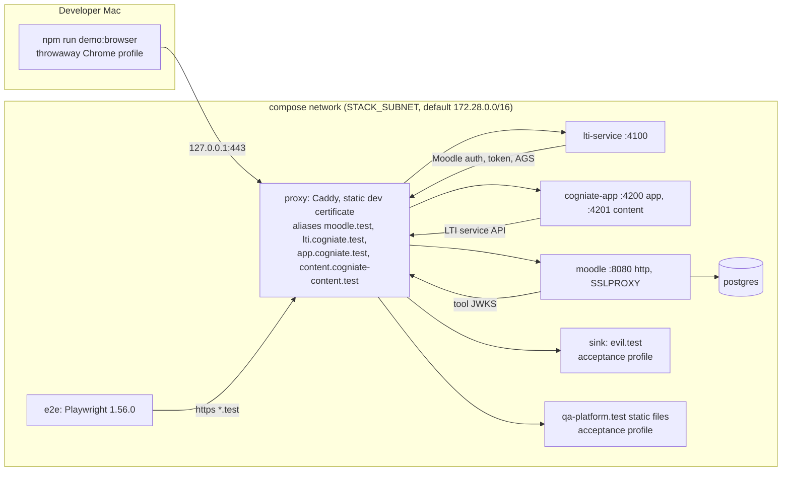

# Local stack

Status: T0 round 2. Decision: [ADR-005](adr/ADR-005-local-topology-tls-cookies.md). Commands: `infra/README.md` (owned by the Author). The goal: the browser sees the same sites, TLS and cookie rules as production. There is no "dev mode" that turns off a check.

## 1. Topology

## 2. Names and URLs

Code and tests read the four values. No URL literal is allowed in code.

| Variable (`.env`) | Default | Upstream | Production analog | Site |
| --- | --- | --- | --- | --- |
| `PUBLIC_MOODLE_URL` | `https://moodle.test` | `moodle:8080` | `school.moodlecloud.com` | `moodle.test` |
| `PUBLIC_LTI_URL` | `https://lti.cogniate.test` | `lti-service:4100` | `lti.cogniate.ai` | `cogniate.test` |
| `PUBLIC_APP_URL` | `https://app.cogniate.test` | `cogniate-app:4200` | `dev-portal.cogniate.ai` | `cogniate.test` |
| `PUBLIC_CONTENT_URL` | `https://content.cogniate-content.test` | `cogniate-app:4201` | a separate content domain (Q10) | `cogniate-content.test` |

Site check: `moodle.test` and `cogniate.test` are different sites. So the stack exercises the cross-site POST from `auth.php`, the cross-site deep-linking return, and `SameSite=None` on the state cookie. The spike layout (`localhost:8080` and `localhost:3000`) is same-site and hides these paths (spike §7).

| Item | Rule |
| --- | --- |
| Content host | The proxy removes the `Cookie` request header on `PUBLIC_CONTENT_URL` (security §7). |
| Ports | Only the proxy publishes `127.0.0.1:${PUBLIC_PORT:-443}`. If `PUBLIC_PORT` is not 443, every URL gets `:PORT`, and seed adds the port to Moodle `curlsecurityallowedport`. |
| DNS | Docker network aliases on the proxy. We do not use `*.localhost`: Chromium and musl map it to loopback (spike §6). |
| TLS | `gen-env` makes a dev CA (Name Constraints `permitted DNS:test`, life ≤ 1 year) and one leaf certificate (SAN = the four names) with `openssl`, **before** any container starts. Files in `infra/.certs/` (git-ignored). `stack:reset` keeps them. Caddy loads the static leaf (no `tls internal`). |
| Trust | Moodle: `$CFG->dataroot/moodleorgca.crt` = Alpine CA bundle + root (Moodle reads it first). Node: `NODE_EXTRA_CA_CERTS`. e2e Chromium: NSS database. Human: `npm run demo:browser` (accepts only our leaf) or a manual keychain trust. |
| Moodle | `SITE_URL = PUBLIC_MOODLE_URL`, `SSLPROXY=true`. So `MoodleSession` is `Secure`. |
| Moodle dev-only | `curlsecurityblockedhosts` = the Moodle default list with only `STACK_SUBNET` cut out (`172.16.0.0/12` is split around it; every other default entry stays). `curlsecurityallowedport` = `443` only (plus `PUBLIC_PORT` if it is not 443; port 80 is removed). Inside the subnet only the proxy listens on 443, so Moodle can reach only the proxy. `noemailever=1`. MoodleCloud does not need these: production tool URLs are public https on 443. |
| Node | `node:24-alpine` containers, repo mounted, `node --watch`. Unit tests run on the host. |
| State | All state is in the checkout: `.env`, `infra/.certs/`, `infra/.secrets/` (incl. `seed.json`), `infra/.logs/`, `infra/.data/`, `.tmp/`. Plus Docker volumes named after `COMPOSE_PROJECT_NAME`: Moodle `pgdata` and `moodledata`, and (ADR-012) the SQLite volumes `ltidb` and `appdb`. |
| SQLite storage (ADR-012) | `lti.db` and `cogniate.db` with their `-wal` and `-shm` files live only in the volumes `<project>_ltidb` and `<project>_appdb`. Course packages and uploads stay in `infra/.data/cogniate-app/{packages,uploads}` (nested binds; the host-side scripts create them with mode `0700`). Every guarded path (`stack:up`, `stack:restart`, `stack:reset`, `stack:data-*`, `stack:storage-compat`; `test:acceptance`, `test:e2e` and `e2e:reset` only inside each internal `stack-up.sh` or `stack-reset.sh` run, so host-control restarts during a suite do not wait on it) takes the operation lock `.tmp/storage-op.<project>.lock/` (one checkout per project; the lock also waits for a live storage container of the project) and then runs a fresh storage preflight: narrow root-folder and mountpoint preparation, a two-process WAL lock check with a live holder and a positive release, and the ordered start-state table (ADR-012 §6, §7). A failure stops the start; a failed `stack:restart` preflight keeps the running container. Legacy database files in `infra/.data/<service>/` are never used automatically: `stack:up` refuses and names `stack:data-import`. A `docker compose` command typed by hand and Docker's own restart after a VM boot do not run the preflight. Read a database only through the maintenance container or the QA fixture container (ADR-012 §11). |
| Lane and cleanup (ADR-012 §15) | The SQLite volumes belong to the compose project name. A fresh QA lane must have no `<lane>_ltidb` and no `<lane>_appdb` before its first start and after its cleanup. `stack:reset` removes both volumes and the bind data of this project. `stack:down` keeps them. `docker volume prune` without `--all` removes only unused anonymous volumes; `docker volume prune --all` also removes unused named volumes, so these databases and the Moodle volumes. `docker system prune --volumes` removes anonymous volumes only. A Docker Desktop purge removes every volume. `stack:reset` is never a recovery step; the non-destructive exit is `stack:data-quarantine` (ADR-012 §9). |
| Second stack | `COMPOSE_PROJECT_NAME`, `PUBLIC_PORT`, `STACK_SUBNET` let QA run a clean clone next to the Author's stack (charter §3a). |

## 3. Profiles

| Profile | Adds | Used by |
| --- | --- | --- |
| default | proxy, postgres, moodle, lti-service, cogniate-app | everything, T7 |
| `test` | `e2e` container | `test:acceptance`, `test:e2e` |
| `acceptance` (from T2b; start: `STACK_PROFILE=acceptance npm run stack:up`) | `sink` (alias `evil.test`): answers 200 to every request and logs `sink_hit {host, method, path}` to `infra/.logs/sink.jsonl`. `qa-platform.test`: `https://qa-platform.test/<path>` serves `tests/fixtures/qa-platform/<path>` (`.json` as `application/json`), and logs `qa_platform_hit {method, path}` to `infra/.logs/qa-platform.jsonl`. QA writes its JWKS there at run time and git-ignores the generated files (no test private key in git). Both names get a second leaf certificate (`infra/.certs/qa.crt`, SAN `evil.test`, `qa-platform.test`, signed by the same dev CA), so the T1 leaf does not change. Both names are added to `OUTBOUND_PRIVATE_HOST_ALLOWLIST` of both services in this profile only. `/healthz` and `service_started` show `"profile": "acceptance"` and the active allowlist. | T2b to T5b acceptance runs |
| `compat` (T3c; started only by `npm run test:compat`) | `compat` container: Python 3.12 with the pinned MIT `ltiaas` 0.0.4 SDK (test-only black box, ADR-003). It mounts QA's `tests/compat` read-only, the root CA and the `cogniate` API key file, and calls `PUBLIC_LTI_URL`. | AC-T3-27 |

`npm run test:acceptance -- <args>` does these steps: (1) `STACK_PROFILE=acceptance npm run stack:up` (only the changed services restart); (2) run the QA suite in `e2e` with `<args>` and the caller's `QA_*` env (H14); (3) `npm run stack:up` without `STACK_PROFILE` to restore the default, also when the suite fails. If a run is killed between (1) and (3), the profile stays on: `/healthz` shows `"profile": "acceptance"`, and step (3) by hand restores the default.

T7 runs with `"profile": "default"` and no test knobs (AC-T7-13).

## 4. Fallbacks

The Author does not choose a fallback alone. The Lead decides at the time-box.

| # | When | Change | ACs |
| --- | --- | --- | --- |
| F1 | Caddy cannot load the static certificate | Small Node TLS proxy with the same `infra/.certs/` files, names and ports | none change |
| F2 | Moodle does not work behind the proxy with `SSLPROXY` | Moodle on `http://moodle.test` through the proxy. Record the Chrome "insecure form" risk on the deep-linking return. | AC-T1-07 (cookie not `Secure`). Deep-linking ACs may fail: Lead decides. |
| F3 | HTTPS costs more than the time-box (needs a Lead decision) | Spike layout: http, `localhost`, Node and Playwright in Moodle's network namespace | See the table below. Human-review item: "cross-site cookie path not tested". |

ACs that change or become N/A under F3:

| AC | Under F3 |
| --- | --- |
| AC-T1-03, LC-T1-01, AC-T1-13 | N/A (no TLS) |
| AC-T1-07 | N/A (`MoodleSession` without `Secure`) |
| AC-T2-08 | Cookie without `__Host-`, `Secure`, `SameSite=None`, `Partitioned` (not allowed on http) |
| AC-T4-01 | Cookie without `__Host-` and `Secure` |
| AC-T5-01, AC-T5-03 | Origins `http://localhost:4201` and `http://localhost:4200` |
| AC-T5-17 | App and content are the same site: the cookie-isolation claim (security §1) is not tested |
| AC-T7-07 | Final URL `http://localhost:4200/play/...` |

## 5. Facts from the Author spike that this design uses

Source: `infra/moodle/SPIKE-NOTES.md`.

| Fact (spike section) | Design consequence |
| --- | --- |
| Moodle 5.2.4 ready in about 31 s. CLI at `/var/www/html/admin/cli`. (§1, §2) | Provisioning uses CLI PHP. Reset is cheap. |
| Issuer = wwwroot. Deployment id = tool type id. Login sends `client_id` and `lti_deployment_id`. (§5a, §5d) | Login checks `iss` + `client_id` + deployment. |
| `id_token` `exp = iat + 60 s`. (§5d) | 60 s skew. Validate at once. |
| Dynamic registration: new tool PENDING, embed, preconfigured only; choice page if the domain exists. (§5b) | Wizard shows Activate + edit. The service and app handle "update". |
| `lti_add_type` from CLI works. (§5a) | T2a dev seed without UI. |
| AGS score → gradebook 80/100. NRPS without name or email. (§5d) | ADR-010 mapping. Privacy default works. |
| Moodle curl blocks private IPs and allows ports 80/443. (§6) | Dev-only change: only `STACK_SUBNET` is cut out of the block list, only port 443 allowed. Production needs public https on 443. |
| `MoodleSession` is `SameSite=Lax`, fixed in code; `auth.php` re-posts. (§7) | Our cookies handle only our side. |
| Native SCORM upload and `.mbz` backup work; restore elsewhere not verified. (§8) | Native channel stays stretch. |

## 6. Helper commands for a human run (T9)

These two commands help a person who runs the stack by hand (T9 guides). Both change nothing.

| Command | What it does |
| --- | --- |
| `npm run stack:doctor` | Checks the computer and the stack. One line per check: `OK`, `FIX` (the exact fix is on the next line) or `INFO`. Exit `1` if one check needs a fix. Checks: Docker runs and has 6 GB memory or more; Node.js 24.11 or later; npm packages installed; `.env` present and its URLs match `PUBLIC_PORT`; certificates present, valid for 14 days or more and naming the four hosts; `PUBLIC_PORT` free or used by this stack's proxy; `STACK_SUBNET` not used by another Docker network; base images and the Build Runner image present; both course zips present. When the stack runs: each service healthy, Build Runner running, no test knobs, profile `default`, stack seeded. Last: whether the stack names resolve on this computer (else it tells you to use `npm run demo:browser`). |
| `npm run demo:users` | Prints the four public URLs, the Moodle users (`admin`, `cg_teacher`, `cg_student`, `cg_student2`), the courses `COGNIATE-DEV-101` and `COGNIATE-DEV-102`, the portal users (`thanh@cogniate.test`, `qa-b@cogniate.test`) and, for each user, the `.env` variable that holds the password. It never prints a password (they are in `.env` and `infra/.secrets/seed.json`). When the stack runs, it also lists the Cogniate activities in Moodle with their links. |

Logs for a human run: `infra/.logs/<service>.jsonl` (`lti-service`, `cogniate-app`, `cogniate-content`, and `build-runner` for T8).
