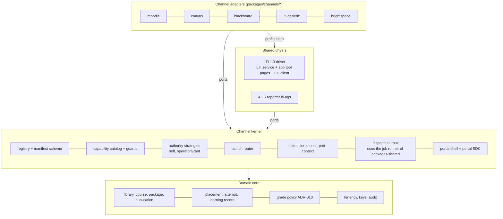

# LA target architecture: LTI as a Service v1

Status: v1.2 for G-DESIGN round 2 (A1, milestone LA P2, 2026-10-22; v1.2 = fix round 1 after the G-DESIGN round 1 reviews; response: [review-response-R1-A1](review-response-R1-A1.md)). Owner: Architect A1 (overall consistency). Plan: [plan v1.2](../../team/ltiaas/plan.md). Terms: [terms](terms.md). Base architecture: [`../README.md`](../README.md) (M1 state); its terms stay valid.

## 1. Goal

Make the Cogniate LTI service a multi-LMS "LTI as a service" with a channel-adapter architecture (plan §1):

- A new LTI LMS is **one channel folder** plus, for QA, one simulator module. It changes **zero core files**.
- Moodle, Canvas and Blackboard move into the model with **no behaviour change**.
- `lti-generic` (any kind A LTI 1.3 platform) and `brightspace` (D2L Brightspace) prove the model.
- The service gets the pilot controls of E5 (A2).
- The backlog milestones LB–LG get named ports, not designs.

## 2. Context


The trust model of the M1 architecture stays: only the LTI service speaks LTI 1.3 to an LMS; the app uses the LTIAAS-shaped API (`../README.md` §3).

## 3. Layers



| Layer | Contains | May use | Must not |
| --- | --- | --- | --- |
| Domain core | library, course, course version, package, publication, placement, attempt, learning record, the grade policy (`packages/tracking`), tenancy, keys, audit | `packages/shared` | name a channel; know LTI message details (a review rule in LA) |
| Channel kernel | registry, manifest schema, capability catalog and guards, authority strategies, launch router, extension mount, dispatch outbox, job runner, portal shell ([LA-ADR-01](adr/LA-ADR-01-channel-kernel.md), [LA-ADR-03](adr/LA-ADR-03-learning-record-core.md)) | core | name a channel; import a channel folder by path |
| Shared drivers | the LTI 1.3 driver (LTI service; app `tool-pages/`, `clients/lti-client.ts`, `domain/launch.ts`); the `lti-ags` reporter | kernel ports, core | branch on a channel id or a profile id |
| Channel adapters | manifests, LTI profiles, setup adapters, extension code, portal modules ([LA-ADR-01 D1](adr/LA-ADR-01-channel-kernel.md#decision)) | kernel types, `@cogniate/shared`, the portal UI kit | import another channel; import app `domain/**` |

Two words (Reviewer-B B-LAD-12): **domain core** is the layer above. **Core** (terms §1) is every line of product code outside the channel folders: the domain core, the kernel and the drivers together. The rules N1–N9 and the checks F1–F5 use "core" in that wide sense. The other layer rules of this table are review rules in LA. The job runner is in `packages/shared`; the dispatch outbox that uses it is in the app kernel (Reviewer-B B-LAD-18).

## 4. Rules that keep core channel-neutral

| # | Rule | Check |
| --- | --- | --- |
| N1 | Core code has no channel id, no LMS product name and no LMS-named identifier in code tokens ([LA-ADR-01 D10](adr/LA-ADR-01-channel-kernel.md#decision)). | F1 |
| N2 | Core finds channel behaviour only through the registry, capabilities and profile traits. | F1, F3 |
| N3 | No file lists channel ids. Each deployable finds channel folders by discovery ([LA-ADR-01 D4](adr/LA-ADR-01-channel-kernel.md#decision)). | F2 |
| N4 | Core never imports a channel folder by path; a channel folder never imports another one. | F3 |
| N5 | A new kind of feature is a new capability in the kernel catalog (an ADR revision), never a channel branch. | review |
| N6 | Frozen wire names that contain an LMS word live only in `packages/channel-kernel/src/legacy-wire.ts` ([LA-ADR-04 D2](adr/LA-ADR-04-refactor-and-migration.md#decision)). | F1 exception |
| N7 | Core SQL never reads the frozen `connection.lms` column; after `014`, no product SQL reads or writes `score_sync` ([LA-ADR-04 D4](adr/LA-ADR-04-refactor-and-migration.md#decision), [LA-ADR-03 D4](adr/LA-ADR-03-learning-record-core.md#decision)). | F5 |
| N8 | A channel chooses its binding authority only from the kernel strategies, under A2's rules ([LA-ADR-07 D2](adr/LA-ADR-07-security-and-tenancy.md)); registry load checks 6 and 8 enforce the shared-platform rule, the manual rule (`MANUAL_SELF_LEGACY_CHANNELS`) and the guard levels (`LAUNCH_GUARD_CHANNELS`). | registry load check |
| N9 | A `self` binding keeps the token endpoint, the JWKS URL, the authentication and registration endpoints and the client assertion `aud` on the issuer origin (I-SELF). Any value off the issuer origin needs an operator grant ([LA-ADR-02 D2a](adr/LA-ADR-02-generic-lti-channel.md#decision); Reviewer-A A-LAD-01). | K1 negative case; Author unit test |

**Scope (the authoritative list; QA strategy §3.1 reads it).** One machine-readable copy lives in `packages/channel-kernel/fitness-scope.json`; E1 step S2 creates it together with F1 and F3 (QA Q-LAD-18). If this table and the QA table differ, this table wins.

| Class | Paths |
| --- | --- |
| Channel folders (not core) | `packages/channels/<id>/**` |
| Core | all other product code: `services/*/src/**`, `packages/*/src/**` (also `packages/channel-kernel/src/**`), `apps/*/src/**` |
| Allowed exceptions inside core (closed list) | `packages/channel-kernel/src/legacy-wire.ts`; applied SQL migrations (history, ADR-006); `packages/shared/src/config.ts` for the dev-stack Moodle URL only, until E1 S3 makes it optional |
| Shared build files (core for F2) | root `package.json`, `package-lock.json`, `tsconfig*.json`, `eslint.config.js`, `vitest.config.ts`, `infra/**` except files that the simulator host manifest generates |
| Not core | `tests/**`, `docs/**` |

**Checks (all in `npm run check` except F2; QA designs the probes: [`tests/ltiaas/TEST-STRATEGY.md`](../../../tests/ltiaas/TEST-STRATEGY.md) §3).**

| Id | Check | Mechanism (Author choice inside the rule) | Pass |
| --- | --- | --- | --- |
| F1 | LMS-name lint over core code tokens. Banned words: every channel id (from the folder names), the names of every named channel (manifest `names`), and a fixed vendor list (`moodle`, `canvas`, `instructure`, `blackboard`, `brightspace`, `d2l`, `desire2learn`, `schoology`, `sakai`, `totara`). Comments are not checked. Token exceptions: the HTML `canvas` element and the Canvas Web API names. | a Node script with the TypeScript compiler API, or ESLint `no-restricted-syntax`; a checked-in per-file ratchet; a check-one-text mode for QA probes | installed in step S2 with today's per-file counts as the ratchet baseline (R3 §2.1: 214 code lines in 60 files); every core count 0 at E1 done (step S9) ([LA-ADR-04 D1](adr/LA-ADR-04-refactor-and-migration.md#decision)) |
| F2 | Add-channel gate: `git diff --name-status --no-renames` of an add-channel branch against its base; a path in core, a shared build file or another channel folder fails | `npm run fitness:channel-diff -- --base <sha> --channel <id>` | `core` = 0 on the E2-N diff against the E2-K-done SHA ([LA-ADR-02 D8](adr/LA-ADR-02-generic-lti-channel.md#decision)) |
| F3 | Dependency direction: the import table of [LA-ADR-01 D1](adr/LA-ADR-01-channel-kernel.md#decision) | ESLint `no-restricted-imports` per glob (as the content-host fence) | 0 errors, from step S2 |
| F4 | Canary channel: a test-only channel folder under `tests/**` that K0 passes to `loadChannelFolders` as a second root (a function argument only, [LA-ADR-01 D4](adr/LA-ADR-01-channel-kernel.md#decision)) | QA K0 | the canary passes K0 with no core edit |
| F5 | Frozen-data rules N7; channel SQL names only the tables and columns of its manifest `storage` list (LA-ADR-01 D5); A2's rules (no `'/lti/launch/'` literal outside the account resolver; no `DELETE FROM audit_event` outside its job); the SQL portability lint for new SQL. Each rule starts with the step that makes it true ([LA-ADR-04 D1](adr/LA-ADR-04-refactor-and-migration.md#decision); QA Q-LAD-18) | the F1 script family | 0 hits from the start step of each rule |

### 4a. Local CI script (F7.6)

There is no CI service in the repo. One script runs the release checks on a clean clone (QA pre-review Q-LAD-09; tools from QA's proposal).

| Item | Design |
| --- | --- |
| Command | `npm run ci:local` (script `infra/scripts/ci-local.sh`), from the root of a clean clone |
| Steps, in order | 1. `npm ci --ignore-scripts` at the root, then in `tests/` (its own lock file). 2. `npm run check` (lint, typecheck, unit and infra tests, the fitness checks F1, F3 and F5). 3. `npm audit --omit=dev --audit-level=high`. 4. `npm sbom --sbom-format cyclonedx --omit dev` into `.tmp/ci/sbom.cdx.json`. 5. A secret scan of every tracked file (`git ls-files`) with a fixed pattern list in the script: private key blocks, `ltis_` API keys, 64-hex master keys, and a non-empty value after a key name of `.env.example`. A reviewed allow list in the script names each known non-secret hit by file, for example the private-key search pattern in `tests/acceptance/M1/common/99-logs.test.ts`; the clean tree must pass with it. |
| Network | Steps 1 and 3 read the npm registry. No other step uses the network. If the registry cannot be reached, the script prints `network_unavailable` and exits 2. A network failure is never a pass. |
| Result | Exit 0 only when every step passes; exit 1 when a check fails; exit 2 when the network is unavailable. One output line per step: name, result, seconds. A secret finding names the file and line, never the value. |
| Acceptance (per step; QA Q-LAD-21) | On a clean clone, steps 1, 2, 4 and 5 pass. Step 3 passes, or fails with the advisory ids in its output line: a step 3 failure is a dependency finding, not a script defect. The fixed negative control: a planted `ltis_` key in a temporary tracked copy of a file makes step 5 fail with exit 1, and the output names that file and line. |
| Not in LA | A hosted CI service, image signing, digest pins of base images (LG; R4 SC-2). |

## 5. Module and package layout after LA

```text
packages/
  channel-kernel/            NEW workspace. Manifest types and schema, capability catalog, registry builder,
                             text fill, legacy-wire.ts (frozen names), fitness-scope.json. Pure, no I/O.
  channels/                  NEW, not a workspace; one folder per channel (LA-ADR-01 D1)
    moodle/                  manifest.ts, lti-profiles.ts (standard), app.ts (six-value setup),
                             app/ (web-services token, course shell, .mbz exporter), portal/, README.md
    canvas/                  manifest.ts, lti-profiles.ts (5 profiles), app.ts (developer key JSON route), portal/, README.md
    blackboard/              manifest.ts, lti-profiles.ts (2 profiles), app.ts, portal/, README.md
    lti-generic/             E2: manifest.ts, lti-profiles.ts, README.md (no app.ts and no portal module:
                             the kernel admin-value setup adapter and the manifest wizard serve it)
    brightspace/             E2: manifest.ts, lti-profiles.ts, README.md (the same; field defaults in the manifest)
    tsconfig.node.json, tsconfig.portal.json   the channel build model (LA-ADR-01 D1), made once in S2
  shared/                    + jobs (job runner, LA-ADR-03 D7); + key provider (A2, LA-ADR-06 D6)
  tracking/                  neutral outcome → status rules; the HTTP mapping moves to the AGS reporter
  package-inspector/         unchanged
services/
  lti-service/src/           the LTI 1.3 driver. profiles/index.ts builds the profile registry from the channel folders.
                             A2: operator listener, rate limits, audit, key lifecycle.
  cogniate-app/src/
    kernel/                  NEW: ports.ts, registry, capabilities and guards, authority/ (self, operatorGrant),
                             launch router, extension mount, records/ (outbox, learning records)
    drivers/lti-ags/         NEW: the AGS record reporter (line item, score POST, read-back)
    providers/               REMOVED: the three adapters move into their channel folders
    app/, domain/, tool-pages/, worker/, clients/, cli/   stay; LMS branches leave them (E1 S4–S7)
apps/
  portal/src/channels/       NEW: shell (cards, routes, manifest wizard); connect/ keeps shared parts only
  portal/src/sdk/            NEW: the portal SDK (alias @cogniate/portal-sdk), the only portal code a channel module imports (P11)
  player/                    text name from the play view (no closed LMS union)
tests/                       QA: tests/sim/<id>/ simulator modules, tests/ltiaas/ kit, fitness probes, canary channel
```

The paths of `tool-pages/`, `domain/` and `app/` stay, to keep the merge with the Blackboard and Canvas run small ([LA-ADR-04 D9](adr/LA-ADR-04-refactor-and-migration.md#decision)).

App path → layer (Reviewer-B B-LAD-12):

| Path in `services/cogniate-app/src/` | Layer |
| --- | --- |
| `domain/` (courses, publications, attempts, records, libraries), `app/courses.ts`, `app/publications.ts`, `app/results.ts`, `app/upload.ts`, `content-host/` | domain core |
| `kernel/`, `app/connections.ts`, `app/redemption.ts`, `app/binding-*.ts`, `app/operator.ts`, `worker/` (outbox host) | channel kernel |
| `tool-pages/`, `clients/lti-client.ts`, `domain/launch.ts`, `domain/pickers.ts`, `drivers/lti-ags/` | LTI 1.3 driver |

## 6. Epic map

| Epic | Title | Priority | Design owner | Design | Build lanes (plan §5.3) | Wave |
| --- | --- | --- | --- | --- | --- | --- |
| E0 | Baseline intake | Must | A1 + QA | [LA-ADR-04 D6, D9](adr/LA-ADR-04-refactor-and-migration.md#decision); QA strategy §4 | QA | B1 |
| E1 | Channel kernel for the LTI family | Must | A1 | [LA-ADR-01](adr/LA-ADR-01-channel-kernel.md), [LA-ADR-04](adr/LA-ADR-04-refactor-and-migration.md) | K, P, L | B1–B2 |
| E2 | Generic LTI 1.3 channel and D2L Brightspace | Must (one Should, one Could) | A1 | [LA-ADR-02](adr/LA-ADR-02-generic-lti-channel.md) | K, L | B3 |
| E3 | LTI Advantage completeness | Must and Should | A2 | [LA-ADR-05](adr/LA-ADR-05-lti-advantage-completeness.md) | L | B2–B3 |
| E4 | Learning-record core and dispatch | Must (core), Should (extras) | A1 | [LA-ADR-03](adr/LA-ADR-03-learning-record-core.md) | R | B2–B3 |
| E5 | Service operability and security | Must and Should | A2 | [LA-ADR-06](adr/LA-ADR-06-service-operability.md), [LA-ADR-07](adr/LA-ADR-07-security-and-tenancy.md) | S | B1–B3 |
| E6 | Self-serve onboarding and connection health | Could | A2 | [LA-ADR-08](adr/LA-ADR-08-onboarding-and-connection-health.md) | P | B3 |
| E7 | Conformance kit and CI | Must (one Should, one Could) | QA (+ A1 fitness scope) | [`tests/ltiaas/TEST-STRATEGY.md`](../../../tests/ltiaas/TEST-STRATEGY.md); §4 above | QA, QA-E2E | B1–B4 |
| E8 | Docs and hand-over | Must | Docs | §7 E8 rows; [operability](operability.md) | Docs | B4 |

### 6a. Hot files and owners (input for P3; Reviewer-B B-LAD-06, Reviewer-A A-LAD-12)

These files need edits from more than one lane. P3 fixes one owner per file and the order of edits; the other lanes send their changes to the owner, or the owner first splits the file into new modules (charter-LA §3). **P3 result:** the ownership matrix in [epics.md §5](epics.md#5-file-ownership-matrix) replaces this table for the build; it lists its adjustments with reasons.

| File | Lanes that need it | Proposed owner | Order or split |
| --- | --- | --- | --- |
| `services/cogniate-app/src/domain/score-syncs.ts`, `worker/score-sync.ts`, `app/results.ts` | K (S4 disabled rule, S5), R (E4 outbox, read-back guard) | K until S5, then R | E4 starts after S4 and S5 land |
| `services/cogniate-app/src/tool-pages/launch.ts`, `tool-pages/picker.ts`, `domain/launch.ts` | K (S5, S7), R (E4 placement), L (E3 no context, Cancel, multi-select) | K | K first; then R; then L |
| `services/lti-service/src/lti/{login,launch,target,checks,registration}.ts`, `http/routes/{protocol,registration}.ts`, `profiles/index.ts` | L (S3, E2-K DR fixes, E3), S (account resolver, status gate, session cap) | L | S delivers the resolver and the limit hooks as new modules that L calls |
| `services/lti-service/src/http/{app,auth}.ts`, `config.ts`, `packages/shared/src/config.ts` | S (listener, rate limits, key ring), L (S3 `PublicUrls`, storage-check route) | S | L asks S for the route mount and the S3 config change |
| `packages/channels/*/manifest.ts`, `*/app.ts`, `*/app/**` | K (E1, E2), L (E3 values: scopes, `content.*`, Canvas `dynamic`), P (E6 `setup.connectionCheck`) | K | L and P send value changes to K |
| `services/cogniate-app/src/app/operator.ts`, `cli/grant.ts`, `cli/binding.ts`, new `cli/audit.ts` (`app:audit list`) | K (S5 operator CLI by authority; E2-K bound-value flags, `--accept-staged`, `--confirm-foreign-hosts`), S (E5 app audit event in the command transaction, `--operator`, `--evidence-channel`, `--evidence-ref`, `app:audit list`) | K | S delivers an app audit-writer module and `cli/audit.ts` as new files; K calls the writer. K's S5 change lands first (Reviewer-B B-LAD-21) |
| `packages/channels/*/lti-profiles.ts` | L | L | — |
| `packages/channels/*/portal/**`, `apps/portal/**` | P | P | — |
| App migrations | K (`013`), R (`014`), S (`015`), L (E3 `picker_pick`), P (`016`) | Lead | numbers in landing order at P3 (data model §1) |
| LTI service migrations | L (E2-K platform fields, E3 storage), S (E5 tables) | Lead | numbers in landing order at P3 |

## 7. Features per epic

One line each. "Decision" links the design decision that the breakdown turns into acceptance criteria.

**E0 Baseline intake (Must)**

| Id | Feature | Priority | Decision |
| --- | --- | --- | --- |
| F0.1 | Rebase on G-BASE (frozen candidate) | Must | [LA-ADR-04 D9](adr/LA-ADR-04-refactor-and-migration.md#decision), LA-H10 |
| F0.2 | Regression baseline and golden outputs | Must | [LA-ADR-04 D6](adr/LA-ADR-04-refactor-and-migration.md#decision) |
| F0.3 | One open-world rewrite of the closed-list assertions | Must | plan LD-1; QA strategy §4.3 |
| F0.4 | ADR-012 is a dev-stack rule only | Must | plan LD-3; [LA-ADR-06 D13](adr/LA-ADR-06-service-operability.md) |

**E1 Channel kernel (Must)**

| Id | Feature | Priority | Decision |
| --- | --- | --- | --- |
| F1.1 | Open the closed Zod enum (blocker 2) | Must | [LA-ADR-04 D1 S1](adr/LA-ADR-04-refactor-and-migration.md#decision) |
| F1.2 | Kernel package: manifest schema, capability catalog, legacy projection | Must | [LA-ADR-01 D2, D3](adr/LA-ADR-01-channel-kernel.md#decision) |
| F1.12 | Channel build model: typecheck, unit tests, lint, Tailwind source and Vite settings for `packages/channels/*`; profile schema check | Must | [LA-ADR-01 D1, D4](adr/LA-ADR-01-channel-kernel.md#decision) (load check 7) |
| F1.13 | Port context, extension ports P5–P7, portal SDK and P11 | Must | [LA-ADR-01 D5](adr/LA-ADR-01-channel-kernel.md#decision) |
| F1.3 | Folder-discovery registry with load checks 1–6 | Must | [LA-ADR-01 D4](adr/LA-ADR-01-channel-kernel.md#decision) |
| F1.4 | LTI profiles in channel folders; traits `endpoints`, `privacyFloor`; generic check 14; `channel` on `GET /api/providers` | Must | [LA-ADR-01 D6](adr/LA-ADR-01-channel-kernel.md#decision) |
| F1.5 | Migration `013`; channel and authority reads (blocker 1) | Must | [LA-ADR-04 D4](adr/LA-ADR-04-refactor-and-migration.md#decision) |
| F1.6 | `ConnectionSetup` port for all channels; authority strategies; stored target kind | Must | [LA-ADR-01 D5, D7](adr/LA-ADR-01-channel-kernel.md#decision) |
| F1.7 | Extension ports and capability guards (Canvas JSON, web services, course shell, `.mbz`) | Must | [LA-ADR-01 D8](adr/LA-ADR-01-channel-kernel.md#decision) |
| F1.8 | `{LMS}` texts from manifests in every service and the player | Must | [LA-ADR-01 D12](adr/LA-ADR-01-channel-kernel.md#decision) |
| F1.9 | Portal shell: registry routes, manifest cards, manifest wizard; modules move | Must | [LA-ADR-01 D9](adr/LA-ADR-01-channel-kernel.md#decision); proof: Author shell test (every manifest renders) and K2 U1–U3 (F7.7) |
| F1.10 | `PUBLIC_MOODLE_URL` leaves the LTI service config | Must | [LA-ADR-04 D1 S3](adr/LA-ADR-04-refactor-and-migration.md#decision), LA-IC-02 |
| F1.11 | Fitness checks F1–F5 and the canary channel (F1 and F3 from step S2) | Must | §4; [LA-ADR-04 D1](adr/LA-ADR-04-refactor-and-migration.md#decision) |

**E2 Generic LTI and D2L (Must; one Should, one Could)**

| Id | Feature | Priority | Decision |
| --- | --- | --- | --- |
| F2.1 | Profile traits `issuerKind`, `endpointOrigins`, `clientAssertionAud`, `assertionDeploymentId`, `dynamicRegistration`; the self invariant I-SELF and the refused hosts | Must | [LA-ADR-02 D2, D2a](adr/LA-ADR-02-generic-lti-channel.md#decision) |
| F2.2 | Generic DR fixes 1–8 (issuer path, endpoint origins, token format, `authorization_server`, capability checks, profile at complete, granted scopes, texts) | Must | [LA-ADR-02 D5](adr/LA-ADR-02-generic-lti-channel.md#decision) |
| F2.3 | Grant bound values for admin-value profiles | Must | [LA-ADR-02 D6](adr/LA-ADR-02-generic-lti-channel.md#decision) |
| F2.4 | Channel `lti-generic`: manual with a grant, DR with `self` | Must | [LA-ADR-02 D3](adr/LA-ADR-02-generic-lti-channel.md#decision) |
| F2.5 | Channel `brightspace`, manual | Must | [LA-ADR-02 D4](adr/LA-ADR-02-generic-lti-channel.md#decision) |
| F2.6 | `brightspace` Dynamic Registration | Should | [LA-ADR-02 D4](adr/LA-ADR-02-generic-lti-channel.md#decision) |
| F2.7 | Generic and D2L simulator providers; simulator host manifest | Must | [LA-ADR-02 D7](adr/LA-ADR-02-generic-lti-channel.md#decision) |
| F2.8 | Add-channel gate F2 on the E2-N diff | Must | [LA-ADR-02 D8](adr/LA-ADR-02-generic-lti-channel.md#decision) |
| F2.9 | DR management flow (`registration_client_uri`) | Could | [LA-ADR-02 D5](adr/LA-ADR-02-generic-lti-channel.md#decision) item 9 |
| F2.10 | Kernel admin-value setup adapter and `FieldSpec.default` (so a kind A named LMS is data only) | Must | [LA-ADR-01 D2, D5](adr/LA-ADR-01-channel-kernel.md#decision); [LA-ADR-02 D4, D8](adr/LA-ADR-02-generic-lti-channel.md#decision) |
| F2.11 | Staged Dynamic Registration with an operator grant when I-SELF fails | Must | [LA-ADR-02 D5](adr/LA-ADR-02-generic-lti-channel.md#decision) item 10, D6 |
| F2.12 | Guard levels `launch` and `registration` for product families | Must | [LA-ADR-01 D6](adr/LA-ADR-01-channel-kernel.md#decision); [LA-ADR-02 D1](adr/LA-ADR-02-generic-lti-channel.md#decision) |

**E3 LTI Advantage completeness (A2)**

| Id | Feature | Priority | Decision |
| --- | --- | --- | --- |
| F3.1 | Platform storage launch (D-4) | Must | [LA-ADR-05 D1](adr/LA-ADR-05-lti-advantage-completeness.md) |
| F3.2 | Launch without context | Must | LA-ADR-05 D2 |
| F3.3 | Deep Linking: Cancel, multi-select, `accept_lineitem`, shaped token fields | Must | LA-ADR-05 D3 |
| F3.4 | NRPS decision (D-8): keep the service, stop asking for the scope | Must | LA-ADR-05 D4 |
| F3.5 | Ungraded placements (D-11) | Should | LA-ADR-05 D5 |
| F3.6 | Canvas Dynamic Registration (D-1) | Should | LA-ADR-05 D6 |
| F3.7 | Claim policy per tool account (D-9) | Should | LA-ADR-05 D7 |
| F3.8 | New-window launch (D-10) | Should | LA-ADR-05 D8 |
| F3.9 | AGS extras (submission, `scoringUserId`, extensions) | Should | LA-ADR-05 D9 |
| F3.10 | Small spec gaps | Could | LA-ADR-05 D10 |

**E4 Learning-record core (Must core, Should extras)**

| Id | Feature | Priority | Decision |
| --- | --- | --- | --- |
| F4.1 | `placement`, `learning_record`, `record_dispatch`; migration `014` with backfill | Must | [LA-ADR-03 D1–D4](adr/LA-ADR-03-learning-record-core.md#decision), [LA-ADR-04 D5](adr/LA-ADR-04-refactor-and-migration.md#decision) |
| F4.2 | `RecordReporter` port and the `lti-ags` reporter | Must | [LA-ADR-03 D5](adr/LA-ADR-03-learning-record-core.md#decision) |
| F4.3 | ADR-010 grade policy and P2 guarantees unchanged | Must | [LA-ADR-03 D6](adr/LA-ADR-03-learning-record-core.md#decision) |
| F4.4 | Job runner: leases, fairness, bounded parallelism, `429` / `Retry-After`; shared with E5 jobs | Must | [LA-ADR-03 D7](adr/LA-ADR-03-learning-record-core.md#decision) |
| F4.5 | Read-back guard and disabled-connection rules by authority | Must | [LA-ADR-03 D8](adr/LA-ADR-03-learning-record-core.md#decision) |
| F4.6 | Progress record kinds and submission times | Should | [LA-ADR-03 D3](adr/LA-ADR-03-learning-record-core.md#decision) |
| F4.7 | Backlog ports named (reporters `everyRecord`, catalog exporter, schedules, secrets, identity) | Must (names only) | [LA-ADR-03 D9](adr/LA-ADR-03-learning-record-core.md#decision) |

**E5 Operability and security (A2)**

| Id | Feature | Priority | Decision |
| --- | --- | --- | --- |
| F5.1 | Rate limits | Must | [LA-ADR-06 D1](adr/LA-ADR-06-service-operability.md) |
| F5.2 | Tenant model and account resolver (LA-H7) | Must | LA-ADR-06 D2 |
| F5.3 | Operator API with operator keys | Must | LA-ADR-06 D3; [LA-ADR-07 D4](adr/LA-ADR-07-security-and-tenancy.md) |
| F5.4 | Audit log (LTI service; app operator commands) | Must | LA-ADR-06 D4; [data model §5](data-model.md#5-cogniate-app-migration-015-e5-app-part-e6) |
| F5.5 | API key lifecycle | Must | LA-ADR-06 D5 |
| F5.6 | Key provider with versioned envelope encryption | Must | LA-ADR-06 D6 |
| F5.7 | Signing-key lifecycle and the A-T0-16 tests | Must | LA-ADR-06 D7 |
| F5.8 | Tenancy layers, authority rules, grant evidence, threat deltas | Must | LA-ADR-07 D1, D2, D5, D6 |
| F5.9 | Connection secrets port (shape now; build in LB or LF) | Must (shape) | LA-ADR-07 D3 |
| F5.10 | Service key revoke and write scope | Should | LA-ADR-06 D8; LA-ADR-07 D7 |
| F5.11 | `Idempotency-Key` | Should | LA-ADR-06 D9 |
| F5.12 | Metrics, `/readyz`, tenant ids in logs (LTI service; app metrics in [app API delta §8a](contracts/cogniate-app-api-delta.md#8a-app-metrics-should-with-e5-metrics)) | Should | LA-ADR-06 D10 |
| F5.13 | E5 jobs on the job runner (retention and audit retention are Must inside it) | Should | LA-ADR-06 D11 |
| F5.14 | Fail-closed production profile, secrets from files | Should | LA-ADR-06 D12 |
| F5.15 | Async store port in the LTI service (engine in LG, LA-H5) | Should | LA-ADR-06 D13 |
| F5.16 | Pilot backup and restore (LA-H8) | Should | LA-ADR-06 D14 |
| F5.17 | Trusted audiences only | Could | LA-ADR-07 D8 |

**E6 Onboarding and health (Could, A2)**

| Id | Feature | Priority | Decision |
| --- | --- | --- | --- |
| F6.1 | Operator grant stays the default; per-channel self-serve table | decision now | [LA-ADR-08 D1, D2](adr/LA-ADR-08-onboarding-and-connection-health.md) |
| F6.2 | Verified admin launch (`verifiedAdminLaunch`) | Could | LA-ADR-08 D3 |
| F6.3 | Connection check | Could | LA-ADR-08 D4 |
| F6.4 | Connection health view | Could | LA-ADR-08 D5 |
| F6.5 | Manifest verify-step values | Could | LA-ADR-08 D6; [LA-ADR-01 D2](adr/LA-ADR-01-channel-kernel.md#decision) |

**E7 Conformance kit and CI (Must; one Should)**

| Id | Feature | Priority | Decision |
| --- | --- | --- | --- |
| F7.1 | K0 channel contract suite per port, no Docker | Must | QA strategy §2.2, §2.7 |
| F7.2 | K1 simulator suites per port | Must | QA strategy §2.4 |
| F7.3 | Pass rule: N/A only for a false capability whose guard passes | Must | QA strategy §2.6 |
| F7.4 | Data-driven simulator and one host manifest | Must | QA strategy §2.8; [LA-ADR-02 D7](adr/LA-ADR-02-generic-lti-channel.md#decision) |
| F7.5 | Fitness checks in `npm run check` | Must | §4; QA strategy §3 |
| F7.6 | Local CI script (install, check, vulnerability scan, SBOM, secret scan) | Must | §4a |
| F7.7 | K2 cases U1–U4: manifest cards and wizard, one browser DL and score flow per new channel, the platform storage launch. They are the end-to-end proof of F1.9 and F3.1 (Reviewer-B B-LAD-07) | Must | QA strategy §2.4 |
| F7.9 | Other K2 browser checks | Could | QA strategy §2.2 |
| F7.8 | Certification reference tool (LA-H9) | Should | plan §3 E7; R1 §4 |

**E8 Docs and hand-over (Must)**

| Id | Feature | Priority | Decision (content source) |
| --- | --- | --- | --- |
| F8.1 | "Add a new LTI channel" guide, timed once with a new person or agent | Must | [LA-ADR-01 D1, D2, D4](adr/LA-ADR-01-channel-kernel.md#decision); [LA-ADR-02 D4, D7](adr/LA-ADR-02-generic-lti-channel.md#decision); plan §4 measure 5 |
| F8.2 | Admin guide per LMS, also `lti-generic` and D2L | Must | manifests `texts.adminSteps`; [LA-ADR-02](adr/LA-ADR-02-generic-lti-channel.md) |
| F8.3 | Operator runbook | Must | [operability](operability.md) |
| F8.4 | Deliberate spec deviations and new contract §8 rows | Must | R1 §4; [lti-service-api-delta](contracts/lti-service-api-delta.md) |
| F8.5 | Review pack in `docs/human_review/ltiaas/` | Must | charter-LA §1 |

## 8. Open consistency items

Items that A1 cannot close inside its own files. Each names the owner. Closed items stay in the table with the closing reference.

| # | Item | Owner | Status |
| --- | --- | --- | --- |
| OC-1 | Base SHA of the add-channel gate (plan §4 measure 1) | Lead | **Closed:** the plan measures E2-N against the E2-K-done SHA (`docs/team/ltiaas/plan.md:144`). |
| OC-2 | AP-05-09 against today's "No gradebook column" row | A2 | **Closed:** A2 [LA-ADR-05](adr/LA-ADR-05-lti-advantage-completeness.md) AP-05-09 now expects today's `failed` row; D5 keeps it for every graded placement, and AP-05-28 checks it on a Moodle-shaped channel. |
| OC-3 | LA-IC-09: the T5b P5 fixture after migration `014` | Lead | **Closed:** plan LD-6 (the fixture deletes the same row in `record_dispatch`). |
| OC-4 | Admin-value `POST /api/platforms` rules and the trait fields of `GET /api/providers` | A2 | **Closed:** A2 [lti-service-api-delta](contracts/lti-service-api-delta.md) §4.6.1 and §4.7; LA-IC-01 lists the trait fields. |
| OC-5 | Human decision ids of A2 | Lead | **Closed:** plan v1.2 §6.2 has LA-H21 to LA-H24. |
| OC-6 | Who builds the connection secrets table | A2 | **Closed:** A2 [LA-ADR-07](adr/LA-ADR-07-security-and-tenancy.md) D3 "Scope in LA": LB or LF builds it; LA keeps `connection.ws_*`. |
| OC-7 | Three QA allowances for the tasks README §2: (a) QA writes `infra/.secrets/lti/keyring.json` in its own clone and restarts the LTI service (A2 LA-ADR-06 AP-06-24); (b) `docker compose exec -e STACK_PROFILE=production -e OPERATORS=<name> cogniate-app npm run app:grant …` (A2 LA-ADR-07 AP-07-04, AP-07-09); (c) `docker compose exec lti-service npm run lti:operator -- init …` (A2 LA-ADR-06 AP-06-13; QA Q-LAD-15) | Lead (P3 breakdown) | **Closed:** QA forms (a)–(c) in [tasks/README §2](tasks/README.md#2-qa-rules-for-la), each only on QA's own compose project; the same table adds forms (d)–(g) (QA Q-LAB-01, Reviewer-B B-LAB-03, A2 LA-B2b) and (h)–(j). |
| OC-8 | The LD-1 rewrite list missed two closed-list assertions (QA pre-review Q-LAD-08) | QA | **Closed:** QA added both rows and the wider E0 scan (TEST-STRATEGY v1.1 §4.3; qa.md round 1). |
| OC-9 | Plan E5 Must 3 and the app CLIs (Reviewer-A A-LAD-17) | Lead | **Closed:** plan OC-9 (`docs/team/ltiaas/plan.md:93`): Must 3 covers the LTI service CLIs; R-LA-2 goes to the human review list. |
| OC-10 | A2 alignment with the round-1 A1 decisions (I-SELF and staged DR, port context, worker rule, `MANUAL_SELF_LEGACY_CHANNELS`, `wireLms`) | A2 | **Closed:** A2's round-1 fixes at `877d951` ([review-response-R1-A2](review-response-R1-A2.md)). |
| OC-11 | QA strategy alignment: R1 runs only before the PASS of runtime steps S3–S6, S8, E4 (LA-ADR-04 D6; B-LAD-11); K2 U1–U4 are Must (F7.7; B-LAD-07) | QA (through the Lead) | **Closed:** TEST-STRATEGY v1.2/v1.3 §9.2 item 13 (§2.2 K2 row, §2.4, §2.6, §4.2–§4.4, §4.7). |
| OC-12 | A2 texts that follow the round-2 A1 decisions: (a) [LA-ADR-08](adr/LA-ADR-08-onboarding-and-connection-health.md) D6 and its K0 row: the manifest has no `setup.verify`; the shell takes the verify step from the binding authority (LA-ADR-01 D2, D9; B-LAD-20); only `setup.connectionCheck` stays. (b) [LA-ADR-06](adr/LA-ADR-06-service-operability.md) D1: the app-edge limit is designed (app API delta §5a); the 60 s providers cache is Could, not built. (c) [operability](operability.md) runbook and the Q22 evidence policy: the `--confirm-foreign-hosts` check (LA-ADR-02 D6; A-LAD-23). (d) [security-delta](security-delta.md) §12 and [LA-ADR-07](adr/LA-ADR-07-security-and-tenancy.md) R-LA-1: a registration-level guard refuses a launch on a Moodle `standard` platform (LA-ADR-01 D6; A-LAD-19). | A2 (through the Lead) | **Closed:** A2 made (a)–(d) at `88909be` ([review-response-R2-A2](review-response-R2-A2.md), "Alignment lines of README §8 OC-12"; Reviewer-A A-LAD-26). |

QA pre-review findings in A1 files (`docs/reviews/LA-DESIGN/qa.md`):

| Finding | Change |
| --- | --- |
| Q-LAD-07 | [LA-ADR-01 D4](adr/LA-ADR-01-channel-kernel.md#decision): `loadChannelFolders`, `buildChannelRegistry`, `ChannelRegistry` sketch; the extra root is a function argument only. D5: `ConnectionSetup` sketch. |
| Q-LAD-08 | OC-8 above (QA-owned list); rule in LA-ADR-04 D6. |
| Q-LAD-09 | §4a above. |
| Q-LAD-10 | [LA-ADR-04 D2](adr/LA-ADR-04-refactor-and-migration.md#decision): rows for the frozen error codes and for the values that core writes; LA-ADR-01 D10 points to them. |
| Q-LAD-11 | LA-ADR-04 D1: step S2 installs F1 with the baseline ratchet and F3; S9 only brings the counts to 0. |
| Q-LAD-12 | [LA-ADR-01 D3](adr/LA-ADR-01-channel-kernel.md#decision): the `records.reporters` and `records.readBack` guards are covered by Author unit tests and the K0 canary with the capability off. |

## 9. Design file index

| File | Owner | Content |
| --- | --- | --- |
| [README.md](README.md) | A1 | this overview |
| [terms.md](terms.md) | A1 | LA terms mapped to the existing terms |
| [adr/LA-ADR-01-channel-kernel.md](adr/LA-ADR-01-channel-kernel.md) | A1 | channel folder, manifest, capability model, registry, ports, profiles, authority, extras, portal, the no-LMS-name rule |
| [adr/LA-ADR-02-generic-lti-channel.md](adr/LA-ADR-02-generic-lti-channel.md) | A1 | `lti-generic`, `brightspace`, profile traits, generic DR fixes, grant bound values, simulator needs, gate base |
| [adr/LA-ADR-03-learning-record-core.md](adr/LA-ADR-03-learning-record-core.md) | A1 | placement, learning record, record dispatch, reporters, grade policy, job runner, backlog ports |
| [adr/LA-ADR-04-refactor-and-migration.md](adr/LA-ADR-04-refactor-and-migration.md) | A1 | refactor order, frozen names, migrations `013` and `014`, regression proof, rollback, intended changes `LA-IC-nn` |
| [adr/LA-ADR-05-lti-advantage-completeness.md](adr/LA-ADR-05-lti-advantage-completeness.md) | A2 | platform storage, launch without context, Deep Linking, NRPS, ungraded items, Canvas DR, claim policy, new window, AGS extras |
| [adr/LA-ADR-06-service-operability.md](adr/LA-ADR-06-service-operability.md) | A2 | rate limits, tenant model, operator API, audit, API keys, key provider, signing keys, jobs, storage path, backup |
| [adr/LA-ADR-07-security-and-tenancy.md](adr/LA-ADR-07-security-and-tenancy.md) | A2 | tenancy layers, authority rules, secrets port, operator role, grant evidence, threat deltas |
| [adr/LA-ADR-08-onboarding-and-connection-health.md](adr/LA-ADR-08-onboarding-and-connection-health.md) | A2 | self-serve onboarding, verified admin launch, connection check, health view |
| [data-model.md](data-model.md) | A1 | LA table changes of both services, state machines, migration tests |
| [contracts/cogniate-app-api-delta.md](contracts/cogniate-app-api-delta.md) | A1 | app API changes |
| [contracts/lti-service-api-delta.md](contracts/lti-service-api-delta.md) | A2 | LTI service API changes |
| [operability.md](operability.md) | A2 | runbook-level design: config, topology, signals, alerts, backup and restore, key rotation |
| [security-delta.md](security-delta.md) | A2 | deltas to `../security.md` |
| [review-response-R1-A1.md](review-response-R1-A1.md) | A1 | G-DESIGN round 1: one row per finding routed to A1 |
| `review-response-R1-A2.md`, `review-response-R2-A2.md` | A2 | G-DESIGN rounds 1 and 2: one row per finding routed to A2 |
| [review-response-R2-A1.md](review-response-R2-A1.md), [review-response-R3-A1.md](review-response-R3-A1.md) | A1 | G-DESIGN rounds 2 and 3: one row per finding routed to A1 |
| [epics.md](epics.md) | A1 | P3: epic → feature → task, task DAG, waves, file-ownership matrix, Docker needs, sizes, critical path, open ownership items |
| [tasks/README.md](tasks/README.md) | A1 | P3: spec rules, QA rules and allowances (OC-7), request rules, test knobs |
| `tasks/LA-*.md`, [tasks/A2-lanes.md](tasks/A2-lanes.md) | A1 (E0, E1, E2, E4, E7, E8), A2 (E3, E5, E6) | P3 task specs |
| [`tests/ltiaas/TEST-STRATEGY.md`](../../../tests/ltiaas/TEST-STRATEGY.md) | QA | test levels, conformance kit, fitness check design, regression proof, lanes, testability checklist |

## 10. Human decisions and unknowns

No BLOCKER-level unknown is open without an id.

| Id | Decision or unknown | Default in the design | Where |
| --- | --- | --- | --- |
| LA-H1 | G-DEV approval | — | plan §6.2 |
| LA-H3 | Live test sites (Canvas, Blackboard, D2L) | simulator only; claims say "tested against the signed simulator" | [LA-ADR-02](adr/LA-ADR-02-generic-lti-channel.md) |
| LA-H4 | Privacy: claims, retention, erase scope | keep records; pseudonymous default; `privacyFloor` | [LA-ADR-03](adr/LA-ADR-03-learning-record-core.md), A2 LA-ADR-05 D7 |
| LA-H5 | Postgres in LA or LG | LG; async port Should | A2 LA-ADR-06 D13 |
| LA-H6 | First new named LMS | D2L Brightspace | [LA-ADR-02 D1, D4](adr/LA-ADR-02-generic-lti-channel.md#decision) |
| LA-H7 | v1 tenant model | path mode; vendor-model controls built | A2 LA-ADR-06 D2 |
| LA-H10 | G-BASE timing | frozen candidate | [LA-ADR-04 D9](adr/LA-ADR-04-refactor-and-migration.md#decision) |
| R2-2 (unknown, not blocking) | D2L product family `desire2learn`; D2L DR token format | guard `desire2learn`; D2L DR is Should | [LA-ADR-02 D4](adr/LA-ADR-02-generic-lti-channel.md#decision) |
| LA-H21 | Operator policy: key life, roles, two-person rule | named staff; 90-day keys | A2 [LA-ADR-06](adr/LA-ADR-06-service-operability.md), [LA-ADR-07](adr/LA-ADR-07-security-and-tenancy.md) |
| LA-H22 | Offer ungraded items (D-11) | yes for Canvas `link_selection` and `lti-generic`; no for Moodle | A2 [LA-ADR-05](adr/LA-ADR-05-lti-advantage-completeness.md) D5 |
| LA-H23 | Moodle manual connect authority | keep `self` for the pilot (residual R-LA-1; the list `MANUAL_SELF_LEGACY_CHANNELS` of load check 6) | A2 [LA-ADR-07](adr/LA-ADR-07-security-and-tenancy.md), [LA-ADR-08](adr/LA-ADR-08-onboarding-and-connection-health.md) |
| LA-H24 | Approve the verified-admin-launch authority (E6 D3, Could) after a security review | only if E6 gets capacity | A2 [LA-ADR-08](adr/LA-ADR-08-onboarding-and-connection-health.md) |
