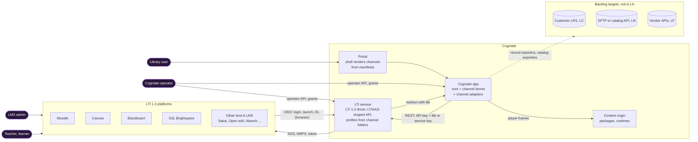
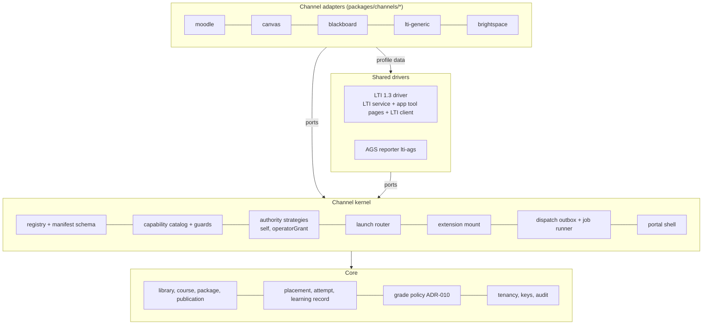

# LA target architecture: LTI as a Service v1

Status: v1 for G-DESIGN (A1, milestone LA P2, 2026-10-22). Owner: Architect A1 (overall consistency). Plan: [plan v1.1](../../team/ltiaas/plan.md). Terms: [terms](terms.md). Base architecture: [`../README.md`](../README.md) (M1 state); its terms stay valid.

## 1. Goal

Make the Cogniate LTI service a multi-LMS "LTI as a service" with a channel-adapter architecture (plan §1):

- A new LTI LMS is **one channel folder** plus, for QA, one simulator module. It changes **zero core files**.
- Moodle, Canvas and Blackboard move into the model with **no behaviour change**.
- `lti-generic` (any kind A LTI 1.3 platform) and `brightspace` (D2L Brightspace) prove the model.
- The service gets the pilot controls of E5 (A2).
- The backlog milestones LB–LG get named ports, not designs.

## 2. Context



The trust model of the M1 architecture stays: only the LTI service speaks LTI 1.3 to an LMS; the app uses the LTIAAS-shaped API (`../README.md` §3).

## 3. Layers



| Layer | Contains | May use | Must not |
| --- | --- | --- | --- |
| Core | library, course, course version, package, publication, placement, attempt, learning record, the grade policy (`packages/tracking`), tenancy, keys, audit | `packages/shared` | name a channel; know LTI message details |
| Channel kernel | registry, manifest schema, capability catalog and guards, authority strategies, launch router, extension mount, dispatch outbox, job runner, portal shell ([LA-ADR-01](adr/LA-ADR-01-channel-kernel.md), [LA-ADR-03](adr/LA-ADR-03-learning-record-core.md)) | core | name a channel; import a channel folder by path |
| Shared drivers | the LTI 1.3 driver (LTI service; app `tool-pages/`, `clients/lti-client.ts`, `domain/launch.ts`); the `lti-ags` reporter | kernel ports, core | branch on a channel id or a profile id |
| Channel adapters | manifests, LTI profiles, setup adapters, extension code, portal modules ([LA-ADR-01 D1](adr/LA-ADR-01-channel-kernel.md#decision)) | kernel types, `@cogniate/shared`, the portal UI kit | import another channel; import app `domain/**` |

## 4. Rules that keep core channel-neutral

| # | Rule | Check |
| --- | --- | --- |
| N1 | Core code has no channel id, no LMS product name and no LMS-named identifier in code tokens ([LA-ADR-01 D10](adr/LA-ADR-01-channel-kernel.md#decision)). | F1 |
| N2 | Core finds channel behaviour only through the registry, capabilities and profile traits. | F1, F3 |
| N3 | No file lists channel ids. Each deployable finds channel folders by discovery ([LA-ADR-01 D4](adr/LA-ADR-01-channel-kernel.md#decision)). | F2 |
| N4 | Core never imports a channel folder by path; a channel folder never imports another one. | F3 |
| N5 | A new kind of feature is a new capability in the kernel catalog (an ADR revision), never a channel branch. | review |
| N6 | Frozen wire names that contain an LMS word live only in `packages/channel-kernel/src/legacy-wire.ts` ([LA-ADR-04 D2](adr/LA-ADR-04-refactor-and-migration.md#decision)). | F1 exception |
| N7 | Core SQL never reads the frozen `connection.lms` column; after `014`, no product SQL reads or writes `score_sync` ([LA-ADR-04 D4](adr/LA-ADR-04-refactor-and-migration.md#decision), [LA-ADR-03 D4](adr/LA-ADR-03-learning-record-core.md#decision)). | F5 |
| N8 | A channel chooses its binding authority only from the kernel strategies, under A2's rules ([LA-ADR-07 D2](adr/LA-ADR-07-security-and-tenancy.md)); registry load check 6 enforces the shared-platform and manual rules. | registry load check |

**Scope (the authoritative list; QA strategy §3.1 reads it).** One machine-readable copy lives in `packages/channel-kernel/fitness-scope.json` (E1 S9). If this table and the QA table differ, this table wins.

| Class | Paths |
| --- | --- |
| Channel folders (not core) | `packages/channels/<id>/**` |
| Core | all other product code: `services/*/src/**`, `packages/*/src/**` (also `packages/channel-kernel/src/**`), `apps/*/src/**` |
| Allowed exceptions inside core (closed list) | `packages/channel-kernel/src/legacy-wire.ts`; applied SQL migrations (history, ADR-006); `packages/shared/src/config.ts` for the dev-stack Moodle URL only, until E1 S3 makes it optional |
| Shared build files (core for F2) | root `package.json`, `package-lock.json`, `tsconfig*.json`, `eslint.config.js`, `vitest.config.ts`, `infra/**` except files that the simulator host manifest generates |
| Not core | `tests/**`, `docs/**` |

**Checks (all in `npm run check` except F2; QA designs the probes: [`tests/ltiaas/TEST-STRATEGY.md`](../../../tests/ltiaas/TEST-STRATEGY.md) §3).**

| Id | Check | Mechanism (Author choice inside the rule) | Pass |
| --- | --- | --- | --- |
| F1 | LMS-name lint over core code tokens. Banned words: every channel id (from the folder names), the names of every named channel (manifest `names`), and a fixed vendor list (`moodle`, `canvas`, `instructure`, `blackboard`, `brightspace`, `d2l`, `desire2learn`, `schoology`, `sakai`, `totara`). Comments are not checked. Token exceptions: the HTML `canvas` element and the Canvas Web API names. | a Node script with the TypeScript compiler API, or ESLint `no-restricted-syntax`; a checked-in per-file ratchet; a check-one-text mode for QA probes | every core count 0 at E1 done (baseline: 214 code lines in 60 files, R3 §2.1) |
| F2 | Add-channel gate: `git diff --name-status --no-renames` of an add-channel branch against its base; a path in core, a shared build file or another channel folder fails | `npm run fitness:channel-diff -- --base <sha> --channel <id>` | `core` = 0 on the E2-N diff against the E2-K-done SHA ([LA-ADR-02 D8](adr/LA-ADR-02-generic-lti-channel.md#decision)) |
| F3 | Dependency direction: the import table of [LA-ADR-01 D1](adr/LA-ADR-01-channel-kernel.md#decision) | ESLint `no-restricted-imports` per glob (as the content-host fence) | 0 errors |
| F4 | Canary channel: a test-only channel folder under `tests/**` that the registry loader reads through an extra root in tests | QA K0 | the canary passes K0 with no core edit |
| F5 | Frozen-data rules N7, and A2's rules (no `'/lti/launch/'` literal outside the account resolver; no `DELETE FROM audit_event` outside its job; SQL portability lint) | the F1 script family | 0 hits |

## 5. Module and package layout after LA

```text
packages/
  channel-kernel/            NEW workspace. Manifest types and schema, capability catalog, registry builder,
                             text fill, legacy-wire.ts (frozen names), fitness-scope.json. Pure, no I/O.
  channels/                  NEW, not a workspace; one folder per channel (LA-ADR-01 D1)
    moodle/                  manifest.ts, lti-profiles.ts (standard), app.ts (six-value setup),
                             app/ (web-services token, course shell, .mbz exporter), portal/, README.md
    canvas/                  manifest.ts, lti-profiles.ts (5 profiles), app.ts (developer key JSON route), portal/, README.md
    blackboard/              manifest.ts, lti-profiles.ts (2 profiles), app.ts, portal/, README.md
    lti-generic/             E2: manifest.ts, lti-profiles.ts, app.ts, README.md (no portal module)
    brightspace/             E2: manifest.ts, lti-profiles.ts, app.ts, README.md (no portal module)
  shared/                    + jobs (job runner, LA-ADR-03 D7); + key provider (A2, LA-ADR-06 D6)
  tracking/                  neutral outcome → status rules; the HTTP mapping moves to the AGS reporter
  package-inspector/         unchanged
services/
  lti-service/src/           the LTI 1.3 driver. profiles/index.ts builds the profile registry from the channel folders.
                             A2: operator listener, rate limits, audit, key lifecycle.
  cogniate-app/src/
    kernel/                  NEW: ports.ts, registry, capabilities and guards, authority/ (self, operatorGrant),
                             launch router, extension mount, records/ (outbox, learning records)
    drivers/lti-ags/         NEW: the AGS record reporter (line item, score POST, read-back)
    providers/               REMOVED: the three adapters move into their channel folders
    app/, domain/, tool-pages/, worker/, clients/, cli/   stay; LMS branches leave them (E1 S4–S7)
apps/
  portal/src/channels/       NEW: shell (cards, routes, manifest wizard); connect/ keeps shared parts only
  player/                    text name from the play view (no closed LMS union)
tests/                       QA: tests/sim/<id>/ simulator modules, tests/ltiaas/ kit, fitness probes, canary channel
```

The paths of `tool-pages/`, `domain/` and `app/` stay, to keep the merge with the Blackboard and Canvas run small ([LA-ADR-04 D9](adr/LA-ADR-04-refactor-and-migration.md#decision)).

## 6. Epic map

| Epic | Title | Priority | Design owner | Design | Build lanes (plan §5.3) | Wave |
| --- | --- | --- | --- | --- | --- | --- |
| E0 | Baseline intake | Must | A1 + QA | [LA-ADR-04 D6, D9](adr/LA-ADR-04-refactor-and-migration.md#decision); QA strategy §4 | QA | B1 |
| E1 | Channel kernel for the LTI family | Must | A1 | [LA-ADR-01](adr/LA-ADR-01-channel-kernel.md), [LA-ADR-04](adr/LA-ADR-04-refactor-and-migration.md) | K, P, L | B1–B2 |
| E2 | Generic LTI 1.3 channel and D2L Brightspace | Must (one Should, one Could) | A1 | [LA-ADR-02](adr/LA-ADR-02-generic-lti-channel.md) | K, L | B3 |
| E3 | LTI Advantage completeness | Must and Should | A2 | [LA-ADR-05](adr/LA-ADR-05-lti-advantage-completeness.md) | L | B2–B3 |
| E4 | Learning-record core and dispatch | Must (core), Should (extras) | A1 | [LA-ADR-03](adr/LA-ADR-03-learning-record-core.md) | R | B2–B3 |
| E5 | Service operability and security | Must and Should | A2 | [LA-ADR-06](adr/LA-ADR-06-service-operability.md), [LA-ADR-07](adr/LA-ADR-07-security-and-tenancy.md) | S | B1–B3 |
| E6 | Self-serve onboarding and connection health | Could | A2 | [LA-ADR-08](adr/LA-ADR-08-onboarding-and-connection-health.md) | P | B3 |
| E7 | Conformance kit and CI | Must (one Should, one Could) | QA (+ A1 fitness scope) | [`tests/ltiaas/TEST-STRATEGY.md`](../../../tests/ltiaas/TEST-STRATEGY.md); §4 above | QA, QA-E2E | B1–B4 |
| E8 | Docs and hand-over | Must | Docs | §7 E8 rows; [operability](operability.md) | Docs | B4 |

## 7. Features per epic

One line each. "Decision" links the design decision that the breakdown turns into acceptance criteria.

**E0 Baseline intake (Must)**

| Id | Feature | Priority | Decision |
| --- | --- | --- | --- |
| F0.1 | Rebase on G-BASE (frozen candidate) | Must | [LA-ADR-04 D9](adr/LA-ADR-04-refactor-and-migration.md#decision), LA-H10 |
| F0.2 | Regression baseline and golden outputs | Must | [LA-ADR-04 D6](adr/LA-ADR-04-refactor-and-migration.md#decision) |
| F0.3 | One open-world rewrite of the closed-list assertions | Must | plan LD-1; QA strategy §4.3 |
| F0.4 | ADR-012 is a dev-stack rule only | Must | plan LD-3; [LA-ADR-06 D13](adr/LA-ADR-06-service-operability.md) |

**E1 Channel kernel (Must)**

| Id | Feature | Priority | Decision |
| --- | --- | --- | --- |
| F1.1 | Open the closed Zod enum (blocker 2) | Must | [LA-ADR-04 D1 S1](adr/LA-ADR-04-refactor-and-migration.md#decision) |
| F1.2 | Kernel package: manifest schema, capability catalog, legacy projection | Must | [LA-ADR-01 D2, D3](adr/LA-ADR-01-channel-kernel.md#decision) |
| F1.3 | Folder-discovery registry with load checks 1–6 | Must | [LA-ADR-01 D4](adr/LA-ADR-01-channel-kernel.md#decision) |
| F1.4 | LTI profiles in channel folders; traits `endpoints`, `privacyFloor`; generic check 14; `channel` on `GET /api/providers` | Must | [LA-ADR-01 D6](adr/LA-ADR-01-channel-kernel.md#decision) |
| F1.5 | Migration `013`; channel and authority reads (blocker 1) | Must | [LA-ADR-04 D4](adr/LA-ADR-04-refactor-and-migration.md#decision) |
| F1.6 | `ConnectionSetup` port for all channels; authority strategies; stored target kind | Must | [LA-ADR-01 D5, D7](adr/LA-ADR-01-channel-kernel.md#decision) |
| F1.7 | Extension ports and capability guards (Canvas JSON, web services, course shell, `.mbz`) | Must | [LA-ADR-01 D8](adr/LA-ADR-01-channel-kernel.md#decision) |
| F1.8 | `{LMS}` texts from manifests in every service and the player | Must | [LA-ADR-01 D12](adr/LA-ADR-01-channel-kernel.md#decision) |
| F1.9 | Portal shell: registry routes, manifest cards, manifest wizard; modules move | Must | [LA-ADR-01 D9](adr/LA-ADR-01-channel-kernel.md#decision) |
| F1.10 | `PUBLIC_MOODLE_URL` leaves the LTI service config | Must | [LA-ADR-04 D1 S3](adr/LA-ADR-04-refactor-and-migration.md#decision), LA-IC-02 |
| F1.11 | Fitness checks F1–F5 and the canary channel | Must | §4 |

**E2 Generic LTI and D2L (Must; one Should, one Could)**

| Id | Feature | Priority | Decision |
| --- | --- | --- | --- |
| F2.1 | Profile traits `issuerKind`, `endpointOrigins`, `clientAssertionAud`, `assertionDeploymentId`, `dynamicRegistration` | Must | [LA-ADR-02 D2](adr/LA-ADR-02-generic-lti-channel.md#decision) |
| F2.2 | Generic DR fixes 1–8 (issuer path, endpoint origins, token format, `authorization_server`, capability checks, profile at complete, granted scopes, texts) | Must | [LA-ADR-02 D5](adr/LA-ADR-02-generic-lti-channel.md#decision) |
| F2.3 | Grant bound values for admin-value profiles | Must | [LA-ADR-02 D6](adr/LA-ADR-02-generic-lti-channel.md#decision) |
| F2.4 | Channel `lti-generic`: manual with a grant, DR with `self` | Must | [LA-ADR-02 D3](adr/LA-ADR-02-generic-lti-channel.md#decision) |
| F2.5 | Channel `brightspace`, manual | Must | [LA-ADR-02 D4](adr/LA-ADR-02-generic-lti-channel.md#decision) |
| F2.6 | `brightspace` Dynamic Registration | Should | [LA-ADR-02 D4](adr/LA-ADR-02-generic-lti-channel.md#decision) |
| F2.7 | Generic and D2L simulator providers; simulator host manifest | Must | [LA-ADR-02 D7](adr/LA-ADR-02-generic-lti-channel.md#decision) |
| F2.8 | Add-channel gate F2 on the E2-N diff | Must | [LA-ADR-02 D8](adr/LA-ADR-02-generic-lti-channel.md#decision) |
| F2.9 | DR management flow (`registration_client_uri`) | Could | [LA-ADR-02 D5](adr/LA-ADR-02-generic-lti-channel.md#decision) item 9 |

**E3 LTI Advantage completeness (A2)**

| Id | Feature | Priority | Decision |
| --- | --- | --- | --- |
| F3.1 | Platform storage launch (D-4) | Must | [LA-ADR-05 D1](adr/LA-ADR-05-lti-advantage-completeness.md) |
| F3.2 | Launch without context | Must | LA-ADR-05 D2 |
| F3.3 | Deep Linking: Cancel, multi-select, `accept_lineitem`, shaped token fields | Must | LA-ADR-05 D3 |
| F3.4 | NRPS decision (D-8): keep the service, stop asking for the scope | Must | LA-ADR-05 D4 |
| F3.5 | Ungraded placements (D-11) | Should | LA-ADR-05 D5 |
| F3.6 | Canvas Dynamic Registration (D-1) | Should | LA-ADR-05 D6 |
| F3.7 | Claim policy per tool account (D-9) | Should | LA-ADR-05 D7 |
| F3.8 | New-window launch (D-10) | Should | LA-ADR-05 D8 |
| F3.9 | AGS extras (submission, `scoringUserId`, extensions) | Should | LA-ADR-05 D9 |
| F3.10 | Small spec gaps | Could | LA-ADR-05 D10 |

**E4 Learning-record core (Must core, Should extras)**

| Id | Feature | Priority | Decision |
| --- | --- | --- | --- |
| F4.1 | `placement`, `learning_record`, `record_dispatch`; migration `014` with backfill | Must | [LA-ADR-03 D1–D4](adr/LA-ADR-03-learning-record-core.md#decision), [LA-ADR-04 D5](adr/LA-ADR-04-refactor-and-migration.md#decision) |
| F4.2 | `RecordReporter` port and the `lti-ags` reporter | Must | [LA-ADR-03 D5](adr/LA-ADR-03-learning-record-core.md#decision) |
| F4.3 | ADR-010 grade policy and P2 guarantees unchanged | Must | [LA-ADR-03 D6](adr/LA-ADR-03-learning-record-core.md#decision) |
| F4.4 | Job runner: leases, fairness, bounded parallelism, `429` / `Retry-After`; shared with E5 jobs | Must | [LA-ADR-03 D7](adr/LA-ADR-03-learning-record-core.md#decision) |
| F4.5 | Read-back guard and disabled-connection rules by authority | Must | [LA-ADR-03 D8](adr/LA-ADR-03-learning-record-core.md#decision) |
| F4.6 | Progress record kinds and submission times | Should | [LA-ADR-03 D3](adr/LA-ADR-03-learning-record-core.md#decision) |
| F4.7 | Backlog ports named (reporters `everyRecord`, catalog exporter, schedules, secrets, identity) | Must (names only) | [LA-ADR-03 D9](adr/LA-ADR-03-learning-record-core.md#decision) |

**E5 Operability and security (A2)**

| Id | Feature | Priority | Decision |
| --- | --- | --- | --- |
| F5.1 | Rate limits | Must | [LA-ADR-06 D1](adr/LA-ADR-06-service-operability.md) |
| F5.2 | Tenant model and account resolver (LA-H7) | Must | LA-ADR-06 D2 |
| F5.3 | Operator API with operator keys | Must | LA-ADR-06 D3; [LA-ADR-07 D4](adr/LA-ADR-07-security-and-tenancy.md) |
| F5.4 | Audit log (LTI service; app operator commands) | Must | LA-ADR-06 D4; [data model §5](data-model.md#5-cogniate-app-migration-015-e5-app-part-e6) |
| F5.5 | API key lifecycle | Must | LA-ADR-06 D5 |
| F5.6 | Key provider with versioned envelope encryption | Must | LA-ADR-06 D6 |
| F5.7 | Signing-key lifecycle and the A-T0-16 tests | Must | LA-ADR-06 D7 |
| F5.8 | Tenancy layers, authority rules, grant evidence, threat deltas | Must | LA-ADR-07 D1, D2, D5, D6 |
| F5.9 | Connection secrets port (shape now; build in LB or LF) | Must (shape) | LA-ADR-07 D3 |
| F5.10 | Service key revoke and write scope | Should | LA-ADR-06 D8; LA-ADR-07 D7 |
| F5.11 | `Idempotency-Key` | Should | LA-ADR-06 D9 |
| F5.12 | Metrics, `/readyz`, tenant ids in logs (LTI service; app metrics in [app API delta §8a](contracts/cogniate-app-api-delta.md#8a-app-metrics-should-with-e5-metrics)) | Should | LA-ADR-06 D10 |
| F5.13 | E5 jobs on the job runner (retention and audit retention are Must inside it) | Should | LA-ADR-06 D11 |
| F5.14 | Fail-closed production profile, secrets from files | Should | LA-ADR-06 D12 |
| F5.15 | Async store port in the LTI service (engine in LG, LA-H5) | Should | LA-ADR-06 D13 |
| F5.16 | Pilot backup and restore (LA-H8) | Should | LA-ADR-06 D14 |
| F5.17 | Trusted audiences only | Could | LA-ADR-07 D8 |

**E6 Onboarding and health (Could, A2)**

| Id | Feature | Priority | Decision |
| --- | --- | --- | --- |
| F6.1 | Operator grant stays the default; per-channel self-serve table | decision now | [LA-ADR-08 D1, D2](adr/LA-ADR-08-onboarding-and-connection-health.md) |
| F6.2 | Verified admin launch (`verifiedAdminLaunch`) | Could | LA-ADR-08 D3 |
| F6.3 | Connection check | Could | LA-ADR-08 D4 |
| F6.4 | Connection health view | Could | LA-ADR-08 D5 |
| F6.5 | Manifest verify-step values | Could | LA-ADR-08 D6; [LA-ADR-01 D2](adr/LA-ADR-01-channel-kernel.md#decision) |

**E7 Conformance kit and CI (Must; one Should)**

| Id | Feature | Priority | Decision |
| --- | --- | --- | --- |
| F7.1 | K0 channel contract suite per port, no Docker | Must | QA strategy §2.2, §2.7 |
| F7.2 | K1 simulator suites per port | Must | QA strategy §2.4 |
| F7.3 | Pass rule: N/A only for a false capability whose guard passes | Must | QA strategy §2.6 |
| F7.4 | Data-driven simulator and one host manifest | Must | QA strategy §2.8; [LA-ADR-02 D7](adr/LA-ADR-02-generic-lti-channel.md#decision) |
| F7.5 | Fitness checks in `npm run check` | Must | §4; QA strategy §3 |
| F7.6 | Local CI script (install, check, vulnerability scan, SBOM, secret scan) | Must | plan §3 E7; QA strategy |
| F7.7 | K2 browser checks | Could | QA strategy §2.2 |
| F7.8 | Certification reference tool (LA-H9) | Should | plan §3 E7; R1 §4 |

**E8 Docs and hand-over (Must)**

| Id | Feature | Priority | Decision (content source) |
| --- | --- | --- | --- |
| F8.1 | "Add a new LTI channel" guide, timed once with a new person or agent | Must | [LA-ADR-01 D1, D2, D4](adr/LA-ADR-01-channel-kernel.md#decision); [LA-ADR-02 D4, D7](adr/LA-ADR-02-generic-lti-channel.md#decision); plan §4 measure 5 |
| F8.2 | Admin guide per LMS, also `lti-generic` and D2L | Must | manifests `texts.adminSteps`; [LA-ADR-02](adr/LA-ADR-02-generic-lti-channel.md) |
| F8.3 | Operator runbook | Must | [operability](operability.md) |
| F8.4 | Deliberate spec deviations and new contract §8 rows | Must | R1 §4; [lti-service-api-delta](contracts/lti-service-api-delta.md) |
| F8.5 | Review pack in `docs/human_review/ltiaas/` | Must | charter-LA §1 |

## 8. Open consistency items

Items that A1 cannot close inside its own files. Each names the owner who closes it.

| # | Item | Owner | Proposal |
| --- | --- | --- | --- |
| OC-1 | Plan §4 measure 1 says the gate runs "against the E1-done SHA". E2 has planned core work (traits, DR fixes, grant bound values), so the base must be the E2-K-done SHA ([LA-ADR-02 D8](adr/LA-ADR-02-generic-lti-channel.md#decision)). QA already aligned (QA strategy §3.3). | Lead | Change the plan wording to "against the SHA where E1 and E2-K are done". |
| OC-2 | A2 [LA-ADR-05](adr/LA-ADR-05-lti-advantage-completeness.md) AP-05-09 says that a launch without an AGS claim has "no dispatch row". Today a graded placement without a line item gives a `failed` row "No gradebook column" (ADR-010 rule 1), and [LA-ADR-03 D2](adr/LA-ADR-03-learning-record-core.md#decision) keeps that until the ungraded rule (LA-IC-07, Should, LA-H22) ships. | A2 | AP-05-09 expects today's `failed` row until LA-ADR-05 D5 ships, or AP-05-09 moves under D5. |
| OC-3 | LA-IC-09: migration `014` makes the T5b P5 fixture ineffective (QA strategy §4.7). | Lead | One decision that lets the fixture delete the same row in `record_dispatch` ([LA-ADR-04 D8](adr/LA-ADR-04-refactor-and-migration.md#decision)). |
| OC-4 | A2's [lti-service-api-delta](contracts/lti-service-api-delta.md) records `channel` on `GET /api/providers` (C11), `complete.profile` and `complete.scopes`, `grantedScopes`, `clientAssertionAud` (C10, §4.5, §4.6) and `PLATFORM_RATE_LIMITED` with `details.retryAfter` (C12). Two A1 changes are not yet in it: (a) the `POST /api/platforms` rules for the new admin-value profiles `lti-generic` and `brightspace` ([LA-ADR-02 D2, D3, D6](adr/LA-ADR-02-generic-lti-channel.md#decision)): endpoints on other https origins when the profile has `endpointOrigins: any-https` (site rules 1–4 instead of `PLATFORM_URL_NOT_ON_ISSUER_ORIGIN`), an issuer with a path, the reserved-issuer rule; (b) the new trait fields on each `GET /api/providers` profile: `endpoints`, `issuerKind`, `endpointOrigins` (the app reads `endpoints` to decide which values a grant binds). | A2 | Add both rows to the LTI service delta (§4.6, §4.7) and as contract §8 rows if they differ from LTIAAS. |
| OC-5 | Human decision ids: A1 uses only plan ids (LA-H3, LA-H4, LA-H6, LA-H10). A2 uses LA-H21 and up (LA-H22 proposed: ungraded items). | Lead | Renumber in the plan when the list is final. |
| OC-6 | LA-ADR-07 D3 builds the connection secrets table only "if A1 moves the Moodle web-services token". A1 does not move it in LA (no extra schema change; [data model §5a](data-model.md#5a-cogniate-app-migration-016-e6-could)). | A2 | LA-ADR-07 D3 "Scope in LA": build in LB or LF. |

## 9. Design file index

| File | Owner | Content |
| --- | --- | --- |
| [README.md](README.md) | A1 | this overview |
| [terms.md](terms.md) | A1 | LA terms mapped to the existing terms |
| [adr/LA-ADR-01-channel-kernel.md](adr/LA-ADR-01-channel-kernel.md) | A1 | channel folder, manifest, capability model, registry, ports, profiles, authority, extras, portal, the no-LMS-name rule |
| [adr/LA-ADR-02-generic-lti-channel.md](adr/LA-ADR-02-generic-lti-channel.md) | A1 | `lti-generic`, `brightspace`, profile traits, generic DR fixes, grant bound values, simulator needs, gate base |
| [adr/LA-ADR-03-learning-record-core.md](adr/LA-ADR-03-learning-record-core.md) | A1 | placement, learning record, record dispatch, reporters, grade policy, job runner, backlog ports |
| [adr/LA-ADR-04-refactor-and-migration.md](adr/LA-ADR-04-refactor-and-migration.md) | A1 | refactor order, frozen names, migrations `013` and `014`, regression proof, rollback, intended changes `LA-IC-nn` |
| [adr/LA-ADR-05-lti-advantage-completeness.md](adr/LA-ADR-05-lti-advantage-completeness.md) | A2 | platform storage, launch without context, Deep Linking, NRPS, ungraded items, Canvas DR, claim policy, new window, AGS extras |
| [adr/LA-ADR-06-service-operability.md](adr/LA-ADR-06-service-operability.md) | A2 | rate limits, tenant model, operator API, audit, API keys, key provider, signing keys, jobs, storage path, backup |
| [adr/LA-ADR-07-security-and-tenancy.md](adr/LA-ADR-07-security-and-tenancy.md) | A2 | tenancy layers, authority rules, secrets port, operator role, grant evidence, threat deltas |
| [adr/LA-ADR-08-onboarding-and-connection-health.md](adr/LA-ADR-08-onboarding-and-connection-health.md) | A2 | self-serve onboarding, verified admin launch, connection check, health view |
| [data-model.md](data-model.md) | A1 | LA table changes of both services, state machines, migration tests |
| [contracts/cogniate-app-api-delta.md](contracts/cogniate-app-api-delta.md) | A1 | app API changes |
| [contracts/lti-service-api-delta.md](contracts/lti-service-api-delta.md) | A2 | LTI service API changes |
| [operability.md](operability.md) | A2 | runbook-level design: config, topology, signals, alerts, backup and restore, key rotation |
| [security-delta.md](security-delta.md) | A2 | deltas to `../security.md` |
| [`tests/ltiaas/TEST-STRATEGY.md`](../../../tests/ltiaas/TEST-STRATEGY.md) | QA | test levels, conformance kit, fitness check design, regression proof, lanes, testability checklist |

## 10. Human decisions and unknowns

No BLOCKER-level unknown is open without an id.

| Id | Decision or unknown | Default in the design | Where |
| --- | --- | --- | --- |
| LA-H1 | G-DEV approval | — | plan §6.2 |
| LA-H3 | Live test sites (Canvas, Blackboard, D2L) | simulator only; claims say "tested against the signed simulator" | [LA-ADR-02](adr/LA-ADR-02-generic-lti-channel.md) |
| LA-H4 | Privacy: claims, retention, erase scope | keep records; pseudonymous default; `privacyFloor` | [LA-ADR-03](adr/LA-ADR-03-learning-record-core.md), A2 LA-ADR-05 D7 |
| LA-H5 | Postgres in LA or LG | LG; async port Should | A2 LA-ADR-06 D13 |
| LA-H6 | First new named LMS | D2L Brightspace | [LA-ADR-02 D1, D4](adr/LA-ADR-02-generic-lti-channel.md#decision) |
| LA-H7 | v1 tenant model | path mode; vendor-model controls built | A2 LA-ADR-06 D2 |
| LA-H10 | G-BASE timing | frozen candidate | [LA-ADR-04 D9](adr/LA-ADR-04-refactor-and-migration.md#decision) |
| R2-2 (unknown, not blocking) | D2L product family `desire2learn`; D2L DR token format | guard `desire2learn`; D2L DR is Should | [LA-ADR-02 D4](adr/LA-ADR-02-generic-lti-channel.md#decision) |
| A2 ids LA-H21+ | A2's decisions (for example LA-H22 ungraded items) | as A2 records | A2 ADRs |
