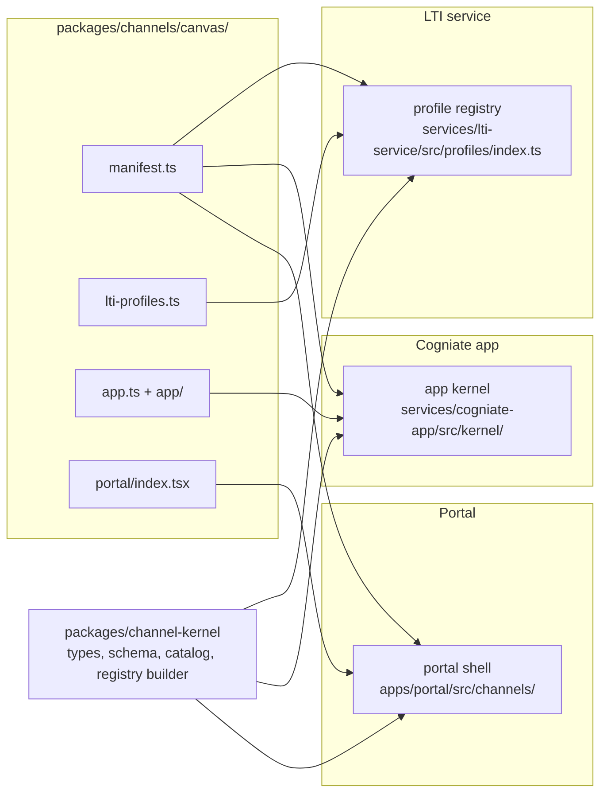

# LA-ADR-01: Channel kernel, manifest, registry and capabilities

Status: Proposed (A1, milestone LA P2, 2026-10-22). Epic: E1 (Must). Terms: [terms](../terms.md). Inputs: [plan v1 §3 E1](../../../team/ltiaas/plan.md), [R3](../../../research/ltiaas/R3-extensibility-audit.md) (seam map, 5 traits, ports), [R5 §4b](../../../research/ltiaas/R5-test-baseline.md), [ADR-011 §6, §11](../../adr/ADR-011-multi-lms.md).

## Context

ADR-011 made the LTI launch code read profile data, not LMS names (ADR-011 §17). But the rest of the product still has closed LMS lists and LMS-named branches:

- Product code outside the two adapter folders has 214 code lines in 60 files that branch on an LMS name, a profile id or an LMS-only feature (R3 §2.1).
- The LMS list is closed in 13 or more places: `LmsType` (`services/cogniate-app/src/providers/types.ts:12-16`), the second `LmsType` (`services/cogniate-app/src/domain/connections.ts:18`), `ProfileLms` (`services/lti-service/src/profiles/types.ts:5`), the Zod enum (`services/cogniate-app/src/clients/lti-client.ts:55`), the portal `Lms` (`apps/portal/src/types.ts:2`) and others (R3 §2.2 note).
- `lmsOfProfile` maps every unknown profile to `moodle` (`services/cogniate-app/src/providers/index.ts:22-27`).
- Two capabilities have LMS names: `webServices` and `canvasConfiguration` (`providers/types.ts:19-26`). Four guards test the LMS name instead of the capability (R3 §2.4).
- `lms === 'moodle'` almost always means "no operator grant". `lms === 'blackboard'` almost always means "shared platform" (R3 §2.4).
- The portal has one static card list (`apps/portal/src/Integrations.tsx:21-108`), one route pair per LMS (`apps/portal/src/App.tsx:123-131`) and a wizard map for two LMSs only (`apps/portal/src/connect/wizards.ts:7-10`).

Good shapes already exist: the adapter interface (`providers/types.ts:136-160`), the redemption engine that branches on target kind (R3 §2.4), profile traits (`profiles/types.ts:24-51`) and the portal wizard module (`apps/portal/src/connect/wizard-types.ts:20-24`). This ADR routes the core through these shapes.

## Decision

### D1. One folder per channel

Every channel lives in `packages/channels/<channel id>/`. The folder is not an npm workspace. Each entry file imports only what the import table below allows. The service containers already mount `packages/` (`infra/compose.yaml:27,142,178`), so no infra change is needed.

```text
packages/channels/<id>/
  manifest.ts        pure data (D2). Read by the LTI service, the app and the portal.
  lti-profiles.ts    LTI profiles of this channel, real and simulator (family lti13 only). LTI service entry.
  app.ts             app adapter: ConnectionSetup port and optional extension ports (D5). App entry.
  app/               optional: extension code that needs storage (Moodle web services, .mbz exporter).
  portal/index.tsx   optional portal module (D9). Portal entry.
  README.md          channel facts with sources (the "Source" column of ADR-011 §6), and the live status.
packages/channel-kernel/   new workspace package: manifest types and schema, capability catalog,
                           registry builder, text fill, legacy wire projection. Pure, no I/O.
```



Import rules (ESLint `no-restricted-imports`, added in E1):

| Code | May import |
| --- | --- |
| `packages/channels/*/manifest.ts` | `@cogniate/channel-kernel` types only |
| `packages/channels/*/lti-profiles.ts` | kernel types, its own `manifest.ts` |
| `packages/channels/*/app.ts`, `app/**` | kernel types, the app port types (`services/cogniate-app/src/kernel/ports.ts`), `@cogniate/shared`, its own files |
| `packages/channels/*/portal/**` | kernel types, the portal UI kit (`apps/portal/src/ui/**`), its own manifest |
| A channel folder | never another channel folder; never `services/**/domain/**` directly |
| Core | never a channel folder by path. Only the three registry loaders read channel folders (D4). |

### D2. Channel manifest

The manifest is data. It has no functions and no I/O. The kernel validates it with one schema at load time.

```ts
// packages/channel-kernel/src/manifest.ts (sketch)
export interface ChannelManifest {
  id: string;                                   // channel id, ^[a-z][a-z0-9-]{1,31}$, equals the folder name
  family: 'lti13';                              // LA; the schema reserves 'catalog-file' | 'xapi' | 'vendor-api' | 'package'
  names: {
    text: string;                               // fills {LMS} in every text ("Moodle", "Canvas", "your LMS")
    label: string;                              // provider list label ("Blackboard Learn")
  };
  card: {
    title: string; description: string; mark: string; color: string;
    category: 'LMS Publishing'; order: number;  // Integrations page (D9)
  };
  availability: 'ga' | 'preview' | 'simulation-only';  // simulation-only: loaded only when simulations are on
  registration: Array<{                         // order = portal order
    method: 'dynamic' | 'manual';
    authority: 'self' | 'operatorGrant';        // binding authority of this method (D7); 'verifiedAdminLaunch' is reserved (LA-ADR-08, Could)
    profiles: string[];                         // profile ids of this channel that this method may use
    defaultProfile: string;
  }>;
  capabilities: Partial<CapabilitySet>;         // D3; absent = false or empty
  lti?: {
    guardedFamilies: string[];                  // signed product families this channel owns (D6), lower case
    toolConfiguration: 'channel' | 'none';      // rows from app.ts (show step), or none
  };
  setup: {                                      // "show, collect, verify, enable" (D9)
    createFields: FieldSpec[];                  // POST /app-api/connections extras (siteUrl, serviceUrl, profile)
    bindingFields: FieldSpec[];                 // PUT …/platform body keys (strict), per method
    verify: 'firstLaunch' | 'operatorGrant' | 'verifiedAdminLaunch';  // verifiedAdminLaunch is Could (A2 LA-ADR-08 D6)
    connectionCheck?: boolean;                // the "Check connection" panel (A2 LA-ADR-08 D4, Could)
  };
  texts: {
    adminSteps: string[]; teacherSteps: string[];
    disconnect: string; notReady: string | null; // all with {LMS}, {tool}, {site} placeholders only
  };
}
export interface FieldSpec { key: string; label: string; kind: 'origin' | 'id' | 'grantCode' | 'url' | 'choice'; required: boolean; method?: 'dynamic' | 'manual' }
```

### D3. Capability model

A capability is a dotted id with a typed value. The kernel owns the catalog: a channel cannot invent a capability. A new capability is a kernel change with a test (an ADR revision). The value comes from one source only.

| Capability id | Type | Source | Replaces (evidence) | Guard when false or absent |
| --- | --- | --- | --- | --- |
| `registration.dynamic` | boolean | manifest `registration` has a `dynamic` method, and the LTI profile allows DR (LA-ADR-02) | `dynamicRegistration`; `lms === 'moodle'` (`app/connections.ts:206,235`) | `POST /app-api/connections` with `method: dynamic` → `422 CAPABILITY_NOT_SUPPORTED`; registration URL → `409 CONNECTION_NOT_PENDING` (unchanged codes) |
| `binding.authority` | map method → `self` \| `operatorGrant` (reserved: `verifiedAdminLaunch`, A2 [LA-ADR-08](LA-ADR-08-onboarding-and-connection-health.md), Could) | manifest `registration[].authority` | `operatorApproval`; 8 sites of `lms === 'moodle'` / `IN ('canvas','blackboard')` (R3 §2.4) | grant CLI refuses a connection whose authority is `self` |
| `registration.scopes` | list of service scope ids | manifest (A2 sets the values: D-8 in [LA-ADR-05](LA-ADR-05-lti-advantage-completeness.md)) | the fixed scope list of ADR-009 and of the Canvas JSON (app contract §4.6) | — (the scopes that the channel asks for) |
| `platform.sharing` | `exclusive` \| `shared` | LTI profile trait `sharing` | 10 sites of `lms === 'blackboard'` (R3 §2.4) | — (selects the target kind) |
| `deployments.multiple` | boolean | manifest | `addDeployment`; `lms !== 'canvas'` (`app/canvas-deployments.ts:16`, `app/operator.ts:68`) | `POST …/deployments` → `409 CAPABILITY_NOT_SUPPORTED` |
| `site.serviceOrigin` | boolean | LTI profile trait `serviceUrl` | `acceptsServiceUrl` (`providers/types.ts:147`); `--service-url` check (`app/operator.ts:74`) | `serviceUrl` in create → `400 INVALID_REQUEST` (unchanged) |
| `setup.artifacts` | list of artifact ids | manifest | `canvasConfiguration` (`app/canvas-configuration.ts:17`) | artifact route → `409 CAPABILITY_NOT_SUPPORTED` |
| `siteApi.token` | boolean | manifest | `webServices` (`app/web-services.ts:32`) | `PUT …/web-services` → `409 CAPABILITY_NOT_SUPPORTED` |
| `publish.createCourse` | boolean (needs `siteApi.token`) | manifest | `courseShell` (`app/publications.ts:86`) | publish with `createMoodleCourse` → `409 CAPABILITY_NOT_SUPPORTED` |
| `export.packages` | list of package exporter ids | manifest | the `.mbz` routes in core (`app/mbz.ts`, R3 S28) | exporter route of another channel's exporter is not shown (course-version feature, ADR-011 §11 note) |
| `content.multiple` | boolean | manifest (Moodle false: evidence A-T0-11, A2 [LA-ADR-05](LA-ADR-05-lti-advantage-completeness.md)) | — (single select today, app contract §6) | the picker stays single select, also when `accept_multiple` is true |
| `content.ungraded` | boolean | manifest | — (D-11; A2 [LA-ADR-05](LA-ADR-05-lti-advantage-completeness.md) defines the behaviour) | ungraded placement is not offered |
| `launch.windowHint` | boolean | manifest (Canvas, Blackboard true; Moodle false until D-10) | `lms !== 'moodle'` (`services/cogniate-app/src/tool-pages/picker.ts:149`) | the content item has no `window` member |
| `launch.topLevelContinue` | boolean | manifest (Canvas true) | `view.lms === 'canvas'` (`services/cogniate-app/src/tool-pages/play.ts:108`) | the embedded page stays static |
| `records.reporters` | list of reporter ids | manifest | the hard-wired AGS worker (R3 S58) | no reporter = no dispatch row ([LA-ADR-03](LA-ADR-03-learning-record-core.md)) |
| `records.readBack` | boolean | the reporter | "Refresh from Moodle" (`app/results.ts:41-60`) | `POST …/results/refresh` → `409 CAPABILITY_NOT_SUPPORTED` |

**Legacy projection.** The connection DTO and `GET /app-api/lms-providers` keep the six legacy capability flags byte for byte. One pure kernel function makes them from the capability set:

| Legacy flag | = |
| --- | --- |
| `dynamicRegistration` | `registration.dynamic` |
| `operatorApproval` | some method has `operatorGrant` |
| `webServices` | `siteApi.token` |
| `courseShell` | `publish.createCourse` |
| `addDeployment` | `deployments.multiple` |
| `canvasConfiguration` | `setup.artifacts` contains `developer-key-json` |

A guard that existed in M1 keeps its `details.capability` value (`webServices`, `courseShell`, `addDeployment`, `canvasConfiguration`, `dynamicRegistration`, `operatorApproval`). A new guard uses the capability id. The legacy names live only in `packages/channel-kernel/src/legacy-wire.ts` (D10).

### D4. Channel registry

- Each deployable builds the registry by **folder discovery**: the LTI service and the app read `packages/channels/*/` at start (`readdir` and dynamic `import()`); the portal uses Vite `import.meta.glob('…/packages/channels/*/manifest.ts', { eager: true })` and the same for `portal/index.tsx`. No file in core lists channel ids.
- Load checks (any failure stops the start with one log line `channel_registry_invalid {channel, reason}`):
  1. The manifest passes the schema; `id` equals the folder name; ids are unique.
  2. Every profile id is unique across channels. A profile belongs to the channel whose folder holds it.
  3. Every guarded family belongs to one channel only.
  4. Every capability id is in the catalog; `publish.createCourse` needs `siteApi.token`.
  5. Every `registration[].profiles` entry exists in the channel's `lti-profiles.ts` (LTI service) or in `GET /api/providers` (app, at first use).
  6. A method whose profile has `sharing: shared` must not use authority `self` (A2 [LA-ADR-07 D2](LA-ADR-07-security-and-tenancy.md) rule A4). A `manual` method must not use `self` either (rule A3), unless its channel id is in the frozen legacy list of `legacy-wire.ts`. That list has one entry, the Moodle channel (no behaviour change); a new entry needs an ADR revision and a security review.
- `availability: 'simulation-only'` channels load only when the LTI service runs with simulations on (LTI contract §9.13). Tests can give the loader an extra root (the canary channel, D10). Production code has no extra root.
- Channel order: by `card.order`, then by id (moodle, canvas, blackboard for the baseline).
- Profile order in `GET /api/providers`: real profiles first, then simulation profiles; inside each group by the profile field `listOrder`, then by id. The baseline values reproduce today's order exactly (`services/lti-service/src/profiles/index.ts:27-31`): `standard`, the four Canvas profiles, `blackboard`; then `blackboard-sim`, `canvas-sim-cloud`.

### D5. Ports

| Port | Side | Owner | Responsibility | Today |
| --- | --- | --- | --- | --- |
| P1 `ChannelRegistry` | all | kernel | List and find channels; channel of a profile; guarded family owner; text name; capability set | `LMS_TYPES`, `lmsOfProfile`, `lmsNameOf`, 13+ closed lists |
| P2 `ConnectionSetup` | app | adapter (`app.ts`) | Create rules, tool configuration rows, strict binding body, binding target, staged create, admin-value parser (Moodle six values) | `ProviderAdapter` (`providers/types.ts:136-160`), widened to Moodle |
| P3 `AuthorityStrategy` | app | kernel | `self` and `operatorGrant`: bind, disconnect, suspend, release (D7) | `app/redemption.ts`, `app/binding-cleanup.ts`, Moodle branches in `app/connections.ts:193-201,269-331` |
| P4 `LaunchRouter` | app | kernel | (platform, deployment) → connection, by stored authority (D7) | `routeLaunch` (`domain/connections.ts:203-212`) |
| P5 `ExtensionRoutes` | app | adapter, optional | Extra routes with a capability and an optional frozen legacy path | `app/canvas-configuration.ts`, `app/web-services.ts`, mounted in `app/server.ts:157-166` |
| P6 `PublishHook` | app | adapter, optional | Work after a publish (course shell) | `app/publications.ts:56-96` |
| P7 `PackageExporter` | app | adapter, optional | Course-version export (`.mbz`) | `app/mbz.ts`, `domain/mbz-builds.ts` |
| P8 `RecordReporter` | app | driver | Deliver learning records ([LA-ADR-03](LA-ADR-03-learning-record-core.md)) | `worker/score-sync.ts` |
| P9 `PlacementResolver` | app | driver (LTI) | Launch context → placement ([LA-ADR-03](LA-ADR-03-learning-record-core.md)) | `domain/launch.ts:35-87` |
| P10 `ProfileSource` | LTI service | adapter (`lti-profiles.ts`) | The channel's `ProviderProfile[]` | `profiles/{standard,canvas,blackboard}.ts` |
| P11 `ChannelUiModule` | portal | adapter, optional | Wizard parts, teacher steps, extra panels (D9) | `ProviderWizardModule` (`apps/portal/src/connect/wizard-types.ts:20-24`) |

Reserved, not built in LA (names only, [terms §5](../terms.md#5-ports-reserved-for-the-backlog-names-only)): `CatalogExporter` (LB), `ConnectionSchedule` (LB: per-connection schedules on the job runner of [LA-ADR-03 D7](LA-ADR-03-learning-record-core.md#decision)), `ConnectionSecrets` (LB, LF; shape in A2 [LA-ADR-07 D3](LA-ADR-07-security-and-tenancy.md)), `IdentityResolver` (LD).

### D6. LTI profiles in the LTI service

- Each channel's `lti-profiles.ts` exports its profiles. `services/lti-service/src/profiles/index.ts` stays the one profile registry API (`listProfiles`, `findProfile`, `profileDefinition`, …). It reads the profiles from the channel registry instead of three imports (`profiles/index.ts:5-7`).
- `ProfileLms` (`profiles/types.ts:5`) is replaced by `channel: string` (the owning channel, set by the loader). The driver never compares a channel id.
- Trait `endpoints: 'admin' | 'fixed'` replaces `isStandardProfile` in rules (R3 S68: `http/routes/platforms.ts:102,165,172-177,245`, `http/service-context.ts:40`). The `standard` id stays the default value for old rows (`store/platforms.ts:98`).
- **Generic check 14.** Let F be the signed `tool_platform.product_family_code`, lower case. If a channel guards F, the platform profile must belong to that channel; else `PROVIDER_PROFILE_MISMATCH` with `detail family=F`. A missing F, or an F that no channel guards, passes. Baseline manifests: Canvas guards `canvas`, Blackboard guards `blackboardlearn`, Moodle guards nothing. So the refused set equals today's (`lti/checks.ts:246-251`).
- Text names: `lmsNameOf` and `lmsNameOfFamily` (`profiles/index.ts:96-107`) become registry lookups of `names.text`. A profile with no channel text (impossible after load check 2) uses the `standard` channel text, as today.
- `GET /api/providers` adds the field `channel`. The field `lms` stays (frozen: `canvas`, `blackboard`, `null` for the baseline profiles; the channel id for new profiles). A2 records the wire change in [lti-service-api-delta](../contracts/lti-service-api-delta.md).
- New profile traits for E2 (token audience, client assertion `deployment_id`, DR endpoint policy) are in [LA-ADR-02](LA-ADR-02-generic-lti-channel.md).
- Trait `privacyFloor` (`allowlist` \| `none`) keeps today's effect of `minimizeClaims` (`profiles/types.ts:19`): `allowlist` for every Canvas and Blackboard profile, `none` for `standard`. A2's claim policy per tool account ([LA-ADR-05](LA-ADR-05-lti-advantage-completeness.md), E3 Should) can remove more claims, never fewer. Until the claim policy exists, the floor alone decides, so E1 changes nothing.

### D7. App adapters, authority and routing

- The app adapter (`app.ts`) implements P2 for every channel, Moodle included: the Moodle six-value parser and `badPlatformFields` (`app/connections.ts:134-149`) move into `packages/channels/moodle/app.ts`.
- The kernel selects the authority strategy from the connection's stored `binding_authority`, never from the channel id:

| Strategy | Bind | Routing | Disconnect and suspend | Score rows after disable |
| --- | --- | --- | --- | --- |
| `self` | Dynamic Registration `complete`, or the admin-value create of `PUT …/platform`; no adoption (security §2.6) | `lti_platform_id` (today's Moodle rule, `domain/connections.ts:188-191`) | unconditional `active: false` (today's Moodle rule) | today's Moodle rule (the LTI service `403` makes them `failed`) |
| `operatorGrant` | the two-phase grant redemption (app contract §4.7.1), target kind from the adapter | `approved_deployment` (`domain/connections.ts:204-206`) | fence-out with refs | `CONNECTION_DISABLED` without a POST (`domain/score-syncs.ts:29`) |

- The target kind is stored on each binding attempt, so revoke cleanup and fence-out pick the record kind without an LMS test (R3 S9, S12).
- The manifest may combine `dynamic` with `operatorGrant` (A2's Canvas Dynamic Registration, D-1, Should, [LA-ADR-05](LA-ADR-05-lti-advantage-completeness.md)). Then the registration only stages an **inactive** platform with a binding ref, and the normal grant redemption adopts and activates it (adoption rule A3 of app contract §4.7.1). The strategy table above does not change.
- Core reads the channel only through `connection.channel` and the registry. Core never reads `connection.lms` ([LA-ADR-04 D4](LA-ADR-04-refactor-and-migration.md#decision)).

### D8. Moodle, Canvas and Blackboard extras as capabilities

| Extra | Today | After LA | Owner folder |
| --- | --- | --- | --- |
| Moodle Dynamic Registration | `standard` only; Moodle texts in core (`tool-pages/register.ts`, `lti/http/routes/registration.ts:31-48`) | `registration.dynamic` + method authority `self`; the DR flow stays in the LTI driver; texts from the manifest | moodle (texts), driver (flow) |
| Moodle web services token | route and columns in core (`app/web-services.ts`, `009_native_channel.sql:18-20`) | `siteApi.token`; P5 extension route with frozen path `/web-services` | moodle (`app/`) |
| Moodle course shell | publish branch in core (`app/publications.ts:56-96`) | `publish.createCourse`; P6 hook; frozen body field `createMoodleCourse` | moodle (`app/`) |
| Moodle `.mbz` | course routes in core (`app/mbz.ts`, `app/courses.ts:85-98`) | `export.packages: ['mbz']`; P7 exporter; frozen paths `…/mbz`, `?kind=mbz` | moodle (`app/`) |
| Canvas developer key JSON | core route guarded by LMS name (`app/canvas-configuration.ts:17`) | `setup.artifacts: ['developer-key-json']`; P5 route with frozen path `/canvas-configuration` | canvas |
| Canvas added deployment | Canvas-named route (`app/canvas-deployments.ts:16`) | `deployments.multiple`; kernel route `POST …/deployments` (path unchanged) | kernel |
| Canvas service URL | `acceptsServiceUrl` | `site.serviceOrigin` from the profile | profile |
| Canvas embedded continuation | `view.lms === 'canvas'` | `launch.topLevelContinue` | canvas manifest |
| `window` hint in Deep Linking | `lms !== 'moodle'` | `launch.windowHint` (true for Canvas and Blackboard) | manifests |
| Blackboard shared platform | `lms === 'blackboard'` (10 sites) | `platform.sharing` from the profile | profile |
| Operator approval grant | `lms !== 'moodle'` (8 sites) | method authority `operatorGrant` | manifests |
| Moodle-only tables and columns | `mbz_build`, `connection.ws_*`, `publication.moodle_course_*` | unchanged names (frozen schema); only the Moodle folder's extension code uses them, through its port context (a storage handle limited to these tables and to the connection's library; channel code never gets a raw database handle, A2 [LA-ADR-07 D1](LA-ADR-07-security-and-tenancy.md)) | moodle (`app/`) |

### D9. Portal rendering from the manifest

- **Cards.** The Integrations page shows one card per channel from `manifest.card`, plus the static cards that are not channels (Kajabi, Figma, …, `Integrations.tsx:21-108`). The baseline manifests keep today's title, text, mark and colour.
- **Routes.** One route pair: `/integrations/:channelId/connect` and `/integrations/:channelId/:connectionId`. An unknown channel id, or a connection of another channel, shows "not found" (app contract §4.2 rule). The app server allowlist uses the same pattern with the registry (`app/portal.ts:29-30`).
- **Wizard.** The shell renders the four steps of every channel from the manifest: **show** (`GET …/tool-configuration` rows and setup artifacts), **collect** (`setup.createFields`, `setup.bindingFields`), **verify** (`setup.verify`: first launch or operator grant), **enable** (status and teacher steps). A channel module (P11) may replace one step or add panels. The Moodle, Canvas and Blackboard modules move into their folders with no visible change. A new channel needs no module.
- **Texts.** Status, disconnect and not-ready texts come from `manifest.texts` with `{LMS}` filled.
- **Ready rule.** `ready` comes from `GET /app-api/lms-providers` (profile ready) for every channel. The Moodle-only rule `lms === "moodle"` (`Integrations.tsx:157`) goes away; the Moodle profile is always ready, so the result does not change.

### D10. "No LMS name in core"

- **Rule.** Core code has no channel id, no LMS product name and no LMS-named identifier in code tokens. Core finds channel behaviour only through the registry, capabilities and profile traits.
- **Allowed exceptions (closed list, reviewed):** `packages/channel-kernel/src/legacy-wire.ts` (frozen wire names, D3); applied SQL migrations (history, ADR-006 checksum rule); `packages/shared/src/config.ts` for the dev-stack Moodle URL only, until E1 S3 makes it optional. `infra/**` is not core code for this rule ([README §4](../README.md#4-rules-that-keep-core-channel-neutral)).
- **Enforcement:** the LMS-name lint with a ratchet, the add-channel gate, and the canary channel. Scope, patterns and baseline: [README §4](../README.md#4-rules-that-keep-core-channel-neutral). QA owns the test design ([`tests/ltiaas/TEST-STRATEGY.md`](../../../../tests/ltiaas/TEST-STRATEGY.md) §3).

### D11. Wire compatibility

- Every app API path, request field, response field, error code and log event of M1 stays. LA adds fields; it does not rename or remove ([app API delta](../contracts/cogniate-app-api-delta.md)).
- New fields: `channel`, `channelName` and `channelCapabilities` on the connection DTO and on each `GET /app-api/lms-providers` entry. `lms` stays; its value is the channel id (an open set after LA).
- The `details.capability` values of the M1 guards stay (D3).

### D12. Texts

Every text that names an LMS uses `{LMS}` with the manifest text name: tool pages, player, `packages/tracking` status texts (`packages/tracking/src/status-text.ts:19`), LTI service error and registration pages, portal texts. The Moodle text name is `Moodle`, so Moodle texts stay byte for byte. Closed name unions (`'Moodle' | 'Canvas' | 'Blackboard'`, 22 lines in 13 files, R3 §1) become `string`.

## Alternatives considered

| Alternative | Why not |
| --- | --- |
| Keep the adapters in two folders per service (today) and only widen the closed types | A new LMS still edits 25 core files (R3 §3). It fails plan measure 1. |
| One npm workspace package per channel | Each new channel then edits the root `package.json` workspaces or the service dependencies: a core file change. Folder discovery needs no list. |
| A generated, checked-in registry index | The generated file is a core file that changes for every channel. |
| Capabilities as free strings that each channel invents | The kernel cannot guard what it does not know. A closed catalog keeps guards testable (K-CAP, R5 §4a). |
| Derive the channel from the profile only (no stored channel) | `standard` is used by Moodle, and LA-ADR-02 adds an admin-value generic channel. A stored `connection.channel` is simpler and safe ([LA-ADR-04](LA-ADR-04-refactor-and-migration.md)). |
| Rename the M1 wire fields to generic names | It breaks M1, M2 and T7 (plan §4 measure 3) and LTIAAS-shaped clients. A frozen projection costs one small file. |

## Consequences

- A new LTI LMS is one folder plus, for QA, one simulator module (LA-ADR-02). The kernel, the LTI driver and the portal shell do not change.
- The kernel owns one capability catalog. A new kind of feature is a kernel change with an ADR revision, on purpose.
- The three registry loaders do dynamic imports at start. A broken channel folder stops the start (fail closed).
- `ProviderAdapter` "pure" rule (`providers/types.ts:1-4`) stays for `app.ts`. Storage access is allowed only in a channel's `app/` extension code, through the port context.
- Code review gets simpler: every LMS fact is in one folder with its source note.

## Migration and compatibility

See [LA-ADR-04](LA-ADR-04-refactor-and-migration.md): the refactor order, migration `013`, the frozen wire names and the regression proof. Old rows keep their behaviour: their channel is their `lms` value; their authority is `self` for `moodle` and `operatorGrant` for the others.

## Test impact

- Author unit tests (no Docker, `npm run check`): manifest schema; registry load checks 1–6 (each failure case); capability catalog; generic check 14 refuses exactly the M1 set.
- QA K0 (channel contract suite over the public kernel and registry entry points, no Docker): the legacy projection of every baseline channel equals the M1 capability objects (golden, R5 §4c); one guard case per false capability (K-CAP).
- The LMS-name lint, the add-channel gate and the canary channel ([README §4](../README.md#4-rules-that-keep-core-channel-neutral)).
- Regression: R5 §4c tiers R0–R2 at the end of E1, with LD-1 open-world assertions.

## Open questions

| Id | Question | Default until decided |
| --- | --- | --- |
| — | None that blocks E1. LA-H6 (the E2 LMS) does not change the kernel. | — |
