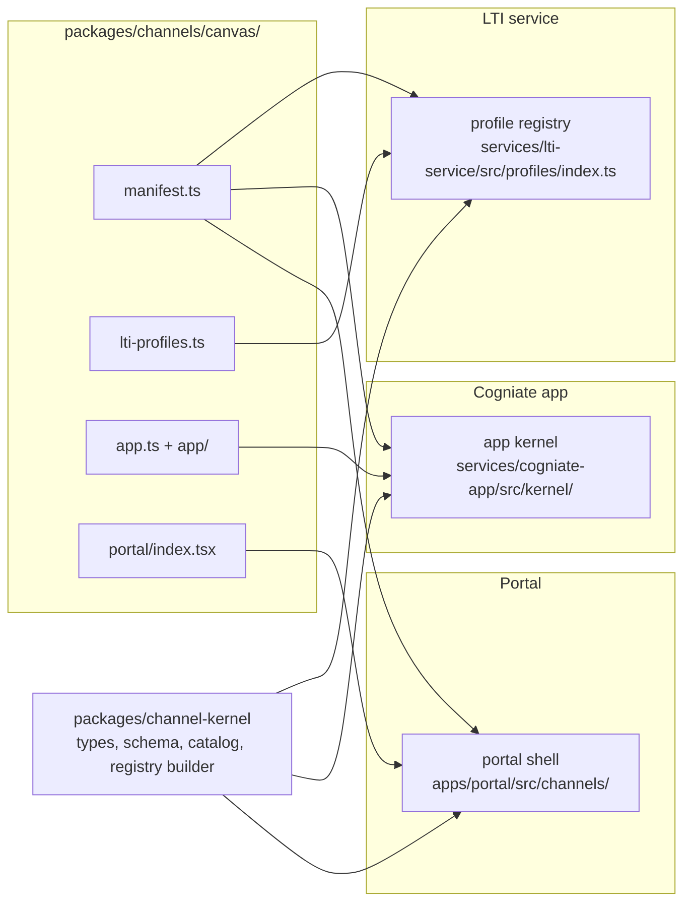

# LA-ADR-01: Channel kernel, manifest, registry and capabilities

Status: Proposed (A1, milestone LA P2, 2026-10-22). Epic: E1 (Must). Terms: [terms](../terms.md). Inputs: [plan v1 §3 E1](../../../team/ltiaas/plan.md), [R3](../../../research/ltiaas/R3-extensibility-audit.md) (seam map, 5 traits, ports), [R5 §4b](../../../research/ltiaas/R5-test-baseline.md), [ADR-011 §6, §11](../../adr/ADR-011-multi-lms.md).

## Context

ADR-011 made the LTI launch code read profile data, not LMS names (ADR-011 §17). But the rest of the product still has closed LMS lists and LMS-named branches:

- Product code outside the two adapter folders has 214 code lines in 60 files that branch on an LMS name, a profile id or an LMS-only feature (R3 §2.1).
- The LMS list is closed in 13 or more places: `LmsType` (`services/cogniate-app/src/providers/types.ts:12-16`), the second `LmsType` (`services/cogniate-app/src/domain/connections.ts:18`), `ProfileLms` (`services/lti-service/src/profiles/types.ts:5`), the Zod enum (`services/cogniate-app/src/clients/lti-client.ts:55`), the portal `Lms` (`apps/portal/src/types.ts:2`) and others (R3 §2.2 note).
- `lmsOfProfile` maps every unknown profile to `moodle` (`services/cogniate-app/src/providers/index.ts:22-27`).
- Two capabilities have LMS names: `webServices` and `canvasConfiguration` (`providers/types.ts:19-26`). Four guards test the LMS name instead of the capability (R3 §2.4).
- `lms === 'moodle'` almost always means "no operator grant". `lms === 'blackboard'` almost always means "shared platform" (R3 §2.4).
- The portal has one static card list (`apps/portal/src/Integrations.tsx:21-108`), one route pair per LMS (`apps/portal/src/App.tsx:123-131`) and a wizard map for two LMSs only (`apps/portal/src/connect/wizards.ts:7-10`).

Good shapes already exist: the adapter interface (`providers/types.ts:136-160`), the redemption engine that branches on target kind (R3 §2.4), profile traits (`profiles/types.ts:24-51`) and the portal wizard module (`apps/portal/src/connect/wizard-types.ts:20-24`). This ADR routes the core through these shapes.

## Decision

### D1. One folder per channel

Every channel lives in `packages/channels/<channel id>/`. The folder is not an npm workspace. Each entry file imports only what the import table below allows. The service containers already mount `packages/` (`infra/compose.yaml:27,142,178`), so no infra change is needed.

```text
packages/channels/<id>/
  manifest.ts        pure data (D2). Read by the LTI service, the app and the portal.
  lti-profiles.ts    LTI profiles of this channel, real and simulator (family lti13 only). LTI service entry.
  app.ts             app adapter: ConnectionSetup port and optional extension ports (D5). App entry.
                     Optional when every profile of the channel has `endpoints: admin`: then the kernel
                     admin-value setup adapter serves the channel (D5).
  app/               optional: extension code that needs storage (Moodle web services, .mbz exporter).
  portal/index.tsx   optional portal module (P11, D5). Portal entry.
  *.test.ts(x)       unit tests next to the code (run by the root Vitest): *.test.ts at the root and in app/,
                     *.test.tsx in portal/.
  README.md          channel facts with sources (the "Source" column of ADR-011 §6), and the live status.
                     No other file kind: a helper goes into app/ or portal/ (BD-A1-16).
packages/channel-kernel/   new workspace package: manifest types and schema, capability catalog,
                           registry builder, text fill, legacy wire projection. Pure, no I/O.
```



**Build model (E1 step S2, once; Reviewer-B B-LAD-01).** After S2 no channel edits a shared build file:

| Tool | Rule |
| --- | --- |
| Typecheck | Two configs under `packages/channels/`: `tsconfig.node.json` (`*/*.ts`, that is the root entries and root tests, and `*/app/**`; BD-A1-16) and `tsconfig.portal.json` (`*/manifest.ts`, `*/portal/**`, `jsx`, DOM libraries). The root `npm run typecheck` runs both. |
| Unit tests | The root `vitest.config.ts` includes `packages/channels/*/**/*.test.{ts,tsx}`; portal-side tests use the portal's jsdom setup by file pattern. |
| Lint | `eslint.config.js` gets one block per channel glob: the import table below (F3) and the LMS-name rule scope (F1). |
| Styles and dev server | `apps/portal/src/styles.css` gets `@source "../../../packages/channels/*/portal/**/*.{ts,tsx}";` (the file-glob form, as built in LA-E1-11; the folder form did not scan the moved styles) (Tailwind v4 does not scan files outside the portal by itself). `apps/portal/vite.config.ts` gets `server.fs.allow` for `packages/channels` and the alias `@cogniate/portal-sdk` (P11). |
| Profile data | Registry load check 7 (D4) validates every profile against one `ProviderProfile` schema with a closed trait set. |

QA probe (with the canary): a type error and a failing unit test in a scratch channel folder each fail `npm run check`.

Import rules (ESLint `no-restricted-imports`, added in E1 step S2):

| Code | May import |
| --- | --- |
| `packages/channels/*/manifest.ts` | `@cogniate/channel-kernel` types only |
| `packages/channels/*/lti-profiles.ts` | kernel types, its own `manifest.ts` |
| `packages/channels/*/app.ts` | kernel types, the app port types (`services/cogniate-app/src/kernel/ports.ts`), values from the pure kernel setup sub-path `@cogniate/channel-kernel/setup` (`toolName`, `PRINTABLE_ID`, `GRANT_CODE`, `parseStrictBody`; BD-A1-40), values from `@cogniate/shared/channel` and types from `@cogniate/shared` (A2 BD-A2-11; A1 BD-A1-18: the pure helpers, for example the site rules of the Moodle six-value parser), its own `manifest.ts` and its own `app/**` (BD-A1-16, for the P5–P7 handlers of D5). No `fetch`, `WebSocket` or `process`. `app.ts` is pure: no database, no LTI call, no context. An `app/**` module does no work when it loads (no I/O and no timer at top level); its functions get the `PortContext` at call time. |
| `packages/channels/*/app/**` | the same, and its own files. From `@cogniate/shared`: values only through the allow-list sub-path `@cogniate/shared/channel`, the root only with `import type`, no other sub-path ([security delta §8](../security-delta.md#8-tenant-isolation), channel import fence; BD-A2-11). No `fetch`, `WebSocket` or `process`. Its functions get a `PortContext` (D5) from the kernel at call time. |
| `packages/channels/*/portal/**` | kernel types, `@cogniate/portal-sdk` (the folder `apps/portal/src/sdk/`, P11), its own manifest, React. Never other portal code. |
| `apps/portal/src/sdk/**` | portal code (UI kit, API client, hooks, DTO types, error helpers). It is the one portal folder that a channel module may import. |
| A channel folder | never another channel folder; never `services/**/domain/**` directly |
| Every file under `packages/channels/<id>/` (tests too; BD-A1-16) | Base fence that every entry rule keeps: no `@cogniate/cogniate-app`, `@cogniate/lti-service`, `@cogniate/portal` or `@cogniate/player` (or any sub-path); `@cogniate/shared` values only from `@cogniate/shared/channel` and only where the file's row allows them (BD-A2-11); and no path under `services/` or `apps/`, except `services/cogniate-app/src/kernel/ports.ts` (from `app.ts` and `app/**`) and `apps/portal/src/sdk/**` (from `portal/**`). No runtime dynamic loading: no `import()` expression, no `require()`, no `import x = require()`, no `createRequire`. A type-position `import('…')` follows the table row of the file. A non-test file never imports a test file. A file that is not one of the layout kinds above is an error. A root test imports its own channel files, kernel types and test tools. |
| Specifiers (all code) | A template literal with no `${…}` counts as a string specifier, so a core `import()` of a channel path is an error (N4); only the three registry loaders build channel paths at run time. |
| Core | never a channel folder by path. Only the three registry loaders read channel folders (D4). |

### D2. Channel manifest

The manifest is data. It has no functions and no I/O. The kernel validates it with one schema at load time.

```ts
// packages/channel-kernel/src/manifest.ts (sketch)
export interface ChannelManifest {
  id: string;                                   // channel id, ^[a-z][a-z0-9-]{1,31}$, equals the folder name
  family: 'lti13';                              // LA; the schema reserves 'catalog-file' | 'xapi' | 'vendor-api' | 'package'
  names: {
    text: string;                               // fills {LMS} in every text ("Moodle", "Canvas", "your LMS")
    label: string;                              // provider list label ("Blackboard Learn")
  };
  card: {
    title: string; description: string; mark: string; color: string;
    icon?: 'graduation-cap';                     // BD-A1-49: a closed list of named icons; the shell draws it instead of `mark`
    category: 'LMS Publishing'; order: number;  // Integrations page (D9)
  };
  availability: 'ga' | 'preview' | 'simulation-only';  // simulation-only: loaded only when simulations are on
  registration: Array<{                         // order = portal order
    method: 'dynamic' | 'manual';
    authority: 'self' | 'operatorGrant';        // binding authority of this method (D7); 'verifiedAdminLaunch' is reserved (LA-ADR-08, Could)
    profiles: string[];                         // profile ids of this channel that this method may use
    defaultProfile: string;
  }>;
  capabilities: Partial<CapabilitySet>;         // D3; absent = false or empty
  lti?: {
    guardedFamilies: Array<{ family: string; level: 'launch' | 'registration' }>;  // D6; family in lower case
    toolConfiguration: 'channel' | 'none';      // 'channel': the channel's rows (show step), from app.ts or, for a channel
                                                // without app.ts, from the kernel admin-value adapter (BD-A1-85); 'none': no rows
  };
  setup: {                                      // "show, collect, verify, enable" (D9)
    createFields: FieldSpec[];                  // POST /app-api/connections extras (siteUrl, serviceUrl, profile)
    bindingFields: FieldSpec[];                 // PUT …/platform body keys (strict), per method
    // No verify field: the shell takes the verify step from the binding authority (D9; Reviewer-B B-LAD-20).
    connectionCheck?: boolean;                // the "Check connection" panel (A2 LA-ADR-08 D4, Could)
    toolRows?: readonly { key: string; label: string; value: string }[];  // BD-A1-78: rows of the kernel admin-value
                                              // adapter; value = literal text + {toolName} {loginUrl} {launchUrl} {keysUrl}
                                              // {deepLinkingUrl} {ltiHost} {scopes}; absent = the generic set (app delta §3.3);
                                              // an E2-K kernel field (BD-A1-94), so a named kind A LMS adds only data
  };
  storage?: {                                   // D5 "Tables": what the channel's app/ SQL may name (Q-LAD-25)
    tables: string[];                           // Moodle: ['mbz_build']
    columns: string[];                          // 'table.column'; Moodle: ['connection.ws_token_encrypted', 'connection.ws_site_name',
                                                //   'connection.ws_release', 'publication.moodle_course_id', 'publication.moodle_course_idnumber',
                                                //   'publication.shell_status', 'publication.shell_error']
  };
  texts: {
    adminSteps: string[]; teacherSteps: string[];
    disconnect: string; notReady: string | null; // all with {LMS}, {tool}, {site} placeholders only
    registered?: string;                         // status text of a registered connection; default "Registered" (BD-A1-25)
    registration?: Partial<Record<'UNKNOWN_TOOL_ACCOUNT' | 'INVALID_REQUEST' | 'ISSUER_MISMATCH' | 'INVALID_OPENID_CONFIGURATION' | 'TOOL_MAY_EXIST'
      | 'REGISTRATION_UPDATE_NOT_ALLOWED' | 'UPDATE_NOT_ALLOWED' | 'PLATFORM_IN_USE', string>>;  // BD-A1-59: DR help sentences with LMS menu paths; BD-A1-101: PLATFORM_IN_USE = the API description at grant redemption
    errors?: Partial<Record<'SITE_RULE_1' | 'SITE_RULE_5' | 'PLATFORM_IN_USE' | 'DEPLOYMENT_IN_USE'
      | 'DEPLOYMENT_FIXED', string>>;            // BD-A1-63: portal error texts that name an LMS; else a generic core text
  };
}
export interface FieldSpec { key: string; label: string; kind: 'origin' | 'id' | 'grantCode' | 'url' | 'choice'; required: boolean; method?: 'dynamic' | 'manual';
  default?: string }  // E2-K: a pre-filled value, a template with {siteUrl}; never trusted alone (Reviewer-B B-LAD-05)
```

### D3. Capability model

A capability is a dotted id with a typed value. The kernel owns the catalog: a channel cannot invent a capability. A new capability is a kernel change with a test (an ADR revision). Each capability has one rule that computes its value (column "Source"). For `registration.dynamic` the rule reads two inputs: the manifest has a `dynamic` method, and that method's profile has a `dynamicRegistration` trait (Reviewer-B B-LAD-14).

| Capability id | Type | Source | Replaces (evidence) | Guard when false or absent |
| --- | --- | --- | --- | --- |
| `registration.dynamic` | boolean | manifest `registration` has a `dynamic` method, and the LTI profile allows DR (LA-ADR-02) | `dynamicRegistration`; `lms === 'moodle'` (`app/connections.ts:206,235`) | `POST /app-api/connections` with `method: dynamic` → `422 CAPABILITY_NOT_SUPPORTED`; registration URL → `409 CONNECTION_NOT_PENDING` (unchanged codes) |
| `binding.authority` | map method → `self` \| `operatorGrant` (reserved: `verifiedAdminLaunch`, A2 [LA-ADR-08](LA-ADR-08-onboarding-and-connection-health.md), Could) | manifest `registration[].authority` | `operatorApproval`; 8 sites of `lms === 'moodle'` / `IN ('canvas','blackboard')` (R3 §2.4) | grant CLI refuses a connection whose authority is `self` |
| `registration.scopes` | list of service scope ids | manifest (A2 sets the values: D-8 in [LA-ADR-05](LA-ADR-05-lti-advantage-completeness.md)) | the fixed scope list of ADR-009 and of the Canvas JSON (app contract §4.6) | — (the scopes that the channel asks for) |
| `platform.sharing` | `exclusive` \| `shared` | LTI profile trait `sharing` | 10 sites of `lms === 'blackboard'` (R3 §2.4) | — (selects the target kind) |
| `deployments.multiple` | boolean | manifest | `addDeployment`; `lms !== 'canvas'` (`app/canvas-deployments.ts:16`, `app/operator.ts:68`) | `POST …/deployments` → `409 CAPABILITY_NOT_SUPPORTED` |
| `site.serviceOrigin` | boolean | LTI profile trait `serviceUrl` | `acceptsServiceUrl` (`providers/types.ts:147`); `--service-url` check (`app/operator.ts:74`) | `serviceUrl` in create → `400 INVALID_REQUEST` (unchanged) |
| `setup.artifacts` | list of artifact ids | manifest | `canvasConfiguration` (`app/canvas-configuration.ts:17`) | artifact route → `409 CAPABILITY_NOT_SUPPORTED` |
| `siteApi.token` | boolean | manifest | `webServices` (`app/web-services.ts:32`) | `PUT …/web-services` → `409 CAPABILITY_NOT_SUPPORTED` |
| `publish.createCourse` | boolean (needs `siteApi.token`) | manifest | `courseShell` (`app/publications.ts:86`) | publish with `createMoodleCourse` → `409 CAPABILITY_NOT_SUPPORTED` |
| `export.packages` | list of package exporter ids | manifest | the `.mbz` routes in core (`app/mbz.ts`, R3 S28) | exporter route of another channel's exporter is not shown (course-version feature, ADR-011 §11 note) |
| `content.multiple` | boolean | manifest (Moodle false: evidence A-T0-11, A2 [LA-ADR-05](LA-ADR-05-lti-advantage-completeness.md)) | — (single select today, app contract §6) | the picker stays single select, also when `accept_multiple` is true |
| `content.ungraded` | boolean | manifest | — (D-11; A2 [LA-ADR-05](LA-ADR-05-lti-advantage-completeness.md) defines the behaviour) | ungraded placement is not offered |
| `launch.windowHint` | boolean | manifest (Canvas, Blackboard true; Moodle false until D-10) | `lms !== 'moodle'` (`services/cogniate-app/src/tool-pages/picker.ts:149`) | the content item has no `window` member |
| `launch.topLevelContinue` | boolean | manifest (Canvas true) | `view.lms === 'canvas'` (`services/cogniate-app/src/tool-pages/play.ts:108`) | the embedded page stays static |
| `records.reporters` | list of reporter ids | manifest | the hard-wired AGS worker (R3 S58) | no reporter = no dispatch row ([LA-ADR-03](LA-ADR-03-learning-record-core.md)) |
| `records.readBack` | boolean | the reporter | "Refresh from Moodle" (`app/results.ts:41-60`) | `POST …/results/refresh` → `409 CAPABILITY_NOT_SUPPORTED` |
| `setup.connectionCheck` | boolean | manifest `setup.connectionCheck` (Could, A2 [LA-ADR-08 D4](LA-ADR-08-onboarding-and-connection-health.md)) | — | `POST …/check` → `409 CAPABILITY_NOT_SUPPORTED` |

Every LA channel has `records.reporters` and `records.readBack`, so no LA channel makes these two guards fire. Their guard cases are covered by Author unit tests and by the K0 canary channel with the capability off (QA pre-review Q-LAD-12). No product change is needed for that.

**Legacy projection.** The connection DTO and `GET /app-api/lms-providers` keep the six legacy capability flags byte for byte. One pure kernel function makes them from the capability set:

| Legacy flag | = |
| --- | --- |
| `dynamicRegistration` | `registration.dynamic` |
| `operatorApproval` | some method has `operatorGrant` |
| `webServices` | `siteApi.token` |
| `courseShell` | `publish.createCourse` |
| `addDeployment` | `deployments.multiple` |
| `canvasConfiguration` | `setup.artifacts` contains `developer-key-json` |

A guard that existed in M1 keeps its `details.capability` value (`webServices`, `courseShell`, `addDeployment`, `canvasConfiguration`, `dynamicRegistration`, `operatorApproval`). A new guard uses the capability id. The legacy names live only in `packages/channel-kernel/src/legacy-wire.ts` (D10).

### D4. Channel registry

- Each deployable builds the registry by **folder discovery**: the LTI service and the app read `packages/channels/*/` at start (`readdir` and dynamic `import()`); the portal uses Vite `import.meta.glob('…/packages/channels/*/manifest.ts', { eager: true })` and the same for `portal/index.tsx`. No file in core lists channel ids.
- Load checks (any failure stops the start with one log line `channel_registry_invalid {channel, reason}`):
  1. The manifest passes the schema; `id` equals the folder name; ids are unique.
  2. Every profile id is unique across channels. A profile belongs to the channel whose folder holds it.
  3. Every guarded family belongs to one channel only.
  4. Every capability id is in the catalog; `publish.createCourse` needs `siteApi.token`.
  5. Every `registration[].profiles` entry exists in the channel's `lti-profiles.ts` (LTI service) or in `GET /api/providers` (app, at first use).
  6. A method whose profile has `sharing: shared` must not use authority `self` (A2 [LA-ADR-07 D2](LA-ADR-07-security-and-tenancy.md) rule A4). A `manual` method must not use `self` either (rule A3), unless its channel id is in the frozen legacy list `MANUAL_SELF_LEGACY_CHANNELS` of `legacy-wire.ts`. That list has one entry, the Moodle channel (no behaviour change); a new entry needs an ADR revision and a security review.
  7. Every profile passes one `ProviderProfile` schema with a closed trait set; `issuerKind` agrees with `issuer` (LA-ADR-02 D2); `wireLms` (D6) is allowed only on the baseline profiles. The baseline profiles are the keys of the frozen map `BASELINE_PROFILE_WIRE_LMS` of `legacy-wire.ts` (eight pairs). A baseline profile must have `wireLms` equal to its map value, and every other profile must not have `wireLms` (build ratification BD-A1-06, [build decisions A1](../build-decisions-A1.md)). `privacyFloor: 'none'` is allowed only on a profile in the frozen list `PRIVACY_FLOOR_NONE_PROFILES` of `legacy-wire.ts` (one entry: `standard`); every other profile has `allowlist` (BD-A1-22, ratified by A2 as BD-A2-21; LA-ADR-07 T18). A new non-baseline profile has a `listOrder` above every baseline `listOrder` (BD-A1-23). The E2 traits are optional and get the strictest default (LA-ADR-02 D2, BD-A1-74); a given value must agree with the profile: `issuerKind` with `issuer`; `endpointOrigins` is `null` exactly when `endpoints` is `fixed`, and `any-https` only with `endpoints: admin`; the flag `clientAssertionAudArray` is removed (LA-E2-02, merge `78ffce1`; BD-A1-75, BD-A1-99), so a profile that still sets it fails the closed flag set (unknown flag); an absent `clientAssertionAud` is `{ value: '{tokenEndpoint}', form: 'string' }`.
  8. A `launch`-level guard (D6) is allowed only on a channel in the frozen list `LAUNCH_GUARD_CHANNELS` of `legacy-wire.ts` (the Canvas and Blackboard channels).
- `availability: 'simulation-only'` channels load only when the LTI service runs with simulations on (LTI contract §9.13).
- **Extra root.** The loader takes its roots only as a function argument. Product code passes exactly one root, a constant path to `packages/channels/` (built from `import.meta.url`). No environment variable, knob or runtime setting can add a root. Tests pass a second root for the canary channel (D10).

Entry points (the public kernel surface that K0 tests use, QA pre-review Q-LAD-07):

```ts
// packages/channel-kernel/src/registry.ts (sketch)
export interface LoadedChannel {
  folder: string;              // absolute path; its base name must equal manifest.id (load check 1)
  manifest: unknown;           // default export of manifest.ts, not yet validated
  ltiProfiles?: unknown[];     // side 'lti' only: export of lti-profiles.ts
  appAdapter?: unknown;        // side 'app' only: export of app.ts
}
export interface RegistryOptions { simulations: boolean }
export class RegistryError extends Error { channel: string | null; check: 1 | 2 | 3 | 4 | 5 | 6; reason: string }

/** Node only (LTI service, app): readdir of each root, then import() of the entry files of that side. */
export function loadChannelFolders(roots: readonly string[], side: 'lti' | 'app'): Promise<LoadedChannel[]>;

/** Pure: runs load checks 1–6 (check 5 only on the 'lti' side, against the loaded profiles) and builds the registry, or throws RegistryError. */
export function buildChannelRegistry(channels: readonly LoadedChannel[], opts: RegistryOptions): ChannelRegistry;

export interface ChannelRegistry {
  channels(): readonly ChannelManifest[];                    // registry order
  channel(id: string): ChannelManifest | null;
  channelOfProfile(profileId: string): string | null;
  ownerOfFamily(family: string): string | null;              // lower case; generic check 14
  textName(channelId: string | null): string;                // {LMS}; null = the standard profile's channel
  capabilities(channelId: string, profile?: ProfileTraits): CapabilitySet;
  legacyCapabilities(channelId: string, profile?: ProfileTraits): LegacyCapabilities; // the six M1 flags
}
```

The portal builds the same `LoadedChannel[]` from `import.meta.glob` and calls `buildChannelRegistry`. The app runs load check 5 against `GET /api/providers` at first use, through `channelOfProfile` (a profile of a method that the LTI service does not report makes the method unavailable, log `channel_profile_unknown`).
- Channel order: by `card.order`, then by id (moodle, canvas, blackboard for the baseline).
- Profile order in `GET /api/providers`: real profiles first, then simulation profiles; inside each group by the profile field `listOrder`, then by id. The baseline values reproduce today's order exactly (`services/lti-service/src/profiles/index.ts:27-31`): `standard`, the four Canvas profiles, `blackboard`; then `blackboard-sim`, `canvas-sim-cloud`. A new channel's profiles take `listOrder` values above the baseline values, so they come after the baseline real profiles and before every simulation profile (A2 [lti-service-api-delta §4.7](../contracts/lti-service-api-delta.md)). Load check 7 enforces it (BD-A1-23): a profile whose id is not a key of `BASELINE_PROFILE_WIRE_LMS` needs a `listOrder` above the largest `listOrder` of the baseline profiles, simulation profiles included (70 today), computed from the profile definitions whatever the simulation setting.

### D5. Ports

| Port | Side | Owner | Responsibility | Today |
| --- | --- | --- | --- | --- |
| P1 `ChannelRegistry` | all | kernel | List and find channels; channel of a profile; guarded family owner; text name; capability set | `LMS_TYPES`, `lmsOfProfile`, `lmsNameOf`, 13+ closed lists |
| P2 `ConnectionSetup` | app | adapter (`app.ts`), or the kernel admin-value setup adapter when the channel has no `app.ts` | Create rules, tool configuration rows, strict binding body, binding target, staged create, admin-value parser (Moodle six values) | `ProviderAdapter` (`providers/types.ts:136-160`), widened to Moodle |
| P3 `AuthorityStrategy` | app | kernel | `self` and `operatorGrant`: bind, disconnect, suspend, release (D7) | `app/redemption.ts`, `app/binding-cleanup.ts`, Moodle branches in `app/connections.ts:193-201,269-331` |
| P4 `LaunchRouter` | app | kernel | (platform, deployment) → connection, by stored authority (D7) | `routeLaunch` (`domain/connections.ts:203-212`) |
| P5 `ExtensionRoutes` | app | adapter, optional | Extra routes with a capability and an optional frozen legacy path | `app/canvas-configuration.ts`, `app/web-services.ts`, mounted in `app/server.ts:157-166` |
| P6 `PublishHook` | app | adapter, optional | Work after a publish (course shell) | `app/publications.ts:56-96` |
| P7 `PackageExporter` | app | adapter, optional | Course-version export (`.mbz`) | `app/mbz.ts`, `domain/mbz-builds.ts` |
| P8 `RecordReporter` | app | driver | Deliver learning records ([LA-ADR-03](LA-ADR-03-learning-record-core.md)) | `worker/score-sync.ts` |
| P9 `PlacementResolver` | app | driver (LTI) | Launch context → placement ([LA-ADR-03](LA-ADR-03-learning-record-core.md)) | `domain/launch.ts:35-87` |
| P10 `ProfileSource` | LTI service | adapter (`lti-profiles.ts`) | The channel's `ProviderProfile[]` | `profiles/{standard,canvas,blackboard}.ts` |
| P11 `ChannelUiModule` | portal | adapter, optional | Wizard parts, teacher steps, extra panels (D9) | `ProviderWizardModule` (`apps/portal/src/connect/wizard-types.ts:20-24`) |

P2 `ConnectionSetup` is today's `ProviderAdapter` (`providers/types.ts:136-160`) with these changes (sketch, `services/cogniate-app/src/kernel/ports.ts`):

```ts
export interface ConnectionSetup {
  readonly channel: string;                                   // = manifest.id
  // Create: channel checks after the kernel checks (method, profile, site rules 1–4). Moodle: today's https-origin rule.
  checkCreate(input: { siteUrl: string; serviceUrl?: string; profile: ProfileView }): { ok: true; siteUrl: string; serviceUrl: string } | { ok: false; field: string; rule?: number };
  toolConfiguration(ctx: ToolConfigurationContext): ToolRow[]; // show step (unchanged signature)
  // Collect: the strict body of PUT …/platform or POST …/deployments; `adminValues` only for `endpoints: admin` profiles.
  parseBindingBody(body: unknown, ctx: PlatformBodyContext & { purpose: GrantPurpose }):
    { ok: true; values: PlatformBodyValues & { adminValues?: AdminValues } } | { ok: false; fields: string[]; reason?: 'origin' };  // BD-A1-35
  // `self` authority with typed values (Moodle six values): the platform create, no grant.
  selfCreate?(values: AdminValues & { deploymentId: string }, ctx: CreateRequestContext): StagedCreate;
  // `operatorGrant` authority (unchanged names): the redemption target and its staged create.
  initialTarget?(ctx: InitialTargetContext): BindingTarget;
  createRequest?(target: BindingTarget, ctx: CreateRequestContext): StagedCreate;
  // Per-profile app data (BD-A1-29): replaces profileLabel, acceptsServiceUrl and siteRuleSuffixes.
  readonly profiles: Readonly<Record<string, AppProfileData>>;
  // Optional extension ports P5–P7.
  extensionRoutes?: readonly ExtensionRoute[];
  publishHooks?: readonly PublishHook[];
  packageExporters?: readonly PackageExporter[];
}
export interface AdminValues { issuer: string; authenticationEndpoint: string; accessTokenEndpoint: string; jwksUrl: string; tokenAudience?: string }
export interface AppProfileData {               // plain data per offered profile (BD-A1-29)
  sharing: 'exclusive' | 'shared'; serviceUrl: boolean;
  label: string;                               // app-only: the frozen GET /app-api/lms-providers label (for example 'Moodle site')
  refusedHostSuffixes?: readonly string[];     // site rule 5
}
```

**Contract surface for K0 (build ruling BD-A1-20, [build decisions A1](../build-decisions-A1.md)).** The kit's K-ADAPTER case uses only the names and result shapes of this sketch: `channel`; `checkCreate` → `{ ok: true, siteUrl, serviceUrl }` or `{ ok: false, field, rule? }`; `toolConfiguration` → an array of rows; `parseBindingBody` → `{ ok: true, values }` or `{ ok: false, fields, reason? }` (a refusal is a value, never a throw; `reason` is absent or `'origin'`, BD-A1-35); `selfCreate?`, `initialTarget?`, `createRequest?`; `extensionRoutes?`, `publishHooks?`, `packageExporters?`. Required members, and a missing one fails the case: `channel`, `checkCreate`, `toolConfiguration` and `parseBindingBody` for every channel with `app.ts`; `selfCreate` when a registration entry is `manual` with `self`; `initialTarget` and `createRequest` when an entry has `operatorGrant`; an extension port whose capability is true. Until LA-E1-07 creates `kernel/ports.ts`, the kit relies only on these names, the arity and the result discriminants, not on the context field names. A channel with `lti.toolConfiguration: 'channel'` and no `app.ts` (BD-A1-85) has no `ConnectionSetup` of its own: the case does not require `app.ts`, checks through the LTI profile registry API that every profile of the channel has `endpoints: admin`, and expects no adapter members from the channel (the kernel admin-value adapter serves it).

The fields `lms`, `lmsName`, `label`, `methods`, `capabilities`, `defaultProfile`, `acceptsServiceUrl`, `siteRuleSuffixes` and `profileLabel` of `ProviderAdapter` move into the manifest or the profile data. Refusal texts (BD-A1-35): core owns the `422 INVALID_PLATFORM_VALUES` descriptions. No `reason` gives "Some values are missing or not valid."; `reason: 'origin'` gives "The URLs must be https and on the {LMS} site of this connection." with the channel text name, so the Moodle text stays byte for byte. A channel sets `reason: 'origin'` only for a URL-origin failure and never supplies a text. `profileLabel`, `acceptsServiceUrl` and `siteRuleSuffixes` become the plain-data map `profiles` of the port (BD-A1-29): one entry per offered profile. A unit test keeps `sharing`, `serviceUrl` and `refusedHostSuffixes` equal to the same profile in the channel's `lti-profiles.ts`, and every manifest registration profile has an entry; `label` is app-only. A profile that `GET /api/providers` reports but `profiles` does not list stays ignored (LA-ADR-04 D1 S1). The kernel admin-value adapter gives `sharing: 'exclusive'`, `serviceUrl: false`, the LTI profile label and no suffixes.

**Published ports (BD-A1-28).** `services/cogniate-app/src/kernel/ports.ts` (LA-E1-07) is the reference for the context types: `ToolConfigurationContext { urls, libraryName, sharedClientId }`; `PlatformBodyContext { siteUrl, clientId?, sharedClientId }` with `purpose: GrantPurpose` (`'initial' | 'add_deployment'`); `InitialTargetContext { connection, values, profile, sharedPlatform }`; `CreateRequestContext { libraryName }`; `selfCreate` values add `clientId`. Once the file is on the integration branch, K0 imports these types (`import type`) and fills every required field. The adapter stays pure (no database, no LTI call), as today (`providers/types.ts:1-4`).

`services/cogniate-app/src/kernel/ports.ts` holds every type that these sketches name (`ToolConfigurationContext`, `PlatformBodyContext`, `CreateRequestContext`, `InitialTargetContext`, `StagedCreate`, `BindingTarget`, `GrantPurpose`, `ToolRow`, `ProfileView`, `PlatformBodyValues`, `PortContext`, …). It is a public interface file with no logic: QA may read it and import its types (types only) as soon as step S5 creates it (QA Q-LAD-19).

**Kernel admin-value setup adapter (E2-K; Reviewer-B B-LAD-05).** One kernel `ConnectionSetup` for channels whose profiles all have `endpoints: admin` and that have no `app.ts`: tool configuration rows from `setup.toolRows` (placeholders filled from the context `toolUrls` and `toolAccountId`; no row data = the generic row set of app delta §3.3; BD-A1-78); the strict body `issuer`, `clientId`, `deploymentId`, `authenticationEndpoint`, `accessTokenEndpoint`, `jwksUrl`, `tokenAudience?`, `grantCode` (field defaults from `FieldSpec.default`: literal text with the only placeholder `{siteUrl}`, filled with the connection site URL when the field is absent; a posted value always wins; the grant's bound values and the LTI profile rules still check the filled value; BD-A1-80); the `exclusive_platform` target with the admin values; the staged create. `lti-generic` and `brightspace` use it, so neither has an `app.ts`. The app gives this adapter to every channel without `app.ts`; the LTI service refuses admin values on a `fixed` profile at create, and from LA-E2-04 the app's first-use check (load check 5) makes a method unavailable when its profile reports `endpoints: fixed` (BD-A1-79).

**Extension ports and the port context (P5–P7; Reviewer-B B-LAD-03).** Sketch, same file:

```ts
export interface PortContext {                 // made by the kernel per call; a channel never stores it
  libraryId: string;                           // bound; every statement must use :library_id
  connectionId: string | null;                 // null for course-version ports (P7)
  sql: ChannelSql;                             // no raw database handle
  outbound: GuardedClient;                     // the shared SSRF-guarded client (security §9)
  seal(value: string): Promise<Uint8Array>; unseal(blob: Uint8Array): Promise<string>;  // async, as the key provider (LA-ADR-06 D6)
  logger: Logger; traceId: string; now(): number;
  // BD-A1-37 (P5): public values and the public tool keys, for setup artifacts such as the Canvas JSON.
  urls: PublicUrls; libraryName: string; toolAccountId: string;
  publicToolKeys(): Promise<{ ok: true; keys: PublicJwk[] } | { ok: false }>;  // public members only, active key first
}
export interface PublicJwk { kty: string; kid: string; alg: string; use: string; n: string; e: string }
export interface ChannelSql {                  // the kernel binds :library_id (and :connection_id when not null)
  get<T>(statement: string, params?: Record<string, unknown>): T | undefined;
  all<T>(statement: string, params?: Record<string, unknown>): T[];
  run(statement: string, params?: Record<string, unknown>): { changes: number };
}
export interface ExtensionRoute {              // P5: mounted under /app-api/connections/:id/
  method: 'GET' | 'PUT' | 'POST'; path: string;              // a frozen legacy path (D8) or `x/<name>`
  capability: CapabilityId; legacyCapabilityName?: string;   // the guard and its frozen details.capability value
  handle(input: { body: unknown; query: Record<string, string> }, ctx: PortContext): Promise<
    | { status: number; body: unknown; headers?: Record<string, string> }
    | { error: { status: number; code: string; message: string; details?: Record<string, unknown> } }>;  // BD-A1-37: the kernel renders the standard error body
}
export interface PublishHook {                 // P6: runs after POST /app-api/publications
  option: string;                              // the frozen body flag that turns it on (`createMoodleCourse`)
  capability: CapabilityId;                    // publish.createCourse
  parseOptions(value: unknown): { ok: true; options: unknown } | { ok: false; fields: string[] };  // BD-A1-37: the body flag value, checked before any change
  afterPublish(p: PublicationView, options: unknown, ctx: PortContext): Promise<void>;
  dtoFields(p: PublicationView, ctx: PortContext): Record<string, unknown>;  // only frozen field names (D8)
}
export interface PackageExporter {             // P7: course-version level, no connection
  id: string;                                  // 'mbz'
  formats: readonly string[];                  // ['scorm12']
  start(v: CourseVersionView, ctx: ExporterContext): Promise<ExportBuildView>;
  latest(v: CourseVersionView, ctx: ExporterContext): Promise<ExportBuildView | null>;   // BD-A1-37: async (refreshes the runner status)
  download(v: CourseVersionView, ctx: ExporterContext): Promise<{ artifact: string; mediaType: string; filename: string } | null>; // the kernel streams it
}
export interface ExporterContext extends PortContext { buildQueue: BuildQueue }
export interface BuildQueue {                  // BD-A1-37: a kernel service on BUILD_QUEUE_DIR; a channel never sees a path
  submit(buildId: string, request: Record<string, unknown>): Promise<void>;  // requests/<id>.json, atomic, mode 0600
  status(buildId: string): Promise<unknown | null>;   // status/<id>.json, parsed, size-capped; null when absent
  runner(): Promise<unknown | null>;                  // status/runner.json
  pending(buildId: string): Promise<boolean>;         // BD-A1-47: requests/<id>.json is still a regular file (lstat, no read)
}
// PublicationView, CourseVersionView, ExportBuildView (today's mbz build DTO fields), ProfileView: explicit interfaces
// in kernel/ports.ts with the fields a channel may read; ports.ts imports types only from @cogniate/channel-kernel and
// @cogniate/shared, never from domain/**, clients/** or app/** (BD-A1-37, BD-A1-38).
```

| Rule | Detail |
| --- | --- |
| Library scope | `ChannelSql` refuses a statement that does not contain `:library_id` (error `channel_sql_unscoped`, Author unit test). A table without its own `library_id` is reached through a join, for example `publication` through `connection`. |
| Tables | Channel SQL may name only the tables and columns that its manifest lists in `storage` (Moodle: `mbz_build`; `connection.ws_*`; `publication.moodle_course_*`, `shell_*`). Fitness check F5 refuses other names in channel SQL. A2's "no database handle" rule (LA-ADR-07 D1) means no raw handle; `ChannelSql` is the bound handle. |
| DTO fields | A channel cannot add a field to a core DTO in LA. The frozen publication fields `moodleCourse`, `shellStatus`, `shellError` come from the Moodle hook's `dtoFields`; the kernel accepts only names in `legacy-wire.ts`. |
| Body flags | The kernel publish route parses the frozen flag `createMoodleCourse` (a `legacy-wire.ts` name) and calls the hook whose `option` equals it; a channel without the capability gets the M1 guard (`409 CAPABILITY_NOT_SUPPORTED`, `courseShell`). |
| Port context values (BD-A1-37) | `urls`, `libraryName` and `toolAccountId` are the values of the call's library. `publicToolKeys()` asks the LTI service for that tool account only and copies only `kty`, `kid`, `alg`, `use`, `n`, `e`; on an LTI error it gives `{ ok: false }`, and the route answers its own frozen error through the `error` result. NOT_FOUND and the capability guard run in the kernel before `handle`. Security review: A2. |
| Build queue (BD-A1-37) | `buildQueue` exists only on the P7 context. The kernel accepts a build id only when it matches `[A-Za-z0-9_-]{1,64}`, uses only the `requests/`, `status/` and `out/` folders of `BUILD_QUEUE_DIR`, writes only `requests/` (mode `0600`, write then rename), caps the size of a status file before it parses it, and streams `out/<buildId>.<ext>` for `download`. `pending(buildId)` is true only while `requests/<buildId>.json` exists as a regular file (no symlink follow, no content read); like `status`, it is bound to the call's library, so another library's build id gives `false` (A2 BD-A2-39; BD-A1-47). Known limit in LA (BD-A1-58; Reviewer-B B-LA-E1-08-04): the queue serves the `.mbz` exporter only (its status steps, its hold file and the ownership query `EXPORT_BUILD_SCOPE_SQL` on `mbz_build`); a second exporter needs a kernel change of the ownership table and the status steps. Channel files never import `node:fs` or `node:path` (BD-A1-16). Security review: A2. |
| Contract file (BD-A1-38) | `kernel/ports.ts` holds only the channel contract, with one doc comment per member and the required rules of BD-A1-20 and BD-A1-28. Kernel-internal types (for example `SetupRouteDeps` with the database, the LTI client and the master key) live in a kernel-internal module that channel files cannot import. Channel files also refuse `eval`, implied eval and `new Function` (lint). |
| Setup helpers (BD-A1-40; A2 BD-A2-37) | Deployment and tenant values come through the contexts, built by the kernel: the P2 contexts (`ToolConfigurationContext`, `CreateRequestContext`) and the P5 `PortContext` carry `toolAccountId` and `toolUrls` (`login`, `launch`, `keys`, `register`, `ltiOrigin`). A channel file holds no tool account id and no protocol path. The pure helpers `toolName`, `PRINTABLE_ID`, `GRANT_CODE` and `parseStrictBody` have one definition in `@cogniate/channel-kernel/setup` (`packages/channel-kernel/src/setup.ts`, package export `./setup`), which the app kernel admin-value adapter uses too. The BD-A2-11 conditions apply: pure, export names pinned by a unit test, a list change is a Reviewer-A item. None of them is on `@cogniate/shared/channel`. |
| Channel storage (BD-A1-42) | The manifest `storage` list names every table and column that channel SQL touches, also the neutral key columns it scopes or joins on (for example `connection.id`, `library_id`, `site_url`, `updated_at`; `publication.id`, `connection_id`, `updated_at`); no wildcard; F5 `channel-sql-tables` checks it. Core data such as export metadata comes through the explicit views (`CourseVersionView`), never through channel SQL on core course tables. The `rowid` pseudo-column is never in a storage list; the rule has exact allow entries (file, exact statement text, reason) only for the three pre-LA `mbz_build` statements that move 1:1 into `packages/channels/moodle/app/builds.ts` (A2 BD-A2-46; BD-A1-52); any other `rowid` in channel SQL fails. |

**Portal module (P11; Reviewer-B B-LAD-02).** Sketch, `apps/portal/src/sdk/index.ts` (alias `@cogniate/portal-sdk`):

```ts
export interface ChannelUiModule {
  Wizard?: ComponentType<ChannelWizardProps>;                  // replaces the whole shell wizard (Canvas, Blackboard, Moodle); it must pick its
                                                               // verify step from connection.bindingAuthority (BD-A1-44)
  steps?: Partial<Record<'show' | 'collect' | 'verify' | 'enable', ComponentType<ChannelWizardProps>>>;
  TeacherSteps?: ComponentType;                                // shown after publication
  connectionPanels?: ComponentType<{ connection: ConnectionView; sdk: PortalSdk }>[];  // Moodle web services, Canvas JSON
  coursePanels?: ComponentType<{ course: CourseView; version: CourseVersionView | null; onChanged(): void; sdk: PortalSdk }>[]; // Moodle .mbz
  // BD-A1-25: optional slots; the shell has a default for each and never tests a channel id.
  publicationPanels?: ComponentType<{ publication: PublicationView; onChanged(): void; sdk: PortalSdk }>[]; // Moodle course shell
  ConnectionError?: ComponentType<ConnectionErrorProps & { Default: ComponentType<ConnectionErrorProps> }>; // BD-A1-32: renders <Default/> for errors it does not handle
  ConnectionDetails?: ComponentType<{ connection: ConnectionView; sdk: PortalSdk }>; // replaces the default detail block and its "Open {LMS}" link
}
export interface ConnectionErrorProps { connection: ConnectionView; error: ApiErrorView; libraryName: string; sdk: PortalSdk }
export interface ChannelWizardProps {        // today's ProviderWizardProps (wizard-types.ts:11-18) plus the SDK
  provider: ProviderView; connection: ConnectionView | null; libraryName: string; opener: string;
  onCreated(c: ConnectionView): void; onChanged(c: ConnectionView): void; sdk: PortalSdk;
}
export interface PortalSdk {                 // re-exports of today's portal code; no new behaviour
  api: PortalApi;                            // the named calls of apps/portal/src/api.ts, plus extension(id, path, init)
  useApi: typeof useApi; navigate(to: string): void;
  ui: PortalUiKit;                           // Button, Card, Tabs, ErrorNotice, Loading, ConnectionBadge, provider error texts
}
// ProviderView, ConnectionView, CourseView, CourseVersionView, PublicationView, ApiErrorView = today's DTO types of
// apps/portal/src/types.ts, re-exported.
```

S8 first moves the needed helpers into `apps/portal/src/sdk/`, then moves the modules. A module that needs more than the SDK gives an SDK addition in S8, not a deep import.

Reserved, not built in LA (names only, [terms §5](../terms.md#5-ports-reserved-for-the-backlog-names-only)): `CatalogExporter` (LB), `ConnectionSchedule` (LB: per-connection schedules on the job runner of [LA-ADR-03 D7](LA-ADR-03-learning-record-core.md#decision)), `ConnectionSecrets` (LB, LF; shape in A2 [LA-ADR-07 D3](LA-ADR-07-security-and-tenancy.md)), `IdentityResolver` (LD).

### D6. LTI profiles in the LTI service

- Each channel's `lti-profiles.ts` exports its profiles. The type `ProfileSource` (types only, no schema) is in `@cogniate/channel-kernel`; `lti-profiles.ts` uses `import type { ProfileSource } from '@cogniate/channel-kernel'` and `satisfies readonly ProfileSource[]`. The schema of load check 7 stays in the LTI service and is typed against the kernel type (`satisfies z.ZodType<ProfileSource>`), so the two cannot drift (BD-A1-21). `services/lti-service/src/profiles/index.ts` stays the one profile registry API (`listProfiles`, `findProfile`, `profileDefinition`, …). It reads the profiles from the channel registry instead of three imports (`profiles/index.ts:5-7`).
- `ProfileLms` (`profiles/types.ts:5`) is replaced by `channel: string` (the owning channel, set by the loader). The driver never compares a channel id.
- Trait `endpoints: 'admin' | 'fixed'` replaces `isStandardProfile` in rules (R3 S68: `http/routes/platforms.ts:102,165,172-177,245`, `http/service-context.ts:40`). The `standard` id stays the default value for old rows (`store/platforms.ts:98`).
- **Generic check 14.** Let F be the signed `tool_platform.product_family_code`, lower case. If a channel guards F at the `launch` level, the platform profile must belong to that channel; else `PROVIDER_PROFILE_MISMATCH` with `detail family=F`. A `registration`-level guard is checked at Dynamic Registration (LA-ADR-02 D5 item 5), in the LTI service, on the configuration's `product_family_code`; no app create input carries a signed family, so the app has no registration-phase check (BD-A1-55). At launch it refuses only a platform whose profile belongs to a channel in `MANUAL_SELF_LEGACY_CHANNELS` (the typed-value `self` path; Reviewer-A A-LAD-19), before any claim is stored; for every other platform it only logs `family_guard_mismatch {platform_id, family}` (info) and does not refuse (Reviewer-B B-LAD-04: a new named channel must not break live `lti-generic` or `standard` connections of its LMS). New channels use `registration`; `launch` stays for Canvas and Blackboard (load check 8), where it guards against kind B issuers and the self-hosted Canvas path of ADR-011 §4 rule 4. A change of a guard to `launch` level needs an ADR revision with a move plan for the live connections. A missing F, or an F that no channel guards, passes. Baseline manifests: Canvas guards `canvas` and Blackboard guards `blackboardlearn`, both at the `launch` level; Moodle guards nothing. So the refused set equals today's (`lti/checks.ts:246-251`).
- **One verdict function (BD-A1-39, BD-A1-54).** `familyGuardVerdict(registry, family, profileChannel, phase)` in `@cogniate/channel-kernel`, pure; `phase` is the call phase `'registration' | 'launch'` (the guard level comes from the registry, never from the caller); `family` is the signed family code, lower case. It gives `pass` when the family is absent or empty, when no channel guards it, or when the guarding channel is `profileChannel`. In phase `registration` (Dynamic Registration in the LTI service; the only call site, BD-A1-55) a guard of another channel at either level gives `refuse`. In phase `launch` (check 14 and the app launch router) a `launch`-level guard of another channel gives `refuse`; a `registration`-level guard of another channel gives `refuse` only when `profileChannel` is in `MANUAL_SELF_LEGACY_CHANNELS`, else `log`. Result: `{ kind: 'pass' }`, `{ kind: 'refuse', family, guardChannel }` or `{ kind: 'log', family, guardChannel }`; the callers keep today's output byte for byte (`PROVIDER_PROFILE_MISMATCH` with `detail family=F`; `family_guard_mismatch {platform_id, family}` at info).
- Text names: `lmsNameOf` and `lmsNameOfFamily` (`profiles/index.ts:96-107`) become registry lookups of `names.text`. A profile with no channel text (impossible after load check 2) uses the `standard` channel text, as today.
- `GET /api/providers` adds the field `channel`. The field `lms` stays frozen. Its value comes from the profile field `wireLms` (QA Q-LAD-17): the baseline profiles keep today's values (`standard`: `null`; Canvas profiles: `canvas`; Blackboard profiles: `blackboard`); a profile without `wireLms` shows its channel id. The same eight values are frozen in `legacy-wire.ts` (`BASELINE_PROFILE_WIRE_LMS`), and load check 7 compares the profile data with them (BD-A1-06). So no channel name is in core outside `legacy-wire.ts`. A2 records the wire change in [lti-service-api-delta](../contracts/lti-service-api-delta.md).
- New profile traits for E2 (token audience, client assertion `deployment_id`, DR endpoint policy) are in [LA-ADR-02](LA-ADR-02-generic-lti-channel.md).
- Trait `privacyFloor` (`allowlist` \| `none`, required) keeps today's effect of `minimizeClaims` (`profiles/types.ts:19`): `allowlist` for every Canvas and Blackboard profile, `none` for `standard`. BD-A1-22 (ratified by A2 as BD-A2-21): `none` only on the profiles of the frozen list `PRIVACY_FLOOR_NONE_PROFILES` (load check 7); the launch keeps every claim only when the value is exactly `none` and minimizes for any other value (fail closed). A raise of `standard` to `allowlist` changes Moodle launches, so it needs its own `LA-IC-nn` (plan LD-9). The claim policy of LA-E3-10 composes fail closed: a claim stays only when both the profile floor and the account policy allow it. A2's claim policy per tool account ([LA-ADR-05](LA-ADR-05-lti-advantage-completeness.md), E3 Should) can remove more claims, never fewer. Until the claim policy exists, the floor alone decides, so E1 changes nothing.

### D7. App adapters, authority and routing

- The app adapter (`app.ts`) implements P2 for every channel, Moodle included: the Moodle six-value parser and `badPlatformFields` (`app/connections.ts:134-149`) move into `packages/channels/moodle/app.ts`.
- The kernel selects the authority strategy from the connection's stored `binding_authority`, never from the channel id:

| Strategy | Bind | Routing | Disconnect and suspend | Score rows after disable |
| --- | --- | --- | --- | --- |
| `self` | Dynamic Registration `complete`, or the admin-value create of `PUT …/platform`; no adoption (security §2.6) | `lti_platform_id` (today's Moodle rule, `domain/connections.ts:188-191`) | unconditional `active: false` (today's Moodle rule) | today's Moodle rule (the LTI service `403` makes them `failed`) |
| `operatorGrant` | the two-phase grant redemption (app contract §4.7.1), target kind from the adapter | `approved_deployment` (`domain/connections.ts:204-206`) | fence-out with refs | `CONNECTION_DISABLED` without a POST (`domain/score-syncs.ts:29`) |

- The target kind is stored on each binding attempt, so revoke cleanup and fence-out pick the record kind without an LMS test (R3 S9, S12).
- Source of `sharing` in the app (build ratification BD-A1-12, [build decisions A1](../build-decisions-A1.md)): code that works on an existing binding reads the stored `binding_attempt.target_kind`. A new binding (redemption phase 1, which makes no LTI call) takes the target kind from the app adapter, which declares `sharing` per profile that it offers as plain data. A unit test keeps that data equal to the `sharing` trait of the same profile in the channel's `lti-profiles.ts`. The app never infers `sharing` from a channel id or a target snapshot.
- The manifest may combine `dynamic` with `operatorGrant` (A2's Canvas Dynamic Registration, D-1, Should, [LA-ADR-05](LA-ADR-05-lti-advantage-completeness.md)). Then the registration only stages an **inactive** platform with a binding ref, and the normal grant redemption adopts and activates it (adoption rule A3 of app contract §4.7.1). The strategy table above does not change. The same staging applies when a `self` DR method on an `any-https` profile meets a configuration that breaks the self invariant I-SELF ([LA-ADR-02 D2a, D5 item 10](LA-ADR-02-generic-lti-channel.md#decision)): the pending connection's stored authority changes once from `self` to `operatorGrant`.
- Core reads the channel only through `connection.channel` and the registry. Core never reads `connection.lms` ([LA-ADR-04 D4](LA-ADR-04-refactor-and-migration.md#decision)).

### D8. Moodle, Canvas and Blackboard extras as capabilities

| Extra | Today | After LA | Owner folder |
| --- | --- | --- | --- |
| Moodle Dynamic Registration | `standard` only; Moodle texts in core (`tool-pages/register.ts`, `lti/http/routes/registration.ts:31-48`) | `registration.dynamic` + method authority `self`; the DR flow stays in the LTI driver; texts from the manifest | moodle (texts), driver (flow) |
| Moodle web services token | route and columns in core (`app/web-services.ts`, `009_native_channel.sql:18-20`) | `siteApi.token`; P5 extension route with frozen path `/web-services` | moodle (`app/`) |
| Moodle course shell | publish branch in core (`app/publications.ts:56-96`) | `publish.createCourse`; P6 hook; frozen body field `createMoodleCourse` | moodle (`app/`) |
| Moodle `.mbz` | course routes in core (`app/mbz.ts`, `app/courses.ts:85-98`) | `export.packages: ['mbz']`; P7 exporter; frozen paths `…/mbz`, `?kind=mbz` | moodle (`app/`) |
| Canvas developer key JSON | core route guarded by LMS name (`app/canvas-configuration.ts:17`) | `setup.artifacts: ['developer-key-json']`; P5 route with frozen path `/canvas-configuration` | canvas |
| Canvas added deployment | Canvas-named route (`app/canvas-deployments.ts:16`) | `deployments.multiple`; kernel route `POST …/deployments` (path unchanged) | kernel |
| Canvas service URL | `acceptsServiceUrl` | `site.serviceOrigin` from the profile | profile |
| Canvas embedded continuation | `view.lms === 'canvas'` | `launch.topLevelContinue` | canvas manifest |
| `window` hint in Deep Linking | `lms !== 'moodle'` | `launch.windowHint` (true for Canvas and Blackboard) | manifests |
| Blackboard shared platform | `lms === 'blackboard'` (10 sites) | `platform.sharing` from the profile | profile |
| Operator approval grant | `lms !== 'moodle'` (8 sites) | method authority `operatorGrant` | manifests |
| Moodle-only tables and columns | `mbz_build`, `connection.ws_*`, `publication.moodle_course_*` | unchanged names (frozen schema); only the Moodle folder's extension code uses them, through its port context (a storage handle limited to these tables and to the connection's library; channel code never gets a raw database handle, A2 [LA-ADR-07 D1](LA-ADR-07-security-and-tenancy.md)) | moodle (`app/`) |

### D9. Portal rendering from the manifest

- **Cards.** The Integrations page shows one card per channel from `manifest.card`, plus the static cards that are not channels (Kajabi, Figma, …, `Integrations.tsx:21-108`). The baseline manifests keep today's title, text, mark and colour.
- **Routes.** One route pair: `/integrations/:channelId/connect` and `/integrations/:channelId/:connectionId`. An unknown channel id, or a connection of another channel, shows "not found" (app contract §4.2 rule). The app server allowlist uses the same pattern with the registry (`app/portal.ts:29-30`).
- **Wizard.** The shell renders the four steps of every channel that has no module `Wizard` (BD-A1-44; in LA the Moodle, Canvas and Blackboard modules keep their own `Wizard`, with no visible change), from the manifest: **show** (`GET …/tool-configuration` rows and setup artifacts), **collect** (`setup.createFields`, `setup.bindingFields`), **verify** (from the binding authority: the connection's stored `binding_authority`, or before create the chosen method's authority: `self` → first launch, `operatorGrant` → approval code, `verifiedAdminLaunch` → admin launch code; a staged DR therefore shows the approval code step), **enable** (status and teacher steps). A channel module (P11) may replace one step or add panels, or replace the whole wizard; every wizard, shell or module, selects its verify step by this authority rule (BD-A1-24, BD-A1-44). The Moodle, Canvas and Blackboard modules move into their folders with no visible change. A new channel needs no module.
- **Texts.** Status, disconnect and not-ready texts come from `manifest.texts` with `{LMS}` filled (`texts.registered` for the registered status, BD-A1-25). The logo comes from `manifest.card` (`mark`, `color`, and the optional `icon` from a closed list of named icons, BD-A1-49; never a component, a URL or an SVG string); no module supplies a logo. Code that needs connection, error or publication context is an optional P11 slot (`ConnectionError`, `ConnectionDetails`, `publicationPanels`, `coursePanels`), each with a shell default. Every slot is a `ComponentType`. When a module gives `ConnectionError`, the shell always renders it and passes its own `DefaultConnectionError` as the prop `Default`; the module renders `<Default {...props} />` for every error that it does not handle (BD-A1-32). No slot result is inspected.
- **Readiness (BD-A1-51).** A `ga` or `preview` channel renders at once from fallback profiles built from its manifest; when `GET /app-api/lms-providers` answers, the shell honours an explicit `ready: false` (it shows `texts.notReady`) and the configured values in the answer (for example the Blackboard Client ID). A failing or slow call never hides a `ga` or `preview` card. The server still decides: the app create step refuses a method whose profile the LTI service does not report (load check 5).
- **Availability.** The portal discovers every manifest at build time. A `simulation-only` channel gets a card and routes only when `GET /app-api/lms-providers` lists it; `ga` and `preview` channels show at once. A direct route to a `simulation-only` channel waits for the list, then shows "not found" when the channel is absent (BD-A1-26).
- **Ready rule.** `ready` comes from `GET /app-api/lms-providers` (profile ready) for every channel. The Moodle-only rule `lms === "moodle"` (`Integrations.tsx:157`) goes away; the Moodle profile is always ready, so the result does not change.

### D10. "No LMS name in core"

- **Rule.** Core code has no channel id, no LMS product name and no LMS-named identifier in code tokens. Core finds channel behaviour only through the registry, capabilities and profile traits.
- **Allowed exceptions (closed list, reviewed):** `packages/channel-kernel/src/legacy-wire.ts` (frozen wire names and values of [LA-ADR-04 D2](LA-ADR-04-refactor-and-migration.md#decision), also the frozen error codes, the behaviour-class values and the lists `MANUAL_SELF_LEGACY_CHANNELS` and `LAUNCH_GUARD_CHANNELS`); applied SQL migrations (history, ADR-006 checksum rule); `packages/shared/src/config.ts` until step S3. S3 removes `moodle` from `PublicUrls`: no service reads it, and the infra scripts read `PUBLIC_MOODLE_URL` from their own environment (Reviewer-B B-LAD-19). `infra/**` is not core code for this rule ([README §4](../README.md#4-rules-that-keep-core-channel-neutral)).
- **Frozen names in other core code (BD-A1-64):** core code that needs a frozen wire name (also the portal) imports it from `@cogniate/channel-kernel` (`legacy-wire.ts` exports: constants such as `PUBLICATION_OPTION`, types such as `LegacyCapabilities` and `LegacyPublicationFields`) and uses computed keys or type extension; it never repeats the name. Channel-specific texts are manifest data (`texts.*`, BD-A1-63). There is no second file exception.
- **Enforcement:** the LMS-name lint with a ratchet, the add-channel gate, and the canary channel. Scope, patterns and baseline: [README §4](../README.md#4-rules-that-keep-core-channel-neutral). QA owns the test design ([`tests/ltiaas/TEST-STRATEGY.md`](../../../../tests/ltiaas/TEST-STRATEGY.md) §3).

### D11. Wire compatibility

- Every app API path, request field, response field, error code and log event of M1 stays. LA adds fields; it does not rename or remove ([app API delta](../contracts/cogniate-app-api-delta.md)).
- New fields: `channel`, `channelName` and `channelCapabilities` on the connection DTO and on each `GET /app-api/lms-providers` entry. `lms` stays; its value is the channel id (an open set after LA).
- The `details.capability` values of the M1 guards stay (D3).

### D12. Texts

Every text that names an LMS uses `{LMS}` with the manifest text name: tool pages, player, `packages/tracking` status texts (`packages/tracking/src/status-text.ts:19`), LTI service error and registration pages, portal texts. The Moodle text name is `Moodle`, so Moodle texts stay byte for byte. Closed name unions (`'Moodle' | 'Canvas' | 'Blackboard'`, 22 lines in 13 files, R3 §1) become `string`.

Build rulings (BD-A1-30, BD-A1-31, [build decisions A1](../build-decisions-A1.md)):

- A text that belongs to a frozen code stays a frozen text, not an `{LMS}` template: `pendingToolText` of `MOODLE_TOOL_MAY_EXIST` (Moodle UI words "Manage tools", "Pending tool") moves byte for byte into `legacy-wire.ts` (LA-ADR-04 D2). Where the channel is known, the recovery sentence comes from `texts.registration.TOOL_MAY_EXIST` (BD-A1-87): the Moodle manifest holds today's sentence with `{LMS}` and `{tool}` (same bytes); other channels get the core default "{LMS} may have saved the Cogniate tool already. If {LMS} shows the tool '{tool}', delete it there, then connect again." The codes do not change (`PLATFORM_ERROR` with `tool_may_exist` in the LTI service; `MOODLE_TOOL_MAY_EXIST` on the app page for every channel).
- M1 default texts that name an LMS and that a baseline flow still sends as a table default (`PLATFORM_IN_USE`, `DEPLOYMENT_IN_USE`, `DEPLOYMENT_FIXED`) become frozen values in `legacy-wire.ts`, byte for byte; app table entries with no app throw site leave the app table (the Moodle channel sends those codes from its own table) (BD-A1-56).
- A text whose channel is known uses that channel's name, also when today's text says "Moodle" for every channel: the `410 RUNTIME_EXPIRED` body names the session's channel (LA-IC-19, BD-A1-57). `textName(null)` (the no-context name) is only for pages with no known channel.
- Dynamic Registration help sentences that hold LMS menu paths come from the channel manifest `texts.registration` (keys: the codes `UNKNOWN_TOOL_ACCOUNT`, `INVALID_REQUEST`, `ISSUER_MISMATCH`, `INVALID_OPENID_CONFIGURATION` (BD-A1-68), `REGISTRATION_UPDATE_NOT_ALLOWED`, `UPDATE_NOT_ALLOWED`), with `{LMS}` filled. A key holds the sentence that the page shows (for `ISSUER_MISMATCH` the registration help line, which replaces the code's action on the DR page); a code action that no page shows keeps no menu path. The Moodle manifest holds today's sentences byte for byte. A channel with no sentence for a key gets a core default with no menu path. When the channel is not known yet (an invalid registration URL), the sentences of the no-context channel apply (the channel whose name `textName(null)` gives; today Moodle), so Moodle bytes never change (BD-A1-59).
- The `409 PLATFORM_IN_USE` description of a grant redemption collision (app API delta §3.4) comes from `texts.registration.PLATFORM_IN_USE` with `{LMS}` filled, else the core default "This LMS tool registration is already connected to Cogniate. Make a new tool registration for this library, or ask your Cogniate operator." (BD-A1-101). The Canvas manifest holds today's Canvas sentence, so its bytes stay. It is an API text, not the portal notice: the portal notice stays `texts.errors.PLATFORM_IN_USE` (BD-A1-63). A core default names no LMS when the words around the name would not read well for every text name (for example `your LMS`).
- A text that lists several LMSs takes the names from data: the `ISSUER_RESERVED` action ("Connect it as Canvas or Blackboard in the Cogniate portal.") names the channels that own the reserved-issuer profiles (the same profiles as `reservedIssuerOrigins`), each once, in profile order (real before simulation, then `listOrder`, then id), joined as "X", "X or Y" or "X, Y or Z". Today this gives "Canvas or Blackboard" byte for byte. It is not derived from `LAUNCH_GUARD_CHANNELS`, which is a different, frozen concept.

## Alternatives considered

| Alternative | Why not |
| --- | --- |
| Keep the adapters in two folders per service (today) and only widen the closed types | A new LMS still edits 25 core files (R3 §3). It fails plan measure 1. |
| One npm workspace package per channel | Each new channel then edits the root `package.json` workspaces or the service dependencies: a core file change. Folder discovery needs no list. |
| A generated, checked-in registry index | The generated file is a core file that changes for every channel. |
| Capabilities as free strings that each channel invents | The kernel cannot guard what it does not know. A closed catalog keeps guards testable (K-CAP, R5 §4a). |
| Derive the channel from the profile only (no stored channel) | `standard` is used by Moodle, and LA-ADR-02 adds an admin-value generic channel. A stored `connection.channel` is simpler and safe ([LA-ADR-04](LA-ADR-04-refactor-and-migration.md)). |
| Rename the M1 wire fields to generic names | It breaks M1, M2 and T7 (plan §4 measure 3) and LTIAAS-shaped clients. A frozen projection costs one small file. |

## Consequences

- A new LTI LMS is one folder plus, for QA, one simulator module (LA-ADR-02). The kernel, the LTI driver and the portal shell do not change.
- The kernel owns one capability catalog. A new kind of feature is a kernel change with an ADR revision, on purpose.
- The three registry loaders do dynamic imports at start. A broken channel folder stops the start (fail closed).
- `ProviderAdapter` "pure" rule (`providers/types.ts:1-4`) stays for `app.ts`. Storage access is allowed only in a channel's `app/` extension code, through the `PortContext` and its library-bound `ChannelSql` (D5).
- Code review gets simpler: every LMS fact is in one folder with its source note.

## Migration and compatibility

See [LA-ADR-04](LA-ADR-04-refactor-and-migration.md): the refactor order, migration `013`, the frozen wire names and the regression proof. Old rows keep their behaviour: their channel is their `lms` value; their authority is `self` for `moodle` and `operatorGrant` for the others.

## Test impact

- Author unit tests (no Docker, `npm run check`): manifest schema; registry load checks 1–8 (each failure case); capability catalog; generic check 14 refuses exactly the M1 set.
- QA K0 (channel contract suite over the public entry points of D4, `buildChannelRegistry` and `ChannelRegistry`, and the `ConnectionSetup` port of D5; no Docker): the legacy projection of every baseline channel equals the M1 capability objects (golden, R5 §4c); one guard case per false capability (K-CAP).
- The LMS-name lint, the add-channel gate and the canary channel ([README §4](../README.md#4-rules-that-keep-core-channel-neutral)); the QA build-model probe (D1).
- Author unit tests: `ChannelSql` refuses an unscoped statement; a registration-level guard does not refuse a launch; the portal shell renders the manifest wizard for every registered manifest (Vitest and Testing Library, a portal dev dependency; Reviewer-B B-LAD-07).
- Regression: R5 §4c tiers R0–R2 at the end of E1, with LD-1 open-world assertions.

## Open questions

| Id | Question | Default until decided |
| --- | --- | --- |
| — | None that blocks E1. LA-H6 (the E2 LMS) does not change the kernel. | — |
