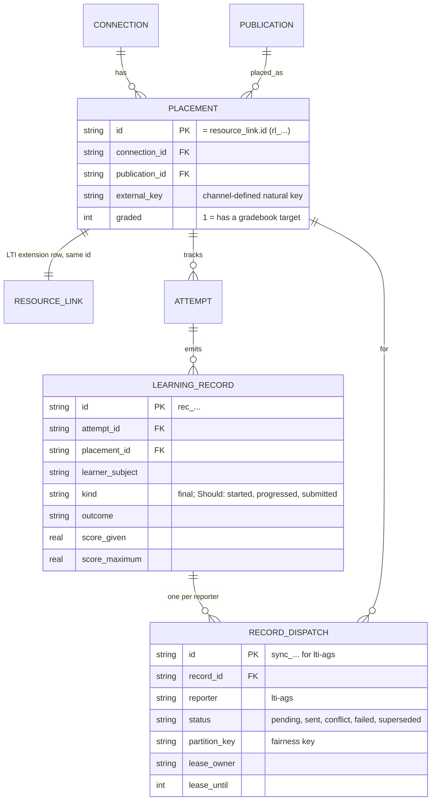

# LA-ADR-03: Learning-record core, record reporters and the job runner

Status: Proposed (A1, milestone LA P2, 2026-10-22). Epic: E4 (core Must, extras Should). Terms: [terms §4](../terms.md#4-learning-records). Inputs: [plan v1 §3 E4](../../../team/ltiaas/plan.md), [R3 §7](../../../research/ltiaas/R3-extensibility-audit.md), [R4 §3.7](../../../research/ltiaas/R4-ops-readiness.md), [ADR-010](../../adr/ADR-010-grade-and-completion-policy.md), app contract [§10](../../contracts/cogniate-app-api.md#10-score-sync-worker--t5a-retry-schedule-and-resend-t5b).

## Context

The record pipeline works, but it is AGS-only and keyed by LTI resource links:

- `attempt` has a foreign key to `resource_link` (`services/cogniate-app/src/domain/migrations/004_launch.sql:44`). `score_sync` also has one, and its `payload` is the AGS score body (`005_runtime_and_score_sync.sql:13-15`).
- The commit transaction builds the AGS body at once (`services/cogniate-app/src/domain/attempts.ts:288-301`).
- The worker posts AGS directly, finds the line item, and maps HTTP answers to statuses (`services/cogniate-app/src/worker/score-sync.ts:41-104`, `packages/tracking/src/outcome.ts:106-115`).
- The disabled rule names two LMSs (`services/cogniate-app/src/domain/score-syncs.ts:29`).
- The worker runs in the web process, sends one row at a time, and has no lease owner. A second worker would mark live sends of the first as interrupted (`domain/score-syncs.ts:95-106`; R4 B-1, B-2). It ignores platform `429` and `Retry-After` (R4 B-3).
- The safety rules are good and must stay: the in-flight marker, delivery uncertainty, bounded confirmation, the 24 h window, best result, supersede and Resend (ADR-010 rules 5–10 and P2; `domain/score-syncs.ts:60-178`).

Plan v1 makes the neutral tables `placement`, `learning_record` and `record_dispatch` a Must, with AGS as the first reporter and a generic outbox with leases, fairness, bounded parallelism and `429` handling. The Lead also asks for one job-runner interface that A2's E5 jobs use (Lead relay of A2 request 4).

## Decision

### D1. Neutral model (Must)



- The kernel owns `placement`, `learning_record`, `record_dispatch` and the outbox. The LTI driver owns `resource_link` and `gradebook_read`. The AGS reporter owns the AGS body and the AGS read-back.
- The learner stays a **learner subject** (the LTI `sub`). LA adds no learner table: identity and privacy belong to LD and LA-H4.
- Every name that tests and clients read stays: `rl_…` ids, `resourceLinkId`, `sync_…` ids, `scoreSyncs`, `/app-api/score-syncs/:id/resend`, the `score_sync` and `resource_link_rebound` log events (R3 M-4).

### D2. Placement (Must)

- One `placement` row per LTI resource link. `placement.id` = `resource_link.id`. The launch transaction upserts both rows (today: `upsertResourceLink`, `services/cogniate-app/src/domain/launch.ts:62-79`).
- `external_key` is the channel's natural key. LTI: the JSON array `[deployment_id, context_id, resource_link_id]`. Unique: (`connection_id`, `external_key`). The `resource_link` unique key stays (`004_launch.sql:22`).
- **Empty context.** A launch without a context (A2 [LA-ADR-05](LA-ADR-05-lti-advantage-completeness.md), E3 Must; R1 C-11) uses context id `""` in both keys. The `NOT NULL` columns accept it, so no schema change is needed.
- `graded` (default `1`) says that the placement has a gradebook target. Until A2's D-11 item ships, every placement is graded, so behaviour does not change: a graded placement without a line item still gives the `local_failure` outcome "No gradebook column" and a `failed` dispatch (ADR-010 rule 1, `services/cogniate-app/src/worker/score-sync.ts:26,61-64`). A2's ungraded rule (E3 Should, after LA-H22; [LA-ADR-05 D5](LA-ADR-05-lti-advantage-completeness.md)) applies only to channels with `content.ungraded` true: a new placement whose launch has no AGS `lineitem` claim gets `graded = 0`, and a later launch with that claim sets `1`. Channels without `content.ungraded` (Moodle) keep today's rule (A2 AP-05-28). An ungraded placement gets a learning record but no dispatch (`appliesTo` is false).
- `attempt.resource_link_id` stays (the foreign key cannot change additively). Code calls it the placement id. Limit: a non-LTI placement (LD, LE) cannot have an attempt until a later migration adds `attempt.placement_id`. LA records the limit; it does not solve it.

### D3. Learning record (Must for `final`; Should for progress kinds)

- A learning record is an immutable fact. The commit transaction writes one record of kind `final` when an accepted commit gives a non-preview attempt a new best final result (the `improves` rule, `packages/tracking/src/outcome.ts:57-65`, with a final outcome and a score).
- This rule gives the same dispatches as today: the highest non-superseded dispatch value of a learner and placement never goes down, so a commit that does not improve its attempt could never create a score sync row today either (`attempts.ts:283,289-301`). An Author unit test checks this with golden rows of the T5a and T5b commit sequences.
- Preview attempts write no record (ADR-010 rule 6).
- Fields: `attempt_id`, `placement_id`, `learner_subject`, `course_version_id`, `kind`, `outcome`, `score_given`, `score_maximum`, `occurred_at`. Should: `started_at`, `submitted_at` (R1 gap 11; AGS submission fields are A2's E3 Should item).
- Should: kinds `started`, `progressed`, `submitted`. The AGS reporter ignores them (ADR-010 rule 2: only final outcomes). They exist for LC (xAPI).

### D4. Record dispatch and the move of `score_sync` (Must)

- After the record write, the outbox asks each reporter of the connection (`records.reporters`, [LA-ADR-01 D3](LA-ADR-01-channel-kernel.md#decision)) for a dispatch decision. The baseline channels list `['lti-ags']`.
- A `record_dispatch` row has every column of today's `score_sync` row with the same meaning (status, tries, `next_try_at`, `sent_at`, `last_error`, `resent_at`, `send_started_at`, `delivery_uncertain`, `confirmation_after`, `payload`, `score_given`, `score_maximum`), plus `record_id`, `reporter`, `placement_id`, `learner_subject`, `partition_key`, `lease_owner`, `lease_until`, `not_before` (D7).
- AGS dispatch ids keep the prefix `sync_`. Migration `014` copies every `score_sync` row into `record_dispatch` with the same id and the same state, and makes one backfilled `final` learning record per copied row ([LA-ADR-04 D5](LA-ADR-04-refactor-and-migration.md#decision)). After `014`, no code reads or writes `score_sync`; the table stays as a frozen copy.
- The results API, Resend, the status line and `lastScoreSync` read `record_dispatch` rows of reporter `lti-ags`. Their JSON does not change.

### D5. Record reporter port (Must: the port and `lti-ags`)

```ts
// services/cogniate-app/src/kernel/records.ts (sketch)
export type DeliveryOutcome =
  | { kind: 'accepted' }
  | { kind: 'conflict'; text: string }                    // AGS 409
  | { kind: 'rejected'; text: string }                    // 400, 403, 404, 422: no retry
  | { kind: 'retryable'; text: string; uncertain: boolean } // 401, 5xx, no answer; uncertain only after a send began
  | { kind: 'throttled'; text: string; retryAt: number }  // 429 with Retry-After (D7)
  | { kind: 'local_failure'; text: string };              // no gradebook column, key cannot be used
export interface RecordReporter {
  id: string;                                   // 'lti-ags'
  policy: 'bestResult';                         // reserved: 'everyRecord' (LC); LA builds bestResult only
  appliesTo(p: PlacementView): boolean;         // lti-ags: p.graded
  prepare(r: LearningRecordView): unknown;      // the payload, stored at dispatch create (AGS body)
  partitionKey(d: DispatchView): string;        // lti-ags: the LTI platform id; for a shared platform, platform id + ':' + deployment id
  deliver(d: DispatchView, ctx: DeliveryContext): Promise<DeliveryOutcome>;  // marks "send began" through ctx before the remote call
  readBack?(p: PlacementView, learnerSubject: string, ctx: DeliveryContext): Promise<ReadBackResult>;
}
```

The `lti-ags` reporter (`services/cogniate-app/src/drivers/lti-ags/`):

| Step | Rule (unchanged behaviour) | Today |
| --- | --- | --- |
| `prepare` | The AGS body `{ userId, activityProgress: "Completed", gradingProgress: "FullyGraded", scoreGiven, scoreMaximum }` | `agsScoreBody` (`packages/tracking/src/outcome.ts:51`) |
| line item | Launch value, else `GET /api/lineitems?resourceLinkId=` and keep it; none → `local_failure` "No gradebook column" | `worker/line-item.ts:8-18`, ADR-010 rule 1 |
| send | `POST /api/lineitems/:id/scores` with `SERVICE-AUTH-V1`; the kernel's `beginSend` runs first, in one transaction with the connection state | `worker/score-sync.ts:61-74`, `domain/score-syncs.ts:85-93` |
| mapping | 2xx → `accepted`; `409` → `conflict` ("{LMS} has a grade with a newer time"); `400`, `403`, `404`, `422` → `rejected`; `401`, `5xx`, `0` → `retryable` (`uncertain` when the POST began and the answer was `0` or `5xx`); `429` (`PLATFORM_RATE_LIMITED`, or the LTI service's own `RATE_LIMITED`) → `throttled` with `retryAt` from `Retry-After` (LA-IC-11) | `outcome.ts:106-115`, `score-sync.ts:76-79` |
| read-back | AGS results read ("Refresh from {LMS}"), stored in `gradebook_read` | `app/results.ts:41-60` |

The `HTTP → outcome` table moves from `packages/tracking` into the reporter. `packages/tracking` keeps the neutral rule `outcome → status, next try` (renamed from `syncResult`; same results).

### D6. Grade policy and guarantees (Must, unchanged)

The outbox applies these rules to every reporter with policy `bestResult`. The keys change from (resource link, user) to (placement, learner subject, reporter). With one reporter, that is the same set of rows.

| Rule | Where it stays | Evidence today |
| --- | --- | --- |
| ADR-010 rule 5: a dispatch only for a better result; supersede lower `pending` rows; never retry a superseded row | outbox create step and `isCurrent` check | `attempts.ts:288-301`, `score-syncs.ts:60-67` |
| ADR-010 rule 9: retries 5 s, 30 s, 2 min, 10 min, 30 min, then hourly to 24 h | `packages/tracking` `nextRetryAt` | `outcome.ts:83` |
| ADR-010 rule 10: Resend only for the best `failed` or `conflict` row; new 24 h window | outbox Resend | `score-syncs.ts:157-178`, `outcome.ts:122-129` |
| P2: in-flight marker before the remote call; uncertainty kept; confirmation ≥ 5 s after the first accepted send of a row that needs it; one successful confirmation; window not extended | outbox `beginSend`, `recordResult`, startup recovery | `score-syncs.ts:69-137`, app contract §10 P2 |
| Outcome → status | `accepted` → `sent` (or `pending` for a confirmation), `conflict` → `conflict`, `rejected` and `local_failure` → `failed`, `retryable` → `pending` or `failed` at the window end, `throttled` → `pending` (D7) | `outcome.ts:106-115` |
| Disabled connection | authority `operatorGrant`: `failed` with `CONNECTION_DISABLED`, no remote call; authority `self`: send as today (the LTI service `403` ends it) | `score-syncs.ts:29,48-58`; [LA-ADR-01 D7](LA-ADR-01-channel-kernel.md#decision) |
| Texts | `lastError` and status texts fill `{LMS}`; Moodle texts byte for byte | `score-sync.ts:79`, `packages/tracking/src/status-text.ts:19-36` |

Known difference A-T9-C01 (5 s retry while the line-item lookup fails) stays as it is (app contract §10). Fixing it is not part of E4.

### D7. One job runner for the outbox and the E5 jobs (Must)

Each service has one job runner (shared code in `packages/shared`, new module `jobs`; reason: one interface for E4 and E5). The outbox is one queue job. A2's E5 jobs (retention, key re-wrap, scheduled signing-key rotation) are interval jobs ([LA-ADR-06](LA-ADR-06-service-operability.md)).

```ts
// packages/shared/src/jobs.ts (sketch)
export interface QueueJob<Item> {
  name: string;                                         // 'record-dispatch'
  due(now: number, limit: number): Item[];              // rows with status pending, next_try_at <= now, not_before <= now, no live lease
  partition(item: Item): string;                        // fairness key
  lease(item: Item, owner: string, until: number): boolean; // conditional update; false = someone else has it
  run(item: Item, ctx: JobContext): Promise<void>;
  limits: { parallel: number; perPartition: number; leaseMs: number };
}
export interface IntervalJob {
  name: string;                                         // 'retention', 'audit-retention', 'key-rewrap', 'signing-key-rotation'
  everyMs: number | null;                               // null = on demand only (key-rewrap)
  runAtStart: boolean;                                  // retention: true (today's start-up run)
  run(ctx: JobContext): Promise<JobRunResult>;          // single-run lease: one row per job name in job_lease
}
export interface JobRunResult { result: 'ok' | 'failed'; counts?: Record<string, number> }
export interface JobContext { instanceId: string; bootId: string; traceId: string; now(): number; logger: Logger; signal: AbortSignal }
export interface JobRunner {
  addQueue<Item>(job: QueueJob<Item>): void;
  addInterval(job: IntervalJob): void;
  runNow(name: string): Promise<JobRunResult | { result: 'skipped_lease' }>; // the on-demand trigger (operator API, A2)
  start(): void; stop(): Promise<void>;
}
```

| Rule | Detail |
| --- | --- |
| Lease | `lease_owner` = the instance id plus the boot id of the process (`app-1/<boot id>`); `lease_until` = now + `leaseMs` (default 60 s: above every outbound timeout of the app, 5 s by default and 15 s at most). The lease is taken by one conditional update. Only the lease owner (the same instance id **and** boot id) records a result, so a process that lost its lease cannot record late. |
| One in flight per key (Reviewer-A A-LAD-03) | For a `bestResult` reporter, at most one dispatch per (placement, learner subject, reporter) is in flight, across every runner. The lease update succeeds only when no other row with the same key has a live lease or a `send_started_at` value (one `UPDATE … WHERE NOT EXISTS (…)` statement). So a higher row waits until the lower send has a recorded result, as the single serial worker does today. |
| Confirmation (A-LAD-03) | The confirmation rule (`needsConfirmation`, `services/cogniate-app/src/domain/score-syncs.ts:72-75`) treats a superseded row of the same key that still has `send_started_at` like an uncertain row. With the one-in-flight rule this case cannot occur in normal work; the rule covers a crash between steps. |
| Instance id (QA Q-LAD-23) | `JOB_INSTANCE_ID` (default `app-1`, `lti-1`). Each runner process makes a random boot id at start and keeps one heartbeat row per instance id (`job_instance`: instance id, boot id, heartbeat every 10 s). `stop()` (called by the service's `SIGTERM` handler) deletes its own row. At start: (1) no row, or a row with a heartbeat 30 s old or older: the runner writes its own row and takes back at once the leases of its instance id (the same slot restarted). (2) A row of the same instance id with another boot id and a fresh heartbeat: the runner does **not** exit; the web part serves at once; the runner takes no lease and recovers nothing, and checks again every 5 s. When the row is gone or its heartbeat is 30 s old, it goes on as in (1). If that other heartbeat moves after the runner started, a second live process has the same id: `job_instance_conflict`, the runner stops (exit 1 of a worker process; the web process logs the error and keeps serving with its runner off) (B-LAD-09). So a normal restart (stop, then start) has today's timing: recovery is immediate (`score-syncs.ts:95-106`). Only a crash without `stop()` waits up to 30 s before the first send. The same rule holds for the LTI service runner. |
| Recovery (Reviewer-A A-LAD-05) | When the runner may start (Instance id, case 1), every dispatch with `send_started_at` set and **no live lease of another instance** (its own instance id, an expired lease, or `lease_owner IS NULL`, for example a row that migration `014` copied) becomes `delivery_uncertain = 1` and loses the marker, as today (`score-syncs.ts:96-107`). A row with a live lease of another instance is left alone until that lease expires. |
| Fairness | `due` returns rows round-robin over partitions, oldest `next_try_at` first inside each partition. For `lti-ags` the partition is the LTI platform id; for a shared platform it is platform id + deployment id, so one slow Learn host does not hold the other Blackboard schools (Reviewer-A A-LAD-13, Reviewer-B B-LAD-10). A `429` with `Retry-After` pauses only the partition of the row that got it. |
| Parallelism | `parallel` default 4 for the whole runner. `perPartition` is fixed at 1 for `bestResult` reporters (not a setting). With one platform (every M1, M2, T7 test) the sends stay sequential, as today. |
| `429` | The LTI service answers `429 PLATFORM_RATE_LIMITED` with `retryAfter` (A2, [lti-service-api-delta](../contracts/lti-service-api-delta.md)). The reporter returns `throttled`. The outbox keeps the row `pending`, does not count a try, does not mark it uncertain, sets `next_try_at` to the later of `retryAt` and the normal backoff, and sets `not_before` = `retryAt` on every `pending` row of that partition. The 24 h window still applies. |
| Interval jobs | One row per job name in `job_lease` with owner, `lease_until`, `last_run_at`, `last_result`. A run starts only when the lease is free or expired; else the run is `skipped_lease`. A crash cannot block a job for ever: the lease expires. Every run (also `runNow`) gets its own trace id and logs one `job_run {job, ms, result, counts}` line (`result`: `ok`, `failed`, `skipped_lease`; an error logs its class name only). These are the needs of A2's E5 jobs ([LA-ADR-06 D11](LA-ADR-06-service-operability.md)). |
| Worker process | The runner runs in the web process (default, as today) or alone (`npm run worker`, the same code). When `npm run worker` runs, the web process must have `APP_JOB_RUNNER=off`; the `production` profile refuses a start with both on (B-LAD-09). Two processes need two distinct instance ids; the heartbeat rule above stops a second live process with an equal id. With these rules and the one-in-flight rule, a second runner is safe. Production topology is A2's ([operability](../operability.md)). |

### D8. Guards (Must)

- `POST /app-api/publications/:id/results/refresh` needs a reporter with `readBack` (capability `records.readBack`). All baseline channels have it.
- Resend and refresh of a disabled `operatorGrant` connection keep `409 CONNECTION_NOT_READY` (app contract §4.7.2).

### D9. Ports for the backlog (names and limits only, not built)

| Port | Milestone | What LA leaves | Known limit |
| --- | --- | --- | --- |
| `RecordReporter` with policy `everyRecord` | LC (xAPI), LF (vendors) | the port, `reporter` and `partition_key` columns, progress record kinds (Should) | per-reporter settings per connection (DataCamp pattern 4) are not built |
| `CatalogExporter` + `ConnectionSchedule` | LB | the job runner (interval jobs) | no catalog item model |
| `ConnectionSecrets` slot | LB, LF | the key provider (A2, E5) | no table in LA |
| `IdentityResolver` | LD | `learner_subject` | no learner table; LA-H4 |
| `PackageExporter` | LE | `.mbz` as the first exporter ([LA-ADR-01 D8](LA-ADR-01-channel-kernel.md#decision)) | — |

## Alternatives considered

| Alternative | Why not |
| --- | --- |
| Keep `score_sync` as the AGS table and put only new reporters in `record_dispatch` | Two outbox tables for one engine. The results API and Resend would read two sources. |
| Keep `score_sync` and add `record_dispatch` as a thin index | The delivery state would exist twice and could disagree. |
| Rename `score_sync` and `resource_link` | Breaks foreign keys and the API names; ADR-011 §1 fact 4 forbids table rebuilds (R3 M-1, M-2). |
| Write a learning record for every commit | Noise (every `unload`), and no reporter needs it in LA. Progress kinds cover LC later. |
| A message queue for the outbox | Needs hosting (LG). The lease table gives the same safety for one or a few instances. |

## Consequences

- The record core no longer depends on AGS. A new reporter is a driver with the port; it gets retries, leases, fairness and the P2 rules from the outbox.
- `014` is the only E4 migration. It copies delivery state, so its migration test is a Must (D5 in LA-ADR-04).
- One slow platform no longer delays the other platforms (R4 B-1). A second runner is safe only with a distinct instance id, `APP_JOB_RUNNER=off` in the web process, and the one-in-flight rule (D7; R4 B-2).
- The `score_sync` table stays as a dead copy until a later clean-up (LG). Nothing reads it.

## Migration and compatibility

[LA-ADR-04 D5](LA-ADR-04-refactor-and-migration.md#decision) (migration `014`, the backfill and its rollback note). Tables: [data-model §3](../data-model.md#3-cogniate-app-migration-014-e4-learning-records-and-job-runner). The app API is unchanged ([app API delta §6](../contracts/cogniate-app-api-delta.md)).

## Test impact

- Author unit tests (no Docker): golden equality of dispatch rows for the T5a and T5b commit sequences; reporter mapping table; `throttled` handling; lease rules (own instance at once, other owner after expiry); recovery of a leaseless row with `send_started_at` (A-LAD-05); two runners with distinct ids on one temporary SQLite file: one due row gives exactly one `beginSend`, and a higher row of the same learner waits until the lower send has a result (A-LAD-03); the restart rules with a controlled clock: a clean restart (row deleted by `stop()`) recovers at once; a restart after a crash waits until the old heartbeat is 30 s old; a second live process with the same id stops with `job_instance_conflict`, and its wait never takes a lease (Q-LAD-23, B-LAD-09); fairness order with a shared-platform partition per deployment; job runner single-run lock. QA covers the observable parts black-box (QA strategy §8 E4).
- Migration test for `014`: every `score_sync` row has one `record_dispatch` row with equal id and state, one `final` record, and one placement per resource link; the results API JSON is equal before and after.
- Regression: T5a, T5b (P2, P5, P11 checks), T7, M1 score rows. QA decides the exact set ([`tests/ltiaas/TEST-STRATEGY.md`](../../../../tests/ltiaas/TEST-STRATEGY.md)).

## Open questions

| Id | Question | Default until decided |
| --- | --- | --- |
| LA-H4 | Retention of learning records and dispatches; erase scope for one learner | Keep them (data-model §2.1 rule: they are the record of results) |
| Q4 | Best or latest result | Best (ADR-010); only the reporter policy changes |
