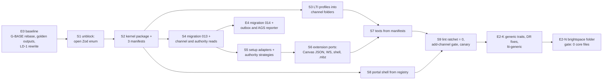

# LA-ADR-04: Refactor and migration of Moodle, Canvas and Blackboard into the kernel

Status: Proposed (A1, milestone LA P2, 2026-10-22). Epics: E0, E1 (Must), E4 data move (Must). Terms: [terms](../terms.md). Inputs: [plan v1.1 §3 E0, E1, §4, §6.1](../../../team/ltiaas/plan.md), [R3 §7.3](../../../research/ltiaas/R3-extensibility-audit.md) (migration risks M-1 to M-6), [R5 §4c](../../../research/ltiaas/R5-test-baseline.md) (regression tiers), [ADR-011 §14](../../adr/ADR-011-multi-lms.md#14-compatibility-migration-upgrade-and-rollback), [ADR-006](../../adr/ADR-006-storage.md) (migration rule).

## Context

- The three baseline channels must move into the kernel with **no behaviour change** (plan §1). M1, M2 and T7 must pass with only the reviewed closed-list rewrite of E0 (plan §4 measure 3, LD-1).
- E1 must change no storage command and may make only additive schema changes, each with a migration test (plan §3 E1).
- Two facts limit the schema work:
  - `connection.lms` has `NOT NULL DEFAULT 'moodle' CHECK (lms IN ('moodle','canvas','blackboard'))` (`services/cogniate-app/src/domain/migrations/011_lms_types.sql:4`). SQLite cannot change a CHECK without a table rebuild. The runner runs each file in one transaction with foreign keys on, and eight foreign keys reference `connection`, so a rebuild does not fit (R3 M-1; ADR-011 §1 fact 4).
  - An old build refuses a database with migrations that it does not know (ADR-011 §1 fact 4). Rollback is the ADR-011 §14 backup-and-restore procedure.
- Tests and clients read wire names that contain LMS words or LTI words: `canvasConfiguration`, `/canvas-configuration`, `createMoodleCourse`, `resourceLinkId`, `scoreSyncs`, the `score_sync` log event (R3 M-4; `apps/portal/src/types.ts:9,191,207`).
- No stack suite has run at HEAD; the baseline must come first (R5 §1.3).

## Decision

### D1. Order of work (strangler steps)

Each step keeps the product working and is one reviewable task (P3 makes the task specs). A step changes no behaviour unless this table says so.

| Step | Change | Lane | Behaviour change | Proof (beyond `npm run check` with unit tests and K0) |
| --- | --- | --- | --- | --- |
| E0 | Rebase on G-BASE (LA-H10); QA records the baseline and the golden outputs (D6); QA rewrites the closed-list assertions once (LD-1) | QA | none | baseline run (R5 §6 item 1) |
| S1 | The app accepts any `lms` string in `GET /api/providers` (`services/cogniate-app/src/clients/lti-client.ts:55`); the app ignores a profile that no adapter owns | K | none (all answers today have known values) | golden `GET /app-api/lms-providers` |
| S2 | `packages/channel-kernel`; manifests for `moodle`, `canvas`, `blackboard`; registry loaders; legacy capability projection. S2 also installs F1 (the LMS-name lint) with today's per-file counts as the ratchet baseline, and F3 (the import fence), so no later step can add an LMS name to core | K | none | K0: projection equals the M1 capability objects (golden); F1 and F3 pass on the S2 tree |
| S3 | `profiles/{standard,canvas,blackboard}.ts` move to `packages/channels/*/lti-profiles.ts`; traits `endpoints`, `privacyFloor`; generic check 14; `channel` field on `GET /api/providers`; text names from manifests; `PUBLIC_MOODLE_URL` leaves the LTI service config (`packages/shared/src/config.ts:18,43` becomes optional per service) | L | additive `channel` field only | golden `GET /api/providers` (plus `channel`); check 14 refusal table; M1 sim protocol rows |
| S4 | Migration `013` (D4); the connection repository reads `channel` and `binding_authority`; routing, the disabled rule and the cleanup read the stored authority and target kind | K | none | migration test (D4); M1 `migration` and `snapshot-upgrade` phases; R1 tier |
| S5 | `ConnectionSetup` port for all three channels (Moodle create rules and the six-value parser move into `packages/channels/moodle/app.ts`); authority strategies `self` and `operatorGrant`; operator CLI by authority | K | none | M1 sim rows (grants, redemption, suspend, release); T4b1 manual connect |
| S6 | Extension ports: Canvas JSON route, web services route, course-shell hook, `.mbz` exporter move into their folders behind capability guards, with frozen paths | K | none | golden Canvas JSON (url and inline); T8 subset; M1 guard rows |
| S7 | `{LMS}` texts from manifests in tool pages, player, `packages/tracking`, LTI service pages; closed name unions become `string` | K, L | none (Moodle text name is `Moodle`) | golden error pages and status texts per channel |
| S8 | Portal shell: registry routes, manifest cards, manifest wizard; Moodle, Canvas and Blackboard modules move into their folders | P | none visible | M2 (64 cases); T6 subset |
| S9 | The F1 ratchet counts reach 0 in core; add-channel gate F2 on; QA canary channel | K, QA | none | the fitness checks themselves |
| E4 | Migration `014` (D5); outbox and job runner; AGS reporter | R | none | migration test (D5); T5a, T5b (P2, P5, P11), T7 |

S3 and S8 can run in parallel with S4–S6 (different lanes, different files). E2-K and E2-N follow S9 ([LA-ADR-02 D8](LA-ADR-02-generic-lti-channel.md#decision)). E4 needs S4 only.

### D2. Frozen wire names

These names stay byte for byte, although they contain an LMS word or an LTI word. Only `packages/channel-kernel/src/legacy-wire.ts` may hold the LMS-named ones (LMS-name lint exception, [LA-ADR-01 D10](LA-ADR-01-channel-kernel.md#decision)).

| Kind | Frozen names |
| --- | --- |
| DTO fields | `lms`, `capabilities` with the six legacy flags, `webServices`, `serviceUrl`, `platform.*`, `registrationUrl` |
| Request fields | `lms`, `profile`, `createMoodleCourse` |
| Paths | `/app-api/lms-providers`, `…/canvas-configuration`, `…/web-services`, `…/deployments`, `…/mbz`, `…/download?kind=mbz`, `/integrations/moodle/…`, `/integrations/canvas/…`, `/integrations/blackboard/…` |
| Error details | `details.capability` values of the M1 guards |
| Error and page codes | `MOODLE_TOOL_MAY_EXIST` (app contract §6; text `packages/shared/src/html.ts:8-12`), `MOODLE_WS_ERROR` (`services/cogniate-app/src/app/api-errors.ts:45`) |
| Values that core writes | the behaviour-class values `moodle`, `canvas`, `blackboard` of the frozen `connection.lms` column (D4 rule 2); the legacy manual-`self` list of registry load check 6 (one entry, the Moodle channel; LA-ADR-01 D4) |
| Ids and records | `rl_…`, `sync_…`, `resourceLinkId`, `scoreSyncs`, `lastScoreSync` |
| Log events | `score_sync`, `resource_link_rebound`, `launch_rejected` reasons, `provider_not_ready`, every ADR-011 event |
| Schema | every table and column name (applied migrations are history; ADR-006) |

### D3. App API and portal route compatibility

- Every change is additive ([app API delta](../contracts/cogniate-app-api-delta.md)). A request without the new fields behaves as today.
- The three baseline portal routes keep their URLs because the generic route pattern `/integrations/:channelId/…` gives the same paths. The server allowlist (`services/cogniate-app/src/app/portal.ts:29-30`) uses the same pattern.
- The LTI service API is additive too (`channel` on `GET /api/providers`; E2 fields). A2 owns that delta ([lti-service-api-delta](../contracts/lti-service-api-delta.md)).

### D4. Migration `013_channel_kernel.sql` (E1, step S4)

| Table | Change | Backfill | Meaning |
| --- | --- | --- | --- |
| `connection` | `channel TEXT` | `= lms` | the channel id; core reads only this |
| `connection` | `binding_authority TEXT CHECK (binding_authority IN ('self','operatorGrant','verifiedAdminLaunch'))` | `moodle` → `self`; `canvas`, `blackboard` → `operatorGrant` | the authority used to bind (D7 of LA-ADR-01) |
| `binding_attempt` | `target_kind TEXT CHECK (target_kind IN ('exclusive_platform','platform_deployment','shared_deployment'))` | Canvas `initial` → `exclusive_platform`; Canvas `add_deployment` → `platform_deployment`; Blackboard → `shared_deployment` | the record kind for cleanup (R3 S9, S12) |
| `binding_grant` | `bound_values TEXT` (JSON) | `NULL` | the admin values of an admin-value binding ([LA-ADR-02 D6](LA-ADR-02-generic-lti-channel.md#decision)) |

Rules:

1. **Writes.** A new connection writes `channel` and `binding_authority` in its insert. Both never change.
2. **The frozen `lms` column.** A new connection of a baseline channel writes `lms` = its channel id. A connection of any other channel writes its **behaviour class**: `moodle` for `self`; `canvas` for `operatorGrant` with an exclusive platform; `blackboard` for `operatorGrant` with a shared platform. Reason: the CHECK allows only these values. A missed old read of `lms` then still selects the same authority rules (fail-equivalent, not fail-open).
3. **Reads.** Core never reads `connection.lms`. The connection repository maps `channel` (never `NULL` after the backfill). A fitness check in `npm run check` fails when product SQL outside the repository names `lms` of `connection`.
4. **`binding_grant.lms`** has no CHECK (`011_lms_types.sql:30`); new grants store the channel id.
5. **Migration test (Must, plan E1 constraint).** On a copy of every M1 fixture database: after `013`, every row has `channel = lms`, the expected `binding_authority` and `target_kind`; every API answer of the golden set is equal; an `012` build refuses the `013` ledger (ADR-011 §1 fact 4).

### D5. Migration `014_learning_records.sql` (E4)

| Step | Rule |
| --- | --- |
| 1 | Create `placement`, `learning_record`, `record_dispatch`, `job_lease` ([data-model §3](../data-model.md#3-cogniate-app-migration-014-e4-learning-records-and-job-runner)). |
| 2 | One `placement` per `resource_link` row: same id, same `connection_id` and `publication_id`, `external_key` = `[deployment_id, context_id, resource_link_id]`, `graded = 1`. |
| 3 | One `learning_record` (kind `final`) per `score_sync` row: its `attempt_id`, `resource_link_id` as `placement_id`, `user_sub`, score, `occurred_at = created_at`. The record id is derived from the sync id (`rec_` + the sync id body), so the step is repeatable in a test. |
| 4 | One `record_dispatch` per `score_sync` row: the same id and every state column copied (status, tries, times, `last_error`, `resent_at`, `send_started_at`, `delivery_uncertain`, `confirmation_after`, `payload`, scores); `reporter = 'lti-ags'`; `partition_key` = the LTI platform id of the connection (`lti_platform_id`; for a shared platform, the `lti_platform_id` of its reservation); no lease. |
| 5 | `score_sync` stays unchanged and is never read or written after `014` (frozen copy). |

The migration runs at the first start, before the job runner starts (today `recoverInterruptedSends` runs at worker creation, `services/cogniate-app/src/worker/score-sync.ts:39`). So a copied `send_started_at` becomes `delivery_uncertain` by the normal startup recovery, exactly as today.

**Migration test (Must).** Every `score_sync` row has one equal `record_dispatch` row and one record; every `resource_link` has one placement; the results API JSON, Resend answers and the play status answer are equal before and after; a P2 fixture (a row with `send_started_at` set and a pending confirmation) behaves as in T5b after the restart.

### D6. Regression proof (Must)

| Item | Content |
| --- | --- |
| Golden outputs (E0) | Recorded at the G-BASE SHA and compared after every step: `GET /api/providers`; `GET /app-api/lms-providers`; connection DTOs per channel and status; tool-configuration rows per channel; Canvas JSON (`jwk=url` and `jwk=inline`); `/healthz` of both services; every tool error page per channel (HTML); player status texts; results API rows; simulator records per M1 scenario (stored claims, client assertion `aud`, Deep Linking items). The only allowed differences are the additive fields (`channel`, `channelName`, `channelCapabilities`) and the D8 items. |
| Tiers (R5 §4c) | R0 on every commit (`npm run check` with K0 and the fitness checks, about 1.5 min). R1 before each E1 step's QA PASS: M1 `--phase sim --provider all` (394 rows) and M2 (64), about 30 min on the simulator slot. R2 at the end of E1 and at the final SHA: T7 (3 × 17) and the legacy suites, about 1.5–2.5 h on the Moodle slot. |
| Schema steps | S4 and E4 add the M1 `migration` and `snapshot-upgrade` phases once each. The 70 storage rows stay out, because no storage command changes (plan E1 constraint; LD-3). |
| Assertions | Only the E0 open-world rewrite changes test assertions (LD-1). QA owns that list (QA strategy §4.3); it must cover every exact list and count of profiles, providers, LMS entries, cards and simulation profiles, also `tests/acceptance/M1/canvas/11-canvas-platforms.test.ts:255` and `tests/acceptance/M1/common/90-simulation-gates.test.ts:19` (QA pre-review Q-LAD-08). Any other assertion change in M1, M2 or T7 is a behaviour change and needs an `LA-IC` id (D8) or the Lead. |
| Intended changes | Only the items of D8, each with its id. A golden difference or a frozen-test failure without an id is a FAIL (QA strategy §4.7). |

### D7. Rollback

- Every migration is forward only. No ledger entry is edited or deleted.
- Rollback uses the ADR-011 §14 procedure unchanged: stop both services, `stack:data-restore` of the verified backup made before the first start of the new revision, then the old revision. No storage command changes in LA.
- WARNING: a rollback loses every write after the backup: connections, grants, launches, attempts, learning records and dispatches. After a rollback across `014`, scores that the LMS accepted stay in the LMS gradebook; the portal no longer shows their dispatch rows.
- `013` alone is safe to roll back with the same procedure: the old build reads `lms`, which keeps the M1 values for every baseline connection. A connection of a new channel does not exist before E2.

### D8. Intended behaviour changes (ids `LA-IC-nn`)

Each id names the golden fields and the frozen tests that it changes. The Lead approves each test change as one reviewed list, like LD-1. The owner of the design writes the exact expected values in its ADR.

| Id | Change | Epic | Design | Golden fields changed | Frozen tests touched (QA confirms) |
| --- | --- | --- | --- | --- | --- |
| LA-IC-01 | Additive wire fields: `channel`, `channelName`, `channelCapabilities` (connection DTO, `lms-providers` entries); `channel` on each `GET /api/providers` profile (E1); the trait fields `endpoints`, `issuerKind`, `endpointOrigins` on each `GET /api/providers` profile (E2-K; values in A2's [lti-service-api-delta §4.7](../contracts/lti-service-api-delta.md)) | E1 S2, S3; E2-K | [LA-ADR-01 D6, D11](LA-ADR-01-channel-kernel.md#decision); [LA-ADR-02 D2](LA-ADR-02-generic-lti-channel.md#decision) | new fields only; every baseline field equal | whole-object assertions that LD-1 does not open |
| LA-IC-02 | The LTI service no longer requires `PUBLIC_MOODLE_URL`. The outbound allowlist still comes from `MOODLE_HOST` (`infra/compose.yaml:135`), so `/healthz` does not change | E1 S3 | this ADR, D1 | none expected | none expected |
| LA-IC-03 | Moodle DR accepts an issuer with a path (`path-prefix`); host-root Moodle unchanged | E2-K | [LA-ADR-02 D2, D5](LA-ADR-02-generic-lti-channel.md#decision) | none for the baseline | a Q18 refusal test, if one exists |
| LA-IC-04 | No NRPS scope in any channel: Canvas JSON `scopes`, the DR request scope, Moodle manual row 13 "Do not use this service" | E3 | A2 [LA-ADR-05 D4](LA-ADR-05-lti-advantage-completeness.md) | Canvas JSON, Moodle tool rows, DR request | M1 Canvas JSON rows, T4b1 and T7 tool-row checks |
| LA-IC-05 | A valid launch without a context opens the player | E3 | A2 [LA-ADR-05 D2](LA-ADR-05-lti-advantage-completeness.md) | the `not_resource_link` refusal page for that case | a test that expects the refusal, if one exists |
| LA-IC-06 | Platform storage launch when the state cookie is missing | E3 | A2 [LA-ADR-05 D1](LA-ADR-05-lti-advantage-completeness.md) | login page for profiles with `platformStorage` | none for profiles with `platformStorage: null` |
| LA-IC-07 | Ungraded placements (channels with `content.ungraded` only) get a record, no dispatch, and "Not graded in {LMS}"; the Canvas JSON gets the `link_selection` placement | E3 Should (LA-H22) | A2 [LA-ADR-05 D5](LA-ADR-05-lti-advantage-completeness.md); [LA-ADR-03 D2](LA-ADR-03-learning-record-core.md#decision) | results rows of ungraded placements; Canvas JSON | B-PF-03 checks for ungraded placements only; the M1 Canvas JSON rows |
| LA-IC-08 | Claim policy per tool account; the `cogniate` account moves to `allowlist` (D-9), so Moodle launches keep only the allowlist claims | E3 Should (LA-H4) | A2 [LA-ADR-05 D7](LA-ADR-05-lti-advantage-completeness.md), [security-delta](../security-delta.md) | stored Moodle claims; `GET /api/idtoken` (`raw=true`) for Moodle; `launch_claims_minimized` lines | tests that read Moodle `custom`, `lis`, name or e-mail claims (QA scan) |
| LA-IC-09 | After `014`, the T5b P5 fixture must delete the failed row in `record_dispatch`, not in `score_sync` (`tests/host/p5-fixture.mjs`) | E4 | [LA-ADR-03 D4](LA-ADR-03-learning-record-core.md#decision), D5 above | none (product behaviour equal) | the P5 fixture only; the Lead decided it (plan LD-6): the fixture deletes the same row in `record_dispatch`, the assertions do not change, both reviewers review the fixture diff |
| LA-IC-10 | E5 service changes (rate limits `429`, API key table, signing-key states, audit) | E5 | A2 [LA-ADR-06](LA-ADR-06-service-operability.md) | A2 lists them | A2 lists them; M1, M2, T7 must stay green (AP-06-18) |
| LA-IC-11 | A platform `429` (and the Canvas throttling `403`) becomes `429 PLATFORM_RATE_LIMITED`; the outbox keeps the row `pending` until `Retry-After` and pauses the partition (`throttled`). Today both become `502 PLATFORM_ERROR` in the LTI service and are retried with the normal backoff. | E4, E5 | [LA-ADR-03 D5, D7](LA-ADR-03-learning-record-core.md#decision); A2 [lti-service-api-delta §1.3](../contracts/lti-service-api-delta.md) | score sync rows after a throttled send | none in M1, M2, T7 (no test sends `429`) |
| LA-IC-12 | Deep Linking: a "Cancel" button on the picker page and on the "No course is published" page; `POST /api/deeplinking {contentItems: []}` gives `200` (was `400`); an item with `lineItem` gives `400 INVALID_CONTENT_ITEM` when the launch has `accept_lineitem: false`; `acceptLineItem`, `acceptMediaTypes` in the shaped token | E3 | A2 [LA-ADR-05 D3](LA-ADR-05-lti-advantage-completeness.md) (exact values in its §5 table) | picker page HTML; `deepLinkingSettings` | tests that click the only picker button; a test that expects `400` for an empty list; whole-object checks of `deepLinkingSettings` (QA scan) |
| LA-IC-13 | Could gaps: `scoreGiven: null` accepted as absent (was `400`); an NRPS claim without `2.0` in `service_versions` gives `403 SERVICE_NOT_AVAILABLE`; an untrusted extra `aud` fails check 5 | E3 Could | A2 [LA-ADR-05 D10](LA-ADR-05-lti-advantage-completeness.md); [LA-ADR-07 D8](LA-ADR-07-security-and-tenancy.md) | none for the baseline platforms | tests that expect `400` for `scoreGiven: null` (QA scan) |

### D9. Merge with the Blackboard and Canvas run

LA starts on the frozen candidate (LA-H10 recommendation). Lane K rebases at each wave end and owns the merge of the E1 files. A change of the other run in a file that E1 moves (for example `services/cogniate-app/src/providers/canvas.ts`) is merged into the new channel folder file, with the golden outputs as the check.

## Alternatives considered

| Alternative | Why not |
| --- | --- |
| A table rebuild to change the `lms` CHECK | Not possible inside the migration runner with foreign keys on (R3 M-1); forbidden by ADR-011 §1 fact 4. |
| Write `moodle` into `lms` for every new channel | A missed old read would treat an operator-grant channel as Moodle and route launches without an approval (fail-open). The behaviour class is fail-equivalent. |
| One big-bang refactor | Not reviewable; no golden comparison per step; high merge risk with the other run. |
| Move `score_sync` rows by an `UPDATE` or rename | Breaks the frozen-table rule and the foreign keys; copying keeps the old table as evidence. |
| Skip the backfill of old dispatch rows | The results API and Resend would read two tables. |

## Consequences

- E1 has one migration (`013`), E4 one (`014`), E2-K one small LTI service migration. Each has a migration test.
- `connection.lms` and `score_sync` stay as frozen columns and tables. A later clean-up (LG, with the Postgres move) can drop them.
- The golden outputs make "no behaviour change" a checkable claim, not a review opinion.

## Migration and compatibility

This ADR is the migration and compatibility record. Table details: [data-model](../data-model.md). App API: [app API delta](../contracts/cogniate-app-api-delta.md).

## Test impact

The proof of D6. QA owns the exact suites, slots and the golden-output tool ([`tests/ltiaas/TEST-STRATEGY.md`](../../../../tests/ltiaas/TEST-STRATEGY.md) §4).

## Open questions

| Id | Question | Default until decided |
| --- | --- | --- |
| LA-H10 | Start the build on the frozen candidate or wait for the full Blackboard and Canvas acceptance | Frozen candidate; rebase at each wave end |
