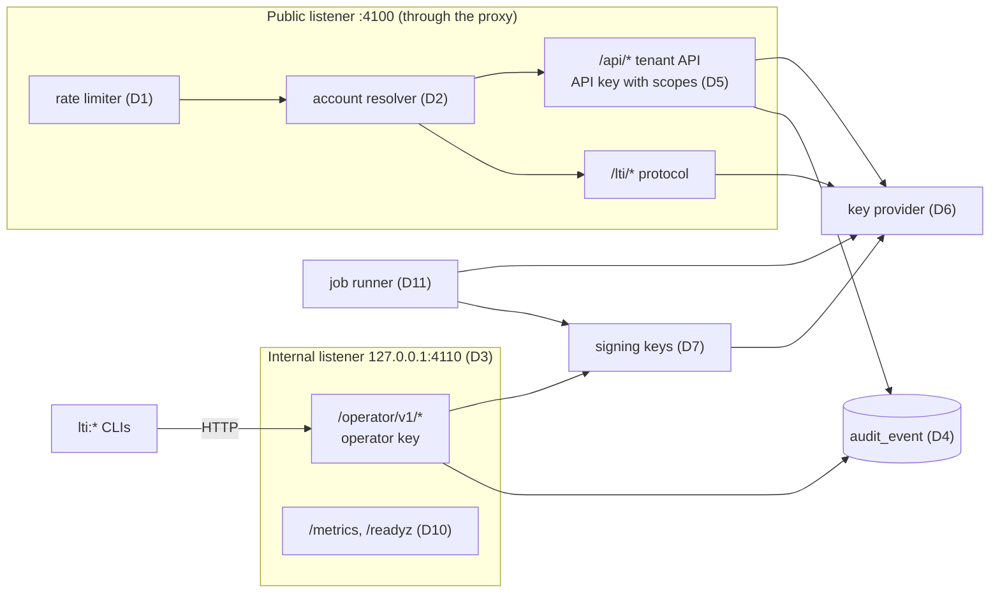
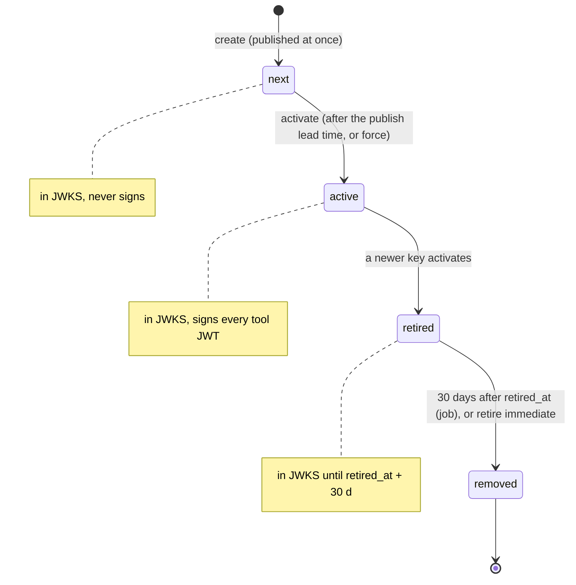

# LA-ADR-06: Service operability of the LTI service

Status: **Proposed** (P2 design, Architect-2 A2, 2026-10-22). Epic: E5 (plan v1 §3). Owner: A2. Consistency owner: A1.
Inputs: [plan v1 §3 E5](../../../team/ltiaas/plan.md#e5-service-operability-and-security--must-and-should), [R4 ops readiness](../../../research/ltiaas/R4-ops-readiness.md) (ids `T-1`, `K-1`, … below are R4 row ids), [R1 spec coverage](../../../research/ltiaas/R1-spec-coverage.md), [LA terms](../terms.md).
Related: [LA-ADR-07 security and tenancy](LA-ADR-07-security-and-tenancy.md), [LTI service API delta](../contracts/lti-service-api-delta.md), [operability runbook design](../operability.md), [security delta](../security-delta.md).

Names in this file follow [LA terms](../terms.md) (§6: operator, operator key, API key scope, key provider, key version, key ring, signing key state, audit event, rate-limit class). The job runner is the one of [LA-ADR-03](LA-ADR-03-learning-record-core.md) (Lead decision: one interface, owned by A1).

## 1. Context

The LTI protocol core is production-shaped (R4 §2). The operations layer is not. Facts:

| # | Fact | Evidence |
| --- | --- | --- |
| F1 | No rate limit exists in product code or in the proxy. Unauthenticated routes do work: `GET /lti/register/:account` fetches a URL and stores a session; login writes a state row. | R4 L-1; `services/lti-service/src/http/routes/registration.ts:114-128`; `services/lti-service/src/store/states.ts:16-21`; `infra/proxy/Caddyfile:30-33` |
| F2 | Fastify has no `trustProxy`, so a per-client limit cannot see the client address behind the proxy. | `services/lti-service/src/http/app.ts:67-71` |
| F3 | Every tool account gets its tool URLs from `PUBLIC_APP_URL`. A second tenant cannot receive its own launches. The account has no status. | `services/lti-service/src/store/accounts.ts:45-47`; `services/lti-service/src/db/migrations/001_init.sql:2-10` |
| F4 | Accounts, API keys, signing keys and the shared platform have only container CLIs. The CLIs write `lti.db` while the service runs. | `services/lti-service/src/cli/bootstrap.ts:23-30`; `services/lti-service/src/cli/shared-platform.ts:1-64`; R4 J-3 |
| F5 | One API key per account. `--rotate-api-key` replaces it at once. The key has no scope: the same key launches and deletes platforms. | `services/lti-service/src/store/accounts.ts:59-62`; `services/lti-service/src/http/auth.ts:64-67` |
| F6 | No audit store. Some admin changes write no log event (`PATCH /api/platforms/:id`, the bootstrap CLI). | R4 AU-1; `services/lti-service/src/http/routes/platforms.ts:211-231` |
| F7 | One master key from the environment encrypts tool private keys and registration tokens. Blobs are `iv | tag | ciphertext` with no key version and no associated data. The same key is the root of the service-key HMAC. | `packages/shared/src/crypto.ts:24-37`; `services/lti-service/src/config.ts:22-23`; `services/lti-service/src/store/service-keys.ts:24-38`; `infra/compose.yaml:128` |
| F8 | Signing-key rotation makes the new key active at once (no "publish first"). The JWKS keeps a retired key only while `now - created_at < 30 days`, so a key older than 30 days leaves the JWKS at the moment it retires. The contract says "retired keys for 30 days". No test covers rotation (A-T0-16). | `services/lti-service/src/store/tool-keys.ts:13-37`; `docs/architecture/contracts/lti-service-api.md:148`; `docs/human_review/deferred.md:21`, `:67` (F9) |
| F9 | A service key has no expiry and no revoke path except a platform delete. A leaked service key plus the API key can write grades for every activity of the course (A-T3a-04). | `services/lti-service/src/store/service-keys.ts:56`, `:85-88`; `docs/human_review/deferred.md:22` |
| F10 | No metrics, no readiness, no tenant id in `http_request`. `/healthz` is public and shows the profile, knobs and allowlist. | R4 O-1, O-2, O-4, L-2; `services/lti-service/src/http/app.ts:80-85`, `:110-113` |
| F11 | Scheduled work is one in-process timer (retention). | `packages/shared/src/retention.ts:14-29` |
| F12 | Storage is SQLite per service on the ADR-012 volumes. ADR-012 is accepted as a design for the dev stack; its runtime gates are open. LD-3: E5 changes no storage engine. | `docs/architecture/adr/ADR-012-sqlite-volume-storage.md:3`; plan v1 §6.1 LD-3 |

Tenancy assumption: plan v1 LA-H7 recommends "build the vendor-model controls in E5; sell only to Cogniate libraries in v1; one host per tool account". This ADR designs for that recommendation.

## 2. Decision

Priority marks follow plan v1 §3: **Must**, **Should**, **Could**.

| # | Decision | Priority | Plan E5 item |
| --- | --- | --- | --- |
| D1 | **Rate limits** in the LTI service: token buckets per rate-limit class and key; `429 RATE_LIMITED` with `Retry-After`; `trustProxy` only for configured proxy addresses. | Must | Must 1 |
| D2 | **Tenant model**: a tool account has a status (`active`, `suspended`, `closed`) and its own tool URLs. One **account resolver** module makes every protocol URL. Path mode stays the default; host mode is a profile of the resolver for LG hosting. | Must | Must 2 |
| D3 | **Operator API** on an internal listener with its own credential (operator key). The LTI CLIs become clients of it, except the one trust bootstrap command. | Must | Must 3 |
| D4 | **Audit log**: an append-only `audit_event` table. Every operator call and every tenant admin call writes exactly one audit event, in the same transaction as the change. | Must | Must 4 |
| D5 | **API key lifecycle**: an `api_key` table with id, label, scopes (`launch`, `admin`), expiry, last use and revoke; at most two active keys per account. | Must | Must 5 |
| D6 | **Key provider** port with versioned envelope encryption, associated data and purpose subkeys. A local key-ring file provider in LA. Cloud KMS adapter in LG. | Must | Must 6 |
| D7 | **Signing-key lifecycle** `next` → `active` → `retired` with `published_at`, `activated_at`, `retired_at`. JWKS retention counts from `retired_at`. Activation waits for a publish lead time. The A-T0-16 tests close the deferral. | Must | Must 7 |
| D8 | **Service key revoke and re-issue** by platform, deployment, context or resource link. A write-scope policy per account closes A-T3a-04. | Should | Should |
| D9 | **`Idempotency-Key`** on `POST /api/lineitems`, `POST /api/platforms` and `POST /api/platforms/:id/deployments`. | Should | Should |
| D10 | **Observability**: tenant id in logs, OpenMetrics `/metrics` and `/readyz` on the internal listener, minimal public `/healthz` in the production profile. | Should | Should |
| D11 | **E5 jobs** run on the one job runner of LA-ADR-03 (A1 owns the interface). E5 fixes the job list and what each job needs: a schedule or an on-demand trigger, a single-run lease, one log line per run. | Should | (job runner shape) |
| D12 | **Production profile**: fail-closed start rules, secrets from files. | Should | Should |
| D13 | **Storage path**: SQLite on the ADR-012 volumes stays for dev, simulator and pilot. LA adds only additive tables, each with a migration test. An async store port in the LTI service is Should. The Postgres engine is LG (LA-H5). | Should (port); decision now | Should |
| D14 | **Pilot backup and restore**: RPO and RTO definitions, key-ring escrow, a restore drill on the existing cold backup. An online backup is not in LA (LD-3). LA-H8 decides the pilot RPO. | Should | Should |

Kernel fit ([LA README §3](../README.md#3-layers), layer "Core: tenancy, keys, audit"; [LA-ADR-01](LA-ADR-01-channel-kernel.md)): D1–D14 are **service-wide**. They live in the LTI service core and in `packages/shared` (key provider; the job runner of LA-ADR-03 D7). They name no channel and need no capability, so they add no port to LA-ADR-01 D5 and no K0 contract. Channel adapters never call the operator API, the key provider or the audit writer directly. The kernel and the LTI 1.3 driver call them.



### D1. Rate limits (Must)

| Rule | Detail |
| --- | --- |
| Algorithm | Token bucket per (class, key). Refill per second. Buckets live in memory in a bounded map (at most 100,000 keys; least recently used first out). One instance in LA. A shared store is LG. |
| Order | The IP classes run in an `onRequest` hook, before any database read. The key classes run right after the API key or operator key lookup. A failed authentication spends one token of the `auth_failure` bucket of the client address. |
| Client address | The socket address. `X-Forwarded-For` is used only when the socket peer is in `TRUSTED_PROXY_CIDRS` (Fastify `trustProxy` with that list). Values: CIDRs or host names; a host name is resolved at start and again every 60 s. Value in the compose stack (every profile): `proxy`, the Caddy service, so the `e2e` container and every other peer are untrusted. Empty list = no forwarded header is trusted. |
| Answer, API | `429`, body `{ "status": 429, "error": "Too Many Requests", "details": { "message": "RATE_LIMITED", "description": "Too many requests. Retry after <n> s." } }`, header `Retry-After: <n>` (whole seconds, ≥ 1). |
| Answer, protocol pages | `429` HTML error page with code `RATE_LIMITED` (security §2.2 page rules; action line: "Too many requests. Wait one minute, then open the activity again from {LMS}."). |
| Not limited | `GET /healthz`, `GET /readyz`, `GET /metrics` (internal listener). |
| Log | `rate_limited {class, key_kind, tool_account_id?, client_ip?, retry_after_s}` at `warn`, at most once per bucket per minute. `client_ip` only for the IP classes. |
| Settings | Precedence, highest first: the per-account override (`PATCH /operator/v1/accounts/:id` field `limits`; account-keyed classes); the global value set through the operator API (`PATCH /operator/v1/rate-limits`, every class, also the address-keyed ones; stored in the new table `service_setting`, key `rate_limits`); `LTI_RATE_LIMITS` (JSON, optional, read at start); the built-in table below. An operator change applies at once (one process in LA) and writes one audit event (`settings.rate_limits` or `account.update`). |

Default limits (starting values for the pilot; the operator can change them):

| Class | Routes | Key | Rate (per minute) | Burst |
| --- | --- | --- | --- | --- |
| `protocol` | `GET|POST /lti/login/:account`, `POST /lti/launch/:account`, `POST /lti/launch/:account/storage-check` ([LA-ADR-05 D1](LA-ADR-05-lti-advantage-completeness.md)) | client address | 600 | 200 |
| `protocol_account` | same | tool account | 6,000 | 1,000 |
| `registration` | `GET /lti/register/:account` | client address | 10 | 5 |
| `registration_account` | same | tool account | 1 (= 60 per hour) | 20 |
| `keys` | `GET /lti/keys/:account` | client address | 300 | 100 |
| `api` | `/api/idtoken`, `/api/deeplinking*`, `/api/lineitems*`, `/api/memberships` | API key id | 1,200 | 300 |
| `admin` | every Bearer route (`/api/platforms*`, `/api/registrations*`, `/api/providers`, the new admin routes) | API key id | 120 | 60 |
| `auth_failure` | any `401` on `/api/*` or `/operator/*` | client address | 120 | 120 |
| `operator` | `/operator/v1/*` | operator key id | 120 | 60 |

A school behind one NAT address can start a class of several hundred learners in one minute. So the per-address protocol limit is high, and the per-account limit is the main control. Registration sessions also have a cap: at most 20 open sessions per account (`409 REGISTRATION_SESSION_LIMIT` page code at `GET /lti/register/:account`).

Acceptance points (the breakdown turns them into criteria):

| Id | Observable result |
| --- | --- |
| AP-06-01 | With the `api` limit of account `qa-second` set to 5 per minute (burst 5), the 6th `GET /api/idtoken` within one minute gives `429 RATE_LIMITED` and `Retry-After` ≥ 1. A request of account `cogniate` in the same second gives `200`. |
| AP-06-02 | With `protocol` set to 3 per minute, burst 3 (`PATCH /operator/v1/rate-limits`), the 4th login from one client address within one minute gives a `429` HTML page with `data-error-code="RATE_LIMITED"` and no `Set-Cookie` (no state). |
| AP-06-03 | Untrusted peer: with `protocol` set to 3 per minute, four logins sent from the `e2e` container straight to the LTI service on the stack network, each with another `X-Forwarded-For` value (`203.0.113.1` … `.4`), give `429` on the 4th (the header is ignored). Trusted peer: a limited request through the proxy logs `rate_limited` with `client_ip` = the `e2e` container address, not the proxy address. |
| AP-06-04 | With `auth_failure` set to 30 per minute, burst 30, 31 failed authentications from one address in one minute give `429` on the 31st, also with a valid key. |
| AP-06-05 | With the `registration` and `registration_account` limits raised to 100 per minute (operator API), the 21st open registration session of one account gives the page `REGISTRATION_SESSION_LIMIT`; no outbound fetch happens for it. |
| AP-06-06 | `GET /healthz` is never limited. One `rate_limited` line per bucket per minute, at most. After `PATCH /operator/v1/rate-limits` the next request uses the new value, and one `settings.rate_limits` audit event exists. |

### D2. Tenant model (Must)

New tool account fields (additive migration; numbers come from the P3 breakdown):

| Column | Type | Default for old rows | Rule |
| --- | --- | --- | --- |
| `status` | text | `active` | `active`, `suspended`, `closed`. Checked in code, not by a SQL `CHECK`. |
| `status_changed_at` | integer | `created_at` | — |
| `public_base_url` | text, null | `null` | `null` = path mode: protocol URLs are `{PUBLIC_LTI_URL}/lti/<route>/{accountId}`. A value = host mode (LG): `https://{host}` and the account id leaves the path. LA builds path mode only and keeps the field. |
| `limits` | JSON, null | `null` | Per-account overrides of D1. |
| `claim_policy` | JSON, null | `null` | [LA-ADR-05 D7](LA-ADR-05-lti-advantage-completeness.md). |
| `service_key_write_scope` | text | `context` | D8. |

Existing columns `launch_url`, `deep_linking_url`, `registration_url` become **operator-settable** per account. Rules: https, no user info, no fragment, at most 2,048 characters, host not the host of `PUBLIC_CONTENT_URL` or `PUBLIC_LTI_URL`. The bootstrap of `cogniate` keeps the values from `PUBLIC_APP_URL` (`services/lti-service/src/store/accounts.ts:45-47`), so nothing changes for the Cogniate app.

**Account resolver** (one module in the LTI service): `resolveAccount(request) → account | null` and `protocolUrls(account) → { login, launch, keys, register }`. Every place that builds or checks a protocol URL uses it: the login target check (`services/lti-service/src/lti/target.ts`), the registration request (`services/lti-service/src/lti/registration.ts:121-123`), the launch redirect URI, the tool JWKS URL and the operator API answers. A fitness check (E7) refuses a literal `'/lti/launch/'` outside this module.

Status effects:

| Status | Login, launch, registration start | `/api/*` | `GET /lti/keys/:account` | Operator API |
| --- | --- | --- | --- | --- |
| `active` | as today | as today | served | all |
| `suspended` | `403` page `TOOL_ACCOUNT_SUSPENDED`; no state row | `403 TOOL_ACCOUNT_SUSPENDED` after authentication | served (platforms can still verify earlier JWTs) | all |
| `closed` | `404` page `UNKNOWN_TOOL_ACCOUNT` | `401` (all API keys revoked at close) | `404` | read, purge |

Closing revokes every API key and service key of the account in the same transaction. A purge job deletes a closed account's rows after `closedRetentionDays` (default 30; LA-H4) — Should, with D11.

Acceptance points:

| Id | Observable result |
| --- | --- |
| AP-06-07 | After `PATCH /operator/v1/accounts/qa-second {status: "suspended"}`, a login for `qa-second` gives the `403` page `TOOL_ACCOUNT_SUSPENDED`; `GET /api/idtoken` with a valid `qa-second` ltik gives `403 TOOL_ACCOUNT_SUSPENDED`; `cogniate` launches still pass. After `status: "active"` both work again. |
| AP-06-08 | After `PATCH … {launchUrl: "https://tool-b.test/launch"}`, a resource link launch of `qa-second` redirects (303) to `https://tool-b.test/launch?…&ltik=…`. `cogniate` still redirects to `{PUBLIC_APP_URL}/tool/launch`. |
| AP-06-09 | `launchUrl` values `http://x.test`, `https://u:p@x.test/a`, `https://x.test/a#f` and a URL on the content host give `400 INVALID_REQUEST` with the field name; nothing changes. |
| AP-06-10 | After close, every API key of the account gives `401`, `GET /lti/keys/<id>` gives `404`, and one audit event `account.close` exists. |

### D3. Operator API (Must)

| Rule | Detail |
| --- | --- |
| Listener | A second Fastify listener on `OPERATOR_HOST:OPERATOR_PORT`, default `127.0.0.1:4110`, inside the LTI service container. The proxy has no route to it. The `service_started` log line has `operator_bind`. **`acceptance` compose profile only:** `OPERATOR_HOST=0.0.0.0`, so the `e2e` container reaches it on the stack network (`http://lti-service:4110`); still no proxy route. The `default` profile stays on loopback, and the `production` profile refuses a non-loopback bind (D12). LG may expose it on a private network with mutual TLS. |
| Credential | `Authorization: OPERATOR-AUTH-V1 <OPERATOR_KEY>`. Operator key format `ltio_` + 43 base64url characters. Table `operator_key`: id, operator name, SHA-256 hash, created, expires (default 90 days, at most 1 year), last used, revoked. A tenant API key never works here, and an operator key never works on `/api/*`. |
| Trust bootstrap | `npm run lti:operator -- init --name <operator>` is the only command that writes `lti.db` directly. It makes the first operator key only when no active key exists, prints it once, and the host wrapper writes `infra/.secrets/lti-operator-key` (mode `0600`; in the `acceptance` profile the same mode as `infra/.secrets/seed.json`, which the `e2e` container already reads through its read-only mount). Audit actor `system:bootstrap`. |
| CLIs | `lti:bootstrap`, `lti:shared-platform` and the new key commands call the operator API with the key file. Their arguments and their stdout lines stay the same (for example the one JSON line `{account, created, kid, apiKey}` of `lti:bootstrap`), so `infra/scripts/lti-bootstrap.sh` and the stack scripts need no change in behaviour. |
| Paths | Ours (contract §8 D5 style). Full list: [contract delta §3](../contracts/lti-service-api-delta.md). |
| Errors | The same error body as `/api/*`. New codes in the contract delta. |

Endpoint groups (Must unless marked):

| Group | Endpoints |
| --- | --- |
| Accounts | `GET`, `POST /operator/v1/accounts`; `GET`, `PATCH /operator/v1/accounts/:id` (name, tool URLs, status, limits, claim policy, write scope) |
| Rate limits | `GET`, `PATCH /operator/v1/rate-limits` (global values per class, D1) |
| API keys | `GET`, `POST /operator/v1/accounts/:id/api-keys`; `POST …/api-keys/:keyId/revoke` |
| Signing keys | `GET`, `POST /operator/v1/accounts/:id/signing-keys`; `POST …/signing-keys/:kid/activate`; `POST …/signing-keys/:kid/retire` |
| Shared platforms | `POST /operator/v1/accounts/:id/shared-platforms` (replaces the logic of `lti:shared-platform`) |
| Key provider | `GET /operator/v1/key-provider`; `POST /operator/v1/key-provider/rewrap` |
| Audit | `GET /operator/v1/audit` |
| Operators | `GET`, `POST /operator/v1/operator-keys`; `POST …/operator-keys/:id/revoke` |
| Service keys (Should) | `POST /operator/v1/accounts/:id/service-keys/revoke` |
| Jobs (Should) | `GET /operator/v1/jobs`; `POST /operator/v1/jobs/:name/run` |

Acceptance points:

| Id | Observable result |
| --- | --- |
| AP-06-11 | `acceptance` profile: `GET http://lti-service:4110/operator/v1/accounts` from the `e2e` container with the operator key gives `200`. The same path on `https://lti.cogniate.test` gives `404` (no route). A tenant API key on the operator listener gives `401 INVALID_OPERATOR_AUTHORIZATION_HEADER`; an operator key on `/api/platforms` gives `401`. `default` profile: the `service_started` line has `operator_bind: "127.0.0.1:4110"`. |
| AP-06-12 | `npm run lti:bootstrap -- --account cogniate --name Cogniate` on a fresh stack prints the same JSON line shape as today, and the new run writes one audit event per change with actor `operator:<name>`. |
| AP-06-13 | `lti:operator init` refuses (exit 1, one line) when an active operator key exists. |

### D4. Audit log (Must)

Table `audit_event` in `lti.db`:

| Column | Meaning |
| --- | --- |
| `id` | `aud_` + 16 random bytes (base64url); rows also sort by `ts`, then `id` |
| `ts` | epoch milliseconds |
| `actor_type`, `actor_id` | `api_key` + key id; `operator` + operator name; `system` + job or command name; `platform` + platform id (a Dynamic Registration callback) |
| `tool_account_id` | the tenant, or `null` for operator-global actions |
| `action` | dotted name, for example `platform.create`, `deployment.update`, `api_key.revoke`, `signing_key.activate` (full list: contract delta §5) |
| `target_type`, `target_id` | for example `platform`, `plt_…` |
| `result`, `code` | `ok`; or `refused` + the `details.message` code of the answer |
| `trace_id`, `client_ip` | request trace id; client address (D1 rule) |
| `details` | JSON, at most 4 KB, after the shared `redact()` (`packages/shared/src/logger.ts:106-109`). It names changed fields; it holds values only of non-secret fields (for example `active: false`). It never holds a key, token or secret. |

Rules:

1. **One event per authenticated admin request.** Every operator call and every tenant call on a Bearer admin route writes exactly one event: `ok` in the same database transaction as the change, or `refused` after a `4xx`. A read (`GET`) writes no event, except `GET /operator/v1/audit` itself (action `audit.read`). An unauthenticated request writes no event; it logs `api_auth_failed` and spends the `auth_failure` bucket.
2. **Append only.** The repository has `insert` and `list` only. A SQLite trigger refuses every `UPDATE` of `audit_event`. Only the `audit-retention` job (D11) deletes rows older than `AUDIT_RETENTION_DAYS` (default 400; LA-H4). A fitness check refuses any other `DELETE FROM audit_event` in product code.
3. **Read.** `GET /operator/v1/audit?toolAccountId=&action=&since=&until=&cursor=&limit=` (at most 500 per page, newest first). Tenant read `GET /api/audit` (admin scope, own account only) is Should.
4. **App operator commands.** The Cogniate app writes the same event shape for `app:grant` and `app:binding` into its own database: table `audit_event` of migration `015` ([LA data model §5](../data-model.md#5-cogniate-app-migration-015-e5-app-part-e6), A1). The app table has `library_id` where this table has `tool_account_id`; every other column and the rules 1–3 come from here. The actor is the operator name from `--operator <name>` (required in the production profile, [LA-ADR-07 D4](LA-ADR-07-security-and-tenancy.md#d4-operator-role-must); else from `OPERATOR_NAME`, else `unknown`). The grant evidence fields go into `details` ([LA-ADR-07 D5](LA-ADR-07-security-and-tenancy.md#d5-grant-evidence-must-fields-policy-q22)).

Acceptance points:

| Id | Observable result |
| --- | --- |
| AP-06-14 | For each route in the contract delta §5 table, one successful call makes exactly one `audit_event` row with that `action`, the actor, the tenant and `result = ok`. One refused call (for example `409 PLATFORM_ALREADY_EXISTS`) makes one row with `result = refused` and that code. |
| AP-06-15 | `UPDATE audit_event …` in a SQLite shell inside the container fails with `audit_event is append-only`. |
| AP-06-16 | No row holds an API key, an operator key, a private JWK, an ltik or a service key (QA secret scan of the table). |
| AP-06-17 | `GET /operator/v1/audit?toolAccountId=qa-second` returns only `qa-second` events. |

### D5. API key lifecycle (Must)

Table `api_key`: `id` (`key_` + 16 random bytes), `tool_account_id`, `prefix` (the first 8 characters after `ltis_`, for display), `hash` (SHA-256, unique), `label`, `scopes` (JSON array of `launch`, `admin`), `created_at`, `created_by`, `expires_at` (null = no expiry), `last_used_at`, `revoked_at`.

| Rule | Detail |
| --- | --- |
| Migration | One row per account from `tool_account.api_key_hash`, label `bootstrap`, scopes `["launch","admin"]`, no expiry. The old column stays (additive rule) and is no longer read. |
| Format | Unchanged: `ltis_` + 43 base64url characters (contract §8 D2). Only the hash is stored. |
| Scopes | `launch` = the LTIK-AUTH-V2 and SERVICE-AUTH-V1 routes. `admin` = every Bearer route. A valid key without the needed scope gets `403 API_KEY_SCOPE_MISSING`. |
| Active keys | At most 2 active keys per account. A third issue gives `409 API_KEY_LIMIT`. |
| Expiry | Optional, 1 hour to 2 years. An expired or revoked key gives the same `401` as an unknown key (no hint). |
| Last use | Updated at most once per minute per key (in-memory throttle). |
| Rotation (normal) | Issue a new key; put it in the tool back end (Cogniate: the key file, which the app reads at each use, `services/cogniate-app/src/clients/lti-client.ts`); check that `last_used_at` of the old key stops moving; revoke the old key. |
| Rotation (emergency) | `lti:bootstrap --rotate-api-key` keeps today's meaning: a new key and every other key revoked at once (`services/lti-service/src/store/accounts.ts:59-62`). |

Acceptance points:

| Id | Observable result |
| --- | --- |
| AP-06-18 | After the migration, the existing `cogniate` key still passes LTIK-AUTH-V2, SERVICE-AUTH-V1 and Bearer calls (regression: M1, T7 unchanged). |
| AP-06-19 | With two active keys, both pass. After revoke of the first, it gives `401` and the second passes. A third issue with two active keys gives `409 API_KEY_LIMIT`. |
| AP-06-20 | A key with scopes `["launch"]` gets `200` on `GET /api/idtoken` and `403 API_KEY_SCOPE_MISSING` on `GET /api/platforms`. |
| AP-06-21 | A key past `expires_at` gives `401 INVALID_LTIK_AUTH_AUTHORIZATION_HEADER` on Bearer routes. |
| AP-06-22 | The issue answer shows the key once. `GET …/api-keys` never shows the key or its hash; it shows `prefix`, label, scopes, dates. |

### D6. Key provider (Must)

```ts
// packages/shared: the only code that holds key material. Sketch, not final code.
export type MacPurpose = 'service-key' | 'runtime-token';
export interface SealedBlob { bytes: Uint8Array }            // self-describing, see "Blob format"
export interface KeyProvider {
  readonly kind: string;                                     // 'local-keyring' in LA; 'cloud-kms' in LG
  ready(): Promise<void>;                                    // fails closed when a needed version is missing
  activeVersion(): string;
  seal(plaintext: Uint8Array, aad: string): Promise<SealedBlob>;        // new data key, wrapped by the active key version
  open(blob: SealedBlob, aad: string): Promise<Uint8Array>;             // also opens legacy blobs (no header)
  mac(purpose: MacPurpose, version: string, input: Uint8Array): Promise<Uint8Array>;
  versions(): ReadonlyArray<{ id: string; state: 'active' | 'decrypt-only' }>;
}
```

| Rule | Detail |
| --- | --- |
| Blob format | `"cgk1"` magic, 1-byte length + key version id, 2-byte length + wrapped data key (`iv | tag | ciphertext` of 32 bytes), then `iv | tag | ciphertext` of the value. AES-256-GCM everywhere. A blob without the magic is a **legacy** blob: `iv | tag | ciphertext` with the master key and no associated data (`packages/shared/src/crypto.ts:24-37`). If a legacy blob starts with the magic by chance (2⁻³² chance), the header parse or tag check fails and `open` tries the legacy form; the GCM tag proves the result. |
| Associated data | `lti:<table>:<column>:<tool_account_id>:<row key>`, for example `lti:tool_key:private_jwk_encrypted:cogniate:<kid>`. A blob moved to another row does not open (R4 M-2). |
| Local provider | Key-ring file at `LTI_KEYRING_FILE`, default `/run/secrets/lti/keyring.json` (compose mounts `infra/.secrets/lti/` read only at `/run/secrets/lti/`). JSON `{ "active": "k2", "keys": { "legacy": "<64 hex>", "k2": "<64 hex>" } }`, mode `0600`. Legacy blobs (no header) open with the version `legacy`, so a ring that must still open them keeps the old master key under that id. When the file does not exist, `LTI_MASTER_KEY` (or `LTI_MASTER_KEY_FILE`) is the version `legacy`, active. So today's stack starts without a change. |
| Purpose subkeys | `mac('service-key', 'legacy', …)` uses today's subkey `HMAC(masterKey, 'cogniate-lti/service-key/v1')` (`services/lti-service/src/store/service-keys.ts:24-38`), so every existing service key keeps its exact value (M1 rule "byte-identical"). Other versions use HKDF-SHA-256 of the key version with info `cogniate-lti/<purpose>/<version>`. |
| Service-key version | New column `service_key.derivation_version` (default `legacy`). A new derivation version is an incident step only: it changes each activity's key at its next launch. |
| Re-wrap | Job `key-rewrap` (D11): in batches of 100 rows per transaction, re-seal every blob whose version is not the active version (also legacy blobs). Idempotent and resumable. One audit event per run with counts. |
| Status | `GET /operator/v1/key-provider` → `{ kind, activeVersion, versions: [{ id, state, sealedCount, derivedCount }] }`. `sealedCount` = sealed blobs of that version (the re-wrap moves them); `derivedCount` = `service_key` rows whose derivation version is that version (their values depend on it; the re-wrap does not change them). A version may leave the key ring only when both counts are 0; so `legacy` stays while old service keys exist. `ready()` fails, and `/readyz` gives `503`, when a referenced version is missing. |
| Cache | The decrypted active private JWK is kept in memory per kid for at most 10 minutes (today it is decrypted for every signature, `services/lti-service/src/store/tool-keys.ts:46-49`). |
| Scope in LA | LTI service: Must (`tool_key`, `registration_session`). Cogniate app (`APP_MASTER_KEY`: picker ltik, resource-link service key, ref copy, web-services token, runtime token): Should, with the same shared package; the app tables belong to A1. Cloud KMS adapter: LG. |

Acceptance points:

| Id | Observable result |
| --- | --- |
| AP-06-23 | A stack with only `LTI_MASTER_KEY` starts. Existing tool keys and registration sessions open. Existing service keys keep their values (M1 generation-0 rows unchanged). |
| AP-06-24 | Procedure (QA's own clone; the breakdown adds it to the tasks README §2 allowance): write `infra/.secrets/lti/keyring.json` = `{active: "k2", keys: {legacy: <the stack's LTI_MASTER_KEY>, k2: <new 64 hex>}}`, then `npm run stack:restart -- lti-service`. Then `GET /operator/v1/key-provider` shows `activeVersion: "k2"`, and a new signing key is sealed with `k2` (its `sealedCount` grows by 1). After `POST /operator/v1/key-provider/rewrap`, `sealedCount` of every version except `k2` is 0 (`derivedCount` of `legacy` is unchanged), and launches, Deep Linking responses, token requests and score POSTs with existing service keys still work. |
| AP-06-25 | A blob copied from the `tool_key` row of `cogniate` into the row of `qa-second` does not open (`open` fails; the signing call gives `500 INTERNAL_ERROR` with the trace id, and logs `key_open_failed {table}`). |
| AP-06-26 | A key ring without a version that a row still uses makes `/readyz` answer `503` with `key_version_missing`, and the service logs `key_provider_not_ready {version}`. |

### D7. Signing-key lifecycle and A-T0-16 (Must)



| Rule | Detail |
| --- | --- |
| Terms | `next`, `active` and `retired` are the signing key states of [terms §6](../terms.md#6-tenancy-operations-and-security-shared-with-a2). `removed` is only the end mark of a row whose retention has ended ("until its retention ends"): the key is not in the JWKS and has no private part. |
| Columns (additive) | `tool_key.published_at`, `activated_at`, `retired_at`, `removed_at`. Status values `next`, `active`, `retired`, `removed`. Migration: an `active` row gets `published_at = activated_at = created_at`; a `retired` row gets `retired_at` = the migration time (it stays published 30 more days; this is the safe side). |
| One active, one next | Exactly one `active` key per account. At most one `next` key (`409 SIGNING_KEY_NEXT_EXISTS`). |
| JWKS | `active`, then `next`, then `retired` with `now < retired_at + 30 days`. **The active key stays first**: the Canvas inline export takes the first key (`services/cogniate-app/src/app/canvas-configuration.ts:27-28`). `Cache-Control: public, max-age=300` stays (`services/lti-service/src/http/routes/protocol.ts:14-17`). |
| Publish lead time | Activate needs `now ≥ published_at + SIGNING_KEY_PUBLISH_LEAD_S` (default 86,400 s; minimum 600 s). Else `409 SIGNING_KEY_NOT_PUBLISHED_LONG_ENOUGH`. `{force: true}` skips the wait for a compromise; the audit event has `forced: true`. |
| Activate | One transaction: the old `active` becomes `retired` with `retired_at = now`; the `next` becomes `active`. Every tool JWT after the commit uses the new `kid` (Deep Linking response, client assertion). The platform token cache stays valid: tokens do not depend on our key. |
| Retire immediate | `POST …/signing-keys/:kid/retire {immediate: true}` on a `retired` key sets `removed` at once (compromise). It refuses the `active` key (`409 SIGNING_KEY_ACTIVE`). |
| Private part | A job zeroes the private blob of a `removed` key and sets `removed_at`. The public JWK stays in the row for audit. |
| Scheduled rotation | Should. Job `signing-key-rotation`: for accounts with `autoRotate: true`, make `next` at `active age ≥ SIGNING_KEY_ROTATE_DAYS − 7` and activate it at `≥ SIGNING_KEY_ROTATE_DAYS` (default 90) after the lead time. Default `autoRotate: false` in LA, because Canvas inline-key installs need a manual re-export ([operability §6.1](../operability.md)). The alert "active key older than 90 days" works in both modes. |
| CLI | `lti:bootstrap --rotate-signing-key` keeps working: it calls create + activate with `force` and prints the new kid. The guide marks it as the emergency path. |

A-T0-16 acceptance tests (they close `docs/human_review/deferred.md:21` and F9 at `:67`):

| Id | Observable result |
| --- | --- |
| AP-06-27 | After `POST …/signing-keys` (next key B, active key A), `GET /lti/keys/cogniate` lists A first and B second. A Deep Linking response JWT and a client assertion still have header `kid = A`. |
| AP-06-28 | Activate B before the lead time gives `409 SIGNING_KEY_NOT_PUBLISHED_LONG_ENOUGH`. With the lead time passed (test setting 600 s and a controlled clock in an Author unit test; `force` on the simulator), activation makes new Deep Linking responses and client assertions use `kid = B`; the JWKS lists B first and A second. |
| AP-06-29 | Retention counts from `retired_at`: a key A created 40 days ago and retired now stays in the JWKS (the J-2 defect is gone). At `retired_at + 30 days + 1 s` it is gone (Author unit test with a controlled clock). |
| AP-06-30 | On the simulator: a learner launch with A active, then activation of B, then the score POST of that launch's service key succeeds (the simulator token endpoint verifies a client assertion with `kid = B`, after one refetch of our JWKS). A teacher Deep Linking response signed with B is accepted. |
| AP-06-31 | Each create, activate and retire writes one audit event. |

### D8. Service key revoke and write scope (Should)

| Rule | Detail |
| --- | --- |
| Revoke | `POST /api/service-keys/revoke` (tenant, `admin` scope) and `POST /operator/v1/accounts/:id/service-keys/revoke`. Body `{ platformId, deploymentId?, contextId?, resourceLinkId? }`. Answer `{ revoked: <n> }`. One audit event. |
| Re-issue | Today a revoked row never gets a key again (`services/lti-service/src/store/service-keys.ts:56`), so that activity loses grade return for ever. New rule: the next launch of the same scope makes a new value. Column `service_key.issue_epoch` (default 0) goes + 1, and the HMAC input gets `epoch=<n>` when `n > 0`. Epoch 0 keeps today's input byte for byte. A platform delete still removes its rows (cascade). |
| Write scope (A-T3a-04) | Account field `service_key_write_scope`: `context` (today, default) or `resource-link`. With `resource-link`, a SERVICE-AUTH-V1 write (score POST, line item `PUT` and `DELETE`) is allowed only for the AGS `lineitem` URL of the key's resource link, or for a line item whose `resourceLinkId` equals the key's resource link (one `GET` of the line item; cached 10 minutes). Else `403 SERVICE_KEY_SCOPE`. LTIK-AUTH-V2 is unchanged. Recommendation: set `cogniate` to `resource-link` after one T5a and T5b regression, because its worker posts only to the launch `lineitem` or the line item found by `resourceLinkId` (ADR-010 rule 1). |

### D9. Idempotency-Key (Should)

`Idempotency-Key` (1–64 characters `[A-Za-z0-9_-]`, optional) on `POST /api/lineitems`, `POST /api/platforms`, `POST /api/platforms/:id/deployments`. Table `idempotency_record` (account, key, method and route, SHA-256 of the body, status, answer body, `created_at`), kept 24 hours. The same key and body within 24 hours gives the stored answer and no second platform call. The same key with another body gives `422 IDEMPOTENCY_KEY_REUSED`. A request while the first one runs gives `409 IDEMPOTENCY_IN_PROGRESS`. Without the header, behaviour is as today.

### D10. Observability (Should)

| Signal | Rule |
| --- | --- |
| Tenant id in logs | `http_request`, `api_auth_failed` (when the path names the account), `launch_*`, `login_rejected` and `rate_limited` get `tool_account_id` when it is known; `platform_id` where it is known. Ids only, never personal data. |
| Metrics | `GET /metrics` on the internal listener, OpenMetrics text. The list is in [operability §4](../operability.md). Labels: route class, status class, `tool_account_id`; `platform_id` only on the JWKS and token failure counters. |
| Readiness | `GET /readyz` on both listeners: `200 {status:"ready"}` or `503 {status:"not_ready", reasons:[…]}`. Checks: `SELECT 1`, every migration applied, `keyProvider.ready()`. Public answer: status only. |
| Public health | `/healthz` stays as today in the `default` and `acceptance` profiles (T1 tests read its fields). In the `production` profile it answers `{status, service}` only (R4 L-2). |

### D11. E5 jobs on the shared job runner (Should)

The Lead fixed one job-runner interface for the LA design. A1 owns its shape in [LA-ADR-03 D7](LA-ADR-03-learning-record-core.md#d7-one-job-runner-for-the-outbox-and-the-e5-jobs-must) (`IntervalJob`, `JobRunner.runNow`, table `job_lease`). E5 does not define a second runner. E5 needs these properties; LA-ADR-03 D7 has all four (checked 2026-10-22):

| Need | Why | Where in LA-ADR-03 D7 |
| --- | --- | --- |
| Named jobs with an interval, or on demand only | `key-rewrap` runs on demand (`POST /operator/v1/jobs/:name/run`); retention runs every 10 minutes | `IntervalJob.everyMs` (`null` = on demand), `runAtStart`, `JobRunner.runNow` |
| One live run per job name (a lease that expires) | Two `key-rewrap` runs must not re-seal the same rows at once; a crash must not block the job for ever | one `job_lease` row per job name; `skipped_lease` |
| One log line per run: `job_run {job, ms, result, counts}` (`result`: `ok`, `failed`, `skipped_lease`) | Operators and metrics see each run; errors log the error class name only | rule "Interval jobs" |
| A trace id per run | The audit events of a job run carry it | `JobContext.traceId` |

The LTI service gets its own `job_lease` table with the same shape ([LA data model §4](../data-model.md#4-lti-service-changes)) and `JOB_INSTANCE_ID` default `lti-1`.

E5 jobs (all in the LTI service):

| Job | Trigger | Work | Priority |
| --- | --- | --- | --- |
| `retention` | at start, then every 10 min | today's cleanup (`packages/shared/src/retention.ts:14-29`); the `retention_cleanup` lines stay | Must (exists; it moves onto the runner) |
| `audit-retention` | daily | delete `audit_event` rows older than `AUDIT_RETENTION_DAYS` | Must (with D4) |
| `signing-key-cleanup` | daily | `retired` → `removed` after 30 days; zero the private blob | Must (with D7) |
| `key-rewrap` | on demand | D6 re-wrap | Must (with D6) |
| `api-key-expiry` | hourly | log and count keys that expire within 14 days | Should |
| `idempotency-cleanup` | hourly | delete records older than 24 h | Should (with D9) |
| `signing-key-rotation` | daily | D7 scheduled rotation for accounts with `autoRotate` | Should |
| `account-purge` | daily | D2 purge of closed accounts | Should (LA-H4) |

Acceptance points for the Must jobs:

| Id | Observable result |
| --- | --- |
| AP-06-32 | Author unit tests with a controlled clock and a temporary database: `audit-retention` deletes exactly the rows with `ts` older than `AUDIT_RETENTION_DAYS` and no other row; `signing-key-cleanup` sets `removed` and `removed_at` and zeroes the private blob of a key at `retired_at + 30 days`, and leaves a key at `retired_at + 29 days` unchanged; a second run of one job while the first holds the lease returns `skipped_lease` and changes nothing. |
| AP-06-33 | SIM lane: after a service start, the LTI service log has one `job_run {job: "retention", result: "ok"}` line; `retention_cleanup` lines stay as today (one line per table only when rows were deleted, `packages/shared/src/retention.ts:19`). After `POST /operator/v1/key-provider/rewrap`, one `job_run {job: "key-rewrap"}` line and one `key_provider.rewrap` audit event with counts. |

### D12. Production profile and secrets from files (Should)

`STACK_PROFILE=production` refuses to start (exit 1, `config_refused {reason}`) when: a test knob is active (`packages/shared/src/knobs.ts`); `LTI_PROVIDER_SIMULATION=on`; `OUTBOUND_PRIVATE_HOST_ALLOWLIST` is not empty; `LTI_MASTER_KEY` is set as an environment value (only `*_FILE` or the key ring is allowed); `TRUSTED_PROXY_CIDRS` is empty; the operator listener binds to a non-loopback address. Every secret has a `*_FILE` form: `LTI_MASTER_KEY_FILE`, `LTI_KEYRING_FILE`, `APP_MASTER_KEY_FILE` (the app API key is already a file). The `default` and `acceptance` profiles keep today's environment values. The `acceptance` profile adds only `OPERATOR_HOST=0.0.0.0` (D3).

### D13. Storage path (decision now; port is Should)

1. SQLite on the ADR-012 volumes stays the store for dev, the simulator and the pilot. LA adds only **additive** migrations (new tables, new nullable or defaulted columns). Each has a migration test from the previous schema. LA changes no storage command and adds no storage-harness row (LD-3; R5 lesson L3).
2. New SQL in LA follows a portability lint (R4 S-2): no `rowid`, no `X''` literals, no SQLite date functions; `RETURNING` and `ON CONFLICT` are allowed (Postgres has them). The audit trigger (D4) is part of the SQLite adapter and is listed as such.
3. Should: the LTI service store becomes async interfaces (`LtiStore`) with the SQLite adapter behind them. The LTI service keeps its SQL in 8 store files (R4 S-2), so the port is small. The app records follow with E4 (A1).
4. State that is in memory today and must move for more than one instance (LG): the score clock, the platform token cache, the platform JWKS cache, the rate-limit buckets. LA records this rule; LA does not build it.
5. The Postgres engine, row-level security and the data move from SQLite are **LG** (LA-H5, Lead recommendation).

### D14. Pilot backup and restore (Should)

| Item | LA design |
| --- | --- |
| Targets | RPO and RTO are human decisions (LA-H8). Lead recommendation: RPO 1 h, RTO 4 h. |
| Mechanism in LA | The existing cold backup of ADR-012 §8 (`npm run stack:data-backup`, `stack:data-restore`). It needs both services stopped. LA adds no online backup (LD-3). |
| Conflict | A 1 h RPO with a cold backup needs an hourly stop of both services. So LA-H8 must choose: (a) accept a nightly cold backup in a maintenance window (RPO 24 h) for the pilot, or (b) bring the LG managed database with point-in-time recovery before the pilot, or (c) the Lead allows one new online snapshot command in E5 (a change to LD-3, with its own storage rows). Recommendation: (a) for a pilot with few libraries, (b) before general sale. |
| Key-ring escrow | A backup without the key versions that its rows use cannot decrypt tool keys. The backup record lists the key version ids in use (from `GET /operator/v1/key-provider`), never key material. The key-ring file has its own escrow copy in a different place, with its own access list. |
| Restore drill | Once per release: restore the newest backup into a scratch compose project, start it, check `/readyz`, one simulator launch, one score POST. Record the times (RTO evidence). Procedure: [operability §7](../operability.md). |

## 3. Alternatives considered

| Alternative | Why not |
| --- | --- |
| Rate limits only at the proxy (Caddy) | The stock Caddy image has no rate-limit module, and the proxy cannot see the tool account or the API key. The edge limit is still useful in LG, in front of D1. |
| One shared Bearer credential for operators (a "super API key") | A tenant key and an operator key would share one grammar and one listener. A leak or a routing error would give tenant callers operator power. |
| Keep the CLIs writing `lti.db` | Two writers on one SQLite file while the service runs (R4 J-3; the ADR-012 lock problem). No actor for the audit log. |
| Audit events only as log lines | Logs can be lost (async stream) and have no tenant read or retention rule. The same transaction as the change is the only way to make "one event per change" true. |
| Slow hash (scrypt or Argon2) for API keys | The keys are 256-bit random values; a fast hash is safe for them and keeps every request cheap (R4 K-4). |
| Rotate the master key in place, without versions | Every blob would need a re-encrypt in one step during downtime; a lost step loses keys. |
| Activate the new signing key at once (today) | Platforms with a cached key set refuse JWTs for up to the cache time (1EdTech Security Framework §6.4 recommends publishing first). |
| Postgres in LA | Needs hosting answers (Q11) and brings back the storage and migration harness (R5 L3, L12). The async port makes LG a new adapter, not a rewrite. |

## 4. Consequences

- A second tenant can use the service: own tool URLs, own status, own keys, own limits, own audit trail.
- An operator works through one authenticated API; every change has an actor and a trace id.
- Key rotation (API key, signing key, master key) is a procedure with overlap and a test, not a one-way switch.
- New tables in `lti.db`: `api_key`, `operator_key`, `audit_event`, `service_setting` (one row per key; LA uses only `rate_limits`), `idempotency_record` (Should), and the job lease table of the LA-ADR-03 runner. New columns on `tool_account`, `tool_key`, `service_key`.
- More code in the LTI service core (estimate, inferred): about 1,500–2,500 lines with tests for the Must items.
- LTIAAS compatibility: new codes and headers are additions (ADR-003 P2–P4). New contract §8 rows D22 and later ([contract delta §8](../contracts/lti-service-api-delta.md)).

## 5. Migration and compatibility

| Item | Rule |
| --- | --- |
| Schema | Additive only. Old rows keep today's behaviour: account `active`, path mode, today's tool URLs; the bootstrap API key keeps both scopes; signing key rows get the timestamps of D7; service keys keep derivation version `legacy` and epoch 0 (byte-identical values). |
| Startup without new config | A stack without `LTI_KEYRING_FILE`, `LTI_RATE_LIMITS`, `TRUSTED_PROXY_CIDRS` or an operator key starts and behaves as today, except that rate limits apply with the D1 defaults and the trusted-proxy default of the compose stack. |
| CLIs | Same commands, same arguments, same stdout lines. `lti:operator init` is new and runs once in `stack:up` before `lti:bootstrap` (Author: `infra/scripts/lti-bootstrap.sh`). |
| Rollback | ADR-011 §14 procedure (cold backup and restore). A rollback to the pre-LA build loses the new rows (keys issued, audit events). An API key issued after the backup stops working after a rollback: issue it again. |
| Behaviour changes | Only: `429` answers above the limits; `403 TOOL_ACCOUNT_SUSPENDED` for a suspended account; `403 API_KEY_SCOPE_MISSING` for a key without scope (no existing key lacks a scope). |

**LA-IC-10 in detail** ([LA-ADR-04 D8](LA-ADR-04-refactor-and-migration.md#d8-intended-behaviour-changes-ids-la-ic-nn) asks A2 to list the E5 changes). Expected values for the baseline stack:

| E5 change | Expected value for M1, M2, T7 and the golden outputs | Golden or frozen test touched |
| --- | --- | --- |
| Rate limits (D1) | No `429` in any baseline run: the defaults are far above test traffic. QA records the request rate per class of one T7 run, and the `401` rate per minute of the M1 `sim` phase and the legacy suites (many expected `401` answers from one `e2e` address), at E0. If a suite goes above the `auth_failure` default (120 per minute), the `acceptance` compose sets `LTI_RATE_LIMITS` for `auth_failure` above the measured rate: no product change and no assertion change. | none expected |
| API key table (D5) | The `cogniate` and `qa-second` keys keep working with both scopes; `lti:bootstrap` prints the same one JSON line | none expected |
| Signing-key states (D7) | `GET /lti/keys/:account` is unchanged for a stack with one key (the active key only). After `--rotate-signing-key` the old key stays 30 days from its retirement; on a fresh stack this equals today's list (today: 30 days from creation, `services/lti-service/src/store/tool-keys.ts:30-36`) | none expected; a test that counts JWKS keys after a rotation of a key older than 30 days (QA scan) |
| Operator listener and `lti:operator init` (D3) | `stack:up` runs `lti:operator init` once before `lti:bootstrap` and writes `infra/.secrets/lti-operator-key`; the `acceptance` profile binds the listener on the stack network (no proxy route); no public route changes | stack scripts that list the secret files (QA scan) |
| Audit log (D4) | No wire change | none |
| `/healthz` (D10) | Unchanged in the `default` and `acceptance` profiles | none (G1 `/healthz` stays equal) |
| Closed lists | The base contract §1.3 code table and §5 event table grow | covered by the LD-1 open-world rewrite |
| `trustProxy` (D1) | `TRUSTED_PROXY_CIDRS=proxy` in every compose profile. No log field changes: `http_request` has no client address today (`services/lti-service/src/http/app.ts:82-84`) | none |

## 6. Test impact

Ownership follows plan LD-5 (and QA strategy §9.2 items 1–3): E5 is service-wide, so it adds **no K0 contract**; service internals are Author unit tests (Reviewer-B checks them); points that need a running service are SIM-lane acceptance by QA (`tests/ltiaas/**`); QA-E2E owns K2 and the simulator modules.

| Level | Owner | Tests |
| --- | --- | --- |
| Author unit | Author | Token bucket; trusted-proxy address; account resolver; status gates; scope check; key provider: seal, open, legacy blob, associated data mismatch (AP-06-25), missing version (AP-06-26); signing-key state machine with a controlled clock: the lead-time pass of AP-06-28 and the retention of AP-06-29; audit writer rules (one event per change, append-only trigger); each E5 job with a controlled clock (AP-06-32); one migration test per LTI service migration (below). |
| SIM-lane acceptance | QA | AP-06-01 to AP-06-24; AP-06-27; the `409` part of AP-06-28 and an activation with `force`; AP-06-30; AP-06-31; AP-06-33. AP-06-14 runs per route of the contract delta §5 table and reads `GET /operator/v1/audit`. The tests reach the operator listener from the `e2e` container in the `acceptance` profile (D3) and set limits through `PATCH /operator/v1/rate-limits` (D1); no new test knob. |
| Simulator modules | QA-E2E | Nothing new for D7: the simulator fetches the tool JWKS at each check (`tests/sim/core/provider.mjs:15`). A `429` answer with `Retry-After` is shared with E4 (QA strategy §2.8). |
| Regression | QA (M1), QA-E2E (M2, T7) | M1, M2, T7 unchanged (LA-IC-10 table above; AP-06-18). |
| Fitness (F5) | Author builds, QA verifies | No `'/lti/launch/'` literal outside the account resolver; no `DELETE FROM audit_event` outside the `audit-retention` job; SQL portability lint for new SQL. |

LTI service migration tests (Author unit; each from the previous schema, on a copy of an M1 fixture database):

| Migration content | Test |
| --- | --- |
| `tool_account` columns (D2; LA-ADR-05 D7) | Old rows read `active`, path mode, today's tool URLs, `claim_policy` `null`, write scope `context`. |
| `api_key` table and backfill (D5) | One `bootstrap` row per account with both scopes; the old key passes all three schemes. |
| `operator_key`, `audit_event` with the append-only trigger (D3, D4) | An `UPDATE` of `audit_event` fails with `audit_event is append-only`. |
| `tool_key` timestamps (D7) | An `active` row gets `published_at = activated_at = created_at`; a `retired` row gets `retired_at` = the migration time. |
| `service_key.derivation_version`, `issue_epoch` (D6, D8) | Every old row is `legacy`, epoch 0; its key value is unchanged. |
| `oidc_state.storage_target`, `storage_origin`; `storage_check` (LA-ADR-05 D1) | Old state rows have `null` targets. |
| `service_setting` (D1); `idempotency_record` (D9, Should); `job_lease` (D11) | Tables exist and are empty; with no `rate_limits` row the built-in limits apply. |

## 7. Open questions

| Id | Question | Recommendation | Owner |
| --- | --- | --- | --- |
| LA-H5 | Postgres in LA or LG | LG; async store port in LA (D13) | Product owner (plan v1 §6.2) |
| LA-H7 | v1 tenant model and host model | Vendor-model controls now; sell to Cogniate libraries only; host mode in LG (D2) | Product owner |
| LA-H8 | Pilot RPO, RTO, SLO; and which of D14 (a), (b), (c) | (a) for the pilot, (b) before general sale | Product owner + CTO |
| LA-H4 | Retention of audit events, closed accounts and idempotency records | Audit 400 days; closed account 30 days; idempotency 24 h | Product + DPO |
| LA-H21 (proposed by A2) | Operator policy: who holds an operator key, key life, and whether account close, forced key activation and binding release need a second operator | Named staff only; 90-day keys; second operator for close and forced activation (Could in LA: a `confirmBy` field) | Product + Security; extends Q22 |
| — (engineering) | Default limits of D1 | Start with the D1 table; QA records the real launch rate of a T7 run; the Lead may tune before the pilot | Lead |
| — (consistency, A1 file) | [LA data model §4](../data-model.md#4-lti-service-changes) lacks the table `service_setting` (D1, Must) and the column `service_key.issue_epoch` (D8, Should) | Add both rows | A1 (through the Lead) |
| — (consistency, tasks README) | QA needs two allowances for E5 and E3 tests: write `infra/.secrets/lti/keyring.json` in its own clone and restart the LTI service (AP-06-24); `docker compose exec -e STACK_PROFILE=production … cogniate-app npm run app:grant …` (LA-ADR-07 AP-07-04, AP-07-09) | Add both to `docs/architecture/tasks/README.md` §2 in the breakdown | Lead |

A2 uses the range LA-H21 and up for new human decisions, so the ids do not collide with A1. The Lead may renumber them in the plan.
