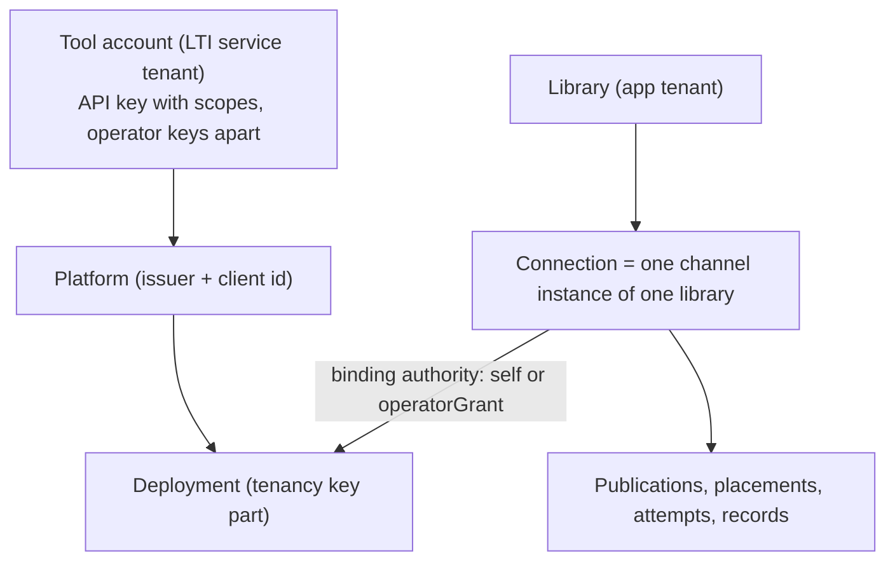

# LA-ADR-07: Security and tenancy for many channels

Status: **Proposed** (P2 design, Architect-2 A2, 2026-10-22). Epics: E1 (kernel rules), E3, E5, E6 (plan v1 §3). Owner: A2. Consistency owner: A1.
Inputs: [security model](../../security.md), [ADR-011 §4, §4a, §4b](../../adr/ADR-011-multi-lms.md#4-tenancy-model), [LA-ADR-01](LA-ADR-01-channel-kernel.md) (kernel, ports, authority strategies), [LA-ADR-05](LA-ADR-05-lti-advantage-completeness.md), [LA-ADR-06](LA-ADR-06-service-operability.md), [R4](../../../research/ltiaas/R4-ops-readiness.md), [R2 §3](../../../research/ltiaas/R2-lms-landscape.md#3-two-platform-kinds) (per-tenant and fixed issuers), [LA terms](../terms.md).
Related: [security delta](../security-delta.md) (the section-by-section changes to `security.md`).

## 1. Context

| # | Fact | Evidence |
| --- | --- | --- |
| F1 | The LTI service tenant is the tool account. Every lookup includes `tool_account_id`; an API key resolves to one account. | `docs/architecture/security.md:188`; `services/lti-service/src/http/auth.ts:64-76` |
| F2 | The app tenant is the library. Every query includes `library_id`. At launch, platform → connection → library. | `docs/architecture/security.md:189`; app contract §1 |
| F3 | The tenancy key of a launch is (tool account, issuer, client id, deployment id). Client ids and deployment ids are not secrets. So typed ids never prove that a library may use an LMS installation; Canvas and Blackboard need an operator grant. | ADR-011 §1, §4 rules 1–11, §4a |
| F4 | The Moodle paths use binding authority `self`: Dynamic Registration (a platform-issued registration token proves control), and manual connect with six typed values, first come first served (security §2.6). | `docs/architecture/security.md:94-104`; [LA-ADR-01 D7](LA-ADR-01-channel-kernel.md#d7-app-adapters-authority-and-routing) |
| F5 | LA loads channel code by folder discovery at start. Channel `app/` extension code may use storage through the port context. | [LA-ADR-01 D1, D4](LA-ADR-01-channel-kernel.md#d1-one-folder-per-channel), consequences |
| F6 | The only per-connection secret today is the Moodle web-services token, encrypted with `APP_MASTER_KEY`. LB, LC and LF need more (SFTP keys, vendor OAuth). | app contract §11 ("stored encrypted and never returned"); [terms §5](../terms.md#5-ports-reserved-for-the-backlog-names-only) "Connection secrets slot" |
| F7 | The operator is "a Cogniate staff member with shell access to the Cogniate app service". The grant evidence is a free `--note`. App operator events have no operator identity. | ADR-011 §3 (`docs/architecture/adr/ADR-011-multi-lms.md:49`); app contract §4.8; R4 AU-1 (`services/cogniate-app/src/app/operator.ts`); Q22 (`docs/architecture/open-questions.md:31`) |
| F8 | A leaked service key plus the API key can write grades for every activity of the course (A-T3a-04). | `docs/human_review/deferred.md:22` |
| F9 | Extra audiences in a launch pass when `azp` is right; the spec says to reject untrusted audiences. | R1 S-08; `services/lti-service/src/lti/checks.ts:120-124` |

## 2. Decision

| # | Decision | Priority |
| --- | --- | --- |
| D1 | **Four tenancy layers** with one isolation rule each, plus two-tenant tests: Author unit fixtures for every port and every new table, QA black-box checks for every new route. | Must |
| D2 | **Authority rules for channels**: a channel can only choose a kernel authority strategy. `self` is allowed only where the registration act proves control. A shared platform needs `operatorGrant` (or, later, `verifiedAdminLaunch`). | Must |
| D3 | **Connection secrets port**: shape and rules now. LA does not build it; LB or LF builds it. | Must (shape); build: LB or LF |
| D4 | **Operator role**: named operators; an operator key per person on the LTI side; a required operator name on the app CLIs in the production profile; audit events for every operator action. | Must |
| D5 | **Grant evidence (Q22)**: structured evidence fields beside the free note; required in the production profile. | Must (fields); policy text: Q22 |
| D6 | **Threat model deltas** for the kernel and the new features, with a control and an owner for each row. | Must |
| D7 | **Service key write scope** (A-T3a-04): security reason for [LA-ADR-06 D8](LA-ADR-06-service-operability.md#d8-service-key-revoke-and-write-scope-should). | Should |
| D8 | **Trusted audiences** (S-08): refuse untrusted extra audiences. | Could |

### D1. Tenancy layers (Must)



| Layer | Isolation rule | Enforced by | New in LA |
| --- | --- | --- | --- |
| Tool account | Every LTI service repository function that reads or writes tenant data takes `tool_account_id` as a required argument. A credential of account A never reads or changes data of account B: `401` or `404`. | store functions (`services/lti-service/src/store/*`); auth (`http/auth.ts`) | Also for `api_key`, `audit_event`, `storage_check`, `idempotency_record`, the operator API (the account id is always explicit in the path; there is no "all accounts" write). |
| Library | Every app query takes `library_id`. A resource of another library gives `404`. | app repositories (`services/cogniate-app/src/domain/*`) | Channel code never gets a database handle. `app.ts` stays pure (no database, no outbound call; LA-ADR-01 consequences). Only a channel's `app/` extension code gets a `PortContext` from the kernel ([LA-ADR-01 D5](LA-ADR-01-channel-kernel.md#d5-ports)): a library-bound `ChannelSql` (every statement must use `:library_id`, which the kernel binds; `:connection_id` for connection ports), never a raw handle. Channel code cannot import a database, key or outbound factory: its value imports from `@cogniate/shared` come only from the allow-list sub-path `@cogniate/shared/channel` ([security delta §8](../security-delta.md#8-tenant-isolation), channel import fence; BD-A2-11). |
| Connection | One connection is one channel instance of one library. Its records (placements, attempts, records, dispatches, secrets) never move to another library (ADR-011 D12). | kernel authority strategies; launch router | The launch router selects the connection only by the stored authority (A1 D7). A manifest cannot add a routing rule. |
| Deployment | The tenancy key is (tool account, issuer, client id, deployment id). The issuer alone never selects a tenant. A shared platform's deployment belongs to one connection; a new binding increases the binding generation. | ADR-011 §4; LTI checks 9, 13, 14 | Unchanged rules; they now hold for every channel with `platform.sharing = shared`. |

Two-tenant tests, split by plan LD-5:

- **Author unit tests** (in-process, temporary database, port fixtures): for each app port of [LA-ADR-01 D5](LA-ADR-01-channel-kernel.md#d5-ports) that touches tenant data (P2–P7, P9), a fixture with two libraries calls the port with library A's port context and library B's ids. For each new LTI service repository (`api_key`, `operator_key`, `audit_event`, `storage_check`, `idempotency_record`), the same with two tool accounts. Pass rule: not found, no changed row, no outbound call. Reviewer-B checks that every port and every new table has one case.
- **QA black-box points** (AP-07-01, AP-07-02 below): the same rule through the public routes.

Acceptance points:

| Id | Observable result |
| --- | --- |
| AP-07-01 | For each new app route of LA (app API delta §3, §5; LA-ADR-05 picker cancel; LA-ADR-08 routes when built), a call in library A's portal session (or with A's picker) with an id of library B gives `404` (or the route's documented not-found page), changes no row, and makes no outbound call. The frozen isolation ACs (AC-T4-16, AC-T4-29, AC-T4-34, AC-T7-08, AC-T7-09) stay green. |
| AP-07-02 | For each new LTI service route that reads or changes tenant data (`/api/service-keys/revoke`, `/api/audit`, `/api/account`, `/lti/launch/:account/storage-check`), a call with account `qa-second`'s credential (or check value) and an id of account `cogniate` gives `401`, `403` or `404`, returns no row of `cogniate`, and changes nothing. `GET /operator/v1/audit?toolAccountId=qa-second` returns no `cogniate` event (AP-06-17). |
| AP-07-03 | A channel `app/` module cannot import `services/**/domain/**`: the F3 import rule of [LA-ADR-01 D1](LA-ADR-01-channel-kernel.md#d1-one-folder-per-channel) fails the lint (QA F3 probe). |

### D2. Authority rules for channels (Must)

| # | Rule | Why |
| --- | --- | --- |
| A1 | A manifest chooses its binding authority only from the kernel strategies: `self`, `operatorGrant`; `verifiedAdminLaunch` when [LA-ADR-08](LA-ADR-08-onboarding-and-connection-health.md) D3 is built. A new strategy is a kernel change with a security review. | The strategy decides launch and grade authority (A1 D7); a channel must not invent its own. |
| A2 | `self` is safe only when the **registration act itself proves control** of the platform: Dynamic Registration with a platform-issued registration token, where the platform calls our registration URL that carries the library's single-use `ref`, **and** rule A6 holds. | The platform admin starts the call from inside the LMS; the `ref` ties it to the library. The issuer host vouches only for its own origin (A-LAD-01). |
| A3 | For **typed values** (manual registration), ids prove nothing (F3). A new channel's manual method uses `operatorGrant` (or `verifiedAdminLaunch`). The Moodle manual method keeps `self` (no behaviour change; accepted residual R-LA-1 below). The registry load enforces it: [LA-ADR-01 D4](LA-ADR-01-channel-kernel.md#d4-channel-registry) load check 6, with the frozen list `MANUAL_SELF_LEGACY_CHANNELS` in `legacy-wire.ts` (one entry: the Moodle channel; B-LAD-17). | Squatting by a library that learned a client id (ADR-011 R-M-03). |
| A4 | A channel with `platform.sharing = shared` must not use `self` for any method. The registry load refuses it ([LA-ADR-01 D4](LA-ADR-01-channel-kernel.md#d4-channel-registry) load check 6). | A `self` binding of a shared deployment would let any library take a school of a shared vendor app (Blackboard, Schoology, itslearning are shared, R2 §2.1). |
| A5 | A fixed-endpoint profile with a fixed issuer reserves its issuer origin (ADR-011 §4 rule 3). A per-tenant-issuer platform uses an admin-value profile; check 14 guards its signed product family when a named channel owns it (A1 D6). An admin value is never a fixed host or a fixed-issuer host of any loaded profile ([contract delta §4.6.1](../contracts/lti-service-api-delta.md#461-post-apiplatforms-for-the-admin-value-profiles-lti-generic-and-brightspace-e2-must) rules 1–3). | Keeps `standard` and `lti-generic` from binding a named LMS or its hosts. |
| A6 | **Origin binding** (A-LAD-01; A1 names it I-SELF, [LA-ADR-02 D2a](LA-ADR-02-generic-lti-channel.md#d2a-self-invariant-must-reviewer-a-a-lad-01)). For a `self` binding, the auth, token, JWKS and registration endpoints and the client assertion audience are on the issuer origin (today's `standard` rule). A value off the issuer origin, or a separate audience, needs an operator grant (or a fixed value of a named profile together with a grant). So Dynamic Registration on an `any-https` profile stages an **inactive** platform, and the connection's authority changes once from `self` to `operatorGrant`, as for Canvas DR ([LA-ADR-05 D6](LA-ADR-05-lti-advantage-completeness.md#d6-canvas-dynamic-registration-should-d-1)), unless every value is on the issuer origin. A1 owns the rule text and the app flow ([LA-ADR-02 D2a, D5 item 10](LA-ADR-02-generic-lti-channel.md#d5-generic-dynamic-registration-fixes-must)); the LTI service enforces it: an active create that breaks it is refused, and a `complete` that breaks it is staged ([contract delta §4.5, §4.6.1](../contracts/lti-service-api-delta.md#45-dynamic-registration-38) rule 7). | A party that controls an issuer host also controls launches for it. If our service then signs client assertions for a client id that the party chose, and sends them (or the access token that they buy) to a host off that origin, the party can take the platform access token of another school (A-LAD-01 attack path; required outcome "the platform access token goes only to platform URLs", `docs/architecture/security.md:190`). |

Acceptance points:

| Id | Observable result |
| --- | --- |
| AP-07-07 | A test channel folder whose method uses a profile with `sharing: shared` and authority `self` stops the registry load: one line `channel_registry_invalid {channel, reason}`, where `reason` names rule A4 (proposed value `shared_platform_self_authority`), and the service does not start. |
| AP-07-08 | A test manifest with an authority value outside `self` and `operatorGrant` (also the reserved `verifiedAdminLaunch` while LA-ADR-08 D3 is not built) stops the registry load (load check 1, schema). |
| AP-07-10 | A test channel folder (id not in the legacy list) with a `manual` method and authority `self` stops the registry load; `reason` names rule A3 (proposed value `manual_self_authority`). The baseline `moodle` manifest (manual `self`, legacy list) loads. |
| AP-07-11 | (A-LAD-01, K1 negative case on the generic simulator provider) A Dynamic Registration of an `lti-generic` connection whose configuration has the token endpoint on another host (or an `authorization_server` off the issuer origin) creates **no active** platform: `GET /api/registrations/:id` shows `endpointsOnIssuerOrigin: false`; `complete` answers `active: false`; the connection DTO shows authority `operatorGrant` and waits for a grant; a learner launch of that platform gets `PLATFORM_NOT_ACTIVE`, and the simulator records no token request at any host. A direct active `POST /api/platforms` with the same values gives `400 PLATFORM_URL_NOT_ON_ISSUER_ORIGIN`. |

Owner of these points: the Author unit tests of the registry load checks ([LA-ADR-01](LA-ADR-01-channel-kernel.md) test impact: "registry load checks 1–6, each failure case"). QA may add the same cases to K0 as negative inputs through the public registry builder and the test-only extra loader root (LD-5).

Alignment: [LA-ADR-02 D3, D4](LA-ADR-02-generic-lti-channel.md#d3-generic-channel-lti-generic-must) follow rule A3: the manual methods of `lti-generic` and `brightspace` use `operatorGrant`. Their Dynamic Registration methods use `self` only when rule A6 (I-SELF) holds; else the registration is staged, and the connection's authority changes once from `self` to `operatorGrant` (LA-ADR-02 D5 item 10). `brightspace` DR is always staged. LA-ADR-02 also explains a second reason for A3: with `endpointOrigins: any-https`, a typed JWKS URL is not tied to the issuer host, so typed values could forge launches. Moodle manual stays `self` (R-LA-1).

### D3. Connection secrets port (Must: shape; build: backlog)

```ts
// Kernel port (app). Sketch. Values never leave the kernel except to the owning channel's extension code.
export interface ConnectionSecrets {
  put(ctx: PortContext, purpose: string, value: Uint8Array): Promise<{ version: number }>;  // replaces; one audit event
  get(ctx: PortContext, purpose: string): Promise<Uint8Array | null>;                     // only the owning channel
  delete(ctx: PortContext, purpose: string): Promise<void>;                               // also on release
  list(ctx: PortContext): Promise<Array<{ purpose: string; version: number; updatedAt: string }>>; // metadata only
}
```

| Rule | Detail |
| --- | --- |
| Storage | One table `connection_secret` (library, connection, purpose, version, sealed value, timestamps) in the app database. The shape is reserved in the [LA data model §5a](../data-model.md#5a-cogniate-app-migration-016-e6-could) ("Reserved, not built in LA"). The value is sealed with the key provider ([LA-ADR-06 D6](LA-ADR-06-service-operability.md#d6-key-provider-must)); associated data `app:connection_secret:<library_id>:<connection_id>:<purpose>`. |
| Exposure | No DTO, no log line and no audit event holds a value. `purpose` is a declared id in the manifest (for example `site-api-token`). The portal can only set or clear it. |
| Life | A put makes a new version and removes the old value. `app:binding release` deletes the connection's secrets. |
| Scope in LA | **Not built in LA.** LA fixes only the port shape and the rules above, so that LB (SFTP keys) or LF (vendor OAuth) adds the table and the port with no kernel redesign. The first of LB or LF that needs a per-connection secret builds it. A1 keeps the Moodle web-services token on the frozen columns `connection.ws_*` in LA (no move; [LA-ADR-01 D8](LA-ADR-01-channel-kernel.md#d8-moodle-canvas-and-blackboard-extras-as-capabilities) last row). That token stays sealed with `APP_MASTER_KEY` as today, or with the key provider when the app moves to it ([LA-ADR-06 D6](LA-ADR-06-service-operability.md#d6-key-provider-must), Should). |

### D4. Operator role (Must)

| Rule | LTI service | Cogniate app |
| --- | --- | --- |
| Who | A named Cogniate staff member (policy: LA-H21, Q22). | same |
| Credential | One operator key per person, 90 days by default ([LA-ADR-06 D3](LA-ADR-06-service-operability.md#d3-operator-api-must)). No shared operator key. | Shell access to the app container (today, ADR-011 §3). LG replaces it with an operator API behind SSO. Scope (A-LAD-17): plan E5 Must 3 ("the CLIs become clients of the operator API") covers the **LTI service** CLIs in LA; the app CLIs stay shell commands with a named, audited operator (D4, D5), and R-LA-2 records the gap. Lead decision OC-9 confirms this scope (README §8); R-LA-2 goes to the human review list. |
| Identity in records | The operator name of the key is the audit actor. | `--operator <name>` on `app:grant` and `app:binding`. Production rule: required, and the name must be in the allowed list (`OPERATORS`, comma-separated names, or `OPERATORS_FILE`, a JSON array); else exit 1. Default and acceptance profiles: optional (M1 commands unchanged), default from `OPERATOR_NAME`, else `unknown`. |
| Audit | One audit event per operator call (LA-ADR-06 D4). | One audit event per command (the same shape; table `audit_event` of migration `015`, A1). Read path: a read-only CLI `npm run app:audit -- list [--connection <id>] [--action <a>] [--since <ISO>] [--limit <n ≤ 500>]` prints one JSON line per event, newest first, with no note text; it writes no event. |
| Least privilege | One role in LA. Could: a `support` role (read, grant issue) and an `admin` role (suspend, release, account close, forced key activation). | same |
| Two-person rule | Could: `confirmBy` for account close and forced signing-key activation (LA-H21). | Could: for `app:binding release`. |

Profile of a CLI run: the app CLIs read `STACK_PROFILE` from their **own process** environment. With `STACK_PROFILE=production` a CLI applies the production rules of D4 and D5 (operator name, evidence fields). It does not run the service start checks of [LA-ADR-06 D12](LA-ADR-06-service-operability.md#d12-production-profile-and-secrets-from-files-should). So a test stack in the `acceptance` profile can prove the CLI rules with one command, for example `docker compose exec -e STACK_PROFILE=production -e OPERATORS=qa-op cogniate-app npm run app:grant -- issue … --operator qa-op --evidence-channel support-call --evidence-ref QA-1` (the breakdown adds this command form to the tasks README §2 allowance).

Residual R-LA-2: the app operator name is self-asserted by a person with shell access. The audit trail is accountable, not authenticated, until LG adds SSO for operators.

Acceptance points:

| Id | Observable result |
| --- | --- |
| AP-07-04 | With `STACK_PROFILE=production` in the CLI process (form above), `app:grant issue …` without `--operator` exits 1 with one line and stores nothing (the grant list is unchanged); with a name not in `OPERATORS` it exits 1. |
| AP-07-05 | In the acceptance profile, the M1 grant and binding commands work unchanged; their audit events have actor `operator:unknown` (or the `OPERATOR_NAME` value). |
| AP-07-06 | Every `app:grant issue`, `revoke`, `app:binding suspend` and `release` run writes one app audit event with the operator name, the connection, the result, and `note_present`; `app:audit list --connection <id>` (a read-only command, through `docker compose exec`) shows it. A refused run on a known grant or connection (for example `app:grant revoke` of a redeemed grant, which exits 1 today, `services/cogniate-app/src/app/operator.ts:123`) writes one event with `result: refused`. |

### D5. Grant evidence (Must: fields; policy: Q22)

| Field | Values | Where |
| --- | --- | --- |
| `--evidence-channel` | `institution-email`, `support-call`, `lms-admin-ticket`, `other`. The value `verified-admin-launch` is written only by the system for [LA-ADR-08 D3](LA-ADR-08-onboarding-and-connection-health.md#d3-verified-admin-launch-could); an operator cannot type it. | `app:grant issue`, `app:binding suspend`, `app:binding release` |
| `--evidence-ref` | 1–200 characters: a ticket id or message id, not the message itself | same |
| `--note` | unchanged (1–500 characters) | same |

- Production profile: `--evidence-channel` and `--evidence-ref` are required. Default and acceptance profiles: optional (M1 commands unchanged).
- Storage: the evidence lives in the app audit event of the command ([LA data model §5](../data-model.md#5-cogniate-app-migration-015-e5-app-part-e6), table `audit_event`): `details` holds `evidence_channel`, `evidence_ref` and `note_present: true`, never the note text, because a note can hold personal data. The grant row gets **no** new column (no extra schema change). The note stays where M1 keeps it: `binding_grant.note` for a grant (`services/cogniate-app/src/domain/migrations/011_lms_types.sql:37`); suspend and release log only `note_present` (`services/cogniate-app/src/app/operator.ts:163`).
- The evidence **policy** (what the operator must check, through which channel) is the human decision Q22. The recommendation stays as in `docs/architecture/open-questions.md:31`, plus one check: for a bound value whose host is not the issuer host, the operator confirms with the LMS administrator that the vendor issued this client id for this issuer at that host, and only then uses `--confirm-foreign-hosts` (LA-ADR-02 D6, A-LAD-23).

Acceptance point:

| Id | Observable result |
| --- | --- |
| AP-07-09 | With `STACK_PROFILE=production` in the CLI process, `app:grant issue …` without `--evidence-channel` or without `--evidence-ref` exits 1 with one line and stores nothing (no grant row, no audit event). With both values, the command succeeds, and its one audit event has `details.evidence_channel`, `details.evidence_ref` and `details.note_present`, and no note text. `--evidence-channel verified-admin-launch` exits 1. In the acceptance profile, the M1 command without the new flags still succeeds (AP-07-05). |

### D6. Threat model deltas (Must)

STRIDE letters: S spoofing, T tampering, R repudiation, I information disclosure, D denial of service, E elevation of privilege.

| # | New element | Threat | Control | Owner |
| --- | --- | --- | --- | --- |
| T1 | Channel folder discovery | T, E: a planted or broken channel folder runs in every service | Channel code is repo code under review; no runtime plugin path; load checks fail closed (A1 D4); the extra loader root exists only as a function argument of the registry builder in tests: no environment variable or runtime setting can add a root, and product code passes none (LA-ADR-01 D4); the production image has a read-only root file system ([LA-ADR-06 D12](LA-ADR-06-service-operability.md#d12-production-profile-and-secrets-from-files-should)) | A1, A2 |
| T2 | Manifest texts and fields | T: script injection through manifest text | Texts are data with placeholders `{LMS}`, `{tool}`, `{site}` only; every output is HTML-escaped (security §7 "Output") | A1 |
| T3 | Capability values | E: a channel turns on a feature it should not have | Closed capability catalog; guards before any outbound call (A1 D3); authority only from kernel strategies (D2 A1) | A1 |
| T4 | Manual connect of a new channel | S: a library binds another school's platform with typed ids | D2 rule A3 (`operatorGrant` or `verifiedAdminLaunch`) | A1, A2 |
| T5 | Shared-platform channels | S, E: a library takes a school of a shared vendor app | D2 rule A4; deployment ownership and binding generation (ADR-011 D4, D6) | A1 |
| T6 | Platform storage launch | S: a forged `lti.get_data` reply; I: the state leaks to another frame | Replies only from the storage origin with the right `message_id`; `postMessage` never to `*`; the server compares the SHA-256 of the value; the storage-check POST needs our `Origin`; the storage check is single use and lives 120 s ([LA-ADR-05 D1](LA-ADR-05-lti-advantage-completeness.md#d1-platform-storage-launch-must-d-4)) | A2 |
| T7 | Platform storage launch | I: claims are stored before the browser binding is proven | Claims pass every signed check and the claim policy first; the row lives 120 s and is deleted after 10 min; no ltik exists before the check (R-LA-4) | A2 |
| T8 | Launch without context | T: two placements collide | Placement key includes the deployment and the resource link id (LTI Core: unique per deployment); the AGS URL rule (security §8) is unchanged | A1, A2 |
| T9 | Multi-item Deep Linking | E: an item names another library's publication | Every posted publication is checked against the picker's connection and `available` status; at most 20 | A2 |
| T10 | Operator API | E: tenant callers reach operator functions | Loopback listener (the `acceptance` test profile binds the stack network for QA, still without a proxy route); own credential grammar; no route through the proxy; rate limit; audit; production refuses a non-loopback bind ([LA-ADR-06 D3](LA-ADR-06-service-operability.md#d3-operator-api-must)) | A2 |
| T11 | API keys | E: a leaked launch-side key deletes platforms | Scopes `launch` and `admin`; two-key overlap; revoke; expiry (LA-ADR-06 D5) | A2 |
| T12 | Key provider | I: theft of the key ring; T: a sealed blob moved to another row | Key ring as a read-only `0600` file, escrow stored apart; associated data binds each blob to its row; versioned re-wrap after a leak (LA-ADR-06 D6) | A2 |
| T13 | Rate limiter | S: a forged `X-Forwarded-For`; D: bucket memory growth; D: a limit that any sender can empty for every tenant | Forwarded header only from `TRUSTED_PROXY_CIDRS`; bounded bucket map; IPv6 keyed by /64; `auth_failure` spent only by API key and operator key failures, never by an ltik failure under a valid key (A-LAD-02); the account-wide protocol and registration classes are soft (A-LAD-07) (LA-ADR-06 D1) | A2 |
| T14 | Audit log | R: an operator denies a change; T: rows are edited | One event per change in the same transaction; append-only trigger; no other delete than the retention job (LA-ADR-06 D4) | A2 |
| T15 | Audit log | I: client addresses and operator names are personal data | Retention (LA-H4); tenant read sees only its own account; never key or token values | A2 |
| T16 | Per-account tool URLs | I: an ltik goes to a wrong host | Only an operator sets them; https; not our own content or LTI host; the ltik works only with that account's API key (LA-ADR-06 D2) | A2 |
| T17 | Idempotency records | I: a stored answer is replayed to another tenant | The key is scoped by tool account; 24 h life | A2 |
| T18 | Claim policy `passthrough` | I: names and emails enter Cogniate | Profile `privacyFloor` cannot be lowered; new accounts default to `allowlist`; every change is an audit event ([LA-ADR-05 D7](LA-ADR-05-lti-advantage-completeness.md#d7-claim-policy-per-tool-account-should-d-9)). Build ratification BD-A2-21 (A1 BD-A1-22): `none` is allowed only for the profile ids in the frozen list `PRIVACY_FLOOR_NONE_PROFILES` (`['standard']`, `packages/channel-kernel/src/legacy-wire.ts`), and load check 7 stops the start for any other profile with `none`; a new entry needs an ADR revision and a Reviewer-A security review. The launch fails closed: it keeps every claim only for the exact value `none`, and an unknown value minimizes. The claim policy (LA-E3-10) composes the same way: a claim stays only when both layers allow it explicitly. | A2 |
| T19 | Verified admin launch (Could) | S: a teacher, not an administrator, binds the school | Signed institution or system administrator role; single-use code bound to the library and the connection; the platform's site origin equals the connection site; rate limit; audit ([LA-ADR-08 D3](LA-ADR-08-onboarding-and-connection-health.md)) | A2 |
| T20 | Connection health view and check | I: another library's data; D: probe abuse | Library-scoped queries; ids and public key ids only; one connection check per connection per minute (LA-ADR-08) | A2 |
| T21 | Canvas Dynamic Registration | S: a registration from a foreign host | Configuration host rule, issuer equal to the profile issuer, endpoints in the profile's allowed set, inactive create, grant still needed ([LA-ADR-05 D6](LA-ADR-05-lti-advantage-completeness.md#d6-canvas-dynamic-registration-should-d-1)) | A2, A1 |
| T22 | Metrics | I: tenant ids as labels | Internal listener only; no personal data in labels | A2 |
| T23 | Service keys | E: a leaked service key writes grades for the whole course | D7 | A2 |
| T24 | Dynamic Registration and admin values on `any-https` profiles | S, I: a library user registers a fake issuer whose configuration names another school's token host and audience and returns that school's client id; our service then signs client assertions for that client id and sends the bought access token to the AGS URL of a forged launch (A-LAD-01) | Rule A6: an active platform keeps every endpoint and the assertion audience on the issuer origin; off-origin values only staged, with an operator grant that binds every value; fixed hosts of every profile refused; the connection check and the verified admin launch follow the same rule ([LA-ADR-08 D3 rule 6, D4](LA-ADR-08-onboarding-and-connection-health.md#d3-verified-admin-launch-could)); AP-07-11 | A1, A2 |
| T25 | Issuer with a path (`lti-generic` DR) | S: a person who can host both a JSON file and an endpoint that answers the registration POST under the issuer path of an LMS host registers that path under their own library | I-SELF keeps every token request on that host, so no other school's token leaks; Moodle needs its fixed configuration path (trait `configurationPath`, LA-ADR-02 D2a); residual R-LA-7 | A1, A2 |

New residual risks (for `open-questions.md` "Residual risks", through the Lead):

| Id | Risk | Why accepted |
| --- | --- | --- |
| R-LA-1 | Moodle manual connect stays `self`: a library that learns a Moodle tool's six values before the rightful library can bind it first. | Unchanged prototype behaviour; the client id is visible only to the Moodle admin and in launches; the rightful library sees `PLATFORM_IN_USE`, and the operator can suspend and release. A launch whose signed family a named channel guards (also at the `registration` level) is refused on a Moodle `standard` platform before any claim is stored, so this path cannot capture another named LMS (LA-ADR-01 D6, A-LAD-19). LA-H23 decides a stronger rule. |
| R-LA-2 | App operator identity is self-asserted (shell access). | Accountable records now; SSO for operators in LG. |
| R-LA-3 | Rate limits are per instance (in memory). | One instance in LA and the pilot; a shared store in LG. |
| R-LA-4 | The storage path stores minimized, signed claims for up to 120 s before the browser binding is proven. | No ltik and no tool access exist before the check; the row is deleted after 10 min. |
| R-LA-5 | The account-wide protocol and registration limits are soft: a flood from many addresses is logged and alerted, not refused (LA-ADR-06 D1, A-LAD-07). | A hard account bucket would let any sender block every library. Per-address limits stay hard; edge protection (WAF) is LG. |
| R-LA-6 | A person who starts a login knows its state and can carry the storage check to a second browser that they control (LA-ADR-05 D1 security property, A-LAD-09). | The `Origin` rule stops a foreign site from doing it in a victim's browser; what stays is the class of the accepted residual R2. |
| R-LA-7 | On a generic LMS host, a person who can serve both a configuration file and a registration endpoint under an issuer path can register that path for their own library (LA-ADR-02 D2a). | I-SELF keeps the token on that host; the person must already control content and an endpoint on the LMS host; Moodle uses its fixed configuration path. |

### D7. Service key write scope (Should)

A service key exists for background grade return of one activity (contract §3.3). With `service_key_write_scope = resource-link` ([LA-ADR-06 D8](LA-ADR-06-service-operability.md#d8-service-key-revoke-and-write-scope-should)), a leaked service key can write only the line items of its own resource link. This closes A-T3a-04 for accounts that turn it on. Recommendation: `cogniate` turns it on in E5 after one T5a and T5b regression.

### D8. Trusted audiences (Could)

Platform field `trustedAudiences` (default empty). Check 5 refuses a launch whose `aud` has a value other than the client id and the listed values (R1 S-08; Security Framework §5.1.3). Moodle sends one audience, so Moodle is unchanged. Detail in [LA-ADR-05 D10](LA-ADR-05-lti-advantage-completeness.md#d10-small-spec-gaps-could).

## 3. Alternatives considered

| Alternative | Why not |
| --- | --- |
| Let a channel adapter implement its own binding authority | Each new channel would bring its own security model; review cost and risk grow per channel. |
| Treat typed client ids as proof for new channels (like Moodle manual) | Ids are public (F3); this repeats the squatting risk for every new LMS. |
| Database-level isolation (Postgres row-level security) in LA | Needs the Postgres engine (LG, LA-H5). LA keeps the code-level rule and adds two-tenant tests. |
| A per-channel secrets table | Each channel would repeat the sealing, the audit and the release rule. One kernel port does it once. |
| Free-text evidence only (today) | It cannot be checked for presence or searched; the production profile cannot require it. |

## 4. Consequences

- Every new channel inherits the same tenancy, authority and secrets rules; a reviewer checks the manifest's authority values, not new code.
- Operators are named in every record. Production use of the app CLIs needs an operator list and evidence fields.
- Four residual risks are explicit (R-LA-1 … R-LA-4).

## 5. Migration and compatibility

- No change for Moodle, Canvas and Blackboard in E1: their authority values are today's (`self` for Moodle, `operatorGrant` for Canvas and Blackboard).
- The app CLI options `--operator`, `--evidence-channel`, `--evidence-ref` are additions; they are required only in the production profile.
- Load check 6 refuses nothing in the baseline: Blackboard, the only shared channel, uses `operatorGrant`; the Moodle manual `self` method is on the frozen legacy list.
- The evidence fields add no column: they live in the app audit event (D5), so migration `015` of the [LA data model](../data-model.md#5-cogniate-app-migration-015-e5-app-part-e6) is enough.

## 6. Test impact

Ownership follows plan LD-5.

| Level | Owner | Tests |
| --- | --- | --- |
| Author unit (no Docker; Reviewer-B checks the quality) | Author | Two-tenant port fixtures for every app port with tenant data and every new LTI service repository (D1); registry load check 6 failure cases (AP-07-07, AP-07-08, AP-07-10); rule A6 table (each endpoint and the audience on or off the issuer origin, active or staged create; reserved hosts of every loaded profile); operator name and evidence parsing of the app CLIs. |
| K0 (no Docker, public kernel and registry entry points) | QA | Optional negative cases of AP-07-07, AP-07-08 and AP-07-10 through the public registry builder; the `binding.authority` value of every registered channel equals the fixture (the baseline: `moodle` `self` for both methods; `canvas`, `blackboard` `operatorGrant`). |
| Static (F3) | Author builds, QA verifies | AP-07-03. |
| K1 and SIM-lane acceptance | QA | AP-07-11 (K1-REG negative case on the generic simulator provider; the simulator serves a DR configuration with a foreign token host); AP-07-01, AP-07-02 black-box per route; AP-07-04, AP-07-05, AP-07-06, AP-07-09 on the app CLIs (production and acceptance profiles). |
| Regression | QA, QA-E2E | The frozen isolation ACs of AP-07-01; M1 grant, suspend and release rows unchanged in the acceptance profile. |
| Security review | Reviewer-A | Each T-row control of D6 maps to an acceptance point, a unit test or a fitness check in the breakdown. |

## 7. Open questions

| Id | Question | Recommendation | Owner |
| --- | --- | --- | --- |
| Q22 | Evidence policy for grants, suspend and release; who may be an operator | As `docs/architecture/open-questions.md:31`; record channel and reference in the new fields; confirm a foreign host with the LMS administrator before `--confirm-foreign-hosts` (A-LAD-23) | Product + Legal |
| LA-H21 | Operator policy: key life, roles, two-person rule | Named staff; 90-day keys; second operator for account close, forced key activation and binding release (Could) | Product + Security |
| LA-H23 | Moodle manual connect: keep `self` (R-LA-1), or require a verified admin launch or a grant | Keep `self` for the pilot; move Moodle manual to `verifiedAdminLaunch` when LA-ADR-08 D3 is built | Product + Security |
| LA-H7 | Tenant model and host model | As plan v1 §6.2 | Product owner |
| LA-H4 | Retention of audit events with client addresses and operator names | 400 days | Product + DPO |
| — (closed) | Registry load check for rules A3 and A4 | Closed: A1 added load check 6 to LA-ADR-01 D4 | A1 |

LA-H21 to LA-H24 are in plan v1.2 §6.2.
