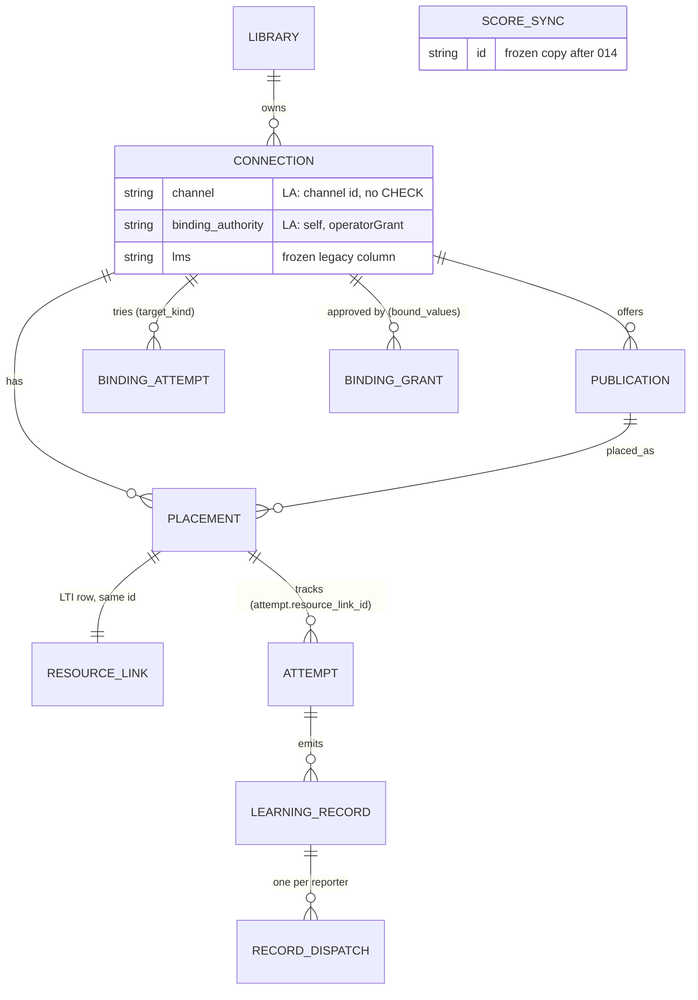
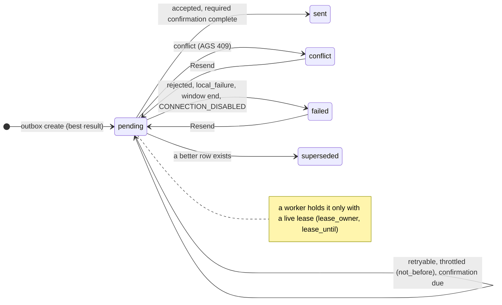

# LA data model changes

Status: v1 (A1, milestone LA P2, 2026-10-22); P4 build ratification BD-A1-04 in §1 and §4.1 ([build decisions A1](build-decisions-A1.md)). Base: [`../data-model.md`](../data-model.md) (M1 state). Rules of [ADR-006](../adr/ADR-006-storage.md) stay: plain SQL, one migration file per step, the checksum rule, never edit an applied migration. Plan rule for LA: only **additive** changes (new tables, new nullable or defaulted columns), each with a migration test; no storage-command change (plan §3 E1, LD-3).

## 1. Overview

| Service | Migration | Epic, step | Owner of the design | Content |
| --- | --- | --- | --- | --- |
| Cogniate app | `013_channel_kernel.sql` | E1 S4 | A1 ([LA-ADR-04 D4](adr/LA-ADR-04-refactor-and-migration.md#decision)) | `connection.channel`, `connection.binding_authority`, `binding_attempt.target_kind`, `binding_grant.bound_values` |
| Cogniate app | `014_learning_records.sql` | E4 | A1 ([LA-ADR-03](adr/LA-ADR-03-learning-record-core.md), [LA-ADR-04 D5](adr/LA-ADR-04-refactor-and-migration.md#decision)) | `placement`, `learning_record`, `record_dispatch`, `job_instance`, `job_lease`; backfill from `resource_link` and `score_sync` |
| Cogniate app | `015_app_audit.sql` | E5 (app part) | shape A2 ([LA-ADR-06 D4](adr/LA-ADR-06-service-operability.md)), table A1 | `audit_event` |
| Cogniate app | `016_connection_health.sql` (first E6 file; number: the Lead, in landing order) | E6 (Could), LA-E6-02 (P, B3) | shape A2 ([LA-ADR-08 D5](adr/LA-ADR-08-onboarding-and-connection-health.md)), table A1 | `connection_event`, `connection.artifact_key_kid` (moved from `015`; Reviewer-B B-LAD-13) |
| Cogniate app | second E6 file, `admin_launch_code` (number: the Lead, in landing order; plan LD-12) | E6 (Could), LA-E6-03 (K, B4) | shape A2 ([LA-ADR-08 D3](adr/LA-ADR-08-onboarding-and-connection-health.md)), table A1 | `admin_launch_code` |
| Cogniate app | E3 migration (number: P3) | E3 Must (multi-select) | A1 (table), A2 (feature, [LA-ADR-05 D3](adr/LA-ADR-05-lti-advantage-completeness.md)) | `picker_pick` (§5b; Reviewer-A A-LAD-10) |
| LTI service | `005_…` and later (numbers: the Lead, §4.1) | E2-K, E3, E5 | A1 (E2 platform fields), A2 (the rest) | §4 |

Each file keeps one epic. Migrations of different lanes must not depend on each other. File name form: `NNN_<content>.sql` (three digits), so the name order is the number order.

**Number rule** (BD-A1-04, from the build practice; tasks README RQ-5). The Lead gives each number when it briefs the task, in the order that it gives them. So a task can land after a task with a higher number: LTI `006` landed before `005`. This is safe for three reasons. (1) Migrations of different lanes do not depend on each other. (2) Each file is additive (plan rule above). (3) The runner sorts the file names and applies every file that is not in `schema_migration`, also a file with a lower number than an applied one, and it accepts gaps (`packages/shared/src/migrations.ts:58-84`). So a database that got `006` before `005` has the same schema as a new database. A migration may depend only on a file that has a lower number and is already on the integration branch when it lands. A number is never given twice; the number of a cut task stays unused. A rule that must tell new migrations from applied ones uses a list of file names, never a number threshold (F5 `sql-portability`, LA-E1-04).



## 2. Cogniate app: migration `013` (E1): channel kernel

```sql
-- 013_channel_kernel.sql (sketch). Forward only, additive. LA-ADR-04 D4.
ALTER TABLE connection ADD COLUMN channel TEXT;                       -- channel id; NULL only before the backfill below
ALTER TABLE connection ADD COLUMN binding_authority TEXT
  CHECK (binding_authority IN ('self', 'operatorGrant', 'verifiedAdminLaunch'));
UPDATE connection SET channel = lms;
UPDATE connection SET binding_authority = CASE WHEN lms = 'moodle' THEN 'self' ELSE 'operatorGrant' END;

ALTER TABLE binding_attempt ADD COLUMN target_kind TEXT
  CHECK (target_kind IN ('exclusive_platform', 'platform_deployment', 'shared_deployment'));
UPDATE binding_attempt SET target_kind = (
  SELECT CASE WHEN c.lms = 'blackboard' THEN 'shared_deployment'
              WHEN binding_attempt.purpose = 'add_deployment' THEN 'platform_deployment'
              ELSE 'exclusive_platform' END
  FROM connection c WHERE c.id = binding_attempt.connection_id);

ALTER TABLE binding_grant ADD COLUMN bound_values TEXT;               -- JSON; NULL = only the M1 columns are bound
CREATE INDEX connection_channel ON connection (library_id, channel);
```

| Rule | Detail |
| --- | --- |
| Writers | `POST /app-api/connections` writes `channel` and `binding_authority` in its insert (from the manifest method). `channel` never changes. `binding_authority` changes at most once, from `self` to `operatorGrant`, when the Dynamic Registration of a pending connection breaks I-SELF and is staged ([LA-ADR-02 D5](adr/LA-ADR-02-generic-lti-channel.md#decision) item 10); the same transaction writes `lms = 'canvas'`, so the behaviour class matches (A-LAD-20). Phase 1 of a redemption writes `target_kind` from the adapter's target. `app:grant issue` writes `bound_values` for an admin-value profile ([LA-ADR-02 D6](adr/LA-ADR-02-generic-lti-channel.md#decision)). |
| `connection.lms` | Frozen. Baseline channels write their id. Other channels write the behaviour class: `moodle` (`self`), `canvas` (`operatorGrant`, exclusive), `blackboard` (`operatorGrant`, shared). Core never reads it ([LA-ADR-04 D4](adr/LA-ADR-04-refactor-and-migration.md#decision) rule 3). |
| `binding_grant.lms` | Stores the channel id (no CHECK, `011_lms_types.sql:30`). |
| `bound_values` | `{ "issuer", "authenticationEndpoint", "accessTokenEndpoint", "jwksUrl", "tokenAudience"? }`. Exact text compare at redemption, after the canonical-origin rule for origins. Not secret (ids are not secrets, ADR-011 §1). |
| Routing | `self`: `lti_platform_id` (unchanged Moodle rule). `operatorGrant`: `approved_deployment` (unchanged). The SQL reads `binding_authority`, not `lms` (today `domain/connections.ts:189,205,209`). |
| Disabled rule | `binding_authority = 'operatorGrant' AND status = 'disabled'` replaces `con.lms IN ('canvas','blackboard') AND …` (`domain/score-syncs.ts:29`). |

## 3. Cogniate app migration 014 (E4): learning records and job runner

```sql
-- 014_learning_records.sql (sketch). Forward only, additive. LA-ADR-03, LA-ADR-04 D5.
CREATE TABLE placement (
  id             TEXT PRIMARY KEY,                    -- = resource_link.id for LTI (rl_...)
  connection_id  TEXT NOT NULL REFERENCES connection (id),
  publication_id TEXT NOT NULL REFERENCES publication (id),
  external_key   TEXT NOT NULL,                       -- LTI: json_array(deployment_id, context_id, resource_link_id), one encoding function; context_id may be ""
  graded         INTEGER NOT NULL DEFAULT 1 CHECK (graded IN (0, 1)),
  created_at     INTEGER NOT NULL,
  updated_at     INTEGER NOT NULL,
  UNIQUE (connection_id, external_key)
);
CREATE INDEX placement_publication ON placement (publication_id);

CREATE TABLE learning_record (
  id                TEXT PRIMARY KEY,                 -- rec_...
  attempt_id        TEXT NOT NULL REFERENCES attempt (id),
  placement_id      TEXT NOT NULL REFERENCES placement (id),
  learner_subject   TEXT NOT NULL,                    -- LTI sub
  course_version_id TEXT NOT NULL REFERENCES course_version (id),
  kind              TEXT NOT NULL CHECK (kind IN ('final', 'started', 'progressed', 'submitted')),  -- LA Must: final
  outcome           TEXT NOT NULL,
  score_given       REAL,
  score_maximum     REAL,
  started_at        INTEGER,                          -- Should
  submitted_at      INTEGER,                          -- Should
  occurred_at       INTEGER NOT NULL,
  created_at        INTEGER NOT NULL
);
CREATE INDEX learning_record_learner ON learning_record (placement_id, learner_subject);

CREATE TABLE record_dispatch (
  id                 TEXT PRIMARY KEY,                -- sync_... for lti-ags (the old score_sync ids)
  seq                INTEGER NOT NULL,                -- insertion order (A2 BD-A2-40, A1 BD-A1-46): MAX(seq)+1 in the write transaction
  record_id          TEXT NOT NULL REFERENCES learning_record (id),
  reporter           TEXT NOT NULL,                   -- 'lti-ags'
  placement_id       TEXT NOT NULL REFERENCES placement (id),
  learner_subject    TEXT NOT NULL,
  partition_key      TEXT NOT NULL,                   -- fairness key (lti-ags: LTI platform id; shared platform: platform id + ':' + deployment id)
  payload            TEXT NOT NULL,                   -- reporter body (lti-ags: AGS score body)
  score_given        REAL NOT NULL,
  score_maximum      REAL NOT NULL,
  status             TEXT NOT NULL CHECK (status IN ('pending', 'sent', 'conflict', 'failed', 'superseded')),
  tries              INTEGER NOT NULL DEFAULT 0,
  created_at         INTEGER NOT NULL,
  next_try_at        INTEGER,
  not_before         INTEGER,                         -- 429 Retry-After pause of the partition
  sent_at            INTEGER,
  last_error         TEXT,
  resent_at          INTEGER,
  send_started_at    INTEGER,                         -- P2 in-flight marker
  delivery_uncertain INTEGER NOT NULL DEFAULT 0 CHECK (delivery_uncertain IN (0, 1)),
  confirmation_after INTEGER,
  lease_owner        TEXT,
  lease_until        INTEGER,
  updated_at         INTEGER NOT NULL
);
CREATE INDEX record_dispatch_due ON record_dispatch (status, next_try_at, partition_key);
CREATE INDEX record_dispatch_learner ON record_dispatch (placement_id, learner_subject, reporter);
CREATE INDEX record_dispatch_record ON record_dispatch (record_id);
CREATE UNIQUE INDEX record_dispatch_seq ON record_dispatch (seq);

CREATE TABLE job_instance (                          -- one heartbeat row per runner instance (LA-ADR-03 D7)
  instance_id  TEXT PRIMARY KEY,                      -- JOB_INSTANCE_ID
  boot_id      TEXT NOT NULL,                         -- random per process; part of lease_owner
  role         TEXT NOT NULL DEFAULT 'web' CHECK (role IN ('web', 'worker')),  -- P3 (LA-E4-05): the production check "both on"
  started_at   INTEGER NOT NULL,
  heartbeat_at INTEGER NOT NULL                       -- stop() deletes the row; a fresh row of another boot id makes a start wait, not exit
);

CREATE TABLE job_lease (
  name         TEXT PRIMARY KEY,                      -- interval job name
  owner        TEXT,
  lease_until  INTEGER,
  last_run_at  INTEGER,
  last_result  TEXT
);
-- Backfill (LA-ADR-04 D5): placement from resource_link; learning_record and record_dispatch from score_sync.
-- record_dispatch.seq = ROW_NUMBER() OVER (ORDER BY s.created_at, s.rowid) (SQLite-adapter item (d) of LA-ADR-06 D13;
-- one exact F5 allow entry). New SQL never uses rowid; statements order by created_at, seq.
```

| Rule | Detail |
| --- | --- |
| Placement writer | The launch transaction upserts `resource_link` and `placement` together (same id; the placement upsert key is `placement.id`). A rebind updates `placement.publication_id` with `resource_link.publication_id`. |
| Empty context | A launch without a context (A2 [LA-ADR-05 D2](adr/LA-ADR-05-lti-advantage-completeness.md)) uses `""` in `external_key` and in `resource_link.context_id`. |
| `graded` | `1` for every row until A2's ungraded rule ships ([LA-ADR-03 D2](adr/LA-ADR-03-learning-record-core.md#decision)). |
| Record writer | The commit transaction, in the same transaction as the attempt update ([LA-ADR-03 D3](adr/LA-ADR-03-learning-record-core.md#decision)). Records are never updated or deleted. |
| Dispatch writer | The outbox create step (best-result rule) in the commit transaction; the outbox engine for every later change. Only the lease owner records a result. For a `bestResult` reporter at most one row per (`placement_id`, `learner_subject`, `reporter`) has a live lease or `send_started_at` (the lease update checks it; [LA-ADR-03 D7](adr/LA-ADR-03-learning-record-core.md#decision)). |
| Worker check (P3, LA-E4-05) | In the `production` profile a runner start refuses (`config_refused {reason: "job_runner_twice"}`) when a live `job_instance` row of the other `role` exists, so the web runner and `npm run worker` never both run (LA-ADR-03 D7 "Worker process"). Other profiles only log `job_runner_twice` at warn level. |
| Frozen `score_sync` | After `014` no product SQL reads or writes `score_sync` (a fitness check in `npm run check`). |
| `gradebook_read` | Unchanged; owned by the `lti-ags` reporter (read-back). |
| Retention | Unchanged rule ([`../data-model.md` §2.1](../data-model.md#21-retention-a-t4b2-02)): placements, records and dispatches are the record of results and are not deleted. Retention periods are LA-H4. |

## 4. LTI service changes

### 4.1 LTI service migration numbers (BD-A1-04)

| File | Task (lane) | Content | Landed on the integration branch |
| --- | --- | --- | --- |
| `001`–`004` | M1 | today's tables (`004_provider_profiles.sql`: `platform.profile`) | before LA |
| `005_operator_key.sql` | LA-E5-01 (S1) | table `operator_key` | `29c109d` |
| `006_key_provider.sql` | LA-E5-08 (S2) | `service_key.derivation_version TEXT NOT NULL DEFAULT 'legacy'` | `85a1882` (before `005`) |
| `007_audit_event.sql` | LA-E5-02 (S1) | table `audit_event`, its two indexes and the append-only trigger | `0d320c4` |

Next numbers: `008` and up. The Lead gives one number at a time, when it briefs a task that adds an LTI service migration (RQ-5), and records it in the board row of the task. The number rule of §1 applies. The other rows of the table below still need a number when their task starts.

### 4.2 Changes

| Change | Epic | Design | Rule |
| --- | --- | --- | --- |
| `platform.client_assertion_aud TEXT` | E2-K | A1 [LA-ADR-02 D2](adr/LA-ADR-02-generic-lti-channel.md#decision) | admin value or DR `authorization_server`; `NULL` = the profile default |
| `platform.granted_scopes TEXT` (JSON) | E2-K | A1 [LA-ADR-02 D5](adr/LA-ADR-02-generic-lti-channel.md#decision) | the DR response `scope`; `NULL` = today's scope set |
| `oidc_state.storage_target`, `oidc_state.storage_origin`; table `storage_check` | E3 | A2 [LA-ADR-05 D1](adr/LA-ADR-05-lti-advantage-completeness.md) | platform storage launch |
| `tool_account.status`, `status_changed_at`, `public_base_url`, `limits`, `claim_policy`, `service_key_write_scope` | E5, E3 | A2 [LA-ADR-06 D2](adr/LA-ADR-06-service-operability.md) | tenant model; claim policy |
| tables `api_key`, `operator_key`, `audit_event`, `idempotency_record` (Should) | E5 | A2 [LA-ADR-06 D3–D5, D9](adr/LA-ADR-06-service-operability.md) | operator API, keys, audit |
| `tool_key.published_at`, `activated_at`, `retired_at`, `removed_at` and the state values | E5 | A2 [LA-ADR-06 D7](adr/LA-ADR-06-service-operability.md) | signing-key lifecycle (A-T0-16) |
| `service_key.derivation_version` (default `legacy`) | E5 | A2 [LA-ADR-06 D6](adr/LA-ADR-06-service-operability.md) | key provider |
| `service_key.issue_epoch INTEGER NOT NULL DEFAULT 0` | E5 Should | A2 [LA-ADR-06 D8](adr/LA-ADR-06-service-operability.md) | + 1 at each re-issue after a revoke; the HMAC input gets `epoch=<n>` only when `n > 0`, so epoch 0 keeps today's key values |
| table `service_setting` (`key TEXT PRIMARY KEY`, `value` JSON, `updated_at`, `updated_by`) | E5 Must | A2 [LA-ADR-06 D1](adr/LA-ADR-06-service-operability.md) | one row per setting; LA uses only the key `rate_limits` (set by `PATCH /operator/v1/rate-limits`); no row = the built-in limits |
| tables `job_lease` and `job_instance` (same shape as §3) | E5 | A1 shape, A2 jobs | job runner ([LA-ADR-03 D7](adr/LA-ADR-03-learning-record-core.md#decision)); the same restart rule as the app runner (Q-LAD-23) |

No LTI service change is needed for a new profile: `platform.profile` has no CHECK (`services/lti-service/src/db/migrations/004_provider_profiles.sql:4`).

## 5. Cogniate app: migration `015` (E5 app part, E6)

```sql
-- 015_app_audit.sql (sketch). Shape and rules from A2 LA-ADR-06 D4.
CREATE TABLE audit_event (
  id              TEXT PRIMARY KEY,                   -- aud_ + 16 random bytes (base64url)
  ts              INTEGER NOT NULL,                   -- epoch ms
  actor_type      TEXT NOT NULL,                      -- operator (app:grant, app:binding), system
  actor_id        TEXT NOT NULL,                      -- the operator name (--operator, else OPERATOR_NAME, else 'unknown')
  library_id      TEXT,                               -- the app tenant, or NULL
  connection_id   TEXT,                               -- set by every event about a connection; NULL otherwise (A2 BD-A2-45)
  action          TEXT NOT NULL,                      -- for example grant.issue, grant.revoke, binding.suspend, binding.release
  target_type     TEXT,                               -- the changed object: grant, binding, approval
  target_id       TEXT,                               -- its id
  result          TEXT NOT NULL CHECK (result IN ('ok', 'refused')),
  code            TEXT,
  trace_id        TEXT,
  client_ip       TEXT,                               -- NULL for the CLIs (A2 BD-A2-45)
  details         TEXT                                -- JSON, at most 4 KB, after redact(): evidence_channel, evidence_ref, note_present; never the note text, a code, a key or a token
);
CREATE INDEX audit_event_library ON audit_event (library_id, ts);
CREATE INDEX audit_event_connection ON audit_event (library_id, connection_id, ts);
CREATE TRIGGER audit_event_append_only BEFORE UPDATE ON audit_event
  BEGIN SELECT RAISE(ABORT, 'audit_event is append-only'); END;
CREATE TRIGGER audit_event_replace_guard BEFORE INSERT ON audit_event   -- the twin of LTI migration 008
  WHEN EXISTS (SELECT 1 FROM audit_event WHERE id = NEW.id)
  BEGIN SELECT RAISE(ABORT, 'audit_event is append-only'); END;

-- connection.artifact_key_kid moved to 016 (E6; Reviewer-B B-LAD-13).
```

| Rule | Detail |
| --- | --- |
| Tenant column | The app tenant is the library, so the app table has `library_id` where the LTI service table has `tool_account_id`. Every other column and rule is A2's (LA-ADR-06 D4 rules 1–3). |
| Writers | `app:grant issue`, `revoke`; `app:binding suspend`, `release`: one event per command, in the same transaction as the local change. A refused run on a known grant or connection writes one event with `result: refused` (A2 [LA-ADR-07](adr/LA-ADR-07-security-and-tenancy.md) AP-07-06). A grant event never holds the approval code. |
| Readers | Only the read-only CLI `app:audit list` (it writes no event); no portal route. `--connection <id>` filters on `connection_id` (A2 BD-A2-45; A1 BD-A1-48). |
| Target and connection | `target_type` and `target_id` name the changed object (grant, binding, approval). Every event about a connection also sets `connection_id`, so one connection's history is one indexed query. |
| E6 column | `connection.artifact_key_kid` is in `016` (§5a), so `015` holds one epic only. |

## 5a. Cogniate app: migration `016` (E6, Could)

Built only if E6 is in scope. Shape from A2 ([LA-ADR-08](adr/LA-ADR-08-onboarding-and-connection-health.md) D3, D5). Two files (plan LD-12): the first holds `connection_event` and `connection.artifact_key_kid` (LA-E6-02); the second holds `admin_launch_code` (LA-E6-03). The Lead numbers both in landing order.

```sql
-- 016_connection_health.sql (sketch)
CREATE TABLE connection_event (
  id            TEXT PRIMARY KEY,                     -- cev_...
  connection_id TEXT NOT NULL REFERENCES connection (id),
  library_id    TEXT NOT NULL REFERENCES library (id),
  kind          TEXT NOT NULL,                        -- launch_refused, deep_link_refused, check, disconnect, suspend
  code          TEXT,                                 -- for example site_mismatch, lms_mismatch, deployment_not_approved, a check result
  trace_id      TEXT,
  at            INTEGER NOT NULL
);
CREATE INDEX connection_event_connection ON connection_event (connection_id, at);

ALTER TABLE connection ADD COLUMN artifact_key_kid TEXT;   -- key id inside the last exported setup artifact (Canvas inline key)

-- second E6 file (LA-E6-03; number in landing order)
CREATE TABLE admin_launch_code (                      -- verified admin launch (D-3), one live code per connection
  code_hash      TEXT PRIMARY KEY,                    -- SHA-256 of the 80-bit code; the code is shown once in the LMS
  connection_id  TEXT NOT NULL REFERENCES connection (id),
  platform_id    TEXT NOT NULL,
  deployment_id  TEXT NOT NULL,
  admin_sub_hash TEXT NOT NULL,                       -- SHA-256 of the administrator's sub
  trace_id       TEXT NOT NULL,
  created_at     INTEGER NOT NULL,
  expires_at     INTEGER NOT NULL,                    -- created_at + 30 min
  used_at        INTEGER
);
```

| Rule | Detail |
| --- | --- |
| `connection_event` | At most 100 rows per connection and 30 days (retention job; LA-H4). Every portal read includes `library_id`. |
| `artifact_key_kid` | Written when a setup artifact with an embedded key snapshot is exported (today only the Canvas `jwk=inline` export, app contract §4.6). The connection health view compares it with the active signing key (A2 [LA-ADR-08](adr/LA-ADR-08-onboarding-and-connection-health.md)). Generic name on purpose: core must not have a Canvas-named column. |
| `admin_launch_code` | Single use; a newer code of the same connection replaces an unused older one; redemption follows A2's LA-ADR-08 D3 rules. |

**Reserved, not built in LA:** `connection_secret` (library, connection, purpose, version, sealed value, timestamps), the shape of A2's [LA-ADR-07 D3](adr/LA-ADR-07-security-and-tenancy.md). LA keeps the Moodle web services token on `connection.ws_*` (frozen columns; no move), so LB or LF builds the table.

## 5b. Cogniate app: picker picks (E3)

Multi-select Deep Linking (A2 [LA-ADR-05 D3](adr/LA-ADR-05-lti-advantage-completeness.md)) returns up to 20 publications from one picker session, but `picker_session.publication_id` holds one (`services/cogniate-app/src/domain/migrations/004_launch.sql:37`). One additive table keeps every pick (Reviewer-A A-LAD-10):

```sql
CREATE TABLE picker_pick (
  picker_id_hash   TEXT NOT NULL REFERENCES picker_session (id) ON DELETE CASCADE,  -- the retention delete of a session removes its picks (A-LAD-21)
  publication_id   TEXT NOT NULL REFERENCES publication (id),
  resource_link_id TEXT REFERENCES resource_link (id),   -- set at the first launch of that pick
  PRIMARY KEY (picker_id_hash, publication_id)
);
```

| Rule | Detail |
| --- | --- |
| Writer | The picker POST writes one row per picked publication in the transaction that marks the picker used. A single pick also writes `picker_session.publication_id` (unchanged). |
| Stats | `stats.activities` counts picks from `picker_pick` that no launch has matched yet (today it counts one per session, base data model §2.1). |
| Retention | A picker session with an unmatched pick stays (the base retention exception), now read from `picker_pick`. When the retention job deletes a session, `ON DELETE CASCADE` deletes its picks in the same statement (Reviewer-A A-LAD-21; one retention test: a session whose picks are all matched is deleted without an error). |

## 6. State machines

**Connection.** Unchanged states and transitions ([`../data-model.md` §3](../data-model.md#3-state-machines)). `registered` is reached by the bind step of the connection's authority strategy: `self` (DR complete or the admin-value create) or `operatorGrant` (phase 2 of a redemption).

**Binding attempt.** Unchanged (`open`, `committed`, `cancelled`, `failed`, `abandoned`; app contract §4.7.1). `target_kind` never changes.

**Record dispatch.** The score sync machine stays. LA adds the lease and the throttle pause; they are not new statuses.



**Interval job lease.** `free` → `held` (owner, `lease_until`) → `free` at the end of a run, or after `lease_until` passes (crash).

## 7. Migration tests (Must)

| Migration | Test |
| --- | --- |
| `013` | [LA-ADR-04 D4](adr/LA-ADR-04-refactor-and-migration.md#decision) rules 5 and 6 |
| `014` | [LA-ADR-04 D5](adr/LA-ADR-04-refactor-and-migration.md#decision) "Migration test" |
| `015` | the trigger refuses an `UPDATE` of `audit_event` |
| `016` | old rows of `connection` keep `artifact_key_kid = NULL` (Reviewer-B note) |
| LTI service | each migration from the previous schema; A2 lists the E3 and E5 tests |

## 8. Notes for LG (not built in LA)

LA records these items for the storage-engine milestone LG (LA-H5). LA builds none of them.

| Item | Source | Note |
| --- | --- | --- |
| Insertion-order column | A2 BD-A2-22, [LA-ADR-06 D13](adr/LA-ADR-06-service-operability.md) item 6 | Nine pre-LA app statements use `rowid` to break a tie after a millisecond timestamp. Postgres has no stable `rowid`. The LG app store port adds an insertion-order column (for example a `bigint` identity `seq`) to `attempt`, `binding_grant`, `approved_deployment`, `mbz_build` and `score_sync`; the data move fills it from the SQLite `rowid`. |
| Frozen columns and tables | [LA-ADR-04](adr/LA-ADR-04-refactor-and-migration.md) consequences; [LA-ADR-03](adr/LA-ADR-03-learning-record-core.md) consequences | `connection.lms` and `score_sync` stay frozen in LA; an LG clean-up can drop them with the Postgres move. |
