# LA epic plan: epics, tasks, waves and file ownership

Status: v1 (A1, task LA-B1, P3 breakdown, 2026-10-22). Design SHA: `88909be` plus the round-3 fixes ([review-response-R3-A1](review-response-R3-A1.md)). Inputs: [plan v1.2](../../team/ltiaas/plan.md) §3, §5.3, §6.1 (LD-1 to LD-10); [README](README.md) §6, §6a, §7, §8; [TEST-STRATEGY v1.3](../../../tests/ltiaas/TEST-STRATEGY.md); A2's task specs and [A2-lanes](tasks/A2-lanes.md). Spec rules, QA rules and test knobs: [tasks/README](tasks/README.md).

A1 wrote the E0, E1, E2, E4, E7 and E8 specs. A2 wrote the E3, E5 and E6 specs. Where an A2 spec names an A1 step by its design name (for example "E1 S5" or "E4 placement task"), §2.1 gives the task id.

## 1. How to read this plan

| Item | Meaning |
| --- | --- |
| Lanes | K (app kernel: registry, manifests, connections, binding), P (portal), S1 (LTI service operations: rate limits, tenant model, operator API, audit), S2 (LTI service key lifecycle: API keys, `KeyProvider`, signing keys, service keys), L (LTI service protocol and the app tool pages from B3), R (app records: placement, learning record, outbox, reporter), QA, QA-E2E, Docs (plan §5.3; S1 and S2 by Lead decision LD-10) |
| Waves | B1–B4. A wave ends with the wave-end gate (LA-E7-08, LA-E7-09). A file changes owner only at a wave end (tasks README RQ-6). |
| Size | S = 1 day, M = 2–3 days (2.5 in the sums), L = 4–5 days (4.5 in the sums) |
| Docker | `none` = Author unit tests and K0 only; `SIM` = a booked SIM-lane slot (QA, QA-E2E); `MOODLE` = a booked Moodle-lane slot. Authors work without Docker (plan LD-2). |
| Priority | Must, Should, Could. Should and Could tasks are separate, so the Lead can cut them without breaking a Must task. |

## 2. Epic → feature → task

| Epic | Feature | Priority | Tasks |
| --- | --- | --- | --- |
| E0 Baseline intake (Must) | F0.1 Rebase on G-BASE | Must | [LA-E0-01](tasks/LA-E0-01.md) |
|  | F0.2 Regression baseline and golden outputs | Must | [LA-E0-02](tasks/LA-E0-02.md), [LA-E0-03](tasks/LA-E0-03.md) |
|  | F0.3 One open-world rewrite (LD-1) | Must | [LA-E0-04](tasks/LA-E0-04.md) |
|  | F0.4 ADR-012 is a dev-stack rule only (LD-3) | Must | [LA-E0-02](tasks/LA-E0-02.md), [LA-E7-08](tasks/LA-E7-08.md) |
| E1 Channel kernel (Must) | F1.1 Open the closed Zod enum | Must | [LA-E1-01](tasks/LA-E1-01.md) |
|  | F1.2 Kernel package: schema, catalog, legacy projection | Must | [LA-E1-02](tasks/LA-E1-02.md) |
|  | F1.3 Folder-discovery registry, load checks | Must | [LA-E1-02](tasks/LA-E1-02.md) |
|  | F1.4 LTI profiles in channel folders; traits; check 14; `channel` on providers | Must | [LA-E1-05](tasks/LA-E1-05.md), [LA-E1-10](tasks/LA-E1-10.md) |
|  | F1.5 Migration `013`; channel and authority reads | Must | [LA-E1-06](tasks/LA-E1-06.md) |
|  | F1.6 `ConnectionSetup` port; authority strategies; target kind | Must | [LA-E1-07](tasks/LA-E1-07.md) |
|  | F1.7 Extension ports and capability guards | Must | [LA-E1-08](tasks/LA-E1-08.md) |
|  | F1.8 `{LMS}` texts | Must | [LA-E1-09](tasks/LA-E1-09.md), [LA-E1-10](tasks/LA-E1-10.md) |
|  | F1.9 Portal shell from the registry | Must | [LA-E1-11](tasks/LA-E1-11.md) |
|  | F1.10 `PUBLIC_MOODLE_URL` leaves the LTI service | Must | [LA-E1-05](tasks/LA-E1-05.md) |
|  | F1.11 Fitness checks F1–F5 and the canary | Must | [LA-E1-03](tasks/LA-E1-03.md), [LA-E1-04](tasks/LA-E1-04.md), [LA-E1-12](tasks/LA-E1-12.md), [LA-E7-01](tasks/LA-E7-01.md) |
|  | F1.12 Channel build model; profile schema check | Must | [LA-E1-03](tasks/LA-E1-03.md), [LA-E1-05](tasks/LA-E1-05.md) |
|  | F1.13 Port context, P5–P7, portal SDK, P11 | Must | [LA-E1-08](tasks/LA-E1-08.md), [LA-E1-11](tasks/LA-E1-11.md) |
| E2 Generic LTI and D2L (Must; one Should, one Could) | F2.1 Profile traits and I-SELF | Must | [LA-E2-01](tasks/LA-E2-01.md) |
|  | F2.2 Generic DR fixes | Must | [LA-E2-02](tasks/LA-E2-02.md) |
|  | F2.3 Grant bound values | Must | [LA-E2-04](tasks/LA-E2-04.md) |
|  | F2.4 Channel `lti-generic` | Must | [LA-E2-03](tasks/LA-E2-03.md) |
|  | F2.5 Channel `brightspace`, manual | Must | [LA-E2-05](tasks/LA-E2-05.md) |
|  | F2.6 `brightspace` DR | Should | [LA-E2-06](tasks/LA-E2-06.md) |
|  | F2.7 Generic and D2L simulator providers | Must | [LA-E7-02](tasks/LA-E7-02.md), [LA-E7-05](tasks/LA-E7-05.md) |
|  | F2.8 Add-channel gate F2 on E2-N | Must | [LA-E2-05](tasks/LA-E2-05.md) |
|  | F2.9 DR management flow | Could | [LA-E2-07](tasks/LA-E2-07.md) |
|  | F2.10 Kernel admin-value adapter, `FieldSpec.default` | Must | [LA-E2-03](tasks/LA-E2-03.md) |
|  | F2.11 Staged DR with an operator grant | Must | [LA-E2-02](tasks/LA-E2-02.md), [LA-E2-04](tasks/LA-E2-04.md) |
|  | F2.12 Guard levels `launch` and `registration` | Must | [LA-E1-05](tasks/LA-E1-05.md), [LA-E1-07](tasks/LA-E1-07.md), [LA-E2-01](tasks/LA-E2-01.md), [LA-E2-05](tasks/LA-E2-05.md) |
| E3 LTI Advantage completeness (A2; Must and Should) | F3.1 Platform storage launch | Must | [LA-E3-01](tasks/LA-E3-01.md), [LA-E3-02](tasks/LA-E3-02.md) |
|  | F3.2 Launch without context | Must | [LA-E3-03](tasks/LA-E3-03.md) |
|  | F3.3 Deep Linking completeness | Must | [LA-E3-04](tasks/LA-E3-04.md), [LA-E3-05](tasks/LA-E3-05.md), [LA-E3-13](tasks/LA-E3-13.md) |
|  | F3.4 NRPS decision D-8 | Must | [LA-E3-06](tasks/LA-E3-06.md), [LA-E3-07](tasks/LA-E3-07.md) |
|  | F3.5 Ungraded placements | Should | [LA-E3-08](tasks/LA-E3-08.md), [LA-E3-14](tasks/LA-E3-14.md), [LA-E4-08](tasks/LA-E4-08.md) |
|  | F3.6 Canvas DR | Should | [LA-E3-09](tasks/LA-E3-09.md), [LA-E3-15](tasks/LA-E3-15.md) |
|  | F3.7 Claim policy per tool account | Should | [LA-E3-10](tasks/LA-E3-10.md) |
|  | F3.8 New-window launch | Should | no task: decision only (A2 LA-ADR-05 D8; Moodle deferred, Canvas and Blackboard unchanged) |
|  | F3.9 AGS extras | Should | [LA-E3-11](tasks/LA-E3-11.md) |
|  | F3.10 Small spec gaps | Could | [LA-E3-12](tasks/LA-E3-12.md) |
| E4 Learning-record core (Must core, Should extras) | F4.1 Placement, record, dispatch; migration `014` | Must | [LA-E4-02](tasks/LA-E4-02.md) |
|  | F4.2 `RecordReporter` and `lti-ags` | Must | [LA-E4-03](tasks/LA-E4-03.md) |
|  | F4.3 ADR-010 and P2 unchanged | Must | [LA-E4-02](tasks/LA-E4-02.md) |
|  | F4.4 Job runner, `429` handling | Must | [LA-E4-01](tasks/LA-E4-01.md), [LA-E4-02](tasks/LA-E4-02.md), [LA-E4-05](tasks/LA-E4-05.md), [LA-E5-14](tasks/LA-E5-14.md) |
|  | F4.5 Read-back guard, disabled rules | Must | [LA-E4-03](tasks/LA-E4-03.md) |
|  | F4.6 Progress kinds, submission times | Should | [LA-E4-04](tasks/LA-E4-04.md) |
|  | F4.7 Backlog ports named | Must (names) | [LA-E4-03](tasks/LA-E4-03.md) |
| E5 Operability and security (A2; Must and Should) | F5.1 Rate limits | Must | [LA-E4-06](tasks/LA-E4-06.md), [LA-E5-03](tasks/LA-E5-03.md), [LA-E5-06](tasks/LA-E5-06.md), [LA-E5-14](tasks/LA-E5-14.md) |
|  | F5.2 Tenant model, account resolver | Must | [LA-E5-04](tasks/LA-E5-04.md), [LA-E5-06](tasks/LA-E5-06.md) |
|  | F5.3 Operator API, operator keys | Must | [LA-E5-01](tasks/LA-E5-01.md), [LA-E5-05](tasks/LA-E5-05.md) |
|  | F5.4 Audit log | Must | [LA-E5-02](tasks/LA-E5-02.md), [LA-E5-11](tasks/LA-E5-11.md), [LA-E5-12](tasks/LA-E5-12.md) |
|  | F5.5 API key lifecycle | Must | [LA-E5-07](tasks/LA-E5-07.md) |
|  | F5.6 Key provider | Must | [LA-E5-08](tasks/LA-E5-08.md), [LA-E5-09](tasks/LA-E5-09.md), [LA-E5-22](tasks/LA-E5-22.md) |
|  | F5.7 Signing-key lifecycle | Must | [LA-E5-10](tasks/LA-E5-10.md), [LA-E5-19](tasks/LA-E5-19.md) |
|  | F5.8 Tenancy layers, authority rules, grant evidence | Must | [LA-E1-07](tasks/LA-E1-07.md), [LA-E2-01](tasks/LA-E2-01.md), [LA-E5-12](tasks/LA-E5-12.md), [LA-E5-13](tasks/LA-E5-13.md) |
|  | F5.9 Connection secrets port (shape) | Must (shape) | no task: shape only, built in LB or LF (A2 LA-ADR-07 D3) |
|  | F5.10 Service key revoke, write scope | Should | [LA-E5-15](tasks/LA-E5-15.md) |
|  | F5.11 `Idempotency-Key` | Should | [LA-E5-16](tasks/LA-E5-16.md) |
|  | F5.12 Metrics, `/readyz`, tenant ids in logs | Should | [LA-E4-07](tasks/LA-E4-07.md), [LA-E5-17](tasks/LA-E5-17.md), [LA-E5-18](tasks/LA-E5-18.md) |
|  | F5.13 E5 jobs on the runner | Should (Must inside) | [LA-E5-19](tasks/LA-E5-19.md), [LA-E5-20](tasks/LA-E5-20.md) |
|  | F5.14 Production profile, secrets from files | Should | [LA-E5-21](tasks/LA-E5-21.md) |
|  | F5.15 Async store port | Should | [LA-E5-23](tasks/LA-E5-23.md) |
|  | F5.16 Pilot backup and restore | Should | [LA-E5-24](tasks/LA-E5-24.md) |
|  | F5.17 Trusted audiences only | Could | [LA-E3-12](tasks/LA-E3-12.md) |
| E6 Onboarding and health (A2; Could) | F6.1 Operator grant stays the default | decision | no task: a decision (A2 LA-ADR-08 D1, D2) |
|  | F6.2 Verified admin launch | Could | [LA-E6-03](tasks/LA-E6-03.md), [LA-E6-07](tasks/LA-E6-07.md) |
|  | F6.3 Connection check | Could | [LA-E6-01](tasks/LA-E6-01.md), [LA-E6-04](tasks/LA-E6-04.md) |
|  | F6.4 Connection health view | Could | [LA-E6-02](tasks/LA-E6-02.md), [LA-E6-05](tasks/LA-E6-05.md), [LA-E6-06](tasks/LA-E6-06.md) |
|  | F6.5 Manifest verify-step values | Could | [LA-E6-01](tasks/LA-E6-01.md), [LA-E6-03](tasks/LA-E6-03.md), [LA-E6-04](tasks/LA-E6-04.md) |
| E7 Conformance kit and CI (Must; one Should, one Could) | F7.1 K0 contract suite | Must | [LA-E7-01](tasks/LA-E7-01.md) |
|  | F7.2 K1 simulator suites | Must | [LA-E7-06](tasks/LA-E7-06.md), [LA-E7-08](tasks/LA-E7-08.md) |
|  | F7.3 Pass rule | Must | [LA-E7-06](tasks/LA-E7-06.md) |
|  | F7.4 Data-driven simulator, host manifest | Must | [LA-E7-02](tasks/LA-E7-02.md), [LA-E7-03](tasks/LA-E7-03.md), [LA-E7-05](tasks/LA-E7-05.md) |
|  | F7.5 Fitness checks in `npm run check` | Must | [LA-E7-04](tasks/LA-E7-04.md) |
|  | F7.6 Local CI script | Must | [LA-E7-10](tasks/LA-E7-10.md) |
|  | F7.7 K2 U1–U4 | Must | [LA-E7-07](tasks/LA-E7-07.md), [LA-E7-09](tasks/LA-E7-09.md) |
|  | F7.8 Certification reference tool | Should | [LA-E7-11](tasks/LA-E7-11.md) |
|  | F7.9 Other K2 checks | Could | [LA-E7-12](tasks/LA-E7-12.md) |
| E8 Docs and hand-over (Must) | F8.1 Add-channel guide, timed once | Must | [LA-E8-01](tasks/LA-E8-01.md), [LA-E8-02](tasks/LA-E8-02.md) |
|  | F8.2 Admin guide per LMS | Must | [LA-E8-03](tasks/LA-E8-03.md) |
|  | F8.3 Operator runbook | Must | [LA-E8-04](tasks/LA-E8-04.md) |
|  | F8.4 Spec deviations, contract §8 rows | Must | [LA-E8-05](tasks/LA-E8-05.md) |
|  | F8.5 Review pack | Must | [LA-E8-05](tasks/LA-E8-05.md) |

Every Must feature of README §7 has at least one task, and every task has ACs (4–12, `AC-LA-<epic>-<nn>-<mm>`).

### 2.1 Design step names in A2's specs

| Name in an A2 spec | Task id |
| --- | --- |
| E1 S1, S2 | LA-E1-01; LA-E1-02 and LA-E1-03 |
| E1 S3 | LA-E1-05 (LTI service part in B2: LA-E1-10) |
| E1 S4 | LA-E1-06 |
| E1 S5 | LA-E1-07 |
| E1 S6 | LA-E1-08 |
| E1 S7 | LA-E1-09 (app, player, tracking) and LA-E1-10 (LTI service) |
| E1 S8 | LA-E1-11 |
| E1 S9 | LA-E1-12 |
| job runner (R) | LA-E4-01 |
| E4 placement task, E4 core (R) | LA-E4-02 (and LA-E4-03 for the reporter) |
| E4 extras (R) | LA-E4-04 (progress kinds), LA-E4-08 (ungraded record part) |
| E2-K; A1 F2.1 I-SELF | LA-E2-01 (traits, I-SELF), LA-E2-02 (DR fixes, staged DR), LA-E2-03 (`lti-generic`), LA-E2-04 (grant bound values) |
| E2-K staged DR (A1 F2.11) | LA-E2-02 (LTI side) and LA-E2-04 (app side) |
| E2-N | LA-E2-05 |

## 3. Task list

| Task | Title | Priority | Lane | Wave | Depends on | Size | Docker |
| --- | --- | --- | --- | --- | --- | --- | --- |
| [LA-E0-01](tasks/LA-E0-01.md) | Base intake on G-BASE | Must | K | B1 | — | S | none |
| [LA-E0-02](tasks/LA-E0-02.md) | Baseline regression record | Must | QA | B1 | E0-01 | M | SIM+MOODLE |
| [LA-E0-03](tasks/LA-E0-03.md) | Golden outputs G1–G4 | Must | QA | B1 | E0-01 | M | SIM |
| [LA-E0-04](tasks/LA-E0-04.md) | LD-1 open-world rewrite | Must | QA | B1 | E0-01 | S | SIM |
| [LA-E1-01](tasks/LA-E1-01.md) | S1 open the provider enum | Must | K | B1 | E0-01, E0-03 | S | SIM |
| [LA-E1-02](tasks/LA-E1-02.md) | S2 kernel package, baseline manifests, app registry | Must | K | B1 | E1-01 | M | SIM |
| [LA-E1-03](tasks/LA-E1-03.md) | S2 channel build model, import fence F3 | Must | K | B1 | E1-02 | S | none |
| [LA-E1-04](tasks/LA-E1-04.md) | Fitness tools F1, F2, F5 runner | Must | P | B1 | E1-02 | M | none |
| [LA-E1-05](tasks/LA-E1-05.md) | S3 LTI profiles into channel folders | Must | L | B1 | E1-02 | L | SIM+MOODLE |
| [LA-E1-06](tasks/LA-E1-06.md) | S4 migration 013, channel and authority reads | Must | K | B1 | E1-02 | L | SIM |
| [LA-E1-07](tasks/LA-E1-07.md) | S5 ConnectionSetup, authority strategies, LMS check, CLI | Must | K | B2 | E1-06 | L | SIM+MOODLE |
| [LA-E1-08](tasks/LA-E1-08.md) | S6 extension ports P5–P7, port context | Must | K | B2 | E1-07 | M | SIM+MOODLE |
| [LA-E1-09](tasks/LA-E1-09.md) | S7 texts (app, player, tracking), portal routes | Must | K | B2 | E1-07, E1-08 | M | SIM+MOODLE |
| [LA-E1-10](tasks/LA-E1-10.md) | S3/S7 LTI: `channel` on providers, page texts | Must | L | B2 | E1-05 | M | SIM+MOODLE |
| [LA-E1-11](tasks/LA-E1-11.md) | S8 portal shell, SDK, channel portal modules | Must | P | B2 | E1-02, E1-03, E1-06 | L | SIM |
| [LA-E1-12](tasks/LA-E1-12.md) | S9 F1 ratchet at 0, F2 ready, canary | Must | K | B2 | E1-04, E1-08, E1-09, E1-10, E1-11, E7-01 | S | none |
| [LA-E2-01](tasks/LA-E2-01.md) | E2-K traits, I-SELF, admin-value platform rules | Must | L | B3 | E1-12, E5-14 | L | SIM+MOODLE |
| [LA-E2-02](tasks/LA-E2-02.md) | E2-K DR fixes and staged registration | Must | L | B3 | E2-01, E3-06 | L | SIM+MOODLE |
| [LA-E2-03](tasks/LA-E2-03.md) | E2-K admin-value adapter, `lti-generic` | Must | K | B3 | E1-12, E2-01 | M | SIM |
| [LA-E2-04](tasks/LA-E2-04.md) | E2-K grant bound values, staged DR app side | Must | K | B3 | E2-02, E2-03, E5-12 | M | SIM |
| [LA-E2-05](tasks/LA-E2-05.md) | E2-N `brightspace` manual, F2 gate | Must | K | B3 | E2-04, E7-02 | S | SIM |
| [LA-E2-06](tasks/LA-E2-06.md) | `brightspace` DR, staged | Should | K | B3 | E2-05, E7-05 | S | SIM |
| [LA-E2-07](tasks/LA-E2-07.md) | DR management flow | Could | L | B3 | E2-02, E5-08 | M | SIM |
| [LA-E3-01](tasks/LA-E3-01.md) | Platform storage: login page, state columns | Must | L | B2 | E1-05 | M | SIM |
| [LA-E3-02](tasks/LA-E3-02.md) | Platform storage: storage check, Canvas values | Must | L | B2 | E3-01, E5-03 | L | SIM |
| [LA-E3-03](tasks/LA-E3-03.md) | Launch without context | Must | L | B3 | E4-02, E1-07, E1-09 | S | SIM |
| [LA-E3-04](tasks/LA-E3-04.md) | Deep Linking: service part | Must | L | B2 | — | S | SIM |
| [LA-E3-05](tasks/LA-E3-05.md) | Deep Linking: Cancel, multi-select, not-graded page | Must | L | B3 | E3-04, E1-09, E4-02, E2-03 | M | SIM+MOODLE |
| [LA-E3-06](tasks/LA-E3-06.md) | NRPS scope: `complete.scopes`, audit event | Must | L | B2 | E5-02 | S | SIM |
| [LA-E3-07](tasks/LA-E3-07.md) | NRPS scope: channel values, Canvas JSON, Moodle row 13 | Must | K | B3 | E3-06, E1-07, E1-08 | S | SIM+MOODLE |
| [LA-E3-08](tasks/LA-E3-08.md) | Ungraded placements (picker) | Should | L | B3 | E3-05, E4-08, E3-14 | M | SIM |
| [LA-E3-09](tasks/LA-E3-09.md) | Canvas Dynamic Registration | Should | L | B3 | E3-06, E2-02, E2-04 | M | SIM |
| [LA-E3-10](tasks/LA-E3-10.md) | Claim policy per tool account | Should | L | B3 | E5-04 | M | SIM+MOODLE |
| [LA-E3-11](tasks/LA-E3-11.md) | AGS extras | Should | L | B3 | — | S | SIM |
| [LA-E3-12](tasks/LA-E3-12.md) | Small spec gaps, trusted audiences | Could | L | B3 | E3-11 | S | SIM |
| [LA-E3-13](tasks/LA-E3-13.md) | Deep Linking per-type item fields | Should | L | B3 | E3-04 | S | SIM |
| [LA-E3-14](tasks/LA-E3-14.md) | `content.ungraded` values, Canvas `link_selection` JSON | Should | K | B3 | E2-03, E1-08 | S | SIM |
| [LA-E3-15](tasks/LA-E3-15.md) | Canvas `dynamic` method (LA-IC-14) | Should | K | B3 | E3-09 | S | SIM |
| [LA-E4-01](tasks/LA-E4-01.md) | Job runner in `packages/shared` | Must | R | B1 | E0-01 | M | none |
| [LA-E4-02](tasks/LA-E4-02.md) | Migration 014, placements, records, outbox | Must | R | B2 | E1-06, E1-07, E4-01 | L | SIM+MOODLE |
| [LA-E4-03](tasks/LA-E4-03.md) | `lti-ags` reporter, throttling, read-back guard | Must | R | B2 | E4-02, E5-14, E7-05 | M | SIM+MOODLE |
| [LA-E4-04](tasks/LA-E4-04.md) | Progress record kinds, submission times | Should | R | B3 | E4-03 | S | SIM |
| [LA-E4-05](tasks/LA-E4-05.md) | Worker process mode, production refusal | Must | R | B2 | E4-03 | S | SIM |
| [LA-E4-06](tasks/LA-E4-06.md) | App-edge limit on the handoff pages | Should | R | B3 | E0-02, E1-09 | S | SIM |
| [LA-E4-07](tasks/LA-E4-07.md) | App metrics and readiness listener | Should | R | B3 | E4-03, E5-17 | M | SIM |
| [LA-E4-08](tasks/LA-E4-08.md) | Ungraded placements, record part | Should | R | B3 | E4-03, E3-14 | S | SIM |
| [LA-E5-01](tasks/LA-E5-01.md) | Operator listener, operator keys, `lti:operator init` | Must | S1 | B1 | — | M | SIM |
| [LA-E5-02](tasks/LA-E5-02.md) | Audit log (LTI service) | Must | S1 | B1 | E5-01 | M | SIM |
| [LA-E5-03](tasks/LA-E5-03.md) | Rate limits | Must | S1 | B1 | E5-01, E5-02 | L | SIM |
| [LA-E5-04](tasks/LA-E5-04.md) | Tenant model, account resolver | Must | S1 | B1 | E5-01, E5-02 | L | SIM |
| [LA-E5-05](tasks/LA-E5-05.md) | LTI CLIs as operator API clients | Must | S1 | B2 | E5-04, E5-07, E5-10 | S | SIM |
| [LA-E5-06](tasks/LA-E5-06.md) | Protocol wiring: resolver, status pages, session cap | Must | L | B1 | E5-03, E5-04 | M | SIM |
| [LA-E5-07](tasks/LA-E5-07.md) | API key lifecycle | Must | S2 | B2 | E5-01, E5-02 | M | SIM |
| [LA-E5-08](tasks/LA-E5-08.md) | Key provider (versioned envelopes) | Must | S2 | B1 | — | L | SIM |
| [LA-E5-09](tasks/LA-E5-09.md) | Key provider status, re-wrap job, legacy refusal | Must | S2 | B2 | E5-08, E4-01, E5-19 | M | SIM |
| [LA-E5-10](tasks/LA-E5-10.md) | Signing-key lifecycle, A-T0-16 | Must | S2 | B1 | E5-01, E5-02, E5-08 | L | SIM |
| [LA-E5-11](tasks/LA-E5-11.md) | App audit writer, operator policy, `app:audit list` | Must | S1 | B2 | E1-07 | M | SIM |
| [LA-E5-12](tasks/LA-E5-12.md) | App CLI wiring: `--operator`, evidence flags, audit | Must | K | B2 | E5-11, E1-07 | S | SIM |
| [LA-E5-13](tasks/LA-E5-13.md) | Two-tenant isolation checks for new routes | Must | QA | B3 | E3-02, E3-05, E5-07 | M | SIM |
| [LA-E5-14](tasks/LA-E5-14.md) | Platform throttling `429 PLATFORM_RATE_LIMITED` | Must | L | B2 | — | S | SIM |
| [LA-E5-15](tasks/LA-E5-15.md) | Service key revoke, re-issue epoch, write scope | Should | S2 | B3 | E5-07, E5-08 | M | SIM |
| [LA-E5-16](tasks/LA-E5-16.md) | `Idempotency-Key` | Should | S1 | B3 | E5-07 | M | SIM |
| [LA-E5-17](tasks/LA-E5-17.md) | Metrics, `/readyz`, production `/healthz` | Should | S1 | B3 | E5-03 | M | SIM |
| [LA-E5-18](tasks/LA-E5-18.md) | Tenant ids in protocol log lines | Should | L | B3 | E5-06 | S | SIM |
| [LA-E5-19](tasks/LA-E5-19.md) | Retention jobs on the job runner | Must | S1 | B2 | E5-02, E5-10, E4-01 | M | SIM |
| [LA-E5-20](tasks/LA-E5-20.md) | Should jobs and the jobs endpoints | Should | S1 | B3 | E5-19 | M | SIM |
| [LA-E5-21](tasks/LA-E5-21.md) | Production profile, secrets from files | Should | S1 | B3 | E5-01, E5-08 | S | SIM |
| [LA-E5-22](tasks/LA-E5-22.md) | App key provider (`APP_MASTER_KEY` blobs) | Should | K | B4 | E5-08, E4-02 | M | SIM |
| [LA-E5-23](tasks/LA-E5-23.md) | Async store port in the LTI service | Should | S1 | B4 | E2-01, E2-02, E3-02, E3-12, E5-19 | M | SIM |
| [LA-E5-24](tasks/LA-E5-24.md) | Pilot backup and restore drill | Should | QA-E2E | B4 | E5-08 | S | SIM |
| [LA-E6-01](tasks/LA-E6-01.md) | Connection check | Could | P | B3 | E2-01, E5-03 | M | SIM |
| [LA-E6-02](tasks/LA-E6-02.md) | Connection health view | Could | P | B3 | E6-01, E4-02, E5-10 | M | SIM |
| [LA-E6-03](tasks/LA-E6-03.md) | Verified admin launch | Could | K | B4 | E6-01, E1-07, E2-01 | L | SIM |
| [LA-E6-04](tasks/LA-E6-04.md) | `setup.connectionCheck` values | Could | K | B3 | E6-01 | S | SIM |
| [LA-E6-05](tasks/LA-E6-05.md) | `artifact_key_kid` write at the Canvas inline export | Could | K | B3 | E6-02 | S | SIM |
| [LA-E6-06](tasks/LA-E6-06.md) | `connection_event` writer calls in the tool pages | Could | L | B3 | E6-02 | S | SIM |
| [LA-E6-07](tasks/LA-E6-07.md) | Portal verify panel | Could | P | B4 | E6-03 | S | SIM |
| [LA-E7-01](tasks/LA-E7-01.md) | K0 contract suite, canary channel | Must | QA | B1 | E1-02 | M | none |
| [LA-E7-02](tasks/LA-E7-02.md) | Data-driven simulator, generic and D2L providers | Must | QA-E2E | B1 | E0-01, E7-03 | M | SIM |
| [LA-E7-03](tasks/LA-E7-03.md) | Infra wiring of the simulator host manifest | Must | S1 | B1 | E0-01 | S | SIM |
| [LA-E7-04](tasks/LA-E7-04.md) | QA verification of F1–F5 | Must | QA | B2 | E1-03, E1-04 | S | none |
| [LA-E7-05](tasks/LA-E7-05.md) | Simulator scenario options, DR platform side | Must | QA-E2E | B2 | E7-02 | L | SIM |
| [LA-E7-06](tasks/LA-E7-06.md) | K1 suites, fixtures, pass rule | Must | QA | B2 | E7-02, E7-05, E1-07 | L | SIM |
| [LA-E7-07](tasks/LA-E7-07.md) | K2 browser cases U1–U4 | Must | QA-E2E | B3 | E1-11, E2-04, E2-05, E3-02, E7-05 | M | SIM |
| [LA-E7-08](tasks/LA-E7-08.md) | Wave-end and final gates, SIM lane | Must | QA | each wave end | — | M | SIM |
| [LA-E7-09](tasks/LA-E7-09.md) | Wave-end and final gates, Moodle lane, full K2 | Must | QA-E2E | each wave end | — | M | MOODLE+SIM |
| [LA-E7-10](tasks/LA-E7-10.md) | Local CI script | Must | R | B1 | E0-01 | S | none |
| [LA-E7-11](tasks/LA-E7-11.md) | Certification reference tool (LA-H9) | Should | L | B4 | E3-05, E3-02, E5-07 | M | SIM |
| [LA-E7-12](tasks/LA-E7-12.md) | Other K2 checks (U5) | Could | QA-E2E | B4 | E7-07 | S | SIM |
| [LA-E8-01](tasks/LA-E8-01.md) | "Add a new LTI channel" guide | Must | Docs | B4 | E2-05, E7-02, E7-06 | M | none |
| [LA-E8-02](tasks/LA-E8-02.md) | Timed walkthrough of the guide | Must | QA | B4 | E8-01 | S | SIM |
| [LA-E8-03](tasks/LA-E8-03.md) | Admin guides incl. `lti-generic`, D2L | Must | Docs | B4 | E2-04, E2-05 | M | none |
| [LA-E8-04](tasks/LA-E8-04.md) | Operator runbook | Must | Docs | B4 | E2-04, E4-05, E5-19 | M | none |
| [LA-E8-05](tasks/LA-E8-05.md) | Spec deviations, §8 rows, review pack | Must | Docs | B4 | E8-01, E8-03, E8-04 | M | none |

Human decisions that gate tasks: LA-H10 (G-BASE; LA-E0-01 works for both answers), LA-H22 (LA-E3-08, LA-E4-08), LA-H24 (LA-E6-03), LA-H9 (LA-E7-11), LA-H4 (LA-E3-10). LA-H3 (live sites) gates no Must task.

## 4. Task DAG

Arrows point from a task to the tasks that need it. Dashed boxes are Should or Could tasks. The dotted arrow means "the K1 ACs of the target run after the source lands". The wave-end gates (LA-E7-08, LA-E7-09) close every wave and are not drawn.

```mermaid
flowchart LR
  subgraph B1["Wave B1"]
    E0_01["E0-01 K"]
    E0_02["E0-02 QA"]
    E0_03["E0-03 QA"]
    E0_04["E0-04 QA"]
    E1_01["E1-01 K"]
    E1_02["E1-02 K"]
    E1_03["E1-03 K"]
    E1_04["E1-04 P"]
    E1_05["E1-05 L"]
    E1_06["E1-06 K"]
    E4_01["E4-01 R"]
    E5_01["E5-01 S1"]
    E5_02["E5-02 S1"]
    E5_03["E5-03 S1"]
    E5_04["E5-04 S1"]
    E5_06["E5-06 L"]
    E5_08["E5-08 S2"]
    E5_10["E5-10 S2"]
    E7_01["E7-01 QA"]
    E7_02["E7-02 QA-E2E"]
    E7_03["E7-03 S1"]
    E7_10["E7-10 R"]
  end
  subgraph B2["Wave B2"]
    E1_07["E1-07 K"]
    E1_08["E1-08 K"]
    E1_09["E1-09 K"]
    E1_10["E1-10 L"]
    E1_11["E1-11 P"]
    E1_12["E1-12 K"]
    E3_01["E3-01 L"]
    E3_02["E3-02 L"]
    E3_04["E3-04 L"]
    E3_06["E3-06 L"]
    E4_02["E4-02 R"]
    E4_03["E4-03 R"]
    E4_05["E4-05 R"]
    E5_05["E5-05 S1"]
    E5_07["E5-07 S2"]
    E5_09["E5-09 S2"]
    E5_11["E5-11 S1"]
    E5_12["E5-12 K"]
    E5_14["E5-14 L"]
    E5_19["E5-19 S1"]
    E7_04["E7-04 QA"]
    E7_05["E7-05 QA-E2E"]
    E7_06["E7-06 QA"]
  end
  subgraph B3["Wave B3"]
    E2_01["E2-01 L"]
    E2_02["E2-02 L"]
    E2_03["E2-03 K"]
    E2_04["E2-04 K"]
    E2_05["E2-05 K"]
    E2_06["E2-06 K"]
    E2_07["E2-07 L"]
    E3_03["E3-03 L"]
    E3_05["E3-05 L"]
    E3_07["E3-07 K"]
    E3_08["E3-08 L"]
    E3_09["E3-09 L"]
    E3_10["E3-10 L"]
    E3_11["E3-11 L"]
    E3_12["E3-12 L"]
    E3_13["E3-13 L"]
    E3_14["E3-14 K"]
    E3_15["E3-15 K"]
    E4_04["E4-04 R"]
    E4_06["E4-06 R"]
    E4_07["E4-07 R"]
    E4_08["E4-08 R"]
    E5_13["E5-13 QA"]
    E5_15["E5-15 S2"]
    E5_16["E5-16 S1"]
    E5_17["E5-17 S1"]
    E5_18["E5-18 L"]
    E5_20["E5-20 S1"]
    E5_21["E5-21 S1"]
    E6_01["E6-01 P"]
    E6_02["E6-02 P"]
    E6_04["E6-04 K"]
    E6_05["E6-05 K"]
    E6_06["E6-06 L"]
    E7_07["E7-07 QA-E2E"]
  end
  subgraph B4["Wave B4"]
    E5_22["E5-22 K"]
    E5_23["E5-23 S1"]
    E5_24["E5-24 QA-E2E"]
    E6_03["E6-03 K"]
    E6_07["E6-07 P"]
    E7_11["E7-11 L"]
    E7_12["E7-12 QA-E2E"]
    E8_01["E8-01 Docs"]
    E8_02["E8-02 QA"]
    E8_03["E8-03 Docs"]
    E8_04["E8-04 Docs"]
    E8_05["E8-05 Docs"]
  end
  E0_01 --> E0_02
  E0_01 --> E0_03
  E0_01 --> E0_04
  E0_01 --> E1_01
  E0_03 --> E1_01
  E1_01 --> E1_02
  E1_02 --> E1_03
  E1_02 --> E1_04
  E1_02 --> E1_05
  E1_02 --> E1_06
  E1_06 --> E1_07
  E1_07 --> E1_08
  E1_07 --> E1_09
  E1_08 --> E1_09
  E1_05 --> E1_10
  E1_02 --> E1_11
  E1_03 --> E1_11
  E1_06 --> E1_11
  E1_04 --> E1_12
  E1_08 --> E1_12
  E1_09 --> E1_12
  E1_10 --> E1_12
  E1_11 --> E1_12
  E7_01 --> E1_12
  E1_12 --> E2_01
  E5_14 --> E2_01
  E2_01 --> E2_02
  E3_06 --> E2_02
  E1_12 --> E2_03
  E2_01 --> E2_03
  E2_02 --> E2_04
  E2_03 --> E2_04
  E5_12 --> E2_04
  E2_04 --> E2_05
  E7_02 --> E2_05
  E2_05 --> E2_06
  E7_05 --> E2_06
  E2_02 --> E2_07
  E5_08 --> E2_07
  E1_05 --> E3_01
  E3_01 --> E3_02
  E5_03 --> E3_02
  E4_02 --> E3_03
  E1_07 --> E3_03
  E1_09 --> E3_03
  E3_04 --> E3_05
  E1_09 --> E3_05
  E4_02 --> E3_05
  E2_03 --> E3_05
  E5_02 --> E3_06
  E3_06 --> E3_07
  E1_07 --> E3_07
  E1_08 --> E3_07
  E3_05 --> E3_08
  E4_08 --> E3_08
  E3_14 --> E3_08
  E3_06 --> E3_09
  E2_02 --> E3_09
  E2_04 --> E3_09
  E5_04 --> E3_10
  E3_11 --> E3_12
  E3_04 --> E3_13
  E2_03 --> E3_14
  E1_08 --> E3_14
  E3_09 --> E3_15
  E0_01 --> E4_01
  E1_06 --> E4_02
  E1_07 --> E4_02
  E4_01 --> E4_02
  E4_02 --> E4_03
  E5_14 --> E4_03
  E7_05 --> E4_03
  E4_03 --> E4_04
  E4_03 --> E4_05
  E0_02 --> E4_06
  E1_09 --> E4_06
  E4_03 --> E4_07
  E5_17 --> E4_07
  E4_03 --> E4_08
  E3_14 --> E4_08
  E5_01 --> E5_02
  E5_01 --> E5_03
  E5_02 --> E5_03
  E5_01 --> E5_04
  E5_02 --> E5_04
  E5_04 --> E5_05
  E5_07 --> E5_05
  E5_10 --> E5_05
  E5_03 --> E5_06
  E5_04 --> E5_06
  E5_01 --> E5_07
  E5_02 --> E5_07
  E5_08 --> E5_09
  E4_01 --> E5_09
  E5_19 --> E5_09
  E5_01 --> E5_10
  E5_02 --> E5_10
  E5_08 --> E5_10
  E1_07 --> E5_11
  E5_11 --> E5_12
  E1_07 --> E5_12
  E3_02 --> E5_13
  E3_05 --> E5_13
  E5_07 --> E5_13
  E5_07 --> E5_15
  E5_08 --> E5_15
  E5_07 --> E5_16
  E5_03 --> E5_17
  E5_06 --> E5_18
  E5_02 --> E5_19
  E5_10 --> E5_19
  E4_01 --> E5_19
  E5_19 --> E5_20
  E5_01 --> E5_21
  E5_08 --> E5_21
  E5_08 --> E5_22
  E4_02 --> E5_22
  E2_01 --> E5_23
  E2_02 --> E5_23
  E3_02 --> E5_23
  E3_12 --> E5_23
  E5_19 --> E5_23
  E5_08 --> E5_24
  E2_01 --> E6_01
  E5_03 --> E6_01
  E6_01 --> E6_02
  E4_02 --> E6_02
  E5_10 --> E6_02
  E6_01 --> E6_03
  E1_07 --> E6_03
  E2_01 --> E6_03
  E6_01 --> E6_04
  E6_02 --> E6_05
  E6_02 --> E6_06
  E6_03 --> E6_07
  E1_02 --> E7_01
  E0_01 --> E7_02
  E7_03 --> E7_02
  E0_01 --> E7_03
  E1_03 --> E7_04
  E1_04 --> E7_04
  E7_02 --> E7_05
  E7_02 --> E7_06
  E7_05 --> E7_06
  E1_07 --> E7_06
  E1_11 --> E7_07
  E2_04 --> E7_07
  E2_05 --> E7_07
  E3_02 --> E7_07
  E7_05 --> E7_07
  E0_01 --> E7_10
  E3_05 --> E7_11
  E3_02 --> E7_11
  E5_07 --> E7_11
  E7_07 --> E7_12
  E2_05 --> E8_01
  E7_02 --> E8_01
  E7_06 --> E8_01
  E8_01 --> E8_02
  E2_04 --> E8_03
  E2_05 --> E8_03
  E2_04 --> E8_04
  E4_05 --> E8_04
  E5_19 --> E8_04
  E8_01 --> E8_05
  E8_03 --> E8_05
  E8_04 --> E8_05
  E2_03 -.-> E2_02
  classDef opt stroke-dasharray: 5 5
  class E2_06,E2_07,E3_08,E3_09,E3_10,E3_11,E3_12,E3_13,E3_14,E3_15,E4_04,E4_06,E4_07,E4_08,E5_15,E5_16,E5_17,E5_18,E5_20,E5_21,E5_22,E5_23,E5_24,E6_01,E6_02,E6_03,E6_04,E6_05,E6_06,E6_07,E7_11,E7_12 opt
```

## 5. File-ownership matrix

Every product path that LA changes has exactly one owner lane per wave. A cell names the owner even in a wave with no planned change, so that a request has a target. A lane that needs a change in a file of another lane uses the request rules RQ-1 to RQ-6 of [tasks/README §4](tasks/README.md#4-shared-files-request-rules). A task's "May edit" list is a subset of its lane's cells for its wave. App paths are under `services/cogniate-app/src/`, LTI service paths under `services/lti-service/src/`.

Adjustments to README §6a, with the reason:

1. `packages/shared/src/config.ts`: L in B1–B2 (README §6a: S). S3 removes `moodle` from `PublicUrls` in B1, and lane S1 has no change in this file before LA-E5-21 in B3.
2. LTI `http/routes/platforms.ts`: S1 in B1 (audit writes, LA-E5-02), L in B2 and B3. LA-E1-10 adds `channel` to `GET /api/providers` in B2, so S3 is split over B1 (LA-E1-05) and B2 (LA-E1-10).
3. App `domain/score-syncs.ts`, `worker/**`, `app/results.ts`, `domain/attempts.ts`: K in B1 only. LA-E1-06 (S4) does all K edits of these files in B1, so R owns them from B2 with no K edit left (README §6a: "K until S5").
4. App `domain/launch.ts`: R in B2, L in B3 (A2 LA-E3-05 `launchStats`); R's B3 ungraded rule lives in its own module (RQ-4).
5. B4 windows: lane S1 owns the whole LTI service in B4 (A2 LA-E5-23); lane K owns the app files of A2 LA-E5-22 and LA-E6-03 in B4.
6. New channel folders are written by one lane: `lti-generic/**` and `brightspace/**` (manifest, profile and README) by K, so the F2 diff of E2-N is one lane's diff. The baseline `*/lti-profiles.ts` stay with L.
7. Lane P builds the fitness tools in B1 (LA-E1-04) and lane R builds the local CI script (LA-E7-10): both lanes have room in B1, and lane K is the longest lane.
8. Lead decision LD-10 splits lane S into S1 (rate limits, tenant model and account status, operator API, audit) and S2 (key lifecycle: API keys, `KeyProvider`, signing keys, service keys). `http/operator/**` splits per endpoint group; S1 owns the shared mount file. The S rows below follow LD-10; A2's re-assignment of its E5 specs wins where it differs (OI-9).")

| Path | B1 | B2 | B3 | B4 | Request rule or note |
| --- | --- | --- | --- | --- | --- |
| **Root and build** | | | | | |
| `package.json`, `package-lock.json`, `tsconfig.json`, `tsconfig.base.json`, `vitest.config.ts`, `eslint.config.js` | K | K | K | K | RQ-1 for script lines (P fitness, R `ci:local`, R `worker` via the app package, L reference-tool workspace) and lock changes (P Testing Library) |
| `packages/channels/tsconfig.node.json`, `tsconfig.portal.json` | K | K | K | K |  |
| `infra/compose.yaml` | S1 | S1 | S1 | S1 | RQ-1 for S2 (key ring secret mount, LA-E5-08) and R (app metrics bind, `APP_RATE_LIMITS` in the `acceptance` profile) |
| `infra/scripts/lib.sh`, `infra/scripts/lti-bootstrap.sh`, other `infra/**` | S1 | S1 | S1 | S1 |  |
| `infra/scripts/fitness/**` (F1, F2, F5 runner) | P | K | K | K | new in B1 (LA-E1-04) |
| `infra/scripts/fitness/f1-baseline.json` | P | K | K | K | RQ-3: every lane lowers the counts of its own files |
| `infra/scripts/fitness/rules/<rule>.mjs` | new file: its task | new file: its task | — | — | `sql-portability` P B1; `connection-lms` K B1; `channel-sql-tables` K B2; `no-score-sync` R B2; A2's two rules S1 (E5) |
| `infra/scripts/ci-local.sh` and its test | R | R | R | R | new in B1 (LA-E7-10) |
| **Kernel and channels** | | | | | |
| `packages/channel-kernel/**` (schema, catalog, registry, `legacy-wire.ts`, `fitness-scope.json`) | K | K | K | K | new in B1 |
| `packages/channels/{moodle,canvas,blackboard}/manifest.ts`, `app.ts`, `app/**`, `README.md` | K | K | K | K | RQ-1 for E3 and E6 values (A2: `registration.scopes`, `content.*`, Canvas `dynamic`, `setup.connectionCheck`) |
| `packages/channels/{moodle,canvas,blackboard}/lti-profiles.ts` | L | L | L | L |  |
| `packages/channels/{moodle,canvas,blackboard}/portal/**` | P | P | P | P | new in B2 (LA-E1-11) |
| `packages/channels/lti-generic/**` | — | — | K | K | new in B3 (LA-E2-03) |
| `packages/channels/brightspace/**` | — | — | K | K | new in B3 (LA-E2-05) |
| **Shared packages** | | | | | |
| `packages/shared/src/jobs.ts` | R | R | R | R | new in B1 |
| `packages/shared/src/key-provider.ts`, `packages/shared/src/crypto.ts` | S2 | S2 | S2 | S2 | new in B2 (LA-E5-08); `crypto.ts` keeps the legacy functions |
| `packages/shared/src/index.ts` | R | S2 | S2 | S1 | export lines: R jobs (B1); S2 sends its key-provider line to R by RQ-1 in B1 |
| `packages/shared/src/config.ts` | L | L | S1 | S1 | adjustment 1 |
| `packages/shared/src/html.ts` | K | K | K | K |  |
| `packages/shared/src/logger.ts` | S1 | S1 | S1 | S1 | A2 LA-E5-01 (`ltio_` pattern); L sends `storageValue` by RQ-1 |
| `packages/tracking/src/status-text.ts`, `html.ts` | K | K | K | K |  |
| `packages/tracking/src/outcome.ts`, `index.ts`, `contract.ts` | R | R | R | R |  |
| `packages/package-inspector/src/**` | K | K | K | K | only if a remaining F1 hit needs it (LA-E1-12) |
| **LTI service** | | | | | |
| `http/app.ts`, `main.ts`, `config.ts`, `api-errors.ts`, `http/operator/{index,accounts,shared-platforms,rate-limits,audit,operator-keys,jobs}.ts`, `http/rate-limit.ts`, `http/idempotency.ts`, `http/metrics.ts`, `accounts/**`, `cli/**`, `jobs/index.ts` and the S1 jobs, `services/lti-service/package.json` | S1 | S1 | S1 | S1 | LD-10: S1 owns the shared mount files; RQ-1 for mount lines (S2 groups, `service-key-admin.ts`, P `platform-check.ts`), key ring settings (S2), the `Retry-After` line (L LA-E5-14), the registry loader hook (L, only if needed); S2 error codes come as a new S2 module merged by one line (RQ-4) |
| `http/operator/{api-keys,signing-keys,key-provider,service-keys}.ts`, `jobs/{key-rewrap,signing-key-cleanup}.ts`, `http/routes/service-key-admin.ts` | S2 | S2 | S2 | S1 | new from B1 (LD-10 split per endpoint group); S1 in B4 for LA-E5-23 |
| `http/auth.ts` | S1 | S2 | S2 | S1 | S1: rate-limit and status gate (B1); S2: API key auth (LA-E5-07, B2), write scope (LA-E5-15, B3) |
| `store/accounts.ts`, `store/operator-keys.ts`, `store/audit.ts`, `store/settings.ts`, `store/idempotency.ts` | S1 | S1 | S1 | S1 |  |
| `store/api-keys.ts`, `store/tool-keys.ts`, `store/service-keys.ts` | S2 | S2 | S2 | S1 | S1 in B4 for LA-E5-23 |
| `store/registrations.ts` | S2 | S2 | L | S1 | S2: key provider (B1–B2); L: E2-K (B3) |
| `store/retention.ts` | S1 | L | S1 | S1 | L: `storage_check` (B2); S1: retention jobs (B3) |
| `store/platforms.ts`, `store/states.ts`, `store/launches.ts`, new `store/storage-checks.ts` | L | L | L | S1 |  |
| `lti/codes.ts` | S1 | L | L | S1 | S1: page codes (B1) |
| `lti/**` other files (`login`, `launch`, `target`, `checks`, `claims`, `registration`, `deep-linking`, `idtoken`, `service-keys`, `platform-rules`, `binding`, `jwks`, `tool-jwt`, `service-url`), new `lti/storage-pages.ts` | L | L | L | S1 |  |
| `http/routes/platforms.ts` | S1 | L | L | S1 | adjustment 2 |
| `http/routes/{protocol,registration,services,compat,idtoken}.ts`, `http/service-context.ts`, `http/error-page.ts`, `http/context.ts`, `http/validation.ts` | L | L | L | S1 |  |
| new `http/routes/platform-check.ts` | — | — | P | S1 | new in B3 (A2 LA-E6-01) |
| `profiles/**`, `platform/**`, `testkit.ts` | L | L | L | S1 |  |
| LTI migrations (new files) | its task | its task | its task | its task | RQ-5: numbers by the Lead in landing order |
| **Cogniate app** | | | | | |
| `kernel/registry.ts`, `kernel/ports.ts`, `kernel/setup.ts`, `kernel/setup/**`, `kernel/authority/**`, `kernel/launch-router.ts`, `kernel/extensions.ts`, `kernel/port-context.ts` | K | K | K | K | new from B1 (LA-E1-02) and B2 (LA-E1-07, LA-E1-08) |
| `kernel/records/**`, `drivers/lti-ags/**` | R | R | R | K | new in B2; K in B4 for A2 LA-E5-22 |
| `worker/**`, `domain/score-syncs.ts`, `domain/attempts.ts`, `domain/results.ts`, `app/results.ts` | K | R | R | K | adjustment 3 |
| `domain/retention.ts`, `config.ts` | R | R | R | K | K in B4 for A2 LA-E5-22 |
| `main.ts` | K | R | R | K | K: registry load (B1); R: job runner and listener (B2, B3) |
| new `worker-main.ts`, `app/edge-limit.ts`, `app/metrics.ts` | — | R | R | R |  |
| `domain/launch.ts` | K | R | L | K | adjustment 4 |
| `tool-pages/launch.ts`, `tool-pages/picker.ts`, `domain/pickers.ts` | K | K | L | K | README §6a order K, R, L; RQ-1 for writer calls (P LA-E6-02) |
| `tool-pages/{register,register-texts,play,page,launch-rules,canvas-embedded}.ts` | K | K | K | K |  |
| `clients/lti-client.ts` | K | R | K | K | R: `429` and `Retry-After` (B2); K: `complete` with `profile` and `scopes` (B3) |
| `app/{connections,redemption,binding-cleanup,binding-targets,operator,views,reject-info,server,portal,publications,courses,api-errors}.ts`, `domain/{connections,bindings,publications}.ts`, `cli/{grant,binding,operator-runtime}.ts`, `content-host/**`, `clients/**` (other), `providers/**` (removed in B2), `testkit.ts`, `services/cogniate-app/package.json` | K | K | K | K | RQ-1 for mount lines (S1, R, P) and script lines (S1 `app:audit`, R `worker`) |
| new `app/audit.ts`, `app/operator-policy.ts`, `cli/audit.ts` | — | S1 | S1 | S1 | A2 LA-E5-11 |
| new `app/connection-check.ts`, `app/connection-health.ts`, `domain/connection-events.ts` | — | — | P | P | A2 LA-E6-01, LA-E6-02 |
| new `app/admin-launch.ts`, `app/sealing.ts`, `kernel/authority/verified-admin-launch.ts` | — | — | — | K | A2 LA-E6-03, LA-E5-22 |
| App migrations (new files) | K (`013`) | R (`014`), S1 (`015`) | L (`picker_pick`), P (`connection_event`, `artifact_key_kid`) | K (`admin_launch_code`) | RQ-5 |
| **Portal, player, new apps** | | | | | |
| `apps/portal/**` | P | P | P | P |  |
| `apps/player/src/**` | K | K | K | K | texts in B2 (LA-E1-09) |
| new `apps/reference-tool/**` | — | — | — | L | LA-E7-11 (Should) |
| **Tests and docs (not product; for completeness)** | | | | | |
| `tests/ltiaas/**`; LD-1 files (B1); `tests/acceptance/run-api.mjs` one line (B2); `tests/host/p5-fixture.mjs` (B2, LD-6) | QA | QA | QA | QA |  |
| `tests/e2e/ltiaas/**`, `tests/sim/**` (with `tests/sim/hosts.json`) | QA-E2E | QA-E2E | QA-E2E | QA-E2E |  |
| `docs/guides/ltiaas/**`, `docs/human_review/ltiaas/**` | — | — | — | Docs |  |

## 6. Waves and lanes

Plan §5.3 gives the draft wave order. The breakdown keeps it with these changes: E4 starts in B1 with the job runner (it has no dependency on E1 and A2's E5 jobs need it); the E1 LTI-service part S3 is split over B1 and B2 (adjustment 2 of §5); the E1-end regression gate is the B2 wave-end gate; the guides wait for B4 (Docs is an end-phase role, charter-LA §1).

| Wave | K | L | P | R | S1 | S2 | QA | QA-E2E | Docs |
| --- | --- | --- | --- | --- | --- | --- | --- | --- | --- |
| B1 | E0-01, E1-01, E1-02, E1-03, E1-06 | E1-05, E5-06 | E1-04 | E4-01, E7-10 | E5-01, E5-02, E5-03, E5-04, E7-03 | E5-08, E5-10 | E0-02, E0-03, E0-04, E7-01 | E7-02 | — |
| B2 | E1-07, E1-08, E1-09, E1-12, E5-12 | E1-10, E3-01, E3-02, E3-04, E3-06, E5-14 | E1-11 | E4-02, E4-03, E4-05 | E5-05, E5-11, E5-19 | E5-07, E5-09 | E7-04, E7-06 | E7-05 | — |
| B3 | E2-03, E2-04, E2-05, E3-07, E2-06 (S), E3-14 (S), E3-15 (S), E6-04 (C), E6-05 (C) | E2-01, E2-02, E3-03, E3-05, E2-07 (C), E3-08 (S), E3-09 (S), E3-10 (S), E3-11 (S), E3-12 (C), E3-13 (S), E5-18 (S), E6-06 (C) | E6-01 (C), E6-02 (C) | E4-04 (S), E4-06 (S), E4-07 (S), E4-08 (S) | E5-16 (S), E5-17 (S), E5-20 (S), E5-21 (S) | E5-15 (S) | E5-13 | E7-07 | — |
| B4 | E5-22 (S), E6-03 (C) | E7-11 (S) | E6-07 (C) | — | E5-23 (S) | — | E8-02 | E5-24 (S), E7-12 (C) | E8-01, E8-03, E8-04, E8-05 |
| each wave end | — | — | — | — | — | — | E7-08 | E7-09 | — |

Task ids in §6 and §7 have no `LA-` prefix. (S) = Should, (C) = Could. Order inside a lane: the Lead starts the tasks that other lanes wait for first: QA captures the golden outputs (LA-E0-03) before LA-E0-02 (K's LA-E1-01 needs them); S1 does LA-E7-03 first in B1 (it unblocks QA-E2E) and LA-E5-11 early in B2 (it unblocks K's LA-E5-12 and LA-E2-04); L does LA-E5-14 early in B2 (it unblocks R's LA-E4-03); K does LA-E1-06 right after LA-E1-02 in B1 (R and P wait for it in B2).

**Wave exit.** A wave ends when every Must task of the wave has its QA PASS and the wave-end gates pass (LA-E7-08 SIM lane, LA-E7-09 Moodle lane). The B2 gate is also the E1-end R2 gate (LA-ADR-04 D6). The B4 gate on the final SHA is the milestone proof (plan §4 measure 3).

## 7. Docker slot needs (LD-2)

Authors need no slot: they run unit tests and K0. QA and QA-E2E need the slots below; an Author smoke run takes one of the two slots by booking. One SIM slot and one Moodle slot may run at the same time (TEST-STRATEGY §5.3).

| Wave | SIM slot (QA, QA-E2E) | Moodle slot (QA-E2E, QA legacy groups) |
| --- | --- | --- |
| B1 | E0-02, E0-03, E0-04, E1-01, E1-02, E1-05, E1-06, E5-01, E5-02, E5-03, E5-04, E5-06, E5-08, E5-10, E7-02, E7-03 | E0-02, E1-05 |
| B2 | E1-07, E1-08, E1-09, E1-10, E1-11, E3-01, E3-02, E3-04, E3-06, E4-02, E4-03, E4-05, E5-05, E5-07, E5-09, E5-11, E5-12, E5-14, E5-19, E7-05, E7-06 | E1-07, E1-08, E1-09, E1-10, E4-02, E4-03 |
| B3 | E2-01, E2-02, E2-03, E2-04, E2-05, E2-06, E2-07, E3-03, E3-05, E3-07, E3-08, E3-09, E3-10, E3-11, E3-12, E3-13, E3-14, E3-15, E4-04, E4-06, E4-07, E4-08, E5-13, E5-15, E5-16, E5-17, E5-18, E5-20, E5-21, E6-01, E6-02, E6-04, E6-05, E6-06, E7-07 | E2-01, E2-02, E3-05, E3-07, E3-10 |
| B4 | E5-22, E5-23, E5-24, E6-03, E6-07, E7-11, E7-12, E8-02 | — |
| each wave end | LA-E7-08 (R1 + K1 all channels + golden + U1 when a migration landed; about 50–60 min), K2 in LA-E7-09 | LA-E7-09 (T7 × 3 + legacy groups; about 1.5–2.5 h) |

Booking rule of thumb (TEST-STRATEGY §4.4): an R1 run (S3, S4, S5, S6, S8, E4 steps) takes about 40 min of the SIM slot; an R2-lite run (S3, S5, S6, S7 steps) takes about 10–25 min of the Moodle slot; a task's own acceptance tests add their measured time.

## 8. Size per lane (days)

Sizes in days (S = 1, M = 2.5, L = 4.5). "All" counts Should and Could tasks. The recurring wave-end gates are counted once per wave end.

| Lane | B1 | B2 | B3 | B4 | Gates (4 wave ends) | Total, Must only | Total, all |
| --- | --- | --- | --- | --- | --- | --- | --- |
| K | 10 | 11.5 | 7 (12) | 0 (7) | 0 | 28.5 | 40.5 |
| L | 7 | 12.5 | 12.5 (27.5) | 0 (2.5) | 0 | 32 | 49.5 |
| P | 2.5 | 4.5 | 0 (5) | 0 (1) | 0 | 7 | 13 |
| R | 3.5 | 8 | 0 (5.5) | 0 | 0 | 11.5 | 17 |
| S1 | 15 | 6 | 0 (8.5) | 0 (2.5) | 0 | 21 | 32 |
| S2 | 9 | 5 | 0 (2.5) | 0 | 0 | 14 | 16.5 |
| QA | 8.5 | 5.5 | 2.5 | 1 | 10 | 27.5 | 27.5 |
| QA-E2E | 2.5 | 4.5 | 2.5 | 0 (2) | 10 | 19.5 | 21.5 |
| Docs | 0 | 0 | 0 | 10 | 0 | 10 | 10 |

A cell "m (a)" means m days of Must work and a days with Should and Could.

## 9. Critical path

Estimate: one Author per lane, tasks in DAG order, the lane order of §6, and a wave starts after the previous wave exit. Durations are Author days; QA rounds and the gates add elapsed time.

| Wave | Must only (days) | With Should and Could (days) | Chain that sets the length |
| --- | --- | --- | --- |
| B1 | 17.5 | 17.5 | S1: LA-E5-01 → LA-E7-03 → LA-E5-02 → LA-E5-03 → LA-E5-04, then L: LA-E5-06. K finishes at about day 12.5 (LA-E0-01 → QA LA-E0-03 → LA-E1-01 → LA-E1-02 → LA-E1-06 → LA-E1-03); S2 at about day 10.5 (LA-E5-08 → LA-E5-10). |
| B2 | 12.5 | 12.5 | R: K's LA-E1-07 → LA-E4-02 → LA-E4-03 → LA-E4-05. L (LA-E1-10, E3 platform storage, LA-E5-14) ends at about day 12.5; S1 (LA-E5-11, LA-E5-19, LA-E5-05) and S2 (LA-E5-07, LA-E5-09) end earlier; K at 11.5 (LA-E1-07 → LA-E1-08 → LA-E1-09 → LA-E1-12, LA-E5-12). |
| B3 | 15 | 27.5 | Must: L LA-E2-01 → LA-E2-02, K LA-E2-04 → LA-E2-05, QA-E2E LA-E7-07. With Should and Could: lane L carries 27.5 days (E2-K plus every E3 Should, LA-E5-18, LA-E2-07, LA-E6-06); see open item OI-1. |
| B4 | 10 | 10 | Docs: LA-E8-01 → LA-E8-03 → LA-E8-04 → LA-E8-05 (LA-E8-02 walkthrough after LA-E8-01). |
| Sum | 55 | 67.5 | about 11 weeks for the Must scope, plus QA rounds and gates |

With the LD-10 split, the Must critical path runs through lane S1 and A2's protocol wiring in B1 (LA-E5-01 to LA-E5-06), through the record core in B2 (LA-E1-07 → LA-E4-02 → LA-E4-03), and through E2-K in B3. Without the split, lane S alone needed about 15 days in B2 (Reviewer-B B-LAB-02). Lane K is the longest A1 lane (28.5 Must days) but is not on the critical path when the lane order of §6 is kept.

## 10. Open ownership items

Items that this breakdown could not close alone. Each names who decides.

| Id | Item | Proposal | Decides |
| --- | --- | --- | --- |
| OI-1 | Lane L in B3 carries 27.5 days when every Should and Could task stays (12.5 days of Must work: LA-E2-01, LA-E2-02, LA-E3-03, LA-E3-05). The other lanes carry at most 15.5 days in B3. | (a) Cut or defer L's Should and Could tasks (LA-E3-08 to LA-E3-13, LA-E5-18, LA-E2-07, LA-E6-06: 15 days), or (b) add a second protocol Author in B3 with a disjoint file set: "L2" takes LA-E3-03, LA-E3-05, LA-E3-08, LA-E3-10, LA-E3-13, LA-E5-18 and LA-E6-06 with app `tool-pages/launch.ts`, `tool-pages/picker.ts`, `domain/pickers.ts`, `domain/launch.ts`, the app migration `picker_pick` and LTI `lti/{login,launch,claims,idtoken,deep-linking,service-keys}.ts`; L keeps E2-K, LA-E3-09, LA-E3-11, LA-E3-12 and LA-E2-07 with `lti/{registration,checks,platform-rules,codes}.ts`, `http/routes/**`, `store/**`, `profiles/**`, `platform/**` and the LTI `testkit.ts`. A1 recommends (a) for the Could tasks and (b) only if the E3 Should tasks stay in LA. | Lead |
| OI-2 | App migration `016` is split over two tasks in two waves: `connection_event` and `connection.artifact_key_kid` (P, LA-E6-02, B3) and `admin_launch_code` (K, LA-E6-03, B4). data-model §1 shows one file. | Two migration files, numbered by the Lead in landing order (RQ-5). A1 updates data-model §1 at its next design edit. | Lead, A1 |
| OI-3 | The LTI service tables `job_lease` and `job_instance` (data-model §4, with the `role` column of data-model §3) have no named task: A2's LA-E5-19 adds `job_lease` "if R's runner does not create it". The runner (LA-E4-01) creates no table; each service adds its own migration. | LA-E5-19 (S1) adds both tables and registers the jobs in `main.ts`; LA-E5-09 (S2) then depends on LA-E5-19 in B3 (with LD-10 they are in two lanes). | **Closed:** A2 LA-B2b: LA-E5-19 (S1, now B2) owns the LTI `job_lease` and `job_instance` migration; the signing-key cleanup job moves into LA-E5-10 |
| OI-4 | A2's LA-E5-21 calls the app `config.ts` a K file. The matrix gives it to R in B1–B3 and to K in B4 (LA-E5-22 window). LA-E5-21 does not edit it, so nothing conflicts. | A2 aligns the text at its next edit. | **Closed:** A2 LA-B2b aligned the spec text |
| OI-5 | A2's specs name A1 steps by design names (E1 S3, E4 placement task, E2-K). | §2.1 maps every name to a task id; A2 may replace the names at its next edit. | **Closed:** A2 LA-B2b uses task ids |
| OI-6 | `job_instance.role` (data-model §3, rule "Worker check") is a P3 addition, so that the `production` profile can refuse a web runner and a separate worker at the same time (LA-ADR-03 D7; LA-E4-05). | Reviewers check it at G-BREAKDOWN ([review-response-R3-A1](review-response-R3-A1.md), last row). | Reviewers |
| OI-7 | LA-E2-07 (DR management, Could) needs an operator route and an audit action that the design does not fix. | The Author proposes both to A2 through the Lead before the build (LA-E2-07 design notes). | A2, Lead |
| OI-8 | TEST-STRATEGY §9.2 item 11: a guarded capability whose route only a Should or Could task builds is `notBuilt` in the kit fixture until that task lands. | Breakdown rule in [tasks/README §2](tasks/README.md#2-qa-rules-for-la); the Lead confirms. | Lead |
| OI-9 | Lead decision LD-10 splits lane S into S1 and S2 (Reviewer-B B-LAB-02). A2's LA-B2b list (relayed by the Lead) gives S2 = LA-E5-07, LA-E5-08, LA-E5-09, LA-E5-10, LA-E5-15 and the file split of §5; LA-E5-08 and LA-E5-10 move to B1, LA-E5-09 and LA-E5-19 to B2. This plan follows that list. | **Closed** by LD-10 and A2's list; if a later A2 spec differs, A2's spec wins and A1 aligns §3, §5 and §8. | Lead, A2 |

Requests from A2's specs that the matrix closes (no decision needed):

| Request | Owner in the matrix |
| --- | --- |
| LTI `api-errors.ts` (error codes of LA-E5-01, -03, -04, -07, -10, -14) | S1, and S2 in B2 (§5); L sends `PLATFORM_RATE_LIMITED` by RQ-1 |
| `services/lti-service/package.json` (`lti:operator`), `packages/shared/src/logger.ts` (`ltio_` pattern) | S1 in every wave |
| `packages/shared/src/index.ts` (key provider export) | R in B1 (jobs export), S2 in B2–B3 |
| `services/cogniate-app/package.json` (`app:audit`, `worker`) | K by RQ-1 |
| `http/routes/platforms.ts` | S in B1, L in B2 and B3 (A2-lanes said "S in B1, L in B3"; B2 is added for LA-E1-10) |
| Mount lines: LTI `http/app.ts` (S2 groups, P `platform-check.ts`; L `Retry-After` line), app `app/server.ts` (P, R) | S1 and K by RQ-1 |
| `clients/lti-client.ts` (Reviewer-A part 2 note) | K in B1, R in B2, K in B3 and B4 (§5) |
| E3 and E6 manifest values (`registration.scopes`, `content.multiple`, `content.ungraded`, Canvas `dynamic`, `setup.connectionCheck`, `verifiedAdminLaunch`) | K by RQ-1; `registration.scopes` is K's own task LA-E3-07 |
| R parts of LA-E3-03 (course name "—" for an empty context) and LA-E3-08 (ungraded rule) | LA-E4-02 AC-11 and LA-E4-08 (which depends on A2's LA-E3-14) |
| K and L parts of A2's Should and Could tasks (Reviewer-B B-LAB-01) | A2's companion tasks LA-E3-14, LA-E3-15 (K), LA-E6-04, LA-E6-05 (K), LA-E6-06 (L), LA-E6-07 (P), each cut together with its partner |
| `lti-generic` values: `content.multiple`, `registration.scopes`, `platformStorage` (A2 LA-ADR-05 D1 rule 1a, D3b, D4) | LA-E2-03 (K) |
| `brightspace` `registration.scopes` | LA-E2-05 (K) |

## 11. Index of task specs

- A1: [E0](tasks/LA-E0-01.md) (LA-E0-01 to LA-E0-04), [E1](tasks/LA-E1-01.md) (LA-E1-01 to LA-E1-12), [E2](tasks/LA-E2-01.md) (LA-E2-01 to LA-E2-07), [E4](tasks/LA-E4-01.md) (LA-E4-01 to LA-E4-08), [E7](tasks/LA-E7-01.md) (LA-E7-01 to LA-E7-12), [E8](tasks/LA-E8-01.md) (LA-E8-01 to LA-E8-05).
- A2: [E3](tasks/LA-E3-01.md) (LA-E3-01 to LA-E3-15), [E5](tasks/LA-E5-01.md) (LA-E5-01 to LA-E5-24), [E6](tasks/LA-E6-01.md) (LA-E6-01 to LA-E6-07); LA-E3-14, LA-E3-15 and LA-E6-04 to LA-E6-07 come with A2's fix round LA-B2b; lanes: [A2-lanes](tasks/A2-lanes.md).
- Rules: [tasks/README](tasks/README.md) (spec format, QA rules with the OC-7 allowances, request rules, test knobs).

