# LA epic plan: epics, tasks, waves and file ownership

Status: v1.1 (A1, task LA-B1b, G-BREAKDOWN fix round 1, 2026-10-22; v1 = task LA-B1). Response: [tasks/review-response-B1-A1](tasks/review-response-B1-A1.md). Design SHA: `54e8088` (G-DESIGN PASS) plus the P3 consistency edits of [review-response-R3-A1](review-response-R3-A1.md) and [tasks/review-response-B1-A1](tasks/review-response-B1-A1.md). Inputs: [plan v1.2](../../team/ltiaas/plan.md) §3, §5.3, §6.1 (LD-1 to LD-15); [README](README.md) §6, §6a, §7, §8; [TEST-STRATEGY v1.3](../../../tests/ltiaas/TEST-STRATEGY.md); A2's task specs and [A2-lanes](tasks/A2-lanes.md). Spec rules, QA rules and test knobs: [tasks/README](tasks/README.md). Build ratifications (P4): [build decisions A1](build-decisions-A1.md) (§5 adjustment 12).

A1 wrote the E0, E1, E2, E4, E7 and E8 specs. A2 wrote the E3, E5 and E6 specs. Where an A2 spec names an A1 step by its design name (for example "E1 S5" or "E4 placement task"), §2.1 gives the task id.

## 1. How to read this plan

| Item | Meaning |
| --- | --- |
| Lanes | K (app kernel: registry, manifests, connections, binding), P (portal), S1 (LTI service operations: rate limits, tenant model, operator API, audit), S2 (LTI service key lifecycle: API keys, `KeyProvider`, signing keys, service keys), L (LTI service protocol: registration, platforms, profiles, platform calls), L2 (B3 only: the app tool pages and the launch-side LTI files, plan LD-11), R (app records: placement, learning record, outbox, reporter), Docs (plan §5.3; S1 and S2 by LD-10, L2 by LD-11). Test authors (plan LD-13, LD-17): QA (lead QA: E0, kit, fitness, the per-step R1 and migration runs, the wave-end regressions, the slot schedule, the qa.md files), QA-2 (writes and runs the task suites of lanes S1, S2), QA-3 (lanes K, R, P), QA-4 (lanes L, L2), QA-E2E (K2, Moodle-lane checks, simulator); folders in [tasks/README §2](tasks/README.md#2-qa-rules-for-la). |
| Waves | B1–B4 are **ownership windows and regression points**, not start barriers (plan LD-15). A task starts when its dependencies are done and its lane owns its files. A file changes owner only at a wave end (tasks README RQ-6), after the wave-end gate (LA-E7-08, LA-E7-09). |
| Size | S = 1 day, M = 2–3 days (2.5 in the sums), L = 4–5 days (4.5 in the sums) |
| Docker | `none` = Author unit tests and K0 only; `SIM` = a booked SIM-lane slot (QA, QA-E2E); `MOODLE` = a booked Moodle-lane slot. Authors work without Docker (plan LD-2). |
| Priority | Must, Should, Could. Should and Could tasks are separate, so the Lead can cut them without breaking a Must task. "Could (deferred)" = deferred by default (plan LD-11 (a)). |
| QA days | Per Author task (plan LD-17): the test author of the lane writes the K1-SIM and K0 ACs test-first and runs them (write S 0.5, M 1, L 1.5 days, QA Q-LAB-10; run S 0.25, M or L 0.5 days). The lead QA adds 0.5 for an R1 run and 0.25 for the migration phases and U1. QA-E2E adds 0.25 for a Moodle-lane check. QA's own tasks count their size. |

## 2. Epic → feature → task

| Epic | Feature | Priority | Tasks |
| --- | --- | --- | --- |
| E0 Baseline intake (Must) | F0.1 Rebase on G-BASE | Must | [LA-E0-01](tasks/LA-E0-01.md) |
|  | F0.2 Regression baseline and golden outputs | Must | [LA-E0-02](tasks/LA-E0-02.md), [LA-E0-03](tasks/LA-E0-03.md) |
|  | F0.3 One open-world rewrite (LD-1) | Must | [LA-E0-04](tasks/LA-E0-04.md) |
|  | F0.4 ADR-012 is a dev-stack rule only (LD-3) | Must | [LA-E0-02](tasks/LA-E0-02.md), [LA-E7-08](tasks/LA-E7-08.md) |
| E1 Channel kernel (Must) | F1.1 Open the closed Zod enum | Must | [LA-E1-01](tasks/LA-E1-01.md) |
|  | F1.2 Kernel package: schema, catalog, legacy projection | Must | [LA-E1-02](tasks/LA-E1-02.md) |
|  | F1.3 Folder-discovery registry, load checks | Must | [LA-E1-02](tasks/LA-E1-02.md) |
|  | F1.4 LTI profiles in channel folders; traits; check 14; `channel` on providers | Must | [LA-E1-05](tasks/LA-E1-05.md), [LA-E1-10](tasks/LA-E1-10.md) |
|  | F1.5 Migration `013`; channel and authority reads | Must | [LA-E1-06](tasks/LA-E1-06.md) |
|  | F1.6 `ConnectionSetup` port; authority strategies; target kind | Must | [LA-E1-07](tasks/LA-E1-07.md) |
|  | F1.7 Extension ports and capability guards | Must | [LA-E1-08](tasks/LA-E1-08.md) |
|  | F1.8 `{LMS}` texts | Must | [LA-E1-09](tasks/LA-E1-09.md), [LA-E1-10](tasks/LA-E1-10.md) |
|  | F1.9 Portal shell from the registry | Must | [LA-E1-11](tasks/LA-E1-11.md) |
|  | F1.10 `PUBLIC_MOODLE_URL` leaves the LTI service | Must | [LA-E1-05](tasks/LA-E1-05.md) |
|  | F1.11 Fitness checks F1–F5 and the canary | Must | [LA-E1-03](tasks/LA-E1-03.md), [LA-E1-04](tasks/LA-E1-04.md), [LA-E1-12](tasks/LA-E1-12.md), [LA-E7-01](tasks/LA-E7-01.md) |
|  | F1.12 Channel build model; profile schema check | Must | [LA-E1-03](tasks/LA-E1-03.md), [LA-E1-05](tasks/LA-E1-05.md) |
|  | F1.13 Port context, P5–P7, portal SDK, P11 | Must | [LA-E1-08](tasks/LA-E1-08.md), [LA-E1-11](tasks/LA-E1-11.md) |
| E2 Generic LTI and D2L (Must; one Should, one Could) | F2.1 Profile traits and I-SELF | Must | [LA-E2-01](tasks/LA-E2-01.md) |
|  | F2.2 Generic DR fixes | Must | [LA-E2-02](tasks/LA-E2-02.md) |
|  | F2.3 Grant bound values | Must | [LA-E2-04](tasks/LA-E2-04.md) |
|  | F2.4 Channel `lti-generic` | Must | [LA-E2-03](tasks/LA-E2-03.md) |
|  | F2.5 Channel `brightspace`, manual | Must | [LA-E2-05](tasks/LA-E2-05.md) |
|  | F2.6 `brightspace` DR | Should | [LA-E2-06](tasks/LA-E2-06.md) |
|  | F2.7 Generic and D2L simulator providers | Must | [LA-E7-02](tasks/LA-E7-02.md), [LA-E7-05](tasks/LA-E7-05.md) |
|  | F2.8 Add-channel gate F2 on E2-N | Must | [LA-E2-05](tasks/LA-E2-05.md) |
|  | F2.9 DR management flow | Could | [LA-E2-07](tasks/LA-E2-07.md) |
|  | F2.10 Kernel admin-value adapter, `FieldSpec.default` | Must | [LA-E2-03](tasks/LA-E2-03.md) |
|  | F2.11 Staged DR with an operator grant | Must | [LA-E2-02](tasks/LA-E2-02.md), [LA-E2-04](tasks/LA-E2-04.md) |
|  | F2.12 Guard levels `launch` and `registration` | Must | [LA-E1-05](tasks/LA-E1-05.md), [LA-E1-07](tasks/LA-E1-07.md), [LA-E2-01](tasks/LA-E2-01.md), [LA-E2-05](tasks/LA-E2-05.md) |
| E3 LTI Advantage completeness (A2; Must and Should) | F3.1 Platform storage launch | Must | [LA-E3-01](tasks/LA-E3-01.md), [LA-E3-02](tasks/LA-E3-02.md) |
|  | F3.2 Launch without context | Must | [LA-E3-03](tasks/LA-E3-03.md) |
|  | F3.3 Deep Linking completeness | Must | [LA-E3-04](tasks/LA-E3-04.md), [LA-E3-05](tasks/LA-E3-05.md), [LA-E3-13](tasks/LA-E3-13.md) |
|  | F3.4 NRPS decision D-8 | Must | [LA-E3-06](tasks/LA-E3-06.md), [LA-E3-07](tasks/LA-E3-07.md) |
|  | F3.5 Ungraded placements | Should | [LA-E3-08](tasks/LA-E3-08.md), [LA-E3-14](tasks/LA-E3-14.md), [LA-E4-08](tasks/LA-E4-08.md) |
|  | F3.6 Canvas DR | Should | [LA-E3-09](tasks/LA-E3-09.md), [LA-E3-15](tasks/LA-E3-15.md), [LA-E3-16](tasks/LA-E3-16.md) (cut group: all three together) |
|  | F3.7 Claim policy per tool account | Should | [LA-E3-10](tasks/LA-E3-10.md) |
|  | F3.8 New-window launch | Should | no task: decision only (A2 LA-ADR-05 D8; Moodle deferred, Canvas and Blackboard unchanged) |
|  | F3.9 AGS extras | Should | [LA-E3-11](tasks/LA-E3-11.md) |
|  | F3.10 Small spec gaps | Could | [LA-E3-12](tasks/LA-E3-12.md) |
| E4 Learning-record core (Must core, Should extras) | F4.1 Placement, record, dispatch; migration `014` | Must | [LA-E4-02](tasks/LA-E4-02.md) |
|  | F4.2 `RecordReporter` and `lti-ags` | Must | [LA-E4-03](tasks/LA-E4-03.md) |
|  | F4.3 ADR-010 and P2 unchanged | Must | [LA-E4-02](tasks/LA-E4-02.md) |
|  | F4.4 Job runner, `429` handling | Must | [LA-E4-01](tasks/LA-E4-01.md), [LA-E4-02](tasks/LA-E4-02.md), [LA-E4-05](tasks/LA-E4-05.md), [LA-E5-14](tasks/LA-E5-14.md) |
|  | F4.5 Read-back guard, disabled rules | Must | [LA-E4-03](tasks/LA-E4-03.md) |
|  | F4.6 Progress kinds, submission times | Should | [LA-E4-04](tasks/LA-E4-04.md) |
|  | F4.7 Backlog ports named | Must (names) | [LA-E4-03](tasks/LA-E4-03.md) |
| E5 Operability and security (A2; Must and Should) | F5.1 Rate limits | Must | [LA-E4-06](tasks/LA-E4-06.md), [LA-E5-03](tasks/LA-E5-03.md), [LA-E5-06](tasks/LA-E5-06.md), [LA-E5-14](tasks/LA-E5-14.md) |
|  | F5.2 Tenant model, account resolver | Must | [LA-E5-04](tasks/LA-E5-04.md), [LA-E5-06](tasks/LA-E5-06.md) |
|  | F5.3 Operator API, operator keys | Must | [LA-E5-01](tasks/LA-E5-01.md), [LA-E5-05](tasks/LA-E5-05.md) |
|  | F5.4 Audit log | Must | [LA-E5-02](tasks/LA-E5-02.md), [LA-E5-11](tasks/LA-E5-11.md), [LA-E5-12](tasks/LA-E5-12.md) |
|  | F5.5 API key lifecycle | Must | [LA-E5-07](tasks/LA-E5-07.md) |
|  | F5.6 Key provider | Must | [LA-E5-08](tasks/LA-E5-08.md), [LA-E5-09](tasks/LA-E5-09.md), [LA-E5-22](tasks/LA-E5-22.md) |
|  | F5.7 Signing-key lifecycle | Must | [LA-E5-10](tasks/LA-E5-10.md), [LA-E5-19](tasks/LA-E5-19.md) |
|  | F5.8 Tenancy layers, authority rules, grant evidence | Must | [LA-E1-07](tasks/LA-E1-07.md), [LA-E2-01](tasks/LA-E2-01.md), [LA-E5-12](tasks/LA-E5-12.md), [LA-E5-13](tasks/LA-E5-13.md) |
|  | F5.9 Connection secrets port (shape) | Must (shape) | no task: shape only, built in LB or LF (A2 LA-ADR-07 D3) |
|  | F5.10 Service key revoke, write scope | Should | [LA-E5-15](tasks/LA-E5-15.md) |
|  | F5.11 `Idempotency-Key` | Should | [LA-E5-16](tasks/LA-E5-16.md) |
|  | F5.12 Metrics, `/readyz`, tenant ids in logs | Should | [LA-E4-07](tasks/LA-E4-07.md), [LA-E5-17](tasks/LA-E5-17.md), [LA-E5-18](tasks/LA-E5-18.md) |
|  | F5.13 E5 jobs on the runner | Should (Must inside) | [LA-E5-19](tasks/LA-E5-19.md), [LA-E5-20](tasks/LA-E5-20.md) |
|  | F5.14 Production profile, secrets from files | Should | [LA-E5-21](tasks/LA-E5-21.md) |
|  | F5.15 Async store port | Should | [LA-E5-23](tasks/LA-E5-23.md) |
|  | F5.16 Pilot backup and restore | Should | [LA-E5-24](tasks/LA-E5-24.md) |
|  | F5.17 Trusted audiences only | Could | [LA-E3-12](tasks/LA-E3-12.md) |
| E6 Onboarding and health (A2; Could) | F6.1 Operator grant stays the default | decision | no task: a decision (A2 LA-ADR-08 D1, D2) |
|  | F6.2 Verified admin launch | Could | [LA-E6-03](tasks/LA-E6-03.md), [LA-E6-07](tasks/LA-E6-07.md) |
|  | F6.3 Connection check | Could | [LA-E6-01](tasks/LA-E6-01.md), [LA-E6-04](tasks/LA-E6-04.md) |
|  | F6.4 Connection health view | Could | [LA-E6-02](tasks/LA-E6-02.md), [LA-E6-05](tasks/LA-E6-05.md), [LA-E6-06](tasks/LA-E6-06.md) |
|  | F6.5 Manifest verify-step values | Could | [LA-E6-01](tasks/LA-E6-01.md), [LA-E6-03](tasks/LA-E6-03.md), [LA-E6-04](tasks/LA-E6-04.md) |
| E7 Conformance kit and CI (Must; one Should, one Could) | F7.1 K0 contract suite | Must | [LA-E7-01](tasks/LA-E7-01.md) |
|  | F7.2 K1 simulator suites | Must | [LA-E7-06](tasks/LA-E7-06.md), [LA-E7-08](tasks/LA-E7-08.md) |
|  | F7.3 Pass rule | Must | [LA-E7-06](tasks/LA-E7-06.md) |
|  | F7.4 Data-driven simulator, host manifest | Must | [LA-E7-02](tasks/LA-E7-02.md), [LA-E7-03](tasks/LA-E7-03.md), [LA-E7-05](tasks/LA-E7-05.md) |
|  | F7.5 Fitness checks in `npm run check` | Must | [LA-E7-04](tasks/LA-E7-04.md) |
|  | F7.6 Local CI script | Must | [LA-E7-10](tasks/LA-E7-10.md) |
|  | F7.7 K2 U1–U4 | Must | [LA-E7-07](tasks/LA-E7-07.md), [LA-E7-09](tasks/LA-E7-09.md) |
|  | F7.8 Certification reference tool | Should | [LA-E7-11](tasks/LA-E7-11.md) |
|  | F7.9 Other K2 checks | Could | [LA-E7-12](tasks/LA-E7-12.md) |
| E8 Docs and hand-over (Must) | F8.1 Add-channel guide, timed once | Must | [LA-E8-01](tasks/LA-E8-01.md), [LA-E8-02](tasks/LA-E8-02.md) |
|  | F8.2 Admin guide per LMS | Must | [LA-E8-03](tasks/LA-E8-03.md) |
|  | F8.3 Operator runbook | Must | [LA-E8-04](tasks/LA-E8-04.md) |
|  | F8.4 Spec deviations, contract §8 rows | Must | [LA-E8-05](tasks/LA-E8-05.md) |
|  | F8.5 Review pack | Must | [LA-E8-05](tasks/LA-E8-05.md) |

Every Must feature of README §7 has at least one task, and every task has ACs (4–12, `AC-LA-<epic>-<nn>-<mm>`).

### 2.1 Design step names in A2's specs

| Name in an A2 spec | Task id |
| --- | --- |
| E1 S1, S2 | LA-E1-01; LA-E1-02 and LA-E1-03 |
| E1 S3 | LA-E1-05 (LTI service part in B2: LA-E1-10) |
| E1 S4 | LA-E1-06 |
| E1 S5 | LA-E1-07 |
| E1 S6 | LA-E1-08 |
| E1 S7 | LA-E1-09 (app, player, tracking) and LA-E1-10 (LTI service) |
| E1 S8 | LA-E1-11 |
| E1 S9 | LA-E1-12 |
| job runner (R) | LA-E4-01 |
| E4 placement task, E4 core (R) | LA-E4-02 (and LA-E4-03 for the reporter) |
| E4 extras (R) | LA-E4-04 (progress kinds), LA-E4-08 (ungraded record part) |
| E2-K; A1 F2.1 I-SELF | LA-E2-01 (traits, I-SELF), LA-E2-02 (DR fixes, staged DR), LA-E2-03 (`lti-generic`), LA-E2-04 (grant bound values) |
| E2-K staged DR (A1 F2.11) | LA-E2-02 (LTI side) and LA-E2-04 (app side) |
| E2-N | LA-E2-05 |

## 3. Task list

| Task | Title | Priority | Lane | Wave | Depends on | Size | Docker | Tests by | QA days (author write + run / lead QA run) |
| --- | --- | --- | --- | --- | --- | --- | --- | --- | --- |
| [LA-E0-01](tasks/LA-E0-01.md) | Base intake on G-BASE | Must | K | B1 | — | S | none | QA-3 (writes and runs) | 0.75 / 0 |
| [LA-E0-02](tasks/LA-E0-02.md) | Baseline regression record | Must | QA | B1 | E0-01, E0-04 | M | SIM+MOODLE | QA (own task) | — |
| [LA-E0-03](tasks/LA-E0-03.md) | Golden outputs G1–G4 | Must | QA | B1 | E0-01 | M | SIM | QA (own task) | — |
| [LA-E0-04](tasks/LA-E0-04.md) | LD-1 open-world rewrite | Must | QA | B1 | E0-01 | S | SIM | QA (own task) | — |
| [LA-E1-01](tasks/LA-E1-01.md) | S1 open the provider enum | Must | K | B1 | E0-01, E0-03 | S | SIM | QA-3 (writes and runs) | 0.75 / 0 |
| [LA-E1-02](tasks/LA-E1-02.md) | S2 kernel package, baseline manifests, app registry | Must | K | B1 | E1-01 | M | SIM | QA-3 (writes and runs) | 1.5 / 0 |
| [LA-E1-03](tasks/LA-E1-03.md) | S2 channel build model, import fence F3 | Must | K | B1 | E1-02 | S | none | QA-3 (writes and runs) | 0.75 / 0 |
| [LA-E1-04](tasks/LA-E1-04.md) | Fitness tools F1, F2, F5 runner | Must | P | B1 | E1-02 | M | none | QA-3 (writes and runs) | 1.5 / 0 |
| [LA-E1-05](tasks/LA-E1-05.md) | S3 LTI profiles into channel folders | Must | L | B1 | E1-02 | L | SIM+MOODLE | QA-4 (writes and runs) | 2 / 0.5 + E2E 0.25 |
| [LA-E1-06](tasks/LA-E1-06.md) | S4 migration 013, channel and authority reads | Must | K | B1 | E1-02 | L | SIM | QA-3 (writes and runs) | 2 / 0.75 |
| [LA-E1-07](tasks/LA-E1-07.md) | S5 ConnectionSetup, authority strategies, LMS check, CLI | Must | K | B2 | E1-06 | L | SIM+MOODLE | QA-3 (writes and runs) | 2 / 0.5 + E2E 0.25 |
| [LA-E1-08](tasks/LA-E1-08.md) | S6 extension ports P5–P7, port context | Must | K | B2 | E1-07 | L | SIM+MOODLE | QA-3 (writes and runs) | 2 / 0.5 + E2E 0.25 |
| [LA-E1-09](tasks/LA-E1-09.md) | S7 texts (app, player, tracking), portal routes | Must | K | B2 | E1-07, E1-08 | M | SIM+MOODLE | QA-3 (writes and runs) | 1.5 / 0 + E2E 0.25 |
| [LA-E1-10](tasks/LA-E1-10.md) | S3/S7 LTI: `channel` on providers, page texts | Must | L | B2 | E1-05 | M | SIM+MOODLE | QA-4 (writes and runs) | 1.5 / 0.5 + E2E 0.25 |
| [LA-E1-11](tasks/LA-E1-11.md) | S8 portal shell, SDK, channel portal modules | Must | P | B2 | E1-02, E1-03, E1-06 | L | SIM | QA-3 (writes and runs) | 2 / 0.5 + E2E 0.5 |
| [LA-E1-12](tasks/LA-E1-12.md) | S9 F1 ratchet at 0, F2 ready, canary | Must | K | B2 | E1-04, E1-08, E1-09, E1-10, E1-11, E7-01 | S | none | QA-3 (writes and runs) | 0.75 / 0 |
| [LA-E2-01](tasks/LA-E2-01.md) | E2-K traits, I-SELF, admin-value platform rules | Must | L | B3 | E1-12, E5-14 | L | SIM+MOODLE | QA-4 (writes and runs) | 2 / 0 + E2E 0.25 |
| [LA-E2-02](tasks/LA-E2-02.md) | E2-K DR fixes and staged registration | Must | L | B3 | E2-01, E3-06 | L | SIM+MOODLE | QA-4 (writes and runs) | 2 / 0 + E2E 0.25 |
| [LA-E2-03](tasks/LA-E2-03.md) | E2-K admin-value adapter, `lti-generic` | Must | K | B3 | E1-12, E2-01 | M | SIM | QA-3 (writes and runs) | 1.5 / 0 |
| [LA-E2-04](tasks/LA-E2-04.md) | E2-K grant bound values, staged DR app side | Must | K | B3 | E2-02, E2-03, E5-12 | M | SIM | QA-3 (writes and runs) | 1.5 / 0 |
| [LA-E2-05](tasks/LA-E2-05.md) | E2-N `brightspace` manual, F2 gate | Must | K | B3 | E2-04, E7-02 | S | SIM | QA-3 (writes and runs) | 0.75 / 0 + E2E 0.5 |
| [LA-E2-06](tasks/LA-E2-06.md) | `brightspace` DR, staged | Should | K | B3 | E2-05, E7-05 | S | SIM | QA-3 (writes and runs) | 0.75 / 0 |
| [LA-E2-07](tasks/LA-E2-07.md) | DR management flow | Could (deferred) | L | B3 | E2-02, E5-08 | M | SIM | QA-4 (writes and runs) | 1.5 / 0 |
| [LA-E3-01](tasks/LA-E3-01.md) | Platform storage: login page, state columns | Must | L | B2 | E1-05 | M | SIM | QA-4 (writes and runs) | 1.5 / 0 |
| [LA-E3-02](tasks/LA-E3-02.md) | Platform storage: storage check, Canvas values | Must | L | B2 | E3-01, E5-03, E5-04 | L | SIM | QA-4 (writes and runs) | 2 / 0 |
| [LA-E3-03](tasks/LA-E3-03.md) | Launch without context | Must | L2 | B3 | E4-02, E1-07, E1-09 | S | SIM | QA-4 (writes and runs) | 0.75 / 0 |
| [LA-E3-04](tasks/LA-E3-04.md) | Deep Linking: service part | Must | L | B2 | — | S | SIM | QA-4 (writes and runs) | 0.75 / 0 |
| [LA-E3-05](tasks/LA-E3-05.md) | Deep Linking: Cancel, multi-select, not-graded page | Must | L2 | B3 | E3-04, E1-09, E4-02, E2-03 | M | SIM+MOODLE | QA-4 (writes and runs) | 1.5 / 0 + E2E 0.25 |
| [LA-E3-06](tasks/LA-E3-06.md) | NRPS scope: `complete.scopes`, audit event | Must | L | B2 | E5-02 | S | SIM | QA-4 (writes and runs) | 0.75 / 0 |
| [LA-E3-07](tasks/LA-E3-07.md) | NRPS scope: channel values, Canvas JSON, Moodle row 13 | Must | K | B3 | E3-06, E1-07, E1-08 | S | SIM+MOODLE | QA-3 (writes and runs) | 0.75 / 0 + E2E 0.25 |
| [LA-E3-08](tasks/LA-E3-08.md) | Ungraded placements (picker) | Should | L2 | B3 | E3-05, E4-08, E3-14 | M | SIM | QA-4 (writes and runs) | 1.5 / 0 |
| [LA-E3-09](tasks/LA-E3-09.md) | Canvas Dynamic Registration | Should | L | B3 | E3-06, E2-02, E2-04, E3-15 | M | SIM | QA-4 (writes and runs) | 1.5 / 0 |
| [LA-E3-10](tasks/LA-E3-10.md) | Claim policy per tool account | Should | L2 | B3 | E5-04 | M | SIM+MOODLE | QA-4 (writes and runs) | 1.5 / 0 + E2E 0.25 |
| [LA-E3-11](tasks/LA-E3-11.md) | AGS extras | Should | L | B3 | — | S | SIM | QA-4 (writes and runs) | 0.75 / 0 |
| [LA-E3-12](tasks/LA-E3-12.md) | Small spec gaps, trusted audiences | Could (deferred) | L | B3 | E3-11 | S | SIM | QA-4 (writes and runs) | 0.75 / 0 |
| [LA-E3-13](tasks/LA-E3-13.md) | Deep Linking per-type item fields | Should | L2 | B3 | E3-04 | S | SIM | QA-4 (writes and runs) | 0.75 / 0 |
| [LA-E3-14](tasks/LA-E3-14.md) | Ungraded placements: channel values, Canvas `link_selection` | Should | K | B3 | E2-03, E1-08 | S | SIM | QA-3 (writes and runs) | 0.75 / 0 |
| [LA-E3-15](tasks/LA-E3-15.md) | Canvas `dynamic` method (LA-IC-14) | Should | K | B3 | E2-04 | S | SIM | QA-3 (writes and runs) | 0.75 / 0 |
| [LA-E3-16](tasks/LA-E3-16.md) | Canvas DR in the portal (Canvas wizard) | Should | P | B3 | E3-15, E2-04 (K1-SIM also E3-09) | M | SIM | QA-3 (writes and runs) | 1.5 / 0 + E2E 0.25 |
| [LA-E4-01](tasks/LA-E4-01.md) | Job runner in `packages/shared` | Must | R | B1 | E0-01 | M | none | QA-3 (writes and runs) | 1.5 / 0 |
| [LA-E4-02](tasks/LA-E4-02.md) | Migration 014, placements, records, outbox | Must | R | B2 | E1-06, E1-07, E4-01 | L | SIM+MOODLE | QA-3 (writes and runs) | 2 / 0.75 + E2E 0.25 |
| [LA-E4-03](tasks/LA-E4-03.md) | `lti-ags` reporter, throttling, read-back guard | Must | R | B2 | E4-02, E5-14, E7-05 | M | SIM+MOODLE | QA-3 (writes and runs) | 1.5 / 0 + E2E 0.25 |
| [LA-E4-04](tasks/LA-E4-04.md) | Progress record kinds, submission times | Should | R | B3 | E4-03 | S | SIM | QA-3 (writes and runs) | 0.75 / 0 |
| [LA-E4-05](tasks/LA-E4-05.md) | Worker process mode, production refusal | Must | R | B2 | E4-03 | S | SIM | QA-3 (writes and runs) | 0.75 / 0 |
| [LA-E4-06](tasks/LA-E4-06.md) | App-edge limit on the handoff pages | Should | R | B3 | E0-02, E1-09 | S | SIM | QA-3 (writes and runs) | 0.75 / 0 |
| [LA-E4-07](tasks/LA-E4-07.md) | App metrics and readiness listener | Should | R | B3 | E4-03, E5-17 | M | SIM | QA-3 (writes and runs) | 1.5 / 0 |
| [LA-E4-08](tasks/LA-E4-08.md) | Ungraded placements, record part | Should | R | B3 | E4-03, E3-14 | S | SIM | QA-3 (writes and runs) | 0.75 / 0 |
| [LA-E5-01](tasks/LA-E5-01.md) | Operator listener, operator keys, `lti:operator init` | Must | S1 | B1 | — | M | SIM | QA-2 (writes and runs) | 1.5 / 0 |
| [LA-E5-02](tasks/LA-E5-02.md) | Audit log (LTI service) | Must | S1 | B1 | E5-01 | M | SIM | QA-2 (writes and runs) | 1.5 / 0 |
| [LA-E5-03](tasks/LA-E5-03.md) | Rate limits | Must | S1 | B2 | E5-01, E5-02, E5-04 | L | SIM | QA-2 (writes and runs) | 2 / 0 |
| [LA-E5-04](tasks/LA-E5-04.md) | Tenant model, account resolver | Must | S1 | B1 | E5-01, E5-02 | L | SIM | QA-2 (writes and runs) | 2 / 0 |
| [LA-E5-05](tasks/LA-E5-05.md) | LTI CLIs as operator API clients | Must | S1 | B2 | E5-04, E5-07, E5-10 | S | SIM | QA-2 (writes and runs) | 0.75 / 0 |
| [LA-E5-06](tasks/LA-E5-06.md) | Protocol wiring: resolver, status pages, session cap | Must | L | B2 | E5-03, E5-04 | M | SIM | QA-4 (writes and runs) | 1.5 / 0 |
| [LA-E5-07](tasks/LA-E5-07.md) | API key lifecycle | Must | S2 | B2 | E5-01, E5-02 | M | SIM | QA-2 (writes and runs) | 1.5 / 0 |
| [LA-E5-08](tasks/LA-E5-08.md) | Key provider (versioned envelopes) | Must | S2 | B1 | — | L | SIM | QA-2 (writes and runs) | 2 / 0 |
| [LA-E5-09](tasks/LA-E5-09.md) | Key provider status, re-wrap job, legacy refusal | Must | S2 | B2 | E5-08, E5-19, E5-02, E5-03, E4-01 | M | SIM | QA-2 (writes and runs) | 1.5 / 0 |
| [LA-E5-10](tasks/LA-E5-10.md) | Signing-key lifecycle, A-T0-16 | Must | S2 | B1 | E5-01, E5-02, E5-08 | L | SIM | QA-2 (writes and runs) | 2 / 0 |
| [LA-E5-11](tasks/LA-E5-11.md) | App audit writer, operator policy, `app:audit list` | Must | S1 | B2 | E1-07 | M | SIM | QA-2 (writes and runs) | 1.5 / 0 |
| [LA-E5-12](tasks/LA-E5-12.md) | App CLI wiring: `--operator`, evidence flags, audit | Must | K | B2 | E5-11, E1-07 | S | SIM | QA-3 (writes and runs) | 0.75 / 0 |
| [LA-E5-13](tasks/LA-E5-13.md) | Two-tenant isolation checks for new routes | Must | QA | B3 | E3-02, E3-05, E5-07 | M | SIM | QA (own task) | — |
| [LA-E5-14](tasks/LA-E5-14.md) | Platform throttling `429 PLATFORM_RATE_LIMITED` | Must | L | B2 | — | S | SIM | QA-4 (writes and runs) | 0.75 / 0 |
| [LA-E5-15](tasks/LA-E5-15.md) | Service key revoke, re-issue epoch, write scope | Should | S2 | B3 | E5-07, E5-08 | M | SIM | QA-2 (writes and runs) | 1.5 / 0 |
| [LA-E5-16](tasks/LA-E5-16.md) | `Idempotency-Key` | Should | S1 | B3 | E5-07 | M | SIM | QA-2 (writes and runs) | 1.5 / 0 |
| [LA-E5-17](tasks/LA-E5-17.md) | Metrics, `/readyz`, production `/healthz` | Should | S1 | B3 | E5-03, E5-01 | M | SIM | QA-2 (writes and runs) | 1.5 / 0 |
| [LA-E5-18](tasks/LA-E5-18.md) | Tenant ids in protocol log lines | Should | L2 | B3 | E5-06 | S | SIM | QA-4 (writes and runs) | 0.75 / 0 |
| [LA-E5-19](tasks/LA-E5-19.md) | Retention jobs on the job runner | Must | S1 | B2 | E5-02, E5-10, E4-01 | M | SIM | QA-2 (writes and runs) | 1.5 / 0 |
| [LA-E5-20](tasks/LA-E5-20.md) | Should jobs and the jobs endpoints | Should | S1 | B3 | E5-19, E5-07, E5-16, E5-10, E5-04 | M | SIM | QA-2 (writes and runs) | 1.5 / 0 |
| [LA-E5-21](tasks/LA-E5-21.md) | Production profile, secrets from files | Should | S1 | B3 | E5-01, E5-08 | S | SIM | QA-2 (writes and runs) | 0.75 / 0 |
| [LA-E5-22](tasks/LA-E5-22.md) | App key provider (`APP_MASTER_KEY` blobs) | Should | K | B4 | E5-08, E4-02 | M | SIM | QA-3 (writes and runs) | 1.5 / 0 |
| [LA-E5-23](tasks/LA-E5-23.md) | Async store port in the LTI service | Should | S2 | B4 | E2-01, E2-02 | M | SIM | QA-2 (writes and runs) | 1.5 / 0 |
| [LA-E5-24](tasks/LA-E5-24.md) | Pilot backup and restore drill | Should | QA-E2E | B4 | E5-08, E5-04, E5-17 | S | SIM | QA-E2E (own task) | — |
| [LA-E6-01](tasks/LA-E6-01.md) | Connection check | Could | P | B3 | E2-01, E5-03, E6-04 | M | SIM | QA-3 (writes and runs) | 1.5 / 0 |
| [LA-E6-02](tasks/LA-E6-02.md) | Connection health view | Could | P | B3 | E6-01, E4-02, E5-10 | M | SIM | QA-3 (writes and runs) | 1.5 / 0 |
| [LA-E6-03](tasks/LA-E6-03.md) | Verified admin launch | Could | K | B4 | E6-01, E1-07, E2-01 | L | SIM | QA-3 (writes and runs) | 2 / 0 |
| [LA-E6-04](tasks/LA-E6-04.md) | Connection check: channel values | Could | K | B3 | E2-03 | S | SIM | QA-3 (writes and runs) | 0.75 / 0 |
| [LA-E6-05](tasks/LA-E6-05.md) | Health: `artifact_key_kid` of an inline-key artifact | Could | K | B3 | E6-02, E1-08 | S | SIM | QA-3 (writes and runs) | 0.75 / 0 |
| [LA-E6-06](tasks/LA-E6-06.md) | Health: record launch refusals | Could (deferred) | L2 | B3 | E6-02, E3-03, E3-05 | S | SIM | QA-4 (writes and runs) | 0.75 / 0 |
| [LA-E6-07](tasks/LA-E6-07.md) | Verified admin launch: portal verify panel | Could | P | B4 | E6-03, E1-11 | S | SIM | QA-3 (writes and runs) | 0.75 / 0 |
| [LA-E7-01](tasks/LA-E7-01.md) | K0 contract suite, canary channel | Must | QA | B1 | E1-02 | M | none | QA (own task) | — |
| [LA-E7-02](tasks/LA-E7-02.md) | Data-driven simulator, generic and D2L providers | Must | QA-E2E | B1 | E0-01, E7-03 | M | SIM | QA-E2E (own task) | — |
| [LA-E7-03](tasks/LA-E7-03.md) | Infra wiring of the simulator host manifest | Must | S1 | B1 | E0-01 | S | SIM | QA-2 (writes and runs) | 0.75 / 0 |
| [LA-E7-04](tasks/LA-E7-04.md) | QA verification of F1–F5 | Must | QA | B2 | E1-03, E1-04 | S | none | QA (own task) | — |
| [LA-E7-05](tasks/LA-E7-05.md) | Simulator scenario options, DR platform side | Must | QA-E2E | B2 | E7-02 | L | SIM | QA-E2E (own task) | — |
| [LA-E7-06](tasks/LA-E7-06.md) | K1 suites, fixtures, pass rule | Must | QA | B2 | E7-02, E7-05, E1-07 | L | SIM | QA (own task) | — |
| [LA-E7-07](tasks/LA-E7-07.md) | K2 browser cases U1–U4 | Must | QA-E2E | B3 | E1-11, E2-04, E2-05, E3-02, E7-05 | M | SIM | QA-E2E (own task) | — |
| [LA-E7-08](tasks/LA-E7-08.md) | Wave-end and final gates, SIM lane | Must | QA | each wave end | — | M | SIM | QA (own task) | — |
| [LA-E7-09](tasks/LA-E7-09.md) | Wave-end and final gates, Moodle lane, full K2 | Must | QA-E2E | each wave end | — | M | MOODLE+SIM | QA-E2E (own task) | — |
| [LA-E7-10](tasks/LA-E7-10.md) | Local CI script | Must | R | B1 | E0-01 | S | none | QA-3 (writes and runs) | 0.75 / 0 |
| [LA-E7-11](tasks/LA-E7-11.md) | Certification reference tool (LA-H9) | Should | L | B4 | E3-05, E3-02, E5-07 | M | SIM | QA-4 (writes and runs) | 1.5 / 0 |
| [LA-E7-12](tasks/LA-E7-12.md) | Other K2 checks (U5) | Could | QA-E2E | B4 | E7-07 | S | SIM | QA-E2E (own task) | — |
| [LA-E8-01](tasks/LA-E8-01.md) | "Add a new LTI channel" guide | Must | Docs | B4 | E2-05, E7-02, E7-06 | M | none | QA (checks) | — / 0.5 |
| [LA-E8-02](tasks/LA-E8-02.md) | Timed walkthrough of the guide | Must | QA | B4 | E8-01 | S | SIM | QA (own task) | — |
| [LA-E8-03](tasks/LA-E8-03.md) | Admin guides incl. `lti-generic`, D2L | Must | Docs | B4 | E2-04, E2-05 | M | none | QA (checks) | — / 0.5 |
| [LA-E8-04](tasks/LA-E8-04.md) | Operator runbook | Must | Docs | B4 | E2-04, E4-05, E5-19 | M | none | QA (checks) | — / 0.5 |
| [LA-E8-05](tasks/LA-E8-05.md) | Spec deviations, §8 rows, review pack | Must | Docs | B4 | E8-01, E8-03, E8-04 | M | none | QA (checks) | — / 0.25 |

Human decisions that gate tasks: LA-H10 (G-BASE; LA-E0-01 works for both answers), LA-H22 (LA-E3-08, LA-E4-08), LA-H24 (LA-E6-03), LA-H9 (LA-E7-11), LA-H4 (LA-E3-10). LA-H3 (live sites) gates no Must task.

## 4. Task DAG

Arrows point from a task to the tasks that need it. Dashed boxes are Should or Could tasks. A dotted arrow means "some ACs of the target run after the source lands" (LA-E2-03 → LA-E2-02; A2's companion tasks LA-E6-05, LA-E6-06 → LA-E6-02, whose ACs stay "pending" until they land, plan LD-16). The wave-end gates (LA-E7-08, LA-E7-09) close every ownership window and are not drawn.

```mermaid
flowchart LR
  subgraph B1["Wave B1"]
    E0_01["E0-01 K"]
    E0_02["E0-02 QA"]
    E0_03["E0-03 QA"]
    E0_04["E0-04 QA"]
    E1_01["E1-01 K"]
    E1_02["E1-02 K"]
    E1_03["E1-03 K"]
    E1_04["E1-04 P"]
    E1_05["E1-05 L"]
    E1_06["E1-06 K"]
    E4_01["E4-01 R"]
    E5_01["E5-01 S1"]
    E5_02["E5-02 S1"]
    E5_04["E5-04 S1"]
    E5_08["E5-08 S2"]
    E5_10["E5-10 S2"]
    E7_01["E7-01 QA"]
    E7_02["E7-02 QA-E2E"]
    E7_03["E7-03 S1"]
    E7_10["E7-10 R"]
  end
  subgraph B2["Wave B2"]
    E1_07["E1-07 K"]
    E1_08["E1-08 K"]
    E1_09["E1-09 K"]
    E1_10["E1-10 L"]
    E1_11["E1-11 P"]
    E1_12["E1-12 K"]
    E3_01["E3-01 L"]
    E3_02["E3-02 L"]
    E3_04["E3-04 L"]
    E3_06["E3-06 L"]
    E4_02["E4-02 R"]
    E4_03["E4-03 R"]
    E4_05["E4-05 R"]
    E5_03["E5-03 S1"]
    E5_05["E5-05 S1"]
    E5_06["E5-06 L"]
    E5_07["E5-07 S2"]
    E5_09["E5-09 S2"]
    E5_11["E5-11 S1"]
    E5_12["E5-12 K"]
    E5_14["E5-14 L"]
    E5_19["E5-19 S1"]
    E7_04["E7-04 QA"]
    E7_05["E7-05 QA-E2E"]
    E7_06["E7-06 QA"]
  end
  subgraph B3["Wave B3"]
    E2_01["E2-01 L"]
    E2_02["E2-02 L"]
    E2_03["E2-03 K"]
    E2_04["E2-04 K"]
    E2_05["E2-05 K"]
    E2_06["E2-06 K"]
    E2_07["E2-07 L"]
    E3_03["E3-03 L2"]
    E3_05["E3-05 L2"]
    E3_07["E3-07 K"]
    E3_08["E3-08 L2"]
    E3_09["E3-09 L"]
    E3_10["E3-10 L2"]
    E3_11["E3-11 L"]
    E3_12["E3-12 L"]
    E3_13["E3-13 L2"]
    E3_14["E3-14 K"]
    E3_15["E3-15 K"]
    E3_16["E3-16 P"]
    E4_04["E4-04 R"]
    E4_06["E4-06 R"]
    E4_07["E4-07 R"]
    E4_08["E4-08 R"]
    E5_13["E5-13 QA"]
    E5_15["E5-15 S2"]
    E5_16["E5-16 S1"]
    E5_17["E5-17 S1"]
    E5_18["E5-18 L2"]
    E5_20["E5-20 S1"]
    E5_21["E5-21 S1"]
    E6_01["E6-01 P"]
    E6_02["E6-02 P"]
    E6_04["E6-04 K"]
    E6_05["E6-05 K"]
    E6_06["E6-06 L2"]
    E7_07["E7-07 QA-E2E"]
  end
  subgraph B4["Wave B4"]
    E5_22["E5-22 K"]
    E5_23["E5-23 S2"]
    E5_24["E5-24 QA-E2E"]
    E6_03["E6-03 K"]
    E6_07["E6-07 P"]
    E7_11["E7-11 L"]
    E7_12["E7-12 QA-E2E"]
    E8_01["E8-01 Docs"]
    E8_02["E8-02 QA"]
    E8_03["E8-03 Docs"]
    E8_04["E8-04 Docs"]
    E8_05["E8-05 Docs"]
  end
  E0_01 --> E0_02
  E0_04 --> E0_02
  E0_01 --> E0_03
  E0_01 --> E0_04
  E0_01 --> E1_01
  E0_03 --> E1_01
  E1_01 --> E1_02
  E1_02 --> E1_03
  E1_02 --> E1_04
  E1_02 --> E1_05
  E1_02 --> E1_06
  E1_06 --> E1_07
  E1_07 --> E1_08
  E1_07 --> E1_09
  E1_08 --> E1_09
  E1_05 --> E1_10
  E1_02 --> E1_11
  E1_03 --> E1_11
  E1_06 --> E1_11
  E1_04 --> E1_12
  E1_08 --> E1_12
  E1_09 --> E1_12
  E1_10 --> E1_12
  E1_11 --> E1_12
  E7_01 --> E1_12
  E1_12 --> E2_01
  E5_14 --> E2_01
  E2_01 --> E2_02
  E3_06 --> E2_02
  E1_12 --> E2_03
  E2_01 --> E2_03
  E2_02 --> E2_04
  E2_03 --> E2_04
  E5_12 --> E2_04
  E2_04 --> E2_05
  E7_02 --> E2_05
  E2_05 --> E2_06
  E7_05 --> E2_06
  E2_02 --> E2_07
  E5_08 --> E2_07
  E1_05 --> E3_01
  E3_01 --> E3_02
  E5_03 --> E3_02
  E5_04 --> E3_02
  E4_02 --> E3_03
  E1_07 --> E3_03
  E1_09 --> E3_03
  E3_04 --> E3_05
  E1_09 --> E3_05
  E4_02 --> E3_05
  E2_03 --> E3_05
  E5_02 --> E3_06
  E3_06 --> E3_07
  E1_07 --> E3_07
  E1_08 --> E3_07
  E3_05 --> E3_08
  E4_08 --> E3_08
  E3_14 --> E3_08
  E3_06 --> E3_09
  E2_02 --> E3_09
  E2_04 --> E3_09
  E3_15 --> E3_09
  E5_04 --> E3_10
  E3_11 --> E3_12
  E3_04 --> E3_13
  E2_03 --> E3_14
  E1_08 --> E3_14
  E2_04 --> E3_15
  E3_15 --> E3_16
  E2_04 --> E3_16
  E3_09 -.-> E3_16
  E0_01 --> E4_01
  E1_06 --> E4_02
  E1_07 --> E4_02
  E4_01 --> E4_02
  E4_02 --> E4_03
  E5_14 --> E4_03
  E7_05 --> E4_03
  E4_03 --> E4_04
  E4_03 --> E4_05
  E0_02 --> E4_06
  E1_09 --> E4_06
  E4_03 --> E4_07
  E5_17 --> E4_07
  E4_03 --> E4_08
  E3_14 --> E4_08
  E5_01 --> E5_02
  E5_01 --> E5_03
  E5_02 --> E5_03
  E5_04 --> E5_03
  E5_01 --> E5_04
  E5_02 --> E5_04
  E5_04 --> E5_05
  E5_07 --> E5_05
  E5_10 --> E5_05
  E5_03 --> E5_06
  E5_04 --> E5_06
  E5_01 --> E5_07
  E5_02 --> E5_07
  E5_08 --> E5_09
  E5_19 --> E5_09
  E5_02 --> E5_09
  E5_03 --> E5_09
  E4_01 --> E5_09
  E5_01 --> E5_10
  E5_02 --> E5_10
  E5_08 --> E5_10
  E1_07 --> E5_11
  E5_11 --> E5_12
  E1_07 --> E5_12
  E3_02 --> E5_13
  E3_05 --> E5_13
  E5_07 --> E5_13
  E5_07 --> E5_15
  E5_08 --> E5_15
  E5_07 --> E5_16
  E5_03 --> E5_17
  E5_01 --> E5_17
  E5_06 --> E5_18
  E5_02 --> E5_19
  E5_10 --> E5_19
  E4_01 --> E5_19
  E5_19 --> E5_20
  E5_07 --> E5_20
  E5_16 --> E5_20
  E5_10 --> E5_20
  E5_04 --> E5_20
  E5_01 --> E5_21
  E5_08 --> E5_21
  E5_08 --> E5_22
  E4_02 --> E5_22
  E2_01 --> E5_23
  E2_02 --> E5_23
  E5_08 --> E5_24
  E5_04 --> E5_24
  E5_17 --> E5_24
  E2_01 --> E6_01
  E5_03 --> E6_01
  E6_04 --> E6_01
  E6_01 --> E6_02
  E4_02 --> E6_02
  E5_10 --> E6_02
  E6_01 --> E6_03
  E1_07 --> E6_03
  E2_01 --> E6_03
  E2_03 --> E6_04
  E6_02 --> E6_05
  E1_08 --> E6_05
  E6_02 --> E6_06
  E3_03 --> E6_06
  E3_05 --> E6_06
  E6_03 --> E6_07
  E1_11 --> E6_07
  E1_02 --> E7_01
  E0_01 --> E7_02
  E7_03 --> E7_02
  E0_01 --> E7_03
  E1_03 --> E7_04
  E1_04 --> E7_04
  E7_02 --> E7_05
  E7_02 --> E7_06
  E7_05 --> E7_06
  E1_07 --> E7_06
  E1_11 --> E7_07
  E2_04 --> E7_07
  E2_05 --> E7_07
  E3_02 --> E7_07
  E7_05 --> E7_07
  E0_01 --> E7_10
  E3_05 --> E7_11
  E3_02 --> E7_11
  E5_07 --> E7_11
  E7_07 --> E7_12
  E2_05 --> E8_01
  E7_02 --> E8_01
  E7_06 --> E8_01
  E8_01 --> E8_02
  E2_04 --> E8_03
  E2_05 --> E8_03
  E2_04 --> E8_04
  E4_05 --> E8_04
  E5_19 --> E8_04
  E8_01 --> E8_05
  E8_03 --> E8_05
  E8_04 --> E8_05
  E2_03 -.-> E2_02
  E6_05 -.-> E6_02
  E6_06 -.-> E6_02
  classDef opt stroke-dasharray: 5 5
  class E2_06,E2_07,E3_08,E3_09,E3_10,E3_11,E3_12,E3_13,E3_14,E3_15,E3_16,E4_04,E4_06,E4_07,E4_08,E5_15,E5_16,E5_17,E5_18,E5_20,E5_21,E5_22,E5_23,E5_24,E6_01,E6_02,E6_03,E6_04,E6_05,E6_06,E6_07,E7_11,E7_12 opt
```

## 5. File-ownership matrix

Every product path that LA changes has exactly one owner lane per wave. A cell names the owner even in a wave with no planned change, so that a request has a target. A lane that needs a change in a file of another lane uses the request rules RQ-1 to RQ-6 of [tasks/README §4](tasks/README.md#4-shared-files-request-rules). A task's "May edit" list is a subset of its lane's cells for its wave. App paths are under `services/cogniate-app/src/`, LTI service paths under `services/lti-service/src/`.

Adjustments to README §6a and later Lead decisions, with the reason:

1. `packages/shared/src/config.ts`: L in B1–B2 (README §6a: S). S3 removes `moodle` from `PublicUrls` in B1, and lane S1 has no change in this file before LA-E5-21 in B3.
2. LTI `http/routes/platforms.ts`: S1 in B1 (audit writes, LA-E5-02), L in B2 and B3. LA-E1-10 adds `channel` to `GET /api/providers` in B2, so S3 is split over B1 (LA-E1-05) and B2 (LA-E1-10).
3. App `domain/score-syncs.ts`, `worker/**`, `app/results.ts`, `domain/attempts.ts`: K in B1 only. LA-E1-06 (S4) does all K edits of these files in B1, so R owns them from B2 with no K edit left (README §6a: "K until S5").
4. App `domain/launch.ts`: R in B2, L2 in B3 (A2 LA-E3-05 `launchStats`); R's B3 ungraded rule lives in its own module (RQ-4).
5. B4 windows: lane S2 owns the LTI service store, protocol and route files in B4 (A2 LA-E5-23, async store port); S1 keeps its shared files and gets S2's `await` edits in them by RQ-1. Lane K owns the app files of A2 LA-E5-22 and LA-E6-03 in B4.
6. New channel folders are written by one lane: `lti-generic/**` and `brightspace/**` (manifest, profile and README) by K, so the F2 diff of E2-N is one lane's diff. The baseline `*/lti-profiles.ts` stay with L. A2's E3 and E6 value changes come as K companion tasks (LA-E3-14, LA-E3-15, LA-E6-04, LA-E6-05).
7. Lane P builds the fitness tools in B1 (LA-E1-04) and lane R builds the local CI script (LA-E7-10): both lanes have room in B1, and lane K is the longest lane.
8. Lead decision LD-10 splits lane S into S1 (rate limits, tenant model and account status, operator API, audit) and S2 (key lifecycle: API keys, `KeyProvider`, signing keys, service keys). `http/operator/**` splits per endpoint group (A2-lanes §4 notes 2–3): S1 owns the mount files and its groups, S2 its groups; S2 keeps its error codes in `http/key-errors.ts` and its key ring settings in `keys/key-config.ts`, which S1 merges or calls with one line (RQ-4).
9. Lead decision LD-11: lane L2 works in B3 on LA-E3-03, LA-E3-05, LA-E3-08, LA-E3-10, LA-E3-13, LA-E5-18 and LA-E6-06 with the files of the L2 rows below; L keeps the registration, platform, profile and platform-call files. L2 stays in B3 even if the Lead cuts every E3 Should task, because LA-E3-03 and LA-E3-05 are Must (Reviewer-B B-LAB-13).
10. Lead decision LD-14: LA-E5-03 (S1) and LA-E5-06 (L) move to B2. In B2, `lti/codes.ts` is L's and `http/auth.ts` is S2's, so LA-E5-03 sends its page code `RATE_LIMITED` to L and its `auth_failure` call line to S2 by RQ-1, and delivers the limiter as its own module `http/rate-limit.ts` (RQ-4). LA-E5-06 (L, B2) adds the two status page codes to `lti/codes.ts` itself; S1 has no edit of that file in any wave (A2 LA-B2c).
11. `store/retention.ts`: S1 in B1–B3 (A2 LA-B2b: LA-E3-02 no longer edits it; it exports its cleanup function from `store/storage-checks.ts`, and S1's retention job calls it). This closes Reviewer-A A-LAB-15.
12. Build decisions of the Lead (RQ-2 and RQ-4, 2026-10-22; ratified in [build decisions A1](build-decisions-A1.md) BD-A1-03):
    - `packages/shared/src/migrations.ts` had no row (no planned LA change). Owner: S1 in every wave. For LA-E5-02, S1 made `transaction()` nest through `SAVEPOINT` (A2 LA-ADR-06 D4, transaction rule T0). Other lanes ask S1 by RQ-1; LA-E5-23 (S2, B4) does not edit it.
    - Root `package.json` stays with K. Lane R adds the `ci:local` script line itself (RQ-2, one commit of LA-E7-10), as the last entry of `scripts`, so it does not touch K's lines.
    - `infra/scripts/storage-compat.test.mjs` (S1, row "other `infra/**`"): K changed line 130 by RQ-2 for LA-E1-02: `'test:k0'` joins the host-only list next to `'test:unit'` and `'test:infra'`.
    - `packages/shared/src/index.ts`: each lane's export lines have a fixed place, so merges do not conflict. R's jobs lines come directly after the `crypto.ts` line (B1, LA-E4-01). S2's two key-provider lines are at the end of the file (B1, LA-E5-08, by RQ-2 instead of RQ-1). A later export line of another lane goes at the end, by RQ-1 to the owner of the wave.
    - `infra/scripts/stack-up.sh` and `infra/scripts/stack-reset.sh` are already S1 files (row "other `infra/**`"), so no handover was needed; the Lead approved the edits outside the task's "May edit" list. `stack-up.sh` makes `infra/.secrets/lti` with mode 700 before compose starts (key-ring mount of LA-E5-08, an S1 commit for S2's RQ-1). `stack-reset.sh` also removes `infra/.secrets/lti-operator-key` (LA-E5-01 review fix, in the LA-E5-02 dispatch).
    - New `infra/scripts/fitness-audit-event-delete.test.mjs` (S1, LA-E5-02): the test of the F5 rule `audit-event-delete`; until LA-E1-04 lands it also runs the rule over the tree. It stays S1's file. Rule tests never go into `infra/scripts/fitness/rules/` (README §4, F5 rule modules).

| Path | B1 | B2 | B3 | B4 | Request rule or note |
| --- | --- | --- | --- | --- | --- |
| **Root and build** | | | | | |
| `package.json`, `package-lock.json`, `tsconfig.json`, `tsconfig.base.json`, `vitest.config.ts`, `eslint.config.js` | K | K | K | K | RQ-1 for script lines (P fitness and the `test:infra` glob of `infra/scripts/fitness/`, R `worker` via the app package, L reference-tool workspace) and lock changes (P Testing Library); R `ci:local` by RQ-2 as the last script line (adjustment 12) |
| `packages/channels/tsconfig.node.json`, `tsconfig.portal.json` | K | K | K | K |  |
| `infra/compose.yaml`, `infra/scripts/lib.sh`, `infra/scripts/lti-bootstrap.sh`, other `infra/**` (also `stack-up.sh`, `stack-reset.sh`, `storage-compat.test.mjs`, `fitness-audit-event-delete.test.mjs`) | S1 | S1 | S1 | S1 | RQ-1 for S2 (key ring secret mount, LA-E5-08) and R (app metrics bind, `APP_RATE_LIMITS` in the `acceptance` profile); K line 130 of `storage-compat.test.mjs` by RQ-2 (adjustment 12) |
| `infra/scripts/fitness/**` (F1, F2, F5 runner) | P | K | K | K | new in B1 (LA-E1-04) |
| `infra/scripts/fitness/f1-baseline.json` | P | K | K | K | RQ-3: every lane lowers the counts of its own files |
| `infra/scripts/fitness/rules/<rule>.mjs` | new file: its task | new file: its task | — | — | `sql-portability` P B1; `connection-lms` K B1; `channel-sql-tables` K B2; `no-score-sync` R B2; A2's two rules S1 (E5) |
| `infra/scripts/ci-local.sh` and its test | R | R | R | R | new in B1 (LA-E7-10) |
| **Kernel and channels** | | | | | |
| `packages/channel-kernel/**` (schema, catalog, registry, `legacy-wire.ts`, `fitness-scope.json`) | K | K | K | K | new in B1 |
| `packages/channels/{moodle,canvas,blackboard}/manifest.ts`, `app.ts`, `app/**`, `README.md` | K | K | K | K | A2's value changes are K companion tasks (LA-E3-07, LA-E3-14, LA-E3-15, LA-E6-04, LA-E6-05) |
| `packages/channels/{moodle,canvas,blackboard}/lti-profiles.ts` | L | L | L | L |  |
| `packages/channels/{moodle,canvas,blackboard}/portal/**` | P | P | P | P | new in B2 (LA-E1-11); B3: the Canvas Dynamic Registration path (A2 LA-E3-16; `apps/portal/src/sdk/**` export lines only) |
| `packages/channels/lti-generic/**`, `packages/channels/brightspace/**` | — | — | K | K | new in B3 (LA-E2-03, LA-E2-05) |
| **Shared packages** | | | | | |
| `packages/shared/src/jobs.ts` | R | R | R | R | new in B1 |
| `packages/shared/src/key-provider.ts`, `packages/shared/src/crypto.ts` | S2 | S2 | S2 | S2 | new in B1 (LA-E5-08); `crypto.ts` keeps the legacy functions |
| `packages/shared/src/index.ts` | R | S2 | S2 | S2 | export lines: R jobs after the `crypto.ts` line (B1); S2's two key-provider lines at the end of the file by RQ-2 in B1 (adjustment 12) |
| `packages/shared/src/migrations.ts` | S1 | S1 | S1 | S1 | adjustment 12: `transaction()` nests through `SAVEPOINT` (LA-E5-02) |
| `packages/shared/src/config.ts` | L | L | S1 | S1 | adjustment 1 |
| `packages/shared/src/html.ts` | K | K | K | K |  |
| `packages/shared/src/logger.ts` | S1 | S1 | S1 | S1 | A2 LA-E5-01 (`ltio_` pattern); L sends `storageValue` by RQ-1 |
| `packages/tracking/src/status-text.ts`, `html.ts` | K | K | K | K |  |
| `packages/tracking/src/outcome.ts`, `index.ts`, `contract.ts` | R | R | R | R |  |
| `packages/package-inspector/src/**` | K | K | K | K | only if a remaining F1 hit needs it (LA-E1-12) |
| **LTI service** | | | | | |
| `http/app.ts`, `main.ts`, `config.ts`, `api-errors.ts`, `jobs/index.ts`, `services/lti-service/package.json` (S1 shared files) | S1 | S1 | S1 | S1 | adjustment 8; RQ-1 for mount and call lines (S2 groups, `service-key-admin.ts`, P `platform-check.ts`), the `Retry-After` line (L LA-E5-14), S2's `await` edits in B4 (adjustment 5), the registry loader hook (L, only if needed) |
| `http/operator/{index,accounts,shared-platforms,rate-limits,audit,operator-keys,jobs}.ts`, `http/rate-limit.ts`, `http/idempotency.ts`, `http/metrics.ts`, `accounts/**`, `cli/**`, the S1 jobs, `store/{accounts,operator-keys,audit,settings,idempotency,retention}.ts` | S1 | S1 | S1 | S2 | S2 in B4 for LA-E5-23 (adjustments 5, 11) |
| `http/operator/{api-keys,signing-keys,key-provider,service-keys}.ts`, `http/key-errors.ts`, `keys/key-config.ts`, `jobs/{key-rewrap,signing-key-cleanup}.ts`, `http/routes/service-key-admin.ts`, `store/{api-keys,tool-keys,service-keys}.ts` | S2 | S2 | S2 | S2 | new from B1 (LA-E5-08, LA-E5-10) |
| `http/auth.ts` | S1 | S2 | S2 | S2 | S1: status gate (B1, LA-E5-04); S2: API key auth (LA-E5-07, B2), write scope (LA-E5-15, B3); LA-E5-03's `auth_failure` call by RQ-1 (adjustment 10) |
| `store/registrations.ts` | S2 | S2 | L | S2 | S2: key provider (B1–B2); L: E2-K (B3) |
| `store/platforms.ts`, `store/states.ts`, `store/launches.ts`, new `store/storage-checks.ts` | L | L | L | S2 | adjustment 5 |
| `lti/codes.ts` | L | L | L | S2 | no S1 edit after LD-14: LA-E5-06 (L, B2) adds the two status page codes; L adds `RATE_LIMITED` for LA-E5-03 by RQ-1 (adjustment 10) |
| `lti/{login,launch,claims,idtoken,deep-linking,service-keys}.ts` | L | L | L2 | S2 | adjustment 9 |
| other `lti/**` (`target`, `checks`, `registration`, `platform-rules`, `binding`, `jwks`, `tool-jwt`, `service-url`), new `lti/storage-pages.ts` | L | L | L | S2 |  |
| `http/routes/platforms.ts` | S1 | L | L | S2 | adjustment 2 |
| `http/routes/{protocol,registration,services,compat,idtoken}.ts`, `http/service-context.ts`, `http/error-page.ts`, `http/context.ts`, `http/validation.ts` | L | L | L | S2 |  |
| new `http/routes/platform-check.ts` | — | — | P | S2 | new in B3 (A2 LA-E6-01) |
| `profiles/**`, `platform/**`, `testkit.ts` | L | L | L | S2 | L2 puts its helpers in new `*.testkit.ts` files |
| LTI migrations (new files) | its task | its task | its task | its task | RQ-5: numbers by the Lead in landing order |
| **Cogniate app** | | | | | |
| `kernel/registry.ts`, `kernel/ports.ts`, `kernel/setup.ts`, `kernel/setup/**`, `kernel/authority/**`, `kernel/launch-router.ts`, `kernel/extensions.ts`, `kernel/port-context.ts` | K | K | K | K | new from B1 (LA-E1-02) and B2 (LA-E1-07, LA-E1-08) |
| `kernel/records/**`, `drivers/lti-ags/**` | R | R | R | K | new in B2; K in B4 for A2 LA-E5-22 |
| `worker/**`, `domain/score-syncs.ts`, `domain/attempts.ts`, `domain/results.ts`, `app/results.ts` | K | R | R | K | adjustment 3 |
| `domain/retention.ts`, `config.ts` | R | R | R | K | K in B4 for A2 LA-E5-22 |
| `main.ts` | K | R | R | K | K: registry load (B1); R: job runner and listener (B2, B3) |
| new `worker-main.ts`, `app/edge-limit.ts`, `app/metrics.ts` | — | R | R | R |  |
| `domain/launch.ts` | K | R | L2 | K | adjustment 4 |
| `tool-pages/launch.ts`, `tool-pages/picker.ts`, `domain/pickers.ts` | K | K | L2 | K | README §6a order K, R, L2; RQ-1 for writer calls is replaced by A2's LA-E6-06 (L2) |
| `tool-pages/{register,register-texts,play,page,launch-rules,canvas-embedded}.ts` | K | K | K | K |  |
| `clients/lti-client.ts` | K | R | K | K | R: `429` and `Retry-After` (B2); K: `complete` with `profile` and `scopes` (B3) |
| `app/{connections,redemption,binding-cleanup,binding-targets,operator,views,reject-info,server,portal,publications,courses,api-errors,web-services,canvas-configuration,canvas-deployments}.ts` (the last three named by BD-A1-11; LA-E1-08 moves them), `domain/{connections,bindings,publications}.ts`, `cli/{grant,binding,operator-runtime}.ts`, `content-host/**`, `clients/**` (other), `providers/**` (removed in B2), `testkit.ts`, `services/cogniate-app/package.json` | K | K | K | K | RQ-1 for mount lines (S1, R, P) and script lines (S1 `app:audit`, R `worker`) |
| new `app/audit.ts`, `app/operator-policy.ts`, `cli/audit.ts` | — | S1 | S1 | S1 | A2 LA-E5-11 |
| new `app/connection-check.ts`, `app/connection-health.ts`, `domain/connection-events.ts` | — | — | P | P | A2 LA-E6-01, LA-E6-02 |
| new `app/admin-launch.ts`, `app/sealing.ts`, `kernel/authority/verified-admin-launch.ts` | — | — | — | K | A2 LA-E6-03, LA-E5-22 |
| App migrations (new files) | K (`013`) | R (`014`), S1 (`015`) | L2 (`picker_pick`), P (first E6 file) | K (second E6 file) | RQ-5; data-model §1 (plan LD-12) |
| **Portal, player, new apps** | | | | | |
| `apps/portal/**` | P | P | P | P |  |
| `apps/player/src/**` | K | K | K | K | texts in B2 (LA-E1-09) |
| new `apps/reference-tool/**` | — | — | — | L | LA-E7-11 (Should) |
| **Tests and docs (not product; for completeness)** | | | | | |
| `tests/ltiaas/{baseline,golden,k0,canary,kit,fitness,gates,lib,tasks-qa}/**`; LD-1 files (B1); `tests/acceptance/run-api.mjs` one line (B2); `tests/host/p5-fixture.mjs` (B2, LD-6) | QA | QA | QA | QA | plan LD-13 |
| `tests/ltiaas/tasks-ops/<task id>/**` (lanes S1, S2) | QA-2 | QA-2 | QA-2 | QA-2 | plan LD-13, LD-17 |
| `tests/ltiaas/tasks-core/<task id>/**` (lanes K, R, P) | QA-3 | QA-3 | QA-3 | QA-3 | plan LD-13, LD-17 |
| `tests/ltiaas/tasks-lti/<task id>/**` (lanes L, L2) | QA-4 | QA-4 | QA-4 | QA-4 | plan LD-17 |
| `tests/e2e/ltiaas/**`, `tests/sim/**` (with `tests/sim/hosts.json`) | QA-E2E | QA-E2E | QA-E2E | QA-E2E |  |
| `docs/guides/ltiaas/**`, `docs/human_review/ltiaas/**` | — | — | Docs | Docs | plan LD-15: Docs may start in B3 |

## 6. Waves, rolling starts and lanes

Plan LD-15: a task starts when every task in its "Depends on" is done (QA PASS, both reviews) and the ownership matrix gives its files to its lane at that time. Waves are **ownership windows** (a file changes owner only at a wave end) and **regression points** (the wave-end gates LA-E7-08 and LA-E7-09 run M1, M2, T7 and the legacy groups). A wave ends when its Must tasks are done and both gates pass; Should and Could tasks of a wave may land later in the same window if the Lead keeps them.

Tasks that need a file that another lane owned in the previous window wait for that wave-end gate (the "handover" tasks of the estimate in §9): LA-E1-10, LA-E2-02, LA-E2-04, LA-E3-02, LA-E3-03, LA-E3-05, LA-E3-07, LA-E3-08, LA-E3-10, LA-E3-13, LA-E4-02, LA-E4-03, LA-E4-05, LA-E5-07, LA-E5-18, LA-E5-21, LA-E5-22, LA-E5-23, LA-E6-03, LA-E6-06. Every other task may start as soon as its dependencies are done, also before its wave's window opens, because its lane owns its files in both windows.

| Wave | K | L | L2 | P | R | S1 | S2 | QA | QA-E2E | Docs |
| --- | --- | --- | --- | --- | --- | --- | --- | --- | --- | --- |
| B1 | E0-01, E1-01, E1-02, E1-03, E1-06 | E1-05 | — | E1-04 | E4-01, E7-10 | E5-01, E5-02, E5-04, E7-03 | E5-08, E5-10 | E0-02, E0-03, E0-04, E7-01 | E7-02 | — |
| B2 | E1-07, E1-08, E1-09, E1-12, E5-12 | E1-10, E3-01, E3-02, E3-04, E3-06, E5-06, E5-14 | — | E1-11 | E4-02, E4-03, E4-05 | E5-03, E5-05, E5-11, E5-19 | E5-07, E5-09 | E7-04, E7-06 | E7-05 | — |
| B3 | E2-03, E2-04, E2-05, E3-07, E2-06 (S), E3-14 (S), E3-15 (S), E6-04 (C), E6-05 (C) | E2-01, E2-02, E2-07 (C, deferred), E3-09 (S), E3-11 (S), E3-12 (C, deferred) | E3-03, E3-05, E3-08 (S), E3-10 (S), E3-13 (S), E5-18 (S), E6-06 (C, deferred) | E3-16 (S), E6-01 (C), E6-02 (C) | E4-04 (S), E4-06 (S), E4-07 (S), E4-08 (S) | E5-16 (S), E5-17 (S), E5-20 (S), E5-21 (S) | E5-15 (S) | E5-13 | E7-07 | — |
| B4 | E5-22 (S), E6-03 (C) | E7-11 (S) | — | E6-07 (C) | — | — | E5-23 (S) | E8-02 | E5-24 (S), E7-12 (C) | E8-01, E8-03, E8-04, E8-05 |
| each wave end | — | — | — | — | — | — | — | E7-08 | E7-09 | — |

Task ids in §6 and §7 have no `LA-` prefix. (S) = Should, (C) = Could. Lane order: the Lead starts first the tasks that other lanes wait for: QA does LA-E0-03 before LA-E0-02 (K's LA-E1-01 needs the golden outputs); S1 does LA-E7-03 early in B1 (it unblocks QA-E2E's LA-E7-02) and LA-E5-11 early in B2 (K's LA-E5-12 and LA-E2-04 wait for it); L does LA-E5-14 early in B2 (R's LA-E4-03 waits for it); K does LA-E1-06 right after LA-E1-02 (R and P wait for it). Plan LD-14 moved LA-E5-03 and LA-E5-06 to B2: the DAG allows it (their dependents LA-E3-02, LA-E5-09, LA-E5-17, LA-E5-18, LA-E6-01 are in B2 or later), and the two B2 file conflicts go by RQ-1 (§5 adjustment 10).

## 7. Docker slot needs (LD-2)

Authors need no slot: they run unit tests and K0. QA, QA-2, QA-3, QA-4 and QA-E2E use the two booked slots (one SIM, one Moodle; TEST-STRATEGY §5.3; plan LD-2, LD-17: QA-2, QA-3 and QA-4 book the SIM slot for their K1-SIM runs, and the lead QA keeps the slot schedule and the Moodle slot); an Author smoke run takes one of them by booking.

| Wave | SIM slot | Moodle slot |
| --- | --- | --- |
| B1 | E0-02, E0-03, E0-04, E1-01, E1-02, E1-05, E1-06, E5-01, E5-02, E5-04, E5-08, E5-10, E7-02, E7-03 | E0-02, E1-05 |
| B2 | E1-07, E1-08, E1-09, E1-10, E1-11, E3-01, E3-02, E3-04, E3-06, E4-02, E4-03, E4-05, E5-03, E5-05, E5-06, E5-07, E5-09, E5-11, E5-12, E5-14, E5-19, E7-05, E7-06 | E1-07, E1-08, E1-09, E1-10, E4-02, E4-03 |
| B3 | E2-01, E2-02, E2-03, E2-04, E2-05, E2-06, E3-03, E3-05, E3-07, E3-08, E3-09, E3-10, E3-11, E3-13, E3-14, E3-15, E3-16, E4-04, E4-06, E4-07, E4-08, E5-13, E5-15, E5-16, E5-17, E5-18, E5-20, E5-21, E6-01, E6-02, E6-04, E6-05, E7-07 | E2-01, E2-02, E3-05, E3-07, E3-10 |
| B4 | E5-22, E5-23, E5-24, E6-03, E6-07, E7-11, E7-12, E8-02 | — |
| each wave end | LA-E7-08 (R1 + K1 on every channel + golden + U1 when a migration landed; about 50–60 min), K2 in LA-E7-09 | LA-E7-09 (T7 × 3 + legacy groups; about 1.5–2.5 h) |

Booking rule of thumb (TEST-STRATEGY §4.4): an R1 run (S3, S4, S5, S6, S8 and E4 steps, and LA-E1-10) takes about 40 min of the SIM slot; an R2-lite run takes about 10–25 min of the Moodle slot; a task's own acceptance tests add their measured time.

## 8. Size per lane, with QA cost (days)

Author lanes: sizes in days (S = 1, M = 2.5, L = 4.5); "m (a)" = m days of Must work, a days with the Should and Could tasks that are not deferred. QA rows (plan LD-13, LD-17; QA Q-LAB-10): QA-2, QA-3 and QA-4 write the test-first K1-SIM and K0 ACs of their lanes and run them (write S 0.5, M 1, L 1.5 days; run S 0.25, M or L 0.5 days per task; K0 with no Docker, K1-SIM on the simulator slot by booking). The lead QA does its own tasks, the per-step R1 runs (0.5) and migration runs (0.25), and the wave-end gates (1.5 days each). QA-E2E does its own tasks, the Moodle-lane checks (0.25 per task), the K2 runs of LA-E1-11 and LA-E2-05 and its gate part (1 day each).

| Lane | B1 | B2 | B3 | B4 | Gates | Total, Must | Total, all |
| --- | --- | --- | --- | --- | --- | --- | --- |
| K | 10 | 13.5 | 7 (12) | 0 (7) | — | 30.5 | 42.5 |
| L | 4.5 | 15 | 9 (12.5) | 0 (2.5) | — | 28.5 | 34.5 |
| L2 | 0 | 0 | 3.5 (10.5) | 0 | — | 3.5 | 10.5 |
| P | 2.5 | 4.5 | 0 (7.5) | 0 (1) | — | 7 | 15.5 |
| R | 3.5 | 8 | 0 (5.5) | 0 | — | 11.5 | 17 |
| S1 | 10.5 | 10.5 | 0 (8.5) | 0 | — | 21 | 29.5 |
| S2 | 9 | 5 | 0 (2.5) | 0 (2.5) | — | 14 | 19 |
| Docs | 0 | 0 | 0 | 10 | — | 10 | 10 |
| QA-2 (lanes S1, S2: write + run) | 9.75 | 8.75 | 0 (6.75) | 0 (1.5) | — | 18.5 | 26.75 |
| QA-3 (lanes K, R, P: write + run) | 9.5 | 13.25 | 4.5 (16.5) | 0 (4.25) | — | 27.25 | 43.5 |
| QA-4 (lanes L, L2: write + run) | 2 | 8.75 | 6.25 (13) | 0 (1.5) | — | 17 | 25.25 |
| QA (own tasks, R1 and migration runs) | 9.75 | 8.25 | 2.5 | 2.75 | 6 | 29.25 | 29.25 |
| QA-E2E (own tasks, Moodle-lane checks, K2 runs) | 2.75 | 6.5 | 4 (4.5) | 0 (2) | 4 | 17.25 | 19.75 |

Each task's own QA cost is in the §3 columns "Tests by" and "QA days".

## 9. Critical path and capacity

Estimate model (`epics.md` generator, inferred): one Author per lane; rolling starts (LD-15); the handover tasks of §6 wait for the wave-end gate of the previous window (1.5 days of QA and 1 day of QA-E2E per gate); the QA costs of §8 with the plan LD-17 split. Durations are working days; review rounds and repair rounds add elapsed time.

| Model | Must scope (days) | Must, Should and not-deferred Could (days) |
| --- | --- | --- |
| Dependency chain only (unlimited lanes, no QA) | 41.5 | 41.5 |
| One Author per lane, ownership windows, no QA limit | 47.5 | 48 |
| **Plan LD-17 (option Q2): QA-2, QA-3, QA-4 write and run their task suites; the lead QA keeps R1, migration runs, gates** | **51.5** | **55.8** |
| For reference: LD-13 as first written (the lead QA runs every suite) | 66 | 76 |
| For reference: option Q1 (QA-2 and QA-3 write and run; no QA-4) | 58.2 | 74.2 |

**Must dependency chain** (41.5 days): LA-E0-01 → LA-E0-03 → LA-E1-01 → LA-E1-02 → LA-E1-06 → LA-E1-07 → LA-E1-08 → LA-E1-09 → LA-E1-12 → LA-E2-01 → LA-E2-02 → LA-E2-04 → LA-E2-05 → LA-E8-03 → LA-E8-05. Reviewer-B's 44.5 days put the four Docs tasks in series; with LD-15 Docs runs LA-E8-03 and LA-E8-04 next to E2.

**Must critical path with LD-17** (51.5 days): the same chain (LA-E0-01 → LA-E0-03 → LA-E1-01 → LA-E1-02 → LA-E1-06 → LA-E1-07 → LA-E1-08 → LA-E1-09 → LA-E1-12 → LA-E2-01 → LA-E2-02 → LA-E2-04 → LA-E2-05 → LA-E8-03 → LA-E8-05), stretched by the test and run time of each step and by the wave-end gates. Test lanes in the Must scope: QA about 29 days, QA-2 about 18, QA-3 about 27, QA-4 about 17, QA-E2E about 17. With every Should and not-deferred Could task the estimate is 55.8 days; the longest test lane is then QA-3 (about 42 days).

## 10. Open ownership items

Items that this breakdown could not close alone. Closed items stay for the record.

| Id | Item | Proposal or result | Decides |
| --- | --- | --- | --- |
| OI-1 | Lane L in B3 carried 27.5 days with every Should and Could task. | **Closed** by plan LD-11: lane L2 in B3 with the disjoint file split of §5 (adjustment 9); L's and L2's Could tasks (LA-E2-07, LA-E3-12, LA-E6-06) are deferred by default. | Lead |
| OI-2 | App migration `016` was split over two tasks in two waves. | **Closed** by plan LD-12: two files, numbered by the Lead in landing order; data-model §1 and §5a show both. | Lead, A1 |
| OI-3 | Owner of the LTI tables `job_lease` and `job_instance`. | **Closed:** A2's LA-E5-19 (S1, B2) adds both tables and registers the jobs; LA-E5-09 (S2) depends on it. | A2 |
| OI-4 | A2's LA-E5-21 called the app `config.ts` a K file. | **Closed:** A2 aligned the text (LA-B2b). | A2 |
| OI-5 | A2's specs named A1 steps by design names. | **Closed:** A2 uses task ids (LA-B2b); §2.1 stays as a map. | A2 |
| OI-6 | `job_instance.role` (data-model §3) is a P3 addition. | **Closed:** Reviewer-A and Reviewer-B accepted it at G-BREAKDOWN round 1. | Reviewers |
| OI-7 | LA-E2-07 needs an operator route and an audit action. | **Closed** by plan LD-12: the Author proposes both to A2 through the Lead before the build. | Lead |
| OI-8 | The `notBuilt` kit rule. | **Closed** by plan LD-12 (confirmed); tasks README §2. | Lead |
| OI-9 | Lane S split. | **Closed** by plan LD-10 and A2's list (S2 = LA-E5-07, -08, -09, -10, -15, -23). | Lead, A2 |
| OI-10 | QA run capacity (QA Q-LAB-10). | **Closed** by plan LD-17 (option Q2): QA-2, QA-3 and QA-4 write and run their task suites; the lead QA keeps E0, the kit, the fitness checks, the R1 and migration runs, the wave-end regressions, the Moodle slot and the slot schedule (§9: about 51.5 days for the Must scope). | Lead |
| OI-11 | Done-order loops in A2's companion tasks (LA-E6-02 with LA-E6-05 and LA-E6-06; LA-E6-03 with LA-E6-07). | **Closed** by plan LD-16 and A2's LA-B2c: the partner lands first, the companion depends on it, and LA-E6-02 AC-01 to AC-03 are "pending" until LA-E6-05 and LA-E6-06 land; LA-E6-03 has no pending AC. The DAG keeps two dotted arrows for the pending ACs. | Lead, A2 |
| OI-12 | LD-14 moved LA-E5-03 to B2, where `lti/codes.ts` is L's and `http/auth.ts` is S2's. | **Closed** by A2's LA-B2c: LA-E5-03 sends its page code to L and its `auth_failure` call line to S2 by RQ-1; LA-E5-06 (L, B2) adds the two status page codes itself; §5 shows `lti/codes.ts` with no S1 owner. | A2 |
| OI-13 | A2 texts cited first-draft QA form ids. | **Closed** by A2's LA-B2c (form letters); tasks README §2 keeps the map. | A2 |

Requests from A2's specs that the matrix closes (no decision needed):

| Request | Owner in the matrix |
| --- | --- |
| LTI `api-errors.ts` (error codes) | S1 in every wave; S2 keeps its codes in `http/key-errors.ts` (RQ-4); L sends `PLATFORM_RATE_LIMITED` by RQ-1 |
| `services/lti-service/package.json` (`lti:operator`), `packages/shared/src/logger.ts` (`ltio_` pattern), `infra/scripts/lti-bootstrap.sh` | S1 in every wave |
| `packages/shared/src/index.ts` (key provider export) | R in B1 (S2 added its two lines at the end by RQ-2, adjustment 12), S2 from B2 |
| `services/cogniate-app/package.json` (`app:audit`, `worker`) | K by RQ-1 |
| `http/routes/platforms.ts` | S1 in B1, L in B2 and B3, S2 in B4 |
| `store/retention.ts` | S1 in B1–B3 (LA-E3-02 no longer edits it), S2 in B4 |
| Mount lines: LTI `http/app.ts` (S2 groups, P `platform-check.ts`; L `Retry-After` line), app `app/server.ts` (P, R) | S1 and K by RQ-1 |
| `clients/lti-client.ts` | K in B1, R in B2, K in B3 and B4 |
| K and L parts of A2's Should and Could tasks (Reviewer-B B-LAB-01) | A2's companion tasks LA-E3-14, LA-E3-15 (K), LA-E3-16 (P; cut with LA-E3-09 and LA-E3-15, BD-A2-90), LA-E6-04, LA-E6-05 (K), LA-E6-06 (L2), LA-E6-07 (P), each cut together with its partner |
| R parts of LA-E3-03 (course name "—") and LA-E3-08 (ungraded rule) | LA-E4-02 AC-11 and LA-E4-08 (which depends on A2's LA-E3-14) |
| `lti-generic` values `content.multiple`, `registration.scopes`, `platformStorage`; `brightspace` `registration.scopes` | LA-E2-03 AC-09 to AC-11; LA-E2-05 AC-09 |

## 11. Index of task specs

- A1: [E0](tasks/LA-E0-01.md) (LA-E0-01 to LA-E0-04), [E1](tasks/LA-E1-01.md) (LA-E1-01 to LA-E1-12), [E2](tasks/LA-E2-01.md) (LA-E2-01 to LA-E2-07), [E4](tasks/LA-E4-01.md) (LA-E4-01 to LA-E4-08), [E7](tasks/LA-E7-01.md) (LA-E7-01 to LA-E7-12), [E8](tasks/LA-E8-01.md) (LA-E8-01 to LA-E8-05).
- A2: [E3](tasks/LA-E3-01.md) (LA-E3-01 to LA-E3-16), [E5](tasks/LA-E5-01.md) (LA-E5-01 to LA-E5-24), [E6](tasks/LA-E6-01.md) (LA-E6-01 to LA-E6-07); lanes: [A2-lanes](tasks/A2-lanes.md).
- Rules: [tasks/README](tasks/README.md) (spec format, start and done rules, QA authors and folders, QA command forms, request rules, test knobs).
- Responses: [tasks/review-response-B1-A1](tasks/review-response-B1-A1.md), [tasks/review-response-B1-A2](tasks/review-response-B1-A2.md).

