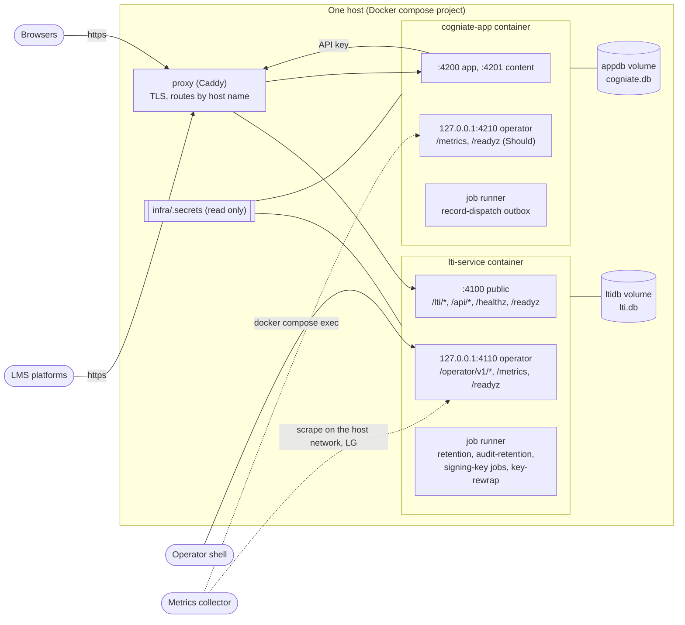

# Operability design (milestone LA)

Status: **Proposed** (P2 design, Architect-2 A2, 2026-10-22). Decisions: [LA-ADR-06](adr/LA-ADR-06-service-operability.md) (E5), [LA-ADR-03 D7](adr/LA-ADR-03-learning-record-core.md#d7-one-job-runner-for-the-outbox-and-the-e5-jobs-must) (job runner), [LA-ADR-07](adr/LA-ADR-07-security-and-tenancy.md), [LA-ADR-08](adr/LA-ADR-08-onboarding-and-connection-health.md). Storage commands: [ADR-012](../adr/ADR-012-sqlite-volume-storage.md) (unchanged in LA, LD-3). Existing operator guide: [`docs/guides/operator.md`](../../guides/operator.md).

This file is the design input for the operator runbook that Docs writes in E8. It says **what** an operator runs and sees. It does not repeat the API details ([contract delta](contracts/lti-service-api-delta.md)). Procedure steps use the imperative and one action per step.

## 1. Scope

| In LA (pilot on one host) | In LG (production platform) |
| --- | --- |
| One compose stack; one LTI service process; one app process (the worker runs in it, or as `npm run worker`) | Several instances, a queue, managed Postgres, cloud KMS, secret manager, ingress with WAF, paging |
| Operator API on a loopback listener; CLIs inside the container | Operator API on a private network with mutual TLS, behind SSO |
| `/metrics` scraped by a local collector (any OpenMetrics reader) | Hosted metrics, traces and log pipeline |
| Cold backup in a maintenance window (ADR-012 §8) | Point-in-time recovery |

## 2. Configuration

New and changed settings (all optional unless marked; the base settings stay as in `infra/compose.yaml` and `.env`):

| Setting | Service | Default | Meaning | Source |
| --- | --- | --- | --- | --- |
| `STACK_PROFILE` | both | `default` | `default`, `acceptance`, or new `production` (fail-closed start rules) | LA-ADR-06 D12 |
| `OPERATOR_HOST`, `OPERATOR_PORT` | LTI | `127.0.0.1`, `4110` (`acceptance` profile: `0.0.0.0`, for the `e2e` container; never routed by the proxy) | operator listener; `/metrics`, `/readyz` with reasons | LA-ADR-06 D3 |
| `LTI_KEYRING_FILE` | LTI | `/run/secrets/lti/keyring.json` (host: `infra/.secrets/lti/keyring.json`) | key ring JSON (`active` + `keys`); no file = `LTI_MASTER_KEY` as version `legacy` | LA-ADR-06 D6 |
| `LTI_MASTER_KEY_FILE`, `APP_MASTER_KEY_FILE` | LTI, app | unset | file forms of the master keys; required form in `production` | LA-ADR-06 D12 |
| `LTI_RATE_LIMITS` | LTI | built-in table | JSON overrides of the default limits at start; the operator API value (`PATCH /operator/v1/rate-limits`) wins over it | LA-ADR-06 D1 |
| `TRUSTED_PROXY_CIDRS` | LTI | `proxy` (CIDRs or host names; names resolved every 60 s) | peers whose `X-Forwarded-For` counts; required in `production` | LA-ADR-06 D1 |
| `SIGNING_KEY_PUBLISH_LEAD_S` | LTI | `86400` (min `600`) | wait between `next` and activation | LA-ADR-06 D7 |
| `SIGNING_KEY_ROTATE_DAYS` | LTI | `90` | age limit for the alert and for `autoRotate` accounts | LA-ADR-06 D7 |
| `AUDIT_RETENTION_DAYS` | both | `400` | audit retention (LA-H4) | LA-ADR-06 D4 |
| `JOB_INSTANCE_ID` | both | `lti-1`, `app-1` | lease owner of the job runner (with a random boot id per process). A normal restart (stop, then start) keeps today's timing: `stop()` deletes the heartbeat row. After a crash without `stop()`, the new runner waits up to 30 s before its first send, and the web part serves at once. Only a second **live** process with the same id stops its runner (`job_instance_conflict`: a worker process exits 1; the web process keeps serving with its runner off). The rule holds for both runners (LA-ADR-03 D7, Q-LAD-23) | LA-ADR-03 D7 |
| `APP_JOB_RUNNER` | app | `on` | `off` in the web process when `npm run worker` runs apart; `production` refuses both on | LA-ADR-03 D7 |
| `OPERATOR_NAME` | app | unset | default actor of `app:grant` and `app:binding` | LA-ADR-07 D4 |
| `OPERATORS`, `OPERATORS_FILE` | app | unset | allowed operator names (comma list, or a JSON array file); one of them required when a CLI runs with `STACK_PROFILE=production` | LA-ADR-07 D4 |
| `PUBLIC_MOODLE_URL` | LTI | — | leaves the LTI service config in E1 (A1, LA-ADR-04 S3) | R4 C-3 |

Secret files (never in git; mode `0600`; mounted read only):

| File | Holder | Content |
| --- | --- | --- |
| `infra/.secrets/lti-api-key.<account>` | app (read at each use) | tool account API key (today) |
| `infra/.secrets/lti-operator-key` | LTI service container (CLIs) | operator key of the host's operator |
| `infra/.secrets/lti/keyring.json` | LTI service | key ring (when used) |
| `infra/.secrets/operators.json` | app | allowed operator names (production) |

The `production` profile refuses to start when a rule of LA-ADR-06 D12 fails. The log line `config_refused {reason}` names the rule.

## 3. Deployment topology (pilot)

Rules:

- The proxy routes only the four public host names. It has no route to `:4110` or `:4210`.
- In the `acceptance` profile only, the LTI operator listener binds the stack network, so QA's `e2e` container can call it (LA-ADR-06 D3). The `default` profile keeps loopback; `production` refuses any other bind.
- In the pilot, a collector reads `/metrics` with `docker compose exec lti-service wget -qO- http://127.0.0.1:4110/metrics` (or a sidecar in the same network namespace). LG exposes it on a private network.
- One LTI service process and one app process, each with one job runner. The app worker may run apart (`npm run worker`, LA-ADR-03 D7) only when the web process has `APP_JOB_RUNNER=off` and the worker has a distinct `JOB_INSTANCE_ID`. The runner then still keeps at most one send in flight per placement, learner and reporter (LA-ADR-03 D7, A-LAD-03).
- In-memory state (score clock, platform token cache, JWKS cache, rate-limit buckets) is per process. That is safe with one LTI service process only (LA-ADR-06 D13 item 4).

## 4. Observability signals

### 4.1 Logs

Every service writes JSON lines (security §11). Key events for operators:

| Area | Events |
| --- | --- |
| Launch path | `login_rejected`, `launch_check_failed {check, code, detail}`, `launch_accepted {binding}`, `launch_claims_minimized`, `rate_limited` |
| Platform calls | `outbound_request`, `outbound_blocked {reason}`, `platform_token`, `platform_rate_limited` |
| Admin | `api_auth_failed`, `account_status_changed`, `api_key_issued`, `api_key_revoked`, `signing_key_changed`, `platform_created`, `deployment_updated`, `platform_deleted` |
| Keys | `key_provider_not_ready`, `key_open_failed` |
| Jobs | `job_run {job, ms, result, counts}`, `retention_cleanup` |
| Start | `service_started`, `config_refused`, `test_knob_active` |
| App (A1 names) | `launch_rejected {reason}`, `score_sync`, `grant_*`, `binding_*`, `connection_check` |

The audit log (tables `audit_event` in both services) is the record of who changed what. Logs are for diagnosis; audit events are for accountability.

### 4.2 Metrics (LTI service, `/metrics`)

| Metric | Type | Labels | Use |
| --- | --- | --- | --- |
| `lti_http_requests_total` | counter | `route_class`, `status_class`, `tool_account_id` | traffic, 5xx ratio |
| `lti_http_request_duration_seconds` | histogram | `route_class` | latency |
| `lti_launch_total` | counter | `result` (`accepted`, `failed`), `check`, `tool_account_id` | launch failure ratio and cause |
| `lti_launch_binding_total` | counter | `binding` (`cookie`, `storage`) | platform storage use |
| `lti_rate_limited_total` | counter | `class`, `key_kind`, `mode` (`hard`, `soft`) | abuse or a limit that is too low; `soft` = an account class above its rate |
| `lti_api_auth_failed_total` | counter | `scheme`, `code` | key problems; ltik failures under a valid key (no bucket spends them, LA-ADR-06 D1) |
| `lti_outbound_total` | counter | `result` (`response`, `blocked`), `reason` | network and guard |
| `lti_outbound_duration_seconds` | histogram | — | platform latency |
| `lti_platform_token_failures_total` | counter | `platform_id` | registration problems |
| `lti_platform_rate_limited_total` | counter | `platform_id` | LMS throttling |
| `lti_jwks_fetch_failures_total` | counter | `platform_id` | platform key set unreachable |
| `lti_jwks_cache_age_seconds` | gauge | `platform_id` | near the 24 h maximum age = launches will fail |
| `lti_signing_key_age_seconds` | gauge | `tool_account_id`, `status` | rotation due; `next` waiting |
| `lti_api_key_expires_in_seconds` | gauge | `tool_account_id` (smallest value) | expiry soon |
| `lti_operator_key_expires_in_seconds` | gauge | — (smallest value) | expiry soon |
| `lti_key_provider_sealed_rows` | gauge | `version` | re-wrap progress |
| `lti_audit_events_total` | counter | `action`, `result` | admin activity |
| `lti_job_runs_total` | counter | `job`, `result` | job health |
| `lti_job_last_success_timestamp_seconds` | gauge | `job` | stale jobs |
| `lti_ready` | gauge | — | 1 = ready |

Label rules: no personal data; `platform_id` only on the listed failure metrics; `tool_account_id` is bounded by the account count.

### 4.3 App signals (Should; names and endpoint: A1, [app API delta §8a](contracts/cogniate-app-api-delta.md#8a-app-metrics-should-with-e5-metrics))

The app has no `/metrics` today. With E5 it gets `GET /metrics` and `GET /readyz` on an app operator listener `127.0.0.1:4210` (not routed by the proxy), with the same label rules as the LTI service.

| Metric (A1 name) | Use |
| --- | --- |
| `app_dispatch_rows{reporter,status}`, `app_dispatch_oldest_pending_seconds{reporter}` | grade return backlog (`DispatchBacklog`) |
| `app_dispatch_sends_total{reporter,outcome}` (`accepted`, `conflict`, `rejected`, `retryable`, `throttled`, `local_failure`) | grade return health (`DispatchFailures`, `PlatformThrottled`) |
| `app_launch_refusals_total{reason,channel}` | setup problems per channel (`deployment_not_approved`, `site_mismatch`, `lms_mismatch`, `unknown_platform`) |
| `app_grant_redemptions_total{result}`, `app_grant_compensation_failures_total` | onboarding health |
| `app_job_runs_total{job,result}`, `app_job_last_success_timestamp_seconds{job}` | `record-dispatch` and `retention` job health (`JobStale`) |

### 4.4 Health and readiness

| Endpoint | Where | Answer |
| --- | --- | --- |
| `/healthz` | public | liveness; `production`: `{status, service}` only |
| `/readyz` | public and operator listener | `200` ready, or `503`; the operator answer lists `reasons` (`database`, `migrations`, `key_version_missing`) |

### 4.5 Service level objectives (recommendation; LA-H8)

| Objective | Pilot target | Production target |
| --- | --- | --- |
| Launch path available (`/readyz` 200 and launch 5xx ratio < 1 %) | 99.5 % per month | 99.95 % (Q11) |
| Final outcomes delivered to the LMS within 1 h, while the LMS is up | 99 % | 99.9 % |
| Recovery point (RPO) / recovery time (RTO) | LA-H8 (Lead: 1 h / 4 h; see §7) | LG managed backup |

## 5. Alerts

Severity: **page** = act now; **ticket** = act within one working day. The paging tool is LG; in the pilot, an alert is an e-mail or chat message from the collector.

| Alert | Condition | Severity | First action |
| --- | --- | --- | --- |
| `LtiNotReady` | `/readyz` not 200 for 2 min | page | Read `key_provider_not_ready`, `config_refused` and `service_started` lines. Check the key ring file and the volume. |
| `Lti5xxRatio` | 5xx > 2 % of requests over 10 min | page | Find `internal_error` lines; take the trace ids. |
| `LaunchFailureRatio` | per account: failed launches > 20 % over 15 min, and ≥ 20 launches | ticket | Group by `check`: 6 = platform key set; 9 = deployment state; 2 or `storage` = browser cookies or storage; 13, 14 = profile or site values. |
| `JwksAgeHigh` | `lti_jwks_cache_age_seconds` > 12 h for a platform | ticket | `outbound_blocked` reason for that host; run the connection check (LA-ADR-08 D4). |
| `PlatformTokenFailing` | ≥ 5 token failures in 15 min for one platform | ticket | Run the connection check; ask the LMS admin if the tool registration changed. |
| `PlatformThrottled` | any `lti_platform_rate_limited_total` increase over 1 h | ticket | Check the dispatch backlog; the outbox waits by itself (LA-ADR-03 D7). |
| `DispatchBacklog` | oldest pending dispatch > 1 h | ticket | Check that the worker runs (`job_run` lines), then platform throttling, then token failures. |
| `DispatchFailures` | > 10 `failed` dispatches per hour | ticket | Group `lastError` codes; tell the library (Resend after a fix). |
| `RateLimitedSpike` | > 100 `rate_limited` lines per minute | ticket | Abuse (one address) or a limit that is too low (one account, normal traffic): change the account `limits`. |
| `ProtocolAccountHigh` | any `rate_limit_soft` line of `protocol_account` or `registration_account` | ticket | A flood from many addresses or a real peak. Look at the addresses in `rate_limited` lines; a real peak needs a higher soft value, a flood needs edge blocking (residual R-LA-5). |
| `LtikFailureSpike` | `lti_api_auth_failed_total{scheme="LTIK-AUTH-V2"}` > 300 per minute for 5 min | ticket | Someone sends random ltiks to the app's `/tool/launch` (A-LAD-02). Check the app's per-address limit and its logs. |
| `SigningKeyOld` | active key age > `SIGNING_KEY_ROTATE_DAYS` | ticket | Start §6.1. |
| `NextKeyWaiting` | a `next` key older than 7 days | ticket | Finish §6.1, or retire the `next` key. |
| `ApiKeyExpiring`, `OperatorKeyExpiring` | expires within 14 days | ticket | §6.2, §6.4. |
| `KeyRingNotRewrapped` | `lti_key_provider_sealed_rows` > 0 for a non-active version, 7 days after a key-ring change | ticket | Run the re-wrap (§6.3). |
| `JobStale` | last success older than 3 × the job interval | ticket | Read `job_run` lines of that job. |
| `BackupMissing` | no verified backup within the RPO | page (pilot) | Run §7.2. |
| `CertificateExpiry` | TLS certificate expires within 21 days | ticket | Renew (dev: `npm run gen-env`; LG: ingress). |
| `SharedPlatformQuota` | outbound calls to one shared Blackboard platform > 8,000 per 24 h | ticket | Anthology's default limit is 10,000 REST calls per 24 h per application (R2 §9 item 13; whether AGS calls count is UNVERIFIED). Ask for a raise before the limit. |

## 6. Key rotation procedures

### 6.1 Tool signing key (every 90 days)

Before you start:

1. List the Canvas connections that use an inline key: in the portal health view, `artifactKeyCurrent` (LA-ADR-08 D5), or ask the library admins if that view is not built.
2. Agree a time with each inline-key Canvas admin. Canvas holds one inline key only, so these installs fail between the activation and the new paste.

Procedure:

1. Make the next key: `POST /operator/v1/accounts/cogniate/signing-keys` (CLI wrapper in the runbook). Write down the new kid B.
2. Check the key set: `GET /lti/keys/cogniate` lists the active key A first and B second.
3. Wait `SIGNING_KEY_PUBLISH_LEAD_S` (24 h by default).
4. Activate B: `POST …/signing-keys/B/activate`.
5. Check: one teacher "Select content" works on one Moodle site, or on the simulator; the log has `signing_key_changed {kid: B, status: active}`.
6. Tell the inline-key Canvas admins to paste the new JSON at once (Canvas admin guide, procedure 6).
7. Do nothing more. After 30 days the `signing-key-cleanup` job removes A from the key set and zeroes its private part.

Compromise of the active key:

1. Make B (step 1) and activate it with `force: true` at once.
2. Retire A at once: `POST …/signing-keys/A/retire {immediate: true}`.
3. Tell the inline-key Canvas admins to paste the new JSON.
4. Record the incident and the audit event ids.

### 6.2 Tool account API key

1. Issue a second key: `POST /operator/v1/accounts/<id>/api-keys {label, scopes}`. The answer shows the key once.
2. Put the key into the tool back end. For Cogniate, write it to `infra/.secrets/lti-api-key.cogniate` (mode `0600`). The app reads the file at each use.
3. Check that `lastUsedAt` of the new key moves and `lastUsedAt` of the old key stops (`GET …/api-keys`).
4. Revoke the old key: `POST …/api-keys/<old id>/revoke`.

Emergency (leaked key): `npm run lti:bootstrap -- --account <id> --name <name> --rotate-api-key`. It issues a new key and revokes every other key at once.

### 6.3 Master key (key ring)

In this procedure `k1` is the version in use now. On a stack without a key-ring file, the version in use is `legacy` (the value of `LTI_MASTER_KEY`): then step 3 makes the file `infra/.secrets/lti/keyring.json` with `legacy` and `k2`.

1. Make a new version (for example `k2`): 32 random bytes as 64 hex characters.
2. Put the escrow copy of `k2` in the escrow store before you change the stack.
3. Add `k2` to the key-ring file, keep `k1`, and set `"active": "k2"`.
4. Restart the LTI service. Check `/readyz` = 200.
5. Start the re-wrap: `POST /operator/v1/key-provider/rewrap`.
6. Wait until `GET /operator/v1/key-provider` shows `sealedCount` 0 for every version except `k2`.
7. Make a backup (§7.2) and record the key versions in the backup record.
8. If `k1` has `derivedCount` 0, remove it from the key-ring file, restart the LTI service and check `/readyz` = 200. Else keep it.
9. Keep the escrow copy of `k1` until every backup that needs it has expired.

CAUTION: The version `legacy` also derives the existing service keys (LA-ADR-06 D6): its `derivedCount` stays above 0 after the re-wrap. On an existing stack, keep `legacy` in the ring.

CAUTION: Do not remove a version while its `sealedCount` or `derivedCount` is above 0. The service then refuses to become ready (`key_version_missing`).

The Cogniate app follows the same steps when it uses the key provider (Should).

### 6.4 Operator key

1. Issue a new key for the same operator: `POST /operator/v1/operator-keys {operator}`.
2. Write it to `infra/.secrets/lti-operator-key`.
3. Revoke the old key with the new key: `POST /operator/v1/operator-keys/<old id>/revoke`.

Key file lost: run `docker compose exec lti-service npm run lti:operator -- init --replace --name <operator>`. It revokes every operator key and makes a new one (one audit event, actor `system:bootstrap`). Write the new key to `infra/.secrets/lti-operator-key`. (`stack:up` uses `init --if-none`, which changes nothing when a key exists.)

### 6.5 Service keys (incident)

1. Revoke the keys of the scope: `POST /operator/v1/accounts/<id>/service-keys/revoke {platformId, deploymentId?, contextId?, resourceLinkId?}` (Should).
2. Tell the library: dispatches of those activities fail with `401` until a learner or teacher launches each activity again; then use Resend on the failed rows.

## 7. Backup and restore

### 7.1 What to keep

| Item | Where | How |
| --- | --- | --- |
| `lti.db`, `cogniate.db` | ADR-012 volumes | `npm run stack:data-backup -- --out <folder>` (both services stopped) |
| Course packages and uploads | `infra/.data/cogniate-app/{packages,uploads}` | file copy in the same window |
| Key ring and master keys | secret files | escrow copy, kept apart from the database backup, with its own access list |
| API key and operator key files | `infra/.secrets/` | not needed for a restore: issue new keys after a restore |

WARNING: A backup folder contains secrets in sealed form and is useless without the matching key versions. Keep it outside the checkout and outside shared evidence (ADR-011 §14).

### 7.2 Backup procedure (pilot, LA-H8 option (a))

1. Announce the maintenance window (both services stop for the time of the copy).
2. Stop the Cogniate app and the LTI service (`npm run stack:down` of the current revision).
3. Run `npm run stack:data-backup -- --out <folder outside the checkout>`. It verifies the copies against its manifest.
4. Copy the content folders.
5. Write the backup record: backup id, time, revision, key-ring versions in use (`GET /operator/v1/key-provider` before the stop).
6. Start the stack (`npm run stack:up`). Check `/readyz` = 200 on both services.
7. Move an encrypted copy of the folder off the host.

### 7.3 Restore drill (once per release)

1. Make a scratch compose project with its own `COMPOSE_PROJECT_NAME`, `PUBLIC_PORT` and `STACK_SUBNET`.
2. Put the key-ring versions of the backup record into the scratch key-ring file (from escrow).
3. Run `npm run stack:data-restore -- --from <folder>` in the scratch project.
4. Start it. Check `/readyz` = 200.
5. Run one simulator learner launch and one score dispatch.
6. Record the start and end times (the measured RTO) and the backup age (the RPO of this drill).
7. Remove the scratch project.

## 8. Tenant operations

| Task | Steps |
| --- | --- |
| New tool account (vendor model, LA-H7) | `POST /operator/v1/accounts` with the tool URLs; set `limits` and `claimPolicy`; issue an API key with the needed scopes; give the key and the protocol URLs to the vendor through an approved channel. |
| Suspend a tool account | `PATCH /operator/v1/accounts/<id> {status: "suspended"}`. Launches show `TOOL_ACCOUNT_SUSPENDED`. Undo with `active`. |
| Close a tool account | `PATCH … {status: "closed"}` (final). Every key stops at once. The purge job deletes its data after `closedRetentionDays` (Should). |
| Grant for an admin-value connection with a host off the issuer host | `app:grant issue` marks every bound value whose host is not the issuer host (for example a D2L token host). Before the issue, confirm with the LMS administrator, through the evidence channel, that the vendor issued this client id for this issuer at that host. Then add `--confirm-foreign-hosts`; without it the command exits 1 (LA-ADR-02 D6, A-LAD-23). Record the confirmation in `--evidence-ref`. |
| Wrong library binding | `app:binding suspend`, then `release` (ADR-011 §4b), with `--operator` and the evidence fields (LA-ADR-07 D5). |

## 9. Incident first steps

| Symptom | Look at | Likely cause | Action |
| --- | --- | --- | --- |
| Teachers see `STATE_COOKIE_MISSING` | `lti_launch_binding_total`, `launch_check_failed {check: 2 or storage}` | blocked third-party cookies; no platform storage on that LMS | Learners: new window. Teachers on Moodle: use Chrome, Edge or Firefox (Q16). Canvas: check that `storage` launches appear. |
| All launches of one platform fail at check 6 | `lti_jwks_cache_age_seconds`, `outbound_blocked` | the LMS key set is unreachable | Connection check; contact the LMS admin. |
| Grades do not arrive | `DispatchBacklog`, `PlatformThrottled`, `PlatformTokenFailing` | worker stopped, LMS throttling, or a changed registration | In that order. |
| One account gets `429` in normal use | `lti_rate_limited_total{class}` | a limit too low for a big class start | Raise the account `limits`. |
| A library reports a foreign course list | audit events of `platform.*` and `binding_*` | a wrong binding | Suspend and release (§8). |
| Service does not become ready after a key change | `/readyz` reasons | a key version missing from the ring | Put the version back from escrow (§6.3 CAUTION). |

## 10. Open items

| Item | Owner |
| --- | --- |
| Pilot RPO choice among LA-ADR-06 D14 (a), (b), (c) | LA-H8 |
| Whether Blackboard AGS calls count against the 10,000 calls per 24 h (§5 `SharedPlatformQuota`) | live check (LA-H3) |
| Paging tool, log pipeline, hosted metrics | LG |
