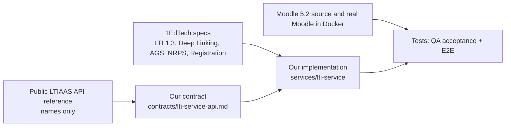

# Question 5: Can `rea` help us clone the LTIAAS API?

**Answer: No. Do not use `rea` for LTIAAS. We do not need it.**

Decision record: [ADR-001](adr/ADR-001-rea-not-used.md). Legal confirmation: [open questions](open-questions.md) Q1.

## What `rea` is

- `rea` (`github.com/morluto/rea`, MIT) is a tool for AI agents. It reverse-engineers software.
- Its inputs are files that you have: programs, mobile apps, desktop apps, websites, network captures (HAR, pcap), firmware.
- Its output is evidence: pseudocode, routes, network observations.
- Its README says: use it on "software you own or are authorized to examine".

## What LTIAAS is

- LTIAAS is a hosted service (SaaS) of GatherAct, LLC.
- We have no program file and no source code of LTIAAS. The service runs on their servers.
- The only things that we can read legally: the public API documentation and the open 1EdTech LTI specifications.

## Why `rea` does not fit

| Reason | Detail |
| --- | --- |
| 1. Legal | The LTIAAS terms forbid customers to "reverse engineer, reproduce ... or create derivative works from" the platform and its documentation. Analysis of LTIAAS with `rea` is reverse engineering. |
| 2. Access | To see LTIAAS traffic, we must make an account and accept those terms. Our team rules forbid third-party sign-ups. |
| 3. No input | `rea` needs an artifact. A hosted SaaS gives no artifact. Probing their live servers is not allowed. |
| 4. Not needed | The public API reference already gives what we need for compatibility: paths, header formats, field names, error format. The 1EdTech specs give the behaviour. |
| 5. Risk | The `rea` repository shows very unusual numbers (about 283k stars in six months). It runs as an MCP server with wide access to the local machine. Do not install it without a code and supply-chain review. |

## What we do instead (independent implementation, written clean-room process)

1. Only the Architect reads the public LTIAAS reference. It takes **only names** into our contract: paths, headers, field names, error shape.
2. The Author and QA work from our contract and the 1EdTech specifications. They do not open the LTIAAS docs or the `ltijs` source.
3. We copy no LTIAAS text and no LTIAAS code.
4. When the public docs are unclear, we choose and write down the choice ([ADR-003](adr/ADR-003-ltiaas-compatibility-scope.md), contract §8). We do not test LTIAAS to find out.
5. We test against a real Moodle 5.2. QA also runs the MIT `ltiaas` Python SDK as a test-only black-box client (T3c), if legal agrees (Q1).

## What this means for the product

- We can say only this: "The LTI service implements the listed endpoints with the paths, header schemes and field names of the public LTIAAS API reference, except the listed differences, and passes a test with an independent client."
- We must not say "a copy of LTIAAS" or "works with any LTIAAS tool".
- A tool that uses the public LTIAAS API can switch with two changes (base URL and API key), except for the items in the differences table (contract §8).
- Undocumented LTIAAS behaviour is not copied. This is a deliberate choice.

## One allowed use later

A tool like `rea` can help when we debug **our own** system, for example with a HAR capture of our own Moodle test. This needs a review of the tool first.
