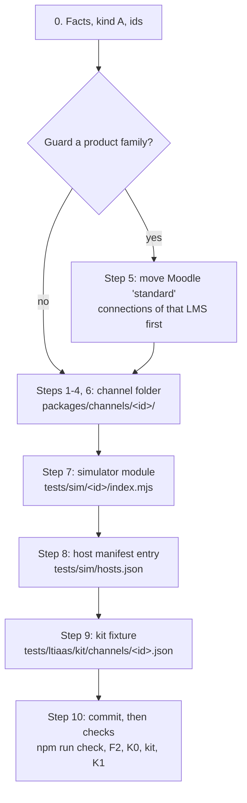

# Guide: add a new LTI channel (kind A LMS)

Source: integration head `adef56e7` (product code `02f5d420`) on `quang/ltiaas-milestone`, 2026-10-24. Status: **draft for review**, walkthrough fix: the 14 findings of the LA-E8-02 timed walkthrough ([LA-E8-02 qa](../../reviews/LA-E8-02/qa.md) §3.1), after fix round 4 ([Reviewer-A](../../reviews/LA-E8-01/reviewer-a.md), [Reviewer-B](../../reviews/LA-E8-01/reviewer-b.md)). Docs rechecked the K0 channel list, the simulator self-tests and the kit host check at integration head `f497e803`. QA checks pending: QA follows this guide on a scratch branch (AC-LA-E8-01-02), and the kit simulator rows of LA-E7-06 are pending a Docker window.

This guide is for a developer or an agent who is new to the repository. It adds one LMS of kind A as a named channel. The work is one channel folder, one simulator module, one host manifest entry and one kit fixture. No core file changes. The target time is less than one working day (plan §4 measure 5). In the LA-E8-02 walkthrough, a walker who was new to the repository added the simulator LMS `acme-lms` in 8 min 49 s ([LA-E8-02 qa](../../reviews/LA-E8-02/qa.md) §2).

The path follows the proven D2L Brightspace channel (LA-E2-05, LA-E2-06). Each example comes from `packages/channels/brightspace/` or `packages/channels/lti-generic/`.

## 0. Before you start

### 0.1 Evidence labels

The labels are the labels of the [operator runbook §0.1](operator-runbook.md#01-evidence-labels): `[SIM …]` (QA ran it on a simulator stack), `[K2 …]` (browser), `[UNIT …]` (unit or contract test, also K0), and **pending verification**. This guide adds one label:

| Label | Meaning |
| --- | --- |
| **pending QA SIM (AC-…)** | Only a simulator row that QA has not run yet proves this step. The step is part of the design; do not rely on its result before QA runs that row. |

### 0.2 Is your LMS kind A?

| Kind | Issuer | Client ID | Examples | This guide |
| --- | --- | --- | --- | --- |
| A | the site URL of one customer | made by the customer admin, per registration | D2L Brightspace, Sakai, Open edX, Absorb | yes |
| B | one fixed value for every customer of the vendor | made by the vendor or the tool vendor | Canvas cloud, Blackboard, Schoology | no |

Source: [R2 §3](../../research/ltiaas/R2-lms-landscape.md#3-two-platform-kinds).

Out of scope: a kind B LMS and a new capability. A kind B channel needs a `launch`-level guard, and a new capability needs a new entry in the kernel catalog. Both need an ADR revision ([LA-ADR-01 D4](../../architecture/ltiaas/adr/LA-ADR-01-channel-kernel.md#d4-channel-registry) load check 8; [README §4](../../architecture/ltiaas/README.md#4-rules-that-keep-core-channel-neutral) rule N5).

### 0.3 Do you need a new channel?

The card **LTI 1.3** (`lti-generic`) already connects any kind A LMS ([LTI 1.3 admin guide](lti-generic-admin.md)). A named channel adds:

- its own card, name and admin steps in the portal;
- field defaults and tool rows in the form of that LMS;
- a guard of its product family, so new Dynamic Registrations of that LMS use the named card.

If you need none of these, use `lti-generic` and stop here.

### 0.4 Collect the LMS facts

Write each fact with its source and status (confirmed, design, UNVERIFIED), as in [`packages/channels/brightspace/README.md`](../../../packages/channels/brightspace/README.md#facts-and-sources):

- the issuer form (the site URL, with or without a path);
- the authentication URL, the token URL, the keyset URL, and the token audience;
- the `product_family_code` that the LMS signs;
- the deployment ID form (for example UUIDs) and how many deployments one registration has;
- Dynamic Registration support, the registration token form, and the admin menu path;
- the admin steps and the field names of the LMS tool form.

An LMS that exists only on the simulator has no vendor source. Use the standard LTI 1.3 values: the issuer is the site URL (an origin), every endpoint is on the issuer host, and the token audience is the token URL. Choose a family code. Mark each of these facts `design` or `UNVERIFIED (simulated only)` in the README.

### 0.5 Choose the ids

| Id | Rule | Example |
| --- | --- | --- |
| channel id `<id>` | lower case, words joined by `-` (the F2 pattern `^[a-z][a-z0-9]*(?:-[a-z0-9]+)*$`); the folder name equals the manifest `id` (load check 1) | `brightspace` |
| profile id | unique over every channel (load check 2) | `brightspace` |
| simulator provider id | `<id>-sim`; it equals the `hosts.json` entry | `brightspace-sim` |

## 1. The path



Every file that you make or change (AC-LA-E8-01-01):

| Step | File | Example |
| --- | --- | --- |
| 2 | `packages/channels/<id>/manifest.ts` | `packages/channels/brightspace/manifest.ts` |
| 3 | `packages/channels/<id>/lti-profiles.ts` | `packages/channels/brightspace/lti-profiles.ts` |
| 6 | `packages/channels/<id>/README.md` | `packages/channels/brightspace/README.md` |
| 6 | `packages/channels/<id>/channel.test.ts` | `packages/channels/brightspace/channel.test.ts` |
| 7 | `tests/sim/<id>/index.mjs` (one provider), and optional `tests/sim/<id>/protocol.test.mjs` | `tests/sim/brightspace/index.mjs` |
| 8 | `tests/sim/hosts.json` (one new entry) | the `brightspace-sim` entry |
| 9 | `tests/ltiaas/kit/channels/<id>.json` | `tests/ltiaas/kit/channels/brightspace.json` |
| 11 | docs only, for example an admin guide | [D2L Brightspace admin guide](brightspace-admin.md) |

Do not edit any other file. A change in core, in a shared build file or in another channel folder fails F2 (step 10). Browser cases are not in this table: QA-E2E owns them (step 10).

## Step 1: Make the channel folder

1. Make the folder `packages/channels/<id>/`.
2. Do not make `app.ts` and do not make `portal/`. When every profile of the channel has `endpoints: 'admin'`, the kernel admin-value setup adapter serves the channel, and the portal shows it from the manifest [UNIT E2-05-03].

Rules ([LA-ADR-01 D1](../../architecture/ltiaas/adr/LA-ADR-01-channel-kernel.md#d1-one-folder-per-channel)):

- `manifest.ts` imports only types from `@cogniate/channel-kernel`.
- `lti-profiles.ts` imports only kernel types (and its own `manifest.ts`).
- A channel file never imports another channel folder, and never a path under `services/` or `apps/`. F3 refuses it inside `npm run check` [UNIT E1-03-03].
- A new folder needs no edit of a root build file to be typechecked, linted and tested [UNIT E1-03-05].
- The services and the portal find the folder by discovery. No core file lists channel ids [UNIT E2-05-03] (`npm run test:k0` passed with `brightspace` loaded and no kernel edit).

## Step 2: Write the manifest (`manifest.ts`)

Copy `packages/channels/brightspace/manifest.ts`. Change each value.

| Field | What to write | Example (`brightspace`) |
| --- | --- | --- |
| `id` | the channel id (= the folder name) | `'brightspace'` |
| `family` | always `'lti13'` | `'lti13'` |
| `names` | `text`: the short name in texts (`{LMS}`); `label`: the full name | `{ text: 'Brightspace', label: 'D2L Brightspace' }` |
| `card` | title, description, mark, color, `category: 'LMS Publishing'`, the next free `order` | `order: 5` (`lti-generic` has 4) |
| `availability` | `'ga'` | `'ga'` |
| `registration` | `manual` with authority `operatorGrant`; add `dynamic` with authority `self` only if the LMS supports Dynamic Registration | see below |
| `capabilities` | the capability values; see "Capabilities" below | see below |
| `lti` | `guardedFamilies` (step 4) and `toolConfiguration: 'channel'` | `[{ family: 'desire2learn', level: 'registration' }]` |
| `setup.createFields` | the site URL field | `{ key: 'siteUrl', label: 'Brightspace URL', kind: 'origin', required: true }` |
| `setup.bindingFields` | the manual fields with `FieldSpec.default` values; the three `method: 'dynamic'` fields only when `registration` has the `dynamic` method | see below |
| `setup.toolRows` | optional: the tool rows in the order of the LMS form | 9 D2L rows |
| `texts` | `adminSteps`, `teacherSteps`, `disconnect`, `notReady: null` | copy and change |

Registration methods:

```ts
registration: [
  { method: 'dynamic', authority: 'self', profiles: ['<profile id>'], defaultProfile: '<profile id>' },
  { method: 'manual', authority: 'operatorGrant', profiles: ['<profile id>'], defaultProfile: '<profile id>' },
],
```

- A `manual` method with authority `self` stops the start (load check 6) [UNIT E2-05-03].
- A Dynamic Registration with `self` connects at once only when every LMS URL and the token audience are on the issuer origin. Else the LTI service stages it, and an operator grant activates it [SIM E2-02-02], [SIM E2-02-03], [SIM E2-06-02].
- An LMS with no Dynamic Registration: remove the `dynamic` line. Then also remove the three `method: 'dynamic'` binding fields (`clientId`, `deploymentId`, `grantCode`), and write `dynamicRegistration: null` in the profile (step 3).

Capabilities (the catalog and the source of each value: [LA-ADR-01 D3](../../architecture/ltiaas/adr/LA-ADR-01-channel-kernel.md#d3-capability-model)):

| Capability | Rule | `brightspace` | `lti-generic` |
| --- | --- | --- | --- |
| `registration.scopes` | the four AGS scopes; copy them | the four AGS scopes | the four AGS scopes |
| `deployments.multiple` | `true` when one registration can have more than one deployment | `true` | `true` |
| `content.multiple` | `true` when the LMS accepts several items in one Deep Linking answer. The picker shows checkboxes only when the LMS also sends `accept_multiple: true` ([LA-ADR-05](../../architecture/ltiaas/adr/LA-ADR-05-lti-advantage-completeness.md) D3b). If you do not know, leave it out. | not set (`false`) | `true` |
| `launch.windowHint` | `true` | `true` | `true` |
| `launch.topLevelContinue` | leave it out; only Canvas sets `true` | `false` | not set (`false`) |
| `records.reporters`, `records.readBack` | `['lti-ags']`, `true` | the same | the same |

- A capability that the manifest does not set is `false` (or an empty list).
- Do not write the computed capabilities. The kernel computes `registration.dynamic` and `binding.authority` from `registration`, `platform.sharing` from the profile `sharing`, and `site.serviceOrigin` from the profile `serviceUrl`.
- `setup.connectionCheck` is in `setup`, not in `capabilities`. Leave it out, as `brightspace` does. `lti-generic` and `canvas` set it to show the "Check connection" panel ([LA-ADR-08 D4](../../architecture/ltiaas/adr/LA-ADR-08-onboarding-and-connection-health.md#d4-connection-check-could-recommended-first); LA-E6-04).

Field defaults (`FieldSpec.default`):

```ts
{ key: 'issuer', label: 'Issuer', kind: 'url', required: true, method: 'manual', default: '{siteUrl}' },
{ key: 'accessTokenEndpoint', label: 'Brightspace OAuth2 access token URL', kind: 'url', required: true, method: 'manual',
  default: 'https://auth.brightspace.com/core/connect/token' },
```

- `{siteUrl}` is filled with the connection's site URL. A posted value replaces the default [UNIT E2-03-06].
- The portal pre-fills the defaults in the binding form [K2 E7-07-02].
- A default is never trusted alone: the operator grant binds every value ([operator runbook §10.3](operator-runbook.md#103-grant-with-bound-values-manual-lti-13-or-d2l-brightspace)).

Tool rows:

- With no `setup.toolRows`, the portal shows the generic 8 rows of `lti-generic` [SIM E2-03-05].
- With `setup.toolRows`, it shows your rows in your order. The kernel fills `{toolName}`, `{ltiHost}`, `{launchUrl}`, `{loginUrl}` and `{keysUrl}` [SIM E2-05-06], [K2 E7-07-02].

Texts: write them in the same style as the other manifests. The portal fills `{LMS}` and `{tool}` [K2 E7-07-02].

## Step 3: Write the LTI profile (`lti-profiles.ts`)

Copy `packages/channels/brightspace/lti-profiles.ts`. One admin-value profile is enough.

```ts
{
  id: '<profile id>', listOrder: 100, endpoints: 'admin', privacyFloor: 'allowlist', label: '<full name>', sharing: 'exclusive',
  issuer: null, authenticationEndpoint: null, accesstokenEndpoint: null, jwksUrl: null,
  siteUrlOn: null, serviceUrl: false, simulation: false,
  productFamily: '<family code>',
  issuerKind: 'per-tenant', endpointOrigins: 'any-https', clientAssertionAud: { value: '{platformValue}', form: 'string' }, assertionDeploymentId: false,
  dynamicRegistration: { issuerRule: 'path-prefix', registrationToken: 'opaque-bearer' },
  flags: { deepLinkingResponseSub: false, serviceOriginCheck: false },
  sources: ['<your sources>'],
},
```

| Trait | Rule |
| --- | --- |
| `listOrder` | a whole number above every other profile: `lti-generic` has 80, `brightspace` 90. New profiles must be above the baseline maximum (load check 7, BD-A1-23). |
| `endpoints: 'admin'` | the admin types the URLs; the grant binds them |
| `issuerKind: 'per-tenant'` | kind A: the issuer is the site URL of one customer |
| `endpointOrigins: 'any-https'` | the LMS may have a URL on another host (for example a central token host) |
| `clientAssertionAud` | `{platformValue}`: the stored token audience, else the token URL |
| `dynamicRegistration` | the object above if the LMS supports Dynamic Registration; `null` if it does not (as `blackboard`). Do not leave the key out: the LTI service reads a missing key as "no Dynamic Registration", but the kernel capability rule reads it as "no profile limit" ([LA-ADR-02 D2](../../architecture/ltiaas/adr/LA-ADR-02-generic-lti-channel.md#d2-profile-traits-added-in-e2), build ruling BD-A1-83). |
| `privacyFloor` | `'allowlist'` |
| `wireLms` | do not set it: only the baseline profiles have it (load check 7) |

Evidence: the `brightspace` profile with these traits [UNIT E2-05-02], [UNIT E2-05-03]; a launch, a Deep Linking pick and a score on the D2L simulator [SIM E2-05-04].

You need no simulator profile: QA registers the simulator hosts as admin values ([LA-ADR-02 D7](../../architecture/ltiaas/adr/LA-ADR-02-generic-lti-channel.md#d7-simulator-needs-must)).

## Step 4: Choose the guard level

A named kind A channel guards its product family at the `registration` level only ([LA-ADR-02 D1](../../architecture/ltiaas/adr/LA-ADR-02-generic-lti-channel.md#d1-two-channels-in-e2)):

```ts
lti: { guardedFamilies: [{ family: '<family code>', level: 'registration' }], toolConfiguration: 'channel' },
```

What the guard does, proven with `desire2learn` on the simulator [SIM E2-05-05]:

1. A launch of the family on an existing `lti-generic` platform still passes. The LTI service only logs `family_guard_mismatch`.
2. A launch of the family on a Moodle `standard` platform is refused with `PROVIDER_PROFILE_MISMATCH`, before any claim is stored.
3. A new Dynamic Registration of the family on an `lti-generic` connection is refused at `complete`.

Effect 3 applies only to an LMS with Dynamic Registration. A channel with no Dynamic Registration still guards its family when you know the code: effects 1 and 2 still apply. If the LMS has no family code of its own, write `guardedFamilies: []` and skip step 5.

The guard also changes the kit: see step 9.

Rules:

- One family belongs to one channel only (load check 3).
- Guard a family only when you know its code. If the code is not confirmed on a real LMS, mark it UNVERIFIED in the README, as `brightspace` does.
- A `launch`-level guard is only for the frozen kind B list (load check 8). Do not use it.
- If you guard a family, do step 5 before the channel ships.

## Step 5: Move Moodle `standard` connections first (only when you guard a family)

After the channel ships, a launch of the family on an active Moodle `standard` platform is refused [SIM E2-05-05]. So find those platforms first, and move them. The order is: **move first, then guard.**

Step 5 runs on a running stack, for each environment that has tool accounts: an operator runs it on that environment before the release that adds the guard. A branch with no stack (host only) does not run it. Step 5 does not apply when the LMS exists only on the simulator: you chose its family code, so no real LMS signs it. Then write "step 5: not applicable (simulated-only LMS)" in the "Live status" section of the channel README.

The rule that the list uses (design and code):

- The guard compares the signed `product_family_code` in lower case ([LA-ADR-01 D6](../../architecture/ltiaas/adr/LA-ADR-01-channel-kernel.md#d6-lti-profiles-in-the-lti-service); `services/lti-service/src/lti/checks.ts`). The LTI service stores the code as the LMS signs it (`services/lti-service/src/lti/launch.ts`). So the list compares in lower case too, and finds `desire2learn`, `DESIRE2LEARN` and `Desire2Learn`.
- Only an **active** platform can launch. An inactive platform gets `PLATFORM_NOT_ACTIVE` [SIM E2-02-03]. So inactive rows are history: the list does not show them.
- A platform with no family has had no accepted launch with a family yet. Its next launch can be your family. So you check it by hand.

Procedure:

1. List the active Moodle-type platforms of the tool account. Use the operator helpers of the [runbook §1](operator-runbook.md#1-set-up-your-shell) (the `tenant` helper uses the API key of the account `cogniate`):

   ```sh
   tenant GET '/api/platforms?profile=standard' | node -e '
   const [family, ...checked] = process.argv.slice(1);
   const t = require("node:fs").readFileSync(0, "utf8");
   for (const p of JSON.parse(t.slice(t.indexOf(" ") + 1)).platforms) {
     if (p.active !== true) continue;
     const f = typeof p.productFamilyCode === "string" ? p.productFamilyCode.toLowerCase() : "";
     if (f === family.toLowerCase()) console.log("AFFECTED", p.id, p.url, p.productFamilyCode);
     else if (f === "" && !checked.includes(p.id)) console.log("CHECK", p.id, p.url, "(no family yet)");
   }
   ' '<family code>'
   ```

   - `AFFECTED`: an active platform of your family. It uses the Moodle card for a non-Moodle LMS.
   - `CHECK`: an active platform with no family yet.
2. For each `CHECK` line, ask its library which LMS it is.
   - If it is your LMS, treat it as `AFFECTED`.
   - If it is not, write down its platform id. You pass it to the list later as an extra argument. A checked id hides only a `CHECK` line (a platform with no family yet). If that platform later signs your family, the list shows it as `AFFECTED` again.
3. For each `AFFECTED` platform:
   1. Ask the library to connect the LMS again with the card **LTI 1.3** ([LTI 1.3 admin guide](lti-generic-admin.md)).
   2. Check that the new connection works: its status is `connected` after a launch.
   3. Ask the library to disconnect the old Moodle connection in the portal. The disconnect switches its platform off (`active: false`; `services/cogniate-app/src/kernel/authority/self.ts`).
   4. Check that the old platform is inactive: `tenant GET /api/platforms/<platform id>` shows `"active":false`.
4. Run the command of item 1 again. Put the ids of the platforms that you checked by hand, and that are not your LMS, after the family code. The last line of the command, `' '<family code>'`, then is `' '<family code>' '<checked id 1>' '<checked id 2>'`.

5. The move is complete when the list prints no line. Do not delete platform rows to empty the list.
6. Then ship the channel with the guard.

The list command and the move steps are pending verification: QA checks them on the simulator at the LA-E8-01 check (AC-LA-E8-01-03). Docs tested the filter only with sample answers: three case variants of one family, an inactive platform of that family, a platform with no family and an unrelated family.

## Step 6: Write the README and the unit test

1. Write `packages/channels/<id>/README.md`: one table of facts with source and status, and a "Live status" section. Copy the form of the `brightspace` README. QA checked that README with a DOC and K0 row (AC-LA-E2-05-08).
2. Write `packages/channels/<id>/channel.test.ts`: test the manifest and profile data (defaults, traits, registration methods, guard, scopes, tool rows). Copy `packages/channels/brightspace/channel.test.ts`. The root `npm run test:unit` runs it [UNIT E1-03-02].

## Step 7: Add the simulator module (`tests/sim/<id>/index.mjs`)

Use the template below. The module returns **one** provider. Do not copy `tests/sim/generic/index.mjs`, although the [simulator README](../../../tests/sim/README.md#add-a-simulator-lms-one-module--one-manifest-entry) still says so: that file also returns the Moodle-shaped provider `moodle-sim`, so a copy registers `moodle-sim` twice and the simulator does not start (`Duplicate simulator provider moodle-sim`). Use the simulator README for the config fields and the start rules.

1. Make `tests/sim/<id>/index.mjs` from this template. It has the shape of `tests/sim/brightspace/index.mjs`:

   ```js
   import { createProvider } from '../core/provider.mjs';

   // One provider only. Values from the facts of the new LMS (the README of the channel).
   export const newlms = {
     id: '<id>-sim',
     issuer: 'https://<id>.sim.test',
     family: '<family code>',
     deployments: ['deploy-<id>-1', 'deploy-<id>-2'],
     auth: { host: '<id>.sim.test', path: '/lti/auth', methods: ['GET', 'POST'] },
     jwks: { host: '<id>.sim.test', path: '/lti/jwks.json' },
     token: { hosts: ['<id>.sim.test'], path: '/lti/token', audience: 'string' },
     sites: [{ host: '<id>.sim.test', lineitems: '/lti/courses/course-1/lineitems', nrps: '/lti/courses/course-1/memberships', dlReturn: '/lti/deep-link/return' }],
     pageHosts: [],
     dlData: 'claim',
     dlSubject: false,
     dlWindowHint: true,
     documentTarget: 'iframe',
   };

   export function createProviders(runtime) {
     return [createProvider(runtime, newlms)];
   }
   ```

2. Change the values to your facts: a token host off the issuer host, a fixed token audience, UUID deployments (`deploymentFormat: 'uuid'`) and Dynamic Registration (`dr`) where your LMS has them. The fields are in the [simulator README](../../../tests/sim/README.md#config-fields-createproviderruntime-config). Example (`brightspace-sim`): token host `auth.brightspace.sim.test`, an audience that is not the token URL, family `desire2learn`, three UUID deployments.
3. Use only lower-case host names that end in `.sim.test`.
4. Optional: add `tests/sim/<id>/protocol.test.mjs`. `tests/sim/brightspace/protocol.test.mjs` is an example, but most of it tests D2L features: UUID deployments, a token host off the issuer host, a fixed token audience and Dynamic Registration. Keep those tests only if your LMS has the same feature. For an LMS with the template values, write tests for: the loader and the hosts; the launch claims (family, deployments, AGS and NRPS URLs); the token (audience = the token URL) with an AGS score and an NRPS call; Deep Linking; and no Dynamic Registration route if the LMS has none.
5. After step 8, run this host-only check from the repository root. It loads every simulator module and the host manifest, and starts no server:

   ```sh
   node --input-type=module -e "
   import { createRuntime } from './tests/sim/core/runtime.mjs';
   import { loadProviders } from './tests/sim/server.mjs';
   const runtime = createRuntime({ publicLtiUrl: 'https://tool.test', fetchJwks: async () => { throw new Error('no key fetch in this check'); } });
   console.log((await loadProviders(runtime)).map((p) => p.id).sort().join(' '));
   "
   ```

   Expected: the ids of the existing providers and **one** new id, `<id>-sim`, for example `blackboard-sim brightspace-sim canvas-sim-cloud canvas-sim-self generic-sim moodle-sim <id>-sim`. An error names the problem, for example a duplicate provider, a duplicate host, or a host that is missing in `hosts.json`.

6. Run the simulator self-tests (host only; they start no stack):

   ```sh
   node --test 'tests/sim/core/*.test.mjs' 'tests/sim/*/protocol.test.mjs'
   ```

   Expected: all tests pass, 0 failed (the summary line `ℹ fail 0`). The tests read the host manifest open-world, so a new provider needs no test edit.

Evidence: one module folder and one `hosts.json` entry add a simulator LMS with no edit of `tests/sim/server.mjs` [UNIT E7-02-02] (host-only); on a stack: pending QA SIM (AC-LA-E7-02-02). The D2L provider served a full launch, Deep Linking and score flow [SIM E2-05-04]. In the LA-E8-02 walkthrough, the discovery check of item 5 showed the new provider `acme-lms-sim`, and the self-tests of item 6 passed with it [UNIT E8-02-02] ([qa](../../reviews/LA-E8-02/qa.md) §1.2).

## Step 8: Add the host manifest entry (`tests/sim/hosts.json`)

Add one entry to `providers`:

```json
{ "id": "brightspace-sim",
  "aliases": ["brightspace.sim.test", "auth.brightspace.sim.test", "school-b.brightspace.sim.test"],
  "allowlist": ["brightspace.sim.test", "auth.brightspace.sim.test", "school-b.brightspace.sim.test"] }
```

- `aliases`: every host of the provider.
- `allowlist`: the hosts that the LTI service calls server to server (keyset, token, configuration, registration, AGS, NRPS). It is a subset of `aliases`.
- The simulator refuses a bad manifest at start (fail closed; [simulator README](../../../tests/sim/README.md#fail-closed-startup-rules-readmemd-4b-bd-a1-01-v11-bd-a1-53)).

QA then starts the stack with `STACK_PROFILE=acceptance npm run stack:up` in a booked Docker window. A new entry adds its hosts to the compose aliases, the certificate names and the `acceptance` allowlist, with no edit of `infra/compose.yaml` or `infra/scripts/lib.sh` [SIM E7-03-02]. The `default` profile gets no simulator host [SIM E7-03-03].

## Step 9: Add the kit fixture (`tests/ltiaas/kit/channels/<id>.json`)

Follow the [kit README §2](../../../tests/ltiaas/kit/README.md#2-how-to-certify-a-new-channel-one-fixture-file-zero-suite-edits):

1. Copy `tests/ltiaas/kit/channels/brightspace.json` (or `lti-generic.json`) to `tests/ltiaas/kit/channels/<id>.json`.
2. Set `id`, `simProvider` (`<id>-sim`), `simProfile`, all 17 capability values, `coveredBy` (normally `{}` for a new channel), `notBuilt`, `expect.legacyFlags`, `expect.toolConfigurationKeys` and the `sim` values.
3. Name the design source of every value in `source` and `sources` [UNIT E7-06-07].

The fixture values follow the manifest and the profile, with the rules of [LA-ADR-01 D3](../../architecture/ltiaas/adr/LA-ADR-01-channel-kernel.md#d3-capability-model). For a channel with no Dynamic Registration, change these values of the `brightspace.json` copy:

| Fixture field | Value |
| --- | --- |
| `capabilities.registration.dynamic` | `false` |
| `capabilities.binding.authority` | `{ "manual": "operatorGrant" }` |
| `expect.legacyFlags.dynamicRegistration` | `false` |

The six `expect.legacyFlags` are the legacy projection of LA-ADR-01 D3: `dynamicRegistration` = `registration.dynamic`; `operatorApproval` = some method has `operatorGrant`; `webServices` = `siteApi.token`; `courseShell` = `publish.createCourse`; `addDeployment` = `deployments.multiple`; `canvasConfiguration` = `setup.artifacts` has `developer-key-json`.

You add one file. You edit no suite and no shared channel list: the kit loader finds every `<id>.json` in `tests/ltiaas/kit/channels/`, and the shipped fixture audit accepts five or more fixtures. With `QA_KIT_CHANNELS` unset or `all`, a run selects every fixture that it finds. QA's K0 canary proves this with a sixth fixture [UNIT E7-06] (row `B-LA-E7-06-06`). With a real sixth fixture in `tests/ltiaas/kit/channels/`, the full kit host check passes: all tests pass, 0 failed ([LA-E7-06 qa](../../reviews/LA-E7-06/qa.md) Round 4, §4.2; Reviewer-B closed `B-LA-E7-06-06` in round 4).

A guard of your channel (step 4) takes part in the kit's L4 family-guard case. For each target channel, the kit selects one foreign family that another channel guards at the `registration` level, from all fixtures. So your family can become the selected probe of another channel, and it can change the probe that a channel had before. The expected result depends on the target: on Moodle (its manual `self` path) the launch is refused with `400 PROVIDER_PROFILE_MISMATCH`, as in step 4; on the other targets it passes with the log `family_guard_mismatch` (`warn_passthrough`). This is expected kit behaviour (finding F-LA-E7-06-WALK-01, LA-E7-06). Docs ran the kit host check at `f497e803` with a temporary channel folder and fixture that guard a new family at the `registration` level: all tests pass, 0 failed. Docs removed the files after the run.

The kit computes the list of expected cases from the fixture before a run. A missing case or an extra case fails the run [UNIT E7-06-02].

## Step 10: Run the checks

### 10.1 Commit your files first

F2 compares two commits: the merge base of `--base` and `HEAD` (`infra/scripts/fitness/channel-diff.mjs`). It does not see files that are not committed.

1. Write down the SHA that your branch started from: `git rev-parse HEAD` before your first change, or the branch that you started from (for example `quang/ltiaas-milestone`).
2. Commit every file of the §1 table on your branch.
3. Run `git status --short`. It must print nothing.

If you run F2 before the commit, it prints `F2 PASS: core = 0, paths = 0`. That result proves nothing about the new channel. A report for a new channel always lists your files.

### 10.2 The checks

| Check | Command | Expected result | Evidence |
| --- | --- | --- | --- |
| Repository check (lint, typecheck, unit, infra, K0, F1, F5) | `npm run check` | exit 0 | `[UNIT E2-06-01]` |
| F2 add-channel gate (after 10.1) | `npm run fitness:channel-diff -- --base <the SHA or branch of 10.1 step 1> --channel <id>` | one line per committed file: `channel:<id>` for the channel folder, `sim` for `tests/sim/**`, `tests` for the kit fixture, `docs` for docs; the last line is `F2 PASS: core = 0, paths = <n>`, with `<n>` equal to the number of files that you committed | `[UNIT E2-05-01]`, `[UNIT E2-06-01]` |
| K0 contract suite | `npm run test:k0` | all tests pass, 0 failed; then the check below prints your channel id | `[UNIT E2-05-03]`, `[UNIT E8-02-02]` |
| Simulator discovery (host only) | the command of step 7, item 5 | the existing provider ids and one new id `<id>-sim` | `[UNIT E8-02-02]` (`acme-lms-sim`, [qa](../../reviews/LA-E8-02/qa.md) §1.2) |
| Simulator self-tests (host only) | the command of step 7, item 6 | all tests pass, 0 failed | `[UNIT E8-02-02]` |
| Kit host check | `LA_LEVEL=k0 npx --no-install vitest run --config tests/ltiaas/kit/vitest.config.mts` | all tests pass, 0 failed, with your fixture discovered and its sources audited | `[UNIT E7-06-02]`, `[UNIT E7-06-07]`; with a real sixth fixture: [LA-E7-06 qa](../../reviews/LA-E7-06/qa.md) Round 4 |
| K1 kit on the simulator (QA, in a booked Docker window, inside the `e2e` container) | from `/repo` (the working directory of the `e2e` container): `LA_RUN_DIR=/tmp/kit-run QA_KIT_CHANNELS=<id> QA_TASK=K1 npm --prefix tests run acceptance:api` ([kit README §3](../../../tests/ltiaas/kit/README.md#full-k1-sim-run-during-a-booked-docker-window); see the note below the table) | every applicable case passes; a case is N/A only when its capability is off and its guard case passed | pending QA SIM (AC-LA-E7-06-01, AC-LA-E7-06-03, AC-LA-E7-06-04). The full kit passed for `brightspace` on the D2L simulator [SIM E2-05-10]. |

K1 command note: the runner `tests/acceptance/run-api.mjs` starts Vitest with the paths `node_modules/vitest/vitest.mjs` and `ltiaas/kit/vitest.config.mts`. Both are relative to the working directory, so the runner must start in `tests/`. `npm --prefix tests run acceptance:api` runs the `acceptance:api` script of `tests/package.json` in `tests/`, and it keeps the three variables. Do not use `node tests/acceptance/run-api.mjs` from `/repo`: it looks for `/repo/ltiaas/kit/vitest.config.mts`, which does not exist. Another correct form: `cd /repo/tests`, then `LA_RUN_DIR=/tmp/kit-run QA_KIT_CHANNELS=<id> QA_TASK=K1 node acceptance/run-api.mjs`. Docs checked the paths of both forms on the host with a stub in place of Vitest (no stack, no test run); the K1 run itself is pending QA SIM. The [kit README §3](../../../tests/ltiaas/kit/README.md#full-k1-sim-run-during-a-booked-docker-window) gives the same two forms (QA-K fix, integration `29fcb01d`).

Check that the K0 suite loaded your channel (host only). The K0 suite makes one group of contract tests for each channel folder that it finds, named `K0 product channel contract: <id>`. This command lists those groups:

```sh
npm run test:k0 -- --reporter=verbose | grep -o 'K0 product channel contract: [a-z0-9-]*' | sort -u
```

Expected: one line for each channel, and one of them is `K0 product channel contract: <id>`. If your id is missing, discovery did not find the folder: check the folder name and the manifest `id` (step 1). Docs ran this check at `f497e803` with a temporary sixth channel folder: the new id was in the list, and all K0 tests passed, 0 failed. Docs removed the folder after the run.

F2 notes:

- A path in core, in a shared build file or in another channel folder makes F2 fail [UNIT E7-04-04].
- A new channel id in a core file also fails F1 inside `npm run check` [UNIT E7-04-02].
- The F2 result of the D2L channel: `F2 PASS: core = 0, paths = 4` for its four channel files [UNIT E2-06-01].

Browser check (K2): not a step of this path. QA-E2E owns the browser cases in its own folder `tests/e2e/ltiaas/` (charter-LA §1, QA-E2E row; LA-E7-07). A browser case for a new channel is a separate QA task, outside the files of §1. The U3 browser flows passed for `lti-generic` and `brightspace` [K2 E7-07-03]; for a new channel: pending QA.

## Step 11: Write the docs (optional)

Write an admin guide for the new LMS under `docs/guides/`. Copy the form of the [D2L Brightspace admin guide](brightspace-admin.md): the facts with their status, the tool rows, the wizard defaults, the approval steps. Docs paths are class `docs` for F2.

Skip this step for an LMS that exists only on the simulator: it has no admin screens, and the channel README holds its facts and steps. F2 then lists no `docs` path.

## Done checklist

- [ ] The LMS is kind A, and a named channel is needed (§0).
- [ ] If you guard a family, the list of step 5 prints no line (with the ids that you checked by hand as arguments), and each moved library has a working LTI 1.3 connection; or the README records step 5 as not applicable (simulated-only LMS).
- [ ] The changed files are only those of the table in §1.
- [ ] The simulator discovery check of step 7 shows one new provider id, and the simulator self-tests pass.
- [ ] All files are committed, and `git status --short` prints nothing.
- [ ] `npm run check` passes.
- [ ] F2 lists your committed files and prints `F2 PASS: core = 0`.
- [ ] `npm run test:k0` passes, and the check of step 10.2 lists your channel id.
- [ ] QA ran the K1 kit for the channel (pending QA SIM for the kit).
