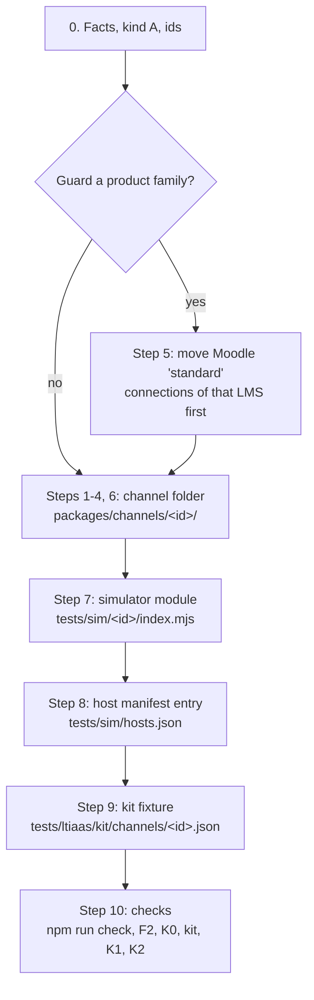

# Guide: add a new LTI channel (kind A LMS)

Source: integration head `adef56e7` (product code `02f5d420`) on `quang/ltiaas-milestone`, 2026-10-24. Status: **draft for review**. Reviews: pending (LA-E8-01 done rule). QA checks pending: QA follows this guide on a scratch branch (AC-LA-E8-01-02), and the kit simulator rows of LA-E7-06 are pending a Docker window.

This guide is for a developer or an agent who is new to the repository. It adds one LMS of kind A as a named channel. The work is one channel folder, one simulator module, one host manifest entry and one kit fixture. No core file changes. The target time is less than one working day (plan §4 measure 5; LA-E8-02 measures it).

The path follows the proven D2L Brightspace channel (LA-E2-05, LA-E2-06). Each example comes from `packages/channels/brightspace/` or `packages/channels/lti-generic/`.

## 0. Before you start

### 0.1 Evidence labels

The labels are the labels of the [operator runbook §0.1](operator-runbook.md#01-evidence-labels): `[SIM …]` (QA ran it on a simulator stack), `[K2 …]` (browser), `[UNIT …]` (unit or contract test, also K0), and **pending verification**. This guide adds one label:

| Label | Meaning |
| --- | --- |
| **pending QA SIM (AC-…)** | Only a simulator row that QA has not run yet proves this step. The step is part of the design; do not rely on its result before QA runs that row. |

### 0.2 Is your LMS kind A?

| Kind | Issuer | Client ID | Examples | This guide |
| --- | --- | --- | --- | --- |
| A | the site URL of one customer | made by the customer admin, per registration | D2L Brightspace, Sakai, Open edX, Absorb | yes |
| B | one fixed value for every customer of the vendor | made by the vendor or the tool vendor | Canvas cloud, Blackboard, Schoology | no |

Source: [R2 §3](../../research/ltiaas/R2-lms-landscape.md#3-two-platform-kinds).

Out of scope: a kind B LMS and a new capability. A kind B channel needs a `launch`-level guard, and a new capability needs a new entry in the kernel catalog. Both need an ADR revision ([LA-ADR-01 D4](../../architecture/ltiaas/adr/LA-ADR-01-channel-kernel.md#d4-channel-registry) load check 8; [README §4](../../architecture/ltiaas/README.md#4-rules-that-keep-core-channel-neutral) rule N5).

### 0.3 Do you need a new channel?

The card **LTI 1.3** (`lti-generic`) already connects any kind A LMS ([LTI 1.3 admin guide](lti-generic-admin.md)). A named channel adds:

- its own card, name and admin steps in the portal;
- field defaults and tool rows in the form of that LMS;
- a guard of its product family, so new Dynamic Registrations of that LMS use the named card.

If you need none of these, use `lti-generic` and stop here.

### 0.4 Collect the LMS facts

Write each fact with its source and status (confirmed, design, UNVERIFIED), as in [`packages/channels/brightspace/README.md`](../../../packages/channels/brightspace/README.md#facts-and-sources):

- the issuer form (the site URL, with or without a path);
- the authentication URL, the token URL, the keyset URL, and the token audience;
- the `product_family_code` that the LMS signs;
- the deployment ID form (for example UUIDs) and how many deployments one registration has;
- Dynamic Registration support, the registration token form, and the admin menu path;
- the admin steps and the field names of the LMS tool form.

### 0.5 Choose the ids

| Id | Rule | Example |
| --- | --- | --- |
| channel id `<id>` | lower case, words joined by `-` (the F2 pattern `^[a-z][a-z0-9]*(?:-[a-z0-9]+)*$`); the folder name equals the manifest `id` (load check 1) | `brightspace` |
| profile id | unique over every channel (load check 2) | `brightspace` |
| simulator provider id | `<id>-sim`; it equals the `hosts.json` entry | `brightspace-sim` |

## 1. The path



Every file that you make or change (AC-LA-E8-01-01):

| Step | File | Example |
| --- | --- | --- |
| 2 | `packages/channels/<id>/manifest.ts` | `packages/channels/brightspace/manifest.ts` |
| 3 | `packages/channels/<id>/lti-profiles.ts` | `packages/channels/brightspace/lti-profiles.ts` |
| 6 | `packages/channels/<id>/README.md` | `packages/channels/brightspace/README.md` |
| 6 | `packages/channels/<id>/channel.test.ts` | `packages/channels/brightspace/channel.test.ts` |
| 7 | `tests/sim/<id>/index.mjs` (and its `protocol.test.mjs`) | `tests/sim/brightspace/index.mjs` |
| 8 | `tests/sim/hosts.json` (one new entry) | the `brightspace-sim` entry |
| 9 | `tests/ltiaas/kit/channels/<id>.json` | `tests/ltiaas/kit/channels/brightspace.json` |
| 11 | docs only, for example an admin guide | [D2L Brightspace admin guide](brightspace-admin.md) |

Do not edit any other file. A change in core, in a shared build file or in another channel folder fails F2 (step 10).

## Step 1: Make the channel folder

1. Make the folder `packages/channels/<id>/`.
2. Do not make `app.ts` and do not make `portal/`. When every profile of the channel has `endpoints: 'admin'`, the kernel admin-value setup adapter serves the channel, and the portal shows it from the manifest [UNIT E2-05-03].

Rules ([LA-ADR-01 D1](../../architecture/ltiaas/adr/LA-ADR-01-channel-kernel.md#d1-one-folder-per-channel)):

- `manifest.ts` imports only types from `@cogniate/channel-kernel`.
- `lti-profiles.ts` imports only kernel types (and its own `manifest.ts`).
- A channel file never imports another channel folder, and never a path under `services/` or `apps/`. F3 refuses it inside `npm run check` [UNIT E1-03-03].
- A new folder needs no edit of a root build file to be typechecked, linted and tested [UNIT E1-03-05].
- The services and the portal find the folder by discovery. No core file lists channel ids [UNIT E2-05-03] (`npm run test:k0` passed with `brightspace` loaded and no kernel edit).

## Step 2: Write the manifest (`manifest.ts`)

Copy `packages/channels/brightspace/manifest.ts`. Change each value.

| Field | What to write | Example (`brightspace`) |
| --- | --- | --- |
| `id` | the channel id (= the folder name) | `'brightspace'` |
| `family` | always `'lti13'` | `'lti13'` |
| `names` | `text`: the short name in texts (`{LMS}`); `label`: the full name | `{ text: 'Brightspace', label: 'D2L Brightspace' }` |
| `card` | title, description, mark, color, `category: 'LMS Publishing'`, the next free `order` | `order: 5` (`lti-generic` has 4) |
| `availability` | `'ga'` | `'ga'` |
| `registration` | `manual` with authority `operatorGrant`; `dynamic` with authority `self` if the LMS supports Dynamic Registration | see below |
| `capabilities` | the capability values; `registration.scopes` = the four AGS scopes | copy them |
| `lti` | `guardedFamilies` (step 4) and `toolConfiguration: 'channel'` | `[{ family: 'desire2learn', level: 'registration' }]` |
| `setup.createFields` | the site URL field | `{ key: 'siteUrl', label: 'Brightspace URL', kind: 'origin', required: true }` |
| `setup.bindingFields` | the manual fields with `FieldSpec.default` values; the three `dynamic` fields | see below |
| `setup.toolRows` | optional: the tool rows in the order of the LMS form | 9 D2L rows |
| `texts` | `adminSteps`, `teacherSteps`, `disconnect`, `notReady: null` | copy and change |

Registration methods:

```ts
registration: [
  { method: 'dynamic', authority: 'self', profiles: ['<profile id>'], defaultProfile: '<profile id>' },
  { method: 'manual', authority: 'operatorGrant', profiles: ['<profile id>'], defaultProfile: '<profile id>' },
],
```

- A `manual` method with authority `self` stops the start (load check 6) [UNIT E2-05-03].
- A Dynamic Registration with `self` connects at once only when every LMS URL and the token audience are on the issuer origin. Else the LTI service stages it, and an operator grant activates it [SIM E2-02-02], [SIM E2-02-03], [SIM E2-06-02].

Field defaults (`FieldSpec.default`):

```ts
{ key: 'issuer', label: 'Issuer', kind: 'url', required: true, method: 'manual', default: '{siteUrl}' },
{ key: 'accessTokenEndpoint', label: 'Brightspace OAuth2 access token URL', kind: 'url', required: true, method: 'manual',
  default: 'https://auth.brightspace.com/core/connect/token' },
```

- `{siteUrl}` is filled with the connection's site URL. A posted value replaces the default [UNIT E2-03-06].
- The portal pre-fills the defaults in the binding form [K2 E7-07-02].
- A default is never trusted alone: the operator grant binds every value ([operator runbook §10.3](operator-runbook.md#103-grant-with-bound-values-manual-lti-13-or-d2l-brightspace)).

Tool rows:

- With no `setup.toolRows`, the portal shows the generic 8 rows of `lti-generic` [SIM E2-03-05].
- With `setup.toolRows`, it shows your rows in your order. The kernel fills `{toolName}`, `{ltiHost}`, `{launchUrl}`, `{loginUrl}` and `{keysUrl}` [SIM E2-05-06], [K2 E7-07-02].

Texts: write them in the same style as the other manifests. The portal fills `{LMS}` and `{tool}` [K2 E7-07-02].

## Step 3: Write the LTI profile (`lti-profiles.ts`)

Copy `packages/channels/brightspace/lti-profiles.ts`. One admin-value profile is enough.

```ts
{
  id: '<profile id>', listOrder: 100, endpoints: 'admin', privacyFloor: 'allowlist', label: '<full name>', sharing: 'exclusive',
  issuer: null, authenticationEndpoint: null, accesstokenEndpoint: null, jwksUrl: null,
  siteUrlOn: null, serviceUrl: false, simulation: false,
  productFamily: '<family code>',
  issuerKind: 'per-tenant', endpointOrigins: 'any-https', clientAssertionAud: { value: '{platformValue}', form: 'string' }, assertionDeploymentId: false,
  dynamicRegistration: { issuerRule: 'path-prefix', registrationToken: 'opaque-bearer' },
  flags: { deepLinkingResponseSub: false, serviceOriginCheck: false },
  sources: ['<your sources>'],
},
```

| Trait | Rule |
| --- | --- |
| `listOrder` | a whole number above every other profile: `lti-generic` has 80, `brightspace` 90. New profiles must be above the baseline maximum (load check 7, BD-A1-23). |
| `endpoints: 'admin'` | the admin types the URLs; the grant binds them |
| `issuerKind: 'per-tenant'` | kind A: the issuer is the site URL of one customer |
| `endpointOrigins: 'any-https'` | the LMS may have a URL on another host (for example a central token host) |
| `clientAssertionAud` | `{platformValue}`: the stored token audience, else the token URL |
| `dynamicRegistration` | only if the LMS supports Dynamic Registration; leave it out otherwise |
| `privacyFloor` | `'allowlist'` |
| `wireLms` | do not set it: only the baseline profiles have it (load check 7) |

Evidence: the `brightspace` profile with these traits [UNIT E2-05-02], [UNIT E2-05-03]; a launch, a Deep Linking pick and a score on the D2L simulator [SIM E2-05-04].

You need no simulator profile: QA registers the simulator hosts as admin values ([LA-ADR-02 D7](../../architecture/ltiaas/adr/LA-ADR-02-generic-lti-channel.md#d7-simulator-needs-must)).

## Step 4: Choose the guard level

A named kind A channel guards its product family at the `registration` level only ([LA-ADR-02 D1](../../architecture/ltiaas/adr/LA-ADR-02-generic-lti-channel.md#d1-two-channels-in-e2)):

```ts
lti: { guardedFamilies: [{ family: '<family code>', level: 'registration' }], toolConfiguration: 'channel' },
```

What the guard does, proven with `desire2learn` on the simulator [SIM E2-05-05]:

1. A launch of the family on an existing `lti-generic` platform still passes. The LTI service only logs `family_guard_mismatch`.
2. A launch of the family on a Moodle `standard` platform is refused with `PROVIDER_PROFILE_MISMATCH`, before any claim is stored.
3. A new Dynamic Registration of the family on an `lti-generic` connection is refused at `complete`.

Rules:

- One family belongs to one channel only (load check 3).
- Guard a family only when you know its code. If the code is not confirmed on a real LMS, mark it UNVERIFIED in the README, as `brightspace` does.
- A `launch`-level guard is only for the frozen kind B list (load check 8). Do not use it.
- If you guard a family, do step 5 before the channel ships.

## Step 5: Move Moodle `standard` connections first (only when you guard a family)

After the channel ships, a launch of the family on a Moodle `standard` platform is refused [SIM E2-05-05]. So find those platforms first, and move them. The order is: **move first, then guard.**

1. List the Moodle-type platforms of the tool account with its admin API key. With the operator shell helpers of the [runbook §1](operator-runbook.md#1-set-up-your-shell), for the account `cogniate`:

   ```sh
   tenant GET '/api/platforms?profile=standard' | node -e '
   const t = require("node:fs").readFileSync(0, "utf8");
   for (const p of JSON.parse(t.slice(t.indexOf(" ") + 1)).platforms)
     if (p.productFamilyCode === process.argv[1] || !p.productFamilyCode) console.log(p.id, p.url, p.productFamilyCode || "(no family yet)");
   ' '<family code>'
   ```

2. Keep the platforms whose `productFamilyCode` is your family code. Each one is a non-Moodle LMS that uses the Moodle card.
3. Check each platform with no family by hand: ask its library which LMS it is. The LTI service stores the family at an accepted launch (LA-E8-01 design note; pending verification), so a platform with no accepted launch has no family yet.
4. For each affected connection, ask the library to connect the LMS again with the card **LTI 1.3** ([LTI 1.3 admin guide](lti-generic-admin.md)). Then the library disconnects the old Moodle connection.
5. Run the list of step 1 again. It must show no platform of your family.
6. Then ship the channel with the guard.

The `GET /api/platforms` answer holds `profile` and `productFamilyCode` for each platform (`services/lti-service/src/http/routes/platforms.ts`). The `tenant` helper itself is pending verification on a stack ([runbook §1](operator-runbook.md#1-set-up-your-shell)).

## Step 6: Write the README and the unit test

1. Write `packages/channels/<id>/README.md`: one table of facts with source and status, and a "Live status" section. Copy the form of the `brightspace` README. QA checked that README with a DOC and K0 row (AC-LA-E2-05-08).
2. Write `packages/channels/<id>/channel.test.ts`: test the manifest and profile data (defaults, traits, registration methods, guard, scopes, tool rows). Copy `packages/channels/brightspace/channel.test.ts`. The root `npm run test:unit` runs it [UNIT E1-03-02].

## Step 7: Add the simulator module (`tests/sim/<id>/index.mjs`)

Follow [`tests/sim/README.md`](../../../tests/sim/README.md#add-a-simulator-lms-one-module--one-manifest-entry):

1. Copy `tests/sim/generic/index.mjs` to `tests/sim/<id>/index.mjs`.
2. Set the `config` values from your facts: `id` (`<id>-sim`), `issuer`, `family`, `deployments` (and `deploymentFormat: 'uuid'` if the LMS uses UUIDs), `auth`, `jwks`, `token` (`hosts`, `path`, `audience`), `dr` if the LMS supports Dynamic Registration, `sites`, `dlData`, `dlSubject`, `dlWindowHint`, `documentTarget`.
3. Use only lower-case host names that end in `.sim.test`.
4. Add `tests/sim/<id>/protocol.test.mjs` (copy `tests/sim/brightspace/protocol.test.mjs`).
5. Run `node --test 'tests/sim/core/*.test.mjs' 'tests/sim/*/protocol.test.mjs'`.

Example (`brightspace-sim`): token host `auth.brightspace.sim.test`, an audience that is not the token URL, family `desire2learn`, three UUID deployments.

Evidence: one module folder and one `hosts.json` entry add a simulator LMS with no edit of `tests/sim/server.mjs` [UNIT E7-02-02] (host-only); on a stack: pending QA SIM (AC-LA-E7-02-02). The D2L provider served a full launch, Deep Linking and score flow [SIM E2-05-04].

## Step 8: Add the host manifest entry (`tests/sim/hosts.json`)

Add one entry to `providers`:

```json
{ "id": "brightspace-sim",
  "aliases": ["brightspace.sim.test", "auth.brightspace.sim.test", "school-b.brightspace.sim.test"],
  "allowlist": ["brightspace.sim.test", "auth.brightspace.sim.test", "school-b.brightspace.sim.test"] }
```

- `aliases`: every host of the provider.
- `allowlist`: the hosts that the LTI service calls server to server (keyset, token, configuration, registration, AGS, NRPS). It is a subset of `aliases`.
- The simulator refuses a bad manifest at start (fail closed; [simulator README](../../../tests/sim/README.md#fail-closed-startup-rules-readmemd-4b-bd-a1-01-v11-bd-a1-53)).

QA then starts the stack with `STACK_PROFILE=acceptance npm run stack:up` in a booked Docker window. A new entry adds its hosts to the compose aliases, the certificate names and the `acceptance` allowlist, with no edit of `infra/compose.yaml` or `infra/scripts/lib.sh` [SIM E7-03-02]. The `default` profile gets no simulator host [SIM E7-03-03].

## Step 9: Add the kit fixture (`tests/ltiaas/kit/channels/<id>.json`)

1. Copy `tests/ltiaas/kit/channels/brightspace.json`.
2. Set `id`, `simProvider` (`<id>-sim`), `simProfile`, every capability value, `notBuilt`, `expect.legacyFlags`, `expect.toolConfigurationKeys` and the `sim` values.
3. Name the design source of every value in `source` and `sources` [UNIT E7-06-07].

The kit computes the list of expected cases from the fixture before a run. A missing case or an extra case fails the run [UNIT E7-06-02].

Known kit item (reported to the Lead and QA): the kit's host check `kit.k0.test.ts` compares the fixture folder with a fixed list of five channels (`ALL_KIT_CHANNEL_IDS` in `tests/ltiaas/kit/lib/fixtures.ts`). A sixth fixture makes that host check fail until QA changes the list. The simulator run selects channels with `QA_KIT_CHANNELS=<id>` and is not affected; `QA_KIT_CHANNELS=all` means the five known channels only.

## Step 10: Run the checks

| Check | Command | Expected result | Evidence |
| --- | --- | --- | --- |
| Repository check (lint, typecheck, unit, infra, K0, F1, F5) | `npm run check` | exit 0 | `[UNIT E2-06-01]` |
| F2 add-channel gate | `npm run fitness:channel-diff -- --base <the branch or SHA you started from> --channel <id>` | each line is `channel:<id>`, `sim`, `tests` or `docs`; the last line is `F2 PASS: core = 0, paths = <n>` | `[UNIT E2-05-01]`, `[UNIT E2-06-01]` |
| K0 contract suite | `npm run test:k0` | pass, with your channel loaded and no kernel edit | `[UNIT E2-05-03]` |
| Kit host check | `LA_LEVEL=k0 npx --no-install vitest run --config tests/ltiaas/kit/vitest.config.mts` | pass (see the known kit item of step 9) | `[UNIT E7-06-02]`, `[UNIT E7-06-07]` |
| K1 kit on the simulator (QA, in a booked Docker window, inside the `e2e` container) | `QA_TASK=K1 QA_KIT_CHANNELS=<id> npm run acceptance:api` | every applicable case passes; a case is N/A only when its capability is off and its guard case passed | pending QA SIM (AC-LA-E7-06-01, AC-LA-E7-06-03, AC-LA-E7-06-04). The full kit passed for `brightspace` on the D2L simulator [SIM E2-05-10]. |
| K2 browser flow (QA) | QA adds the channel to the U3 cases | the card, the wizard with the defaults, a Deep Linking pick and a learner score pass | for `lti-generic` and `brightspace` [K2 E7-07-03]; for a new channel: pending QA |

F2 notes:

- F2 compares your branch with the merge base of `--base` and `HEAD` (`infra/scripts/fitness/channel-diff.mjs`).
- A path in core, in a shared build file or in another channel folder makes F2 fail [UNIT E7-04-04].
- A new channel id in a core file also fails F1 inside `npm run check` [UNIT E7-04-02].

The F2 result of the D2L channel: `F2 PASS: core = 0, paths = 4` for its four channel files [UNIT E2-06-01].

## Step 11: Write the docs (optional)

Write an admin guide for the new LMS under `docs/guides/`. Copy the form of the [D2L Brightspace admin guide](brightspace-admin.md): the facts with their status, the tool rows, the wizard defaults, the approval steps. Docs paths are class `docs` for F2.

## Done checklist

- [ ] The LMS is kind A, and a named channel is needed (§0).
- [ ] If you guard a family, the Moodle `standard` list of step 5 is empty.
- [ ] The changed files are only those of the table in §1.
- [ ] `npm run check` passes.
- [ ] F2 prints `F2 PASS: core = 0`.
- [ ] `npm run test:k0` passes.
- [ ] QA ran the K1 kit for the channel (pending QA SIM for the kit).
