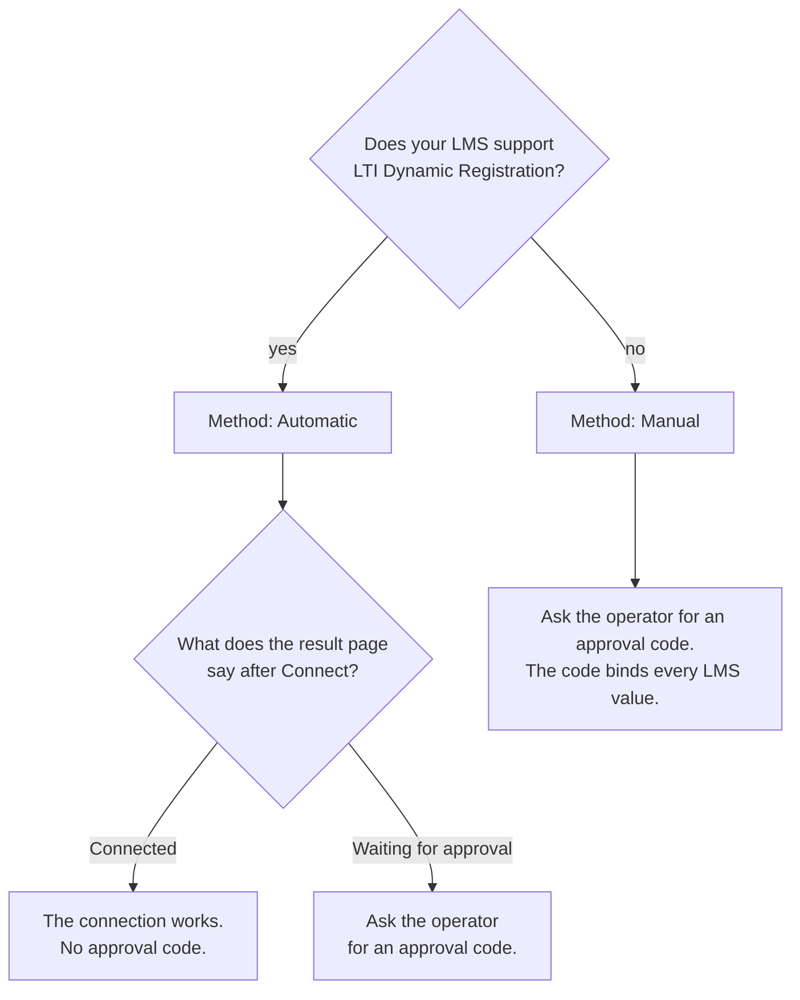

# Admin guide: connect an LTI 1.3 platform (channel `lti-generic`)

Source: wave-end SHA `02f5d420` (product code) on `quang/ltiaas-milestone`, 2026-10-24. Status: **draft for review**. QA check pending (AC-LA-E8-03-01, AC-LA-E8-03-05).

This guide connects one LMS that supports LTI 1.3 Advantage to one Cogniate library. Use it for an LMS that has no own card in the Cogniate portal, for example Sakai, Open edX or Absorb. In the portal, this channel is the card **LTI 1.3**. Its texts call the LMS "LMS".

Three people take part:

- **Cogniate library user:** makes the connection in the Cogniate portal.
- **LMS administrator:** adds the Cogniate tool in the LMS.
- **Cogniate operator:** checks the request and issues a one-time approval code ([operator runbook §10](operator-runbook.md#10-approval-grants)).

Evidence labels: see [operator runbook §0.1](operator-runbook.md#01-evidence-labels). For example, `[SIM E2-03-05]` means that QA ran AC-LA-E2-03-05 on a simulator stack; its file is `docs/reviews/LA-E2-03/qa.md`.

NOTE: Nobody tested this channel on a real LMS. QA used the generic LMS simulator: an issuer with a path, a token host apart from the issuer host, an opaque registration token and many deployments ([channel README](../../../packages/channels/lti-generic/README.md#live-status)).

## When to use this guide

| Your LMS | Use |
| --- | --- |
| Moodle | the Moodle card ([Moodle guide](../moodle-admin.md), [LA changes](baseline-admin-changes.md#1-moodle)) |
| Canvas | the Canvas card ([Canvas guide](../canvas-admin.md), [LA changes](baseline-admin-changes.md#2-canvas)) |
| Blackboard Learn | the Blackboard card ([Blackboard guide](../blackboard-admin.md)) |
| D2L Brightspace | the D2L Brightspace card ([D2L guide](brightspace-admin.md)) |
| Another LMS with LTI 1.3 Advantage | this guide |

Rules:

- Do not connect a non-Moodle LMS with the Moodle card. A launch of a D2L site on a Moodle connection is refused with `PROVIDER_PROFILE_MISMATCH` [SIM E2-05-05].
- A D2L Brightspace site cannot use Dynamic Registration on an LTI 1.3 connection. After **Connect**, the page says "Cogniate could not connect this LMS site" and "The connection failed. Go back to LMS and try again." (`REGISTRATION_FAILED`) [SIM E2-05-05]. Use the D2L Brightspace card. The operator finds the cause in the Cogniate app log: `registration_confirm_rejected` with `lti_reason` `family=desire2learn` [SIM E2-05-05].
- A configuration on a Canvas or Blackboard host is refused with `PLATFORM_URL_NOT_IN_PROFILE` [SIM E2-02-04]. Use the Canvas or Blackboard card.
- An LTI 1.3 connection of a D2L site that exists already keeps working [SIM E2-05-05].

## Choose the method



| Method | Portal name | Approval code | Evidence |
| --- | --- | --- | --- |
| Dynamic Registration, result page "Connected" | Automatic | no | `[SIM E2-02-02]`, `[K2 E7-07-03]` |
| Dynamic Registration, result page "Waiting for approval" | Automatic | yes: the registration is "staged" until the approval | `[SIM E2-02-03]`, `[K2 E7-07-03]` |
| Manual | Manual | yes: the code binds the issuer, the client ID, the deployment ID and the platform URLs | `[SIM E2-04-03]`, `[K2 E7-07-03]` |

The result page decides. Cogniate connects at once only when all of these are true [SIM E2-02-02], [SIM E2-02-03]:

- The authentication URL, the token URL, the keyset URL and the registration URL of the LMS have the same origin as the issuer: the same `https` host and the same port.
- The LMS gives no token audience, or the token audience is the token URL.

Else Cogniate stages the registration, and you need an approval code. For example, a token URL on another host, or a token audience with another path, stages the registration.

## Before you start

| Item | Rule | Evidence |
| --- | --- | --- |
| LMS site URL | The address of the LMS, as an `https` origin, for example `https://lms.school.edu`. An IP address, `localhost` or a Cogniate host is refused with `INVALID_SITE_URL`. | `[SIM E2-03-04]` |
| Issuer (Platform ID) | It may have a path, for example `https://lms.school.edu/sakai`. Its origin must be the LMS site URL. | `[UNIT E2-03-06]`, `[SIM E2-02-02]` |
| Deployments | One registration can have many deployments. | `[UNIT E2-03-01]` |
| Grades | Cogniate sends final scores with LTI Assignment and Grade Services (AGS). It asks for the four AGS scopes and no roster (NRPS) scope. | `[UNIT E2-03-10]`, `[SIM E2-04-08]` |

## Procedure 1: Make the connection (Cogniate library user)

1. In the portal, open **Integrations**, then the card **LTI 1.3**. Click **Connect** [K2 E7-07-01].
2. In **Your site**, enter the connection name [K2 E7-07-02].
3. Select the connection method: **Automatic** (Dynamic Registration) or **Manual** [K2 E7-07-02].
4. Enter the **LMS site URL** [K2 E7-07-02], [SIM E2-03-04].
5. Click **Continue** [K2 E7-07-02].

Result: the connection is `pending`. The card **Tool settings** shows the steps for the LMS administrator, the tool values, and (for Automatic) the registration URL [K2 E7-07-02].

## Procedure 2A: Automatic method (LMS administrator)

Steps 2 and 3 happen in your LMS. Nobody tested them on a real LMS; QA did them with the LMS simulator [K2 E7-07-03].

1. In the portal, on the connection page, copy the **Registration URL** [K2 E7-07-02]. If there is no URL, or it expired, click **Get registration URL**.
2. In your LMS, open the administration page for LTI 1.3 tools.
3. Add Cogniate as a new LTI 1.3 tool. Paste the registration URL.
4. The Cogniate page "Connect this LMS site to Cogniate" opens in the LMS. Check the site and the library. Click **Connect** [K2 E7-07-03].
5. Read the result page:

   | Result page | Meaning | Next step | Evidence |
   | --- | --- | --- | --- |
   | "Connected" and "Done. Go back to LMS and activate the tool." | Cogniate trusts every LMS URL through the issuer; the connection works | Activate the tool in your LMS, if your LMS asks for it. Go to [After the connection](#after-the-connection). | `[SIM E2-02-02]`, `[K2 E7-07-03]` |
   | "Waiting for approval" and "Done. Cogniate checks this connection before it works. Ask your Cogniate operator for the approval code." | a URL or the token audience is not on the issuer origin; the registration is staged | Do [Procedure 3](#procedure-3-ask-for-the-approval-code-lms-administrator). | `[SIM E2-04-04]`, `[K2 E7-07-03]` |

A staged registration does not work before the approval. A learner launch gets `PLATFORM_NOT_ACTIVE` [SIM E2-02-03].

The two result texts come from `services/cogniate-app/src/tool-pages/register.ts`. QA compares the staged text with the page at the guide check (AC-LA-E8-03-05).

## Procedure 2B: Manual method (LMS administrator)

Steps 1 to 5 happen in your LMS. Nobody tested them on a real LMS; QA did them with the LMS simulator [K2 E7-07-03]. The tool values of step 3 come from the portal [K2 E7-07-02].

1. In your LMS, open the administration page for LTI 1.3 tools.
2. Add Cogniate as a new LTI 1.3 tool.
3. Enter the tool values from the portal card **Tool settings**, in this order. Each row has a **Copy** button [K2 E7-07-02].

   | Order | Key | Portal label | Value |
   | --- | --- | --- | --- |
   | 1 | `tool_name` | Tool name | `Cogniate (<library name>)` |
   | 2 | `login_url` | Login URL | `{PUBLIC_LTI_URL}/lti/login/cogniate` |
   | 3 | `redirect_uri` | Redirect URI | `{PUBLIC_LTI_URL}/lti/launch/cogniate` |
   | 4 | `target_link_uri` | Target link URI | `{PUBLIC_LTI_URL}/lti/launch/cogniate` |
   | 5 | `jwks_url` | Public keyset URL | `{PUBLIC_LTI_URL}/lti/keys/cogniate` |
   | 6 | `deep_linking_url` | Deep Linking URL | `{PUBLIC_LTI_URL}/lti/launch/cogniate` |
   | 7 | `scopes` | Scopes | the four AGS scopes, separated by one space (below) |
   | 8 | `privacy` | Privacy | `Do not send the learner's name or e-mail.` |

   Evidence: `[SIM E2-03-05]`, `[K2 E7-07-02]`.

4. Save the tool in your LMS.
5. Copy these values from your LMS: the Platform ID (issuer), the Client ID, the Deployment ID, the authentication request URL, the access token URL, the public keyset URL, and the token audience if your LMS shows one.
6. Do [Procedure 3](#procedure-3-ask-for-the-approval-code-lms-administrator).

Value of the row `scopes`:

```text
https://purl.imsglobal.org/spec/lti-ags/scope/lineitem https://purl.imsglobal.org/spec/lti-ags/scope/lineitem.readonly https://purl.imsglobal.org/spec/lti-ags/scope/result.readonly https://purl.imsglobal.org/spec/lti-ags/scope/score
```

Notes on the values:

- `{PUBLIC_LTI_URL}` is the public address of the Cogniate LTI service. The portal shows the full URL.
- `<library name>` is the name of your Cogniate library, with ASCII characters only. An empty name gives `Cogniate (Library)` (`packages/channel-kernel/src/setup.ts`).
- Cogniate asks for no name and no e-mail address of the learner. Turn these off in your LMS, if your LMS has the setting.

## Procedure 3: Ask for the approval code (LMS administrator)

1. Ask the Cogniate library user for the Cogniate library name, the connection name and the address of the connection page in the portal. The operator needs them to find the connection.
2. Send the request to your Cogniate operator through the channel that your institution agreed with Cogniate.
3. Give these values:

   | Method | Values to give |
   | --- | --- |
   | Every method | the Cogniate library name, the connection name and the connection page address (from step 1) |
   | Automatic, staged | the LMS site URL, the Client ID and the Deployment ID |
   | Manual | the LMS site URL, the issuer, the Client ID, the Deployment ID, the authentication request URL, the access token URL, the public keyset URL, and the token audience if your LMS has one |

   The operator matches the library, the connection and the values before the approval (M1 rule, [operator guide §2.1](../operator.md#21-check-the-request)).

4. Answer the operator's check. If a URL is on a host other than the issuer host (for example a separate token host), the operator asks you to confirm that the LMS vendor issued this Client ID for this issuer at that host [K2 E7-07-03].
5. Give the approval code to the Cogniate library user through a private channel.

The code works once and expires (24 hours by default). This is the M1 grant rule (`[SIM AC-M1-28]` in the [M1 operator guide](../operator.md#22-issue-the-code)). Never put the code in a ticket or an e-mail that many people can read.

## Procedure 4: Save the connection (Cogniate library user)

1. Open the connection page in the portal.
2. In **Platform values**, enter the values from the LMS administrator [K2 E7-07-02]:

   | Method | Fields |
   | --- | --- |
   | Automatic, staged | **Client ID**, **Deployment ID** |
   | Manual | **Platform ID (issuer)**, **Client ID**, **Deployment ID**, **Authentication request URL**, **Access token URL**, **Public keyset URL**, **Token audience** (optional) |

   For Manual, the portal fills **Platform ID (issuer)** with the LMS site URL. Change it if your LMS shows another issuer [K2 E7-07-02], [UNIT E2-03-06].
3. In **Verify connection**, enter the **Approval code** [K2 E7-07-02].
4. Click **Save** [K2 E7-07-03].

Result: the connection is `registered` [SIM E2-04-03], [K2 E7-07-03]. The first valid launch sets it to `connected`.

If a value differs from the approval, the portal shows "The values do not match the approval. Check the marked fields, or ask your Cogniate operator." and marks the field (`GRANT_MISMATCH`) [K2 E7-07-03], [SIM E2-04-03]. Check the value with the LMS administrator. If the value in the approval is wrong, ask the operator for a new code.

## After the connection

| Task | Who | Steps | Evidence |
| --- | --- | --- | --- |
| Add Cogniate content to a course | teacher | In your LMS, add an LTI 1.3 activity, select the Cogniate tool, and select the Cogniate course. | `[K2 E7-07-03]` |
| Select several items at once | teacher | The Cogniate picker shows check boxes when the LMS accepts several items. **Cancel** sends no item. | `[K2 E7-07-03]` |
| Check the connection | library user | On the connection page, use the panel **Check connection**. It tests the LMS keyset and one token. | `[UNIT E6-01-09]`; on an LTI 1.3 platform: pending verification |
| Watch grades | library user | The connection page shows failed grade sends and a warning when a grade waits more than 1 hour. | `[SIM E6-02-05]`, `[UNIT E6-02-08]` |
| Add a second deployment | operator and library user | A second deployment ID needs a new approval code (`--purpose add_deployment`). | pending verification for this channel |

The check panel shows only for a `registered` or `connected` connection of a channel with the check [UNIT E6-01-09]. A check result does not change the connection status [SIM E6-01-02].

## Messages and what to do

| Message or code | Where | Meaning | Do this | Evidence |
| --- | --- | --- | --- | --- |
| `INVALID_SITE_URL` | portal, Procedure 1 | the LMS site URL is not a public `https` origin | Use the LMS address, for example `https://lms.school.edu`. | `[SIM E2-03-04]` |
| `PLATFORM_URL_NOT_IN_PROFILE` | registration page | an LMS URL is on a host that Cogniate reserves for another LMS | Check the LMS configuration. Use the matching card, if the LMS has one. | `[SIM E2-02-04]` |
| "Cogniate could not connect this LMS site" and "The connection failed. Go back to LMS and try again." (`REGISTRATION_FAILED`) | registration page, after **Connect** | the registration failed; for a D2L site: the LMS has its own card in Cogniate | For a D2L site, use the D2L Brightspace card. Else ask the operator to read the Cogniate app log. | `[SIM E2-05-05]` |
| "This is a {LMS} site. Connect it as {LMS} in the Cogniate portal." (`PROVIDER_PROFILE_MISMATCH`) | registration page, before **Connect** | the LMS has its own card in Cogniate | Use that card. | pending verification for this start page |
| "The values do not match the approval. Check the marked fields, or ask your Cogniate operator." (`GRANT_MISMATCH`) | portal, Procedure 4 | a value differs from the approval | Check the marked field. | `[K2 E7-07-03]` |
| "This LMS tool registration is already connected to Cogniate. Make a new tool registration for this library." (`PLATFORM_IN_USE`) | portal, Procedure 4 | another Cogniate connection uses this Client ID | Make a new tool in your LMS for this library. If you think that this is an error, ask your Cogniate operator. | `[UNIT E2-04]` (round 4) |
| "The staged registration of this connection is gone from the LTI service. Make a new connection, or ask your Cogniate operator." (`PLATFORM_IN_USE`) | portal, Procedure 4 | the staged registration does not exist any more | Make a new connection and register again. | `[UNIT E2-04]` (rounds 3, 4) |
| `PLATFORM_NOT_ACTIVE` | launch | the connection waits for the approval | Finish Procedures 3 and 4. | `[SIM E2-02-03]` |

## What is not verified

- No real LMS took part. All results above are simulator or unit results.
- The connection check on an LTI 1.3 platform (QA ran it on the Canvas simulator only).
- A second deployment for this channel.
- The exact menu names of each LMS. Your LMS documentation gives them.
