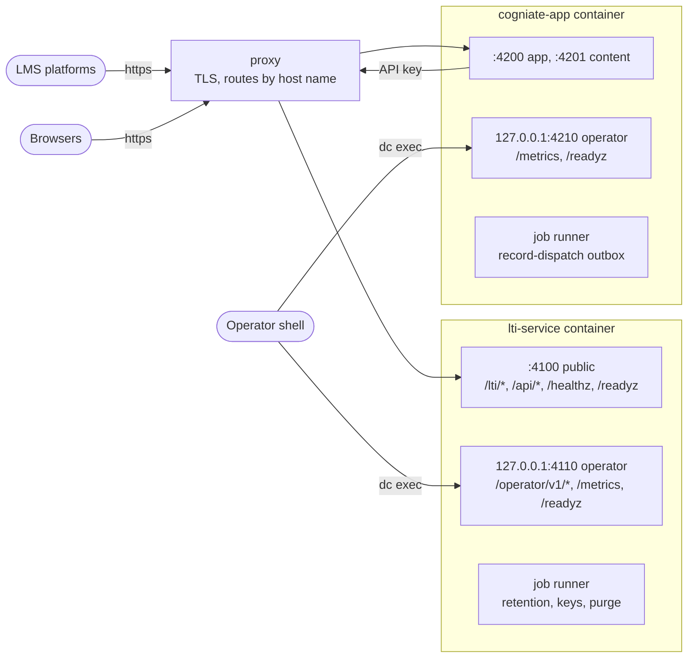
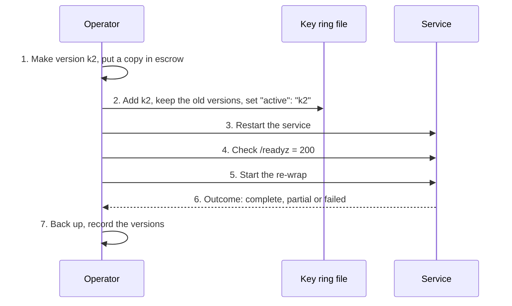

# Operator runbook: LTI service and Cogniate app (milestone LA)

Source: wave-end SHA `02f5d420` (product code) on `quang/ltiaas-milestone`, 2026-10-24. Status: **draft for review**. QA check pending: QA runs each command of this runbook once on a simulator stack (AC-LA-E8-04-01).

This runbook is for Cogniate staff who have shell access to the host of the stack. It covers what LA added: operator keys, tool accounts, rate limits, API keys, signing keys, key rings, audit, grants with bound values, job runners, backups, metrics, alerts and first steps in an incident.

The M1 [operator guide](../operator.md) stays valid. It covers the Blackboard one-time setup, the grant check, binding containment, upgrade and rollback, and the storage lock messages. This runbook links it where a step does not change.

Design inputs: [operability](../../architecture/ltiaas/operability.md), [LTI service API delta](../../architecture/ltiaas/contracts/lti-service-api-delta.md), [app API delta §7, §8a](../../architecture/ltiaas/contracts/cogniate-app-api-delta.md), [LA-ADR-03 D7](../../architecture/ltiaas/adr/LA-ADR-03-learning-record-core.md) (job runner), [security delta](../../architecture/ltiaas/security-delta.md).

## Contents

0. [How to read this runbook](#0-how-to-read-this-runbook)
1. [Set up your shell](#1-set-up-your-shell)
2. [Start, stop and check the stack](#2-start-stop-and-check-the-stack)
3. [Settings and secret files](#3-settings-and-secret-files)
4. [Operator keys](#4-operator-keys)
5. [Tool accounts and rate limits](#5-tool-accounts-and-rate-limits)
6. [API keys](#6-api-keys)
7. [Signing keys](#7-signing-keys)
8. [Master keys and key rings](#8-master-keys-and-key-rings)
9. [Audit](#9-audit)
10. [Approval grants](#10-approval-grants)
11. [Service keys](#11-service-keys)
12. [Job runners](#12-job-runners)
13. [Backup and restore](#13-backup-and-restore)
14. [Readiness and metrics](#14-readiness-and-metrics)
15. [Alerts and signals](#15-alerts-and-signals)
16. [Connection check and health view](#16-connection-check-and-health-view)
17. [Troubleshooting](#17-troubleshooting)
18. [Not in this runbook](#18-not-in-this-runbook)

## 0. How to read this runbook

### 0.1 Evidence labels

Each step or row has a label. The label tells you how QA verified it.

| Label | Meaning |
| --- | --- |
| `[SIM E5-09-03]` | QA ran it on a simulator stack (K1-SIM). `E5-09-03` is the acceptance criterion `AC-LA-E5-09-03`. Its QA file is `docs/reviews/LA-E5-09/qa.md`. |
| `[K2 E7-07-04]` | QA ran it in a browser on a simulator stack (Playwright). |
| `[U1 E5-22-01]` | QA ran it in an upgrade check: the old build first, then the new build on the same volumes. |
| `[UNIT E4-05-03]` | QA checked it with a unit test or a contract test. No stack ran. |
| `[MOODLE-LIVE AC-M1-23]` | QA ran it on the local Moodle stack in M1 (see the M1 operator guide). |
| **Pending verification** | No QA row checks it yet. Do not rely on it. |

How the labels were checked: each label names a QA row, and the named test of that row checks the stated behaviour. Some QA reports put an author unit test inside a range of K1-SIM rows (for example `AC-LA-E5-07-01 .. 10`). The QA test file then says that the AC is an author unit test. In that case the label follows the test file: `UNIT`.

NOTE: Every LMS result in LA is a simulator result. No real Canvas, Blackboard, D2L Brightspace or other LMS took part. The LA wave-end gates (M1, M2, T7) run now. This runbook does not cite them.

### 0.2 Where commands run

- Run each command from the root folder of the checkout, on the host of the stack.
- A `dc exec …` command runs inside a service container.
- Replace each `<value>` with your value. Keep the single quotes around JSON bodies.

## 1. Set up your shell

Copy these four helpers into your shell (bash or zsh). They read the file `.env` of the checkout. `npm run gen-env` writes `COMPOSE_PROJECT_NAME` and the other stack values into it.

```sh
# Run from the repository root. .env holds COMPOSE_PROJECT_NAME (npm run gen-env writes it).
dc() { docker compose -f infra/compose.yaml --env-file .env "$@"; }

# LTI operator API: op METHOD PATH [JSON]. Uses the copy of the operator key in the container.
op() { dc exec -T lti-service node -e '
const fail = (step, reason) => { console.error("op: " + step + ": " + reason); process.exitCode = 1; };
const safe = (v) => typeof v === "string" && /^(?!lti[os]_)[A-Za-z][A-Za-z0-9_.]{0,63}$/.test(v);
(async () => {
  const [method, path, body] = process.argv.slice(1);
  let key = "";
  try { key = require("node:fs").readFileSync("/run/secrets/lti/lti-operator-key", "utf8").trim(); } catch {}
  if (!/^ltio_[A-Za-z0-9_-]{43}$/.test(key)) return fail("key", "the operator key file is missing or does not hold one operator key");
  const headers = { authorization: "OPERATOR-AUTH-V1 " + key };
  if (body) headers["content-type"] = "application/json";
  let r, text;
  try { r = await fetch("http://127.0.0.1:4110" + path, { method, headers, body }); } catch { return fail("request", "no answer from the operator listener"); }
  try { text = await r.text(); } catch { return fail("answer", "the answer could not be read"); }
  if (r.ok) return console.log(r.status, text);
  let d = {};
  try { d = JSON.parse(text).details || {}; } catch {}
  const out = [r.status];
  if (safe(d.message)) out.push(d.message);
  if (safe(d.field)) out.push("field=" + d.field);
  for (const k of ["fields", "reasons"]) if (Array.isArray(d[k])) out.push(k + "=" + d[k].filter(safe).join(","));
  if (Number.isInteger(d.retryAfter)) out.push("retryAfter=" + d.retryAfter);
  console.log(out.join(" ")); process.exitCode = 1;
})().catch(() => fail("helper", "unexpected error"));
' "$@"; }

# Readiness and metrics, no key: probe SERVICE PORT PATH.
probe() { dc exec -T "$1" node -e '
const fail = (step, reason) => { console.error("probe: " + step + ": " + reason); process.exitCode = 1; };
(async () => {
  let r, text;
  try { r = await fetch("http://127.0.0.1:" + process.argv[1] + process.argv[2]); } catch { return fail("request", "no answer from the listener"); }
  try { text = await r.text(); } catch { return fail("answer", "the answer could not be read"); }
  console.log(r.status, text); if (!r.ok) process.exitCode = 1;
})().catch(() => fail("helper", "unexpected error"));
' "$2" "$3"; }

# LTI tenant API of the tool account cogniate: tenant METHOD PATH [JSON]. Uses the app's API key file.
tenant() { dc exec -T cogniate-app node -e '
const fail = (step, reason) => { console.error("tenant: " + step + ": " + reason); process.exitCode = 1; };
const safe = (v) => typeof v === "string" && /^(?!lti[os]_)[A-Za-z][A-Za-z0-9_.]{0,63}$/.test(v);
(async () => {
  const [method, path, body] = process.argv.slice(1);
  let key = "";
  try { key = require("node:fs").readFileSync(process.env.LTI_API_KEY_FILE, "utf8").trim(); } catch {}
  if (!/^ltis_[A-Za-z0-9_-]{43}$/.test(key)) return fail("key", "the API key file is missing or does not hold one API key");
  const headers = { authorization: "Bearer " + key };
  if (body) headers["content-type"] = "application/json";
  let r, text;
  try { r = await fetch((process.env.LTI_API_URL || process.env.PUBLIC_LTI_URL) + path, { method, headers, body }); } catch { return fail("request", "no answer from the LTI service"); }
  try { text = await r.text(); } catch { return fail("answer", "the answer could not be read"); }
  if (r.ok) return console.log(r.status, text);
  let d = {};
  try { d = JSON.parse(text).details || {}; } catch {}
  const out = [r.status];
  if (safe(d.message)) out.push(d.message);
  if (safe(d.field)) out.push("field=" + d.field);
  for (const k of ["fields", "reasons"]) if (Array.isArray(d[k])) out.push(k + "=" + d[k].filter(safe).join(","));
  if (Number.isInteger(d.retryAfter)) out.push("retryAfter=" + d.retryAfter);
  console.log(out.join(" ")); process.exitCode = 1;
})().catch(() => fail("helper", "unexpected error"));
' "$@"; }
```

| Helper | Use | Example |
| --- | --- | --- |
| `dc` | Docker Compose for this stack | `dc ps` |
| `op` | LTI operator API (`/operator/v1/*`) | `op GET /operator/v1/jobs` |
| `probe` | readiness and metrics; no key | `probe lti-service 4110 /readyz` |
| `tenant` | LTI tenant API (`/api/*`) of the tool account `cogniate` | `tenant GET /api/platforms/<platform id>` |

What the helpers print:

| Case | Output | Exit code |
| --- | --- | --- |
| The answer status is below 400 | the status and the answer body, for example `202 {"job":"retention","traceId":"…"}` | 0 |
| The answer status is 400 or higher | one line: the status, the error code and the safe detail fields, for example `409 JOB_RUNNING` or `503 NOT_READY reasons=job_runner_not_active retryAfter=30` | 1 |
| The helper cannot read a valid key, gets no answer, or cannot read the answer | one line on stderr: the helper, the step and a fixed reason, for example `op: key: the operator key file is missing or does not hold one operator key` | 1 |

Rule: a helper never prints a key, a token or a header value. It checks the key file before it makes a request. It prints no error message of Node or of the server, because such a message can contain the value that caused it. `probe` sends no key; it prints the answer body also for a `503`, because the readiness reasons are in the body.

The answer to an issue request (a new operator key or API key) holds the new key once, by design ([§4.2](#42-give-a-key-to-another-operator), [§6.1](#61-rotate-the-key-of-an-account-no-downtime)). Run such a request where nobody else sees your screen. Do not copy that output into a ticket, a chat or a log.

Facts about the helpers:

- `dc` uses the same arguments as the QA runners (`docker compose -f infra/compose.yaml --env-file .env`, in `tests/ltiaas/tasks-ops/LA-E5-22/run.mjs`).
- `op`, `probe` and `tenant` are new in this runbook. Docs tested them only against a local fake HTTP server, also with damaged key files. Pending verification on a stack: QA runs them at the runbook check.
- `op` reads the copy of the operator key in the LTI container, `/run/secrets/lti/lti-operator-key`. `npm run seed` and `npm run lti:bootstrap` write that copy from `infra/.secrets/lti-operator-key` at each run (BD-A2-34). If the copy is missing, run `npm run lti:bootstrap -w services/lti-service -- --account cogniate --name Cogniate` ([§17.4](#174-other-first-steps)). If your key file is lost, see [§4.5](#45-the-operator-key-file-is-lost).
- The proxy has no route to the operator API [SIM E5-01-02]. In the `default` profile, the operator listener binds `127.0.0.1:4110` only [SIM E5-01-04]. So call it only from inside the LTI container, as `op` does.

## 2. Start, stop and check the stack

### 2.1 What runs where (pilot)



The proxy routes only the public host names. It has no route to port 4110 or 4210 [SIM E5-01-02], [SIM E5-17-02].

### 2.2 First start

The base steps (`npm run gen-env`, certificates, first `stack:up`) are in [run the stack](../run-the-stack.md). LA adds the operator key and two readiness checks.

1. Run `npm run stack:up`. It makes no operator key [SIM E5-05-08].
2. Run `npm run seed`. On a new volume it makes the first operator key and writes it to `infra/.secrets/lti-operator-key` (mode `0600`) [SIM E5-01-06], [SIM E5-05-08].
3. Check the LTI service: `probe lti-service 4100 /readyz`. The answer must be `200 {"status":"ready"}` [SIM E5-17-03].
4. Check the Cogniate app: `probe cogniate-app 4210 /readyz`. The answer must be `200 {"status":"ready"}` [SIM E4-07-05].

A second `npm run seed` on the same volume keeps the operator key and the API key [SIM E5-05-08].

### 2.3 Daily check

1. Run `probe lti-service 4110 /readyz`. Expect `200`.
2. Run `probe cogniate-app 4210 /readyz`. Expect `200`.
3. If a check gives `503`, read the `reasons` list. Go to [§14.1](#141-readiness).

The app `/readyz` checks only the app. It stays `200` while the LTI service is down [SIM E4-07-05]. So always check both services.

### 2.4 Stop and restart

| Task | Command | Evidence |
| --- | --- | --- |
| Stop the stack | `npm run stack:down` | `[MOODLE-LIVE AC-M1-23]` |
| Restart the LTI service | `npm run stack:restart -- lti-service` | `[SIM E5-09-02]` |
| Restart the Cogniate app | `npm run stack:restart -- cogniate-app` | `[U1 E5-22-01]` |

After each restart, do the checks of [§2.3](#23-daily-check).

Rules for a stop:

- A clean stop deletes the heartbeat row of the job runner. The new start then takes work at once [UNIT E4-01-04], [UNIT E4-01-06].
- After a crash (no clean stop), the new runner waits until the old heartbeat is 30 s old. Then it takes work [UNIT E4-01-04]. The web part serves pages at once. Pending verification for the web part.
- Docker waits up to 75 s before it kills a service (`stop_grace_period: 75s` in `infra/compose.yaml`). So a stop with a long job in flight can take up to 75 s. The service's own timing (it waits for the job lease of 60 s and exits by itself at 70 s with `service_exit_forced`): pending verification.
- After `npm run stack:restart -- lti-service`, the log has a `job_run {job: "retention"}` line [SIM E5-19-01]. "No `job_instance_conflict` line after a normal restart": pending verification.

WARNING: Never use `npm run stack:reset` on a stack with real data. It deletes the databases and the key files of [§3.3](#33-what-stackreset-deletes).

### 2.5 Stack profiles

| Profile | Use | How it starts |
| --- | --- | --- |
| `default` | pilot and demo | `npm run stack:up` |
| `acceptance` | QA only: simulators and test hosts | `STACK_PROFILE=acceptance npm run stack:up` |
| `production` | fail-closed start rules ([§3.4](#34-production-profile-refusals)) | not a stack profile in LA |

The stack scripts save only `default` or `acceptance` (`infra/scripts/lib.sh`, `saved_profile`). Also, `infra/compose.yaml` gives both master keys to the services as environment values, and `production` refuses that. So the LA compose stack cannot run in `production`. A production host setup is part of milestone LG.

## 3. Settings and secret files

### 3.1 Settings on the compose stack

`infra/compose.yaml` gives each service a fixed list of settings and has no `env_file`. A setting that is not in that list does not reach the service on the LA stack; the service uses its default. The `--env` option of `npm run stack:restart` accepts registered test knobs only. Operability §2 has the same note (BD-A2-105).

| Setting | Service | Value on the compose stack | What it does | Evidence |
| --- | --- | --- | --- | --- |
| `STACK_PROFILE` | both | the saved profile: `default` or `acceptance` | start rules | `[SIM E5-21-07]` |
| `LTI_MASTER_KEY` | LTI | from `.env` | the master key; it is the key version `legacy` when no key ring exists | `[U1 E5-08-01]` |
| `LTI_KEYRING_FILE` | LTI | default `/run/secrets/lti/keyring.json` (host file `infra/.secrets/lti/keyring.json`) | the LTI key ring ([§8.1](#81-lti-service-key-ring-and-re-wrap)) | `[SIM E5-09-02]` |
| `OPERATOR_HOST`, `OPERATOR_PORT` | LTI | `127.0.0.1`, `4110` (`acceptance`: `0.0.0.0`) | the LTI operator listener | `[SIM E5-01-04]` |
| `TRUSTED_PROXY_CIDRS` | LTI | `proxy` | the peers whose `X-Forwarded-For` value counts | `[SIM E5-03-03]`, `[SIM E5-03-04]` |
| `AUDIT_RETENTION_DAYS` | LTI | from `.env`, default `400` | days that the LTI service keeps audit events | `[UNIT E5-19-03]` |
| `JOB_INSTANCE_ID` | LTI | from `.env`, default `lti-1` | the lease owner of the LTI job runner | `[UNIT E4-01-05]` |
| `APP_MASTER_KEY` | app | from `.env` | the app master key; key version `legacy` when no app key ring exists | `[U1 E5-22-01]` |
| `APP_KEYRING_FILE` | app | default `/run/secrets/app-keys/keyring.json` (host file `infra/.secrets/app-keys/keyring.json`) | the app key ring ([§8.2](#82-cogniate-app-key-ring-and-appkeys)) | `[U1 E5-22-01]` |
| `OPERATOR_HOST`, `OPERATOR_PORT` | app | `127.0.0.1`, `4210` (`acceptance`: `0.0.0.0`) | the app operator listener (`/metrics`, `/readyz`) | `[UNIT E4-07-01]`, `[SIM E4-07-02]` |
| `LTI_API_KEY_FILE` | app | `/run/secrets/app/lti-api-key` | the API key of the tool account `cogniate` | M1 |

Settings that the compose file does not pass. They take effect only in a process that you start with them, for example a CLI run with `dc exec -e NAME=value`:

| Setting | Where it counts | Evidence |
| --- | --- | --- |
| `OPERATOR_NAME`, `OPERATORS`, `OPERATORS_FILE` | the app CLIs `app:grant`, `app:binding`, `app:keys` ([§10.2](#102-operator-name-and-evidence-flags)) | `[SIM E5-12-02]`, `[UNIT E5-11-05]` |
| `STACK_PROFILE=production` in a CLI process | the app CLI policy ([§10.2](#102-operator-name-and-evidence-flags)) | `[SIM E5-12-01]` |
| `APP_JOB_RUNNER` | the app web process ([§12.2](#122-cogniate-app-runner-and-worker-mode)) | `[UNIT E4-05-01]` |

Other settings of the design (`LTI_RATE_LIMITS`, `SIGNING_KEY_PUBLISH_LEAD_S`, `SIGNING_KEY_ROTATE_DAYS`, `CLOSED_ACCOUNT_RETENTION_DAYS`, `LTI_MASTER_KEY_FILE`, `APP_MASTER_KEY_FILE`) keep their defaults on the compose stack. In the app, `AUDIT_RETENTION_DAYS` and `JOB_INSTANCE_ID` also keep their defaults; only the LTI service gets them. For rate limits, use the operator API ([§5.4](#54-rate-limits)).

### 3.2 Secret files and folders

Secret files are never in git. Give each file mode `0600` (or `0400`).

| Host file | Read by | Content | Evidence |
| --- | --- | --- | --- |
| `infra/.secrets/lti-operator-key` | you (the host) | your operator key. `npm run seed` writes it once. | `[SIM E5-01-06]` |
| `infra/.secrets/lti/lti-operator-key` | the LTI container (CLIs, `op`) | a copy of the file above. `npm run seed` and `npm run lti:bootstrap` write it at each run. | `[SIM E5-05-03]` |
| `infra/.secrets/lti/keyring.json` | the LTI service | the LTI key ring, when you use one | `[SIM E5-09-02]` |
| `infra/.secrets/app-keys/keyring.json` | the Cogniate app | the app key ring, when you use one | `[U1 E5-22-01]` |
| `infra/.secrets/lti-api-key.cogniate` | you (the host) | the API key of the tool account `cogniate` | M1 |
| `infra/.secrets/app/lti-api-key` | the Cogniate app (`LTI_API_KEY_FILE`) | a copy of the file above. `npm run lti:bootstrap` keeps it equal at each run. Do not write the copy by hand (BD-A2-105). The app reads only this copy. | M1 |

Rules:

- The folders `infra/.secrets/lti/` and `infra/.secrets/app-keys/` must exist (mode `0700`) before a `docker compose up`. `npm run stack:up` makes them [UNIT E5-22 row 10]. Do not make them by hand with another owner.
- The `e2e` test container never sees the two key rings: an empty tmpfs covers each folder [UNIT E5-22 row 10], [U1 E5-22-01].
- A secret file with a group or world bit: the app logs `secret_file_mode_open {setting}` and goes on; in `production` it refuses to start (`secret_file_mode`) [UNIT E5-22-05]. The same rule in the LTI service: pending verification.

### 3.3 What `stack:reset` deletes

`npm run stack:reset` deletes the databases, `seed.json`, the API key files and the app copy folder `infra/.secrets/app/`, `infra/.secrets/lti-operator-key` and its copy `infra/.secrets/lti/lti-operator-key` (BD-A2-02, BD-A2-03, BD-A2-105). It keeps `.env`, `infra/.certs/` and the key-ring folder `infra/.secrets/lti/`. To remove a test key ring, delete `infra/.secrets/lti/keyring.json` by hand.

The M1 guide forbids `stack:reset` as a recovery step ([upgrade and rollback](../operator.md#42-rollback)).

### 3.4 Production profile refusals

A service that starts with `STACK_PROFILE=production` stops with exit code 1 when a rule fails. It writes one log line: `config_refused {reason, message, setting?}`. The message is fixed text and never contains a value.

| Reason | Service | Message (fixed text) | Evidence |
| --- | --- | --- | --- |
| `test_knob_active` | LTI | Production does not allow test knobs. Remove every test knob setting, then start the service again. | `[SIM E5-21-01]` |
| `simulation_on` | LTI | Production does not allow simulation profiles. Remove LTI_PROVIDER_SIMULATION or set it to off, then start the service again. | `[UNIT E5-21-02]` |
| `private_host_allowlist` | LTI | Production does not allow private outbound hosts. Remove OUTBOUND_PRIVATE_HOST_ALLOWLIST, then start the service again. | `[UNIT E5-21-03]` |
| `master_key_in_env` | LTI | Production does not allow the master key as an environment value. Remove LTI_MASTER_KEY and use LTI_MASTER_KEY_FILE or the key-ring file. | `[UNIT E5-21-04]` |
| `no_trusted_proxy` | LTI | Production needs TRUSTED_PROXY_CIDRS. Set it to the address or host name of the proxy, then start the service again. | `[UNIT E5-21-05]` |
| `operator_bind_not_loopback` | LTI, app | Production allows the operator listener on loopback only. Set OPERATOR_HOST to 127.0.0.1 or ::1, then start the service again. | `[UNIT E5-21-06]`, `[UNIT E4-07-01]` |
| `app_master_key_in_env` | app | Production does not allow the app master key as an environment value. Remove APP_MASTER_KEY and use APP_MASTER_KEY_FILE or the app key-ring file. | `[UNIT E5-22-05]` |
| `secret_file_mode` (with `setting`) | app; LTI pending verification | A secret file has group or world access. Set the mode of the file named by the setting to 0600, then start the service again. | `[UNIT E5-22-05]` |
| `job_runner_twice` | app | the web process and a worker both run the job runner ([§12.2](#122-cogniate-app-runner-and-worker-mode)) | `[UNIT E4-05-03]` |

The LTI service checks the first six rules in the order of the table [UNIT E5-21-06]. `LTI_MASTER_KEY_FILE` with the same key starts [UNIT E5-21-04]. `APP_MASTER_KEY_FILE` gives the same key bytes as `APP_MASTER_KEY` [UNIT E5-22-05].

The messages come from the design ([operability §2](../../architecture/ltiaas/operability.md#2-configuration)). QA checked the reason codes. The exact message text: pending verification.

## 4. Operator keys

An operator key opens the LTI operator API. Its form is `ltio_` and 43 more characters. Keep it like a password.

### 4.1 First key

`npm run seed` makes the first key ([§2.2](#22-first-start)). The direct command `lti:operator init` has three modes:

| Command | Result | Evidence |
| --- | --- | --- |
| `dc exec lti-service npm run lti:operator -- init --name <operator>` | makes the first key. If an active key exists: exit 1, one line, no change. | `[SIM E5-01-05]` |
| `… init --if-none` | if an active key exists: exit 0, the line `operator key exists`, no change | `[SIM E5-01-06]` |
| `… init --replace --name <operator>` | revokes every operator key and prints one new key | `[SIM E5-01-07]` |

The new key shows only once, as the only line of the output [SIM E5-01-09]. `init` writes one audit event with actor `system:bootstrap` [SIM E5-02-04]. If you run `init` by hand, write the printed key to `infra/.secrets/lti-operator-key` (mode `0600`). Then refresh the copy in the container ([§4.3](#43-replace-your-own-key), step 4).

### 4.2 Give a key to another operator

1. Issue the key: `op POST /operator/v1/operator-keys '{"operator":"<their name>"}'` [SIM E5-01-09].
2. Copy `operatorKey` from the answer. It shows only once [SIM E5-01-09].
3. Give the key to the other operator through a private channel.
4. The other operator writes it to the operator key file of their setup, `infra/.secrets/lti-operator-key` (mode `0600`), and runs `npm run lti:bootstrap -w services/lti-service -- --account cogniate --name Cogniate` to refresh the copy in the container.
5. The other operator checks the key: `op GET /operator/v1/operator-keys` answers `200` [SIM E5-01-01].
6. Stop here. Your own key stays active. Do not revoke a key in this procedure.

NOTE: Who may hold an operator key, and how several operators share one stack host, is the human decision LA-H21.

### 4.3 Replace your own key

1. Issue a new key for yourself: `op POST /operator/v1/operator-keys '{"operator":"<your name>"}'` [SIM E5-01-09].
2. Copy `operatorKey` from the answer. It shows only once [SIM E5-01-09].
3. Write it to `infra/.secrets/lti-operator-key` (mode `0600`).
4. Run `npm run lti:bootstrap -w services/lti-service -- --account cogniate --name Cogniate`. It issues no new key [SIM E5-05-03], and it copies your key file into the container. The copy step: pending verification on a stack.
5. Check the new key: `op GET /operator/v1/operator-keys` answers `200` and lists your old and your new key. The list never shows a key value [SIM E5-01-09].
6. Revoke the old key: `op POST /operator/v1/operator-keys/<old key id>/revoke`. `op` sends the new key now, so this works [SIM E5-01-10].

A key cannot revoke itself: the answer is `409 OPERATOR_KEY_IN_USE` [SIM E5-01-10]. If you get it in step 6, the container copy still holds the old key: do step 4 again.

### 4.4 Key life

- A new key expires after 90 days by default [SIM E5-01-08].
- `expiresAt` must be from 1 hour to 1 year from now, else `400 INVALID_REQUEST` [SIM E5-01-08].
- An expired key gives the same `401` as an unknown key [UNIT E5-01-11].

### 4.5 The operator key file is lost

Use this only when no operator has a working key. Else ask another operator to issue you a key ([§4.2](#42-give-a-key-to-another-operator)).

1. Run `npm run lti:bootstrap -w services/lti-service -- --account cogniate --name Cogniate --replace-operator-key`.
2. The command runs `init --replace`. It revokes every operator key, also the keys of other operators and scripts [SIM E5-01-07].
3. It writes the new key to `infra/.secrets/lti-operator-key` and the copy for the container.
4. Give new keys to the other operators ([§4.2](#42-give-a-key-to-another-operator)).

Without the key file, `lti:bootstrap` stops: exit 1, one line that names the key file, and no database change. The line names `--replace-operator-key` as the last choice and says that it revokes every operator key [SIM E5-05-07] (round 4 row, with B-LA-E5-05-04).

Steps 1 to 3 as one wrapper run (`--replace-operator-key`): pending verification on a stack. The direct command `init --replace` is verified [SIM E5-01-07].

## 5. Tool accounts and rate limits

A tool account is one tenant of the LTI service. The Cogniate app uses the account `cogniate`.

### 5.1 List and make accounts

| Task | Command | Evidence |
| --- | --- | --- |
| List accounts | `op GET /operator/v1/accounts` | `[SIM E5-04-01]` |
| Read one account | `op GET /operator/v1/accounts/<id>` | `[SIM E5-04-01]` |
| Make an account | `op POST /operator/v1/accounts '{"id":"<id>","name":"<name>","launchUrl":"<url>","deepLinkingUrl":"<url>","registrationUrl":"<url>"}'` | `[SIM E5-04-01]` |
| List the platforms of an account | `op GET /operator/v1/accounts/<id>/platforms` | `[SIM E5-15]` (BD-A2-53 row) |

Rules:

- A new account gets `status: active` and its protocol URLs (`protocolUrls`) [SIM E5-04-01].
- An id that exists gives `409 ACCOUNT_ALREADY_EXISTS` [SIM E5-04-01].
- A new account has no usable API key. Issue one ([§6](#6-api-keys)) [UNIT E5-04-12].
- The platform list shows ids, issuers, client ids and deployment ids. It shows no keys or tokens, and a read writes no audit event [SIM E5-15] (BD-A2-53 row).

### 5.2 Tool URLs

The tool URLs tell the LTI service where to send launches of the account.

1. Read the account: `op GET /operator/v1/accounts/<id>`.
2. Change a URL: `op PATCH /operator/v1/accounts/<id> '{"launchUrl":"<https url>"}'` [SIM E5-04-02].

A URL must be `https`, with no user name, no password and no `#` part. It must not be on the LTI or content host. Else the answer is `400 INVALID_REQUEST` with the field name, and nothing changes [SIM E5-04-03].

NOTE: Use a DNS host name in `launchUrl` and `deepLinkingUrl`. See [§17.3](#173-platform-storage-launches-stop-after-the-storage-check).

For `cogniate` after a change of `PUBLIC_APP_URL`: `npm run seed` keeps the stored tool URLs of an existing account (BD-A2-25). Set them with `PATCH` to `<PUBLIC_APP_URL>/tool/launch`, `/tool/deep-link` and `/tool/register`. Pending verification.

### 5.3 Suspend or close an account

| Task | Command | Result | Evidence |
| --- | --- | --- | --- |
| Suspend | `op PATCH /operator/v1/accounts/<id> '{"status":"suspended"}'` | logins, launches and API calls of the account give `403 TOOL_ACCOUNT_SUSPENDED`; its key set stays; other accounts work | `[SIM E5-04-05]`, `[SIM E5-06-01]`, `[SIM E5-06-03]` |
| Undo a suspend | `op PATCH /operator/v1/accounts/<id> '{"status":"active"}'` | calls work again | `[SIM E5-04-05]` |
| Close | see the procedure below | every API key stops at once | `[SIM E5-04-08]`, `[UNIT E5-07-11]` |

Each status change writes one `account.status` audit event [SIM E5-04-06].

Procedure to close an account. A close is final.

1. Read the account: `op GET /operator/v1/accounts/<id>`.
2. Check the id and the name with the person who asked for the close.
3. Run `op PATCH /operator/v1/accounts/<id> '{"status":"closed"}'`. Type the id from step 1. Do not copy a command of another account.
4. Check the API keys: `op GET /operator/v1/accounts/<id>/api-keys`. Each key has `revokedAt` [UNIT E5-07-11].

After the close, a later change of the account gives `409 ACCOUNT_CLOSED` [SIM E5-04-08]. The `account-purge` job deletes the account data 30 days after the close [UNIT E5-20-06].

### 5.4 Rate limits

| Task | Command | Evidence |
| --- | --- | --- |
| Read every class | `op GET /operator/v1/rate-limits` | `[SIM E5-03-09]` |
| Change one class for every account | `op PATCH /operator/v1/rate-limits '{"classes":{"<class>":{"ratePerMinute":<n>,"burst":<n>}}}'` | `[SIM E5-03-02]`, `[SIM E5-03-08]` |
| Remove your value of a class | `op PATCH /operator/v1/rate-limits '{"classes":{"<class>":null}}'` | pending verification |
| Change a class for one account | `op PATCH /operator/v1/accounts/<id> '{"limits":{"<class>":{"ratePerMinute":<n>,"burst":<n>}}}'` | `[SIM E5-03-01]`, `[SIM E5-03-12]` |

Rules:

- A change applies to the next request. It writes one `settings.rate_limits` audit event [SIM E5-03-08].
- The read shows the source of each value: `operator`, `env` or `default` [SIM E5-03-09].
- An unknown class or a value below 1 gives `400 INVALID_REQUEST`, and nothing changes [SIM E5-03-09].
- `/healthz` is never limited [SIM E5-03-08].
- A limited request gets `429 RATE_LIMITED` with `Retry-After` [SIM E5-03-01]. A login page gets the `429` page `RATE_LIMITED` [SIM E5-03-02].

| Class | Requests | Key | Evidence |
| --- | --- | --- | --- |
| `protocol` | login, launch, storage check | client address | `[SIM E5-03-02]` |
| `protocol_account` | the same, per account (soft: a log line, never `429`) | tool account | `[SIM E5-03-07]` |
| `registration`, `registration_account` | `GET /lti/register/:account` | client address; tool account (soft) | design (pending verification) |
| `keys` | `GET /lti/keys/:account` | client address | `[SIM E5-03-11]` |
| `api` | `/api/idtoken`, `/api/deeplinking*`, `/api/lineitems*`, `/api/memberships` | API key | `[SIM E5-03-01]` |
| `admin` | every Bearer route | API key | `[SIM E5-03-12]` |
| `auth_failure` | a `401` before the key is proven valid | client address | `[SIM E5-03-05]` |
| `operator` | `/operator/v1/*` | operator key | design (pending verification) |

An ltik failure under a valid API key does not spend a bucket [SIM E5-03-06].

## 6. API keys

An API key lets a tool back end call `/api/*`. The Cogniate app reads its key from the file at each use.

### 6.1 Rotate the key of an account (no downtime)

1. Issue a second key: `op POST /operator/v1/accounts/<id>/api-keys '{"label":"<label>","scopes":["launch","admin"]}'` [SIM E5-07-02].
2. Copy `apiKey` from the answer. It shows only once [SIM E5-07-07].
3. Put the key into the tool back end. For `cogniate`:
   1. Write the key to `infra/.secrets/lti-api-key.cogniate` (mode `0600`).
   2. Run `npm run lti:bootstrap -w services/lti-service -- --account cogniate --name Cogniate`. It copies the key file to `infra/.secrets/app/lti-api-key`. The app reads that copy (`LTI_API_KEY_FILE`), not the first file (`infra/scripts/lti-bootstrap.sh`).
   3. Do not write the copy by hand. The app reads the copy at each use, so it needs no restart (BD-A2-105). Pending verification on a stack.
4. List the keys: `op GET /operator/v1/accounts/<id>/api-keys`. Check that `lastUsedAt` of the new key moves [SIM E5-07-07]. It changes at most once per minute [UNIT E5-07-10].
5. Revoke the old key: `op POST /operator/v1/accounts/<id>/api-keys/<old key id>/revoke` [SIM E5-07-02].

Rules:

- An account can have two active keys. A third issue gives `409 API_KEY_LIMIT` [SIM E5-07-03].
- Scopes: `launch` for the launch and service routes; `admin` for the Bearer routes. A missing scope gives `403 API_KEY_SCOPE_MISSING` [SIM E5-07-04].
- `expiresAt` must be from 1 hour to 2 years from now, else `400 INVALID_REQUEST` [SIM E5-07-05].
- A revoked key gives the same `401` as an unknown key on the Bearer routes [SIM E5-07-02]. The same rule on the LTIK and SERVICE schemes: pending verification (the QA report has no row for AC-LA-E5-07-12 yet).
- An expired key also gives that `401` [UNIT E5-07-06] (author unit test with a controlled clock).
- Each issue and revoke writes one audit event with your operator name and no key value [SIM E5-07-08].

### 6.2 Emergency: a key leaked

1. Run `npm run lti:bootstrap -w services/lti-service -- --account <id> --name <name> --rotate-api-key`.
2. It issues a new key and revokes every other key of the account in one step [SIM E5-05-04].
3. The wrapper prints the new key once and writes it to `infra/.secrets/lti-api-key.<id>` (mode `0600`). For `cogniate` it also updates the copy `infra/.secrets/app/lti-api-key` that the app reads (`infra/scripts/lti-bootstrap.sh`). Pending verification for the file writes.

## 7. Signing keys

Each tool account signs its messages with a signing key. The key set `GET /lti/keys/<account>` lists the `active` key first, then the `next` key, then retired keys for 30 days [SIM E5-10-01], [UNIT E5-10-07].

### 7.1 Planned rotation (every 90 days)

Before you start:

1. Ask the Canvas library admins which connections use an inline key. There is no operator list command in LA. After the activation, the portal page of an inline-key Canvas connection shows a warning ([§16.2](#162-health-view)).
2. Agree a time with each inline-key Canvas admin. Canvas holds one inline key only. These installs fail between the activation and the new paste.

Procedure:

1. Make the next key: `op POST /operator/v1/accounts/cogniate/signing-keys`. Write down its `kid` (key B) [SIM E5-10-01].
2. Check the key set: `probe lti-service 4100 /lti/keys/cogniate`. It lists the active key A first and B second [SIM E5-10-01].
3. Wait 24 hours (the publish lead time). An earlier activation gives `409 SIGNING_KEY_NOT_PUBLISHED_LONG_ENOUGH` [SIM E5-10-03].
4. Activate B: `op POST /operator/v1/accounts/cogniate/signing-keys/<kid B>/activate '{}'` [SIM E5-10-04].
5. Check the key set again (step 2). It lists B first and A second [SIM E5-10-04].
6. Make one teacher "Select content" on one Moodle site or on the simulator.
7. Tell the inline-key Canvas admins to paste the new key JSON now ([Canvas guide, procedure 6](../canvas-admin.md#procedure-6-after-a-cogniate-key-change-inline-key-only)).
8. Do nothing more. A launch made before the activation can still send its score [SIM E5-10-06]. The `signing-key-cleanup` job removes A 30 days after its retirement and clears its private part [UNIT E5-10-11].

Rules:

- A second next key gives `409 SIGNING_KEY_NEXT_EXISTS` [SIM E5-10-02].
- Each create, activate and retire writes one audit event [SIM E5-10-09].

### 7.2 The active key is compromised

1. Make key B: `op POST /operator/v1/accounts/cogniate/signing-keys`. If a next key exists, this gives `409 SIGNING_KEY_NEXT_EXISTS` [SIM E5-10-02]: use that key, or remove it first ([§7.3](#73-the-next-key-is-compromised)).
2. Activate B at once: `op POST /operator/v1/accounts/cogniate/signing-keys/<kid B>/activate '{"force":true}'`. The audit event has `details.forced: true` [SIM E5-10-04].
3. Remove the old key A at once: `op POST /operator/v1/accounts/cogniate/signing-keys/<kid A>/retire '{"immediate":true}'`. It leaves the key set at once [SIM E5-10-08].
4. Tell the inline-key Canvas admins to paste the new key JSON.
5. Record the incident and the audit event ids ([§9.1](#91-lti-service-audit)).

Shortcut: `npm run lti:bootstrap -w services/lti-service -- --account <id> --name <name> --rotate-signing-key` makes a new key and activates it with `force` [SIM E5-05-05]. It also removes a waiting next key first [UNIT E5-05-05]. Then do steps 3 to 5.

`retire` of the active key gives `409 SIGNING_KEY_ACTIVE` [SIM E5-10-08].

### 7.3 The next key is compromised

The next key is published but has never signed.

1. Remove it at once: `op POST /operator/v1/accounts/cogniate/signing-keys/<next kid>/retire '{"immediate":true}'` [UNIT E5-10-13].
2. Make a new next key when you need one ([§7.1](#71-planned-rotation-every-90-days), step 1). It gives `201` [UNIT E5-10-13].
3. Record the incident and the audit event id.

### 7.4 Automatic rotation

An account with `autoRotate: true` gets a next key at day 83 and its activation at day 90 (job `signing-key-rotation`). An account with `autoRotate: false` gets no new key [UNIT E5-20-05]. Set the flag with `op PATCH /operator/v1/accounts/<id> '{"autoRotate":true}'`. Pending verification on a stack.

## 8. Master keys and key rings

A master key seals secrets in the database. A key ring holds several key versions, so you can change the master key with no downtime. Each service has its own ring.

Key ring file (both services):

```json
{ "active": "k2", "keys": { "legacy": "<64 hex characters>", "k2": "<64 hex characters>" } }
```

- `legacy` is the master key that the stack used before the ring: the value of `LTI_MASTER_KEY` (LTI) or `APP_MASTER_KEY` (app) in `.env` [SIM E5-09-02], [U1 E5-22-01]. Keep it in the ring. It also derives the service keys (its `derivedCount` stays) [SIM E5-09-03].
- With no ring file, the master key setting is the active version `legacy` [SIM E5-09-01], [UNIT E5-22 row 2].
- A ring without `legacy`, or a master key setting that differs from the ring's `legacy` value, stops the start with `key_ring_invalid` [UNIT E5-22 row 3]. The same rule in the LTI service: pending verification.
- Make a new version as 32 random bytes in hex, for example `openssl rand -hex 32`.

The order is the same for both services:



### 8.1 LTI service key ring and re-wrap

In this procedure `k1` is the version in use now. A stack with no ring file uses `legacy`.

1. Make the new version `k2`. Put an escrow copy of `k2` in your escrow store before you change the stack.
2. Write `infra/.secrets/lti/keyring.json`: add `k2`, keep every old version, and set `"active": "k2"`. Use mode `0600` (for example `umask 077` before you write).
3. Restart the LTI service: `npm run stack:restart -- lti-service` [SIM E5-09-02].
4. Check `probe lti-service 4110 /readyz`. Expect `200`.
5. Check the status: `op GET /operator/v1/key-provider`. `activeVersion` is `k2` [SIM E5-09-02].
6. Start the re-wrap: `op POST /operator/v1/key-provider/rewrap` [SIM E5-09-03].

   | Answer | Meaning | Do this | Evidence |
   | --- | --- | --- | --- |
   | `202 {"job":"key-rewrap","traceId":"…"}` | your run started. The `traceId` is the trace of your run. | Write down the `traceId` and the time. Go to step 7. | `[SIM E5-09-03]` |
   | `503 NOT_READY reasons=job_runner_not_active retryAfter=30` | the job runner is not active yet, for example just after a restart | Wait 30 s. Do step 6 again. | `[UNIT E5-09]` (BD-A2-50 row) |
   | `409 JOB_RUNNING` | another re-wrap run holds the job. Your request started nothing, and its trace id does not find the other run. | Wait one minute. Do step 6 again. Repeat until the answer is `202`. | `[UNIT E5-09]` (BD-A2-50 row) |

   To see a run that you did not start: `op GET '/operator/v1/audit?action=key_provider.rewrap'` lists the re-wrap events. The end of a run is an event with actor `system:key-rewrap` [SIM E5-09-05].

7. One minute after the `202`, read the events of your run: `op GET '/operator/v1/audit?action=key_provider.rewrap&traceId=<traceId>'`. It lists the event of your request and, when your run has ended, one event with actor `system:key-rewrap` [SIM E5-09-05].

   If there is no `system:key-rewrap` event, read the LTI log lines of your trace id: `grep '"trace_id":"<traceId>"' infra/.logs/lti-service.jsonl`.

   | Log line of your trace id | Meaning | Do this | Evidence |
   | --- | --- | --- | --- |
   | `job_run` with `"result":"skipped_lease"` | another run took the job first; your run did nothing | Do step 6 again. | `[UNIT E4-01-07]` |
   | `key_rewrap_failed` | the run did not start | Do step 6 again. | pending verification (name from `http/operator/key-provider.ts`) |
   | no line | the run has not ended yet | Wait one more minute and read again. If there is still no line, do step 6 again. Two requests at the same time can skip one run (operability §6.3). | design |

   When the `system:key-rewrap` event is there, read its field `details.outcome`:

   | `details.outcome` | Do this | Evidence |
   | --- | --- | --- |
   | `complete` | Check `op GET /operator/v1/key-provider`: `sealedCount` is 0 for every version except `k2`. Go to step 8. | `[SIM E5-09-03]` |
   | `partial` | The run stopped safely. Do step 6 again until `complete`. | `[UNIT E5-09-06]` |
   | `failed` with `unreadable` above 0 | A row uses a version that the ring does not have. Put that version back from escrow, restart, and do step 6 again. | `[UNIT E5-09-08]` |
   | `failed` with `errorClass` | Read the LTI log lines of that trace id. Do step 6 once more. If it fails again, start an incident. | `[UNIT E5-09-06]` |

   The re-wrap is finished only when two things are true: the `system:key-rewrap` event of your trace id has `outcome: complete`, and `sealedCount` is 0 for every version except the active one [SIM E5-09-03].

8. Make a backup ([§13](#13-backup-and-restore)). Record the key versions in the backup record.
9. Remove an old version only when its `sealedCount` and `derivedCount` are 0, after a `complete` run. Then restart and check `/readyz` = `200`.
10. Keep the escrow copy of the old version until every backup that needs it has expired.

After the re-wrap, launches, Deep Linking responses, token requests and scores with old service keys still work [SIM E5-09-04].

CAUTION: Keep `legacy` in the ring on an existing stack. Its `derivedCount` stays above 0, because it derives the service keys.

CAUTION: If you remove a version that a row still uses, the LTI service does not become ready. The operator `/readyz` gives `503` with the reason `key_version_missing` [UNIT E5-17-04]. Put the version back from escrow and restart.

### 8.2 Cogniate app key ring and `app:keys`

The app uses the same steps with its own ring and CLI.

| Task | Command | Evidence |
| --- | --- | --- |
| Show the status | `dc exec -T cogniate-app npm run app:keys -- status` | `[U1 E5-22-01]` |
| Re-wrap | `dc exec -T cogniate-app npm run app:keys -- rewrap --operator <your name>` | `[U1 E5-22-01]` |

`status` prints the key provider, the active version and the number of sealed values of each version, for example `Key provider: local-keyring` and `Active version: k2` [U1 E5-22-01]. `rewrap` prints one result line, for example `Re-wrap: complete. Examined 2, re-wrapped 2, …`, and writes one app audit event `key_provider.rewrap` [U1 E5-22-01], [UNIT E5-22 row 8].

Do the steps in this order (BD-A2-97):

1. Make the new version `k2` and put an escrow copy in your escrow store.
2. Write the ring `infra/.secrets/app-keys/keyring.json` with `legacy`, the other old versions and `k2`, and `"active": "k2"`. Use mode `0600`.
3. Restart the app: `npm run stack:restart -- cogniate-app` [U1 E5-22-01].
4. Check `probe cogniate-app 4210 /readyz`. Expect `200`. A `503` with `key_version_missing` means that the ring lacks a version that a row uses [UNIT E5-22 row 9].
5. Run the re-wrap: `dc exec -T cogniate-app npm run app:keys -- rewrap --operator <your name>`.
6. Run `status` again. Old versions show 0 sealed values [U1 E5-22-01].

WARNING: Do not run `rewrap` before the restart. A re-wrap before the restart seals values with a version that the running app does not have. Score dispatches then retry until the restart, and the connection list shows no registration URL for those rows (BD-A2-97). The CLI prints the order after each run [UNIT E5-22 row 8].

If `rewrap` prints `Unreadable versions: …`, put each version back into the app ring, restart the app, and run `rewrap` again. If it prints `Some values changed during the run`, run it again. Picker sessions keep their old form until they expire.

## 9. Audit

Both services keep an append-only audit log. Logs are for diagnosis. Audit events say who changed what.

### 9.1 LTI service audit

| Task | Command | Evidence |
| --- | --- | --- |
| Newest events | `op GET /operator/v1/audit` | `[SIM E5-02-05]` |
| Events of one action | `op GET '/operator/v1/audit?action=<action>'` | `[SIM E5-02-01]` |
| Events of one account | `op GET '/operator/v1/audit?toolAccountId=<id>'` | `[SIM E5-02-06]` |
| Events of one request | `op GET '/operator/v1/audit?traceId=<traceId>'` | `[SIM E5-09-05]` (BD-A2-50 trace join) |

Rules:

- Each change through the operator API or the tenant admin API writes one event, also a refused change (`result: refused` with `code`) [SIM E5-02-01], [SIM E5-02-02].
- A read of the audit log writes one `audit.read` event [SIM E5-02-05].
- No answer holds an API key, an operator key or a private key [SIM E5-02-09].
- Other filters: `actorId`, `since`, `until`, `cursor`, `limit` (at most 500). Pending verification.

### 9.2 Cogniate app audit

`dc exec -T cogniate-app npm run app:audit -- list [--connection <id>] [--action <action>] [--since <ISO time>] [--limit <n>]`

- It prints one JSON line per event, newest first. It writes no event [UNIT E5-11-07].
- On a new stack it prints nothing and exits 0 [SIM E5-11-08].
- Each `app:grant issue`, `revoke`, `app:binding suspend` and `release` run writes one event with the operator name, the connection and the result [SIM E5-12-06].

## 10. Approval grants

The M1 grant flow stays: [operator guide §2](../operator.md#2-approval-grants) (check the request, issue, list, revoke) and [§3](../operator.md#3-contain-and-correct-a-binding) (suspend, release). LA adds four things: grants for more channels, the operator and evidence flags, bound values, and staged registrations.

Run the app CLIs in the app container: `dc exec -T cogniate-app npm run app:grant -- …`.

### 10.1 Which connections need a grant

| Channel | Manual connection | Dynamic Registration |
| --- | --- | --- |
| Moodle | no grant (as M1) | no grant |
| Canvas | grant | grant, staged ([§10.4](#104-grant-for-a-staged-registration)) |
| Blackboard | grant (as M1) | — |
| LTI 1.3 (`lti-generic`) | grant with bound values ([§10.3](#103-grant-with-bound-values-manual-lti-13-or-d2l-brightspace)) | no grant when every URL is on the issuer host; else staged with a grant |
| D2L Brightspace | grant with bound values | staged with a grant (a real D2L registration always has its token host off the issuer host) |

Evidence: Canvas DR [SIM E3-15-03], [SIM E3-09-01]; LTI 1.3 DR [K2 E7-07-03]; LTI 1.3 manual [SIM E2-04-03], [K2 E7-07-03]; D2L manual [K2 E7-07-03]; D2L DR [SIM E2-06-02], [SIM E2-06-03].

### 10.2 Operator name and evidence flags

Give `--operator` on every write command. Give the evidence flags on `app:grant issue`, `app:binding suspend` and `app:binding release`. The flags go into the audit event.

| Flag | Value | Evidence |
| --- | --- | --- |
| `--operator <name>` | your operator name | `[SIM E5-12-04]` |
| `--evidence-channel <channel>` | `institution-email`, `support-call`, `lms-admin-ticket` or `other` | `[SIM E5-12-04]` |
| `--evidence-ref <reference>` | 1 to 200 characters, for example a ticket number. Never the approval code. | `[SIM E5-12-04]` |

In the `default` profile the flags are optional, so the M1 commands still work [SIM E5-12-05]. With `STACK_PROFILE=production` in the CLI process, they are required, and the operator name must be in `OPERATORS` or `OPERATORS_FILE`:

```sh
dc exec -T -e STACK_PROFILE=production -e OPERATORS=<name1>,<name2> cogniate-app npm run app:grant -- issue … \
  --operator <name1> --evidence-channel support-call --evidence-ref <ticket>
```

[SIM E5-12-01] to [SIM E5-12-04]. `app:grant revoke` needs `--operator` but no evidence flags in `production` (BD-A2-63). Pending verification.

A policy refusal prints one JSON line `{event, reason, message}`, exits 1, and stores nothing (no audit event):

| `reason` | Message | Evidence |
| --- | --- | --- |
| `operator_missing` | Add --operator <your name>, then run the command again. | `[SIM E5-12-01]` |
| `operator_unknown` | Your operator name is not in the allowed list. Use your listed name, or ask an administrator to add it. | `[SIM E5-12-02]`, `[UNIT E5-11-03]` |
| `evidence_channel_missing` | Add --evidence-channel (institution-email, support-call, lms-admin-ticket or other), then run the command again. | `[SIM E5-12-03]` |
| `evidence_ref_missing` | Add --evidence-ref <ticket or message reference>, then run the command again. | `[SIM E5-12-03]` |
| `evidence_channel_invalid` | Use one of these evidence channels: institution-email, support-call, lms-admin-ticket, other. | `[UNIT E5-11-04]` |
| `evidence_ref_invalid` | Give an evidence reference of 1 to 200 characters. | `[UNIT E5-11-04]` |
| `operators_ambiguous` | Set only one of OPERATORS and OPERATORS_FILE, then run the command again. | `[UNIT E5-11]` (BD-A2-45 row) |
| `operators_not_configured` | Set OPERATORS or OPERATORS_FILE to the allowed operator names, then run the command again. | `[UNIT E5-11]` |

The message texts come from `services/cogniate-app/src/app/operator-policy.ts`. QA checked the codes; the exact texts: pending verification.

### 10.3 Grant with bound values (manual LTI 1.3 or D2L Brightspace)

For these channels the grant also binds the platform values. The library user types the same values in the portal. The redemption compares each value with the grant.

1. Check the request with the LMS administrator, as in [operator guide §2.1](../operator.md#21-check-the-request). Also get the issuer, the three platform URLs and, for D2L, the OAuth2 audience.
2. Run `issue` with every value:

   ```sh
   dc exec -T cogniate-app npm run app:grant -- issue --library <lib_id> --connection <con_id> \
     --site <site origin> --client-id <client id> --deployment-id <deployment id> \
     --issuer <issuer> --auth-url <auth URL> --token-url <token URL> --jwks-url <keyset URL> \
     [--token-audience <audience>] [--confirm-foreign-hosts] \
     --note "<evidence reference>" --operator <name> --evidence-channel <channel> --evidence-ref <reference>
   ```

3. Read the bound values that the CLI prints before the code. The CLI marks each value whose host is not the issuer host [UNIT E2-04-02].
4. If a value is marked, do the foreign-host step ([§10.5](#105-foreign-host-step)). Without `--confirm-foreign-hosts` the command exits 1 and stores nothing [UNIT E2-04-02].
5. Give the approval code to the library user through a private channel.

Result: a body with a value that differs from the grant gives `422 GRANT_MISMATCH`, and the portal names the field [SIM E2-04-03]. Equal values register the connection [SIM E2-04-03]. The D2L flow with its foreign token host passed in the browser [K2 E7-07-03].

`app:grant list --connection <con_id>` also prints the bound values [UNIT E2-04-07].

### 10.4 Grant for a staged registration

A Dynamic Registration is staged when the LTI service cannot trust every platform URL by the issuer host. A Canvas Dynamic Registration is always staged [SIM E3-09-01]. The staged platform stays off until a grant is redeemed. The `/tool/register` page then shows: "Done. Cogniate checks this connection before it works. Ask your Cogniate operator for the approval code." [SIM E2-04-04]

1. Check the request with the LMS administrator. Get the client id and the deployment id.
2. For LTI 1.3 or D2L Brightspace, run `issue` with `--accept-staged`. The CLI reads the values of the staged platform and prints them:

   ```sh
   dc exec -T cogniate-app npm run app:grant -- issue --library <lib_id> --connection <con_id> \
     --site <site origin> --client-id <client id> --deployment-id <deployment id> \
     --accept-staged [--confirm-foreign-hosts] \
     --note "<evidence reference>" --operator <name> --evidence-channel <channel> --evidence-ref <reference>
   ```

3. Compare each printed value with the evidence from the LMS administrator. Do not type them again [K2 E7-07-03].
4. If a value is marked, do the foreign-host step ([§10.5](#105-foreign-host-step)) [K2 E7-07-03], [SIM E2-06-03].
5. For Canvas, do not use `--accept-staged`. Canvas has fixed endpoints, so the grant binds no values. The CLI refuses the flag (`bound_values_not_allowed`) [SIM E3-15-04].
6. Give the approval code to the library user. The user enters the client id, the deployment id and the code. The redemption switches the staged platform on [SIM E3-15-04], [K2 E7-07-03].

`--accept-staged` on a connection with no staged platform exits 1 and stores nothing [UNIT E2-04-06].

### 10.5 Foreign-host step

The CLI marks each bound value whose host is not the issuer host, for example the D2L token host `auth.brightspace.com`. Such a value needs your extra check.

1. Contact the LMS administrator through your evidence channel.
2. Confirm with the LMS administrator that the LMS vendor issued this client id for this issuer at that token host.
3. Record the confirmation in `--evidence-ref`.
4. Run `issue` again with `--confirm-foreign-hosts`.

Without `--confirm-foreign-hosts`, `issue` exits 1 and stores nothing [UNIT E2-04-02], [K2 E7-07-03].

### 10.6 `app:grant` and `app:binding` refusal codes

A write command that refuses after it found its grant or connection writes one audit event with `result: refused` and one of these codes. The printed CLI lines are the M1 lines. Read the code with `app:audit list --connection <con_id>` [SIM E5-12-07].

| Code | Command | Cause | Do this |
| --- | --- | --- | --- |
| `ttl_invalid` | `issue` | `--ttl-seconds` is not 60 to 604800 | use a value in the range |
| `note_invalid` | `issue`, `suspend`, `release` | `--note` is empty or longer than 500 characters | give a short evidence reference |
| `id_invalid` | `issue` | the client id or deployment id is not 1 to 255 printable ASCII characters | copy the id again from the LMS |
| `library_mismatch` | `issue` | `--library` is not the library of the connection | check the request; do not issue |
| `authority_not_operator_grant` | `issue` | the connection needs no grant (for example Moodle, or LTI 1.3 Dynamic Registration on the issuer host) | do not issue |
| `connection_not_pending` | `issue` | an initial grant for a connection that is not `pending` | for a second deployment, use `--purpose add_deployment` |
| `add_deployment_not_allowed` | `issue` | `add_deployment` on a connection that is not registered or connected, or whose channel allows one deployment only | check the connection state and channel |
| `site_mismatch` | `issue` | `--site` is not the site URL of the connection | check the request |
| `service_url_not_allowed` | `issue` | `--service-url` for a profile without a service URL | remove the flag |
| `service_url_mismatch` | `issue` | `--service-url` is not the service URL of the connection | check the request |
| `client_id_mismatch` | `issue` | the client id is not the one of the connection's platform, the shared platform or the staged platform | check the client id with the LMS administrator |
| `snapshot_missing` | `issue` | the connection has no provider snapshot | ask the library user to make a new connection |
| `profile_changed` | `issue` | the connection's profile changed after it was made | ask the library user to make a new connection |
| `platform_inactive` | `issue` | the shared platform is missing or off (Blackboard) | do the Blackboard one-time setup ([operator guide §1](../operator.md#1-blackboard-one-time-setup-for-each-lti-service-host)) |
| `platform_changed` | `issue` | the shared platform changed | ask the library user to make a new connection |
| `deployment_fixed` | `issue` | the connection already holds another deployment id | check the deployment id |
| `grant_redeemed` | `revoke` | the grant is already redeemed | use `app:binding suspend` |
| `binding_active` | `release` | the connection is not disabled | run `suspend` first |
| `redemption_running` | `release` | a redemption may still run | wait, then run `release` again |
| `bound_values_missing` | `issue` | a manual LTI 1.3 or D2L connection without all of `--issuer`, `--auth-url`, `--token-url`, `--jwks-url`; or a staged connection without `--accept-staged` | add the flags |
| `bound_values_not_allowed` | `issue` | bound-value flags where the grant binds no values (for example Canvas, or a staged connection); or `--accept-staged` on Canvas | remove the flags |
| `bound_value_invalid` | `issue` | a bound value is not an `https` URL, or the issuer is not on the site URL of the connection | check the values |
| `not_staged` | `issue` | `--accept-staged` on a connection with no staged platform | use the bound-value flags |
| `staged_values_changed` | `issue` | the staged platform changed (it is active, or has another issuer or client id) | ask the library user to make a new connection |
| `deployment_mismatch` | `issue` | the deployment id is not a deployment of the staged platform | check the deployment id |
| `foreign_hosts_unconfirmed` | `issue` | a bound value is off the issuer host, and `--confirm-foreign-hosts` is missing | do the foreign-host step ([§10.5](#105-foreign-host-step)) |

Source: [app API delta §7](../../architecture/ltiaas/contracts/cogniate-app-api-delta.md#7-operator-cli-base-48-49). QA checked the refused event with a stable code [SIM E5-12-07], the bound-value codes [UNIT E2-04-01], [UNIT E2-04-02], [UNIT E2-04-06], and the Canvas `--accept-staged` refusal [SIM E3-15-04]. Every other code row: pending verification.

## 11. Service keys

A service key lets the tool send scores for one launch. Revoke the keys of a scope when they leaked.

1. Find the platform: `op GET /operator/v1/accounts/<id>/platforms`. Match the issuer and the client id that the library gives you [SIM E5-15] (BD-A2-53 row).
2. Revoke: `op POST /operator/v1/accounts/<id>/service-keys/revoke '{"platformId":"<platform id>"}'`. Add `deploymentId`, `contextId` or `resourceLinkId` to limit the scope [SIM E5-15-01], [SIM E5-15-02], [SIM E5-15-07].
3. Read `revoked` in the answer: the number of revoked keys [SIM E5-15-01].
4. Tell the library: a score with a revoked key fails with `401` until a learner opens that activity again. The next launch gets a new key [SIM E5-15-01], [SIM E5-15-03]. Then use Resend on the failed rows.

## 12. Job runners

Each service has one job runner. The LTI runner runs maintenance jobs. The app runner sends grades (the `record-dispatch` outbox).

### 12.1 LTI service jobs

| Job | Interval | What it does | Evidence |
| --- | --- | --- | --- |
| `retention` | 10 minutes | deletes expired protocol rows, also storage-check rows older than 10 minutes | `[SIM E5-19-01]` (runs at start), `[UNIT E5-19-02]`, `[UNIT E3-02-04]` |
| `audit-retention` | 24 hours | deletes audit events older than `AUDIT_RETENTION_DAYS` | `[UNIT E5-19-03]` |
| `signing-key-cleanup` | 24 hours | removes retired signing keys after 30 days | `[UNIT E5-10-11]` |
| `key-rewrap` | on demand only | the re-wrap of [§8.1](#81-lti-service-key-ring-and-re-wrap) | `[SIM E5-09-03]` |
| `api-key-expiry` | 1 hour | reports API keys that expire soon | `[UNIT E5-20-04]` |
| `idempotency-cleanup` | 1 hour | deletes `Idempotency-Key` records older than 24 hours | `[UNIT E5-20-06]` |
| `signing-key-rotation` | 24 hours | rotates the keys of `autoRotate` accounts | `[UNIT E5-20-05]` |
| `account-purge` | 24 hours | deletes the data of accounts closed 30 days ago | `[UNIT E5-20-06]` |

`GET /operator/v1/jobs` lists these eight jobs with these intervals [SIM E5-20-01]. Each interval job runs once at the start [SIM E5-20-01].

Procedure: read the job state and run one job now.

1. List the jobs: `op GET /operator/v1/jobs`. Each row has `name`, `everyMs` (`null` = on demand only), `lastRunAt` and `lastResult` [SIM E5-20-01].
2. Run one job: `op POST /operator/v1/jobs/<name>/run` [SIM E5-20-02].

   | Answer | Meaning | Do this | Evidence |
   | --- | --- | --- | --- |
   | `202 {"job":"<name>","traceId":"…"}` | your run started. The `traceId` is the trace of your run. | Write down the `traceId`. Go to step 3. | `[SIM E5-20-02]` |
   | `409 JOB_RUNNING` | another run of the job holds it: a timed run or another request. Your request started nothing, and its trace id does not find the other run. | Wait one minute. Do step 2 again. Repeat until the answer is `202`. | `[UNIT E5-20-03]` |
   | `404 NOT_FOUND` | the job name is wrong | Use a name from step 1. | `[UNIT E5-20]` (BD-A2-65 row) |
   | `503 NOT_READY reasons=job_runner_not_active retryAfter=30` | the job runner is not active yet, for example just after a restart | Wait 30 s. Do step 2 again. | pending verification for this route (the re-wrap route: `[UNIT E5-09]`) |

   To see a run that you did not start: `grep '"event":"job_run"' infra/.logs/lti-service.jsonl | grep '"job":"<name>"' | tail -n 3`. It shows the newest runs of the job, each with its time (`ts`) and `result`.

3. One minute after the `202`, read the LTI log lines of your trace id: `grep '"trace_id":"<traceId>"' infra/.logs/lti-service.jsonl` [SIM E5-20-02].

   | Log line of your trace id | Meaning | Do this | Evidence |
   | --- | --- | --- | --- |
   | `job_run` with `"result":"ok"` | done; `counts` gives the work of the run | Go to step 4. | `[SIM E5-20-02]` |
   | `job_run` with `"result":"skipped_lease"` | another run took the job first; your run did nothing | Do step 2 again. | `[UNIT E4-01-07]` |
   | `job_run` with `"result":"failed"` | the run failed | Read all lines of the trace id. Do step 2 once more. If it fails again, start an incident. | `[UNIT E4-01-08]` |
   | `job_run_request_failed` | the run did not start | Do step 2 again. | pending verification |
   | no line | the run has not ended yet | Wait one more minute and read again. If there is still no line, do step 2 again. | design |

4. The run is finished when your trace id has a `job_run` line with `"result":"ok"` [SIM E5-20-02]. `op GET /operator/v1/jobs` then shows `lastResult: "ok"` for the job.
5. For `key-rewrap`, use [§8.1](#81-lti-service-key-ring-and-re-wrap) steps 6 and 7 instead.

Each run request writes one `job.run` audit event [SIM E5-20-02]. A refused request also writes one, with `result: refused` [UNIT E5-20-03].

The service writes each log line to its output and to `infra/.logs/lti-service.jsonl` (the app: `infra/.logs/cogniate-app.jsonl`). `npm run stack:logs -- lti-service` follows the output.

### 12.2 Cogniate app runner and worker mode

On the compose stack, the app web process runs the job runner (`APP_JOB_RUNNER` is `on` by default, and the compose file sets no value). LA ships no separate worker service. The rules below are for a host setup that runs `npm run worker` apart. QA checked them with unit tests only. The golden check of the default setup (AC-LA-E4-05-05) is pending.

| Rule | Evidence |
| --- | --- |
| With `APP_JOB_RUNNER=off`, the web process serves pages and the API and logs no `job_run` line. A score stays `pending`. | `[UNIT E4-05-01]` |
| `npm run worker` alone (web runner off) sends the pending score. | `[UNIT E4-05-02]` |
| Two runner processes with distinct `JOB_INSTANCE_ID` values send each due row once. | `[UNIT E4-05-04]` |
| A `JOB_INSTANCE_ID` must match `^[A-Za-z0-9-]{1,64}$`. For example, `app_1` stops the runner. | `[UNIT E4-01-12]` |
| A second live process with the same instance id gets `job_instance_conflict` and takes no lease. | `[UNIT E4-01-05]` |
| With a standalone worker, `/metrics` has no send and job series (the worker has no listener). | `[UNIT E4-07-07]` |

To move from a worker back to the web runner:

1. Stop the separate worker.
2. Set `APP_JOB_RUNNER=on` for the web process.
3. Start the web process.

Stop the separate worker before you turn the web runner on. In the `production` profile, a web start while a live worker row exists refuses: `config_refused` with reason `job_runner_twice` [UNIT E4-05-03]. A worker start while a live web runner row exists refuses in the same way [UNIT E4-05-03].

### 12.3 Grades do not arrive

Check in this order:

1. The runner runs: the app log has `job_run` lines (`npm run stack:logs -- cogniate-app`).
2. The LMS throttles: the LTI service answers `429 PLATFORM_RATE_LIMITED` with `Retry-After` [SIM E5-14-01]. The outbox keeps the row `pending`, logs `dispatch_throttled` and waits by itself [SIM E4-03-03].
3. Token failures: run the connection check ([§16.1](#161-connection-check)).

See also the alerts `DispatchBacklog`, `PlatformThrottled` and `PlatformTokenFailing` ([§15.1](#151-alerts)).

## 13. Backup and restore

The backup and restore commands are the M1 commands of ADR-012. LA does not change them. QA ran them on the local Moodle stack [MOODLE-LIVE AC-M1-23], [MOODLE-LIVE AC-M1-30].

### 13.1 What to keep

| Item | Where | How |
| --- | --- | --- |
| `lti.db`, `cogniate.db` | Docker volumes | `npm run stack:data-backup -- --out <folder>` with both services stopped |
| Course packages and uploads | `infra/.data/cogniate-app/{packages,uploads}` | file copy in the same window |
| Key rings and master keys | secret files and `.env` | escrow copy, apart from the database backup, with its own access list |

WARNING: A backup folder holds secrets in sealed form. It is useless without the matching key versions. Keep it outside the checkout and outside shared evidence.

### 13.2 Backup procedure

1. Announce the maintenance window. Both services stop for the time of the copy.
2. Record the key versions: `op GET /operator/v1/key-provider` [SIM E5-09-01] and `dc exec -T cogniate-app npm run app:keys -- status` [U1 E5-22-01].
3. Run `npm run stack:down` [MOODLE-LIVE AC-M1-23].
4. Run `npm run stack:data-backup -- --out <folder outside the checkout>`. Make sure that it exits 0 [MOODLE-LIVE AC-M1-23].
5. Copy the content folders.
6. Write the backup record: backup id, time, revision, the key versions of step 2.
7. Run `npm run stack:up`. Do the checks of [§2.3](#23-daily-check).
8. Move an encrypted copy of the folder off the host.

### 13.3 Restore drill

The restore drill of LA (LA-E5-24) has not run yet. Pending verification. The design steps are in [operability §7.3](../../architecture/ltiaas/operability.md#73-restore-drill-once-per-release). Known rules:

- The restore accepts only a backup of the same compose project. Another `COMPOSE_PROJECT_NAME` gives `project_mismatch` (ADR-012).
- Put the key versions of the backup record into the key rings before you start the restored stack.
- Never use `npm run stack:reset` in a drill. It deletes the key files and the backups folder.

## 14. Readiness and metrics

### 14.1 Readiness

| Check | Command | Healthy answer | Evidence |
| --- | --- | --- | --- |
| LTI, public listener | `probe lti-service 4100 /readyz` | `200 {"status":"ready"}` (no reasons) | `[SIM E5-17-03]` |
| LTI, operator listener | `probe lti-service 4110 /readyz` | `200` | `[UNIT E5-17-04]` |
| App, operator listener | `probe cogniate-app 4210 /readyz` | `200 {"status":"ready"}` | `[SIM E4-07-05]` |

A not-ready service answers `503`. The operator listeners add `reasons`:

| Reason | Service | Cause | Do this | Evidence |
| --- | --- | --- | --- | --- |
| `database` | LTI, app | the database does not answer | check the volume and the container log | `[UNIT E5-17-04]`, `[UNIT E4-07-05]` |
| `migrations` | LTI, app | a migration is not applied | check that the right revision runs; see the upgrade steps of the M1 guide | `[UNIT E5-17-04]`, `[UNIT E4-07-05]` |
| `key_version_missing` | LTI, app | a row uses a key version that the ring does not have | put the version back from escrow; restart | `[UNIT E5-17-04]`, `[UNIT E5-22 row 9]` |

The public `/readyz` of the LTI service never shows reasons [UNIT E5-17-04]. The app `/readyz` does not check the LTI service [SIM E4-07-05].

### 14.2 Metrics

| Service | Command | Evidence |
| --- | --- | --- |
| LTI | `probe lti-service 4110 /metrics` | `[SIM E5-17-01]` |
| App | `probe cogniate-app 4210 /metrics` | `[SIM E4-07-02]` |

The answer is OpenMetrics text. The proxy does not route `/metrics` [SIM E5-17-02]. LA has no collector. Point your own collector at these commands, or read them by hand. No metric label holds a name, an e-mail address or a learner id [SIM E5-17-07], [SIM E4-07-06].

## 15. Alerts and signals

LA has no collector and no alert rules. The conditions below are the design values of [operability §5](../../architecture/ltiaas/operability.md#5-alerts). Set them in your collector. QA did not test an alert rule. In the pilot, an alert is an e-mail or a chat message from the collector.

Severity: **page** = act now. **ticket** = act within one working day.

### 15.1 Alerts

| Alert | Condition | Severity | Meaning | First action |
| --- | --- | --- | --- | --- |
| `LtiNotReady` | `/readyz` not `200` for 2 min | page | the LTI service cannot serve | Read the reasons ([§14.1](#141-readiness)). Read the `config_refused`, `key_provider_not_ready` and `service_started` lines. Check the key ring file and the volume. |
| `Lti5xxRatio` | 5xx above 2 % of requests over 10 min | page | server errors | Find the `internal_error` lines. Take their trace ids. |
| `LaunchFailureRatio` | per account: failed launches above 20 % over 15 min, and at least 20 launches | ticket | many launches fail | Group `launch_check_failed` by `check`: 6 = platform key set; 9 = deployment state; 2 or `storage` = browser cookies or storage; 13, 14 = profile or site values; 5 = audience ([§17.1](#171-launches-fail-at-check-5-extra-audience)). |
| `JwksAgeHigh` | `lti_jwks_cache_age_seconds` above 12 h for a platform | ticket | the platform key set is old; launches fail at 24 h | Read `outbound_blocked` for that host. Run the connection check ([§16.1](#161-connection-check)). |
| `PlatformTokenFailing` | 5 or more token failures in 15 min for one platform | ticket | Cogniate cannot get a platform token | Run the connection check. Ask the LMS admin if the tool registration changed. |
| `PlatformThrottled` | any rise of `lti_platform_rate_limited_total` over 1 h | ticket | the LMS asks Cogniate to wait | Check the dispatch backlog. The outbox waits by itself. |
| `DispatchBacklog` | oldest pending dispatch older than 1 h | ticket | grades wait | Check that the runner runs (`job_run` lines), then platform throttling, then token failures ([§12.3](#123-grades-do-not-arrive)). |
| `DispatchFailures` | more than 10 `failed` dispatches per hour | ticket | grades fail | Group the `lastError` codes. Tell the library. Use Resend after the fix. |
| `RateLimitedSpike` | more than 100 `rate_limited` lines per minute | ticket | abuse, or a limit that is too low | One address: abuse. One account with normal traffic: raise its `limits` ([§5.4](#54-rate-limits)). |
| `ProtocolAccountHigh` | any `rate_limit_soft` line of `protocol_account` or `registration_account` | ticket | a flood from many addresses, or a real peak | Read the addresses in the `rate_limited` lines. A real peak: raise the soft value. A flood: block it at the edge. |
| `LtikFailureSpike` | `lti_api_auth_failed_total{scheme="LTIK-AUTH-V2"}` above 300 per minute for 5 min | ticket | someone sends random ltiks to the app's `/tool/launch` | Check the app's per-address limit and the app log. |
| `SigningKeyOld` | active key older than 90 days (`SIGNING_KEY_ROTATE_DAYS`) | ticket | rotation is due | Start [§7.1](#71-planned-rotation-every-90-days). |
| `NextKeyWaiting` | a next key older than 7 days | ticket | a rotation did not finish | Finish [§7.1](#71-planned-rotation-every-90-days), or remove the next key ([§7.3](#73-the-next-key-is-compromised)). |
| `ApiKeyExpiring` | an API key expires within 14 days | ticket | a tool back end will lose access | Rotate it ([§6.1](#61-rotate-the-key-of-an-account-no-downtime)). |
| `OperatorKeyExpiring` | an operator key expires within 14 days | ticket | an operator will lose access | Replace the key ([§4.3](#43-replace-your-own-key)). |
| `KeyRingNotRewrapped` | `lti_key_provider_sealed_rows` above 0 for a version that is not active, 7 days after a ring change | ticket | the re-wrap did not finish | Run the re-wrap ([§8.1](#81-lti-service-key-ring-and-re-wrap)). |
| `JobStale` | last success older than 3 × the job interval (interval jobs only, not `record-dispatch`) | ticket | a job does not run | Read the `job_run` lines of that job. Then do [§12.1](#121-lti-service-jobs). |
| `BackupMissing` | no verified backup within the recovery point objective (RPO) | page | data loss risk | Do [§13.2](#132-backup-procedure). |
| `CertificateExpiry` | a TLS certificate expires within 21 days | ticket | browsers and LMSs will refuse the site | Renew it (dev stack: `npm run gen-env`). |
| `SharedPlatformQuota` | calls to one shared Blackboard platform above 8,000 per 24 h | ticket | near the Anthology default of 10,000 REST calls per 24 h per application | Ask Anthology for a raise before the limit. Whether grade calls count is UNVERIFIED. |

### 15.2 LTI service metrics

Read them with `probe lti-service 4110 /metrics`. QA checked four names on a stack [SIM E5-17-01] and some more in unit tests. A row marked "pending verification" names a metric of the design that no QA row names yet.

| Metric | Meaning | First action | Evidence |
| --- | --- | --- | --- |
| `lti_http_requests_total` | requests by route class, status class and account | A high 5xx share: do the `Lti5xxRatio` action. | `[SIM E5-17-01]` |
| `lti_http_request_duration_seconds` | request time by route class | No alert in the design. Read it when users report slow pages. | pending verification |
| `lti_launch_total` | launches by result and failed check | Many failures: do the `LaunchFailureRatio` action. | `[SIM E5-17-01]` |
| `lti_launch_binding_total` | launches by state binding: `cookie` or `storage` | No `storage` launches on Canvas while users report blocked cookies: see [§17.3](#173-platform-storage-launches-stop-after-the-storage-check). | pending verification |
| `lti_rate_limited_total` | limited requests by class, key kind and mode (`hard`, `soft`) | Do the `RateLimitedSpike` or `ProtocolAccountHigh` action. | `[SIM E5-17-01]` |
| `lti_api_auth_failed_total` | key failures by scheme and code | Do the `LtikFailureSpike` action. | pending verification |
| `lti_outbound_total` | calls to platforms by result (`response`, `blocked`) and reason | Many `blocked`: read the `outbound_blocked` lines for the host. | pending verification |
| `lti_outbound_duration_seconds` | time of calls to platforms | No alert in the design. A slow LMS makes launches and grades slow. | pending verification |
| `lti_platform_token_failures_total` | token failures per platform | Do the `PlatformTokenFailing` action. | `[UNIT E5-17]` (BD-A2-52 row) |
| `lti_platform_rate_limited_total` | LMS throttling per platform | Do the `PlatformThrottled` action. | pending verification |
| `lti_jwks_fetch_failures_total` | key set fetch failures per platform | Run the connection check ([§16.1](#161-connection-check)). | `[UNIT E5-17]` (BD-A2-54 row) |
| `lti_jwks_cache_age_seconds` | age of the cached platform key set | Do the `JwksAgeHigh` action. | `[UNIT E5-17]` (BD-A2-54 row) |
| `lti_signing_key_age_seconds` | age of each signing key, by status | Do the `SigningKeyOld` or `NextKeyWaiting` action. | `[UNIT E5-17]` (round 2 row: key gauges) |
| `lti_api_key_expires_in_seconds` | time to the next API key expiry, per account | Do the `ApiKeyExpiring` action. | `[UNIT E5-17]` (round 2 row: key gauges) |
| `lti_operator_key_expires_in_seconds` | time to the next operator key expiry | Do the `OperatorKeyExpiring` action. | `[UNIT E5-17]` (round 2 row: key gauges) |
| `lti_key_provider_sealed_rows` | sealed rows per key version | Do the `KeyRingNotRewrapped` action. | `[UNIT E5-17]` (round 2 row: key gauges) |
| `lti_audit_events_total` | committed audit events by action and result | Many `refused` events: read the audit log ([§9.1](#91-lti-service-audit)). | `[UNIT E5-17]` (BD-A2-60 row) |
| `lti_job_runs_total` | job runs by job and result | Many `failed`: do [§12.1](#121-lti-service-jobs). | pending verification |
| `lti_job_last_success_timestamp_seconds` | time of the last good run per job | Do the `JobStale` action. | pending verification |
| `lti_ready` | 1 = ready, 0 = not ready | Do the `LtiNotReady` action. | `[SIM E5-17-01]` |

### 15.3 Cogniate app metrics

Read them with `probe cogniate-app 4210 /metrics`.

| Metric | Meaning | First action | Evidence |
| --- | --- | --- | --- |
| `app_dispatch_rows{reporter,status}` | outbox rows by status | Many `pending`: do the `DispatchBacklog` action. | `[SIM E4-07-02]` |
| `app_dispatch_oldest_pending_seconds{reporter}` | age of the oldest pending row (0 = none) | Above 1 h: do the `DispatchBacklog` action. | `[SIM E4-07-02]` |
| `app_dispatch_sends_total{reporter,outcome}` | send results: `accepted`, `conflict`, `rejected`, `retryable`, `throttled`, `local_failure` | Many `rejected` or `local_failure`: do the `DispatchFailures` action. Many `throttled`: do the `PlatformThrottled` action. | `[SIM E4-07-03]` |
| `app_launch_refusals_total{reason,channel}` | refused launches by reason and channel | Rises for one channel: check that channel's connections (`deployment_not_approved`, `site_mismatch`, `lms_mismatch`, `unknown_platform`). | `[SIM E4-07-04]` |
| `app_grant_redemptions_total{result}` | grant redemptions: `committed`, `cancelled`, `failed` | Many `failed`: read `app:audit list` and the app log. | `[SIM E4-07-02]` |
| `app_grant_compensation_failures_total` | failed clean-ups after a failed redemption | Any rise: read the `grant_compensation_failed` lines and the audit events of that connection (`app:audit list --connection <id>`). | `[SIM E4-07-02]` |
| `app_job_runs_total`, `app_job_last_success_timestamp_seconds` | app job runs and last good run | Do the `JobStale` action (interval jobs only, for example `retention`). | `[SIM E4-07-02]` |

The send and job series exist only when the web process runs the job runner [UNIT E4-07-07].

### 15.4 Log events

Read the logs with `npm run stack:logs -- lti-service` or `npm run stack:logs -- cogniate-app`. Each line is JSON.

| Event | Service | Meaning | First action | Evidence |
| --- | --- | --- | --- | --- |
| `service_started` | LTI | the service started; it holds `operator_bind` | none | `[SIM E5-01-04]` |
| `config_refused {reason}` | both | a start refusal, or an app CLI configuration refusal | [§3.4](#34-production-profile-refusals), [§10.2](#102-operator-name-and-evidence-flags) | `[SIM E5-21-01]` |
| `test_knob_active` | both | a test knob is on | Remove it with `npm run stack:restart -- <service>` (no `--env`). | M1 |
| `secret_file_mode_open {setting}` | app | a secret file has a group or world bit (not `production`) | Set the file mode to `0600`. | `[UNIT E5-22-05]` |
| `key_provider_not_ready {version}` | LTI | the key ring lacks a version that a row uses | [§14.1](#141-readiness), `key_version_missing` | `[UNIT E5-08-08]` |
| `key_open_failed {table}` | both | a sealed value does not open | Check the key ring. A moved or damaged value stays an error. | `[UNIT E5-08-05]` |
| `login_rejected`, `launch_check_failed {check, code, detail}`, `launch_accepted {binding}` | LTI | the launch path; each holds `tool_account_id` | `LaunchFailureRatio` action | `[SIM E5-18-01]`, `[SIM E5-18-02]`, `[SIM E5-18-03]` |
| `launch_claims_minimized` | LTI | the claim policy removed claims | none | pending verification |
| `rate_limited` | LTI | a request hit a hard limit; at most one line per bucket per minute | [§5.4](#54-rate-limits) | `[SIM E5-03-04]` |
| `rate_limit_soft` | LTI | a soft class is above its rate | `ProtocolAccountHigh` action | `[SIM E5-03-07]` |
| `outbound_request`, `outbound_blocked {reason}` | both | a call to a platform; a blocked call | `outbound_blocked`: check the host and the connection ([§16.1](#161-connection-check)). | pending verification |
| `platform_token` | LTI | a platform token request | none | pending verification |
| `platform_rate_limited {platform_id, status, retry_after_s}` | LTI | an LMS answered `429` or a throttling `403` | Wait. Check the backlog. | `[SIM E5-14-05]` |
| `dispatch_throttled` | app | the outbox waits after a platform `429` | none; it retries by itself | `[SIM E4-03-03]` |
| `api_auth_failed` | LTI | an API or operator key failed | Many lines: `LtikFailureSpike` action. | pending verification |
| `account_status_changed`, `api_key_issued`, `api_key_revoked`, `signing_key_changed` | LTI | an operator change | Check the matching audit event ([§9.1](#91-lti-service-audit)). | pending verification (the audit events: `[SIM E5-04-06]`, `[SIM E5-07-08]`, `[SIM E5-10-09]`) |
| `platform_created`, `deployment_updated`, `platform_deleted` | LTI | a platform change through the tenant API | Check the matching audit event. | pending verification (the audit events: `[SIM E5-02-01]`, `[SIM E5-02-03]`) |
| `job_run {job, ms, result, counts}` | both | one job run | [§12.1](#121-lti-service-jobs) | `[SIM E5-19-01]`, `[SIM E5-20-02]` |
| `retention_cleanup` | LTI | rows that the `retention` job deleted, one line per table | none | `[UNIT E5-19-02]` |
| `job_run_request_failed {job}` | LTI | a run request got `202`, but the run did not start | Run the job again ([§12.1](#121-lti-service-jobs)). | pending verification |
| `key_rewrap_failed` | LTI | a re-wrap request got `202`, but the run did not start | Start the re-wrap again ([§8.1](#81-lti-service-key-ring-and-re-wrap)). | pending verification (name from the code) |
| `trusted_proxy_unresolved {host}` | LTI | a host name of `TRUSTED_PROXY_CIDRS` does not resolve | Check the proxy container. | pending verification |
| `operator_refused` | app | an app CLI policy refusal | [§10.2](#102-operator-name-and-evidence-flags) | `[SIM E5-12-01]` |
| `launch_rejected {reason}`, `score_sync`, `grant_*`, `binding_*` | app | the M1 events of the launch, the grades, the grants and the bindings | as in M1 | M1 |
| `connection_check` | app | a connection check result | [§16.1](#161-connection-check) | pending verification |

## 16. Connection check and health view

These are portal features for the library user (Could, built in LA). The operator uses them in an incident.

### 16.1 Connection check

For a `registered` or `connected` Canvas or LTI 1.3 connection, the portal connection page has the panel "Check connection" [UNIT E6-01-09]. It fetches the platform key set and asks for one token [SIM E6-01-01].

| Result | Meaning | Evidence |
| --- | --- | --- |
| `ok` | the key set and the token work | `[SIM E6-01-01]` |
| `failed`, token detail `invalid_client` | the LMS refused the client id | `[SIM E6-01-02]` |
| `failed`, key set not reachable | Cogniate cannot read the LMS key set | `[UNIT E6-01-02]` |
| `409 CONNECTION_NOT_READY` | the connection is `pending`, or its platform is staged | `[SIM E6-01-04]` |
| `409 CAPABILITY_NOT_SUPPORTED` | the channel has no check (Moodle, Blackboard, D2L Brightspace) | `[SIM E6-01-05]` |
| `429 RATE_LIMITED` | one check per connection per minute | `[SIM E6-01-03]` |

A check does not change the connection status [SIM E6-01-02]. Each check writes one `platform.check` audit event [SIM E6-01-10].

Operator form, through the LTI tenant API (the platform must be active): `tenant POST /api/platforms/<platform id>/check '{}'` [SIM E6-01-06]. Get the platform id with `op GET /operator/v1/accounts/cogniate/platforms`. For a shared platform (Blackboard), the answer has `limits: "shared-application"`: the token proves the vendor application, not the school [SIM E6-01-06].

### 16.2 Health view

The portal connection page shows the health of the connection: the dispatch state, the last errors and the key state. The library user sees it; the operator has no command for it in LA.

| Field | Meaning | Evidence |
| --- | --- | --- |
| `dispatch.failedLast24h`, `dispatch.lastError.code` | failed grade sends of the last 24 hours, and the code of the newest error | `[SIM E6-02-05]` |
| `keys.artifactKeyCurrent` | `false` when a Canvas inline key is older than the active signing key | `[SIM E6-02-03]` |
| `lastLaunchRefusal` | the newest refused launch | pending verification (LA-E6-06 deferred) |

When `artifactKeyCurrent` is `false`, the portal shows a warning to paste a new key JSON [UNIT E6-02-08]. When the oldest pending grade is older than 1 hour, it shows a backlog warning [UNIT E6-02-08]. The health of another library's connection gives `404` [SIM E6-02-04].

## 17. Troubleshooting

### 17.1 Launches fail at check 5 (extra audience)

Symptom: every launch of one platform fails with the page `INVALID_ISSUER_OR_AUDIENCE` [SIM E3-12-03]. The log line is `launch_check_failed {check: "5", code: "INVALID_ISSUER_OR_AUDIENCE", detail: "aud_untrusted"}`. The detail name `aud_untrusted`: pending verification.

Cause: the LMS sends one more `aud` value next to the client id. Cogniate accepts only the client id, plus the values of the platform list `trustedAudiences` (empty by default) [SIM E3-12-03].

1. Ask the LMS admin which extra audience the LMS sends. Confirm that it is expected.
2. Find the platform id: `op GET /operator/v1/accounts/<id>/platforms`.
3. Set the list: `tenant PATCH /api/platforms/<platform id> '{"trustedAudiences":["<exact value>"]}'` [SIM E3-12-03].
4. Ask for a new launch. It passes [SIM E3-12-03].

Rules:

- The value must match exactly, with the same case. The service does not change the URL form.
- The `PATCH` replaces the whole list. `'{"trustedAudiences":[]}'` clears it.
- The `tenant` helper uses the key of the account `cogniate`. For another account, use that account's API key.
- With more than one `aud` value, the LMS must send `azp` equal to the client id. The list cannot fix `azp_missing` or `azp_mismatch`. Pending verification.

### 17.2 `PLATFORM_IN_USE`

The library user sees `409 PLATFORM_IN_USE` when they save a connection with an approval code. There are three causes.

| Cause | What the user sees | Do this | Evidence |
| --- | --- | --- | --- |
| The LMS tool registration (client id) is already connected to Cogniate, for example by another library or an old connection | "This LMS tool registration is already connected to Cogniate. Make a new tool registration for this library, or ask your Cogniate operator." Canvas: "This Canvas developer key is already connected to Cogniate. Make a new developer key for this library, or ask your Cogniate operator." | Find the old binding with `app:grant list` and `app:audit list`. If the old binding is wrong, contain it ([operator guide §3](../operator.md#3-contain-and-correct-a-binding)), then issue a new grant. Else ask the LMS admin for a new tool registration. | `[UNIT E2-04]` (round 4, BD-A1-101) |
| The staged registration of the connection is gone from the LTI service | "The staged registration of this connection is gone from the LTI service. Make a new connection, or ask your Cogniate operator." (`details.reason: "staged_gone"`) | Ask the library user to make a new connection and to register again. | `[UNIT E2-04]` (rounds 3, 4, BD-A1-102) |
| Self-hosted Canvas after a release: another library made a Moodle connection with the freed issuer and client id first | the Canvas text above | Follow [operator guide §3a](../operator.md#3a-accepted-limit-d-12-self-hosted-canvas-after-a-release). | `[SIM M1-39.canvas.residual-race]` (M1) |

### 17.3 Platform storage launches stop after the storage check

A platform storage launch is a launch in a frame without the state cookie (for example Canvas in Safari). The LTI service then shows a storage-check page that posts to `POST /lti/launch/<account>/storage-check` [SIM E3-02-02].

Since `02f5d420` (BD-A2-103), the page allows its form to go on to the tool URL of the account. A framed launch then opens the player [K2 E7-07-04].

| Symptom | Cause | Do this | Evidence |
| --- | --- | --- | --- |
| The page `STATE_COOKIE_MISSING` with "Your browser blocked the Cogniate sign-in in this frame. Open the activity in a new window, or allow cookies for this site." | the browser blocks the cookie and the LMS gave no storage answer | Learners: open the activity in a new window. | `[K2 E7-07-05]`, `[SIM E3-02-05]` |
| The page `INVALID_STATE` | the check is unknown, used, older than 120 s, or its value does not match | open the activity again from the LMS | `[SIM E3-02-03]`, `[UNIT E3-02-04]` |
| The frame stays blank after the storage check; cookie launches of the same account still work | the host of the account's `launchUrl` or `deepLinkingUrl` is not a plain DNS name (an IPv6 literal, or a character such as `_`). The page then allows its own origin only (BD-A2-104). | Set a DNS host name: `op PATCH /operator/v1/accounts/<id> '{"launchUrl":"<https url>"}'` (or `deepLinkingUrl`) | pending verification (author unit test only) |

### 17.4 Other first steps

| Symptom | Look at | Likely cause | Do this | Evidence |
| --- | --- | --- | --- | --- |
| The LTI service does not become ready after a key change | `probe lti-service 4110 /readyz` reasons | a key version is missing from the ring | Put the version back from escrow. Restart. | `[UNIT E5-17-04]` |
| A service stops at start with `config_refused` | the reason | a `production` rule | [§3.4](#34-production-profile-refusals) | `[SIM E5-21-01]` |
| `op` fails: the key file is missing | `/run/secrets/lti/lti-operator-key` | no copy in the container | Run `npm run lti:bootstrap -w services/lti-service -- --account cogniate --name Cogniate`. If the host file is lost too, do [§4.5](#45-the-operator-key-file-is-lost). | `[SIM E5-05-03]` |
| `op` gives `401 INVALID_OPERATOR_AUTHORIZATION_HEADER` | `op GET /operator/v1/operator-keys` from another operator | your key is revoked or expired | Ask another operator for a new key ([§4.2](#42-give-a-key-to-another-operator)). | `[SIM E5-01-03]`, `[UNIT E5-01-11]` |
| One account gets `429` in normal use | `lti_rate_limited_total{class}` | a limit too low for a big class start | Raise the account `limits` ([§5.4](#54-rate-limits)). | `[SIM E5-03-01]` |
| Logins and launches of one account give the `403` page `TOOL_ACCOUNT_SUSPENDED` | `op GET /operator/v1/accounts/<id>` | the account is suspended | Undo the suspend if it was a mistake ([§5.3](#53-suspend-or-close-an-account)). | `[SIM E5-06-01]`, `[SIM E5-06-10]` |
| All launches of one platform fail at check 6 | `lti_jwks_cache_age_seconds`, `outbound_blocked` | the LMS key set is not reachable | Run the connection check. Contact the LMS admin. | `[UNIT E6-01-02]` |
| A library reports a course list of another library | `platform.*` audit events, `app:audit list` | a wrong binding | Suspend and release ([operator guide §3](../operator.md#3-contain-and-correct-a-binding)). | M1 |
| Grades do not arrive | `DispatchBacklog`, `PlatformThrottled`, `PlatformTokenFailing` | runner stopped, LMS throttling, or a changed registration | [§12.3](#123-grades-do-not-arrive) | see §12.3 |

## 18. Not in this runbook

- Hosting, paging, a log pipeline, hosted metrics, a secret manager and point-in-time recovery: milestone LG.
- A production host setup (the `production` profile on a full stack): milestone LG ([§2.5](#25-stack-profiles)).
- A second-operator confirmation for an account close and the operator key policy: human decision LA-H21.
- The verified admin launch (LA-E6-03, LA-E6-07): waits for LA-H24.
- Items marked **Pending verification** above. The largest are: the restore drill (LA-E5-24), the separate worker on a stack, the stop timing, and the `aud_untrusted` detail name.
