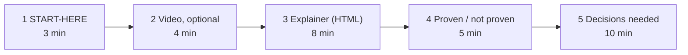

# Hand-over pack: plan

Status: proposal by Docs, 2026-10-16. The Lead approves it. Owner of the pack: Docs.

**Goal:** a product person understands the prototype and the open decisions in 30 minutes or less. Each artifact is small. You can throw it away after the review.

## Order and time budget

| # | Artifact | File in `docs/human_review/` | What the person does | Time |
| --- | --- | --- | --- | --- |
| 1 | START-HERE, one page, STE | `START-HERE.md` | Read what we built, what works, and what we need from you. | 3 min |
| 2 | Narrated video, optional, ≤ 4 min | `video/explainer-en.mp4` | Watch the five flows. Skip it if you prefer to click. | 4 min |
| 3 | Interactive explainer, one HTML file | `explainer.html` | Open it from disk. Click each flow step: who acts, what happens, which test proves it. | 8 min |
| 4 | Proven / not proven | `proven.md` (also a tab in the explainer) | Read one table: claim, status, evidence link. | 5 min |
| 5 | Decisions needed | `decisions-needed.md` (also a tab in the explainer) | For each question, accept our recommendation or write your answer. | 10 min |
| — | One diagram per key flow | `flows.md` | Reference only. The explainer and the video use the same diagrams. | — |
| — | Deferred findings, guides | `deferred.md`, `docs/guides/` | Reference for engineers, and for people who run the stack. | — |

Total: 30 minutes (26 minutes without the video).

## Content rules

- **START-HERE:** five parts: what it is, the five-step story, what works, what does not work yet, what we need from you.
- **decisions-needed.md:** only questions that a human must answer (Q1 to Q16 in `docs/architecture/open-questions.md`, plus Lead escalations). One card each: the question in one sentence, our recommendation, what it blocks, who decides. The prototype uses the recommendation until a human decides. "Blocks the pilot" comes first, "blocks production" second.
- **proven.md:** three states. *Proven by QA* (AC id and qa.md row). *Author check only*. *Not proven* (every item of `docs/architecture/README.md` §6, AC-T9-03).
- **flows.md:** one Mermaid diagram each for connect (6a), publish (6e), deep link (6b), SCORM launch to gradebook (6c) and HTML launch to gradebook (6d). Max 8 boxes. Product words, not protocol words. Each links to the full diagram in `docs/architecture/flows.md`.
- **explainer.html:** one self-contained file. No CDN, no web font, no network request. Dev-portal tokens: dark background `hsl(252 20% 5%)`, purple primary `hsl(270 70% 65%)`, button gradient `#b78bf9 → #7444bb`, cards `#16161d`, radius `.75rem`, "DM Sans" with system fallback. Tabs: Story, Flows (inline SVG), Proven, Decisions. The Decisions tab has "Copy my answers" (plain text for the Lead).
- **Every artifact** shows its source commit and date. When the code changes, we make the artifact again from its sources. We do not edit it by hand.
- **When:** `flows.md` and the explainer shell can start now. The other artifacts state results, so they wait for T7 PASS.

## Video pipeline (local and free, tested on this Mac on 2026-10-16)

1. Script: `video/script.md`, one short STE text per slide, max 600 words.
2. Narration: macOS `say -v Samantha -r 165`, one AIFF file per slide. Slide time = clip time + 0.7 s.
3. Slides: one HTML file with the explainer tokens and diagrams. The narration text shows as a caption. Playwright `recordVideo` records it in `mcr.microsoft.com/playwright:v1.56.0-noble`.
4. Merge: `linuxserver/ffmpeg` in Docker (arm64) joins the clips and encodes H.264 + AAC, 1280×720.
5. Check: duration ≤ 240 s, audio not silent, one frame per slide matches the slide.

Sample result: it worked. English 9.96 s, Vietnamese 12.4 s (`.tmp/docs/video-sample/out/`, git-ignored). A build takes about the video length plus 5 s.

## Vietnamese option

macOS has one Vietnamese voice, `Linh` (vi_VN, compact quality). Vietnamese captions show correctly.

Recommendation: keep English STE as the only written source. Make `video/explainer-vi.mp4` only if a Vietnamese team member listens to the 12-second sample and says that it is clear. A human must also check the Vietnamese script, because an agent translated it. Keep product terms in English (Moodle, LTI, SCORM, Deep Linking).

## Open points for the Lead

- Final mp4 files are about 12 MB each at the sample settings. Recommendation: commit the script and the build files, and keep the mp4 outside git (as for the course zips, Q15).
- Who does the 10-minute run test (AC-T9-01)?
