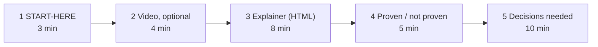

# Hand-over pack: plan

Source: commit `6932539`, 2026-10-19.

Status: accepted by the Lead (2026-10-16). Built 2026-10-19. Owner of the pack: Docs.

**Goal:** a product person understands the prototype and the open decisions in 30 minutes or less. Each artifact is small. You can throw it away after the review.

## Order and time budget

| # | Artifact | File in `docs/human_review/` | What the person does | Time |
| --- | --- | --- | --- | --- |
| 1 | START-HERE, one page, STE | `START-HERE.md` | Read what we built, what works, and what we need from you. | 3 min |
| 2 | Narrated video, optional, ≤ 4 min | `video/explainer-en.mp4` | Watch the five flows. Skip it if you prefer to click. | 4 min |
| 3 | Interactive explainer, one HTML file | `explainer.html` | Open it from disk. Click each flow step: who acts, what happens, which test proves it. | 8 min |
| 4 | Proven / not proven | `proven.md` (also a tab in the explainer) | Read one table: claim, status, evidence link. | 5 min |
| 5 | Decisions needed | `decisions-needed.md` (also a tab in the explainer) | For each question, accept our recommendation or write your answer. | 10 min |
| — | One diagram per key flow | `flows.md` | Reference only. The explainer and the video use the same diagrams. | — |
| — | Deferred findings, guides | `deferred.md`, `docs/guides/` | Reference for engineers, and for people who run the stack. | — |

Total: 30 minutes (26 minutes without the video).

## Content rules

- **START-HERE:** five parts: what it is, the five-step story, what works, what does not work yet, what we need from you.
- **decisions-needed.md:** only questions that a human must answer. Sources: Q1 to Q18 and the residual risks R1 to R5 in `docs/architecture/open-questions.md`, plus the hand-over checks HR-1 and HR-2. One card each: the question in one sentence, our recommendation, what it blocks, who decides. The prototype uses the recommendation until a human decides. "Blocks the pilot" comes first, "blocks production" second.
- **proven.md:** three states. *Proven by QA* (AC id and qa.md row). *Not verified by QA* (builder check only). *Not proven* (every item of `docs/architecture/README.md` §6, AC-T9-03).
- **flows.md:** one Mermaid diagram each for connect (6a), publish (6e), deep link (6b), SCORM launch to gradebook (6c) and HTML launch to gradebook (6d). Max 8 boxes. Product words, not protocol words. Each links to the full diagram in `docs/architecture/flows.md`.
- **explainer.html:** one self-contained file. No CDN, no web font, no network request. Dev-portal tokens: dark background `hsl(252 20% 5%)`, purple primary `hsl(270 70% 65%)`, button gradient `#b78bf9 → #7444bb`, cards `#16161d`, radius `.75rem`, "DM Sans" with system fallback. Tabs: Story, Flows (inline SVG), Proven, Decisions. The Decisions tab has "Copy my answers" (plain text for the Lead).
- **Every artifact** shows its source commit and date. When evidence changes, Docs updates the Markdown, explainer data and both video narrations. The builder stamps sources and generates diagrams; it does not synchronize prose.
- **When:** `flows.md` and the explainer shell can start now. The other artifacts state results, so they wait for T7 PASS.

## Video pipeline (local and free, tested on this Mac on 2026-10-16)

One command: `bash docs/human_review/video/build.sh [en|vi|all]`.

1. Script: `video/script.json`, one short STE text per slide in English and Vietnamese.
2. Narration: macOS `say` (Samantha for English, Linh for Vietnamese), one AIFF file per slide. Slide time = clip time + 0.8 s.
3. Slides: `video/slides.html` (dev-portal tokens; portal screenshots from `apps/portal/evidence/` only, checked for secrets). Playwright takes one PNG per slide in `mcr.microsoft.com/playwright:v1.56.0-noble`.
4. Merge: `linuxserver/ffmpeg` (pinned digest) makes still slides at 5 fps, H.264 CRF 30, mono AAC 64 kbit/s, 1280×720.
5. Check: duration ≤ 240 s and size ≤ 8 MB, else the script fails.

Result (2026-10-19), built from source `6932539d4b44e017dd54acc8dc37c6bb2ba9fed1`:

| Video | Duration | Exact size | Limits |
| --- | --- | --- | --- |
| `explainer-en.mp4` | 182.4 seconds | 2,211,513 bytes | PASS: ≤ 240 seconds and ≤ 8,000,000 bytes |
| `explainer-vi.mp4` | 212.4 seconds | 2,567,661 bytes | PASS: ≤ 240 seconds and ≤ 8,000,000 bytes |

The combined build took 24.60 seconds on this Mac. Both files have H.264 video at 1280×720, 5 fps, and mono AAC audio at 44,100 Hz. Both decode without errors. Docs inspected all 26 slide renders and extracted MP4 frames. The Vietnamese notice remains visible; HR-1 still needs human approval.

Details: [Docs closing-pass record](CLOSING-PASS.md).

## Vietnamese option

macOS has one Vietnamese voice, `Linh` (vi_VN, compact quality). Vietnamese captions show correctly.

English STE remains the written source. The Vietnamese video is supplied for HR-1 review. A Vietnamese team member must check the script and voice before the team keeps it. Keep product terms in English (Moodle, LTI, SCORM, Deep Linking).

## Open points for the Lead

- Both final MP4 files meet the Lead’s limit of 8,000,000 bytes. Exact measurements are above.
- The Lead accepted QA’s 61-second fresh-clone run for AC-T9-01. HR-2 remains a follow-up for unfamiliar-human usability.
- Review workflow and approval status are recorded on the [Lead board](../team/board.md) and in the [T9 reports](../reviews/T9/qa.md).
