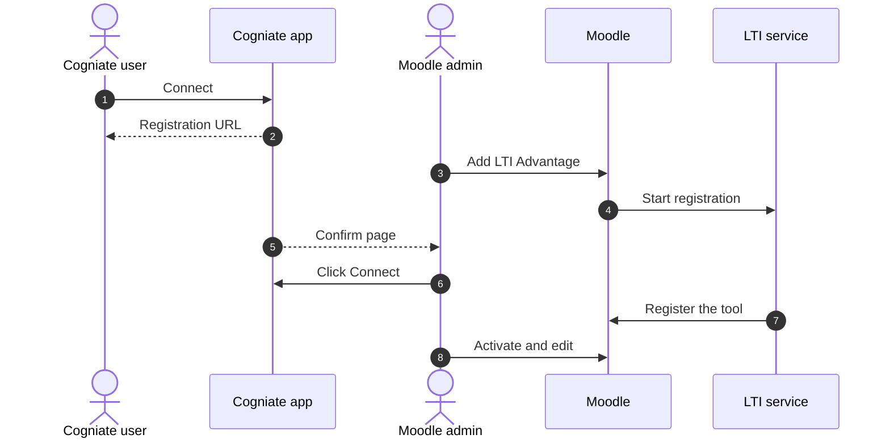
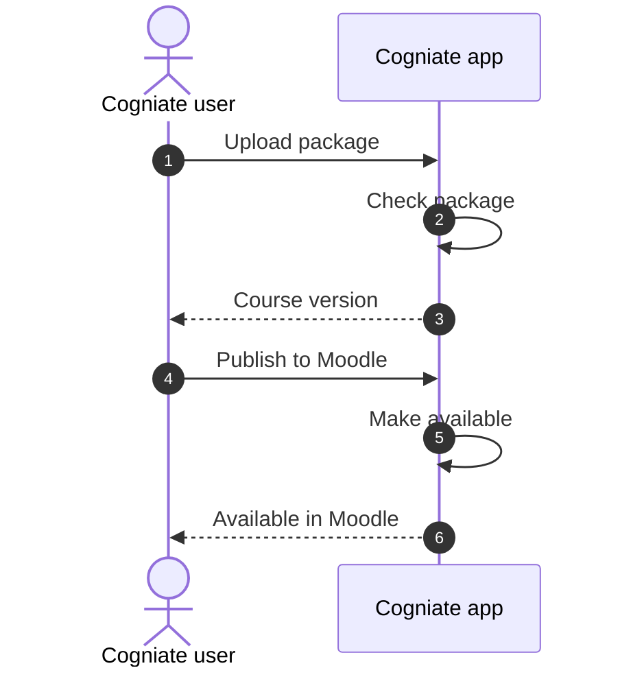
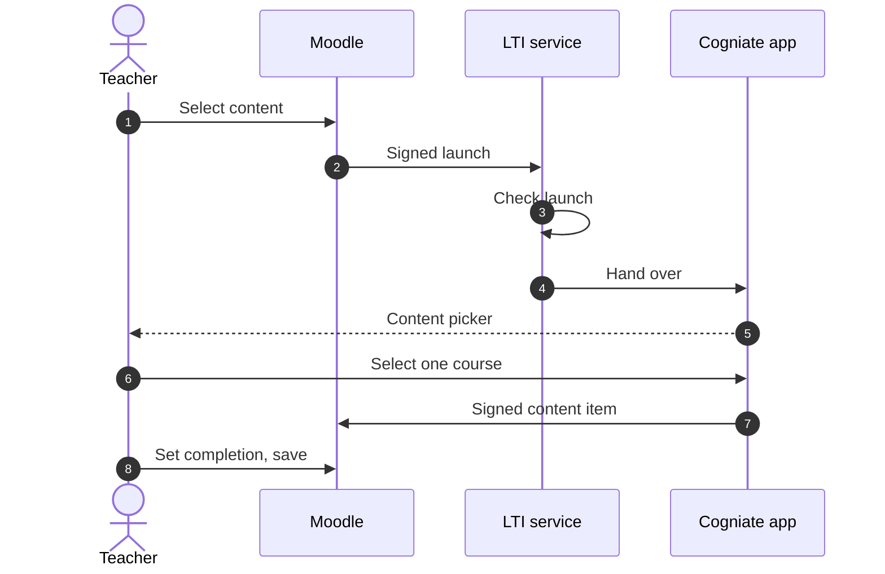
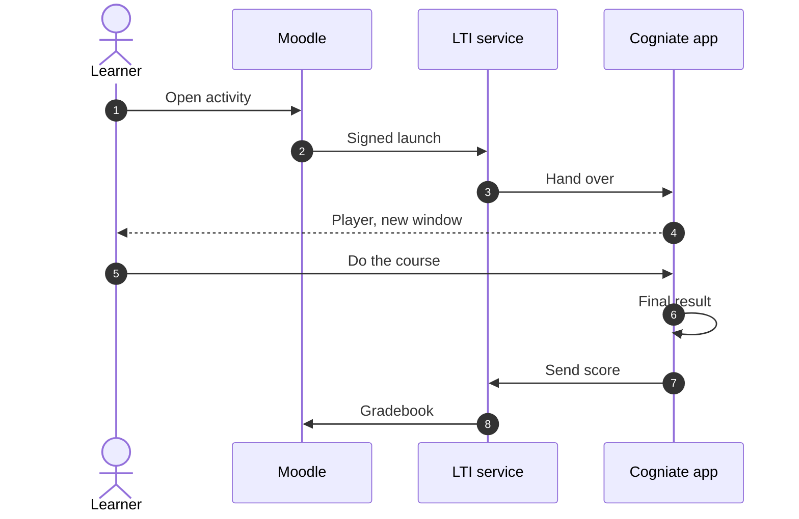
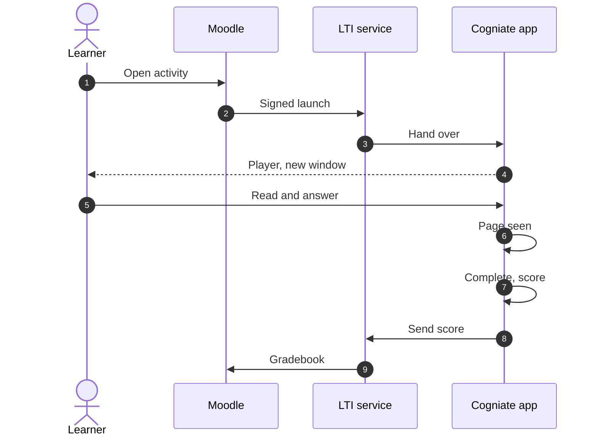

# Key flows

<!-- Made by docs/human_review/tools/build-md.mjs from explainer.html. Do not edit this file by hand. -->

Source: commit `512bb86`, 2026-10-19. The same diagrams are in [`explainer.html`](explainer.html) (tab Flows).

QA tested each flow on a real Moodle 5.2.4 site. The proof line under each flow names the QA rows (docs/reviews/<task>/qa.md).
The full technical diagrams are in [`docs/architecture/flows.md`](../architecture/flows.md).

| # | Flow | People | Status |
| --- | --- | --- | --- |
| 1 | [Connect a Moodle site](#1-connect-a-moodle-site) | Cogniate user, Moodle admin | Proven by QA |
| 2 | [Upload and publish a course](#2-upload-and-publish-a-course) | Cogniate user | Proven by QA |
| 3 | [Teacher adds a course (Deep Linking)](#3-teacher-adds-a-course-deep-linking) | Teacher | Proven by QA |
| 4 | [Learner does a SCORM 1.2 course](#4-learner-does-a-scorm-12-course) | Learner | Proven by QA |
| 5 | [Learner does an HTML course](#5-learner-does-an-html-course) | Learner | Proven by QA |

## 1. Connect a Moodle site

A Cogniate user and a Moodle admin connect one Moodle site to one Cogniate library. This is the default method (dynamic registration). A manual method is the fallback.

1. **Connect.** In the portal, the Cogniate user opens Integrations > Moodle > Connect. The user types the Moodle site URL and a name.
2. **Registration URL.** The portal shows a registration URL. The user gives this URL to the Moodle admin.
3. **Add LTI Advantage.** In Moodle, the admin opens Manage tools, pastes the URL into Tool URL and clicks Add LTI Advantage.
4. **Start registration.** Moodle opens the URL. The LTI service reads the Moodle settings from Moodle.
5. **Confirm page.** The Cogniate app shows a confirm page: the Moodle site, the library and the privacy setting.
6. **Click Connect.** The admin clicks Connect.
7. **Register the tool.** The LTI service registers the Cogniate tool in Moodle. Moodle returns the client ID and the deployment ID.
8. **Activate and edit.** The tool card shows Pending. The admin clicks Activate, then Edit, and sets “Show in activity chooser and as a preconfigured tool” and “New window”.

Status: **Proven by QA**. Evidence: `AC-T7-02`, `AC-T7-14`, `AC-T4-08`, `AC-T3-01`.
Technical diagram: section 6a of `docs/architecture/flows.md`.

## 2. Upload and publish a course

A Cogniate user uploads a course package and makes the course available to one Moodle connection. Publish does not copy the course into Moodle.

1. **Upload package.** The Cogniate user uploads a course package: a SCORM 1.2 zip or an HTML zip.
2. **Check package.** The Cogniate app checks the package and makes a course version. The app treats every package as untrusted data.
3. **Course version.** The portal shows the course and its version.
4. **Publish to Moodle.** The user opens the course and clicks Publish to Moodle. Then the user selects the connection and the version.
5. **Make available.** The app makes the course available to that connection only. The app copies nothing into Moodle.
6. **Available in Moodle.** The portal shows “Available in Moodle”, with the next step for teachers.

Status: **Proven by QA**. Evidence: `AC-T7-03`, `AC-T4-12`, `AC-T4-03`, `AC-T4-05`.
Technical diagram: section 6e of `docs/architecture/flows.md`.

## 3. Teacher adds a course (Deep Linking)

A teacher adds one Cogniate course to a Moodle course. Moodle makes a normal activity with a grade item.

1. **Select content.** The teacher turns on Edit mode and clicks Add content, then Activity or resource. The teacher selects Cogniate and clicks Add. Then the teacher clicks Select content.
2. **Signed launch.** Moodle sends a signed LTI 1.3 launch (a Deep Linking request) to the LTI service.
3. **Check launch.** The LTI service checks the launch: signature, state, nonce and claims.
4. **Hand over.** The LTI service sends the teacher to the Cogniate app with a short-lived launch token.
5. **Content picker.** The app shows the content picker. It lists only the courses that are published to this connection.
6. **Select one course.** The teacher selects one course and clicks Add to Moodle.
7. **Signed content item.** The app returns the course to Moodle as one content item. The LTI service signs it.
8. **Set completion, save.** Moodle fills the activity form, with a grade of max 100. Under Completion conditions, the teacher adds Receive a grade and saves.

Status: **Proven by QA**. Evidence: `AC-T7-03`, `AC-T7-08`, `AC-T4-15`, `AC-T3-07`.
Technical diagram: section 6b of `docs/architecture/flows.md`.

## 4. Learner does a SCORM 1.2 course

A learner opens the activity in Moodle and does the SCORM 1.2 course in the Cogniate player. The score goes to the Moodle gradebook.

1. **Open activity.** The learner opens the Cogniate activity in Moodle.
2. **Signed launch.** Moodle sends a signed LTI 1.3 launch. The LTI service checks it.
3. **Hand over.** The LTI service sends the learner to the Cogniate app with a short-lived launch token.
4. **Player, new window.** The course opens in the Cogniate player, in a new window. The course runs on a separate content site.
5. **Do the course.** The learner reads the pages and answers the question. The SCORM package reports progress and score to our SCORM 1.2 runtime.
6. **Final result.** At the end, the result is passed or failed, with a score from 0 to 100. The pass mark is 70. The best result counts (decision Q4).
7. **Send score.** The Cogniate app sends the score to the LTI service (score sync).
8. **Gradebook.** The LTI service sends the score to the Moodle gradebook (LTI Assignment and Grade Services). In the QA runs, this took about 4 seconds.

Status: **Proven by QA**. Evidence: `AC-T5-07`, `AC-T5-08`, `AC-T7-04`, `AC-T7-05`, `AC-T7-07`.
Technical diagram: section 6c of `docs/architecture/flows.md`.

## 5. Learner does an HTML course

The same launch as the SCORM flow. The HTML export does not record progress. So our HTML runtime watches the pages and calculates the result.

1. **Open activity.** The learner opens the Cogniate activity in Moodle.
2. **Signed launch.** Moodle sends a signed LTI 1.3 launch. The LTI service checks it.
3. **Hand over.** The LTI service sends the learner to the Cogniate app with a short-lived launch token.
4. **Player, new window.** The HTML course opens in the Cogniate player, in a new window.
5. **Read and answer.** The learner reads each page and answers the question.
6. **Page seen.** Our HTML runtime marks a page as seen after 10 seconds on screen and a scroll to the end.
7. **Complete, score.** The course is complete when the learner sees all pages and answers all questions. Score = correct answers / questions × 100. The pass mark is 70.
8. **Send score.** The Cogniate app sends the score to the LTI service (score sync).
9. **Gradebook.** The LTI service sends the score to the Moodle gradebook (LTI Assignment and Grade Services).

Status: **Proven by QA**. Evidence: `AC-T5-09`, `AC-T5-27`, `AC-T7-04`, `AC-T7-05`.
Technical diagram: section 6d of `docs/architecture/flows.md`.
