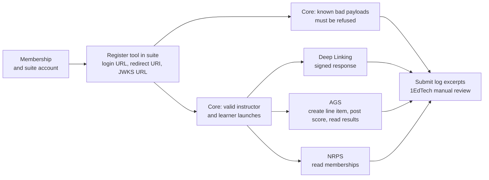

# LA-R1: LTI 1.3 and LTI Advantage spec coverage audit

Researcher R1, milestone LA, 2026-10-22. Base: branch `quang/ltiaas-milestone` at `ee20314` (code of `00977f8`). Scope: `services/lti-service/**`, the tool parts of `services/cogniate-app/**`, the LTI service contract, security model, ADR-002, ADR-003, ADR-011.

## Summary

1. The launch path is strong. OIDC login, the id_token checks of the Security Framework (8 of 9 complete; extra audiences pass, S-08), JWKS handling, state and nonce, and the signed client assertion are built and unit-tested.
2. The LTI service covers the full AGS 2.0 surface (line item CRUD, scores, results, paging) and NRPS 2.0 basics (role, limit, rlid, next). The Cogniate app uses only a part of it.
3. Deep Linking signs correct responses for all 5 standard types, with data echo. The service refuses an empty response, so a tool cannot "cancel" (DL §2.3).
4. Dynamic Registration works for Moodle at the host root. It refuses an issuer with a path (Q18), ignores `authorization_server`, and has no spec update flow (`registration_client_uri`).
5. Platform Storage and client-side postMessages (`lti_storage_target`, `lti.put_data`, `lti.get_data`) are not built. Frames depend on a partitioned cookie only. This is the largest gap for a multi-LMS service, because Canvas frames every launch.
6. Certification: the known-bad payload tests map to existing checks. Valid-launch tests "without context" fail in the app. AGS and NRPS tests need a tool that calls the API; the Cogniate app does not create line items or read rosters.
7. Claim minimization for Canvas and Blackboard drops `custom` and `lis`. A generic service needs a per-tool claim policy, not LMS-named flags.
8. Tool key rotation exists only as a CLI flag. The retired-key overlap uses the key creation time, so an old key can drop out at once (`services/lti-service/src/store/tool-keys.ts:36`).
9. Counts over 134 rows: YES 76, PARTIAL 34, NO 19, N-A 5 (per area: §2.9).
10. Top value for LA: platform storage (E3), a certification reference tool and kit (E7), generic Dynamic Registration fixes (E2), and a claim and privacy policy per tool (E1/E3).

## 1. Sources and method

Public specifications (1EdTech, read on 2026-10-22). The text below paraphrases them; it quotes no long passage.

| Key | Document | URL |
| --- | --- | --- |
| [CORE] | LTI Core 1.3 | https://www.imsglobal.org/spec/lti/v1p3 |
| [SEC] | 1EdTech Security Framework 1.0 | https://www.imsglobal.org/spec/security/v1p0 |
| [DL] | LTI Deep Linking 2.0 | https://www.imsglobal.org/spec/lti-dl/v2p0 |
| [AGS] | LTI Assignment and Grade Services 2.0 | https://www.imsglobal.org/spec/lti-ags/v2p0 |
| [NRPS] | LTI Names and Role Provisioning Services 2.0 | https://www.imsglobal.org/spec/lti-nrps/v2p0 |
| [DR] | LTI Dynamic Registration 1.0 | https://www.imsglobal.org/spec/lti-dr/v1p0 |
| [CSPM] | LTI Client Side postMessages 0.1 (draft, 2022-10-17) | https://www.imsglobal.org/spec/lti-cs-pm/v0p1 |
| [PMS] | LTI postMessage Storage 0.1 (draft, 2022-10-17) | https://www.imsglobal.org/spec/lti-pm-s/v0p1 |
| [CSOIDC] | LTI OIDC Login with Client Side postMessages 0.1 (draft, 2022-10-25) | https://www.imsglobal.org/spec/lti-cs-oidc/v0p1 |
| [CERT] | LTI Advantage Conformance Certification Guide | https://www.imsglobal.org/spec/lti/v1p3/cert |
| [CERTP] | 1EdTech LTI certification page | https://www.1edtech.org/certification/lti |
| [CV-PM] | Canvas: window.postMessage in LTI tools (platform storage support) | https://developerdocs.instructure.com/services/canvas/external-tools/lti/file.lti_window_post_message |
| [CV-SC] | Canvas: AGS Score extensions | https://developerdocs.instructure.com/services/canvas/resources/score |

Method:

- I read every non-test source file of `services/lti-service/src` and the tool pages, client and worker of `services/cogniate-app/src`.
- I mapped each tool-side MUST, SHOULD and MAY to code. Evidence is `path:line` from the repo root. `lti/` = `services/lti-service/src/lti/`, `platform/` = `services/lti-service/src/platform/`, `routes/` = `services/lti-service/src/http/routes/`, `app/` = `services/cogniate-app/src/`.
- Section numbers come from the public pages. Some pages were long; where I could not read a section, the row says UNVERIFIED.
- I did not run the stack or the tests (brief rule). Test file references show that a test exists; I did not re-run it.

Status values: **YES** = done as the spec asks. **PARTIAL** = done with a gap. **NO** = not built. **N-A** = not a tool duty, or out of scope by design. Risk: **H** high, **M** medium, **L** low (for an "LTI as a service" product). Epics: plan §3 (`docs/team/ltiaas/plan.md`).

## 2. Coverage tables

### 2.1 LTI Core 1.3 [CORE]

| Id | Spec | Requirement (level, paraphrase) | Status | Evidence | Gap | Risk | Epic |
| --- | --- | --- | --- | --- | --- | --- | --- |
| C-01 | §5.3.1 | MUST: message type is a known LTI type. | YES | `lti/checks.ts:166-171` | Only 2 types (see C-18). | L | — |
| C-02 | §5.3.2 | MUST: version claim is `1.3.0`. | YES | `lti/checks.ts:167` | — | L | — |
| C-03 | §5.3.3 | MUST: `deployment_id` present, case-sensitive, ≤ 255 ASCII. | YES | `lti/checks.ts:155-163`, `lti/platform-rules.ts:51` | — | L | — |
| C-04 | §5.3.4 | MUST: `target_link_uri` equals the login value. SHOULD: redirect on the signed value. | YES | `lti/checks.ts:191-195`, `lti/launch.ts:53-58`, `lti/launch.ts:123` | — | L | — |
| C-05 | §5.3.5 | MUST: `resource_link.id` present (resource link launch). | YES | `lti/checks.ts:181-183` | — | L | — |
| C-06 | §5.3.6, §5.3.6.1 | MUST: `sub` present, except in an anonymous launch; a tool treats a missing `sub` as anonymous. | PARTIAL | `lti/checks.ts:177` | A launch without `sub` is refused. [CERT] §6.1.1 lists "missing user" as a bad payload, so the refusal passes certification. Document the choice. | L | E8 |
| C-07 | §5.3.7, §5.3.7.1 | MUST: roles claim present; it may be empty. | YES | `lti/checks.ts:178-179`, `packages/shared/src/roles.ts:33-36` | — | L | — |
| C-08 | Appendix A | MUST: tool knows full LIS role URIs; MAY know short names. | YES | `packages/shared/src/roles.ts:5-6`, `packages/shared/src/roles.ts:18-26` | — | L | — |
| C-09 | §3.1.3 | MUST: several deployments can share one client id. | YES | `services/lti-service/src/db/migrations/001_init.sql:38-42`, `services/lti-service/src/profiles/blackboard.ts:12-20` | — | L | — |
| C-10 | §3.3 | MUST: identify a user only by `sub`. | YES | `app/tool-pages/launch.ts:175` | — | L | — |
| C-11 | §5.4.1 | Context claim is optional; `id` is required when present. | PARTIAL | `lti/checks.ts:176-188` (service accepts); `app/tool-pages/launch.ts:149` (app refuses) | The app refuses a launch without a context. [CERT] §6.1.2 has valid launches "email without context". Service keys also need a context (`lti/service-keys.ts:19`). | H | E3, E7 |
| C-12 | §5.4.4 | `document_target` is `frame`, `iframe` or `window`; `return_url` may be used. | YES | `lti/idtoken.ts:54-57`, `app/tool-pages/launch.ts:179`, `app/tool-pages/launch.ts:189-190` | — | L | — |
| C-13 | §5.4.4 | MAY: add `lti_msg`, `lti_errormsg`, `lti_log`, `lti_errorlog` to the return URL. | NO | `app/tool-pages/launch-rules.ts:36-44` | "Back to LMS" sends no message. | L | backlog |
| C-14 | §5.4.6, App. B | Custom values are strings; a tool accepts empty strings. | PARTIAL | `lti/idtoken.ts:58`; `lti/claims.ts:9-22` | Canvas and Blackboard profiles drop `custom` (ADR-011 `docs/architecture/adr/ADR-011-multi-lms.md:302`). Tools that use custom parameters fail on those LMSs. | M | E1, E3 |
| C-15 | §5.4.5, App. D | Optional `lis` claim; tool handles absence. | PARTIAL | `lti/claims.ts:9-22`; `lti/idtoken.ts:37-72` | Not in the shaped token; raw only for `standard`. Dropped for Canvas and Blackboard. | L | E1 |
| C-16 | §3.5, §4.3 | MUST: ignore unknown claims, not fail. | YES | `lti/checks.ts:176-188` (no unknown-claim check), `lti/claims.ts:30-48` | — | L | — |
| C-17 | §3.5 | MUST: TLS for messages, services and URLs. | YES | `lti/platform-rules.ts:14-21`, `lti/service-url.ts:5`, `lti/checks.ts:209-217` | TLS version is infra (S-20). | L | — |
| C-18 | §6.2.1 | SHOULD: put the deployment id in the token request JWT. | NO | `platform/token-client.ts:38-39` | Claim missing. Some platforms may need it (spec note). | M | E2 |
| C-19 | §5.3.5, B.4 | Resource link id is stable; it changes on copy. | YES | `app/tool-pages/launch.ts:167-171`, `docs/architecture/security.md:129` | — | L | — |
| C-20 | §5.4.2 | Tool platform claim: `guid` required when present. | YES | `lti/checks.ts:246-251`, `lti/launch.ts:120-121` | Used for check 14 only; `guid` is not validated (platform duty). | L | — |
| C-21 | Appendix E | `lti1p1` claim helps LTI 1.1 → 1.3 migration (user id mapping). | NO | `lti/claims.ts:9-22`, `lti/idtoken.ts:39-42` | Not read, not exposed. UNVERIFIED: section not read (page truncated). | M | LD |
| C-22 | Other specs | Other message types (Submission Review, Proctoring, data privacy). | N-A | `lti/checks.ts:37` | Out of LA scope. | L | backlog |

### 2.2 1EdTech Security Framework 1.0 [SEC]

| Id | Spec | Requirement (level, paraphrase) | Status | Evidence | Gap | Risk | Epic |
| --- | --- | --- | --- | --- | --- | --- | --- |
| S-01 | §5.1.1.1 | MUST: accept login initiation by GET and POST; `iss`, `login_hint`, `target_link_uri` required. | YES | `routes/protocol.ts:29-30`, `lti/login.ts:36-38` | — | L | — |
| S-02 | [CORE] §4.1 (UNVERIFIED section) | Optional login params: `lti_message_hint`, `lti_deployment_id`, `client_id`. | YES | `lti/login.ts:39-56`, `lti/login.ts:71` | — | L | — |
| S-03 | §5.1.1.2 | Auth request: `scope=openid`, `response_type=id_token`, `response_mode=form_post`, `prompt=none`, `client_id`, `redirect_uri`, `login_hint`, `state`, `nonce`. | YES | `lti/login.ts:68-74` | — | L | — |
| S-04 | §5.1.1.2, §5.1.1.4 | MUST: bind `state` to the browser (CSRF) and check it. | YES | `lti/login.ts:75`, `lti/checks.ts:79-83`, `lti/checks.ts:72-76` | Cookie only (see PS rows). | M | E3 |
| S-05 | §5.1.1.5 | Handle OIDC error answers. | YES | `lti/launch.ts:76-78` | — | L | — |
| S-06 | §5.1.3 step 1 | MUST: verify the signature with the platform key. | YES | `lti/checks.ts:128-134`, `lti/jwks.ts:87-118` | — | L | — |
| S-07 | §5.1.3 step 2 | MUST: `iss` equals the known issuer exactly. | YES | `lti/checks.ts:119` | — | L | — |
| S-08 | §5.1.3 step 3 | MUST: `aud` has the client id; reject untrusted extra audiences. | PARTIAL | `lti/checks.ts:120-124` | Extra audiences pass when `azp` is right. No trusted-audience list. | L | E5 |
| S-09 | §5.1.3 steps 4-5 | SHOULD: `azp` present with many audiences; equal to client id. | YES | `lti/checks.ts:123-124` | — | L | — |
| S-10 | §5.1.3 step 6, §6.1 | `alg` RS256 unless agreed otherwise. | YES | `lti/checks.ts:101`, `lti/jwks.ts:77` | RS256 only (ADR-002). | L | — |
| S-11 | §5.1.3 step 7 | MUST: now < `exp`, small skew allowed. | YES | `lti/checks.ts:137-143` | 60 s skew, by choice (`docs/architecture/security.md:63`). | L | E8 |
| S-12 | §5.1.3 step 8 | MAY: refuse a token with `iat` too far away. | YES | `lti/checks.ts:142` | Future `iat` only; `exp` bounds the past. | L | — |
| S-13 | §5.1.3 step 9, §5.1.1.4 | MUST: `nonce` present; SHOULD: refuse a reused nonce. | YES | `lti/checks.ts:146-149`, `services/lti-service/src/store/states.ts:28-38` | Nonce is bound to a single-use state. | L | — |
| S-14 | §6.3 | Platform key set: every key has a `kid`; token header names it. | YES | `lti/checks.ts:102`, `lti/jwks.ts:107-117` | Unknown kid: one refetch per minute. | L | — |
| S-15 | §6.3 (MAY) | Key set cache: issuer may send `max-age`. | PARTIAL | `lti/jwks.ts:6-10` | Fixed 10 min refresh; `Cache-Control` ignored. Cache is in memory per instance. | L | E5 |
| S-16 | §4.1.1 | Client credentials grant with a signed JWT assertion: `iss`, `sub`, `aud`, `iat`, `exp`, `jti`. | YES | `platform/token-client.ts:35-45`, `lti/tool-jwt.ts:12-22` | — | L | — |
| S-17 | §4.1, §4.1.1.1 | MUST: send `scope`; reuse the token until expiry; treat it as opaque. | YES | `platform/token-client.ts:40`, `platform/token-client.ts:58-82` | Cache is in memory per instance (see AGS-16). | L | E5 |
| S-18 | §5.2 | Tool JWT: `iss` = client id, `aud` = issuer, `exp`, `iat`, `nonce`; POST as form field `JWT`. | YES | `lti/deep-linking.ts:95-103`, `lti/deep-linking.ts:116-118`, `app/tool-pages/picker.ts:166-176` | — | L | — |
| S-19 | §5, §6.2, §6.3 | Tool publishes a JWKS URL; every key has a unique `kid`; RSA `n` and `e`. | YES | `routes/protocol.ts:14-17`, `services/lti-service/src/store/tool-keys.ts:17-21` | kid = JWK thumbprint, RSA 2048. | L | — |
| S-20 | §6.4 (SHOULD) | Rotation: add a new key with a new `kid`; keep the old key published for an overlap. | PARTIAL | `services/lti-service/src/store/tool-keys.ts:14-28`, `services/lti-service/src/store/tool-keys.ts:36`, `services/lti-service/src/cli/bootstrap.ts:16` | CLI flag only. No API, schedule or test. Overlap uses `created_at`, so a key older than 30 days disappears at rotation. | M | E5 |
| S-21 | §3 | TLS 1.2 or 1.3; no SSL. | N-A | `docs/architecture/local-stack.md:13` (TLS proxy) | Infra duty; production TLS is LG. | L | LG |
| S-22 | §6 | Protect the private key. | PARTIAL | `services/lti-service/src/store/tool-keys.ts:21-25` | AES-256-GCM with one master key; no KMS. | M | E5 |

### 2.3 Deep Linking 2.0 [DL]

| Id | Spec | Requirement (level, paraphrase) | Status | Evidence | Gap | Risk | Epic |
| --- | --- | --- | --- | --- | --- | --- | --- |
| DL-01 | §2.2 | SHOULD: check the DL request like a resource link launch. | YES | `lti/launch.ts:93-112`, `lti/checks.ts:184-187` | — | L | — |
| DL-02 | §4.4.1 | Read `deep_link_return_url`, `accept_types`, `accept_presentation_document_targets`. | YES | `lti/deep-linking.ts:81-91`, `lti/idtoken.ts:59-62` | — | L | — |
| DL-03 | §4.4.1 | Optional settings: `accept_media_types`, `accept_lineitem`, `auto_create`, `title`, `text`, `data`. | PARTIAL | `lti/idtoken.ts:59-62` | `acceptLineItem` and `acceptMediaTypes` are not in the shaped token (raw only). | L | E3 |
| DL-04 | §4.5.1-4.5.4 | Response: `aud` = issuer, message type `LtiDeepLinkingResponse`, version, `deployment_id`. | YES | `lti/deep-linking.ts:95-103` | — | L | — |
| DL-05 | §4.5.5 | MUST: echo `data` exactly. | YES | `lti/deep-linking.ts:106` | — | L | — |
| DL-06 | §4.5.7-4.5.10 | Optional `msg`, `log`, `errormsg`, `errorlog`. | YES | `lti/deep-linking.ts:107-111` | Cut at 2,000 characters. | L | — |
| DL-07 | §2.3, §4.5 | MUST: return with an auto-submitted form POST, field `JWT`. | YES | `lti/deep-linking.ts:116-118`, `app/tool-pages/picker.ts:166-176` | — | L | — |
| DL-08 | §2.3, §4.5.6 | SHOULD: return also when nothing is chosen; empty `content_items` is valid. | NO | `lti/deep-linking.ts:44`, `app/tool-pages/picker.ts:119-125` | Service needs 1 to 20 items. Picker has no "Cancel". | M | E3 |
| DL-09 | §4.4.1 | `accept_multiple`: send many items only when allowed. | PARTIAL | `lti/deep-linking.ts:45`; `app/tool-pages/picker.ts:105-118`, `app/tool-pages/picker.ts:151` | Service: YES. App: one item only (radio list). Absent flag allows 20 items (no default in the spec). | M | E3 |
| DL-10 | §4.4.1 | Send only types in `accept_types`. | YES | `lti/deep-linking.ts:46`, `lti/deep-linking.ts:53` | — | L | — |
| DL-11 | §3.2 | `ltiResourceLink.url` optional; default is the tool launch URL. | YES | `lti/deep-linking.ts:65-66` | Must be our own launch URL (stricter). | L | — |
| DL-12 | §3.2 | `custom` values are strings; `null` is invalid. | YES | `lti/deep-linking.ts:50-56` | `null` maps to `{}` (D14 tolerance). | L | — |
| DL-13 | §3.2, §4.4.1 | `lineItem.scoreMaximum` required; honour `accept_lineitem`. | PARTIAL | `lti/deep-linking.ts:57-62`, `app/tool-pages/picker.ts:69` | `accept_lineitem` is not checked; the app always sends a line item. | L | E3 |
| DL-14 | §3.2 | Optional `available` and `submission` windows. | YES | `lti/deep-linking.ts:63-67` (pass-through) | App sends none (product choice). | L | — |
| DL-15 | §3.1, §3.2 | `window` and `iframe` hints; SHOULD give all options that apply. | PARTIAL | `app/tool-pages/picker.ts:63-72`, `app/tool-pages/picker.ts:149-150` | Moodle gets no `window` hint (D-10, `docs/architecture/adr/ADR-011-multi-lms.md:435`). | L | E3 |
| DL-16 | §3.1, §3.3-3.5 | `link`, `file`, `html`, `image`: each has required fields (`url` or `html`). | PARTIAL | `lti/deep-linking.ts:24`, `lti/deep-linking.ts:63` | Types pass, but required fields per type are not checked. The platform refuses them later. | L | E3 |
| DL-17 | §3.2 | A resource link without `lineItem` is an ungraded link. | PARTIAL | `lti/deep-linking.ts:57`; `app/tool-pages/picker.ts:69` | Service allows it. App always grades (D-11, `docs/architecture/adr/ADR-011-multi-lms.md:281`). | M | E3 |
| DL-18 | §3.7 | MAY: extra content item types with a URL type id. | NO | `lti/deep-linking.ts:24`, `lti/deep-linking.ts:52` | Closed list of 5 types. | L | backlog |
| DL-19 | §2.2 | MUST NOT assume that the platform creates the link. | YES | `app/tool-pages/launch.ts:167-171` | The resource link row starts at the first launch. | L | — |
| DL-20 | LMS quirk | Blackboard needs `sub` = client id in the response. | YES | `lti/deep-linking.ts:105`, `services/lti-service/src/profiles/blackboard.ts:6` | — | L | — |
| DL-21 | §4.4.1 | Return URL safety (our rule): sign only for the site origin. | YES | `lti/deep-linking.ts:87-91`, `app/tool-pages/picker.ts:158-162` | — | L | — |

### 2.4 Assignment and Grade Services 2.0 [AGS]

| Id | Spec | Requirement (level, paraphrase) | Status | Evidence | Gap | Risk | Epic |
| --- | --- | --- | --- | --- | --- | --- | --- |
| AGS-01 | §3.1 | SHOULD: read the AGS claim from each message, not cache URLs. | YES | `services/lti-service/src/store/service-keys.ts:57-61`, `app/tool-pages/launch.ts:170` | Service keys refresh the claim on each launch. | L | — |
| AGS-02 | §3.1 | `lineitems` may be absent; `lineitem` only for one line item. | YES | `lti/service-url.ts:53-58`, `platform/ags.ts:192-194` | — | L | — |
| AGS-03 | §3.2 | Scopes: `lineitem` (read and write), `lineitem.readonly` (read), `result.readonly`, `score`. | YES | `platform/ags.ts:15-20`, `platform/ags.ts:122-127`, `platform/ags.ts:216` | — | L | — |
| AGS-04 | §3.2.4 | Container GET with `resource_link_id`, `resource_id`, `tag`, `limit`. | YES | `platform/ags.ts:192-203` | — | L | — |
| AGS-05 | §3.2.4 | MUST: follow `rel="next"` as given; do not re-apply filters. | YES | `platform/ags.ts:195-197`, `platform/link-header.ts:6-17` | — | L | — |
| AGS-06 | §3.2.5 | POST a line item; use only a `resourceLinkId` from a launch. | PARTIAL | `platform/ags.ts:213-218`, `routes/compat.ts:15-20` | No check of `resourceLinkId` (platform answers 404). App never creates line items. | L | E7 |
| AGS-07 | §3.2.6 | PUT replaces the line item; `id` and `resourceLinkId` do not change. | YES | `platform/ags.ts:220-224` | Returns `201` (LTIAAS shape, ADR-003). | L | — |
| AGS-08 | §3.2 | DELETE a line item (`lineitem` scope). | YES | `platform/ags.ts:226-230` | — | L | — |
| AGS-09 | §3.2.7-3.2.14 | `label` non-blank; `scoreMaximum` > 0; optional ids, tag, dates, `gradesReleased`. | YES | `routes/compat.ts:15-20`, `platform/ags.ts:141-149` | — | L | — |
| AGS-10 | §3.1.2 | MAY: extension properties with URL keys on line items, scores, results. | NO | `platform/ags.ts:141-158`, `platform/ags.ts:237-240` | Extensions are dropped both ways. Canvas uses them for submissions [CV-SC]. | M | E3, E4 |
| AGS-11 | §3.3 | Results: `{lineitem}/results`, `user_id`, `limit`, `next` paging. | YES | `platform/ags.ts:245-253`, `platform/link-header.ts:14` | — | L | — |
| AGS-12 | §3.3.4 | Result fields incl. `scoringUserId`. | PARTIAL | `platform/ags.ts:151-158` | `scoringUserId` dropped. | L | E3 |
| AGS-13 | §3.4 | Score POST to `{lineitem}/scores` with score media type. | YES | `platform/ags.ts:233-242`, `platform/ags.ts:22-27` | — | L | — |
| AGS-14 | §3.4 | Required: `userId`, `timestamp`, `activityProgress`, `gradingProgress`; `scoreGiven` with `scoreMaximum`; `scoreGiven` ≥ 0 and may exceed the maximum. | YES | `platform/ags.ts:89-117` | — | L | — |
| AGS-15 | §3.4 | Absent or `null` `scoreGiven` clears the score. | PARTIAL | `platform/ags.ts:101-105` | Absent works; explicit `null` gets `400`. | L | E3 |
| AGS-16 | §3.4.9 | MUST: timestamp with sub-second precision and zone; strictly later per line item and user. | PARTIAL | `platform/score-clock.ts:10-27`, `platform/ags.ts:83`, `platform/ags.ts:111-115` | Clock is in memory per instance. A client timestamp without milliseconds passes. | M | E5, LG |
| AGS-17 | §3.4.7, §3.4.8 | `activityProgress` and `gradingProgress` enums; only `FullyGraded` is final. | YES | `platform/ags.ts:69-70`, `platform/ags.ts:93-95` | Service: all values. | L | — |
| AGS-18 | §3.4.7, §3.4.8 | Progress semantics in the tool (start, in progress, submitted, reset). | PARTIAL | `packages/tracking/src/outcome.ts:43-53` | App sends only `Completed` + `FullyGraded` at a final result. LMS shows no "started" state. | M | E4 |
| AGS-19 | §3.4.10 | Optional `submission.startedAt`, `submittedAt`. | NO | `platform/ags.ts:72-80` | Not accepted, not sent. | L | E4 |
| AGS-20 | §3.4 | Optional `scoringUserId` on a score. | NO | `platform/ags.ts:72-80` | Not accepted. | L | E4 |
| AGS-21 | §3.4.11 | `comment`: plain text, one per result. | YES | `platform/ags.ts:107-110` | — | L | — |
| AGS-22 | §4.3.1 | Declarative model: line item from Deep Linking; else programmatic lookup. | YES | `app/tool-pages/picker.ts:69`, `app/worker/line-item.ts:8-18` | — | L | — |
| AGS-23 | Our rule | Tool may call only URLs of its own launch (security §8). | YES | `lti/service-url.ts:12-50`, `platform/ags.ts:130-135` | — | L | — |

### 2.5 Names and Role Provisioning Services 2.0 [NRPS]

| Id | Spec | Requirement (level, paraphrase) | Status | Evidence | Gap | Risk | Epic |
| --- | --- | --- | --- | --- | --- | --- | --- |
| NR-01 | §3.6.1.1 | Use `context_memberships_url` from the claim; check `service_versions` has 2.0. | PARTIAL | `platform/nrps.ts:31-35` | `service_versions` not checked. | L | E3 |
| NR-02 | §3.6.1.2, §2.1 | Scope `contextmembership.readonly`; GET; membership container media type. | YES | `platform/nrps.ts:11`, `platform/nrps.ts:38-44` | — | L | — |
| NR-03 | §2.4.1 | `role` filter: full URI or short context role name. | YES | `platform/nrps.ts:36-37`, `routes/compat.ts:21-24` | — | L | — |
| NR-04 | §2.4.2 | `limit` hint; `rel="next"` paging. | YES | `platform/nrps.ts:37`, `platform/nrps.ts:52-56` | Caller passes `next` back as `url`. | L | — |
| NR-05 | §2.4.3 | `rel="differences"` link for changes since a time. | NO | `platform/link-header.ts:14`, `platform/nrps.ts:52` | Not parsed, not returned. No incremental roster sync. | M | E3 |
| NR-06 | §3 | Resource link membership with `rlid`. | YES | `platform/nrps.ts:37` | — | L | — |
| NR-07 | §3.2, §3.5 | Per-member `message` section (link claims, custom). | NO | `platform/nrps.ts:12-18` | Schema drops it. | L | backlog |
| NR-08 | §2.2, §2.3 | `user_id`, `roles` required; `status` Active, Inactive, Deleted (default Active). | YES | `platform/nrps.ts:12-18`, `platform/nrps.ts:55` | — | L | — |
| NR-09 | §2.2 | Optional personal fields need platform consent. | PARTIAL | `platform/nrps.ts:55`, `docs/architecture/contracts/lti-service-api.md:305` | Never returned, by design (D13). A service for other tools needs a per-tool policy (LA-H4). | M | E1, E3 |
| NR-10 | Product | The Cogniate app uses NRPS. | N-A | `app/clients/lti-client.ts:251-263` | App never calls it. D-8 asks to drop the scope. | L | E3 |

### 2.6 Dynamic Registration 1.0 [DR]

| Id | Spec | Requirement (level, paraphrase) | Status | Evidence | Gap | Risk | Epic |
| --- | --- | --- | --- | --- | --- | --- | --- |
| DR-01 | §3.3 | Initiation with `openid_configuration`; optional `registration_token` used as Bearer. | YES | `routes/registration.ts:56-60`, `routes/registration.ts:76-91`, `routes/registration.ts:212-215` | — | L | — |
| DR-02 | §3.4, §3.5.1 | MUST: the configuration URL starts with the issuer (issuer + path); abort else. | PARTIAL | `lti/registration.ts:60-62` | Stricter: issuer must equal the URL origin. An issuer with a path (Moodle in a subfolder) gets `ISSUER_MISMATCH` (Q18, `docs/architecture/open-questions.md:26`). | H | E2 |
| DR-03 | §2.1.1 | Read required endpoints: auth, token, JWKS, registration. | YES | `lti/registration.ts:63-69` | Endpoints must be on the issuer origin (stricter). | L | — |
| DR-04 | §2.1.1 | Platform must list `private_key_jwt`, `RS256`, `id_token`, `openid`. | PARTIAL | `lti/registration.ts:58-85` | Not checked. A platform without RS256 fails later at launch. | L | E2 |
| DR-05 | §2.1.1 | If `authorization_server` is present, it is the token `aud`. | NO | `lti/registration.ts:63-84`, `platform/token-client.ts:37` | Ignored; `aud` is always the token endpoint. | M | E2 |
| DR-06 | §2.1.2 | Read the LTI block: `product_family_code`, `version`, `messages_supported`. | YES | `lti/registration.ts:70-83` | — | L | — |
| DR-07 | §2.2.1 | Request: `application_type`, `response_types`, `grant_types`, `initiate_login_uri`, `redirect_uris`, `client_name`, `jwks_uri`, `token_endpoint_auth_method`. | YES | `lti/registration.ts:117-126` | — | L | — |
| DR-08 | §2.2.1 | SHOULD: ask only for the scopes you need. | PARTIAL | `lti/registration.ts:14-20` | Asks for NRPS but the app does not use it (D-8). A service needs a scope set per tool. | M | E1, E3 |
| DR-09 | §2.2.2-2.2.4 | Tool config: `domain`, `target_link_uri`, `claims`, `messages`; optional `secondary_domains`, `custom_parameters`, `description`, logo and policy URIs. | PARTIAL | `lti/registration.ts:127-133` | Optional fields absent. No per-tool custom parameters or logo. | L | E2 |
| DR-10 | §3.6 | Read `client_id` and `deployment_id` from the answer. | YES | `lti/registration.ts:137-143` | — | L | — |
| DR-11 | §3.2, §3.6 | Handle the echoed configuration, which may differ from the request. | PARTIAL | `routes/registration.ts:231-236` | Granted scopes and claims are not stored. | L | E2 |
| DR-12 | §3.6, §4 | Keep `registration_client_uri` and `registration_access_token`; GET or PUT later; or `lti-reg` scopes. | NO | `lti/registration.ts:137-143` | No spec update or read-back flow. | M | E2 |
| DR-13 | Moodle | Moodle update by `reg-update` token scope. | YES | `lti/registration.ts:91-97`, `routes/registration.ts:189-194` | Moodle-only mechanism; app refuses updates (`docs/architecture/security.md:94`). | L | — |
| DR-14 | §3.7 | Post `org.imsglobal.lti.close` on success and on failure. | PARTIAL | `lti/registration.ts:161`, `routes/registration.ts:263`, `routes/registration.ts:117-121` | Error pages do not post the close message. | L | E2 |
| DR-15 | §3.7 | Do not assume the tool is active after registration. | YES | `docs/architecture/contracts/lti-service-api.md:329` | — | L | — |
| DR-16 | Product | Generic DR for any standard LMS, with LMS-neutral texts. | PARTIAL | `routes/registration.ts:34-42`, `services/lti-service/src/lti/codes.ts:39-41` | Page texts name Moodle. | M | E1, E2 |
| DR-17 | Product | Canvas Dynamic Registration. | NO | `routes/registration.ts:129-135`, `docs/architecture/adr/ADR-011-multi-lms.md:265` | Canvas family is refused (D-1). | M | E3 |

### 2.7 Client Side postMessages and Platform Storage [CSPM], [PMS], [CSOIDC]

All three documents are version 0.1 drafts (2022). Canvas implements storage and signals it with `lti_storage_target` [CV-PM]. Moodle 5.2 does not (`docs/architecture/security.md:117`).

| Id | Spec | Requirement (level, paraphrase) | Status | Evidence | Gap | Risk | Epic |
| --- | --- | --- | --- | --- | --- | --- | --- |
| PS-01 | [CSOIDC] §2.1 | Read `lti_storage_target` at login (frame name; `_parent` = parent). | NO | `lti/login.ts:31-77` | Parameter ignored. | H | E3 |
| PS-02 | [CSOIDC] §2.2 | Check cookies first; else render a page that uses storage. | NO | `routes/protocol.ts:20-28` | Login always answers `302` with a cookie. | H | E3 |
| PS-03 | [CSOIDC] §2.3, [PMS] §2.2 | `lti.put_data` for state and nonce before the auth redirect; unique keys from the state. | NO | `lti/login.ts:61-76` | — | H | E3 |
| PS-04 | [CSOIDC] §2.7, [PMS] §2.3 | Launch page reads state and nonce with `lti.get_data` and compares them. | NO | `lti/launch.ts:79-87` | Launch needs the cookie (check 2). | H | E3 |
| PS-05 | [PMS] §1.1.1.1, [CSPM] §2.3 | MUST: target the OIDC auth origin; check the reply origin. | N-A | `lti/login.ts:67` | Nothing to check yet. Design input for E3. | M | E3 |
| PS-06 | [CSPM] §4.1 | `lti.capabilities` (origin `*`); short timeout; use the frame in the answer. | NO | — (no code); [CSPM] §4.1.3-4.1.6 | Canvas uses the `post_message_forwarding` frame [CV-PM]. | M | E3 |
| PS-07 | [PMS] §3.2 | Stay inside 4,096 bytes and 500 keys per tool. | N-A | [PMS] §3.2 | Design input for E3. | L | E3 |
| PS-08 | Our fallback | Partitioned `SameSite=None` state cookie. | YES | `lti/login.ts:75`, `docs/architecture/security.md:121` | Works in Chromium (QA). Safari and blocked-cookie settings are UNVERIFIED (Q16). | H | E3 |
| PS-09 | [DR] §3.7 | `org.imsglobal.lti.close` message. | YES | `lti/registration.ts:161` | See DR-14. | L | — |

### 2.8 Certification test areas [CERT], [CERTP]

The public guide [CERT] says: the 1EdTech suite acts as the platform; all tests are required; launches use OIDC and RS256; evidence is tool log excerpts (screenshots only when there are no logs). "Certified" = Core plus one or two services; "Complete" = Core plus AGS, DL and NRPS (§2.1, §2.2). Membership is needed (§4.1). [CERTP] lists the steps Assess, Test, Submit, Receive. The public pages do not list Dynamic Registration or Platform Storage as test areas (UNVERIFIED for the current suite).

| Id | Spec | Requirement (paraphrase) | Status | Evidence | Gap | Risk | Epic |
| --- | --- | --- | --- | --- | --- | --- | --- |
| CT-01 | [CERT] §4.1 | 1EdTech membership and a suite account. | NO | `docs/architecture/open-questions.md:9` (Q1 says "plan membership") | Human decision and cost. | H | E7 (human) |
| CT-02 | [CERT] §4.2.2.1 | Register the tool: OIDC login URL, redirect URIs, JWKS URL. | PARTIAL | `routes/protocol.ts:14-17`, `routes/platforms.ts:159` (POST `/api/platforms`) | Needs a public HTTPS host that the suite can reach (like Q19 B-3). | M | E7, LG |
| CT-03 | [CERT] §6.1.1 | Known bad payloads: no kid, wrong kid, bad version, bad message, missing claims, bad times, no message type, role, deployment, resource link, sub. | YES | `lti/checks.ts:89-188`, `services/lti-service/src/lti/checks.test.ts:198-216` | Map each case to a log line in the evidence pack. | L | E7 |
| CT-04 | [CERT] §6.1.2 | Valid instructor launches: many roles, short role, unknown role, no role, email only, names only, no PII, email without context. | PARTIAL | `app/tool-pages/launch.ts:136-191` | "Without context" fails (C-11). The launch also needs a bound connection and a `resource` in the target. | H | E7, E3 |
| CT-05 | [CERT] §6.1.3 | Valid learner launches: same set as CT-04. | PARTIAL | `app/tool-pages/launch.ts:149`, `app/tool-pages/launch.ts:162` | Same gaps as CT-04. | H | E7, E3 |
| CT-06 | [CERT] §6.2 | DL: receive the request, return a response with right format, times, signature and claims. | PARTIAL | `lti/deep-linking.ts:75-113`, `app/tool-pages/launch.ts:205-209` | Response is right. Picker needs a staff role and a published course. | M | E7 |
| CT-07 | [CERT] §6.4 | AGS: after a learner launch, the tool creates line items, posts scores, reads results. | PARTIAL | `routes/compat.ts:38-50`, `routes/services.ts:47-57`; `app/clients/lti-client.ts:255-263` | Service: all calls exist. App: never creates a line item. | M | E7 |
| CT-08 | [CERT] §6.3 | NRPS: after an instructor launch, the tool calls memberships with the right headers, token and scope. | PARTIAL | `routes/compat.ts:51-63`, `platform/nrps.ts:38-44` | Service: YES. App: never calls it. | M | E7 |
| CT-09 | [CERT] §6, §6.5 | Log excerpts as evidence for each test. | YES | `routes/protocol.ts:24`, `routes/protocol.ts:38`, `routes/protocol.ts:47-48`, `platform/token-client.ts:60` | Structured events with trace ids exist. No evidence template yet. | L | E7 |
| CT-10 | [CERT] §4.2 | OIDC flow and RS256 only. | YES | `lti/login.ts:68-74`, `lti/checks.ts:101` | — | L | — |

### 2.9 Coverage by area

| Area | Rows | YES | PARTIAL | NO | N-A | Main gap |
| --- | --- | --- | --- | --- | --- | --- |
| LTI Core 1.3 | 22 | 14 | 4 | 3 | 1 | Launch without context (C-11); custom claims on Canvas and Blackboard (C-14) |
| Security Framework 1.0 | 22 | 17 | 4 | 0 | 1 | Key rotation overlap and KMS (S-20, S-22) |
| Deep Linking 2.0 | 21 | 13 | 6 | 2 | 0 | No cancel (DL-08); single item in the app (DL-09) |
| AGS 2.0 | 23 | 15 | 5 | 3 | 0 | Extensions and submission fields (AGS-10, AGS-19); clock per instance (AGS-16) |
| NRPS 2.0 | 10 | 5 | 2 | 2 | 1 | `differences` (NR-05) |
| Dynamic Registration 1.0 | 17 | 7 | 7 | 3 | 0 | Issuer with a path (DR-02); `authorization_server` (DR-05); update flow (DR-12) |
| Client side and storage (drafts) | 9 | 2 | 0 | 5 | 2 | Not built (PS-01..PS-04) |
| Certification areas | 10 | 3 | 6 | 1 | 0 | Reference tool and membership (CT-01, CT-04..CT-08) |
| **Total** | **134** | **76** | **34** | **19** | **5** | |

Reading: the protocol engine (Core, Security) is close to complete. The gaps sit in the newer or optional parts (storage, DR management, AGS extensions) and in the tool behaviour that certification exercises.

## 3. Top 15 gaps for an "LTI as a service" product

Ranking rule: value for many tools and many LMSs first, then certification, then security, then polish.

| Rank | Gap | Rows | Why it matters | Size (inferred) | Epic |
| --- | --- | --- | --- | --- | --- |
| 1 | Platform Storage and client-side postMessages for cookie-free frames | PS-01..PS-06, S-04 | Canvas frames every launch [CV-PM]. Safari and strict settings block the state cookie (Q16, R-M-07). Each new LMS that frames tools repeats the risk. | M (3-5 days) | E3 |
| 2 | Certification reference tool and evidence kit | CT-01..CT-09 | The certified product must pass Core, DL, AGS and NRPS. The Cogniate app is a content tool; it does not exercise AGS writes or NRPS. A small reference tool on the LTIAAS-shaped API can pass all areas. | M | E7 |
| 3 | Valid launches without context (and a clear anonymous policy) | C-11, C-06, CT-04, CT-05 | A certification blocker. Some platforms launch outside a course (admin or system placements). | S | E3 |
| 4 | Generic Dynamic Registration fixes | DR-02, DR-04, DR-05, DR-11, DR-14, DR-16 | Self-hosted Moodle in a subfolder fails today (Q18). Other LMSs need `authorization_server`, neutral texts and capability checks. DR is the cheapest onboarding path for a service. | M | E2 |
| 5 | Claim and privacy policy per tool (custom, lis, names, email, NRPS fields) | C-14, C-15, NR-09, DR-08 | Today two LMS-named flags decide it (`lti/claims.ts:9-22`, `services/lti-service/src/profiles/canvas.ts:7`). A service must let each tool account choose, with a privacy default. Links to LA-H4. | M | E1, E3 |
| 6 | Deep Linking completeness: many items, cancel, ungraded links, settings | DL-03, DL-08, DL-09, DL-13, DL-16, DL-17 | Teachers expect "add several items" and "cancel". D-11 blocks ungraded Canvas items. | M | E3 |
| 7 | Tool key rotation with a correct overlap, an API, a test and a KMS port | S-20, S-22 | A key compromise has no safe runbook. The overlap bug can break JWTs signed just before a rotation. | S-M | E5 |
| 8 | Canvas Dynamic Registration | DR-17 | Canvas admins expect DR for self-service setup (D-1). | M | E3 |
| 9 | AGS score extensions and submission fields | AGS-10, AGS-12, AGS-19, AGS-20 | Canvas uses URL-keyed score extensions for submissions [CV-SC]. Other tools need `scoringUserId` and submission times. | S | E3, E4 |
| 10 | Multi-instance safety: score clock, token cache, JWKS cache | AGS-16, S-15, S-17 | Each process keeps its own clock and caches. Two instances can send equal timestamps (Moodle `409`). | M | E5, LG |
| 11 | Progress semantics in the record model (started, in progress, reset) | AGS-18 | LMS gradebooks can show "in progress". The E4 record model should carry progress, not only final scores. | S | E4 |
| 12 | DR management flow (`registration_client_uri`, `lti-reg` scopes) | DR-12 | Lets a tool update its registration (new scopes, new URLs) without a re-install. | M | E2 |
| 13 | NRPS differences and member message section | NR-01, NR-05, NR-07 | Roster sync tools need incremental changes. Not needed by the Cogniate app (D-8 decision first). | S | E3 |
| 14 | Token request details: `deployment_id` claim, extra-audience rule | C-18, S-08 | Spec SHOULD; some platforms need it. Low effort behind a profile flag. | S | E2, E5 |
| 15 | LTI 1.1 → 1.3 migration claim (`lti1p1`) | C-21 | Customers that move from LTI 1.1 need old user ids mapped. | S-M | LD |

## 4. Certification readiness

What a tool must pass (public guide [CERT]):

Readiness by area:

| Area | Ready now | Needs |
| --- | --- | --- |
| Membership | No | A human decision on membership level and cost (proposed LA-H7). |
| Registration | Mostly | A public HTTPS host for the suite (login, launch, JWKS), and a platform row made with `POST /api/platforms`. |
| Core bad payloads | Yes | One evidence row per case: input, `launch_check_failed {check, code, detail}`, trace id. |
| Core valid launches | No | A target that accepts any valid launch: no context, no roles, unknown roles, no PII. |
| Deep Linking | Partly | A fixed content item for the suite, without a portal publication. |
| AGS | Service yes, tool no | A tool flow that creates a line item, posts a score and reads results. |
| NRPS | Service yes, tool no | A tool flow that reads memberships. |
| Evidence | Partly | A template that maps each test to log events. |

Note (inferred): for an "LTI as a service" product, certify **the LTI service with a reference tool** that uses only the public API. The Cogniate app then inherits the certified engine. This keeps product rules (bound connection, published course, staff-only picker) out of the certification path. A human must confirm that 1EdTech accepts this product shape (UNVERIFIED).

Deliberate deviations to document for reviewers (all allowed or stricter than the spec): 60 s clock skew (S-11), anonymous launch refused (C-06), RS256 only (S-10), issuer-origin rules for endpoints (DR-03), and no personal fields from NRPS (NR-09).

## 5. Recommendations for the LA plan

1. **E3:** Move D-4 (platform storage) from "Should" to "Must". Build `lti_storage_target` detection, cookie-first logic, and `lti.put_data` / `lti.get_data` for state and nonce at login and launch. Test it on the Canvas simulator with the `post_message_forwarding` frame.
2. **E7:** Add a certification reference tool to the conformance kit. It must cover every [CERT] test area: bad payloads, valid launch variants, DL, AGS create, score and results, and NRPS. Use this table as the readiness checklist.
3. **Human (LA-H7, new):** Decide on 1EdTech membership and the certified product shape (service plus reference tool, or the Cogniate app). Needed before E7 can book a suite run.
4. **E3:** Accept valid launches without a context in the app. Make the service key and the attempt model work without a context, or show a neutral page that counts as a success. Keep the refusal of a missing `sub`, and write the reason down (E8).
5. **E2:** Make Dynamic Registration generic: issuer with a path (Q18 design), `authorization_server` as token `aud`, capability checks, close message on failure, stored granted scopes, and texts without the word "Moodle". Add the `deployment_id` claim to the client assertion behind a profile flag.
6. **E1:** Put the claim policy (custom, lis, names, email, NRPS fields) and the scope set into the channel manifest and the tool account settings. Remove the LMS-named `minimizeClaims` choice from core. This needs LA-H4.
7. **E3:** Finish Deep Linking: a multi-select picker when `accept_multiple` is true, a "Cancel" that returns an empty `content_items`, ungraded links (D-11), `acceptLineItem` and `acceptMediaTypes` in the shaped token, and required-field checks per content item type.
8. **E5:** Fix the retired-key overlap (store a retirement time), add a key rotation API and a test, add a scheduled rotation, and add a KMS interface for the master key.
9. **E4:** Let the record model carry progress (`Started`, `InProgress`, `Submitted`), submission times and `scoringUserId`. Pass URL-keyed score extensions through an allowlist, so the Canvas adapter can add its submission extension.
10. **E5 (or LG, see LA-H5):** Move the score clock, the platform token cache and the JWKS cache behind a store interface, so two instances keep strictly later timestamps and share caches.
11. **E3:** Decide D-8 first. If NRPS stays, add `differences`, the member `message` section and the `service_versions` check. If not, drop the NRPS scope from the registration request.
12. **E3:** Plan Canvas Dynamic Registration (D-1) after recommendation 5, with the issuer and endpoints from the Canvas profile.
13. **E2 (Could):** Store `registration_client_uri` and `registration_access_token`, and support the spec read-back and update flow for platforms that offer it.
14. **LD:** Handle the `lti1p1` claim (LTI 1.1 user id mapping) when the identity work starts.
15. **E8:** In the developer guide, list the deliberate deviations of §4 and this coverage table, so each new channel author sees what the engine does and does not do.
