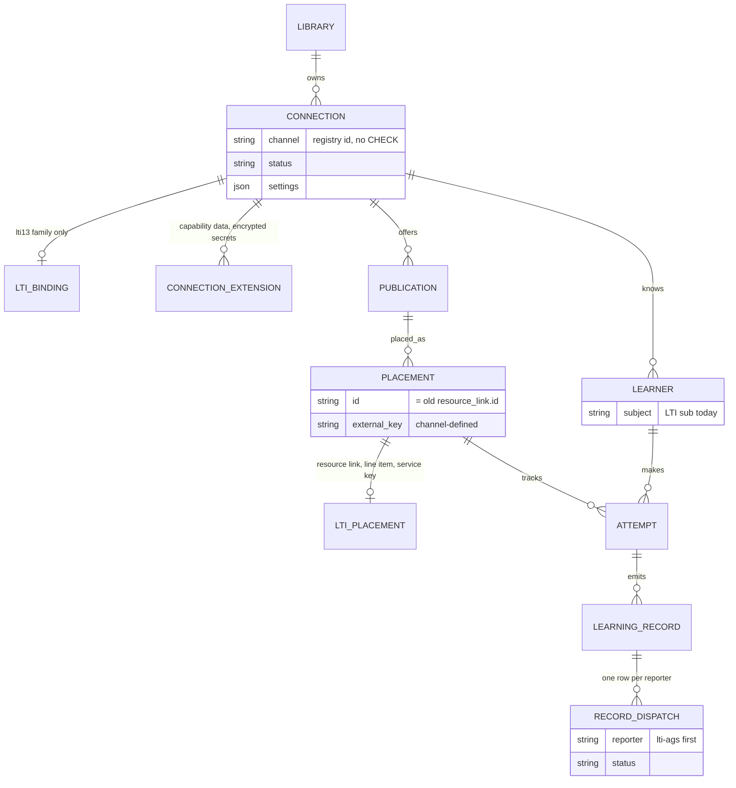

# LA-R3: Channel extensibility audit (code seam map)

Researcher R3, milestone LA, 2026-10-22. Audited tree: `9fcfd72` (product code equal to the baseline `00977f8`; `git diff --stat ee20314 HEAD -- services apps packages` is empty). Brief: `docs/team/ltiaas/briefs/LA-R3.md`.

## Summary

1. Product code outside the two adapter folders has **214 code lines in 60 files** that branch on an LMS name, an LMS type, a profile id or a Moodle/Canvas-only feature (§2.1). Another **145 lines in 19 files** tie core records to LTI resource links, line items, AGS or service keys.
2. I classified **89 seam sites**: 24 move into an adapter (A), 44 become a generic capability or registry lookup (B), 15 are core concepts that must become channel-neutral (C), 6 stay (D).
3. The 44 B sites collapse to **five generic traits**: binding authority (self or operator grant), sharing (exclusive or shared), capability guards, one channel registry, and profile flags. `lms === 'moodle'` almost always means "no operator grant"; `lms === 'blackboard'` almost always means "shared platform".
4. Dry run "add D2L Brightspace today": **36 files** change (7 new, 29 edited); 25 edited files are core files. Two items block: the SQLite `CHECK (lms IN (...))` on `connection` and the closed Zod enum that makes one unknown profile break `GET /api/providers` for every LMS.
5. ADR-011 §17 says a new LMS needs "a profile row and tests". The LTI service is close (launch checks read profile data), but it still has 4 closed LMS lists and no profile field for a custom token audience.
6. Dry run "add an SFTP CSV exporter": it **cannot plug in as a channel today**. It can only be bolted on like the `.mbz` export, as a course-level feature with no connection, schedule or credentials.
7. DataCamp patterns: 0 present, 6 partial; the catalog-sync half of pattern 5 is missing. The record pipeline exists, but only for AGS and keyed by LTI resource links.
8. Proposal (§6): one channel manifest plus 8 ports. Moodle, Canvas and Blackboard extras become named capabilities with optional adapter routes.
9. Data model (§7): `connection`, `resource_link`, `attempt`, `score_sync` and `gradebook_read` carry LTI or LMS-specific keys. Use an additive path: a `channel` column without CHECK, a `placement` table that keeps the `resource_link` ids, and a neutral record outbox beside `score_sync`.
10. Top recommendations (§8): a registry-driven LMS-name lint and a "new channel touches one folder" CI check in E1; fix the two blockers first; keep the API field names and log event names (`resourceLinkId`, `score_sync`) stable for the M1, M2 and T7 regressions.

## 1. Method and scope

- **Product code** = tracked files under `services/`, `apps/`, `packages/` with extensions `.ts .tsx .js .mjs .sql .json .css .html`. Excluded: `*.test.*`, `*.spec.*`, `evidence/`, `testkit.ts` (2 files), `apps/portal/scripts/multi-lms-smoke.mjs`, `apps/player-spike/**`, `package.json`, `tsconfig*.json`, and the two adapter folders of the brief (`services/cogniate-app/src/providers/**`, `services/lti-service/src/profiles/**`). Result: **213 files**.
- **Code lines** = lines that are not comments (`//`, `*`, `/*`, `--`) and not `import`/`export … from` lines or import blocks.
- Four grep patterns on code lines only (the file name is not part of the match):

| Id | Meaning | Extended regex (on the code text) |
| --- | --- | --- |
| P1 | LMS type literal | `(['"\x60])(moodle\|canvas\|blackboard\|blackboardlearn)(['"\x60])` |
| P2 | Profile id or product family branch | `startsWith\(['"](canvas\|blackboard)\|['"]standard['"]\|isStandardProfile\|lmsOfProfile\|lmsOfFamily\|lmsNameOfFamily\|profileOfFixedIssuer\|check14ProductFamily` |
| P3 | LMS-named capability or Moodle/Canvas-only feature | `canvasConfiguration\|courseShell\|webServices\|createMoodleCourse\|moodleWs\|MoodleWs\|[Mm]bz\|registerCanvas\|canvasEmbedded\|MOODLE_[A-Z_]+` |
| P4 | LTI-only concept (outside `services/lti-service`) | `resource_link\|resourceLink\|[Rr]esource link\|line_item\|lineItem\|[Ll]ine item\|\bags\b\|\bAGS\b\|service_key\|serviceKey\|[Ss]ervice key` |

- A grep finds text, not meaning. So I read every P1 and P2 hit and the P3 and P4 files, and I grouped them into seam sites (§2.3). I also searched by hand for closed display-name unions (`'Moodle' | 'Canvas' | 'Blackboard'`): **22 lines in 13 files** (P5, part of §2.3 rows).
- The draft plan says "28 product files outside the adapters name an LMS" (`docs/team/ltiaas/plan.md`, §2). I cannot reproduce 28; the plan gives no method (UNVERIFIED). My numbers: 109 of 213 files name an LMS anywhere (comments and texts included; 21 of them in the LTI service), 34 files have a P1 literal, 60 files have a P1–P3 code seam.

## 2. Seam map

### 2.1 Totals

| Pattern | Lines | Files |
| --- | --- | --- |
| P1 LMS type literal | 97 | 34 |
| P2 profile id or family | 24 | 15 |
| P3 LMS-named feature | 100 | 27 |
| **P1–P3 union** | **214** | **60** (portal 20, cogniate-app 30, lti-service 9, packages 1) |
| P4 LTI concept outside the LTI service | 145 | 19 |
| P4 inside the LTI service (expected: it is the LTI engine) | 130 | 24 |
| P5 closed display-name union or "Moodle" default | 22 | 13 |

### 2.2 Count per file

Prefixes: `app/` = `services/cogniate-app/src/`, `lti/` = `services/lti-service/src/`, `portal/` = `apps/portal/src/`, `pkg/` = `packages/`. Sum = P1+P2+P3+P4. Totals: P1 97, P2 24, P3 100, P4 145, sum 366 (a line can match two patterns).

| File | P1 | P2 | P3 | P4 | Sum |
| --- | --- | --- | --- | --- | --- |
| `app/app/api-errors.ts` | 0 | 0 | 1 | 0 | 1 |
| `app/app/binding-cleanup.ts` | 9 | 0 | 0 | 0 | 9 |
| `app/app/binding-targets.ts` | 3 | 0 | 0 | 0 | 3 |
| `app/app/canvas-configuration.ts` | 1 | 0 | 2 | 4 | 7 |
| `app/app/canvas-deployments.ts` | 1 | 0 | 1 | 0 | 2 |
| `app/app/connections.ts` | 13 | 1 | 1 | 0 | 15 |
| `app/app/courses.ts` | 0 | 0 | 5 | 0 | 5 |
| `app/app/mbz.ts` | 0 | 0 | 11 | 0 | 11 |
| `app/app/operator.ts` | 7 | 0 | 0 | 0 | 7 |
| `app/app/publications.ts` | 0 | 0 | 10 | 0 | 10 |
| `app/app/redemption.ts` | 1 | 0 | 0 | 0 | 1 |
| `app/app/results.ts` | 1 | 0 | 0 | 7 | 8 |
| `app/app/server.ts` | 0 | 0 | 6 | 0 | 6 |
| `app/app/web-services.ts` | 0 | 0 | 6 | 0 | 6 |
| `app/clients/lti-client.ts` | 1 | 1 | 0 | 13 | 15 |
| `app/clients/moodle-ws.ts` | 0 | 0 | 10 | 0 | 10 |
| `app/domain/attempts.ts` | 2 | 0 | 0 | 20 | 22 |
| `app/domain/connections.ts` | 8 | 2 | 3 | 0 | 13 |
| `app/domain/launch.ts` | 0 | 0 | 0 | 15 | 15 |
| `app/domain/mbz-builds.ts` | 0 | 0 | 12 | 0 | 12 |
| `app/domain/migrations/004_launch.sql` | 0 | 0 | 0 | 9 | 9 |
| `app/domain/migrations/005_runtime_and_score_sync.sql` | 0 | 0 | 0 | 3 | 3 |
| `app/domain/migrations/007_resend_and_gradebook.sql` | 0 | 0 | 0 | 2 | 2 |
| `app/domain/migrations/009_native_channel.sql` | 0 | 0 | 2 | 0 | 2 |
| `app/domain/migrations/011_lms_types.sql` | 1 | 1 | 0 | 0 | 2 |
| `app/domain/pickers.ts` | 0 | 0 | 0 | 4 | 4 |
| `app/domain/publications.ts` | 2 | 0 | 0 | 0 | 2 |
| `app/domain/results.ts` | 0 | 0 | 0 | 9 | 9 |
| `app/domain/retention.ts` | 0 | 0 | 0 | 1 | 1 |
| `app/domain/score-syncs.ts` | 1 | 0 | 0 | 34 | 35 |
| `app/main.ts` | 0 | 0 | 1 | 0 | 1 |
| `app/tool-pages/canvas-embedded.ts` | 0 | 0 | 1 | 0 | 1 |
| `app/tool-pages/launch.ts` | 0 | 3 | 0 | 8 | 11 |
| `app/tool-pages/picker.ts` | 2 | 0 | 0 | 1 | 3 |
| `app/tool-pages/play.ts` | 1 | 0 | 1 | 1 | 3 |
| `app/tool-pages/register-texts.ts` | 0 | 0 | 2 | 0 | 2 |
| `app/tool-pages/register.ts` | 0 | 0 | 2 | 0 | 2 |
| `app/worker/line-item.ts` | 0 | 0 | 0 | 5 | 5 |
| `app/worker/score-sync.ts` | 0 | 0 | 0 | 7 | 7 |
| `lti/cli/register-platform.ts` | 0 | 1 | 0 | 0 | 1 |
| `lti/db/migrations/004_provider_profiles.sql` | 0 | 1 | 0 | 0 | 1 |
| `lti/http/routes/platforms.ts` | 0 | 6 | 0 | 0 | 6 |
| `lti/http/routes/registration.ts` | 0 | 1 | 0 | 0 | 1 |
| `lti/http/service-context.ts` | 0 | 1 | 0 | 0 | 1 |
| `lti/lti/checks.ts` | 3 | 1 | 0 | 0 | 4 |
| `lti/lti/launch.ts` | 0 | 2 | 0 | 0 | 2 |
| `lti/lti/login.ts` | 0 | 1 | 0 | 0 | 1 |
| `lti/store/platforms.ts` | 0 | 1 | 0 | 0 | 1 |
| `pkg/shared/src/config.ts` | 1 | 0 | 1 | 0 | 2 |
| `portal/App.tsx` | 4 | 0 | 0 | 0 | 4 |
| `portal/Integrations.tsx` | 2 | 0 | 0 | 0 | 2 |
| `portal/api.ts` | 0 | 0 | 1 | 0 | 1 |
| `portal/connect/Connect.tsx` | 3 | 0 | 0 | 0 | 3 |
| `portal/connect/ConnectionSetup.tsx` | 6 | 0 | 1 | 0 | 7 |
| `portal/connect/ConnectionStatus.tsx` | 3 | 0 | 0 | 0 | 3 |
| `portal/connect/DisconnectDialog.tsx` | 3 | 0 | 0 | 0 | 3 |
| `portal/connect/ProviderSetup.tsx` | 1 | 0 | 0 | 0 | 1 |
| `portal/connect/WebServices.tsx` | 0 | 0 | 2 | 0 | 2 |
| `portal/connect/blackboard/BlackboardCreate.tsx` | 1 | 0 | 0 | 0 | 1 |
| `portal/connect/canvas/CanvasConfiguration.tsx` | 0 | 0 | 1 | 0 | 1 |
| `portal/connect/canvas/CanvasCreate.tsx` | 1 | 0 | 0 | 0 | 1 |
| `portal/connect/wizard-types.ts` | 1 | 0 | 0 | 0 | 1 |
| `portal/courses/MoodleBackup.tsx` | 0 | 0 | 9 | 0 | 9 |
| `portal/courses/Publications.tsx` | 3 | 0 | 0 | 0 | 3 |
| `portal/courses/PublishDialog.tsx` | 1 | 0 | 2 | 0 | 3 |
| `portal/lms.ts` | 1 | 0 | 0 | 0 | 1 |
| `portal/results/Results.tsx` | 2 | 0 | 0 | 1 | 3 |
| `portal/types.ts` | 4 | 1 | 5 | 1 | 11 |
| `portal/ui.tsx` | 3 | 0 | 1 | 0 | 4 |

P5 files not in this table: `app/content-host/server.ts`, `lti/http/error-page.ts`, `lti/lti/codes.ts`, `pkg/tracking/src/status-text.ts`, `apps/player/src/lms-name.ts`, `apps/player/src/shell/main.ts`, `portal/IntegrationLogo.tsx`. The adapter registries also hold closed lists (outside the count, as the brief asks): `app/providers/types.ts:12-16`, `app/providers/index.ts:13-39`, `lti/profiles/types.ts:5`, `lti/profiles/index.ts:27-30,96-107`.

### 2.3 Seam table

Classes: **A** move into the adapter; **B** make a generic capability, trait or registry lookup; **C** core concept that must become channel-neutral; **D** keep.

**Cogniate app: connections, bindings, operator (core of the LTI family)**

| # | file:line | What it does | Class | Note |
| --- | --- | --- | --- | --- |
| S1 | `app/app/connections.ts:62,87` | DTO lists only approved deployment ids when `lms !== 'moodle'` | B | Means "binding authority = operator grant". |
| S2 | `app/app/connections.ts:132` | `lmsOfRow`: a profile with `lms: null` is Moodle | C | "standard profile = Moodle" blocks a generic LTI 1.3 channel. |
| S3 | `app/app/connections.ts:190-206` | Create: default `moodle`; Moodle path reads no providers, refuses every profile but `standard` | A | Moodle create rules into the Moodle adapter. |
| S4 | `app/app/connections.ts:220-223` | Blackboard: refuse create without an active shared platform | B | Means `sharing === 'shared'` (already profile data, `app/clients/lti-client.ts:57`). |
| S5 | `app/app/connections.ts:235` | Registration URL only for a pending dynamic Moodle connection | B | Capability `dynamicRegistration`. |
| S6 | `app/app/connections.ts:247-252,260` | Tool rows and body parser: Moodle rows; Blackboard gets the shared client id | B | Sharing gives the adapter its context. |
| S7 | `app/app/connections.ts:267-317` | `PUT …/platform`: Moodle six-value path vs grant path; Moodle-only error texts | A | Six-value parser and texts into the Moodle adapter. |
| S8 | `app/app/connections.ts:321-326` | Disconnect: Moodle unconditional switch-off vs fenced cleanup | B | Binding authority. |
| S9 | `app/app/binding-cleanup.ts:53` | Attempt record: Blackboard → deployment, else platform | B | Derive from the saved target kind. |
| S10 | `app/app/binding-cleanup.ts:61-65` | Fence records: Canvas platform; Blackboard reservation | B | A 4th exclusive LMS does not add its own platform here (inferred: attempts still list it). |
| S11 | `app/app/binding-cleanup.ts:125-135,197-201,233` | Moodle: unconditional fence, release and delete (no refs) | B | Binding authority `self`. |
| S12 | `app/app/binding-cleanup.ts:151-153` | Revoke cleanup: Canvas `initial` → platform record, else deployment | B | A 4th exclusive LMS gets the wrong record kind (inferred). |
| S13 | `app/app/binding-cleanup.ts:219` | Release keeps a Blackboard deployment inactive | B | Sharing. |
| S14 | `app/app/binding-targets.ts:44-46` | Snapshot: Blackboard → shared ids, else the Canvas issuer rule | B | Sharing. |
| S15 | `app/app/binding-targets.ts:100,109` | Target: refuses Moodle; shared platform only for Blackboard | B | Binding authority and sharing. |
| S16 | `app/app/operator.ts:66` | `app:grant issue` only for `canvas` or `blackboard` | B | A 4th LMS can never get a grant. |
| S17 | `app/app/operator.ts:68-74` | `add_deployment` and `--service-url` only for Canvas | B | Capability `addDeployment`; adapter flag `acceptsServiceUrl` exists (`app/providers/types.ts:147`). |
| S18 | `app/app/operator.ts:86-95` | Canvas issuer check; Blackboard shared readiness | B | A 4th LMS skips the issuer check (inferred gap). |
| S19 | `app/app/operator.ts:148-152,165-167` | Binding text and suspend logs per LMS | B | Binding authority and sharing. |
| S20 | `app/app/redemption.ts:77` | Finalized repeat: Blackboard ignores the client id | B | Target kind `shared_deployment`. The rest of the engine already branches on target kind (`redemption.ts:116-411`). |
| S21 | `app/app/redemption.ts:190` | Canvas "developer key" text inside the engine | A | Adapter text. |
| S22 | `app/app/canvas-configuration.ts:17` | Canvas JSON route; guard by LMS name | A | Route belongs to the Canvas adapter; guard on capability. |
| S23 | `app/app/canvas-deployments.ts:16` | Add-deployment route; guard by LMS name | B | Guard on `addDeployment`. |
| S24 | `app/app/server.ts:157-166` | Core server mounts Canvas routes, Moodle WS and `.mbz` routes | A | Adapter route hook. |
| S25 | `app/app/portal.ts:29-30` | Portal route allowlist names each LMS | B | `/integrations/:channel/…` against the registry. |
| S31 | `app/app/api-errors.ts:25,42-45` | Moodle and Blackboard texts in the core error table | A | Adapter texts. |
| S32 | `app/clients/lti-client.ts:55` | Zod `lms: z.enum(['canvas','blackboard'])` for `GET /api/providers` | B | One unknown LMS fails the whole answer: `INVALID_LTI_ANSWER` at `:219`. |
| S33 | `app/clients/lti-client.ts` (13 P4 lines) | AGS and line-item client calls | D | The LTI channel client. |
| S35 | `app/domain/connections.ts:18` | Second closed `LmsType` | C | One registry type. |
| S36 | `app/domain/connections.ts:80-84` | Complete snapshot per LMS | B | A 4th LMS gets `null` → `PROVIDER_NOT_READY`. |
| S37 | `app/domain/connections.ts:189` | Moodle launch routing: `lms = 'moodle'` | C | Routing keyed on an LMS name. |
| S38 | `app/domain/connections.ts:204-211` | Approval routing: `lms IN ('canvas','blackboard')` | C | A 4th LMS routes nowhere → `unknown_platform`. |
| S39 | `app/domain/connections.ts:110,240-250` | WS token columns on `connection` | A | Extension data. |
| S48 | `app/domain/migrations/011_lms_types.sql:4` | `CHECK (lms IN ('moodle','canvas','blackboard'))` | C | Blocks a 4th LMS without a table rebuild (§7.3). |

**Cogniate app: Moodle-only features**

| # | file:line | What it does | Class | Note |
| --- | --- | --- | --- | --- |
| S26 | `app/app/publications.ts:43,56-96` | `createMoodleCourse` on publish through Moodle WS | A | The guard already uses `courseShell` (`:86`). Move the hook. |
| S27 | `app/app/web-services.ts:26-40` | WS token route; guard on `webServices` | A | Moodle adapter route. |
| S28 | `app/app/mbz.ts`, `app/domain/mbz-builds.ts`, `app/app/courses.ts:85-98` | `.mbz` build and download | A | A package exporter; ADR-011 §11 calls it a course-version feature. |
| S34 | `app/clients/moodle-ws.ts`, `app/main.ts:44` | Moodle WS client and wiring | A | Moodle adapter. |
| S45 | `app/domain/publications.ts:19-28,40-43,83-86` | Moodle shell fields; closed LMS union | A | Extension data. |
| S50 | `app/domain/migrations/009_native_channel.sql` | `mbz_build`, `ws_*`, `moodle_course_*` | A | §7. |
| S57 | `app/tool-pages/register.ts`, `register-texts.ts:18` | Moodle Dynamic Registration pages | A | DR UI per platform. |

**Cogniate app: launch, records, results (core concepts)**

| # | file:line | What it does | Class | Note |
| --- | --- | --- | --- | --- |
| S29 | `app/app/results.ts:41-60` | "Refresh from Moodle": AGS results read | C | Read-back belongs to the AGS reporter. |
| S30 | `app/app/results.ts:47` | No refresh for a disabled non-Moodle connection | B | Binding authority. |
| S40 | `app/domain/score-syncs.ts:29` | Disabled rule `lms IN ('canvas','blackboard')` | B | Binding authority. |
| S41 | `app/domain/score-syncs.ts` (34 P4 lines) | Outbox rows join `resource_link`, line item, service key | C | Neutral dispatch outbox. |
| S42 | `app/domain/attempts.ts:94-100,152` | LMS name map and closed unions | B | A 4th LMS shows "Moodle". |
| S43 | `app/domain/attempts.ts:45-56,289-299` | Attempt keyed by `resource_link_id`; sync row holds the AGS body | C | Placement, learner, neutral record. |
| S44 | `app/domain/launch.ts:35-87` | Resource link upsert with line item and service key | C | Placement plus an LTI extension row. |
| S46 | `app/domain/results.ts:26-31,55-59,64-79` | Results by resource link; host fallback "Moodle"; gradebook diff | C | |
| S47 | `app/domain/pickers.ts` (4 P4 lines) | Pick → resource link | D | LTI Deep Linking. |
| S49 | `app/domain/migrations/004,005,007` | `resource_link`, `attempt`, `score_sync`, `gradebook_read` | C | §7. |
| S51 | `app/tool-pages/launch.ts:62,89-91` | LMS check: `lmsOfProfile` prefix rule and `lmsOfFamily` | B | Today a `d2l-*` profile maps to `moodle` (`app/providers/index.ts:23-27`). |
| S52 | `app/tool-pages/launch.ts:146-185` | LTI launch → resource link → attempt | C | The LTI handler writes core records with LTI keys. |
| S53 | `app/tool-pages/picker.ts:149` | `window` hint for every non-Moodle LMS | B | Profile flag. |
| S54 | `app/tool-pages/picker.ts:60-70` | Deep Linking item with `lineItem` | D | LTI mapper. |
| S55 | `app/tool-pages/play.ts:108`, `canvas-embedded.ts` | Canvas top-level continuation script | B | Profile flag. |
| S56 | `app/tool-pages/play.ts:42`, `app/content-host/server.ts:180`, `app/domain/results.ts:55-59` | "Moodle" fixed in texts | B | Registry name or neutral text. |
| S58 | `app/worker/score-sync.ts:46-79`, `app/worker/line-item.ts` | AGS sender; "Moodle has a grade with a newer time" | C | Reporter port. |

**Packages, player and LTI service**

| # | file:line | What it does | Class | Note |
| --- | --- | --- | --- | --- |
| S59 | `pkg/tracking/src/outcome.ts:37-55` | `AgsScore` and the AGS body in the tracking core | C | Neutral score; AGS mapping in the reporter. |
| S60 | `pkg/tracking/src/status-text.ts:19` | Closed display-name union, default Moodle | B | |
| S61 | `pkg/shared/src/html.ts:8-12` | Moodle pending-tool text | A | |
| S62 | `pkg/shared/src/config.ts:18,43` | `PUBLIC_MOODLE_URL` | D | Dev stack. |
| S63 | `apps/player/src/lms-name.ts:2-4`, `apps/player/src/shell/main.ts:10` | Closed name union; unknown → "Moodle" | B | |
| S64 | `lti/lti/checks.ts:246-250` | Check 14 knows two families only | B | `productFamily` is already profile data (`lti/profiles/types.ts:45`). |
| S65 | `lti/lti/launch.ts:66,107-110` | Default "Moodle"; refused family → LMS name | B | |
| S66 | `lti/lti/login.ts:22-26`, `lti/http/error-page.ts:22`, `lti/lti/codes.ts:39-45,52,65` | "Moodle" default texts | B | |
| S67 | `lti/http/routes/registration.ts:31-48,129-133` | DR pages speak Moodle; DR refuses Canvas and Blackboard families | A | DR works for `standard` only. |
| S68 | `lti/http/routes/platforms.ts:102,165,172-177,245`, `lti/http/service-context.ts:40` | Branch on the `standard` id | B | Trait "admin-value endpoints". |
| S69 | `lti/platform/token-client.ts:36` | Client-assertion `aud` = token URL, or an array by flag | B | No profile field for a custom audience. |
| S70 | `lti/store/platforms.ts:98`, `lti/cli/register-platform.ts:38`, `lti/db/migrations/004_provider_profiles.sql:4` | Default profile `standard` | D | |

**Portal (`apps/portal`)**

| # | file:line | What it does | Class | Note |
| --- | --- | --- | --- | --- |
| S71 | `portal/App.tsx:123-131` | One route pair per LMS | B | |
| S72 | `portal/Integrations.tsx:31-50` | Static card list | B | Cards from the registry. |
| S73 | `portal/Integrations.tsx:157-158` | Ready rule: Moodle always; Blackboard not-ready text | B | |
| S74 | `portal/lms.ts:3-12` | Names, `isLms`, Blackboard text | B | |
| S75 | `portal/types.ts:2-10,29-31` | Closed `Lms`; LMS-named capabilities; create-body union | C | The browser DTO copies the closed lists. |
| S76 | `portal/connect/Connect.tsx:39,52` | Logo mark ternary (every non-Canvas → "Bb"); Moodle create vs wizard | B | |
| S77 | `portal/connect/wizard-types.ts:4`, `portal/connect/wizards.ts:7-10` | Wizard registry for approval LMSs (closed type) | B | The best portal seam today; widen it to every channel. |
| S78 | `portal/connect/ConnectionSetup.tsx:55-91` | Moodle sections; Canvas add-deployment | A | |
| S79 | `portal/connect/ConnectionStatus.tsx:26,71,90` | Canvas service URL; Moodle activation hint and link | A | |
| S80 | `portal/connect/DisconnectDialog.tsx:11,38-42` | Per-LMS text; unknown → Moodle text | A | |
| S81 | `portal/connect/ProviderSetup.tsx:25` | Not-ready text: Blackboard, else Canvas | B | |
| S82 | `portal/connect/{CreateConnection,DynamicSetup,ManualSetup,MoodleSteps,WebServices}.tsx`, `moodle-steps.json` | Moodle wizard in the shared folder | A | |
| S83 | `portal/courses/Publications.tsx:88-94,183` | Moodle teacher steps and course panel; closed `TeacherSteps` type | A | |
| S84 | `portal/courses/PublishDialog.tsx:36,53` | Course shell needs `lms === "moodle"` and `courseShell` | B | Drop the name check. |
| S85 | `portal/courses/{MoodleBackup,MoodleCourse,CoursePackage}.tsx` | `.mbz` and Moodle course panels | A | |
| S86 | `portal/results/Results.tsx:59,182,209-216` | Name default `moodle` | B | |
| S87 | `portal/ui.tsx:57-73` | Moodle error and status texts | A | |
| S88 | `portal/api.ts:69` | `canvasConfiguration` call | A | |
| S89 | `portal/connect/canvas/**`, `portal/connect/blackboard/**` | Per-LMS UI folders | D | Already adapter-shaped. |

### 2.4 Class totals and what the B class really means

| Class | Sites |
| --- | --- |
| A move into the adapter | 24 |
| B generic capability, trait or registry | 44 |
| C channel-neutral core concept | 15 |
| D keep | 6 |
| **Total** | **89** |

| Generic trait behind the B sites | Sites | Today it is spelled |
| --- | --- | --- |
| Binding authority: `self` vs `operatorGrant` | 8 (S1, S8, S11, S15, S16, S19, S30, S40) | `lms === 'moodle'` / `lms !== 'moodle'` / `IN ('canvas','blackboard')` |
| Sharing and target kind: `exclusive` vs `shared` | 10 (S4, S6, S9, S10, S12, S13, S14, S18, S20, S36) | `lms === 'blackboard'` / `lms === 'canvas'` |
| Capability guard written as an LMS check | 4 (S5, S17, S23, S84) | `lms === 'canvas'`, `lms === 'moodle' && …` |
| One channel registry (names, routes, types, cards, parsing) | 17 (S25, S32, S42, S51, S56, S60, S63, S65, S66, S71–S74, S76, S77, S81, S86) | closed unions and maps in 13+ places |
| Profile data or flag | 5 (S53, S55, S64, S68, S69) | `lms !== 'moodle'`, `lms === 'canvas'`, `id === 'standard'`, two hard-coded families |

Good news: the generic shapes already exist. The redemption engine branches on target kind (`app/app/redemption.ts:116-411`). Profiles carry `sharing`, `productFamily` and flags (`lti/profiles/types.ts:24-51`). The adapter interface exists (`app/providers/types.ts:136-160`). The portal has a wizard module type (`portal/connect/wizard-types.ts:20-24`). The work is to route the core through these shapes instead of through LMS names.

## 3. Dry run A: add D2L Brightspace as a 4th LTI LMS today

**Brightspace facts** (outside world):

| Fact | Source |
| --- | --- |
| The admin registers a tool under Manage Extensibility → LTI Advantage; Dynamic or Standard registration; registration and deployment are separate steps | D2L KB "Register an external learning tool for LTI Advantage", https://community.d2l.com/brightspace/kb/articles/23662-tool-registration-deployment-and-links (search summary; the page body did not load, so details are UNVERIFIED) |
| Issuer `https://<host>.brightspace.com`; auth `…/d2l/lti/authenticate`; JWKS `…/d2l/.well-known/jwks`; token `https://auth.brightspace.com/core/connect/token`; custom audience `https://api.brightspace.com/auth/token` with "Enable Custom Aud" | Skillable vendor guide, https://docs.skillable.com/docs/d2l-brightspace-lti-integration.md (third party; UNVERIFIED for every tenant) |
| Signed `tool_platform.product_family_code` value | UNVERIFIED (no public source found; `desire2learn` is a guess) |

Consequence for today: Brightspace cannot connect even as a "Moodle" (`standard`) platform. The token URL is not on the issuer origin, and both standard paths refuse that: manual (`lti/lti/platform-rules.ts:28-35`, called at `lti/http/routes/platforms.ts:96`; app side `app/app/connections.ts:141-149`) and dynamic (`lti/lti/registration.ts:55-68`) (inferred from the third-party URLs).

**Files that would change** (`must` = needed for a working, safe connection; `should` = text or protection parity):

| # | File | Change | Reason | Need |
| --- | --- | --- | --- | --- |
| D1 | `lti/profiles/d2l.ts` (new) | Profiles `d2l-brightspace` and `d2l-sim` | Issuer and endpoints from the profile (ADR-011 D2) | must |
| D2 | `lti/profiles/types.ts:5,13-22` | Add `'d2l'` to `ProfileLms`; add a token-audience field | Closed union; no audience field | must |
| D3 | `lti/profiles/index.ts:5-7,27-30,96-107` | Import, order, `LmsName`, `lmsNameOf`, `lmsNameOfFamily` | Closed registry lists | must |
| D4 | `lti/platform/token-client.ts:36` | Use the profile audience in the client assertion | Custom aud (Skillable guide) | must, if the fact holds |
| D5 | `lti/lti/checks.ts:246-250` | Add the D2L family to check 14 | Else a `standard` platform can take D2L-signed launches | should (family UNVERIFIED) |
| D6 | `lti/lti/codes.ts:45`, `lti/http/routes/registration.ts:41` | "Canvas or Blackboard" texts | Text | should (2 files) |
| D7 | `app/providers/d2l.ts` (new) | Adapter: tool rows, strict body, target, staged create | ADR-011 §7 pattern | must |
| D8 | `app/providers/types.ts:12-16` | `LmsType`, `LMS_TYPES`, `LmsName` | Closed unions | must |
| D9 | `app/providers/index.ts:13-15,23-39` | Registry list, `lmsOfProfile` prefix, names, `lmsOfFamily` | Else `d2l-*` → `moodle`, and every launch fails `lms_mismatch` (`app/tool-pages/launch.ts:90`) | must |
| D10 | `app/domain/migrations/013_*.sql` (new) | Allow `lms = 'd2l'` | `CHECK` at `011_lms_types.sql:4`; SQLite cannot alter a CHECK; ADR-011 §1 fact 4 forbids a rebuild | **must, blocked** |
| D11 | `app/domain/connections.ts:18,80-84,204-211` | Type, complete snapshot, approval routing | Else `PROVIDER_NOT_READY` and `unknown_platform` | must |
| D12 | `app/clients/lti-client.ts:55` | Widen the Zod enum | Else one D2L profile breaks `GET /api/providers` for Canvas and Blackboard too (`:219`) | **must, ship before D1** |
| D13 | `app/app/operator.ts:66,86` | Grant for D2L; issuer check | Else no grant can be issued | must |
| D14 | `app/app/binding-cleanup.ts:61,151` | Fence and revoke-cleanup record kind | Else the wrong record kind (inferred) | must |
| D15 | `app/domain/score-syncs.ts:29` | Disabled rule | Else a disabled D2L connection keeps sending | must |
| D16 | `app/domain/attempts.ts:94-100,152` | Names | Else learners read "Moodle" | must |
| D17 | `app/domain/publications.ts:28` | Type only (a cast hides it) | Type hygiene | should |
| D18 | `app/app/portal.ts:29-30` | Route allowlist | Else a page reload gives 404 | must |
| D19 | `pkg/tracking/src/status-text.ts:19` | Name type | Compile error after D16 | must |
| D20 | `apps/player/src/lms-name.ts:2-4` | Accept the new name | Else "Moodle" in the player | must |
| D21 | `apps/player/src/shell/main.ts:10` | Name type | Compile | must |
| D22 | `portal/types.ts:2,29-31` | `Lms`, create-body union | Closed | must |
| D23 | `portal/lms.ts:3-10` | Names, `isLms` | Closed | must |
| D24 | `portal/App.tsx:123-131` | Two routes | Static routes | must |
| D25 | `portal/Integrations.tsx:31-50,157` | Card and ready rule | Static list | must |
| D26 | `portal/connect/wizard-types.ts:4` | `ApprovalLms` | Closed | must |
| D27 | `portal/connect/wizards.ts:7-10` | Register the module | Static wiring | must |
| D28 | `portal/connect/d2l/` (new, about 4 files like `connect/canvas/`) | Wizard, create, binding, steps JSON | UI | must |
| D29 | `portal/connect/Connect.tsx:39` | Logo mark (else "Bb") | Text | should |
| D30 | `portal/connect/DisconnectDialog.tsx:38-42` | Text (else the Moodle text) | Text | should |
| D31 | `portal/connect/ProviderSetup.tsx:25` | Text (else the Canvas text) | Text | should |
| D32 | `portal/courses/Publications.tsx:183` | `TeacherSteps` type | Compile | must |

Count: **36 product files** = 7 new (D1, D7, D10, about 4 in D28) + 29 edited. 4 edited files are adapter registries (`lti/profiles/{types,index}.ts`, `app/providers/{types,index}.ts`); **25 are core files**. 22 edits are `must`, 7 are `should`. Outside product code: an ADR-011 §6 revision ("A change to a profile is an architecture change", ADR-011 line 203), app contract §4.2–§4.3 and LTI contract §9.3 (the `lms` value lists), a D2L simulator in `tests/sim/**`, acceptance tests and a guide.

**Dynamic Registration:** D2L supports it (KB above). Today DR is `standard`-only and Moodle-worded (S57, S67), and the same-origin rule refuses Brightspace. A D2L DR path is the same work as follow-up D-1 (Canvas DR with profile-based checks).

## 4. Dry run B: add a non-LTI channel (SFTP CSV catalog exporter)

It **cannot plug in as a channel today**. Every channel entry point assumes LTI:

| Entry point | Why an SFTP exporter does not fit | Evidence |
| --- | --- | --- |
| Connection | `lms` CHECK; `method IN ('dynamic','manual')`; `site_url NOT NULL` with https-origin rules; status `registered → connected` on the first launch | `011_lms_types.sql:4`, `002_connections.sql:6-8`, `app/app/connections.ts:191-218`, data-model §3 |
| Adapter interface | `BindingTarget` = issuer, client id, deployment; tool rows; strict platform body | `app/providers/types.ts:85-99,136-160` |
| Records back | The worker needs a service key and a line item; it posts AGS only | `app/worker/score-sync.ts:61-73` |
| Catalog out | No catalog API; a publication needs a connection FK | `002_connections.sql:20-29` |
| Background jobs | One interval timer, for score sync only | `app/worker/score-sync.ts:133` |
| Credentials | Only ad-hoc encrypted columns (`ws_token_encrypted`) | `009_native_channel.sql:18` |
| Outbound | HTTPS guarded client only; no SFTP client | `pkg/shared/src/outbound.ts` |

The only place it could go today is a bolt-on like the `.mbz` "native channel" (ADR-007): a library-level build and download with no connection, no schedule, no delivery and no credentials (`app/app/mbz.ts`, `009_native_channel.sql:2-15`). That would add more channel logic to core. So LA must leave the ports of §6 (catalog exporter, scheduler, secrets) even if LB builds the exporter.

## 5. DataCamp patterns vs current code

Patterns from `docs/research/ltiaas/inputs-datacamp.md` §3.

| # | Pattern | Status | Evidence |
| --- | --- | --- | --- |
| 1 | Core models in the middle: catalog item, learner identity, learning event | **Partial** | Catalog item: `course`, `course_version` (`001_init.sql:38-59`), but no catalog metadata (duration, thumbnail, type). Learner: only `attempt.user_sub`, the LTI `sub` per resource link (`004_launch.sql:45`); no learner model. Event: `attempt` + `score_sync`, but keyed by `resource_link_id` (`004_launch.sql:44`, `005_runtime_and_score_sync.sql:13`) with an AGS payload (`:15`). |
| 2 | A mapper at the edge of each channel | **Partial** | Adapters map setup data (`app/providers/types.ts:152-159`). The Deep Linking item mapper lives in core tool pages (`app/tool-pages/picker.ts:60-70`). `.mbz` is a Moodle mapper in core (`app/app/mbz.ts`). No catalog metadata mapper. |
| 3 | A channel is a set of capabilities | **Partial** | `Capabilities` has 6 booleans (`app/providers/types.ts:19-26`), "derived from the LMS type" (`:18`). Two have LMS names (`canvasConfiguration`, `webServices`). All are setup features; none says catalog out, launch, records back or identity. The core often ignores them (§2.4: 4 guards are LMS checks). |
| 4 | Settings for each connection; more than one connection per customer | **Partial** | Many connections per library: non-unique `connection_library` index (`002_connections.sql:18`) and "Connect another site" (`portal/Integrations.tsx:219-226`). Settings are fixed columns (`002`, `009:18-20`, `011:4-9`, `012:5-7`). No generic settings (completions on or off, identifier type, frequency). |
| 5 | Two background pipelines: catalog sync and record dispatch | **Partial / missing** | Record dispatch exists with retry and delivery recovery, but only for AGS (`app/worker/score-sync.ts`, data-model §3 retry list, `010_score_delivery_confirmation.sql`). No outbox abstraction, one hard-wired reporter. Catalog sync: **missing** (teachers pull through Deep Linking only). |
| 6 | The same onboarding shape: show our values, collect theirs, verify, enable | **Partial** | Show: `GET …/tool-configuration` from `adapter.toolConfiguration` (`app/app/connections.ts:244-254`) and the Canvas JSON. Collect: `parsePlatformBody`. Verify: grant redemption (`app/app/redemption.ts`) and the first launch (`registered → connected`). The portal has two shapes: the Moodle flow (S82) and wizard modules (`portal/connect/wizard-types.ts:6-24`). Not driven by data. |

Score: 0 present, 6 partial. The catalog-sync half of pattern 5 is missing.

## 6. Proposal: ports and a channel manifest

This is a proposal. The Architect decides (charter-LA §1).

### 6.1 Goal and shape

Goal: dry run A becomes "add `channels/d2l/` and nothing else". One folder must serve three deployables (LTI service, app, portal). The portal must not import service code (`portal/types.ts:1`). So I suggest a workspace package per channel with three entry points:

```
packages/channels/<id>/
  manifest.ts        pure data: ids, names, brand, capabilities, profiles, texts (portal + app + LTI read it)
  lti-profiles.ts    ProviderProfile rows (LTI service entry)
  app-adapter.ts     ConnectionSetup, optional routes and hooks (app entry)
  portal/            Wizard, TeacherSteps, extras panels, steps JSON (portal entry)
  sim/               simulator profile data for QA (optional)
```

The three registries load the folder list at build time (generated index or Vite `import.meta.glob`) (inferred option). A CI check fails when a change outside `packages/channels/<id>/` is needed (plan §4 measure 1).

### 6.2 Manifest (candidate shape)

```ts
interface ChannelManifest {
  id: string;                         // 'moodle' | 'canvas' | 'blackboard' | 'd2l' | 'lti-generic' | 'sftp-csv'
  family: 'lti13' | 'file-export' | 'vendor-api' | 'xapi' | 'catalog-pull';
  displayName: string;                // fills {LMS} in every text
  brand: { mark: string; color: string };
  lti?: {
    profiles: string[];               // owned profile ids; replaces the prefix rule (S51)
    productFamilies: string[];        // signed families for check 14 (S64)
  };
  capabilities: Capabilities;         // §6.3
  connection: { methods: ('dynamic' | 'manual')[]; fields: FieldSpec[] };   // what the portal collects
  onboarding: { show: string[]; collect: string[]; verify: 'firstLaunch' | 'operatorGrant' | 'testCall' };
  texts: { disconnect: string; notReady: string; teacherSteps: string[] };
}
```

### 6.3 Capabilities (generic names)

| Capability | Type | Replaces |
| --- | --- | --- |
| `registration.dynamic` | boolean, per profile | `dynamicRegistration`, `lms === 'moodle'` (S5) |
| `binding.authority` | `'self' \| 'operatorGrant'` | `lms === 'moodle'` / `IN ('canvas','blackboard')` (8 sites) |
| `platform.sharing` | from the profile: `'exclusive' \| 'shared'` | `lms === 'blackboard'` (10 sites) |
| `deployments.multiple` | boolean | `addDeployment`, `lms === 'canvas'` (S17, S23) |
| `setup.artifacts` | list of `{ id, mediaType, filename }` | `canvasConfiguration` (S22) |
| `site.serviceOrigin` | boolean | `acceptsServiceUrl`, `--service-url` Canvas check (S17) |
| `publish.hooks` | list, for example `courseShell` | `courseShell` + `lms === 'moodle'` (S26, S84) |
| `site.apiCredential` | `{ kind }`, for example Moodle WS token | `webServices`, `ws_*` columns (S27, S39) |
| `export.packages` | list of exporter ids, for example `moodle-mbz` | `.mbz` label and routes (S28, S85) |
| `launch.*` | profile flags `windowHint`, `topLevelContinue` | S53, S55 |
| `records.back` | list of reporter ids, for example `lti-ags` | hard-wired AGS worker (S58) |
| `catalog.out` | list of exporter ids (LB) | — |
| `identity` | `'lti-sub' \| 'email' \| 'saml-nameid'` (LD) | — |

### 6.4 Ports (candidate interfaces)

| Port | Owner | Responsibility | Today |
| --- | --- | --- | --- |
| P-1 `ChannelRegistry` | kernel | List and find manifests; map profile id and product family to a channel | `LMS_TYPES`, `lmsOfProfile`, 13+ closed lists |
| P-2 `ConnectionSetup` | adapter | Validate create input, tool rows, setup artifacts, strict binding body, binding target, staged create | `ProviderAdapter` (`app/providers/types.ts:136-160`): widen it, add Moodle's create and six-value parser |
| P-3 `BindingAuthority` | kernel strategies `self`, `operatorGrant` | Bind, fence, release, route; select by capability | redemption engine + cleanup, selected by LMS name |
| P-4 `LaunchRouter` | kernel (LTI family) | (platform, deployment) → connection through one binding table | `routeLaunch` SQL literals (S37, S38) |
| P-5 `PlacementResolver` | channel family | Turn launch context into a neutral placement key and an extension row | `upsertResourceLink` (S44) |
| P-6 `RecordReporter` | per reporter (`lti-ags` first) | `send(record) → result`, optional `readBack`; the kernel owns the outbox, retry and delivery state | AGS worker (S58), refresh (S29) |
| P-7 `CatalogExporter` (+ scheduler) | per exporter (LB) | Full or delta export on a schedule | missing |
| P-8 `PackageExporter` | per exporter | Course-version export (`moodle-mbz`, later thin SCORM in LE) | `.mbz` in core (S28) |
| P-9 `ChannelRoutes` | adapter, optional | Extra routes under `/app-api/connections/:id/ext/:capability`, guarded by capability | Canvas JSON, Canvas deployments, Moodle WS (S22-S24, S27) |
| P-10 `ChannelUiModule` | adapter (portal) | Wizard, teacher steps, extras panels | `ProviderWizardModule` (S77): widen to every channel, Moodle included |

The LTI service keeps `ProviderProfile` as its port. Add two data fields: `productFamily` use in check 14 for every profile (S64) and an optional `tokenAudience` template (S69). Replace `isStandardProfile` checks with an `endpoints: 'admin' | 'fixed'` trait (S68).

### 6.5 How the existing extras fit

| Extra | Today | As a capability | Owner after the move |
| --- | --- | --- | --- |
| Moodle Dynamic Registration | `standard` only; Moodle pages (S57, S67) | `registration.dynamic` per profile; the 1EdTech DR flow stays in the LTI kernel; texts from the manifest | LTI kernel + Moodle manifest (later D2L, Canvas D-1) |
| Moodle web-services course shell | publish hook and WS route in core (S26, S27, S34, S39) | `publish.hooks: ['courseShell']` + `site.apiCredential: moodle-ws` | Moodle adapter (P-9, hook) |
| Moodle `.mbz` | course routes and build tables in core (S28, S50) | `export.packages: ['moodle-mbz']`; the portal shows exporters that a connected channel lists | Moodle adapter (P-8) |
| Canvas developer-key JSON | core route with LMS guard (S22) | `setup.artifacts: [{ id: 'developer-key-json' }]` | Canvas adapter (P-9) |
| Canvas added deployment | Canvas-named route (S23) | `deployments.multiple` (engine purpose `add_deployment` exists) | kernel |
| Blackboard shared platform | `lms === 'blackboard'` (10 sites) | `platform.sharing` from the profile | kernel (LTI) |
| Operator approval grant | `lms !== 'moodle'` (8 sites) | `binding.authority: 'operatorGrant'`; a later self-service proof (D-3) is a third strategy | kernel |
| Canvas embedded continuation | `lms === 'canvas'` (S55) | profile flag `launch.topLevelContinue` | Canvas profile |

## 7. Data model

### 7.1 Channel specificity per table (Cogniate app)

| Table | Today | Channel-specific parts | Evidence |
| --- | --- | --- | --- |
| `connection` | Mixed | `lms` with CHECK; `lti_profile`, `lti_platform_id` (unique), `platform_json`, `ref_token_*` (Moodle DR), `service_url`, `lti_binding_ref`, `redeeming_*`, `target_*`, `ws_*` | `002:2-17`, `009:18-20`, `011:4-9`, `012:5-7` |
| `connection_deployment` | LTI, shared platform | reservation per (platform, deployment) | `011:13-23` |
| `binding_grant`, `binding_attempt`, `binding_ref_history`, `approved_deployment` | LTI binding authority | issuer, client id, deployment id, LTI platform id; `binding_grant.lms` | `011:25-87` |
| `publication` | Mostly neutral | `moodle_course_id`, `moodle_course_idnumber`, `shell_*` | `009:23-26` |
| `picker_session`, `handoff` | LTI Deep Linking | ltik, issuer origin, deployment, context | `004:4-7,26-40`, `011:11` |
| `resource_link` | LTI | the activity key, line item, service key | `004:9-24` |
| `attempt` | Core, LTI-bound | FK `resource_link_id`; `user_sub` = LTI `sub` | `004:42-57` |
| `play_session` | Neutral | `return_url` ("Back to Moodle") | `004:59-68` |
| `score_sync` | AGS | FK `resource_link_id`; AGS body; `conflict` = Moodle 409 | `005:10-28`, `007:3`, `010` |
| `gradebook_read` | AGS read-back | per resource link | `007:6-13` |
| `mbz_build` | Moodle export | course-version scope | `009:2-15` |

The LTI service tables (`platform`, `deployment`, `launch`, `service_key`, `oidc_state`, `registration_session`) are the LTI channel's own store. Keep them. `platform.profile` has no CHECK, so new profiles need no LTI migration (`004_provider_profiles.sql:4`).

### 7.2 Channel-neutral shape (candidate)



- `connection` keeps id, library, name, status, site URL and dates; it gets `channel` and `settings`. LTI fields stay where they are first, and later move to `lti_binding` 1:1.
- `placement` is the neutral activity. LTI keeps its keys in `lti_placement` (or in `resource_link` itself during the move).
- `learner` gives pattern 1 its identity model (LD later adds email or SAML ids).
- `learning_record` is the neutral event (outcome, score, completion). `record_dispatch` is the outbox per reporter. The AGS reporter builds its body at send time.

### 7.3 Migration risks

| Id | Risk | Detail | Suggested path |
| --- | --- | --- | --- |
| M-1 | The CHECK on `connection.lms` cannot change additively | SQLite has no `ALTER … CHECK`. The runner runs each file in one transaction with `foreign_keys = ON` (`pkg/shared/src/migrations.ts:2,21-22,76`), so the documented 12-step rebuild (foreign keys off) does not fit. 8 FKs reference `connection` (`002`, `004` ×2, `011` ×5). ADR-011 §1 fact 4 forbids a rebuild. | Add `channel TEXT` without CHECK; write `channel` (and `lms` only for the three old values); read `channel ?? lms`. Freeze `lms`. (inferred) |
| M-2 | Renaming `resource_link` breaks 4 FKs and API names | `picker_session`, `attempt`, `score_sync`, `gradebook_read` reference it (`004:38,44`, `005:13`, `007:7`). | Additive `placement` with `placement.id = resource_link.id`, so FKs and ids stay valid; no rename in LA. |
| M-3 | Score delivery state must survive | `send_started_at`, `delivery_uncertain`, `confirmation_after` protect against double sends (`010`, data-model §2). | Keep `score_sync` as the AGS reporter table; add the neutral record beside it; migrate with the worker stopped. |
| M-4 | Regression assertions read names | Tests read the API (`resourceLinkId`, `scoreSyncs`: `portal/types.ts:191,207`) and log events (`score_sync`, `resource_link_rebound`: `tests/acceptance/T5b/8-supersede.spec.ts:92`, `tests/acceptance/T4b2/3-rebind.spec.ts:52`). 0 test files run SQL on these app tables (`git grep`). | Keep API fields and log event names. Change tables freely behind the repository functions. |
| M-5 | Rollback | An old build refuses a newer migration ledger (ADR-011 §1 fact 4, §14). | Use the ADR-011 §14 backup and restore procedure; one migration per epic step. |
| M-6 | Learner identity and privacy | A `learner` table stores a stable per-connection subject. | Needs LA-H4 (Q3) before E4 design. |

## 8. Recommendations for the LA plan

1. **E1:** Make the channel registry the only list of channels (P-1). Replace the 13+ closed lists (§2.2 note, S35, S42, S60, S63, S74, S75) and the `lmsOfProfile` prefix rule (S51). Add a lint that refuses an LMS literal outside `packages/channels/**` and the registries. Baseline for the lint: 97 P1 lines in 34 files (§2.1).
2. **E1:** Replace the 8 binding-authority sites and the 10 sharing sites with `binding.authority` and `platform.sharing` (§2.4). Store the target kind on `binding_attempt` (S12). This removes most of the Canvas and Blackboard branches from the redemption, cleanup and operator code.
3. **E1 (first task):** Fix the two blockers of dry run A: the Zod enum (S32, D12) and the `connection.lms` CHECK through an additive `channel` column (M-1). Ship the app fix before any new LTI profile.
4. **E1:** Move the Moodle-only code (S3, S7, S26-S28, S34, S57, S82, S85, S87) into a Moodle adapter folder behind P-2, P-8, P-9 and P-10. The Moodle path is the largest remaining special case.
5. **E1 / E7:** Add the CI check of plan §4 measure 1 as "dry run A touches only `packages/channels/<id>/**`". Use this report's 36-file list as the failing baseline.
6. **E2:** Add `tokenAudience` and "family for every profile" (S64, S69) to the LTI profile data. Then a D2L profile is data only. Verify the Brightspace facts of §3 (token host, custom audience, product family) before E2 design; they are UNVERIFIED (LA-H6).
7. **E2 / E3 (D-1):** Make Dynamic Registration a per-profile capability with profile-based issuer and endpoint rules. Brightspace and Canvas both need it; today DR is `standard`-only and same-origin only (S67).
8. **E4:** Introduce `placement`, `learner`, `learning_record` and `record_dispatch` additively (§7.2, M-2, M-3). Make AGS the first `RecordReporter` (P-6) and move "Refresh from Moodle" into it (S29). Keep API and log names (M-4).
9. **E4 / LB:** Define the `CatalogExporter` port, a job scheduler and a secrets slot (`connection_extension`) now, so the SFTP exporter of dry run B is one folder in LB (§4). Do not build the exporter in LA.
10. **E1 / E6:** Drive the portal from the registry: one route pattern, cards from the registry, and the wizard module type for every channel, Moodle included (S71-S77). Use the onboarding shape "show, collect, verify, enable" (pattern 6) as the manifest's `onboarding` block.
11. **E8:** Base the "Add a new LTI channel" guide on the manifest of §6.2 and the dry-run table of §3. The guide is the test of plan §4 measure 5.
12. **LE:** Treat `.mbz` as the first `PackageExporter` (P-8); thin SCORM and cmi5 follow the same port.
13. **E3 (D-11):** Ungraded items need a record path without a line item. The neutral `learning_record` of recommendation 8 gives them a home; plan D-11 after E4's record model, or keep D-11 AGS-only.
