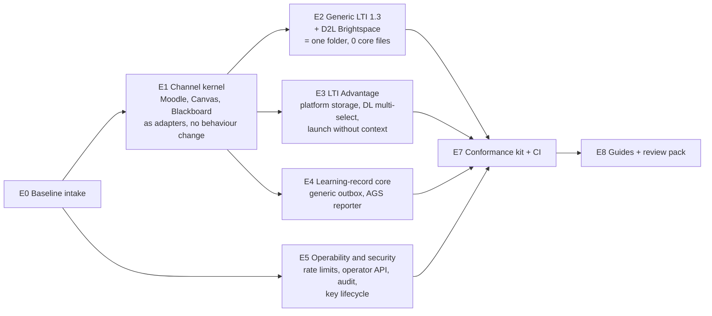

# G-DEV: decision pack for the product owner

Date: 2026-10-22. Lead. Milestone LA "LTI as a Service v1". Branch `quang/ltiaas-milestone` (local only, no push).

P1 Plan, P2 Tech design and P3 Breakdown are done and independently approved. The build (P4) starts only after you decide the items in §3.

## 1. What is ready

| Phase | Result | Evidence |
| --- | --- | --- |
| P1 Plan | 5 research reports; plan v1.2 with 17 Lead decisions (LD-1 to LD-17) | `docs/research/ltiaas/R1..R5`, `docs/team/ltiaas/plan.md` |
| P2 Tech design | 8 ADRs (LA-ADR-01 to 08), 2 contract deltas, data model, operability, security; test strategy | `docs/architecture/ltiaas/`, `tests/ltiaas/TEST-STRATEGY.md` |
| G-DESIGN | **PASS** after 4 rounds. 3 BLOCKER and 15 MAJOR found and closed. | `docs/reviews/LA-DESIGN/` |
| P3 Breakdown | 94 task specs, DAG, file-ownership matrix, lanes, sizes | `docs/architecture/ltiaas/epics.md`, `docs/architecture/ltiaas/tasks/` |
| G-BREAKDOWN | **PASS** after 2 rounds. 7 MAJOR found and closed. | `docs/reviews/LA-BREAKDOWN/` |

## 2. What the build delivers

| Priority | Tasks |
| --- | --- |
| Must | 62 |
| Should | 22 |
| Could | 10 (3 deferred by default) |

- Build lanes (all Claude Code Opus 5.5 xhigh): Authors K, P, R, S1, S2, L, L2; test authors QA, QA-2, QA-3, QA-4, QA-E2E; Docs. Reviewer-A and Reviewer-B review every task.
- Estimate (task sizes from the breakdown): Must scope about 51.5 lane-days, about 58 with review turnaround; about 56 with all Should items. Docker is the main limit: 2 stacks at the same time (3 if E0 shows that a third simulator stack fits).
- Success measures: a new LTI LMS changes 0 core files (CI gate); no LMS name in core (lint); M1, M2 and T7 pass except reviewed test-change lists; the generic channel and D2L pass the conformance kit; a newcomer adds a channel with the guide in less than one day.

## 3. Decisions needed now

| Id | Decision | Lead recommendation |
| --- | --- | --- |
| **LA-H1** | Approve the LA scope, design and breakdown, and start P4 | Approve |
| **LA-H10** | Build base. The Blackboard and Canvas run (`run_ebe671ad72a9`) is not accepted yet: product frozen at `9f8ac62`, storage diagnostic PASS, full rounds, M3 and M4 still running. (a) Start LA on the frozen product and merge its final commits later. (b) Wait for full acceptance. | (a). E0 runs its own baseline regression. Lane K owns the merge of E1 files. |
| **LA-D1 (new)** | Docker sharing. The other run's QA holds an exclusive Docker window (until 14:00 today) on the same 8 GB Docker VM. | Before that run ends, LA uses Docker only in windows that the two Leads agree. LA Authors work without Docker by default (unit + K0). |
| **LA-D2 (new)** | Concurrency cap. Today 8 parallel sessions hit the Claude session limit three times (02:55–04:15); the stopped sessions did not resume by themselves. | Cap P4 at 8 active sessions; the Lead starts the next lane when one finishes. Raise the cap if the limit allows. |

Decisions that can wait until the task that needs them (recommendations in plan §6.2):

| Id | Decision | Needed by |
| --- | --- | --- |
| LA-H2 | Q1 legal: the LTIAAS compatibility claim | Release claim |
| LA-H3 | Real test sites and budget (Canvas, Blackboard, D2L); Blackboard app owner | Live rows |
| LA-H4 | Privacy: claims per channel, retention, learner erase | E3 claim policy, E4 |
| LA-H5 | Postgres in LA or LG (recommendation: engine in LG) | E5 design is done on this recommendation |
| LA-H6 | First new named LMS: D2L Brightspace | E2 (designed on this recommendation) |
| LA-H7 | v1 tenant model (Cogniate libraries only; vendor-model controls built) | E5 |
| LA-H8 | Pilot RPO 1 h, RTO 4 h | E5 backup |
| LA-H9 | 1EdTech membership and the certified product shape | E7 reference tool |
| LA-H21..H24 | Operator policy; ungraded items; Moodle manual connect authority; verified admin launch | E5, E3, E6 |

## 4. What happens after approval

1. Owners make the "before build" one-line spec edits ([deferred.md](deferred.md)).
2. The Lead rebases the LA branch on the chosen base (LA-H10) and creates one worktree and branch per Author lane.
3. Wave B1 starts with rolling starts (LD-15): E0 (QA), E1 kernel (K, L, P), E5 rate limits, operator API and keys (S1, S2), the job runner (R), the simulator (QA-E2E). Test authors write the acceptance tests from the specs at the same time.
4. Every task: QA PASS + Reviewer-A + Reviewer-B; at most 3 fix rounds; M1, M2, T7 at each wave end.
