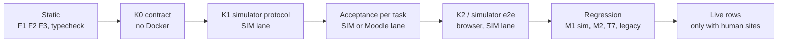
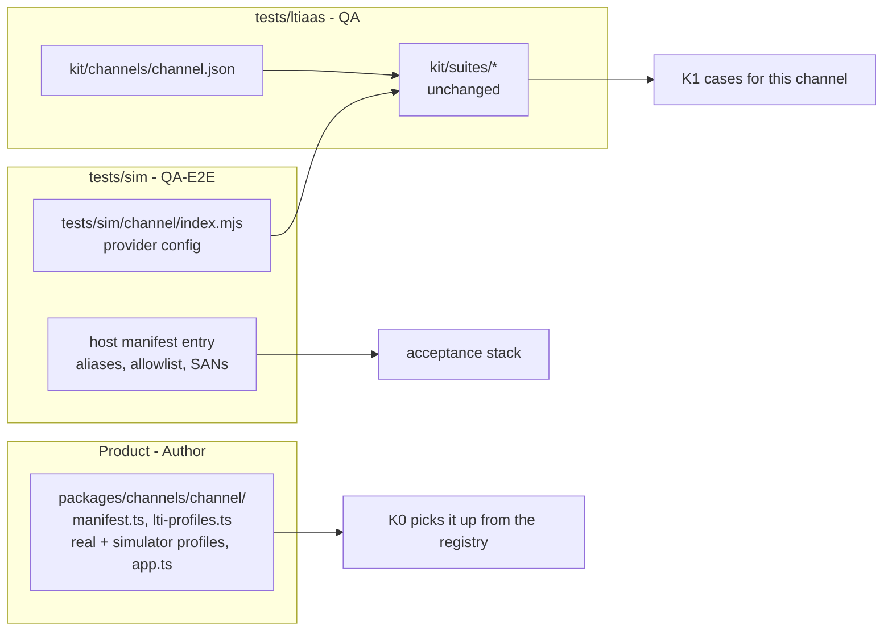

# Milestone LA test strategy and conformance kit design

Status: **v1.4** (QA, task LA-QS, 2026-10-22; v1.1 = G-DESIGN alignment at `19476fc`, task LA-QT: §4.3 rows 7–8, wider E0 scan, §9; v1.2 = G-DESIGN round 2 alignment at `877d951`, task LA-QT2: README OC-11 and plan LD-9 in §2.2, §2.4, §2.6, §4.2–§4.4, §4.7, §9; v1.3 = round 3 at `88909be`, task LA-QT3: §2.4 L4, §9.2 item 14; v1.4 = G-BREAKDOWN round 2 at `936f707`, task LA-QT-B3: §5.2 lanes of QA-2, QA-3, QA-4, plan LD-17). Owner: QA. Inputs: [plan v1](../../docs/team/ltiaas/plan.md) (`1afdf56`), [R5 test baseline](../../docs/research/ltiaas/R5-test-baseline.md), [R3 extensibility audit](../../docs/research/ltiaas/R3-extensibility-audit.md), [R1 spec coverage](../../docs/research/ltiaas/R1-spec-coverage.md), [R4 ops readiness](../../docs/research/ltiaas/R4-ops-readiness.md), [charter-LA](../../docs/team/ltiaas/charter-LA.md). Design files: `docs/architecture/ltiaas/**` (alignment status in §9).

This file says **how** QA proves milestone LA. It fixes test levels, the conformance kit, the CI fitness checks, the regression proof, the Docker lanes and the testability checklist. It does not fix product implementation. Where the design fixes a detail, the text cites the decision. Where a detail is still open between QA and the design, §9.2 lists it with QA's proposal.

Terms come from [LA terms](../../docs/architecture/ltiaas/terms.md): channel, channel folder, channel manifest, channel registry, capability, capability guard, frozen wire name, canary channel, simulator module. F1 is the **LMS-name lint** and F2 is the **add-channel gate** (terms §7). F1 to F5 follow the check ids of A1's README §4: F3 dependency direction, F4 canary channel, F5 frozen-data and design rules.

Rules that apply to every section:

- One focused test per acceptance criterion. Harness work only when an AC needs it. One full regression gate at the end of each wave (plan LD-4, `docs/team/ltiaas/plan.md:190`; charter-LA §5, `docs/team/ltiaas/charter-LA.md:76-81`).
- At most 2 Docker stacks at the same time, by booked slot (plan LD-2, `docs/team/ltiaas/plan.md:188`; `docs/team/ltiaas/charter-LA.md:61`).
- LA does not depend on the open ADR-012 runtime gates (plan LD-3, `docs/team/ltiaas/plan.md:189`).
- `retries: 0`, `workers: 1`, unique names per run (`docs/architecture/tasks/README.md:64`; `tests/playwright.config.ts:21-22`). An empty selection or a skip never fills a row.

## 0. Summary

| Plan epic (priority) | Main proof | Level (§1) | Lane |
| --- | --- | --- | --- |
| E0 Baseline (Must) | Baseline record at the G-BASE SHA; LD-1 open-world rewrite proven on that SHA; golden outputs captured | Regression, golden | SIM + Moodle |
| E1 Channel kernel (Must) | F1, F2, F3 fitness checks; K0 for every registered channel; differential regression and golden comparison (§4) | Static, K0, K1, regression | none, SIM, Moodle |
| E2 Generic channel `lti-generic` + new named LMS `brightspace` (Must) | K0 + K1 pass for both; F2 = 0 core files on the E2-N diff | K0, K1, K2, F2 | SIM |
| E3 Advantage Must items | K1 cases for the storage login, launch without context, Deep Linking and the D-8 scope rule; K2 browser case for the platform storage launch; MOODLE-LIVE checks for the Moodle parts | K1, K2, acceptance | SIM + Moodle |
| E4 Record core Must | K1-AGS cases; outbox cases with the transport gate; T5a/T5b regression; upgrade route U1 | K1, acceptance, regression | SIM + Moodle |
| E5 Operability Must 1–7 | One acceptance test per AC on the simulator (rate limit `429`, audit event per admin route, key rotation with a launch and a score) | Acceptance | SIM |
| E7 Conformance kit (Must) | The kit itself: K0, K1, K2; data-driven simulator; local CI script | All | none, SIM |
| E8 Docs (Must) | Docs state only verified behaviour; guide walkthrough measured with F2 + K0 + K1 | Acceptance | SIM |
| E3/E4/E5 Should, E6 Could | Same kit ports and acceptance pattern; listed in §1.3 | — | — |

## 1. Test levels for LA

### 1.1 Level table



| Level | Owner | Location | What it proves | Stack | When it runs | Evidence label |
| --- | --- | --- | --- | --- | --- | --- |
| Unit | Author | next to the code (`vitest.config.ts:7`) | Each module rule, also adapter data and migrations ("each additive schema change has a migration test", `docs/team/ltiaas/plan.md:53`) | none | every commit, `npm run check` | — (Author self-check) |
| Static fitness (F1–F5) | Author builds (F4: QA), QA verifies | root scripts (§3) | Core stays channel-neutral; a new channel touches only its folder | none | every commit (`npm run check`); F2 on add-channel branches | `STATIC` |
| K0 contract | QA | `tests/ltiaas/k0/` | Every registered channel satisfies the kernel port contracts (manifest, profile data, adapter purity, capability guard table) | none | every commit, through one root script line (§2.7) | `STATIC` |
| K1 simulator protocol | QA | `tests/ltiaas/kit/` | Each channel speaks LTI correctly through the real services on the signed simulator | SIM lane | per task that touches a port; full at wave end | `SIM` |
| Acceptance per task | QA | `tests/ltiaas/<task>/` | The task spec ACs, one focused test per AC | SIM or Moodle lane | P5 per task | `SIM` or `MOODLE-LIVE` |
| K2 / simulator e2e | QA-E2E | `tests/e2e/ltiaas/` | Portal cards and wizards from the manifest; one browser DL + score flow per new channel; Platform Storage in a frame | SIM lane + Chromium | per UI task; wave end | `SIM` |
| Regression | QA (M1, legacy), QA-E2E (M2, T7) | existing folders | No behaviour change for Moodle, Canvas, Blackboard (§4) | SIM lane, Moodle lane | per task (selected set), wave end (full) | `SIM`, `MOODLE-LIVE` |
| Live rows | QA-E2E | `docs/reviews/LA-*/live.md` | Real LMS behaviour | human-provided site | only with written access (LA-H3) | `CANVAS-HOSTED`, `BLACKBOARD-LIVE`, `<CHANNEL>-LIVE` |

Labels follow ADR-011 §13 (`docs/architecture/adr/ADR-011-multi-lms.md:350-366`). `STATIC` is a QA evidence label for checks without a stack; it is not a product term. A `SIM` PASS never says "works with <LMS>" (`docs/architecture/tasks/M3.md:20`).

### 1.2 Who writes what, and file ownership

- QA writes `tests/ltiaas/**` and `docs/reviews/LA-*/qa.md` (`docs/team/ltiaas/charter-LA.md:22`). QA-E2E writes `tests/e2e/ltiaas/**` and the `tests/sim/**` changes that its brief names (`docs/team/ltiaas/charter-LA.md:23`).
- These QA edits outside `tests/ltiaas/**` need a brief that names the files:
  - E0: the LD-1 rewrite files (§4.3): `tests/acceptance/M1/common/00-profiles.test.ts`, `tests/host/run-m1.mjs`, `tests/e2e/host/run-m2.mjs`, `tests/e2e/M2/01-cards.m2.ts`, plus any file that the E0 scan of §4.3 adds.
  - E7: one selector line in `tests/acceptance/run-api.mjs` (it already picks a Vitest config per `QA_TASK`, `tests/acceptance/run-api.mjs:2-7`), and the data-driven simulator files in `tests/sim/**` (QA-E2E).
- The Author adds the root script lines for F1–F3 and K0 to `package.json` and owns `eslint.config.js` (root build files, base charter §1).
- QA writes tests from the task specs, the contracts and the design interfaces. QA does not read Author notes or implementation code before it writes the tests (base charter §1). K0 imports only the public entry points that LA-ADR-01 names: `@cogniate/channel-kernel` (manifest schema, capability catalog, registry builder, legacy projection; `docs/architecture/ltiaas/adr/LA-ADR-01-channel-kernel.md:32-33`) and the public API of the three registry loaders (`docs/architecture/ltiaas/adr/LA-ADR-01-channel-kernel.md:151-162`, `:184`). It does not import internal modules.
- `tests/ltiaas/` has its own `tsconfig.json`, because `tests/tsconfig.json` includes only `acceptance/**` and `e2e/**` (`tests/tsconfig.json:14`).

### 1.3 Test approach for Should and Could items

| Item | Approach |
| --- | --- |
| E3 Should: ungraded links (D-11), Canvas DR (D-1), new-window launch (D-10), AGS extensions | New K1 cases behind a capability. D-1 needs the simulator DR routes of §2.8. |
| E3 Should: claim policy per tool account | K1-LAUNCH case L5 reads the policy from the fixture instead of a channel flag. |
| E4 Should: progress states, submission times | K1-AGS case A2 with the new states; ADR-010 mapping stays for final outcomes. |
| E5 Should: backup drill, metrics, readiness, service key revoke, `Idempotency-Key`, production profile | One acceptance test per AC. The production profile check starts the service with a knob or a simulation profile and expects a refusal at start. |
| E6 Could: verified admin launch, connection check, health view (LA-ADR-08) | AP-08-01 to AP-08-09 as SIM-lane acceptance; the simulator signs an institution administrator role and can answer `invalid_client` at its token endpoint (§2.8). Code life, single use and attempt rules are Author unit tests (§9.2 item 2). Only after E5 rate limits and audit (`docs/team/ltiaas/plan.md:102`). |

## 2. Conformance kit design (E7)

### 2.1 Goal and principles

- One shared contract suite per port or capability. Every channel adapter must pass it.
- A channel plugs in **by data**: a channel fixture, a simulator module and the channel's own manifest. The kit suite code does not change for a new channel. This is the test-side copy of the plan goal "zero core files" (`docs/team/ltiaas/plan.md:9`).
- The three proven channels (Moodle, Canvas, Blackboard) are the **positive controls** of the kit. A false capability with its guard case is the **negative control**. So the kit needs no self-test suite of its own (lesson L3, §6).
- One source per fact. Protocol facts (data mode, `sub` rule, assertion `aud` form, document target) come from the simulator module config, which already exports them (`tests/sim/canvas/index.mjs:33-60`; `tests/sim/blackboard/index.mjs:5-21`). Product-side expectations (capabilities, connect inputs, tool configuration keys) come from the channel fixture. The kit reads both and copies neither.

### 2.2 Levels

The plan names three levels (`docs/team/ltiaas/plan.md:107-110`); R5 §4a gives the shape (`docs/research/ltiaas/R5-test-baseline.md:189-197`).

| Level | Runs in | Content |
| --- | --- | --- |
| K0 | `npm run check`, no Docker | `describe.each(<every registered channel>)` over the port contracts: manifest schema, registry uniqueness, profile data rules, adapter purity, capability guard table |
| K1 | QA SIM lane, `acceptance` profile | Protocol suites per port (§2.4), driven by the channel fixture and the simulator module |
| K2 | QA-E2E SIM lane, Chromium | U1–U4 are **Must** (design README F7.7): manifest-driven cards and wizards; one DL + score flow per new channel; Platform Storage in a frame. U5 (keyboard and axe) is Could (README F7.9). |

### 2.3 Layout and channel inputs

```text
tests/ltiaas/
  TEST-STRATEGY.md            this file
  tsconfig.json
  k0/                         K0 contract suites (no Docker)
  canary/<id>/                canary channel folder, loaded only by K0 as an extra loader root (§2.7)
  kit/
    channels/<channel>.json   channel fixture: one file per channel
    suites/                   K1 suites, one file per port; no channel name inside (§3.5 item 6)
    lib/                      thin glue; imports the M1 helpers, never copies them
    vitest.config.mts
  golden/                     capture, normalize, compare; baselines per SHA (§4.6)
  fitness/                    QA probes for F1-F3 (§3.5)
  <task>/                     acceptance tests per LA task (ids from the P3 breakdown)
tests/e2e/ltiaas/             K2 (QA-E2E)
tests/sim/<channel>/          simulator module per channel (QA-E2E)
```

`kit/lib/` imports the existing helpers instead of copying them (for example `tests/acceptance/M1/common/client.ts:41-195`: `sim`, `admin`, `session`, `launch`, `idToken`, `records`). A copy of a helper repeats a race in two places; T7 failed because one copy of a fixed race was missed (`docs/reviews/T7/qa.md:236`).

**Channel fixture** (`kit/channels/<channel>.json`). Field names are QA's. Values come from the design channel tables and the channel's README facts (LA-ADR-01 D3 and D8, LA-ADR-02), never from product code:

```jsonc
{
  "channel": "<channel id, equals the folder name packages/channels/<id>/>",
  "source": "<design reference, for example LA-ADR-02 §n>",
  "simProvider": "<tests/sim provider id>",         // protocol facts come from this config
  "simProfile": "<product simulator profile id, or null>", // null for admin-value channels (LA-ADR-02 D7)
  "connect": { "method": "manual", "siteUrl": "...", "serviceUrl": "...",
               "fields": { "clientId": "...", "deploymentId": "..." },
               "adminValues": { "issuer": "...", "jwksUrl": "...", "tokenAudience": "..." } }, // admin-value channels only
  "capabilities": {                                 // the full expected capability set (LA-ADR-01 D3 catalog ids)
    "registration.dynamic": false,
    "binding.authority": { "manual": "operatorGrant" },
    "platform.sharing": "exclusive",
    "deployments.multiple": true,
    "content.multiple": false
    // every catalog id, with its typed value
  },
  "coveredBy": { "<capability id>": "<frozen suite id>" }, // only where the happy path needs a real LMS
  "expect": { "toolConfigurationKeys": ["..."], "legacyFlags": { "dynamicRegistration": false } }
}
```

`coveredBy` exists for the Moodle capabilities whose happy path needs a real Moodle (`registration.dynamic` on Moodle: T3b, T7; `siteApi.token` and `publish.createCourse`: T8; `export.packages` `.mbz`: T8). The kit then requires a PASS of that suite in the same wave. `legacyFlags` holds the six frozen M1 flags of the baseline channels (LA-ADR-01 D3 legacy projection, `docs/architecture/ltiaas/adr/LA-ADR-01-channel-kernel.md:138-149`).

### 2.4 K1 suites and cases

Each case id is `K1-<SUITE>-<case>.<channel>`. "Applies when" uses the fixture and the simulator config. Counts are per channel.

| Suite (port) | Cases | Applies when | Oracles | Simulator need |
| --- | --- | --- | --- | --- |
| **K1-LAUNCH** (launch trust, profile) | L1 valid resource-link launch → ltik → `/api/idtoken` fields and site and service origins; L2 profile-dependent faults `unknown-key` and `wrong-issuer`; L3 unknown and inactive deployment codes; L4 signed product family of another channel: a family guarded at the `launch` level (Canvas, Blackboard) → `PROVIDER_PROFILE_MISMATCH`; a family guarded at the `registration` level (for example `desire2learn`) → on a Moodle `standard` platform (a `MANUAL_SELF_LEGACY_CHANNELS` channel) the check 14 refusal `PROVIDER_PROFILE_MISMATCH` before any claim is stored; on every other platform the launch passes and the LTI log has `family_guard_mismatch` (LA-ADR-01 D6, guard levels; A-LAD-19); L5 claim policy (names, email, `custom`, `lis` kept or dropped by the profile's privacy floor and, later, the claim policy; LA-ADR-01 D6); L6 document target: `iframe` → embedded page, which continues at once only when `launch.topLevelContinue` is true; `window` → player; L7 launch without context: AP-05-08 to AP-05-11 (player opens; dispatch to the `lineitem`, or "no gradebook column" without an AGS claim; one placement per resource link id and deployment; no `sub` → `MISSING_CLAIM`) (E3 Must, LA-ADR-05 D2); L8 roles (learner graded, staff preview, DL only for staff); L9 two libraries on the same channel stay apart; L10 platform storage, HTTP level: AP-05-01 (no storage target → the same `302`, `Location` and `Set-Cookie` as before), AP-05-02 (`lti_storage_target` → `200` login page with the same auth URL), AP-05-04, AP-05-05 and AP-05-07 (storage-check refusals and check order) (LA-ADR-05 D1) | always; L4 when the profile has a family; L10 when the profile trait `platformStorage` is not `null` (AP-05-01 on every channel) | redirect and error code, `/api/idtoken`, sim records, log events (`launch_accepted {binding}`) | L7: scenario `omit` works today (`tests/sim/core/provider.mjs:45-46`); L10 needs the login to send `lti_storage_target` (§2.8) |
| **K1-LAUNCH full matrix** | The 12 simulator faults (`tests/sim/core/provider.mjs:47-55`; `tests/sim/core/crypto.mjs:13-23`) | once, on the generic channel only | error code per fault | today |
| **K1-DL** (Deep Linking) | D1 response JWT: `iss`, `aud`, `nonce`, `deployment_id`, type, version, `sub` rule, data mode, exact return URL, `window` member only when `launch.windowHint` is true; D2 one graded item, `scoreMaximum` 100 (baseline); D3 `accept_multiple` true → N items when `content.multiple` is true, and the picker stays single select when it is false (`docs/architecture/ltiaas/adr/LA-ADR-01-channel-kernel.md:131`) (E3 Must); D4 Cancel → `content_items: []` posted to the return URL; a cancel with another `Origin` → `403` (AP-05-12, AP-05-17); D5 `accept_lineitem` false → an item with `lineItem` gives `400 INVALID_CONTENT_ITEM`, and the picker shows `PLACEMENT_NOT_GRADED` when `content.ungraded` is false (AP-05-13, AP-05-18); D6 `/api/idtoken` shows `acceptLineItem` and `acceptMediaTypes` (AP-05-14); D3 multi-select is AP-05-15, the Moodle single-select rule AP-05-16 (MOODLE-LIVE, T7 unchanged); D7 learner DL refused; D8 two responses have different nonces | always; D3 in both forms | sim DL record (`tests/sim/core/provider.mjs:164-187`), picker page, log | D3–D6 need scenario options (§2.8) |
| **K1-AGS** (first record reporter) | A1 token request: assertion `aud` by the profile trait `clientAssertionAud` (token URL as a string, as an array for Blackboard, or the platform value such as the D2L audience), `iss = sub`, unique `jti`, one scope per call and only granted scopes, `deployment_id` claim when `assertionDeploymentId` is on (LA-ADR-02 D2, D5 fix 7); A2 score body by the ADR-010 mapping (`docs/architecture/adr/ADR-010-grade-and-completion-policy.md`, rule 4); A3 status mapping: `204` sent, `400`/`404`/`422` failed, `409` conflict, `5xx` retry, `429` with `Retry-After` → `throttled`: row stays `pending`, no try counted (E4 Must, LA-ADR-03 D7); A4 staff preview sends nothing; A5 disabled connection sends nothing (rule from the fixture); A6 service URLs off the service origin refused (check 13) | always; A6 when the profile has the check | sim token and score records, app results API, log | A3 `429` needs a header option (§2.8) |
| **K1-NRPS** | N1 no Cogniate channel asks for the NRPS scope: no token request in the run asks for it, the Canvas JSON `scopes` has exactly the four AGS scopes (AP-05-19), a Dynamic Registration request sends the four AGS scopes only (AP-05-21; Moodle part MOODLE-LIVE); N2 `GET /api/memberships` still answers for a launch with an NRPS claim, without personal fields (AP-05-22, AC-T3-27) | N1 always (LA-ADR-05 D4); N2 once | sim token and DR records; API body | N2 needs members (§2.8) |
| **K1-REG** (registration and onboarding) | R1 manual setup with the manifest's required fields; strict body refuses an unknown or missing field; R2 operator approval when the method authority is `operatorGrant`: happy path, `GRANT_INVALID`, and for admin-value channels one bound value that differs → `422 GRANT_MISMATCH` (LA-ADR-02 D6); races stay in M1; R3 Dynamic Registration when `registration.dynamic` is true, by the profile trait (LA-ADR-02 D5): issuer with a path (`path-prefix`), `opaque-bearer` or `moodle-scope-jwt` token, `authorization_server` stored as the token audience, refusal when `LtiDeepLinkingRequest` or a channel scope is missing, guarded family of another channel refused (both guard levels), granted scopes stored; R4 reserved issuer on the generic path → `ISSUER_RESERVED`; R5 tool configuration keys equal the fixture keys (labels are not compared); R6 origin binding I-SELF, the K1 negative case of LA-ADR-07 AP-07-11 (Must): a DR configuration with the token endpoint on another host, or an `authorization_server` off the issuer origin, gives `endpointsOnIssuerOrigin: false`, `complete` answers `active: false`, the connection DTO shows authority `operatorGrant`, a learner launch gets `PLATFORM_NOT_ACTIVE`, and the simulator records no token request at any host; an active `POST /api/platforms` with the same values gives `400 PLATFORM_URL_NOT_ON_ISSUER_ORIGIN`; an endpoint host that is a fixed host of another profile gives `PLATFORM_URL_NOT_IN_PROFILE` (LA-ADR-02 D2a, D5 item 10) | R2 by authority; R3 by capability; R6 when a profile of the channel has `endpointOrigins: any-https` | API status and code, sim records | R3 needs simulator DR (§2.8) |
| **K1-CAP** (manifest and capability guards) | C1 `GET /app-api/lms-providers` and the connection DTO show the channel with `channelCapabilities` equal to the fixture set, and the six legacy flags equal `expect.legacyFlags` (LA-ADR-01 D3, D11, `docs/architecture/ltiaas/adr/LA-ADR-01-channel-kernel.md:238-242`); C2 each capability that is false, absent or empty and has a guard in the LA-ADR-01 D3 table: the guard gives the documented status, code and `details.capability`, and no outbound call happens; C3 disconnect → `PLATFORM_NOT_ACTIVE` or `DEPLOYMENT_NOT_ACTIVE`; other connections unchanged | always; C2 once per guarded capability that is off | the three network oracles (`docs/architecture/tasks/README.md:73`): code, zero sim records, no `outbound_request` event | today |
| **K-HYG** | One secret scan per kit run over the service logs, simulator records and redacted evidence; zero hits | once per run | `/__sim/secrets` (`tests/sim/core/runtime.mjs:86`) and the T2b grep method | today |

About 35 K1 cases per channel, plus 12 for the full fault matrix. For five channels (Moodle-shaped standard, Canvas, Blackboard, generic, new named LMS) this is about 190 cases. The M1 `sim` phase runs 394 rows in about 22 min (`docs/research/ltiaas/R5-test-baseline.md:60`), so a full K1 run is estimated at 10–12 min.

**K2 cases (QA-E2E; U1–U4 are Must, design README F7.7; U5 is Could, F7.9):**

- U1: one Integrations card per registered channel, rendered from the manifest.
- U2: the setup wizard steps "show, collect, verify, enable" from the manifest (`docs/team/ltiaas/plan.md:50`).
- U3: one browser DL + score flow for each **new** channel. The old channels keep M2-12 (`docs/architecture/tasks/M2.md:122`).
- U4: platform storage launch = AP-05-03 and AP-05-06. A launch inside the simulator LMS frame (`tests/sim/core/provider.mjs:203-208`) with third-party cookies blocked completes through `lti.put_data` and `lti.get_data`. A reply from another origin or with another `message_id` is ignored (E3 Must, LA-ADR-05 D1). U4 blocks the cookie with a Chromium setting if one exists, else with a route rule that drops the state cookie for the frame request. qa.md records which one.
- U5: keyboard and axe (serious and critical) on new wizard steps only, as M2 does.

### 2.5 How a channel plugs in



1. Product: the channel folder `packages/channels/<id>/` holds `manifest.ts`, `lti-profiles.ts` (the real and the simulator profiles), `app.ts` and an optional portal module (LA-ADR-01 D1, `docs/architecture/ltiaas/adr/LA-ADR-01-channel-kernel.md:20-34`). Each deployable finds it by folder discovery; no file lists channel ids (LA-ADR-01 D4, `:151-153`). The simulator profile exists only when the service runs the `acceptance` profile with simulations on (ADR-011 §6, `docs/architecture/adr/ADR-011-multi-lms.md:216`; LA-ADR-01 D4 `availability: 'simulation-only'`, `:161`). K0 sees the channel through the registry with no test edit.
2. Simulator: one module `tests/sim/<channel>/index.mjs` (a config object; Blackboard needs 22 lines, `docs/research/ltiaas/R5-test-baseline.md:126`) and one entry in the simulator host manifest. E7 makes the simulator data-driven, so this entry also gives the compose aliases, the LTI allowlist and the certificate SANs (`docs/team/ltiaas/plan.md:111`). Today these are 4 extra edits in `tests/sim/server.mjs:8-11`, `infra/compose.yaml:300-311` and `infra/scripts/lib.sh:82-84` (`docs/research/ltiaas/R5-test-baseline.md:124-133`).
3. Kit: one fixture file `tests/ltiaas/kit/channels/<channel>.json`.
4. The kit computes the expected case list from the fixture **before** the run and compares it with the cases that ran. A missing or extra case fails the run. This replaces the hand-written manifests of M1 (374 rows for Canvas and Blackboard, `docs/research/ltiaas/R5-test-baseline.md:205`).

Simulator changes are additive. Each new behaviour is a scenario option with the current default. So M1 and M2, which use the defaults, see no change, and the simulator self-tests stay green (10/10, `docs/research/ltiaas/R5-test-baseline.md:157`).

### 2.6 Pass rule

A channel is **conformant** when K0 and K1 pass, and K2 U1–U3 pass for it (U3 only for a new channel). K2 U1–U4 are Must (design README F7.7; Reviewer-B B-LAD-07): U1–U2 are the end-to-end proof of the portal shell (F1.9), U4 of the platform storage launch (F3.1). Plan measure 4 needs this for the generic channel and the new named LMS (`docs/team/ltiaas/plan.md:140`).

- **K0:** every contract case passes for every registered channel in `npm run check`.
- **K1:** every applicable case passes once on a fresh SIM lane with `retries: 0`.
- **N/A:** a case is N/A only when the fixture marks its capability false **and** the C2 guard case of that capability passes. Nothing else skips (`docs/team/ltiaas/plan.md:110`).
- **Real-LMS capability:** a `coveredBy` capability passes only when the named frozen suite passed in the same wave.
- **Manifest equality:** C1 passes in both directions: no missing capability and no extra capability.
- **Hygiene:** the K-HYG scan has 0 hits.
- **Flake:** a case that fails and then passes on a manual rerun is a flake. QA reports it as a finding. It never counts as a PASS for that run.

Evidence: one table per channel in `docs/reviews/<task>/qa.md`: suite, PASS count, N/A count with the capability, failed case ids, artifact path. The per-case JSON stays in the run artifacts.

### 2.7 How K0 runs

- K0 tests live in `tests/ltiaas/k0/`. They import only the entry points of §1.2 (`@cogniate/channel-kernel` and the registry loader APIs). They import nothing from `tests/**` outside `tests/ltiaas/`.
- The root `npm run check` runs them with the root Vitest and a separate config, for example `vitest run --config tests/ltiaas/k0/vitest.config.mts`. The root default include list stays as it is (`vitest.config.ts:7-8`). ESLint keeps ignoring `tests/**` (`eslint.config.js:17-18`).
- The E1 task that lands the registry adds the root script line. Before that commit, K0 is not wired, so `npm run check` stays green during test-first work.
- K0 cases (from R5 §4a, `docs/research/ltiaas/R5-test-baseline.md:177-187`, and the LA-ADR-01 test impact, `docs/architecture/ltiaas/adr/LA-ADR-01-channel-kernel.md:274`):
  - The legacy projection of every baseline channel equals the M1 capability objects.
  - K-CAP: one guard case per false or absent guarded capability, read from the catalog and the guard table.
  - K-PROFILE: fixed hosts, template fill, site rules 1–6, traits, reserved issuer, simulation gate, through the profile registry API.
  - K-ADAPTER: tool configuration rows, strict body, binding target, staged create; no database and no LTI call from `app.ts`.
  - Every registered channel and the canary pass the manifest schema.
  - Not K0: the registry load-check failure cases and the generic check 14 table are Author unit tests (`:273`).
- **Canary channel:** LA-ADR-01 lets tests give the loader an extra root, and production code has none (`docs/architecture/ltiaas/adr/LA-ADR-01-channel-kernel.md:161`; terms §1, canary channel). QA keeps one minimal canary folder in `tests/ltiaas/canary/<id>/` (manifest, LTI profile, app adapter that implements the ports with fixed data). K0 loads it as the extra root and runs every contract case on it. This proves on every commit that a new channel needs no kernel edit. The canary never enters the product registry.

### 2.8 Simulator work for the kit (QA-E2E, E7)

| Work | Needed by | Estimate (R5 §2.4, inferred) |
| --- | --- | --- |
| Data-driven provider loading and one host manifest that makes the compose aliases, the certificate SANs and the `acceptance` allowlist (QA owns the generator, LA-ADR-02 D7, `docs/architecture/ltiaas/adr/LA-ADR-02-generic-lti-channel.md:117`) | plan measure 5; F2 for every new channel | 0.5–1 day with the Author's infra part |
| Generic provider: issuer with a path, token on a second host, opaque DR token, many deployments (LA-ADR-02 D7); a DR configuration with a foreign token host or an `authorization_server` off the issuer origin (K1-REG R6, AP-07-11); plus a Moodle-shaped config (issuer = site origin, `moodle-scope-jwt` DR token) for the Moodle kit row and the `standard` `path-prefix` check | E2 `lti-generic`; Moodle row of the kit | 0.5 day (+ DR below) |
| D2L provider: token host `auth.brightspace.sim.test`, an audience that differs from the token URL, family `desire2learn`, UUID deployments (LA-ADR-02 D7) | E2 `brightspace` | 0.5 day |
| DL scenario options: item count, cancel, `accept_multiple`, `accept_lineitem`, `accept_media_types` (today fixed at `tests/sim/core/provider.mjs:178-181`) | E3 Must DL (LA-ADR-05 D3) | 0.5 day |
| Score answer options: `Retry-After` header | E4 outbox `throttled` | 0.25 day |
| NRPS members | K1-NRPS N2 | 0.5 day |
| Platform side of Dynamic Registration (configuration document, registration endpoint, both token formats) | E2 DR (Must for `lti-generic`), D2L DR and Canvas DR (Should) | 1.5–3 days |
| Platform storage: the login sends `lti_storage_target`; the auth host serves a forwarding frame with `lti.put_data` and `lti.get_data`, keyed by the sender origin (LA-ADR-05 D1, `docs/architecture/ltiaas/adr/LA-ADR-05-lti-advantage-completeness.md:102`) | E3 Must D-4 (K1 L10, K2 U4) | 1 day (QA estimate) |
| Second platform signing key per provider (platform key rotation) | E5 Should only | 0.5 day |
| Institution administrator role in a launch; token endpoint that answers `invalid_client` on demand | E6 Could (LA-ADR-08 AP-08-01, AP-08-06) | 0.25 day |

## 3. Architecture fitness checks for CI

There is no CI service in the repo. "CI" means `npm run check`, run by every Author and at every gate (`docs/research/ltiaas/R5-test-baseline.md:79`). So F1 and F3 run inside `npm run check`, and F2 runs on demand with a base SHA. The plan gives F1 and F2 to E1 (`docs/team/ltiaas/plan.md:52`) and puts them into `npm run check` in E7 (`docs/team/ltiaas/plan.md:112`). The Author builds them. QA verifies them with probes (§3.5). There is one implementation, not a second QA scanner.

### 3.1 Core paths (input for F1, F2 and F3)

The design owns the list: "Core: all product code outside the channel folders" (terms §1, `docs/architecture/ltiaas/terms.md:21`), with the exceptions of LA-ADR-01 D10 (`docs/architecture/ltiaas/adr/LA-ADR-01-channel-kernel.md:232-236`). A1's README §4 is the authoritative list (`docs/architecture/ltiaas/README.md:99-107`); its machine-readable copy is `packages/channel-kernel/fitness-scope.json` (E1 step S9). The table below equals it. If the two differ, the README wins and QA updates this table.

| Class | Globs |
| --- | --- |
| Channel folders (not core) | `packages/channels/<id>/**` (LA-ADR-01 D1, `:20-34`). The folder is not an npm workspace (`:22`). |
| Core | all other product code: `services/*/src/**`, `packages/*/src/**` (also `packages/channel-kernel/src/**`), `apps/*/src/**` |
| Allowed exceptions inside core (LA-ADR-01 D10, closed list) | `packages/channel-kernel/src/legacy-wire.ts` (frozen wire names); applied SQL migrations (ADR-006 checksum rule); `packages/shared/src/config.ts` for the dev-stack Moodle URL only, until E1 removes `PUBLIC_MOODLE_URL` from the LTI service |
| Excluded from F1, counted by F2 | unit tests (`*.test.ts`, `*.test.tsx`), `testkit.ts` |
| Shared build files (count as core for F2) | root `package.json`, `package-lock.json`, `tsconfig*.json`, `eslint.config.js`, `vitest.config.ts`, `infra/**` except files that the simulator host manifest generates |
| Not core | `tests/**`, `docs/**`; `tests/sim/<id>/**` and the simulator host manifest entry |

### 3.2 F1: no LMS name in core

| Item | Rule |
| --- | --- |
| Scope | Core files of §3.1 with extensions `.ts .tsx .mts .js .mjs .sql .json .css .html`. |
| Banned words | (1) Every channel id, read at check time from the folder names under `packages/channels/`; a new channel bans its own id in core with no edit to the check. (2) The manifest `names.text` and `names.label` of every **named** channel (terms §1); the generic channel's texts (for example "your LMS") are not LMS names and are not banned. (3) A fixed list of LMS vendor names: `moodle`, `canvas`, `instructure`, `blackboard`, `brightspace`, `d2l`, `desire2learn`, `schoology`, `sakai`, `totara`. Case-insensitive. |
| Matching | One part rule for every checked token (BD-A1-09, BD-A1-15; identifiers, property keys, string literals, template parts, JSX text and attributes, import sources, regular-expression pattern text, SQL identifiers and strings): split the token into parts at case changes (camelCase, also an acronym before a word: `HTMLCanvasElement` = `HTML`, `Canvas`, `Element`), at `_`, `-`, digits and every other non-letter character (space, `/`, `.`, `:`; in a regular-expression literal, a backslash plus the character after it is a separator); split each banned word the same way (`lti-generic` = `lti`, `generic`; `d2l` = `d`, `2`, `l`); a hit = all parts of a banned word appear as consecutive whole parts, case-insensitive. So `"canvasConfiguration"`, `"MOODLE_TOOL_MAY_EXIST"`, `"/canvas-configuration"`, `/\bcanvas\b/` and `/^(moodle\|canvas)-/` hit outside `legacy-wire.ts` (AC-06), and `"canvases"`, `"generic"` and `"lti"` alone pass. No explicit frozen-name list: `legacy-wire.ts` is the only file exception, so every frozen wire name outside it is a hit. |
| Code tokens checked | Identifiers (also property keys, type names, enum members), string literals, template parts, JSX text and attribute values, import and export sources, TS literal types, regular-expression literals (the pattern text between the slashes, not the flags; a backslash plus the next character is a separator; BD-A1-15). For `.sql`: identifiers and string literals after `--` and `/* */` comments are removed. For `.json`, `.css`, `.html`: values after comments are removed. |
| Not checked | Comments. They explain sources (for example `packages/tracking/src/outcome.ts:2` cites Moodle's LMSFinish rule) and do not branch behaviour. |
| Exceptions | (a) Token-level: the HTML `canvas` element and Canvas Web API names (`HTMLCanvasElement`, `CanvasRenderingContext2D`, `OffscreenCanvas`). (b) **Frozen wire names** (terms §2; for example `canvasConfiguration`, `webServices`, `createMoodleCourse`, `MOODLE_TOOL_MAY_EXIST`, `/canvas-configuration`; `docs/architecture/contracts/cogniate-app-api.md:205`, `:321`, `:669`): only inside `packages/channel-kernel/src/legacy-wire.ts` (LA-ADR-01 D3, D10, `docs/architecture/ltiaas/adr/LA-ADR-01-channel-kernel.md:149`, `:235`), each entry with its contract reference. (c) The other two D10 file exceptions of §3.1, by exact path. No other file exception. |
| Ratchet | A checked-in baseline with one count per file. The check fails when a count rises or a new file has a hit. The Author lowers counts in the same commit that removes hits; the file never grows. E1 is done when every core count outside the exceptions is 0 (`docs/team/ltiaas/plan.md:138`). Today's size: 214 code lines in 60 files branch on an LMS (`docs/research/ltiaas/R3-extensibility-audit.md:7`); 85 files have a hit on a non-comment line (`docs/research/ltiaas/R5-test-baseline.md:220`). |
| Mechanism | Free choice for the Author: a Node script with the TypeScript compiler API (root dependency), or ESLint `no-restricted-syntax`. The script form is easier for the per-file ratchet and the non-TS files. It must have a mode that checks one input text as if it were at a given repo path (for example `--stdin --as <path>`), so that QA can probe without editing the tree (§3.5). |
| Output | `path:line:col  "<token>"  banned "<word>"`, then the per-file count delta. Exit 1 on any new or higher count. |
| Cost | Under 5 s (estimate) inside `npm run check` (69 s today, `docs/research/ltiaas/R5-test-baseline.md:154`). |

### 3.3 F2: a new LTI LMS changes 0 core files

| Item | Rule |
| --- | --- |
| Command | `npm run fitness:channel-diff -- --base <base SHA> --channel <id>` (name is a proposal). It lists `git diff --name-status --no-renames $(git merge-base <base> HEAD) HEAD`. `--no-renames` makes a renamed core file count as a core change. It also accepts `--paths-from <file>` for QA probes. |
| Classes | `channel:<id>` (`packages/channels/<id>/**`), `sim` (`tests/sim/<id>/**` and the simulator host manifest entry), `tests`, `docs`, `core` (everything else under §3.1 core and the shared build files). A path in **another** channel's folder is also `core` for this gate: adding one channel must not edit another. |
| No catalog file | Each deployable finds channels by folder discovery; no file lists channel ids (LA-ADR-01 D4, `docs/architecture/ltiaas/adr/LA-ADR-01-channel-kernel.md:153`). So there is no allowed "registry list" edit. If the design ever adds such a file, it counts as core. |
| Pass | `core` = 0. The report lists every path with its class. |
| Where it proves measure 1 | Plan measure 1 names the E2 branch against the E1-done SHA (`docs/team/ltiaas/plan.md:137`). But E2 also has core work (generic DR fixes, new profile data fields such as token audience, `docs/team/ltiaas/plan.md:58-59`). LA-ADR-02 D8 therefore orders E2 as E2-K (traits, DR fixes, grant bound values, `lti-generic`) and then E2-N (`brightspace`) (`docs/architecture/ltiaas/adr/LA-ADR-02-generic-lti-channel.md:119-121`). F2 measures the E2-N diff (`packages/channels/brightspace/**` plus QA's simulator module and tests) against the SHA where E1 and E2-K are done. |
| Second measurement | The E8 guide walkthrough (§1, `docs/team/ltiaas/plan.md:118`): the person or agent new to the repo works on a scratch branch; F2 runs on it. |
| Report-only use | QA runs F2 in report mode on each LA task branch after E1, to show core growth early. It fails nothing there. |
| Concrete target list | R3 lists the 25 core files that "add D2L today" edits (`docs/research/ltiaas/R3-extensibility-audit.md:276-313`). None of them may be in the E2-N diff. |
| Workspaces | A channel folder is not an npm workspace (LA-ADR-01 D1, `:22`, and its alternatives table, `:253`), so `package-lock.json` does not change per channel (testability item TD-03). |

### 3.4 F3: dependency direction and channel build fence

The rules are the import table and build model of LA-ADR-01 D1 (`docs/architecture/ltiaas/adr/LA-ADR-01-channel-kernel.md:66-92`), A1's BD-A1-16 (`docs/architecture/ltiaas/build-decisions-A1.md`) and A2's BD-A2-11 (`docs/architecture/ltiaas/build-decisions-A2.md`, `docs/architecture/ltiaas/security-delta.md:81`). The mechanism is ESLint (`no-restricted-imports`, `no-restricted-globals`, and local AST rules) per glob, plus `packages/channels/tsconfig.node.json` (`include`: `*/*.ts` and `*/app/**/*`) and `packages/channels/tsconfig.portal.json`.

| Rule | Probe (§3.5; `LA-E1-03` AC-03, AC-06) |
| --- | --- |
| Core never imports a channel folder by path (static import or dynamic `import()`, including a template literal with no `${…}`; BD-A1-16); only the three registry loaders read channel folders, by discovery | (1) a core file imports `packages/channels/<id>/…` → error; (8) a core file has `import(\`…packages/channels/<id>/…\`)` → error |
| A channel folder never imports another channel folder, and never `services/**/domain/**` (A2 AP-07-03); one base fence applies to every file under `packages/channels/<id>/` (tests too; BD-A1-16): no `@cogniate/cogniate-app`, `@cogniate/lti-service`, `@cogniate/portal`, `@cogniate/player` (or sub-paths), and no path under `services/` or `apps/` except `services/cogniate-app/src/kernel/ports.ts` (from `app.ts` and `app/**`) and `apps/portal/src/sdk/**` (from `portal/**`) | (2) a channel file imports another channel folder → error; (4) `app.ts` or `<id>/app/**` imports `services/**/domain/**` → error |
| Entry-kind imports (D1 table, BD-A1-16): `manifest.ts` imports only `@cogniate/channel-kernel` types; `lti-profiles.ts` imports kernel types and its own `manifest.ts`; `app.ts` may import kernel types, `kernel/ports.ts`, `@cogniate/shared/channel` values, `@cogniate/shared` types (`import type`), its own `./manifest.ts` and its own `./app/**` (an `app/**` module does no work at load time); `portal/**` imports only kernel types, `@cogniate/portal-sdk` (`apps/portal/src/sdk/`), its own manifest and React | (3) `manifest.ts` imports anything other than `@cogniate/channel-kernel` types → error; (5) `<id>/portal/**` imports portal code outside `apps/portal/src/sdk/` → error; allowed control: `app.ts` importing `./manifest.ts` and `./app/x.ts` → pass |
| Channel server shared-package and globals fence (BD-A2-11): `app.ts` and `app/**` import values from `@cogniate/shared` **only** through the allow-list sub-path `@cogniate/shared/channel` (`packages/shared/src/channel.ts`, whose export names are pinned by a unit test), and import from the root `@cogniate/shared` with `import type` only; other sub-paths and the globals `fetch`, `WebSocket` and `process` are refused in `app.ts` and `app/**` | value import, `import * as` or `export *` from `@cogniate/shared` in `app.ts` / `app/**` → error; `fetch(...)`, `WebSocket` or `process` in `app.ts` / `app/**` → error; `import type` from `@cogniate/shared` and value import from `@cogniate/shared/channel` → pass |
| No runtime dynamic loading in any channel file, tests too (BD-A1-16): no `import()` expression, `require()`, `import x = require()` or `createRequire` (a type-position `import('…')` follows the file's row) | (6) a channel file has an `import()` expression or a `require()` call → error |
| Closed list of channel file kinds, deny by default (BD-A1-16): `manifest.ts`, `lti-profiles.ts`, `app.ts`, `app/**`, `portal/**`, `*.test.ts` at the root or in `app/`, `*.test.tsx` in `portal/`, `README.md`; a non-test file never imports a test file | (7) a channel file outside the D1 file kinds (for example `<id>/helpers.ts`) or a non-test file importing `*.test.ts` → error |
| Root channel test typecheck (BD-A1-16): `packages/channels/tsconfig.node.json` includes `*/*.ts` and `*/app/**/*` | AC-06: a type error in `packages/channels/zz-probe/probe.test.ts` fails `npm run typecheck` |

F3 keeps F2 true between E2 measurements: if the core never imports a channel folder and the registry finds channels by discovery, a new folder cannot need a core edit.

### 3.5 QA verification of F1–F3

QA writes no second scanner. QA runs the Author's checks with probes and records the results (`tests/ltiaas/fitness/` and `tests/ltiaas/tasks-core/`):

1. The clean tree passes F1 and F3 inside `npm run check`.
2. F1 probes through the check-one-text mode, each at a core path: an identifier, a string, a template part, JSX text, an import source, a column of a new migration and a regular-expression literal (`/^(moodle|canvas)-/`, `/\.instructure\.com$/`; BD-A1-15, `LA-E1-04` AC-02) with a banned word → each fails with the right token. A comment-only probe and a `<canvas>` / `HTMLCanvasElement` probe → pass. A probe with the **new channel's id** fails without an edit to the banned list.
3. F3 probes with `eslint --stdin --stdin-filename <path>` for each rule of §3.4 (`LA-E1-03` AC-03 items (1)–(8), the BD-A2-11 `@cogniate/shared` and `fetch`/`WebSocket`/`process` probes, and the allowed `app.ts` imports of `./manifest.ts` and `./app/x.ts`), plus the root channel test typecheck probe (`LA-E1-03` AC-06).
4. F2: on the E2-N diff → `core` = 0. A `--paths-from` list with one core path → fail. A list with one path in another channel's folder → fail.
5. The core globs inside the checks equal the design list (§3.1), checked by reading both files.
6. **Kit neutrality (Could):** the same F1 check over `tests/ltiaas/kit/suites/**` gives 0 hits, so the kit stays channel-neutral.
7. **F4 canary:** K0 passes on the canary channel with no core edit (§2.7).

### 3.6 F5: frozen-data rules and the other design rules

A1's README calls these fitness check F5 (`docs/architecture/ltiaas/README.md:117`; not the E5 feature ids F5.x). LA-ADR-06 §6 adds three rules for `npm run check`: no `'/lti/launch/'` literal outside the account resolver; no `DELETE FROM audit_event` outside the `audit-retention` job; a SQL portability lint for new SQL (`docs/architecture/ltiaas/adr/LA-ADR-06-service-operability.md:421`). README rule N7 and LA-ADR-04 D4 rule 3 add: no product SQL outside the connection repository reads `connection.lms`, and after migration `014` no product SQL reads or writes `score_sync` (`docs/architecture/ltiaas/README.md:96`) (`docs/architecture/ltiaas/adr/LA-ADR-04-refactor-and-migration.md:86`; the ADR calls it a K0 test; QA treats it as a static fitness rule, §9.2 item 1). The Author builds them in the same way as F1. QA verifies each one with one passing tree run and one failing probe through the check-one-text mode (§3.5 item 2). QA writes no own scanner for them.

## 4. No-behaviour-change proof for the E1 refactor

### 4.1 Baseline (E0)

QA records the baseline at the G-BASE SHA. LA-H10 decides that SHA: the final Blackboard and Canvas commit, or the frozen candidate C (product `9f8ac62`) (`docs/team/ltiaas/plan.md:205`). The record holds:

- `npm run check` result (here: 1,123 passed, 5 skipped, 111 infra; `docs/research/ltiaas/R5-test-baseline.md:154-156`).
- M1 `--phase sim --provider all`: 394 rows, per-row result.
- M2: 64 cases. T7: 3 runs × 17 PASS + 1 demo skip.
- K1 on the three baseline channels, once the kit exists (it then becomes part of the baseline).
- Golden outputs G1–G4 (§4.6).
- Docker engine, Compose version and VM memory, recorded once. They are facts, not gates (LD-3).

No stack suite has run at HEAD yet (`docs/research/ltiaas/R5-test-baseline.md:11`). So E0 is the first full run on the LA base.

### 4.2 Differential rule

After each E1 step that QA runs R1 for (§4.4: S3, S4, S5, S6, S8, E4), and at each wave end, every frozen suite gives the **same result per test id** as the baseline:

- Baseline PASS → must PASS.
- Baseline FAIL or not run → QA reports it. It does not block E1 unless the failure changes (another error, another step).
- The M1 `migration` phase (12 rows, about 4 min) and `snapshot-upgrade` phase (6 rows, about 2 min) run once at step S4 (migration `013`) and once at E4 (migration `014`) (LA-ADR-04 D6, `docs/architecture/ltiaas/adr/LA-ADR-04-refactor-and-migration.md:110`). Both passed at `aaa823b` (`docs/research/ltiaas/R5-test-baseline.md:60`). The `snapshot-isolated` (6) and `storage` (70) rows stay out: E1 changes no storage command and only adds schema (`docs/team/ltiaas/plan.md:53`; LD-3).

### 4.3 Frozen assertions and the LD-1 rewrite

`git diff --stat <baseline>..<candidate> -- tests/acceptance tests/e2e tests/host tests/sim tests/fixtures` may show only:

1. The LD-1 rewrite (below), once, in E0, reviewed by both reviewers (`docs/team/ltiaas/plan.md:187`).
2. New folders `tests/ltiaas/**` and `tests/e2e/ltiaas/**`.
3. Runner and helper changes that touch no assertion. qa.md lists each file with its reason, as M3 did for its shared files (`docs/reviews/M3/qa.md:410`).
4. Additive simulator options with unchanged defaults (§2.5).

An intended change `LA-IC-nn` changes frozen assertions only through its own reviewed test-change list (plan LD-9, §4.7). Any other change needs a Lead approval with the test id and the reason, as AC-M3-02 did (`docs/architecture/tasks/M3.md:94`).

LD-1 rewrite list (rows 1–6 from `docs/research/ltiaas/R5-test-baseline.md:235-242`, checked against LA-ADR-01 D3, D6 and D11; rows 7–8 from the QA pre-review Q-LAD-08 and design README OC-8, `docs/architecture/ltiaas/README.md:317`):

| # | Today | Open-world form |
| --- | --- | --- |
| 1 | Exact profile list and order, each profile compared as a whole object (`tests/acceptance/M1/common/00-profiles.test.ts:40-45`) | The 6 baseline profiles exist with unchanged values and relative order. Extra **fields** are allowed: `GET /api/providers` adds `channel` to every profile (`docs/architecture/ltiaas/adr/LA-ADR-01-channel-kernel.md:189`). Each extra profile belongs to a registered channel. |
| 2 | `simulation_profiles` equals the 2 baseline ids (`tests/acceptance/M1/common/00-profiles.test.ts:49`; `tests/e2e/host/run-m2.mjs:124`) | The 2 baseline ids are present; each extra id is the simulator profile of a registered channel; the default profile still shows `[]` |
| 3 | "six real profiles" (`tests/host/run-m1.mjs:296`, `:301`) | At least the 6 baseline ids; no simulator profile in the default profile |
| 4 | The exact capability object with 6 keys (`tests/acceptance/M1/common/00-profiles.test.ts:110-111`, `:135-136`) | **No change expected:** the six legacy flags stay byte for byte, and the new set goes into the separate field `channelCapabilities` (LA-ADR-01 D3, D11, `:138`, `:241`) |
| 5 | `details.capability` is `webServices` or `courseShell` (`tests/acceptance/M1/canvas/31-canvas-grants.test.ts:300`, `:307`) | **No change:** the M1 guards keep their `details.capability` values (LA-ADR-01 D3, `:149`; D11, `:242`) |
| 6 | "three LMS cards" (`tests/e2e/M2/01-cards.m2.ts:11-15`) | The 3 baseline cards with unchanged texts; each extra card belongs to a registered channel |
| 7 | The exact `lms` list of `GET /app-api/lms-providers`: `['moodle', 'canvas', 'blackboard']` (`tests/acceptance/M1/canvas/11-canvas-platforms.test.ts:255`) | The 3 baseline entries exist, in this relative order, with unchanged values; each extra entry belongs to a registered channel |
| 8 | Exactly 6 profiles in `GET /api/providers` in the `default` profile (`tests/acceptance/M1/common/90-simulation-gates.test.ts:19`) | The 6 baseline real profiles exist with unchanged values; each extra profile is a real profile of a registered channel; no simulator profile in the `default` profile |

**E0 scan.** LA adds fields to three wire objects: the connection DTO and each `GET /app-api/lms-providers` entry (`channel`, `channelName`, `channelCapabilities`) and each `GET /api/providers` profile (`channel`; from E2-K also `endpoints`, `issuerKind`, `endpointOrigins`) (LA-ADR-01 D6, D11; LA-IC-01). Before the rewrite, QA searches M1, M2 and T7 for:

- whole-object comparisons of these three objects (for example `deepEqual` on a full DTO);
- exact lists and exact counts of profiles, providers, LMS entries, cards and simulation profiles (for example `.length, 6` or `['moodle', 'canvas', 'blackboard']`).

Each hit joins the LD-1 list with the open-world form of row 1 (baseline fields unchanged, extra fields allowed) or of row 7 (baseline entries present and unchanged, each extra entry belongs to a registered channel). A first scan at the design SHA `19476fc` found rows 7 and 8 and no other hit. Two near hits need no rewrite: `tests/acceptance/T6/1-integrations.spec.ts:24` (at least 9 cards) is already open-world, and the `simulation_profiles: []` checks of the `default` profile stay true, because the new channels have no simulator profile (LA-ADR-02 D7). E0 repeats the scan at the G-BASE SHA. The final list goes to both reviewers, and the Lead approves it (LD-1).

A behaviour change of a Should or Could item (for example Canvas Dynamic Registration, LA-ADR-05 D6) is not an LD-1 row. It needs an `LA-IC` id (§4.7).

Proof of the rewrite: the rewritten assertions pass on the baseline SHA, and each is at least as strict for every baseline element. Both reviewers check the second point on the diff. QA builds no mutation campaign for it.

### 4.4 Minimum regression set and run cost

| Tier | When | Content | Lane | Time |
| --- | --- | --- | --- | --- |
| R0 | every commit, every Author lane | `npm run check` with F1, F3 and K0; simulator self-tests; QA typecheck | none | about 1.5 min (69 s + 0.4 s + 2 s measured, `docs/research/ltiaas/R5-test-baseline.md:257`; F1, F3, K0 est. + 30 s) |
| R1 | before the QA PASS of each step that changes a runtime path: S3, S4, S5, S6, S8 and E4 (LA-ADR-04 D6; Reviewer-B B-LAD-11). S1, S2, S7 and S9 use R0 plus the golden compare of the step; the wave-end gate runs R1 for them | M1 `sim` phase (394 rows); M2 (64 cases); K1 on the 3 baseline channels once K1 exists; golden G1–G4 compare; plus the step's own proof column of LA-ADR-04 D1 (`docs/architecture/ltiaas/adr/LA-ADR-04-refactor-and-migration.md:37-49`) | SIM | about 40 min: stack up and seed about 1 min, M1 `sim` about 22 min (`docs/research/ltiaas/R5-test-baseline.md:258`), M2 about 5 min, K1 est. 8 min, golden est. 3 min |
| R2-lite (QA addition) | each step that moves Moodle code (S3, S5, S6, S7) | T7 × 1; the legacy groups of the area table below | Moodle | T7 about 4 min per run with reset (`docs/research/ltiaas/R5-test-baseline.md:71`); legacy per group below |
| R2 / R3 | end of E1, each wave end and the final SHA (LA-ADR-04 D6; LD-4) | Full: M1 `sim`, M2, K1 all channels, K2, golden; T7 × 3 with demo; all legacy groups T2a–T8 | SIM + Moodle in parallel | SIM about 50–60 min; Moodle about 1.5–2.5 h (`docs/research/ltiaas/R5-test-baseline.md:259`); wall clock about 2.5 h |
| Migration steps | S4 (`013`) and E4 (`014`) | M1 `migration` and `snapshot-upgrade` phases; upgrade route U1 (§4.5) | SIM | about 6 min + U1 est. 15 min |
| Out | only if storage commands change | M1 `snapshot-isolated` and `storage` phases | storage lane alone | est. 45–60 min per round (`docs/research/ltiaas/R5-test-baseline.md:260`) |

Area table for R2-lite and for tasks after E1 (areas as of the baseline; the P3 breakdown maps new paths to these areas):

| Area that the task changes | Add these suites | Measured time |
| --- | --- | --- |
| LTI service launch, profiles, platform calls, protocol routes | T2a, T2b, T3a, T3b, T3c | T2a–T3b about 9 min (`docs/reviews/M3/qa.md:49`); T3c not recorded |
| Connections, registration, providers or channels, binding | T4b1, T4b2 | about 5 min (`docs/reviews/T4b1/qa.md:74`) |
| Tool pages, launch handoff, player | T4b2, T5a | — |
| Score worker, attempts, score syncs, `packages/tracking` | T5a, T5b | T5a + T5b + T6 about 19 min (`docs/reviews/T5a/qa.md:146`) |
| Portal | T6, M2 | see above |
| Moodle-only features (web services, course shell, `.mbz`) | T8 | not recorded |

### 4.5 Upgrade route U1

E1 and E4 add tables and columns: migration `013` (E1, step S4) and `014` (E4) (LA-ADR-04 D4, D5). Old rows must keep working. The Author's migration tests check the rows on fixture databases (LA-ADR-04 D4 rule 5, D5, `docs/architecture/ltiaas/adr/LA-ADR-04-refactor-and-migration.md:88`, `:102`). U1 is QA's black-box counterpart through the public API. It runs once at S4 and once at E4. Label `SIM`, SIM lane:

1. On the baseline SHA, run the golden script. It makes connections on the Moodle-shaped standard provider, Canvas sim and Blackboard sim, and one publication each. Its learner attempts leave score sync rows in each status (`sent`, `pending`, `failed`, `conflict`, `superseded`), because migration `014` copies every `score_sync` row into `record_dispatch` (`docs/architecture/ltiaas/adr/LA-ADR-03-learning-record-core.md:83`).
2. Stop both services. Switch the clone to the candidate SHA with the same volumes. Start (the migrations run).
3. Check:
   - The G3 transcript of the old records is equal, apart from the listed additive fields.
   - Each old connection shows `channel` equal to its old `lms` value (`docs/architecture/ltiaas/adr/LA-ADR-01-channel-kernel.md:269`).
   - Its authority behaves as before: Moodle `self`, no grant; Canvas and Blackboard grant-based routing.
   - A new launch on the old resource link works, and its score is sent.
   - Resend of the old failed row follows ADR-010 rule 10.
   - The migration ledger shows only the new additive migrations.

U1 uses no ADR-012 backup or restore command (LD-3). Rollback stays a design note; QA does not test it in LA.

### 4.6 Golden outputs

| Id | Content | Capture point |
| --- | --- | --- |
| G1 | `GET /api/providers`, `GET /app-api/lms-providers`, both `/healthz` bodies, connection DTOs per channel and status, the tool configuration rows of each baseline channel, the Canvas configuration JSON in both forms `jwk=url` and `jwk=inline` (`docs/architecture/contracts/cogniate-app-api.md:321`; the inline public key becomes a placeholder) | API, SIM lane |
| G2 | Simulator transcript per channel for a fixed script (connect, DL, learner launch, grade): OIDC parameters, token request (assertion claims, `aud` form, scopes), score bodies, DL response claims and items | `/__sim/records` |
| G3 | App API transcript of the same script: connection DTOs, publications, results API rows, score sync rows, Resend answers | API |
| G4 | Every tool error page per channel (for example `DEPLOYMENT_NOT_ACTIVE`, `PROVIDER_PROFILE_MISMATCH`, `SERVICE_ORIGIN_MISMATCH`); learner labels; player status texts | HTML text of the pages |

This set covers the golden list of LA-ADR-04 D6 (`docs/architecture/ltiaas/adr/LA-ADR-04-refactor-and-migration.md:108`), with one change: D6 names "simulator records per M1 scenario". QA records G2 for the fixed golden script per channel. For the other scenarios QA relies on the M1 `sim` phase: its assertions already check the stored claims, the assertion `aud` and the Deep Linking items per scenario. A record diff over all 394 M1 rows would need an ordering harness, because asynchronous score sends interleave with other records (§9.2 item 7). In E1, the additive fields `channel`, `channelName` and `channelCapabilities` are the only allowed difference (LA-ADR-04 D6).

- **Normalization.** Ids become placeholders in order of first use. Times become `<t>`. Tokens become `<redacted:length>`. Keys are sorted. Volatile fields (`jti`, `nonce`, `iat`, `exp`, score `timestamp`) are dropped by one short explicit list; each entry has a reason.
- **Intended changes.** An intended change is a reviewed expected-delta file per change id (§4.7). QA never widens the normalizer to hide a difference.
- **Negative control.** Once per golden version, QA changes one field in a copy of a captured output and shows that the compare reports it. qa.md records this. There is no self-test suite.
- **Storage.** `tests/ltiaas/golden/<baseline-sha>/`. Redacted at capture; no secret or key ever enters the file.
- **Cost.** Capture is part of the kit run (est. 3–5 min). Compare is under 5 s, no Docker.

### 4.7 Intended behaviour changes

LA-ADR-04 D8 gives every intended change an id `LA-IC-nn`, with the golden fields and the frozen tests it touches (`docs/architecture/ltiaas/adr/LA-ADR-04-refactor-and-migration.md:121-136`). Plan LD-9 rules the test changes: QA makes one reviewed test-change list per `LA-IC`, at the task that ships the change, and both reviewers approve it. A golden difference or a frozen-test failure without an id is a FAIL (D6, `:112`). QA checks each id like this:

| Id | Change | QA check |
| --- | --- | --- |
| LA-IC-01 | Additive wire fields `channel`, `channelName`, `channelCapabilities`; `channel` on `GET /api/providers` | G1 and G3 expected delta names each new field and its value for the baseline channels (for example `channel: "canvas"`); every baseline field stays equal; E0 scan (§4.3) |
| LA-IC-02 | The LTI service no longer needs `PUBLIC_MOODLE_URL`; `/healthz` does not change | G1 `/healthz` stays equal (it shows `outbound_allowlist`, `services/lti-service/src/http/app.ts:111`) |
| LA-IC-03 | Moodle DR accepts an issuer with a path; host-root Moodle unchanged | T3b and T7 unchanged; the `path-prefix` case on the Moodle-shaped simulator config (§8 E2) |
| LA-IC-04 | No NRPS scope in any channel (Canvas JSON, DR request scope, Moodle row 13) | K1-NRPS N1; G1 delta for the Canvas JSON and the Moodle tool rows; the M1, T4b1 and T7 checks it touches go into the reviewed list |
| LA-IC-05 | A valid launch without a context opens the player | K1-LAUNCH L7; QA found no frozen M1, M2 or T7 test that expects the old refusal (search of `tests/acceptance` and `tests/e2e`) |
| LA-IC-06 | Platform storage launch when the state cookie is missing | K1-LAUNCH L10 (AP-05-01 keeps the old `302` where no storage target is sent); K2 U4 |
| LA-IC-07, -08 | Ungraded placements; claim policy per tool account (Should) | K1 cases behind their capability or policy (§1.3) |
| LA-IC-09 | The T5b P5 fixture deletes the failed row in `record_dispatch`, not in `score_sync` | The fixture today works on `score_sync` (`tests/host/p5-fixture.mjs:1`; `tests/host/storage-fixture-script.mjs:389`). After migration `014` no code reads that table (`docs/architecture/ltiaas/adr/LA-ADR-03-learning-record-core.md:83`), so the P5 check would fail. QA changes the fixture only after the Lead widens the P5 fixture exception (`docs/architecture/tasks/README.md:53`). |
| LA-IC-10 | E5 service changes (A2 lists them) | AP-06 acceptance (§8 E5); M1, M2 and T7 stay green (AP-06-18) |
| LA-IC-11 | A platform `429` (and the Canvas throttling `403`) becomes `429 PLATFORM_RATE_LIMITED`; the outbox keeps the row `pending` (`throttled`) | K1-AGS A3 and the E4 outbox acceptance (§8 E4); no frozen test sends `429` |
| LA-IC-12 | Deep Linking Cancel button, empty `contentItems`, `accept_lineitem`, `acceptLineItem` and `acceptMediaTypes` | K1-DL D3–D6; its test-change list names the picker-page and `deepLinkingSettings` checks that QA finds (QA scan) |
| LA-IC-13 | Could gaps (`scoreGiven: null`, NRPS `service_versions`, trusted audiences) | only if built; K1 cases behind the item |
| LA-IC-14 | Canvas Dynamic Registration (Should): Canvas legacy flag `dynamicRegistration` true, `methods` `["manual", "dynamic"]`, `method: dynamic` accepted | Its test-change list: `tests/acceptance/M1/canvas/11-canvas-platforms.test.ts:218`, `:241`, `:257` and the K0 legacy projection golden of Canvas; K1-REG R3 on the Canvas simulator (AP-05-29, AP-05-30) |
| LA-IC-15 | The score `409` conflict text names the connection's channel: `"({LMS} has a grade with a newer time)"` instead of `"(Moodle has a grade with a newer time)"` on every row (BD-A1-27; E1 keeps the frozen text byte for byte) | Ships at E4 (`LA-E4-03`, lane R): G3 `canvas/` and `blackboard/` `publications/B-conflict/results/0/scoreSyncs/0/lastError` expected delta; LD-9 list of any frozen test reading the conflict `lastError` of a Canvas or Blackboard row |
| LA-IC-16 | Simulator allowlist hosts of the `acceptance` profile come from `tests/sim/hosts.json` (README §4b; BD-A1-36): in `acceptance.*Health.outbound_allowlist`, `.sim.test` entries in `acceptance.ltiHealth.outbound_allowlist` equal (as a set, no duplicates) the union of `allowlist` hosts of `tests/sim/hosts.json` at the compared SHA; every non-`.sim.test` entry equals G-BASE (`["moodle.test", "qa-platform.test", "evil.test"]`); `default.*Health.outbound_allowlist` and `acceptance.appHealth.outbound_allowlist` stay strictly equal to G-BASE | Golden compare rule `sim-hosts-allowlist` in `tests/ltiaas/golden/lib/compare.mjs` + `tests/ltiaas/golden/expected/LA-IC-16.json` + unit test in `tests/ltiaas/golden/golden.k0.test.mjs`. LD-9 list (for both reviewers): golden field `G1.acceptance.ltiHealth.outbound_allowlist` (compared by the rule); LA test suite `tests/ltiaas/tasks-lti/LA-E1-05/profiles.k1sim.test.ts` (`AC-LA-E1-05-07`, `AC-LA-E1-05-09`); frozen tests touched: **none** (`0` files) |
| LA-IC-17 | Moodle `PUT /app-api/connections/:id/platform` refuses unknown body keys with `422 INVALID_PLATFORM_VALUES` and the key in `details.fields`, matching Canvas and Blackboard (D5 port contract; BD-A1-41; Reviewer-A A-LA-E1-07-01) | Recorded in `tests/ltiaas/golden/expected/LA-IC-17.json` + unit test in `tests/ltiaas/golden/golden.k0.test.mjs`. LD-9 list (for both reviewers): golden fields changed: **none** (`0`); frozen tests touched: **none** (`0`). QA scan across `tests/acceptance`, `tests/e2e`, `tests/host`, `tests/sim`, `tests/fixtures`, and `tests/ltiaas/golden` (`T4b1/1-connect.spec.ts:128-134`, `T4b1/3-security.spec.ts:116`, `T4b1/4-adoption.spec.ts:17-24,54,65,75`, `T6/2-connect.spec.ts:133,148-151`, `M1/canvas/41-canvas-grades.test.ts:89-90`, `M1/canvas/61-canvas-containment.test.ts:156-158`, `lib/portal.ts:28`, `e2e/2-scenario-b.spec.ts:52`, `golden/capture.golden.ts:276-285`) confirmed every Moodle/standard `PUT …/platform` body sends only the six documented keys (`issuer`, `clientId`, `deploymentId`, `authenticationEndpoint`, `accessTokenEndpoint`, `jwksUrl`) |

## 5. Parallel QA lanes and Docker limits

### 5.1 Machine and limits

- The Docker VM has 7.75 GiB and 12 CPUs (`docs/research/ltiaas/R5-test-baseline.md:266`). One idle QA stack used about 683 MiB over its five containers (`docs/team/multi-lms-plan.md:1997`). A test stack with the acceptance helpers and Chromium (`shm_size: 1gb`, `infra/compose.yaml:450`) needs about 2.5–3 GiB (inferred, R5 §4d).
- LD-2: at most 2 stacks at the same time, one SIM lane and one Moodle lane; the Lead books the slots (`docs/team/ltiaas/plan.md:188`). An Author smoke run takes one of the two slots.
- In the first LA run of each lane, the runner records the peak of `docker stats --no-stream` (sampled during the browser part). If the two measured peaks add up to more than 6.5 GiB, the Lead runs the lanes one after the other.
- The runner checks before start: port free, subnet does not overlap any existing Docker network, at least 3 GiB of VM memory free.

### 5.2 Lanes

The table takes R5's proposal (`docs/research/ltiaas/R5-test-baseline.md:285-290`). It keeps away from the Blackboard and Canvas lanes (`docs/team/multi-lms-plan.md:3578-3583`) and from the default subnet `172.28.0.0/16` (`infra/scripts/lib.sh:35`).

| Lane | `COMPOSE_PROJECT_NAME` prefix | `PUBLIC_PORT` | `STACK_SUBNET` | Profile | Runs |
| --- | --- | --- | --- | --- | --- |
| QA SIM | `qa-la-sim-r` | 9443 | `172.20.0.0/16` | `acceptance` | K1, M1 `sim`, golden, U1, LA acceptance on SIM, M2, K2 |
| QA Moodle | `qa-la-moodle-r` | 9543 | `172.21.0.0/16` | `default` (legacy groups switch to `acceptance` and back) | T7, legacy T2a–T8, LA acceptance on Moodle |
| QA storage (only if storage commands change) | `qa-la-st-r` | 9643 | `172.22.0.0/16` | `storage` | M1 storage phases; always alone |
| Author smoke (booked slot) | `la-author-<lane>` | 9743 | `172.23.0.0/16` | any | Author checks |
| Task suites of QA-2, QA-3, QA-4 (the booked SIM slot; plan LD-17) | `qa2-la-sim-r`, `qa3-la-sim-r`, `qa4-la-sim-r` | 9443 | `172.20.0.0/16` | `acceptance` | the K1-SIM ACs of the author's lanes |
| Third SIM-only slot (only if the Lead adds it, plan LD-17) | the author's prefix above | 9843 | `172.24.0.0/16` | `acceptance` | the K1-SIM ACs of the author's lanes |

One lane = one clone + one project, port and subnet. All state stays inside the clone (`docs/research/ltiaas/R5-test-baseline.md:268`). Each QA test author (QA, QA-2, QA-3, QA-4) uses its own clone and its own prefix. The SIM slot holds one SIM stack at a time, so the authors share its port and subnet one after the other. The tasks README §2 command forms apply to each author's own project only. The §5.4 cleanup of one author never touches the project of another author.

### 5.3 What can run at the same time

| Work | Needs | With the SIM lane busy | With the Moodle lane busy |
| --- | --- | --- | --- |
| R0, K0, F1–F3, simulator self-tests, QA typecheck, golden compare, harness-only checks | no Docker | yes | yes |
| K1, M1 `sim`, golden capture, U1, SIM acceptance | SIM lane | no: serial inside the lane | yes |
| M2, K2 | SIM lane + Chromium | no: after K1 in the same lane | yes |
| T7, legacy groups, Moodle acceptance | Moodle lane | yes | no: serial inside the lane |
| M1 storage phases | storage lane | no | no |
| Local Canvas (live row L-C13) | about 8 GB alone (`docs/reviews/M3/live.md:72`) | no | no |

Inside one stack everything is serial (`workers: 1`). A knob restart (`docs/architecture/tasks/README.md:77`) or a transport gate rule (`docs/architecture/tasks/M3.md:71`) affects the whole stack.

### 5.4 Lane isolation rules

- Each runner checks and removes only resources with its **own** project label. It never compares the global Docker state. A foreign container or volume is noted, not a FAIL. (M2's global comparison forced one stack at a time, `docs/team/multi-lms-plan.md:2002-2005`.)
- No ADR-012 G-1 client-identity gate in LA lanes (LD-3). The engine identity is recorded once per session.
- The runner wakes the VM before the window (W1 step, `docs/research/ltiaas/R5-test-baseline.md:304`).
- Cleanup removes the lane's containers, volumes, networks and its test image. It never removes another worker's resources or shared base images (`docs/team/multi-lms-plan.md:3586-3587`).

## 6. Lessons from the Blackboard and Canvas phase

| # | What happened | Evidence | LA rule |
| --- | --- | --- | --- |
| L1 | 9 full M1 attempts, 0 complete rounds. 7 of 9 stopped on QA-owned code (oracle, host control, harness), not on product defects. | `docs/reviews/M1/qa.md:414-426`, `:1261-1269`, `:1459-1464`, `:1843-1850`; `docs/research/ltiaas/R5-test-baseline.md:298` | Prove each harness part on the no-Docker path first. A runner defect found in a window is fixed and proven with a targeted run, not a full gate. |
| L2 | The M1 runner stops at the first failed phase, so the legacy suites never ran in the phase. | `docs/reviews/M3/qa.md:387`; `docs/research/ltiaas/R5-test-baseline.md:299` | Suites are independent. Each gives its own result. No gate chain hides a later suite. |
| L3 | The storage harness grew to 22 files and 8,076 lines, 1.5 times the M1 acceptance tests it served. | `docs/research/ltiaas/R5-test-baseline.md:300` | No harness for a harness unless an AC needs it (`docs/team/ltiaas/charter-LA.md:79`). The kit uses known channels as positive controls (§2.1). |
| L4 | Harness self-tests grew to 142 and mutation campaigns to 135 and 70 mutants; reviewers still found 2 BLOCKER + 1 MAJOR in the harness; one control "cannot pass on a correct tree". | `docs/reviews/M1/storage-harness-repair-qa.md:357`, `:406`, `:572`, `:592`; `docs/reviews/M1/storage-harness-reviewer-a.md:24`; `docs/reviews/M1/storage-repair-testability-qa.md:191` | One negative control per oracle, recorded in qa.md (§4.6). No mutation, neutrality or mock-lane campaign without an AC. |
| L5 | 18 of the 43 M1 review files repair or review QA-owned code. | `docs/research/ltiaas/R5-test-baseline.md:302`; `ls docs/reviews/M1` | One short qa.md per task and round: one row per AC, artifact paths. MINOR and NIT go to `docs/team/ltiaas/deferred.md`. |
| L6 | Evidence-mode rules (umask, 0644 files) caused failures and discarded work. | `docs/reviews/M1/qa.md:1216-1225`, `:1929-1934`; `docs/reviews/M1/storage-command-qa.md:405` | One rule from the start: raw secrets stay in the private run folder (created with umask 077); shared evidence is redacted at capture. No later "hygiene generation". |
| L7 | The environment drifted: host reboot, engine update, idle-VM state, foreign containers, WAL locks on the bind mount. | `docs/reviews/M3/qa.md:321-347`, `:391`, `:472`; `docs/reviews/M1/qa.md:586-588`, `:642` | Record the engine; wake the VM; own-label checks only (§5.4). An environment fact is never a product row. |
| L8 | One QA worker owned Docker at a time; QA-E2E rounds 6–10 never got a window. | `docs/team/multi-lms-plan.md:2002-2005`; `docs/reviews/M3/qa-e2e.md:119` | Two lanes with lane-scoped checks (§5). |
| L9 | Every repair needed a Lead commit, a new frozen SHA, two reviews and a new window. | `docs/reviews/M2/qa.md:456`; `docs/reviews/M1/qa.md:1088` | Keep that rigor for the wave-end gate. Inside a task, QA runs on the Author lane SHA, at most 3 rounds (`docs/team/ltiaas/charter-LA.md:80`). |
| L10 | Estimates were far off: M2 was estimated at 45–75 min and took about 4.6 min. | `docs/reviews/M2/qa-plan.md:72`; `docs/research/ltiaas/R5-test-baseline.md:307` | Plan from measured times (§4.4). Record the measured time of each new suite in its first qa.md. |
| L11 | A one-shot read race in shared glue was fixed in M2 but not in the T7 copy. | `docs/reviews/T7/qa.md:236` | One helper library, imported, never copied (§2.3). |
| L12 | An external observer tool wrote container secrets into its own log. | `docs/reviews/M2/qa.md:720` | No ad hoc observer tools. Only the runners' own redacted capture. |

Proportional evidence for LA, in short: one focused test per AC; one table per task in qa.md; the full regression only at wave end; two identical full runs only at milestone end, not per task.

## 7. Testability review checklist (G-DESIGN, G-BREAKDOWN)

QA gives PASS for testability when no item is **missing** for a Must feature. Severity follows the base charter §5: a Must feature that QA cannot test is a BLOCKER; a Must AC without an observable oracle is a MAJOR; a Should or Could gap is a MINOR.

### 7.1 G-DESIGN (design files under `docs/architecture/ltiaas/`)

| Id | Check | Needed by |
| --- | --- | --- |
| TD-01 | The core globs, the channel folder pattern and the D10 exceptions exist as one machine-readable list. | F1, F2, F3 (§3.1) |
| TD-02 | The registry finds channels by folder discovery; no core file lists channel ids. | F2 (§3.3) |
| TD-03 | Channel folders are not npm workspaces (else `package-lock.json` changes per channel). | F2 |
| TD-04 | Every frozen wire name that stays (API keys, error codes, routes, env names, column values) is listed in the one legacy-wire file, each with its contract reference. | F1 exceptions; §4.3 rows 4–5 |
| TD-05 | The manifest is readable black-box: an API or a static document lists each channel with its capability set. | K1-CAP C1 |
| TD-06 | Each capability has a name, a guard (status and code), and the rule "no outbound call when false". | K1-CAP C2 |
| TD-07 | Each port has a black-box observation point: an API field, a simulator record or a log event name. | K1 oracles |
| TD-08 | The kernel entry points that K0 may import are named, with their types. | K0 (§2.7) |
| TD-09 | Each intended behaviour change has an id, the affected golden fields and the frozen tests (§4.7). Everything else is "no change". | §4 |
| TD-10 | Every schema change is additive and forward-only; the design states which old rows U1 must keep working. | U1 |
| TD-11 | Each new fixed-endpoint channel has a simulator profile that exists only in the `acceptance` profile with simulations on, with its reserved issuer and hosts listed. An admin-value channel needs none: QA registers the simulator hosts as admin values (LA-ADR-02 D7). | K1 setup |
| TD-12 | Each time rule (rate-limit window, key lead time and retention, lease expiry, `Retry-After`) has either a black-box control (an operator API setting or an acceptance-only knob, tasks README §3) or an Author unit test with a controlled clock; the design says which. QA does not import service internals to control a clock (§1.2). | E4, E5 acceptance |
| TD-13 | No test-only path exists in production code except behind the `acceptance` profile, as today ("Test overrides must stay unavailable in production", `docs/team/multi-lms-plan.md:3575`). | all |
| TD-14 | New log events and error codes are listed with their fields (no secrets). | oracles, K-HYG |
| TD-15 | Every Must feature has one observable outcome a test can check. | all ACs |
| TD-16 | Wave order lets K0 and F1–F3 land with the first kernel commit, and the add-channel work (E2-N) is separate from the E2 core work (E2-K). | F2, K0 |

### 7.2 G-BREAKDOWN (epics, features, task specs)

| Id | Check |
| --- | --- |
| TB-01 | Each AC has one observable outcome, the oracle (API, simulator record, log, UI text), a deadline for anything async, and its evidence label. |
| TB-02 | Each AC fits one focused test. An AC that needs a list of subcases names the list; more than 10 subcases needs a reason. |
| TB-03 | AC ids are unique and keep the base rule "a number is never reused" (`docs/architecture/tasks/README.md:43`). |
| TB-04 | Each task names its regression subset from the area table (§4.4) and says whether it adds a migration (then U1 runs). |
| TB-05 | Regression ACs point to the frozen suites; they do not restate them. |
| TB-06 | No Must AC needs a live LMS site. Live rows are separate and optional (LA-H3). |
| TB-07 | Each task names the files it owns, also the `tests/sim/**` files for QA-E2E and the root script lines for F1–F3 and K0. |
| TB-08 | An AC that needs harness work says so. This is the only allowed reason for new harness code (charter-LA §5). |
| TB-09 | Every Must epic of plan v1 maps to at least one AC with a test level from §1. |
| TB-10 | Any change to a frozen assertion is listed with the test id and reason, for Lead approval (§4.3). |
| TB-11 | Each AC that uses a knob, the transport gate or a pause names it, and says how the test restores the default. |
| TB-12 | Each kit channel fixture value has its source in the design (channel table, profile facts, R2 facts for the new LMS). |

## 8. Per-epic test approach (Must items)

| Epic | Item | Test approach | Level |
| --- | --- | --- | --- |
| E0 | Baseline | §4.1 record; LD-1 rewrite (§4.3) passes on the baseline SHA; G1–G4 captured | regression, golden |
| E1 | Two blockers (closed Zod enum; `connection.lms` CHECK) | K0: a registry with an extra channel id loads; the providers list stays complete when one profile is unknown (`docs/research/ltiaas/R3-extensibility-audit.md:9`); U1 for the additive schema | K0, acceptance, U1 |
| E1 | Registry, manifest, five generic traits | K0 contract cases; K1 on the 3 baseline channels; golden equal | K0, K1, golden |
| E1 | Moodle-only code into the Moodle channel folder (LA-ADR-01 D8) | T8, T3b, T7 (frozen); F1 ratchet lower | regression, static |
| E1 | Portal from the registry | K2 U1–U2 for the 3 baseline channels; M2 unchanged except LD-1 row 6 | K2, regression |
| E1 | Fitness checks | §3.5 probes | static |
| E2 | Generic channel `lti-generic`; profile traits; DR fixes; grant bound values (LA-ADR-02 D2, D3, D5, D6) | K0 (trait constants per profile); K1 on the generic simulator provider: manual with `operatorGrant` and bound values (R2), DR with an issuer path and an opaque token (R3), `clientAssertionAud` (A1). Moodle: DR at the host root unchanged (T3b, T7); the new `path-prefix` rule for `standard` is proven on the Moodle-shaped simulator config (`SIM`), because the local Moodle runs at the host root; a Moodle in a subfolder stays a live row (Q18) | K0, K1, regression |
| E2 | New named LMS `brightspace` (LA-ADR-02 D4; LA-H6) | K0 (D2L defaults as constants, as AC-M1-01 does); K1 on the D2L simulator provider (token host differs from the issuer, audience differs from the token URL, family `desire2learn`, UUID deployments); K2 U3; F2 on the E2-N diff = 0 core files | K0, K1, K2, static |
| E3 | Platform storage launch (D-4, LA-ADR-05 D1) | K1-LAUNCH L10 (AP-05-01, -02, -04, -05, -07); K2 U4 = AP-05-03 and AP-05-06 in the simulator frame with third-party cookies blocked | K1, K2 |
| E3 | Launch without context (LA-ADR-05 D2) | K1-LAUNCH L7 = AP-05-08 to AP-05-11 on every channel | K1 |
| E3 | Deep Linking completeness (LA-ADR-05 D3) | K1-DL D3–D6 = AP-05-12 to AP-05-15, -17, -18; AP-05-16 and Cancel in Moodle 5.2 as one MOODLE-LIVE check each | K1, Moodle lane |
| E3 | D-8: keep the NRPS service, drop the scope (LA-ADR-05 D4) | K1-NRPS N1, N2 = AP-05-19, -21, -22; AP-05-20 (Moodle row 13) and the Moodle DR scope as MOODLE-LIVE checks; the changed frozen assertions go through the E3 change list (§4.7) | K1, Moodle lane |
| E4 | Channel-neutral tables; `score_sync` rows copied to `record_dispatch` by migration `014`; ids, API and log names kept (`docs/architecture/ltiaas/adr/LA-ADR-03-learning-record-core.md:79-84`) | U1 with dispatch rows in every status (§4.5); G3 transcript equal; T5a/T5b frozen, with the P5 fixture change of §4.7 | U1, golden, regression |
| E4 | AGS as the first reporter; ADR-010 kept (LA-ADR-03 D5, D6) | K1-AGS A1–A6 on all channels; T5b retry, conflict and confirmation suites | K1, regression |
| E4 | Job runner and outbox: lease, fairness, bounded parallelism, `throttled` (LA-ADR-03 D7, `:136-167`) | Acceptance on the SIM lane with two platforms: a transport-gate `hold_before` rule on the score path of platform A (`docs/architecture/tasks/M3.md:63-80`) → the score of platform B is still sent before release (fairness); two held rows of one platform → only one is forwarded at a time (`perPartition` 1); the simulator answers `429` with `Retry-After` → the row stays `pending`, the try count does not rise, and the next score POST of that platform comes no earlier than `Retry-After`; an app restart while a send is held → the row becomes uncertain and follows the existing P2 confirmation rule (T5b). Lease expiry of **another** instance and the job single-run lock are Author unit tests (§9.2 item 1). | acceptance, unit |
| E5 | 1 Rate limits (LA-ADR-06 D1) | AP-06-01 to AP-06-06 on the SIM lane. The per-account limit comes from the operator API, so no knob is needed; poll up to the 60 s apply time. Plus: QA records the request rate per class of one T7 run, to show that the defaults stay far above test traffic (LA-ADR-06 §6). | acceptance |
| E5 | 2 Tenant model, per-account tool URLs, account status (D2) | AP-06-07 to AP-06-10 | acceptance |
| E5 | 3 Operator API with its own credential; CLIs as clients (D3) | AP-06-11 to AP-06-13 (the internal listener through `docker compose exec`, which the AC names) | acceptance |
| E5 | 4 Append-only audit log (D4) | AP-06-14 per route through `GET /operator/v1/audit`; AP-06-15 to AP-06-17; AP-06-31 | acceptance |
| E5 | 5 API key lifecycle (D5) | AP-06-18 (also by M1 and T7 unchanged) to AP-06-22 | acceptance, regression |
| E5 | 6 Key provider and versioned envelopes (D6) | AP-06-23 (by U1: an old stack with only `LTI_MASTER_KEY`) and AP-06-24 (re-wrap, then a launch, a DL response and a token request work) black-box; AP-06-25 and AP-06-26 need a changed database row or key ring: Author unit tests on a temporary database (§9.2 item 2) | acceptance, unit |
| E5 | 7 Signing-key lifecycle, A-T0-16 (D7) | AP-06-27, AP-06-30 (simulator; the simulator fetches the tool JWKS on each check, `tests/sim/core/provider.mjs:15`, so a new `kid` needs no simulator change) and the `409` part of AP-06-28 black-box; activation with `force` on the simulator. The lead-time pass of AP-06-28 and the retention of AP-06-29 need a controlled clock: Author unit tests (§9.2 item 2). Plan measure 6 (`docs/team/ltiaas/plan.md:142`) | acceptance, unit |
| E5 | Security and tenancy (LA-ADR-07) | AP-07-01 and AP-07-02 black-box: for each new app route and each new LTI service read route, a call with library (or tool account) A's credentials and B's ids gives not found and changes nothing; the frozen isolation ACs (AC-T4-16, AC-T4-29, AC-T4-34, AC-T7-08, AC-T7-09; `docs/architecture/README.md:150`) stay green. AP-07-03 is an F3 probe (§3.4). AP-07-04 to AP-07-06 are acceptance on the app CLIs. In-process two-tenant port fixtures are Author unit tests (§9.2 item 2). | acceptance, static, regression |
| E7 | Kit, data-driven simulator, local CI script | The kit passes on the 3 baseline channels (positive controls) and the guards pass (negative controls); a new simulator LMS needs only the §2.5 steps; the CI script runs `npm ci --ignore-scripts`, check, vulnerability scan, SBOM, secret scan and exits non-zero on a planted secret probe | K0, K1, acceptance |
| E8 | Guides and walkthrough | Docs describe only behaviour that QA verified (charter-LA §1). Walkthrough: the new person or agent adds a simulator LMS from the guide; QA runs F2 (0 core files), K0 and K1 on that branch and records the time (< 1 day, plan measure 5) | static, K0, K1 |

## 9. Alignment with the design files

QA read the design files that existed in the shared worktree while it wrote this file. Citations into them give the decision id (for example LA-ADR-01 D4) and the line as read on 2026-10-22; if a line moves, the decision id is the anchor. At G-DESIGN, QA read all 15 design files at the design SHA `19476fc` and applied §7 (review: `docs/reviews/LA-DESIGN/qa.md`, Round 1).

### 9.1 What QA read and aligned

| Design file (status when read) | Aligned in this file |
| --- | --- |
| `terms.md` v1 | §0 terms; F1 = LMS-name lint, F2 = add-channel gate; canary channel; frozen wire name |
| `adr/LA-ADR-01-channel-kernel.md` (Proposed) | Channel folder `packages/channels/<id>/`, not a workspace (§2.5, §3.1, §3.3); folder discovery, no catalog (§3.3); capability catalog ids and `channelCapabilities` (§2.3, §2.4 K1-CAP); legacy projection and `details.capability` kept (§4.3 rows 4–5); `legacy-wire.ts` as the only frozen-name file (§3.2); import table (§3.4); extra loader root for the canary (§2.7); `channel` on `GET /api/providers` (§4.3 row 1, §4.7) |
| `adr/LA-ADR-03-learning-record-core.md` | Migration `014` copy (§4.5, §8 E4); P5 fixture conflict (§4.7); job runner lease, fairness, `throttled` (§8 E4) |
| `adr/LA-ADR-06-service-operability.md` | AP-06-01 to AP-06-31 mapped to E5 rows (§8); extra fitness rules (§3.6); T7 request-rate record (§8 E5) |
| `adr/LA-ADR-02-generic-lti-channel.md` | Channel ids `lti-generic` and `brightspace`; profile traits in K1-AGS A1 and K1-REG R3; grant bound values in K1-REG R2; no simulator profile for admin-value channels (fixture `simProfile` null, TD-11); generic and D2L simulator providers (§2.8); E2-K before E2-N for F2 (§3.3); `standard` DR `path-prefix` change (§4.7, §8 E2) |
| `adr/LA-ADR-04-refactor-and-migration.md` | Steps S1–S9 and their proof column (§4.4 R1); `migration` and `snapshot-upgrade` phases at S4 and E4 (§4.2, §4.4); golden list (§4.6); U1 as the counterpart of the migration tests (§4.5); intended changes LA-IC-01 to LA-IC-10 (§4.7); `connection.lms` rule (§3.6) |
| `adr/LA-ADR-07-security-and-tenancy.md`, `adr/LA-ADR-08-onboarding-and-connection-health.md` (test sections only) | AP-07-01 to AP-07-06 (§8 E5 security row); AP-08-01 to AP-08-09 (§1.3 E6); simulator needs (§2.8) |
| `adr/LA-ADR-05-lti-advantage-completeness.md` | AP-05-01 to AP-05-22 mapped to K1-LAUNCH L7 and L10, K1-DL, K1-NRPS, K2 U4 and the Moodle lane (§2.4, §8 E3); platform storage simulator work (§2.8); the E3 change list (§4.7) |

At G-DESIGN (`19476fc`) QA read these files in full as well:

| Design file | Aligned in this file |
| --- | --- |
| `README.md` v1.1 | §3 (scope table, F1–F5; F1 and F3 start at step S2, LA-ADR-04 D1); §4a local CI script (F7.6) for the §8 E7 row; §8 open items OC-7 (QA allowances, P3) and OC-8 (§4.3 rows 7–8) |
| `adr/LA-ADR-01-channel-kernel.md` D4, D5 (v1.1) | The K0 surface of §1.2 and §2.7 is now named: `loadChannelFolders(roots, side)`, `buildChannelRegistry(channels, opts)`, `ChannelRegistry`, `RegistryError`, and the `ConnectionSetup` port. The canary is a second root, passed as a function argument only (F4). |
| `adr/LA-ADR-04-refactor-and-migration.md` D2, D6, D8 (v1.1) | LA-IC-01 to LA-IC-13 (§4.7; LA-IC-12 and LA-IC-13 are the E3 Deep Linking and Could changes); the LD-1 rule for exact lists and counts (§4.3) |
| `data-model.md`, `contracts/cogniate-app-api-delta.md`, `contracts/lti-service-api-delta.md` | U1 checks (§4.5); K1-REG R1 and R4 for the admin-value profiles (delta §4.6.1); trait fields on `GET /api/providers` (§4.3 E0 scan) |
| `operability.md`, `security-delta.md` | Operator listener in the `acceptance` profile for the E5 acceptance tests (§8 E5); no new QA lane need |

Wording alignment: in §2.4 (K2 U4) and §8 (E3 row), "third-party cookies blocked" means the setup of AP-05-03: the state cookie is removed from the framed launch request (a route rule, or a browser setting that also blocks partitioned cookies). Chromium keeps a `Partitioned` cookie in a frame when third-party cookies are blocked, so that setting alone never reaches the storage path (LA-ADR-05 D1, AP-05-03).

### 9.2 Alignment items and Lead decisions

The Lead decided these items in plan §6.1 (`docs/team/ltiaas/plan.md:198-201`): items 1–3 as LD-5, item 4 as LD-6, item 7 as LD-7 and item 8 as LD-8. Items 5 and 6 were already aligned in the design. Items 9–11 come from the G-DESIGN review (task LA-QT); items 12–13 from round 2 (task LA-QT2). Under LD-5 the architects align the test sections of their ADRs to the ownership rule of §1.2.

| # | Item | QA proposal | Decision |
| --- | --- | --- | --- |
| 1 | The design files use "K0" in two ways. LA-ADR-01 now uses it as this file does (`docs/architecture/ltiaas/adr/LA-ADR-01-channel-kernel.md:273-274`). LA-ADR-02 and -03 still use it for no-Docker tests in general (also kernel internals such as the dispatch row golden, the reporter mapping table, lease rules, fairness order, the single-run lock, and JWT shapes per profile). LA-ADR-05 §6 lists HTTP-level points under K0 (AP-05-01, -04, -05, -07, -12..-14, -19..-22), which need a running service. | In this file K0 is the QA channel contract suite over the public kernel and registry entry points, with no Docker (§2.7). Kernel internals are Author unit tests. Everything that needs a running service is K1 or acceptance on the SIM lane (§2.4 maps every AP-05 id). QA covers the internal rules black-box where they are observable (K1-AGS A1 and A3, the E4 acceptance row). | LD-5 |
| 2 | LA-ADR-06 §6 lists "K0 contract (QA): AP-06-14, AP-06-27..29 with a controlled clock, AP-06-23..26 on a temporary database" (`docs/architecture/ltiaas/adr/LA-ADR-06-service-operability.md:418`). LA-ADR-07 §6 and LA-ADR-08 §6 also put in-process tests under "K0 (QA)": two-tenant port fixtures (AP-07-01, AP-07-02) and the code rules of the verified admin launch. | QA does not import service internals (§1.2). AP-06-14, AP-06-23, AP-06-24, AP-06-27, AP-06-30 and the `409` part of AP-06-28 are black-box SIM-lane acceptance. The controlled-clock parts of AP-06-28 and AP-06-29, and AP-06-25 and AP-06-26, are Author unit tests. AP-07-01 and AP-07-02 are covered black-box per route (§8 E5 security row); the port-level two-tenant fixtures and the LA-ADR-08 code rules are Author unit tests. If the Lead wants black-box proof of the retention rule, the design adds an acceptance-only knob for the retention length and the job interval (tasks README §3). | LD-5 |
| 3 | LA-ADR-05 §6, LA-ADR-06 §6 and LA-ADR-08 §6 give the "K1 simulator" rows to QA-E2E. | K1 and the E5 acceptance tests are QA work in `tests/ltiaas/**` (charter-LA §1, `docs/team/ltiaas/charter-LA.md:22`); QA-E2E owns K2 and the simulator modules (`:23`). The Lead confirms per task in the breakdown. | LD-5 |
| 4 | Migration `014` makes the T5b P5 fixture ineffective (§4.7). | Aligned: LA-ADR-04 D8 records it as LA-IC-09. Open: the Lead decision that widens the P5 fixture exception. | LD-6: the P5 fixture deletes the same failed row in `record_dispatch`; assertions unchanged; both reviewers review the fixture diff |
| 5 | LA-ADR-01 D6 adds `channel` to every `GET /api/providers` profile. | LD-1 row 1 includes "extra fields allowed" (§4.3); the E0 scan finds any other whole-object assertion. | aligned (LD-1 row 1, E0 scan) |
| 6 | E2 has core work (generic DR fixes, new profile traits) and the add-LMS work. | Aligned: LA-ADR-02 D8 orders E2-K before E2-N; F2 measures E2-N (§3.3, TD-16). The Lead records the E2-N base SHA in the breakdown. | aligned (LA-ADR-02 D8) |
| 7 | LA-ADR-04 D6 lists "simulator records per M1 scenario" as a golden output. | G2 covers the fixed golden script per channel; the M1 `sim` phase assertions cover the other scenarios (§4.6). QA builds a per-scenario record diff only if a reviewer shows a gap that the M1 assertions miss (charter-LA §5). | LD-7 |
| 8 | LA-ADR-04 D6 runs T7 and the legacy suites at the end of E1 only. | QA adds R2-lite (T7 × 1 and the area groups) after the steps that move Moodle code (S3, S5, S6, S7), so a Moodle regression shows up in the step that caused it (§4.4). Cost: about 10–25 min of the Moodle slot per step. | LD-8 |
| 9 | The LD-1 list missed two closed-list assertions (QA pre-review Q-LAD-08; design README OC-8). | Done in §4.3: rows 7 and 8, and the E0 scan also looks for exact lists and counts. | The Lead approves the final list at E0 (LD-1) |
| 10 | The local CI script (F7.6) had no design (QA pre-review Q-LAD-09). | Aligned: design README §4a. QA checks its acceptance line (§8 E7 row). | aligned (README §4a) |
| 11 | Two guarded capabilities have routes that exist only when a Should or Could item is built: `content.ungraded` (LA-ADR-05 D5) and `setup.connectionCheck` (LA-ADR-08 D4). Before that, the K1-CAP C2 case cannot run, so the §2.6 N/A rule cannot pass. | A guarded capability joins K1-CAP C2 in the task that builds its route. Before that task, the fixture marks the capability `notBuilt` with the design reference, and the kit leaves its C2 case out of the expected case list. K0 still checks the capability value on every channel. | open: QA applies it in the kit; the Lead confirms in the breakdown |
| 12 | Three QA command forms need the tasks README §2 allowance (design README OC-7): (a) write `infra/.secrets/lti/keyring.json` in QA's own clone and restart the LTI service (AP-06-24); (b) `docker compose exec -e STACK_PROFILE=production -e OPERATORS=<name> cogniate-app npm run app:grant …` (AP-07-04, AP-07-09); (c) `docker compose exec lti-service npm run lti:operator -- init …` (AP-06-13). | Add the three forms to `docs/architecture/tasks/README.md` §2, each only on QA's own compose project; until then QA writes no test that needs them. | **open: Lead, P3 breakdown** |
| 13 | Design README OC-11 (round 2): R1 only before the PASS of the runtime steps; K2 U1–U4 Must; the new K1 negative case for I-SELF; LA-IC-14; plan LD-9 test-change lists. | Done: §2.2 K2 row, §2.4 L4 (guard levels) and K1-REG R6, §2.6 pass rule, §2.8 generic provider, §4.2, §4.3, §4.4 R1 row, §4.7 (LD-9 rule, LA-IC-11 to LA-IC-14). | aligned (README OC-11) |
| 14 | Round 3 (`88909be`): the app-edge limit on `/tool/launch` and `/tool/deep-link` (app API delta §5a, Should; 120 per minute, burst 30 per client address, setting `APP_RATE_LIMITS`). All frozen browser launches come from the one `e2e` address. | At E0, QA also records the peak rate per minute of `/tool/launch` and `/tool/deep-link` from the `e2e` address in M1, M2, T7 and the legacy suites; if a suite goes above the default, the `acceptance` compose raises `APP_RATE_LIMITS` (no assertion change). The design's acceptance point needs "a valid launch from another address": QA has one client address, so the P3 AC must use "a valid launch from the same address after `Retry-After`" or name a second source. | open: QA at E0; the AC wording in P3 |
